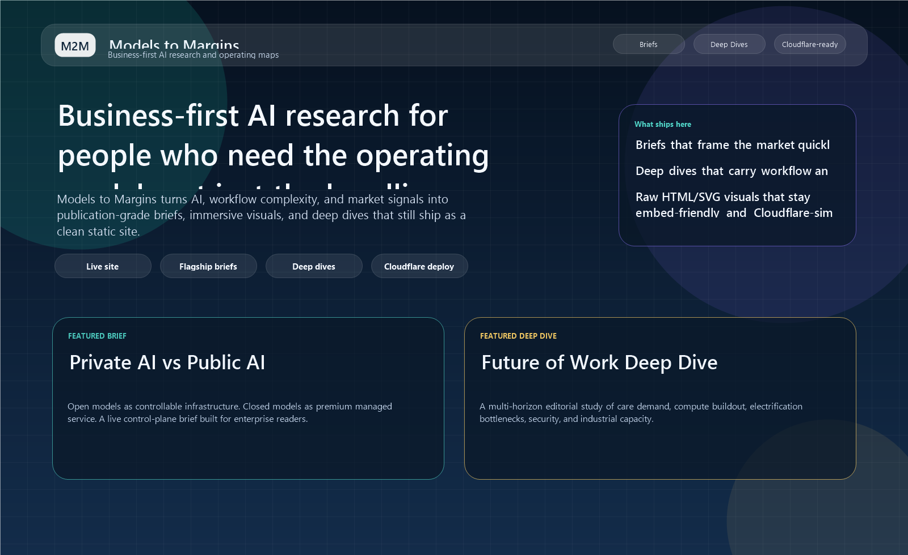
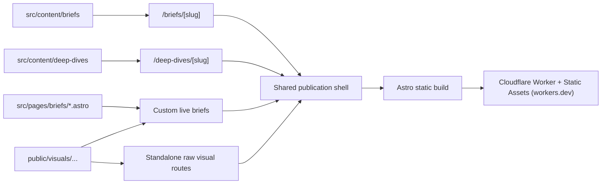

# Models to Margins

<div align="center">
  <p>
    <strong>Business-first AI research and operating maps.</strong>
  </p>
  <p>
    <a href="./LICENSE"></a>
    
    
    <a href="https://models-to-margins.vinayagrw.workers.dev/"></a>
  </p>
  <p>
    Models to Margins is a publication-style Astro site for turning AI, workflow complexity, and industry noise into
    flagship briefs, premium deep dives, and custom live briefs backed by raw HTML assets that still ship as a clean
    static deployment.
  </p>
  <p>
    <a href="https://models-to-margins.vinayagrw.workers.dev/"><strong>Live site</strong></a>
    &middot;
    <a href="https://models-to-margins.vinayagrw.workers.dev/briefs">Briefs</a>
    &middot;
    <a href="https://models-to-margins.vinayagrw.workers.dev/deep-dives">Deep Dives</a>
    &middot;
    <a href="./docs/brief-visual-prompt-pack.md">Brief visual prompt pack</a>
    &middot;
    <a href="./docs/cloudflare-pages-setup.md">Cloudflare guide</a>
    &middot;
    <a href="./docs/admin-visibility-how-to.md">Visibility guide</a>
  </p>
</div>

> [!NOTE]
> The current canonical public hostname is `https://models-to-margins.vinayagrw.workers.dev`. Keep app routes, iframe paths, back links, and raw asset references root-relative so the site works cleanly on that hostname and any future custom domain.

<p align="center">
  
</p>

> [!IMPORTANT]
> This repo is not a generic content site. It is an opinionated publishing system for AI analysis that prioritizes operating clarity, visual explanation, and static-first delivery.

## What This Is

| Surface | What it does | Why it matters |
|---|---|---|
| Editorial briefs | Publishes concise, high-signal analysis on companies, architectures, and workflow shifts. | Gives readers the fast front door into the topic. |
| Custom live briefs | Publishes immersive brief routes under `/briefs/*` when the story needs an embedded operating map or command-center experience. | Keeps the public information architecture centered on Briefs instead of splitting discovery into a separate visual collection. |
| Premium deep dives | Turns long-form research into structured editorial experiences using modern Markdown and semantic HTML. | Makes dense analysis readable without flattening the detail. |
| Raw visual assets | Hosts handcrafted HTML and SVG pages under `public/visuals/...`. | Keeps immersive experiences fast, portable, and easy to embed in live briefs or deep dives. |
| Static Astro delivery | Combines content collections, shared shell components, and clean routes into a static output. | Keeps deploys simple on Cloudflare while preserving a premium reading experience. |

## What Makes It Different

- **Business-first framing**: the site is built to explain operating consequences, not just announce AI news.
- **Live brief architecture**: immersive experiences stay inside the Brief collection instead of becoming disconnected microsites.
- **Raw assets stay portable**: custom HTML visuals remain framework-independent and embed-friendly.
- **Dark-first theming**: dark is the site default with a light toggle, and every embedded visual syncs to the active theme over a postMessage relay.
- **Structured long-form writing**: deep dives use signal cards, reading maps, callouts, decision grids, and collapsible sections rather than plain wall-of-text documents.
- **Cloudflare-ready by default**: the entire output stays static, which keeps build and deployment mechanics easy to reason about.

## What's Live

| Experience | Route | Format | What it demonstrates |
|---|---|---|---|
| The Margin Reckoning — AI-Led SDLC | `/briefs/ai-led-sdlc` | custom live brief | Kinetic ledger weighing AI output volume against stalled margin across an 8-scene governed SDLC, with a river-flow review gate and cost-of-inaction heat matrix |
| Token Mission Control 2026 | `/briefs/token-optimization-2026` | custom live brief | Live atlas of token economics for agentic coding — context pruning, model routing, and budget controls that keep AI work from runaway spend |
| Where AI Margin Actually Accrues | `/briefs/operator-grade-intelligence-engine` | custom live brief | Scroll-editorial operating board on why durable AI value sticks to proprietary data, workflow queues, and execution rails over thin copilots |
| Private AI vs Public AI | `/briefs/private-ai-vs-public-ai` | custom live brief | Shared shell + live visual + decision framing in one page |
| Governed Procurement AI | `/briefs/governed-procurement-ai` | custom live brief | Procurement command-center brief with governed execution and ROI framing |
| AI for Corporate Clarity | `/briefs/ai-for-corporate-clarity` | custom live brief | Clarity board + stakeholder translation workflow for executive communication |
| AI Playbook for a 10-Year-Old | `/deep-dives/ai-playbook-for-explaining-a-problem-to-a-10-year-old` | premium deep dive | Research-backed playbook for using AI to translate hard ideas into child-sized explanations without becoming a shortcut machine |
| Future of Work Deep Dive | `/deep-dives/future-of-work-2026` | premium deep dive | Modern Markdown, semantic HTML, structured editorial design |
| Harness Engineering Deep Dive | `/deep-dives/harness-engineering` | premium deep dive + slide-deck sub-route | Article-shell page with 10 inline interactive visuals; optional `/present` sub-route renders the same content as a single-viewport keyboard-navigable slide deck |
| From Models to Margins — The Metric Chain | `/deep-dives/from-models-to-margins-metric-chain` | premium deep dive (bespoke Blueprint template) | Field-tested playbook on the five metric layers, four practices, and vanity traps for AI products, rendered in the bespoke `blueprint` template with 11 themed interactive visuals on a sticky scene spine |
| Microservices vs Modular Monolith | `/deep-dives/microservices-vs-modular-monolith` | premium deep dive (bespoke Blueprint template) | Nine scenes of date-stamped evidence plus a statistics audit that replaces the maturity-ladder story with a forces-based decision framework |
| The AI Ops Execution Layer | `/deep-dives/ai-ops-execution-layer` | premium deep dive (bespoke Console template) | Eight-scene capability atlas on AI that acts instead of reports, with a governed write path, an autonomy ladder, and a graded evidence refresh |
| Loop Engineering | `/deep-dives/loop-engineering` | premium deep dive (bespoke Console template) | Sequel to Harness Engineering: ten visual-led scenes with 12 interactive instruments — era timeline, evidence board with a dated four-week self-evolving-harness ledger, failure lamps, and an adoption playbook |
| The Customs Entry Agent | `/deep-dives/customs-entry-agent` | premium deep dive (bespoke Atlas template) | Visual-first solution architecture for agentic US customs filing: five chapters (problem, solution, end-to-end architecture, ROI, challenges) with 15 interactive figures. Three of them are stencils built from the shared `aws-stencil-diagram` engine — computed frame boxes, orthogonal connectors auto-routed through the corridors between boxes and collision-tested against every service box, packets riding the elbows in flow order, a step scrubber, per-node detail cards, pan, zoom and fullscreen: an entry-lifecycle stencil carrying four selectable journeys over one topology (repeat SKU, near neighbour, genuinely novel, and the rulebook-change loop that runs backwards), the full AWS reference architecture with official icons and nested Cloud/Region/VPC/subnet/account frames plus 18 numbered badges and two routes that do not exist by construction, and an integration map of ten external systems where every node's card carries transport, cadence, idempotency key and failure semantics. Alongside them: a persona user-flow swimlane, a playable rulebook-invalidation sweep, an append-only audit ledger, and an illustrative cost model with kill-criteria lamps |

## How It Works



> [!NOTE]
> The core architectural choice in this repo is deliberate: content collections handle editorial work, while `public/visuals/...` keeps immersive experiences as raw assets so they stay portable and embed-friendly inside custom live briefs.

## Content And Route Model

### Public surfaces

| Surface | Primary route | Source of truth |
|---|---|---|
| Home | `/` | `src/pages/index.astro` |
| Briefs index | `/briefs` | `src/pages/briefs/index.astro` |
| Deep Dives index | `/deep-dives` | `src/pages/deep-dives/index.astro` |
| Custom live brief | `/briefs/ai-led-sdlc` | `src/pages/briefs/ai-led-sdlc.astro` |
| Custom live brief | `/briefs/token-optimization-2026` | `src/pages/briefs/token-optimization-2026.astro` |
| Custom live brief | `/briefs/operator-grade-intelligence-engine` | `src/pages/briefs/operator-grade-intelligence-engine.astro` |
| Custom live brief | `/briefs/private-ai-vs-public-ai` | `src/pages/briefs/private-ai-vs-public-ai.astro` |
| Custom live brief | `/briefs/governed-procurement-ai` | `src/pages/briefs/governed-procurement-ai.astro` |
| Custom live brief | `/briefs/ai-for-corporate-clarity` | `src/pages/briefs/ai-for-corporate-clarity.astro` |
| Premium deep dive | `/deep-dives/ai-playbook-for-explaining-a-problem-to-a-10-year-old` | `src/content/deep-dives/ai-playbook-for-explaining-a-problem-to-a-10-year-old.md` |
| Premium deep dive | `/deep-dives/future-of-work-2026` | `src/content/deep-dives/future-of-work-2026.md` |
| Premium deep dive | `/deep-dives/harness-engineering` | `src/content/deep-dives/harness-engineering.md` (article-shell, canonical) |
| Slide-deck sub-route | `/deep-dives/harness-engineering/present` | `src/pages/deep-dives/harness-engineering/present.astro` (full-viewport slide deck of the same content) |
| Premium deep dive | `/deep-dives/from-models-to-margins-metric-chain` | `src/content/deep-dives/from-models-to-margins-metric-chain.md` (bespoke `template: blueprint`) |
| Premium deep dive | `/deep-dives/microservices-vs-modular-monolith` | `src/content/deep-dives/microservices-vs-modular-monolith.md` (bespoke `template: blueprint`) |
| Premium deep dive | `/deep-dives/ai-ops-execution-layer` | `src/content/deep-dives/ai-ops-execution-layer.md` (bespoke `template: console`) |
| Premium deep dive | `/deep-dives/loop-engineering` | `src/content/deep-dives/loop-engineering.md` (bespoke `template: console`) |
| Premium deep dive | `/deep-dives/customs-entry-agent` | `src/content/deep-dives/customs-entry-agent.md` (bespoke `template: atlas`) |
| Premium deep dive | `/deep-dives/ai-governance-before-roi` | `src/content/deep-dives/ai-governance-before-roi.md` (bespoke `template: boardroom`) |
| Premium deep dive | `/deep-dives/automation-capex-air-pocket` | `src/content/deep-dives/automation-capex-air-pocket.md` (bespoke `template: gantry`) |
| Premium deep dive | `/deep-dives/taiwan-incident-generalized` | `src/content/deep-dives/taiwan-incident-generalized.md` (bespoke `template: sitrep`) |
| Hidden visitor analytics | `/admin/insights?key=…` | `src/pages/admin/insights.astro` + `public/scripts/insights*.js` (secret-gated, not linked from any public surface) |

### Content model

| Collection / layer | Source directory | Primary renderer | Best use |
|---|---|---|---|
| Briefs | `src/content/briefs` | `src/pages/briefs/[slug].astro` | Flagship reads, company analysis, architecture framing |
| Deep Dives | `src/content/deep-dives` | `src/pages/deep-dives/[slug].astro` | Long-form research with stronger editorial structure |
| Custom live briefs | `src/pages/briefs/*.astro` | direct Astro routing | Immersive brief pages with embedded live assets and custom choreography |
| Raw visual assets | `public/visuals` | direct static routing | Internal HTML/SVG embed assets and optional standalone targets |

<details>
  <summary><strong>Repo map</strong></summary>

```text
models-to-margins/
  src/
    components/        Shared UI primitives
    content/           Typed editorial collections
    integrations/      Astro dev middleware (analytics dev mirror)
    layouts/           Shared page shell
    pages/             Public routes, collection renderers, /admin
    styles/            Shared design system
  public/
    visuals/           Standalone HTML/SVG interactive experiences
    scripts/           Client beacon, dashboard, spine scripts (blueprint, console, ledger, atlas)
    styles/            Bespoke deep-dive stylesheets (blueprint, console, ledger, atlas)
  functions/           Analytics API handlers (imported by worker.js)
  test/                Node test suite for enrichment + storage
  docs/
    cloudflare-pages-setup.md
    site-audit-2026-07.md
    readme-assets/
  worker.js            Worker entry: /api/* analytics routes + static assets
  wrangler.toml        Worker + Static Assets config, ANALYTICS KV binding
  AGENTS.md            Repo-specific editing guardrails
```

</details>

## Authoring Workflow

### 1. Standard Brief

Use a Markdown file in `src/content/briefs/` when the page should render in the shared article shell.

Good fit:
- company snapshots
- architecture comparisons
- workflow or market framing

### 2. Custom live Brief

Use a dedicated Astro page in `src/pages/briefs/` when the page needs:

- an embedded live asset
- custom page choreography
- focus sync or iframe messaging
- an immersive command-center layout

Current references:
- `src/pages/briefs/ai-led-sdlc.astro` — iframes `the-margin-reckoning.html` with theme sync
- `src/pages/briefs/token-optimization-2026.astro`
- `src/pages/briefs/operator-grade-intelligence-engine.astro`
- `src/pages/briefs/private-ai-vs-public-ai.astro`
- `src/pages/briefs/governed-procurement-ai.astro`
- `src/pages/briefs/ai-for-corporate-clarity.astro`

### 3. Premium Deep Dive

Use `src/content/deep-dives/` with modern Markdown plus semantic HTML blocks when the material supports richer structure.

Preferred design vocabulary:
- note panel
- signal cards
- reading map
- callouts
- thesis / decision grids
- `details/summary` for longer ranked or source-heavy sections

Current references:
- `src/content/deep-dives/future-of-work-2026.md` — pure Markdown + small inline data-vis iframes
- `src/content/deep-dives/harness-engineering.md` — same article-shell, embedding a family of 10 large interactive visuals from `public/visuals/harness-engineering/`
- `src/content/deep-dives/from-models-to-margins-metric-chain.md` — bespoke `template: blueprint` shell with a sticky scene spine and 11 theme-synced visuals from `public/visuals/from-models-to-margins/`
- `src/content/deep-dives/microservices-vs-modular-monolith.md` — second `template: blueprint` reference, nine evidence scenes
- `src/content/deep-dives/ai-ops-execution-layer.md` — `template: console` shell, eight scenes with a governed write path and autonomy ladder
- `src/content/deep-dives/loop-engineering.md` — `template: console`, ten visual-led scenes embedding 12 interactive instruments from `public/visuals/loop-engineering/` (every visual autosizes into its frame and theme-syncs over a postMessage relay)
- `src/content/deep-dives/customs-entry-agent.md` — bespoke `template: atlas` shell, five chapters embedding 15 interactive figures from `public/visuals/customs-entry-agent/` (all autosizing, theme-synced, with signal-LED verdict chips carrying the evidence discipline)
- `src/content/deep-dives/ai-governance-before-roi.md` — bespoke `template: boardroom` shell, six chapters embedding 6 interactive exhibits from `public/visuals/ai-governance-before-roi/`, an annual-report/filing identity carrying the confirmed/proposed/open/vendor-claim evidence discipline over the six-way AI ROI measurement gap
- `src/content/deep-dives/automation-capex-air-pocket.md` — bespoke `template: gantry` shell, six chapters embedding 6 interactive figures from `public/visuals/automation-capex-air-pocket/`, a loading-dock identity holding the m/m-vs-y/y demand reconciliation and the zero-published-unit-economics thesis at equal prominence
- `src/content/deep-dives/taiwan-incident-generalized.md` — bespoke `template: sitrep` shell, six chapters embedding 7 interactive exhibits from `public/visuals/taiwan-incident-generalized/`, an after-action-report identity that generalizes the Taiwan near-autonomous AI attack into a threat class plus a 7/30/90-day defender playbook, single-source and MODA-divergence caveats surfaced in the first screen

#### Optional bespoke templates

For a deep dive that needs its own visual identity, opt in with a frontmatter `template:` value. `src/pages/deep-dives/[slug].astro` branches on it and injects that template's scoped CSS/JS instead of the default article shell:

| Template | Look | Shell + assets | Used by |
|---|---|---|---|
| `template: blueprint` | Paper-light drawing board with a sticky scene spine | `.dd-blueprint` + `public/styles/deep-dive-blueprint.css` + `public/scripts/spine-blueprint.js` | metric-chain, microservices-vs-modular-monolith |
| `template: console` | Dark instrument panel with thesis lamps, master tiles, and a mission-brief block | `.dd-console` + `public/styles/deep-dive-console.css` + `public/scripts/spine-console.js` | loop-engineering, ai-ops-execution-layer |
| `template: ledger` | Customs paper-of-record: manila bond paper with ruled ledger lines, an entry-form header, rubber-stamp verdict chips, and EXHIBIT bars (night-audit navy in dark) | `.dd-ledger` + `public/styles/deep-dive-ledger.css` + `public/scripts/spine-ledger.js` | none currently (built for customs-entry-agent, which moved to atlas) |
| `template: atlas` | Systems atlas / mission control: dark grid ground, no sidebar, a chapter rail that is a horizontal band up to 1640px and a vertical figure index beyond it, full-width FIG. frames, stat tiles, and signal-LED verdict chips (pale blueprint grey in light) | `.dd-atlas` + `public/styles/deep-dive-atlas.css` + `public/scripts/spine-atlas.js` | customs-entry-agent |
| `template: boardroom` | Annual-report / proxy-statement filing: ivory stock with an oxblood rule and Fraunces display, a sticky agenda spine with dot leaders, Exhibit-plated figures (brass-on-graphite in dark) | `.dd-boardroom` + `public/styles/deep-dive-boardroom.css` + `public/scripts/spine-boardroom.js` | ai-governance-before-roi |
| `template: gantry` | Loading-dock control board: concrete daylight surfaces with fill-only safety yellow and a numbered dock-door spine (D-01…) with a read-progress gauge, sodium-amber night shift in dark | `.dd-gantry` + `public/styles/deep-dive-gantry.css` + `public/scripts/spine-gantry.js` | automation-capex-air-pocket |
| `template: sitrep` | After-action review binder: photocopied-report paper with an olive structural accent and a literal "Not an official record" cover cell, a phase-timeline spine, exhibit case-tab figures (ops-console dark), signal-red reserved for disputed/gap states only | `.dd-sitrep` + `public/styles/deep-dive-sitrep.css` + `public/scripts/spine-sitrep.js` | taiwan-incident-generalized |
| `template: waybill` | Carbonless consignment note: pale green-white NCR stock with a perforated tear strip, condensed uppercase headings and red carbon impressions, dock-office slate in dark. Signature element is the custody chain, one row per handoff | `.dd-waybill` + `public/styles/deep-dive-waybill.css` + `public/scripts/spine-waybill.js` | candidate-waybill *(prototype)* |
| `template: tower` | Operations control room: instrument grid on cool paper-grey, cyan live accent, status lamps with owner and clock columns, near-black night tower in dark. Signature element is the control row, lamp plus owner plus clock | `.dd-tower` + `public/styles/deep-dive-tower.css` + `public/scripts/spine-tower.js` | candidate-tower *(prototype)* |

New bespoke looks add a `template:` value, a branch in `[slug].astro`, and scoped CSS/JS under a fresh `.dd-<name>` namespace. House-style note: prose in these templates uses no semicolons or em-dashes (scene headings keep their em-dash because the reading-map anchors depend on the slug).

#### Optional slide-deck sub-route

When the same deep-dive content also benefits from a single-viewport "Present mode" (live talks, screen shares), add a sub-route at `src/pages/deep-dives/<slug>/present.astro`:

- The article-shell page at `/deep-dives/<slug>` stays canonical (matches site pattern, indexed normally).
- The sub-route at `/deep-dives/<slug>/present` re-uses the same visuals via iframes laid out as scroll-snap slides with keyboard navigation, side-dot indicators, and slim chrome.
- The article page links to the sub-route inside its `note-panel` block; the sub-route's back link returns to the article (not the deep-dives listing).
- Reference: `src/pages/deep-dives/harness-engineering/present.astro`.

### 4. Raw visual asset

Use `public/visuals/...` when the artifact should remain:

- pure static HTML/CSS/JS
- directly linkable
- easy to embed
- independent of framework runtime

> [!TIP]
> Before inventing a new pattern, check [`AGENTS.md`](./AGENTS.md). It captures the repo's current rules for page structure, metadata order, theme behavior, live-brief routing, raw visual chrome, and deep-dive presentation.

## Visitor Analytics (hidden)

A first-party, privacy-conscious analytics layer is served by the same Cloudflare Worker that fronts the static build: `worker.js` answers `/api/collect` and `/api/events` and reuses the handlers in `functions/api/` verbatim. It is opt-out-friendly and never linked from any public surface.

| Piece | Path | Job |
|---|---|---|
| Client beacon | `public/scripts/beacon.js` | Collects pageview, device, geo-hint, and behavior signals; injected only on public pages |
| Worker router | `worker.js` | Routes `/api/collect` + `/api/events` to the handlers below, serves everything else from `dist/` |
| Collect endpoint | `functions/api/collect.js` | Enriches with Cloudflare geo/UA and writes events to KV (in-memory fallback) |
| Read endpoint | `functions/api/events.js` | Secret-gated event read; returns `404` when the token is absent or wrong |
| Dashboard | `src/pages/admin/insights.astro` | Hidden `/admin/insights` view: KPIs, world map, time series, breakdowns, filterable event table, CSV export |
| Storage | `functions/_shared/storage.js` | `KvStore` (primary) + `MemoryStore` (warn-and-degrade fallback) |

> [!IMPORTANT]
> The dashboard is gated by `env.INSIGHTS_TOKEN` and the KV binding is `env.ANALYTICS` (see `wrangler.toml`). Never hardcode the token or the binding values in source. Access the dashboard with `/admin/insights?key=YOUR_TOKEN`; the key is cached in a same-site cookie after first load.

## Run Locally

```bash
npm install
npm run dev
```

Useful commands:

```bash
npm run build
npm run preview
npm run check
npm test          # node --test: analytics enrichment + storage suites
```

Visibility and discovery docs:

- [docs/brief-visual-prompt-pack.md](./docs/brief-visual-prompt-pack.md)
- [docs/admin-visibility-how-to.md](./docs/admin-visibility-how-to.md)

## Deploy

This repo deploys as a Cloudflare **Worker with Static Assets** (served on `*.workers.dev`), not Cloudflare Pages: `worker.js` answers `/api/*` for visitor analytics and falls through to the `ASSETS` binding for the static Astro build in `dist/`.

| Setting | Value |
|---|---|
| Entry point | `main = "worker.js"` in `wrangler.toml` |
| Static assets | `[assets] directory = "./dist"`, binding `ASSETS` |
| KV | `ANALYTICS` namespace binding (persistent visitor events) |
| Build + deploy | `npm run build` then `npx wrangler deploy` |

> [!WARNING]
> Do not add `pages_build_output_dir` to `wrangler.toml` or deploy this repo through the Pages pipeline — the `/api/*` routes live in `worker.js`, and a Pages deploy would silently drop them.

Deployment docs:
- [docs/cloudflare-pages-setup.md](./docs/cloudflare-pages-setup.md)

## Repo Principles

- **Start from the business problem** before the technical stack.
- **Prefer shared shell components** over one-off page chrome.
- **Keep raw visuals first-class** as embed infrastructure instead of building a separate public visual collection by default.
- **Use modern Markdown and semantic HTML** before adding extra runtime dependencies.
- **Treat Cloudflare deployment simplicity as a feature**, not an afterthought.

<details>
  <summary><strong>Why this structure works</strong></summary>

- Astro content collections keep editorial content typed and easy to scale.
- Shared components keep metadata, navigation, and theme behavior consistent.
- Raw visual assets stay portable and easy to embed in higher-level pages.
- The publication can feel premium without becoming operationally fragile.

</details>
