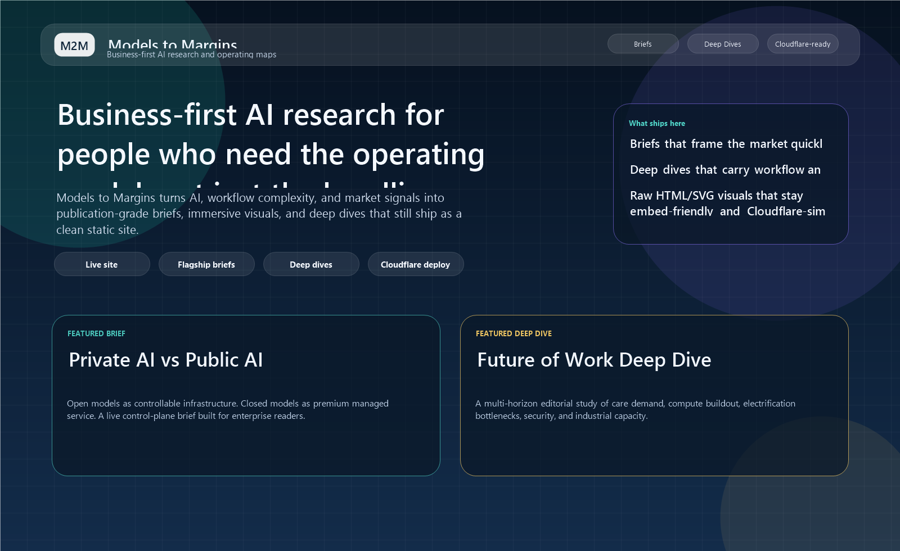
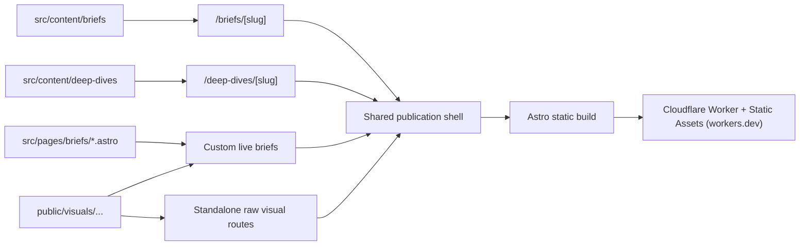

# Models to Margins

<div align="center">
  <p>
    <strong>Business-first AI research and operating maps.</strong>
  </p>
  <p>
    <a href="./LICENSE"></a>
    
    
    <a href="https://models-to-margins.vinayagrw.workers.dev/"></a>
  </p>
  <p>
    Models to Margins is a publication-style Astro site for turning AI, workflow complexity, and industry noise into
    flagship briefs, premium deep dives, and custom live briefs backed by raw HTML assets that still ship as a clean
    static deployment.
  </p>
  <p>
    <a href="https://models-to-margins.vinayagrw.workers.dev/"><strong>Live site</strong></a>
    &middot;
    <a href="https://models-to-margins.vinayagrw.workers.dev/briefs">Briefs</a>
    &middot;
    <a href="https://models-to-margins.vinayagrw.workers.dev/deep-dives">Deep Dives</a>
    &middot;
    <a href="./docs/brief-visual-prompt-pack.md">Brief visual prompt pack</a>
    &middot;
    <a href="./docs/cloudflare-pages-setup.md">Cloudflare guide</a>
    &middot;
    <a href="./docs/admin-visibility-how-to.md">Visibility guide</a>
  </p>
</div>

> [!NOTE]
> The current canonical public hostname is `https://models-to-margins.vinayagrw.workers.dev`. Keep app routes, iframe paths, back links, and raw asset references root-relative so the site works cleanly on that hostname and any future custom domain.

<p align="center">
  
</p>

> [!IMPORTANT]
> This repo is not a generic content site. It is an opinionated publishing system for AI analysis that prioritizes operating clarity, visual explanation, and static-first delivery.

## What This Is

| Surface | What it does | Why it matters |
|---|---|---|
| Editorial briefs | Publishes concise, high-signal analysis on companies, architectures, and workflow shifts. | Gives readers the fast front door into the topic. |
| Custom live briefs | Publishes immersive brief routes under `/briefs/*` when the story needs an embedded operating map or command-center experience. | Keeps the public information architecture centered on Briefs instead of splitting discovery into a separate visual collection. |
| Premium deep dives | Turns long-form research into structured editorial experiences using modern Markdown and semantic HTML. | Makes dense analysis readable without flattening the detail. |
| Raw visual assets | Hosts handcrafted HTML and SVG pages under `public/visuals/...`. | Keeps immersive experiences fast, portable, and easy to embed in live briefs or deep dives. |
| Static Astro delivery | Combines content collections, shared shell components, and clean routes into a static output. | Keeps deploys simple on Cloudflare while preserving a premium reading experience. |

## What Makes It Different

- **Business-first framing**: the site is built to explain operating consequences, not just announce AI news.
- **Live brief architecture**: immersive experiences stay inside the Brief collection instead of becoming disconnected microsites.
- **Raw assets stay portable**: custom HTML visuals remain framework-independent and embed-friendly.
- **Dark-first theming**: dark is the site default with a light toggle, and every embedded visual syncs to the active theme over a postMessage relay.
- **Structured long-form writing**: deep dives use signal cards, reading maps, callouts, decision grids, and collapsible sections rather than plain wall-of-text documents.
- **Cloudflare-ready by default**: the entire output stays static, which keeps build and deployment mechanics easy to reason about.

## What's Live

| Experience | Route | Format | What it demonstrates |
|---|---|---|---|
| When AI agents pay suppliers: the B2B payouts desk | `/deep-dives/agentic-payouts-desk` | interactive deep dive (Ledger template, `pdd` kit) | Six screens for three seats (finance buyer, product builder, strategy reader): the answer per seat, where AI earns a place, how agent payments get built, the money path, a rail chooser with a price ladder and a scenario player, and the rules timeline |

> [!NOTE]
> **Archive and redirects.** On 2026-10-24 every other page moved out of `src/` into `_archive/site-2026-10-24/` (`briefs/`, `deep-dives/`, `pages/`). The page once served at `/deep-dives/payouts-decision-desk` is now `/deep-dives/agentic-payouts-desk`. Every archived route, the old desk path included, redirects to `/deep-dives/agentic-payouts-desk` through the `redirects` map in `astro.config.mjs`, so old links still land on a live page. To bring a page back, move its file from the archive into `src/` and delete its redirect line.

## How It Works



> [!NOTE]
> The core architectural choice in this repo is deliberate: content collections handle editorial work, while `public/visuals/...` keeps immersive experiences as raw assets so they stay portable and embed-friendly inside custom live briefs.

## Content And Route Model

### Public surfaces

| Surface | Primary route | Source of truth |
|---|---|---|
| Home | `/` | `src/pages/index.astro` |
| Briefs index | `/briefs` | `src/pages/briefs/index.astro` |
| Deep Dives index | `/deep-dives` | `src/pages/deep-dives/index.astro` |
| Interactive deep dive | `/deep-dives/agentic-payouts-desk` | `src/content/deep-dives/agentic-payouts-desk.md` (`template: ledger`, `pdd.css`, `pdd.js`). Source ledger: `docs/agentic-payouts-desk-sources.md` |
| Hidden visitor analytics | `/admin/insights?key=…` | `src/pages/admin/insights.astro` + `public/scripts/insights*.js` (secret-gated, not linked from any public surface) |

### Content model

| Collection / layer | Source directory | Primary renderer | Best use |
|---|---|---|---|
| Briefs | `src/content/briefs` | `src/pages/briefs/[slug].astro` | Flagship reads, company analysis, architecture framing |
| Deep Dives | `src/content/deep-dives` | `src/pages/deep-dives/[slug].astro` | Long-form research with stronger editorial structure |
| Custom live briefs | `src/pages/briefs/*.astro` | direct Astro routing | Immersive brief pages with embedded live assets and custom choreography |
| Raw visual assets | `public/visuals` | direct static routing | Internal HTML/SVG embed assets and optional standalone targets |

<details>
  <summary><strong>Repo map</strong></summary>

```text
models-to-margins/
  src/
    components/        Shared UI primitives
    content/           Typed editorial collections
    integrations/      Astro dev middleware (analytics dev mirror)
    layouts/           Shared page shell
    pages/             Public routes, collection renderers, /admin
    styles/            Shared design system
  public/
    visuals/           Standalone HTML/SVG interactive experiences
    scripts/           Client beacon, dashboard, spine scripts per template, page kits (mwf-story, maa, ami, sbp, pdd, aip, ppr)
    styles/            Bespoke deep-dive stylesheets per template, page kit styles (mwf-story, maa, ami, sbp, pdd, aip, ppr)
  scripts/             Repo tooling: layout-check.mjs (rendered layout gate)
  functions/           Analytics API handlers (imported by worker.js)
  test/                Node test suite for enrichment + storage
  docs/
    cloudflare-pages-setup.md
    site-audit-2026-07.md
    readme-assets/
  worker.js            Worker entry: /api/* analytics routes + static assets
  wrangler.toml        Worker + Static Assets config, ANALYTICS KV binding
  AGENTS.md            Repo-specific editing guardrails
```

</details>

## Authoring Workflow

### 1. Standard Brief

Use a Markdown file in `src/content/briefs/` when the page should render in the shared article shell.

Good fit:
- company snapshots
- architecture comparisons
- workflow or market framing

### 2. Custom live Brief

Use a dedicated Astro page in `src/pages/briefs/` when the page needs:

- an embedded live asset
- custom page choreography
- focus sync or iframe messaging
- an immersive command-center layout

Current references:
- `src/pages/briefs/ai-led-sdlc.astro` — iframes `the-margin-reckoning.html` with theme sync
- `src/pages/briefs/token-optimization-2026.astro`
- `src/pages/briefs/operator-grade-intelligence-engine.astro`
- `src/pages/briefs/private-ai-vs-public-ai.astro`
- `src/pages/briefs/governed-procurement-ai.astro`
- `src/pages/briefs/ai-for-corporate-clarity.astro`

### 3. Premium Deep Dive

Use `src/content/deep-dives/` with modern Markdown plus semantic HTML blocks when the material supports richer structure.

Preferred design vocabulary:
- note panel
- signal cards
- reading map
- callouts
- thesis / decision grids
- `details/summary` for longer ranked or source-heavy sections

Current references:
- `src/content/deep-dives/future-of-work-2026.md` — pure Markdown + small inline data-vis iframes
- `src/content/deep-dives/harness-engineering.md` — same article-shell, embedding a family of 10 large interactive visuals from `public/visuals/harness-engineering/`
- `src/content/deep-dives/from-models-to-margins-metric-chain.md` — bespoke `template: blueprint` shell with a sticky scene spine and 11 theme-synced visuals from `public/visuals/from-models-to-margins/`
- `src/content/deep-dives/microservices-vs-modular-monolith.md` — second `template: blueprint` reference, nine evidence scenes
- `src/content/deep-dives/ai-ops-execution-layer.md` — `template: console` shell, eight scenes with a governed write path and autonomy ladder
- `src/content/deep-dives/loop-engineering.md` — `template: console`, ten visual-led scenes embedding 12 interactive instruments from `public/visuals/loop-engineering/` (every visual autosizes into its frame and theme-syncs over a postMessage relay)
- `src/content/deep-dives/customs-entry-agent.md` — bespoke `template: atlas` shell, five chapters embedding 15 interactive figures from `public/visuals/customs-entry-agent/` (all autosizing, theme-synced, with signal-LED verdict chips carrying the evidence discipline)
- `src/content/deep-dives/ai-governance-before-roi.md` — bespoke `template: boardroom` shell, six chapters embedding 6 interactive exhibits from `public/visuals/ai-governance-before-roi/`, an annual-report/filing identity carrying the confirmed/proposed/open/vendor-claim evidence discipline over the six-way AI ROI measurement gap
- `src/content/deep-dives/automation-capex-air-pocket.md` — bespoke `template: gantry` shell, six chapters embedding 6 interactive figures from `public/visuals/automation-capex-air-pocket/`, a loading-dock identity holding the m/m-vs-y/y demand reconciliation and the zero-published-unit-economics thesis at equal prominence
- `src/content/deep-dives/taiwan-incident-generalized.md` — bespoke `template: sitrep` shell, six chapters embedding 7 interactive exhibits from `public/visuals/taiwan-incident-generalized/`, an after-action-report identity that generalizes the Taiwan near-autonomous AI attack into a threat class plus a 7/30/90-day defender playbook, single-source and MODA-divergence caveats surfaced in the first screen

#### Optional bespoke templates

For a deep dive that needs its own visual identity, opt in with a frontmatter `template:` value. `src/pages/deep-dives/[slug].astro` branches on it and injects that template's scoped CSS/JS instead of the default article shell:

| Template | Look | Shell + assets | Used by |
|---|---|---|---|
| `template: blueprint` | Paper-light drawing board with a sticky scene spine | `.dd-blueprint` + `public/styles/deep-dive-blueprint.css` + `public/scripts/spine-blueprint.js` | metric-chain, microservices-vs-modular-monolith |
| `template: console` | Dark instrument panel with thesis lamps, master tiles, and a mission-brief block | `.dd-console` + `public/styles/deep-dive-console.css` + `public/scripts/spine-console.js` | loop-engineering, ai-ops-execution-layer |
| `template: ledger` | Customs paper-of-record: manila bond paper with ruled ledger lines, an entry-form header, rubber-stamp verdict chips, and EXHIBIT bars (night-audit navy in dark) | `.dd-ledger` + `public/styles/deep-dive-ledger.css` + `public/scripts/spine-ledger.js` | measured-workflow-factory, three-topics-priced, monetizing-ai-agents, agent-monetization-instrument, stablecoin-b2b-payouts, payouts-decision-desk |
| `template: atlas` | Systems atlas / mission control: dark grid ground, no sidebar, a chapter rail that is a horizontal band up to 1640px and a vertical figure index beyond it, full-width FIG. frames, stat tiles, and signal-LED verdict chips (pale blueprint grey in light) | `.dd-atlas` + `public/styles/deep-dive-atlas.css` + `public/scripts/spine-atlas.js` | customs-entry-agent |
| `template: boardroom` | Annual-report / proxy-statement filing: ivory stock with an oxblood rule and Fraunces display, a sticky agenda spine with dot leaders, Exhibit-plated figures (brass-on-graphite in dark) | `.dd-boardroom` + `public/styles/deep-dive-boardroom.css` + `public/scripts/spine-boardroom.js` | ai-governance-before-roi |
| `template: gantry` | Loading-dock control board: concrete daylight surfaces with fill-only safety yellow and a numbered dock-door spine (D-01…) with a read-progress gauge, sodium-amber night shift in dark | `.dd-gantry` + `public/styles/deep-dive-gantry.css` + `public/scripts/spine-gantry.js` | automation-capex-air-pocket |
| `template: sitrep` | After-action review binder: photocopied-report paper with an olive structural accent and a literal "Not an official record" cover cell, a phase-timeline spine, exhibit case-tab figures (ops-console dark), signal-red reserved for disputed/gap states only | `.dd-sitrep` + `public/styles/deep-dive-sitrep.css` + `public/scripts/spine-sitrep.js` | taiwan-incident-generalized |
| `template: waybill` | Carbonless consignment note: pale green-white NCR stock with a perforated tear strip, condensed uppercase headings and red carbon impressions, dock-office slate in dark. Signature element is the custody chain, one row per handoff | `.dd-waybill` + `public/styles/deep-dive-waybill.css` + `public/scripts/spine-waybill.js` | private-vs-public-ai-architecture |
| `template: tower` | Operations control room: instrument grid on cool paper-grey, cyan live accent, status lamps with owner and clock columns, near-black night tower in dark. Signature element is the control row, lamp plus owner plus clock | `.dd-tower` + `public/styles/deep-dive-tower.css` + `public/scripts/spine-tower.js` | candidate-tower *(prototype)* |

New bespoke looks add a `template:` value, a branch in `[slug].astro`, and scoped CSS/JS under a fresh `.dd-<name>` namespace. House-style note: prose in these templates uses no semicolons or em-dashes (scene headings keep their em-dash because the reading-map anchors depend on the slug).

#### Interactive pages on the ledger template (page kits)

The most recent deep dives are interactive instruments: one question per screen, one large visual, a reader switch, and evidence chips that open the source. They use `template: ledger` and carry their own prefixed kit:

| Kit | Files | Used by |
|---|---|---|
| `mwf-` | `public/styles/mwf-story.css`, `public/scripts/mwf-story.js` | measured-workflow-factory |
| `maa-` | `public/styles/maa.css`, `public/scripts/maa.js` | monetizing-ai-agents |
| `ami-` | `public/styles/ami.css`, `public/scripts/ami.js` | agent-monetization-instrument |
| `sbp-` | `public/styles/sbp.css`, `public/scripts/sbp.js` | stablecoin-b2b-payouts |
| `pdd-` | `public/styles/pdd.css`, `public/scripts/pdd.js` | agentic-payouts-desk (live) |
| `aip-` | `public/styles/aip.css`, `public/scripts/aip.js` | ai-in-one-payout |
| `ppr-` | `public/styles/ppr.css`, `public/scripts/ppr.js` | payouts-replay |

Rules for these pages:

- The Markdown file is raw HTML inside the ledger shell. It is assembled from per-screen fragments (html, css, js), so edit the kit files and the content file together.
- Every number, date and company fact carries a hidden `data-src` key tied to a source that was opened. Sources never show on the page. On the payouts desk the keys resolve in `docs/agentic-payouts-desk-sources.md`. Anything else is labelled Vendor, Illustration or Our arithmetic, and our own view is drawn as an amber highlight rather than a tag.
- From `pdd-` onward, pages use one shared 12-column grid (`.pdd-grid`, `.pdd-c3` to `.pdd-c9`), equal-height cards and drawers for detail, and must pass the layout gate below.

#### Layout gate

`scripts/layout-check.mjs` renders a page in headless Chrome and fails on measured layout faults. Run it against the dev server before calling any page done:

```bash
npm run check:layout -- /deep-dives/agentic-payouts-desk --root=.pdd "--scene=section[id^=pdd-]" --readers=buyer,builder,strategy
```

Pages with interactive states (a stepper, tabs) pass every state, not only the first. `--states` adds URL hash parts, joined to the reader, and runs the full set once per state. On the payouts desk each build tab, each architecture stage and rail view B open from a deep link. The full payouts run is one script:

```bash
npm run check:layout:payouts
```

Owner-approved exceptions live in `scripts/layout-allow.json`, keyed by page path, each with a reason. The gate applies them for every caller and prints them at the top of the run, so no flag is typed by hand. Today there is one: the payouts Architecture screen may reach 1.9 viewports at 1440, because the owner chose a full map that fits its panel with no inner scroll. `--scene-allow` on the command line overrides the file.

It runs at 375, 1024 and 1440 wide in light and dark, once per reader.

| Fault | Fails when |
|---|---|
| Line breaks | Last line of a heading or label under 20% of its box. A label under 8 words on 3 or more lines. A word broken mid-word. Headings without `text-wrap: balance`. A line that starts with a full stop or comma |
| Empty space | A panel over 220px tall with more than 35% empty at the bottom or right. Content under 60% of the width at 1024 and above. Cards in a row more than 25% apart in height |
| Length | A screen over 1.5 viewports at 1440, 2.5 at 1024 or 4 at 375. A page over 9, 14 or 22 viewports. More than 1,800 visible words per reader |
| Crowding | Text within 8px of an edge. Overlapping text. Tap targets under 42px. Text under 14px. Sideways overflow |

Flags: `--only=<scene id>`, `--widths=`, `--themes=`, `--json=out.json`, `--shots=<dir>` for outlined screenshots, `--budget-words=`.

#### Optional slide-deck sub-route

When the same deep-dive content also benefits from a single-viewport "Present mode" (live talks, screen shares), add a sub-route at `src/pages/deep-dives/<slug>/present.astro`:

- The article-shell page at `/deep-dives/<slug>` stays canonical (matches site pattern, indexed normally).
- The sub-route at `/deep-dives/<slug>/present` re-uses the same visuals via iframes laid out as scroll-snap slides with keyboard navigation, side-dot indicators, and slim chrome.
- The article page links to the sub-route inside its `note-panel` block; the sub-route's back link returns to the article (not the deep-dives listing).
- Reference: `src/pages/deep-dives/harness-engineering/present.astro`.

### 4. Raw visual asset

Use `public/visuals/...` when the artifact should remain:

- pure static HTML/CSS/JS
- directly linkable
- easy to embed
- independent of framework runtime

> [!TIP]
> Before inventing a new pattern, check [`AGENTS.md`](./AGENTS.md). It captures the repo's current rules for page structure, metadata order, theme behavior, live-brief routing, raw visual chrome, and deep-dive presentation.

## Visitor Analytics (hidden)

A first-party, privacy-conscious analytics layer is served by the same Cloudflare Worker that fronts the static build: `worker.js` answers `/api/collect` and `/api/events` and reuses the handlers in `functions/api/` verbatim. It is opt-out-friendly and never linked from any public surface.

| Piece | Path | Job |
|---|---|---|
| Client beacon | `public/scripts/beacon.js` | Collects pageview, device, geo-hint, and behavior signals; injected only on public pages |
| Worker router | `worker.js` | Routes `/api/collect` + `/api/events` to the handlers below, serves everything else from `dist/` |
| Collect endpoint | `functions/api/collect.js` | Enriches with Cloudflare geo/UA and writes events to KV (in-memory fallback) |
| Read endpoint | `functions/api/events.js` | Secret-gated event read; returns `404` when the token is absent or wrong |
| Dashboard | `src/pages/admin/insights.astro` | Hidden `/admin/insights` view: KPIs, world map, time series, breakdowns, filterable event table, CSV export |
| Storage | `functions/_shared/storage.js` | `KvStore` (primary) + `MemoryStore` (warn-and-degrade fallback) |

> [!IMPORTANT]
> The dashboard is gated by `env.INSIGHTS_TOKEN` and the KV binding is `env.ANALYTICS` (see `wrangler.toml`). Never hardcode the token or the binding values in source. Access the dashboard with `/admin/insights?key=YOUR_TOKEN`; the key is cached in a same-site cookie after first load.

## Run Locally

```bash
npm install
npm run dev
```

Useful commands:

```bash
npm run build
npm run preview
npm run check
npm test          # node --test: analytics enrichment + storage suites
npm run check:layout -- <path>   # rendered layout gate, needs the dev server running
npm run check:layout:payouts     # the full payouts desk gate, every reader and state
```

Visibility and discovery docs:

- [docs/brief-visual-prompt-pack.md](./docs/brief-visual-prompt-pack.md)
- [docs/admin-visibility-how-to.md](./docs/admin-visibility-how-to.md)

## Deploy

This repo deploys as a Cloudflare **Worker with Static Assets** (served on `*.workers.dev`), not Cloudflare Pages: `worker.js` answers `/api/*` for visitor analytics and falls through to the `ASSETS` binding for the static Astro build in `dist/`.

| Setting | Value |
|---|---|
| Entry point | `main = "worker.js"` in `wrangler.toml` |
| Static assets | `[assets] directory = "./dist"`, binding `ASSETS` |
| KV | `ANALYTICS` namespace binding (persistent visitor events) |
| Build + deploy | `npm run build` then `npx wrangler deploy` |

> [!WARNING]
> Do not add `pages_build_output_dir` to `wrangler.toml` or deploy this repo through the Pages pipeline — the `/api/*` routes live in `worker.js`, and a Pages deploy would silently drop them.

Deployment docs:
- [docs/cloudflare-pages-setup.md](./docs/cloudflare-pages-setup.md)

## Repo Principles

- **Start from the business problem** before the technical stack.
- **Prefer shared shell components** over one-off page chrome.
- **Keep raw visuals first-class** as embed infrastructure instead of building a separate public visual collection by default.
- **Use modern Markdown and semantic HTML** before adding extra runtime dependencies.
- **Treat Cloudflare deployment simplicity as a feature**, not an afterthought.

<details>
  <summary><strong>Why this structure works</strong></summary>

- Astro content collections keep editorial content typed and easy to scale.
- Shared components keep metadata, navigation, and theme behavior consistent.
- Raw visual assets stay portable and easy to embed in higher-level pages.
- The publication can feel premium without becoming operationally fragile.

</details>
