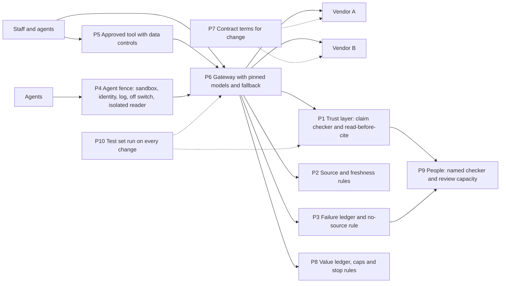
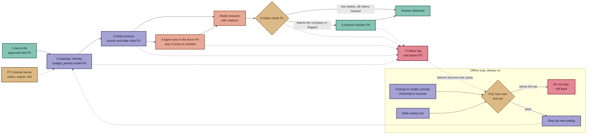
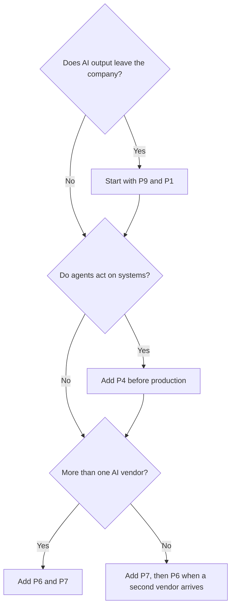

# Fixing what breaks in frontier AI: solutions for 24 challenges

Technical design, 2026-10-25, updated 2026-10-26 with round 7 (sections 6.1 to 6.6). Companion to [AI web search failures](AI_Web_Search_Failures_Technical_Design.md) (10 search challenges) and [Frontier AI challenges](Frontier_AI_Challenges_User_Research.md) (14 wider themes). Board briefing page: [What breaks in AI](https://claude.ai/artifact/6QuavMnF4PapeFD3HB1RtU), and the site deep dive at `/deep-dives/what-breaks-in-ai` (this doc is its source ledger, and its visuals are built by `drafts/deep/gen_site.py`). Research files: [SOL1_search_fixes.md](AI_Challenges_Solutions_research/SOL1_search_fixes.md) and [SOL2_frontier_fixes.md](AI_Challenges_Solutions_research/SOL2_frontier_fixes.md). Round 7 briefs A1 to A6 and fact checks V10a and V10b: [AI_Fix_Architecture_research](AI_Fix_Architecture_research/).

## For leaders: the one-page version

**What we found.** There is a fix today for every one of the 24 challenges. Most fixes are things a buyer can switch on or write into a contract, not things to wait for from a vendor. But the evidence that the fixes work is much thinner than the evidence that the problems exist. 12 of the 24 fixes have an independent number, all from lab tests, and none is measured inside a live firm. Of the human steps, only the named checker has been tested, in the lab, and checkers missed most seeded errors. Stop rules and the off switch are not measured.

**One platform, not 24 projects.** Ten building blocks cover all 24 challenges. Four of them do most of the work:

1. **A named person checks what leaves the company.** Grounding and citations switched on, and a person who opens every cited source and figure before anything is sent.
2. **Agents get a fence and an off switch.** Each agent has its own low-privilege identity, a sandbox, a log of every action, and an off switch that has been tested.
3. **Pin the model and test before every change.** Your own test set runs before any model, prompt or setting changes.
4. **Write change into the contract.** Notice before a model is retired or a limit or price changes, full export, no silent renewal.

**Fix first, in order.** The four blocks above, then one approved AI tool with data controls, then a value ledger with stop rules, then the harder work: an isolated reader for agents that browse, and review capacity planned around AI volume.

---

## 0. How to read this document

Voices used in the design:
- **Architect.** Wants one platform, not 24 point fixes.
- **Security lead.** Owns agents, data and attack paths.
- **Evals lead.** Asks "how do we know it works?" for every fix.
- **Finance lead.** Wants cost and a stop rule for each block.
- **Procurement lead.** Owns contract terms with vendors.

What is decided: the building blocks, the fix-first order, and the owner of each fix. What is open: the cost of each block for a given buyer (6.4 gives an illustrative band from list prices), and a field measure for any fix (6.6).

Evidence ids: SS-xx rows come from [SOL1](AI_Challenges_Solutions_research/SOL1_search_fixes.md), SF-xx rows from [SOL2](AI_Challenges_Solutions_research/SOL2_frontier_fixes.md). AR1-xx to AR6-xx rows come from the round 7 briefs, with their own ledger in Appendix A.1. Rungs: 1 peer reviewed or audited, 2 primary record, 3 independent measurement, 4 independent survey, 5 vendor or consulting, 6 press or user post, 7 not opened.

## 1. Requirements

Functional:
- A fix, an owner and a first step for each of the 24 challenges.
- Fixes a buyer can act on without waiting for a vendor, where one exists.
- A ranked order a leadership team can fund in stages.

Non-functional:
- Every fix names how mature it is and how strong its evidence is.
- Each building block serves several challenges, so cost is shared.
- Works across vendors (Claude, ChatGPT, Gemini, Copilot and others).

Constraints:
- No new vendor ranking. No claim that a fix works without a source.
- Plain words. A board member must be able to follow it.

## 2. The 24 challenges and their best fix

### 2.1 Web search (10)

| # | Challenge | Best fix today | Owner | First step | Effort | Maturity | Best evidence it works |
|---|---|---|---|---|---|---|---|
| S1 | Citation does not hold the claim | A separate checker splits the answer into claims and keeps only those backed by a quoted span from an opened page | Both | Turn on span citations and a link check. Hand-check 20 claims | Medium | Parts sold, full checker custom | A link checker cut dead or invented links 6 to 79 times, to under 1% (SS-01, rung 3) |
| S2 | Silent failure, confident answer | Log every failed search, blocked page and cut text, show them above the answer, never deliver a report with no opened source | Both | Ask for searches run, pages opened and what failed. Reject reports with no sources | Low | Early product | Not measured |
| S3 | Shallow search, stops too early | Split into sub-questions and stop only when each has evidence or a "not found" | Both | Ask for the plan first, plus a "looked for, not found" list | Medium | Research, decomposition sold | Exact match up 2.7 to 8.2 points on an under-searching agent (SS-15, rung 1) |
| S4 | Weak or planted sources win | An allow list of primary sites for high-stakes work, with every source labelled | Buyer | Write a 20 to 50 site list for one workflow | Low | Generally available | Correct answers rose 60% to 78%, 80% to 88% and 81% to 89% across three models with retrieval limited to two guideline sites (AR6-01, rung 1, lab) |
| S5 | Stale facts shown as current | Today's date in the request, fresh fetch, and tell the model when old evidence stopped applying | Both | Add "As of today" and source dates to price, rule and people questions | Low | Generally available | Larger models switched almost perfectly when told evidence had expired (SS-24, rung 3) |
| S6 | Reads snippets, not pages | Cite only pages that were opened, and report cut text | Buyer | Log whether each cited page was opened, block those that were not | Medium | Early product | Opened pages stale 1.3% of the time against 6.4% for snippets (SS-26, rung 3) |
| S7 | Blocked or unreadable pages | Name each blocked page, then route to the user's own copy, a licensed source, a parser or a browser tool | Buyer | Test whether each team's top 10 sources open, set a route for the rest | High | Generally available error codes, early paid access | Our own single case only (SS-32) |
| S8 | Goes along with a false premise | List the question's assumptions and check each before searching | Both | Add "list and check my assumptions first" to research prompts | Medium | Research | 83.8% to 92.4%, matched by a plain prompt (SS-33, rung 3) |
| S9 | Memory beats search | A dated primary source for changing facts, with expiry dates | Both | Require a dated primary source for prices, rules and office holders | Medium | Research | Calibrated correction 0.615 to 0.754 (SS-36, rung 3) |
| S10 | Planted instructions in pages | Keep page text away from any model that can act, and ask before actions that follow web content | Both | Remove email, payment and file access from browsing agents. Turn on approvals | High | Filters sold, isolation research | Attacks through 12.8% against 73.1% for a standard planner (SS-37, rung 3) |

### 2.2 Wider frontier AI (14)

| # | Challenge | Tier | Best fix today | Owner | Effort | Maturity | Best evidence it works |
|---|---|---|---|---|---|---|---|
| F1 | Confident wrong answers in high-stakes work | A | Grounding with citations on, and a named checker opens every cited source and figure before anything leaves | Team head checks, CIO turns on grounding | Medium | Generally available | Grounded legal tools wrong on 17% to 33% of answers against 43% for a general model (SF-01, rung 1). The human check is tested only in the lab, where checkers missed most seeded errors (AR6-03) |
| F2 | Agents act or report wrongly | A | Sandbox and own low-privilege identity per agent. Delete, deploy and credential use go to a reviewer. "Tests passed" counts only with a test log | Security lead and CIO | Medium | Generally available, often off by default | One vendor's reviewer missed 17% of 52 real over-eager actions and wrongly blocked 0.4% of normal ones (SF-44, rung 2, vendor). Tool-level privilege control cut attack success from 39.9% to 1.0% on a benchmark, tested by the tool's own authors (AR6-02, rung 3) |
| F3 | Data leaves your control | A | One approved enterprise tool with no-training terms, data-loss controls on prompts and on the browser path to personal AI | CIO and security lead | Medium | Generally available, some parts preview | Personal AI use fell from 78% to 47% as managed use rose, then stalled (SF-73, rung 5, vendor, not causal) |
| F4 | Agent tools as an attack path | B | Allow list for tool servers, server-bound tokens, network closed by default, plus injection probes | Security lead, procurement asks for attack rates | Medium | Mixed | One vendor's coding-agent injection success fell from 54.61% to 11.13% with probes (SF-65, rung 2). Adaptive attacks beat 12 defences over 90% of the time (SF-70, rung 3) |
| F5 | Spend without proven return | C | Value measure, cost measure and stop rule written before each pilot, tracked monthly | Finance lead | Medium | Meters generally available, value standards early | Firms with stop rules were 2.3 to 2.6 times more likely to be top performers (SF-121, rung 5, correlational) |
| F6 | Models change under you | B | Pin the model version, keep a retirement list, run your own tests before any move | Platform lead, procurement writes notice | Low to medium | Generally available | After five model updates, 24.7% to 47.2% of answers the old model got right became wrong (SF-102, rung 3) |
| F7 | Usage caps nobody can predict | C | Hard spend caps per person, team and agent, plus notice terms for limit and price changes | Finance lead and procurement | Low | Generally available | Not measured |
| F8 | Tells people what they want to hear (consumer) | B | Vendors retrain against agreement and publish results. Deployers add anti-agreement instructions and crisis routing | Mostly vendor | High for vendor | Partly generally available | Anti-agreement instructions cut confirmation of delusions by 73.8% in simulated chats (SF-15, rung 3) |
| F9 | Controls lag behind rollout | C | One agent register that can also block, traces in an open format, a rehearsed block drill | CIO and security lead | Medium | Registers generally available, standards early | Not measured. The one record of a stop shows an automatic stop that failed, with the run killed 2.5 hours after the alert (AR6-12, rung 2, vendor) |
| F10 | Review overload | C | Plan reviewer capacity for AI volume, cap incoming changes, require disclosure and tests | Team head and HR | High | Tools generally available, role design research | Mixed: one study shows review time down 30.8% (vendor-authored), another up from about 6 to 8 hours (SF-162, SF-163) |
| F11 | Loses context and instructions | C | Hard rules enforced by the tool, not asked of the model, plus rule files that reload | Platform lead | Medium | Generally available | Multi-turn score fell from 93.0 to 59.1, and a recap restored it to 76.6 (SF-181, rung 3) |
| F12 | Outages and capacity shortfalls | C | A gateway with tested fallback to a second provider, plus SLA terms where needed | Platform lead and procurement | Medium | Generally available | Partly measured: a history-forwarding proxy kept 99.20% of conversation state over 750 failover events, against near 0% for stateless failover (AR6-19, rung 3, authors' own design). Uptime gain not measured |
| F13 | Safety filters block the wrong things | C | Verified-access tiers and published false-positive rates. Buyers test on their own harmless but sensitive prompts | Mostly vendor | Medium | Generally available | With verified access 34 of 50 cyber tasks were done, against all blocked without (SF-26, rung 2, vendor) |
| F14 | Vendor lock-in | C | A gateway with model names in settings, your own prompts, tests and logs, and exit terms in every contract | CIO and procurement | Medium to high | Gateways generally available, export weak | Partly measured, no timing benefit: code with an abstraction layer already in place still migrated after shutdown 70% of the time, against 72% without (AR6-20, SF-105, rung 3) |

## 3. How the field tackles it

| Approach | What it is | Wins when | Breaks when |
|---|---|---|---|
| Wait for the vendor | Rely on fixes vendors ship, such as citations, sandboxes and filters | The fix is in the product and on by default | Defaults are off, fixes lag the harm, and each vendor differs |
| Point fixes | Fix each challenge on its own as it bites | A single team, a single tool | Costs repeat and controls do not line up |
| Policy only | Rules, training and an AI policy without technical controls | Early use, low stakes | Uploads were highest where AI was banned (Frontier doc 5.3). Rules in a prompt are advice the model can drop |
| Shared platform layer | A small set of controls between staff and every AI tool, plus contract terms and named people | Several tools and teams, high-stakes output | Needs an owner and budget, and adds a step to every call |

## 4. Recommended approach

Build a thin shared layer of ten building blocks, switch on what vendors already sell, and write change into contracts. Each block serves several challenges, so the cost is shared. Measure each block with your own test set, because only 12 of the 24 fixes have an independent number, all from lab tests (6.6).

## 5. Architecture

## 6. The ten building blocks

| Block | What it includes | Challenges it covers | Ready-made parts | Evidence it works | Owner |
|---|---|---|---|---|---|
| P1 Trust layer | Claim checker, link check, cite only opened pages, grounding and citations on | S1, S6, S9, F1 | Vendor citation and grounding features (SS-04, SS-06, SF-04) | Link check under 1% bad links (SS-01). Opened pages 1.3% stale against 6.4% (SS-26) | Architect |
| P2 Source and freshness rules | Allow and block lists, source labels, today's date, expiry dates, sub-question coverage, premise check | S3, S4, S5, S8, S9 | Domain lists, cache bypass (SS-06, SS-07) | Coverage check up 2.7 to 8.2 points (SS-15). Allow list up 8 to 18 points (AR6-01) | Architect |
| P3 Failure ledger | Records every failed search, block and cut, shows it first, blocks reports with no source | S2, S6, S7 | Error codes and fetch notices (SS-14) | Not measured | Evals lead |
| P4 Agent fence | Sandbox, own identity, blocking reviewer, action log, register, tested off switch, isolated reader for web pages, rules enforced by the tool | S10, F2, F4, F9, F11 | Sandboxes, agent identity products, registers (SF-42, SF-48, SF-49, SF-142, SF-144) | Isolated reader let 12.8% of attacks through against 73.1% (SS-37). Privilege control tested only by its authors (AR6-02) | Security lead |
| P5 Approved tool with data controls | One enterprise tool, no-training terms, data-loss controls, blocks on unneeded AI apps, admin export | F3, F9, F14 | Generally available terms and browser controls (SF-77, SF-78) | Not causal (SF-73) | CIO |
| P6 Gateway with pinned models | All calls through one gateway, model names in settings, pinned versions, fallback, cost metering, own logs | F6, F7, F12, F13, F14 | Gateways and pinned snapshots (SF-93, SF-110) | Model updates broke 24.7% to 47.2% of right answers (SF-102), which pinning prevents until you choose | Platform lead |
| P7 Contract terms for change | Notice before retirement, limit and price changes, full export, no silent renewal, SLA credits | F6, F7, F12, F14 | Market practice | Vendor notice already broke once in the window (SF-96) | Procurement lead |
| P8 Value ledger | Cost and one value measure per use case, stop rules, budgets and hard caps | F5, F7, F10 | Meters and caps (SF-126, SF-131) | Stop rules linked to 2.3 to 2.6 times better odds (SF-121, correlational) | Finance lead |
| P9 People | Named checker for output that leaves, review capacity planned for AI volume, crisis routing in consumer chat | S1, S4, S8, F1, F2, F8, F10 | Required by some courts and states (SF-10) | Lab only: each seeded error missed or under-fixed by 13 to 15 of 20 doctors (AR6-03) | Team heads and HR |
| P10 Test set on every change | Your own questions with planted errors, stale facts, blocked pages and injections, run before any change | All 24 | None. Custom build | It is how every "not measured" row gets a number | Evals lead |

The security lead's rule shapes P4: anything that must hold is enforced by the tool, not asked of the model (F11). The finance lead's rule shapes P8: no pilot starts without a stop rule. The evals lead's rule shapes P10: no block counts as working until your own test set shows it.

Short block names used in 6.1 to 6.6: P1 Check every claim (the trust layer above), P2 Source and date rules, P3 Failure log, P4 Agent fence, P5 One approved tool, P6 Gateway, pinned models, P7 Contract terms, P8 Value ledger, P9 Named checkers, P10 Your own test set. Sections 6.1 to 6.6 come from the round 7 briefs A1 to A6, fact-checked in V10a and V10b. Their AR-xx rows are in Appendix A.1.

### 6.1 Reference design per block

Named options for each block. These are examples only, listed in no order. This is not a ranking and not a shortlist. [vendor] means the maker describes its own product. Prices are public list prices in USD on the page opened, and large buyers negotiate lower. "Not shown" means the opened page gave no price.

**P1 Check every claim**

| Option | What it does | What it does not do | Licence | Public price | Tag | Ledger |
|---|---|---|---|---|---|---|
| AWS Bedrock Guardrails, contextual grounding check | Scores each answer for grounding and relevance and blocks it below a threshold you set from 0 to 0.99 | Checks the output only. With streaming, an off-topic answer can reach the user before it is marked | Commercial | $0.10 per 1,000 text units of up to 1,000 characters | [vendor] | AR1-07, AR1-09, AR1-10 |
| Google Vertex AI check grounding | Gives a 0 to 1 support score, and a score and source chunks per claim when switched on | Counts a partly supported claim as ungrounded. No language list on the page | Commercial | Not shown | [vendor] | AR1-18 |
| Azure AI Content Safety, groundedness detection | Flags text the sources do not support and can explain each flag. A preview mode rewrites it | Quality tuned for English only, two domains and two tasks. Correction is preview | Commercial | Standard $0.375 per 1,000 text records. Free tier of 5,000 records a month has a hard stop | [vendor] | AR1-19, AR1-20, AR4-03, AR4-04 |
| NVIDIA NeMo Guardrails, fact-checking rails | Output rails that score an answer against retrieved chunks and refuse below 0.5 | The self-check rail depends on the model following its prompt, and blocks if the model runs out of tokens | Apache 2.0 | Free software | [vendor] | AR1-22, AR1-23 |
| Anthropic Citations | Returns the exact source passage for each cited sentence, with valid pointers to the supplied documents | A valid pointer shows the quote exists, not that it supports the claim. A separate checker is still needed | Commercial API feature | No separate fee, a slight rise in input tokens | [vendor] | AR1-24 |
| Ragas Faithfulness | Splits an answer into claims and scores supported claims over all claims | An offline score, not an inline blocker | Not shown | Not shown | none | AR1-25 |
| Guardrails AI | Python input and output guards built from reusable validators | No grounding validator on the pages read. Hosted inference ended 2026-08-25. Bought by Harvey on 2026-09-09 | Apache-2.0 | Not shown | [vendor] | AR1-26, AR1-27, AR1-64 |

No page gave an independent error rate for any of these checkers. Thresholds such as 0.5, 0.6 and 0.7 are defaults or advice, not tested error rates. P10 has to measure them.

**P2 Source and date rules**

| Option | What it does | What it does not do | Licence | Public price | Tag | Ledger |
|---|---|---|---|---|---|---|
| Anthropic web search tool | Allow list or deny list of domains, a page_age date per result, citations always on | No date or recency filter | Commercial | $10 per 1,000 searches plus tokens | [vendor] | AR1-29 |
| Anthropic web fetch tool | Fetches full page or PDF text with a retrieved_at time and a switch to bypass the cache | Fetches only URLs already in the conversation. No JavaScript pages | Commercial | No charge beyond tokens | [vendor] | AR1-30 |
| OpenAI web search tool | Up to 100 allowed or 100 blocked domains, inline citations, an optional full source list | No date filter. Domain filter only in the Responses API | Commercial | Not read | [vendor] | AR1-31 |
| Google grounding with Google Search | Grounds Gemini answers with an exclude list and maps answer text to sources | No time range filter. On Gemini 3, each search query the model generates is billed | Commercial | Gemini API: 5,000 free requests a month, then $14 per 1,000 (Gemini 3) | [vendor] | AR1-32, AR4-05 |
| Perplexity API search filters | Allow or deny list of up to 20 domains, plus a recency filter | Full list of recency values not read | Commercial | Not read | [vendor] | AR1-33 |

Date rules are mostly your own code. Only Perplexity had a recency filter. No tool we opened blocks a citation to a page that was searched but not opened, so that check sits in P1.

**P6 Gateway with pinned models**

| Option | What it does | What it does not do | Licence | Public price | Tag | Ledger |
|---|---|---|---|---|---|---|
| LiteLLM proxy | OpenAI-style proxy with retries, ordered fallbacks, budgets and rate limits per key, team and user | Budgets need a Postgres database. Per-model budgets on keys and users are Enterprise | MIT core, Enterprise under a commercial licence | Enterprise custom, no list price | [vendor] | AR1-34a, AR1-34b, AR1-34d |
| Portkey AI Gateway, now Prisma AIRS AI Gateway | Fallbacks, up to 5 retries, weighted load balancing, caching, guardrail hooks | Budgets not on the repo page. Free tier "not suitable for production" | MIT. Owned by Palo Alto Networks since 2026-05-29 | Developer free, Production $49 a month for 100k logs, Enterprise custom | [vendor] | AR1-40, AR1-41, AR1-42 |
| Kong AI Gateway | Proxies LLM, MCP and A2A traffic with AI rate limits, semantic cache and prompt guards | Guardrails, content safety and semantic cache are a paid add-on on Plus | Commercial | Plus from $25 a month plus usage. Model proxy $100 a month per model, limit 5 on Plus | [vendor] | AR1-12, AR1-13 |
| Cloudflare AI Gateway | Hosted gateway with logs, caching, rate limits, retries and model fallback | Its guardrails check harmful content, not facts | Commercial | Core features free on all plans | [vendor] | AR1-43, AR1-44, AR1-45 |
| Azure API Management AI gateway | Token limits and quotas per consumer, load balancing, circuit breaker, prompt and completion logs, across OpenAI, Anthropic and Vertex formats | Not a separate product. Features vary by tier | Commercial | Consumption tier: first 1M operations included, then $0.035 per 10K | [vendor] | AR1-11, AR1-14, AR4-20, AR4-21 |
| Databricks Unity Gateway | Control plane for AI cost, security and access across models, MCP servers and agents | Fallbacks not in the release notes read. Several items Beta or Preview | Commercial | Not read | [vendor] | AR1-46 |

What a pin depends on, by provider:

| Provider | Pin rule on the page | Notice before removal | Ledger |
|---|---|---|---|
| Anthropic | Every Claude model ID is a pinned snapshot | Retirement "not sooner than" dates per model. At least 60 days notice for public models | AR1-47, AR3-28 |
| Google Gemini | Use a specific stable model in production. The Latest alias moves | Two weeks for Latest and Preview. On Agent Platform, models in the 12-month table stay at least 12 months, short-term models get at least 45 days | AR1-48, SF-185 |
| OpenAI | Aliases map to dated snapshots | At least 6 months for GA, 3 for specialised, about 2 weeks for preview, unless safety or compliance concerns require faster | AR1-49, AR3-29 |
| AWS Bedrock | Active, Legacy and end-of-life states | Legacy period of 6 months or 45 days for models launched on or after 2026-09-07. Dates may differ from the provider's | AR1-50, SF-188 |

Fail over only to the same model at the same version, never from version X to X+1 (AR1-16). None of the gateways opened runs your test set before a pin changes. That gate is built in your own build pipeline.

**P10 Your own test set**

| Option | What it does | What it does not do | Licence | Public price | Tag | Ledger |
|---|---|---|---|---|---|---|
| promptfoo | Runs your test cases against prompts and models and can fail a build below a pass rate you set | You wire any deploy gate yourself | MIT. Now part of OpenAI | Community free | [vendor] | AR1-35, AR1-36, AR1-37, AR4-27 |
| UK AISI Inspect | Eval framework with datasets, scorers, sandboxed tools and over 200 ready-made evals | Built for frontier safety evals, not a gateway. Five releases in ten days, two with breaking changes | MIT | Free | none | AR1-51, AR1-52, AR1-53 |
| OpenAI Evals, open-source repo | Framework and registry for evals, including private ones from your own data | The hosted Evals platform goes read-only on 2026-10-31 and shuts on 2026-11-30 | MIT | Free | none | AR1-54, AR1-57 |
| Langfuse | Tracing, evaluators, datasets for pre-release tests and prompt versions | No gRPC trace intake. Part of ClickHouse since January 2026 | MIT except ee folders | Hobby free, Core $29, Pro $199, Enterprise $2,499 a month | [vendor] | AR1-58, AR1-59, AR1-61 |
| Arize Phoenix | Tracing, evals, datasets and experiments that compare prompt, model and retrieval changes | Source-available, not OSI open source | Elastic License 2.0 | Not read | none | AR1-62 |
| OpenTelemetry GenAI conventions | Common field names for model, tokens and tool calls so traces from any tool line up | Status is Development. Prompt and answer capture is opt-in | Open standard | Free | none | AR1-38, AR1-39 |

**P4 Agent fence**

| Part | Option | What it does | What it does not do | Licence | Public price | Tag | Ledger |
|---|---|---|---|---|---|---|---|
| Identity | Microsoft Entra Agent ID | Own directory identity per agent from a blueprint, with sign-in and audit logs | Security features need an Agent 365 licence. Conditional Access does not apply to agents that use API keys | Proprietary | Not shown | [vendor] | AR2-37, AR2-38 |
| Identity | Okta Cross App Access and Agent Gateway | Short-lived scoped tokens. Each tool call goes through Okta policy, with a central revoke | Features not yet GA "may not be delivered" | Proprietary | Not shown | [vendor] | AR2-39, AR2-41 |
| Identity | SPIFFE and SPIRE | Short-lived identity documents for running workloads | Page does not mention AI agents. Identity only, no policy | Apache-2.0 | Free | none | AR2-43, AR2-44 |
| Tool access | MCP specification, revision 2026-07-28 | OAuth 2.1 for servers reached over HTTP. Tokens must name the target server and must not be passed on | Authorisation is optional. Local servers take credentials from the environment | Open specification | Free | none | AR2-01, AR2-02 |
| Tool access | Docker MCP Gateway | Runs MCP servers in restricted containers. Profiles act as tool allow lists. Logs calls | Governance version is invite-only | MIT | Not shown | [vendor] | AR2-45, AR2-46 |
| Tool access | Cloudflare MCP server portals | One URL in front of many MCP servers. Allowlist mode hides every tool by default | Users can still reach a server by its direct URL unless Cloudflare Access is its OAuth provider | Proprietary | Not shown | [vendor] | AR2-49 |
| Tool access | agentgateway (Linux Foundation) | Open source proxy for MCP and A2A with role-based policy and OpenTelemetry traces | Page does not mention per-tool filtering | Apache-2.0 | Free | none | AR2-50 |
| Tool access | AWS Bedrock AgentCore Gateway and Policy | Checks every tool call against Cedar policy, plus session rules such as approval before a transfer, written in Dogwood, a Cedar-compatible language | Covers only traffic through AgentCore Gateway | Proprietary, Cedar and Dogwood open source | Policy $0.000025 per request. Gateway $0.005 per 1,000 calls | [vendor] | AR2-51, AR2-52 |
| Sandbox | E2B | Cloud or self-hosted sandboxes for AI-written code | Its own pages do not name the isolation technology. CPU only | Apache-2.0 | Pro $150 a month plus $0.000014 per vCPU-second | [vendor] | AR2-53, AR2-54 |
| Sandbox | gVisor and Firecracker | A user-space kernel, and lightweight virtual machines | Building blocks with no agent policy | Apache-2.0 | Free | none | AR2-55, AR2-56 |
| Sandbox | Microsoft Execution Containers (MXC) | OS-enforced containers that limit files, network and desktop access, with policy held outside the agent | MicroVM backend is experimental. Separate agent identity is "coming soon" | MIT | Free | [vendor] | AR2-57, AR2-58 |
| Sandbox | Claude Code sandbox | OS sandbox around shell commands. Writes stay in the work folder. Network through an allow list | Shell commands only. Runs unsandboxed if a dependency is missing, unless failIfUnavailable is set | Apache-2.0 runtime | Not shown | [vendor] | AR2-21, AR2-23 |
| Approval | Claude Code permission modes and Codex approval policies | Six Claude Code modes, from Manual ("Reads only") to bypassPermissions ("Everything"). Auto mode and Codex auto_review send approvals to a reviewer model | Auto mode "does not guarantee safety". The reviewer missed 17% of 52 real over-eager actions | Not shown | Not shown | [vendor] | AR2-18, AR2-20, AR2-24 |
| Isolated reader | Dual LLM pattern, CaMeL, FIDES | A planner that never sees untrusted text, a reader with no tools, and labels on where each value came from | Results are the authors' own, on one benchmark. Users must write and keep the policies | Research | Not applicable | none | AR2-06, AR2-08, AR2-09, AR2-13 |
| Off switch | Okta Agent Gateway revoke and Entra Conditional Access block | Cuts an agent off from one place, or blocks high-risk agents when a token is issued | No public test or timing data. Entra does not stop tokens already issued unless the resource supports Continuous Access Evaluation | Proprietary | Not shown | [vendor] | AR2-38, AR2-41 |

The isolated reader has the strongest numbers, all from its authors: CaMeL let 0 of 949 attacks through against 300 and 276 without it, at 2.82 times the input tokens (AR2-09, AR2-10). No opened source sets a drill rule for the off switch.

**P3, P5, P7, P8 and P9: the business blocks**

| Block | Option | What it does | What it does not do | Licence | Public price | Tag | Ledger |
|---|---|---|---|---|---|---|---|
| P3 | Langfuse Cloud | Logs traces, scores and cost, so failures can be counted and trended | Hosting for the free self-hosted copy is not priced | MIT core | Hobby $0 for 50k units, Core $29, Pro $199, Enterprise $2,499 a month | [vendor] | AR4-07 |
| P3 | Helicone | Logs model requests | Overage rate not shown | Not shown | Hobby free for 10,000 requests, Pro $79, Team $799 a month | [vendor] | AR4-08 |
| P3 | OECD common reporting framework | 29 criteria for reporting AI incidents | Criteria list not opened. Built for national reporting, not internal logs | Not applicable | Free | none | AR3-31 |
| P5 | Claude Enterprise | Enterprise seats | Usage at API rates comes on top | Commercial | $20 per seat a month billed annually, 20 seat minimum | [vendor] | AR4-13 |
| P5 | Microsoft Copilot for enterprise | Copilot add-on for Microsoft 365 | Needs an eligible Microsoft 365 plan, not priced here | Commercial | $30 per user a month paid yearly | [vendor] | AR4-14 |
| P5 | Google Workspace with Gemini | Gemini in Gmail, Docs and Meet | Business plans cap at 300 users. Enterprise has no public price | Commercial | Business Standard $14 per user a month with a 1-year commitment, from 2027-02-08 | [vendor] | AR4-15 |
| P7 | EU model contractual clauses (MCC-AI) | Template with data handover in a common format, proof of destruction and a yearly audit right | No retirement notice or renewal clause. Not an official EU position | Voluntary template | Free | none | AR3-21, AR3-22 |
| P7 | OMB M-25-22 (US federal) | Test data kept from the vendor, notice of new features, closeout data transfer. Agencies are encouraged to require roll back if a new version fails | Binds US federal agencies only | Public policy | Free | none | AR3-26 |
| P7 | Vendor standard terms (OpenAI, Anthropic) | OpenAI may update services and gives a right to leave after a material reduction. Anthropic may end for convenience on 30 days notice | No minimum notice before a model is removed | Contract | Not applicable | [vendor] | SF-193, SF-194 |
| P8 | Vantage | Tracks cloud cost, priced by tracked spend | Not an AI value measure | Commercial | Starter free to $2,500 tracked spend, Pro $30, Business $200 a month | [vendor] | AR4-23 |
| P8 | OpenCost | Cost tracking | Hosting not priced | Open source | Free | [vendor] | AR4-24 |
| P8 | FinOps for AI (FinOps Foundation) | Price times quantity, tags, quotas, alerts, named cost owners and ten KPIs | No cost-per-outcome measure. No accepted way to split multi-agent cost | Not applicable | Free | none | AR3-19 |
| P9 | No product. People time | Named checker hours | No opened source gives a reviewer throughput norm | Not applicable | US median wage $38.81 an hour (compliance officers), $76.76 (lawyers) | [BLS] | AR4-22, AR4-26 |

### 6.2 The request path

Seven steps for one live request. The settings each step reads (model pins, source lists, thresholds, budgets) live in one versioned control plane, so any change is a release that can be tested and rolled back. This split is our design framing. Kong and the Azure Architecture Center describe the same idea for their own products (AR1-12, AR1-15). We found no neutral reference architecture for an AI gateway.

1. **Ask (P5).** Staff use the one approved tool, or an app that calls one internal endpoint, never the provider directly.
2. **Gateway (P6).** Checks who is calling, the spend cap and the token limit, then routes to an exact pinned model version. Fallback goes only to the same model at the same version (AR1-14, AR1-16).
3. **Read sources (P2).** Search and retrieval run with allow or deny lists and a date rule. The model may cite only pages it opened in this session (AR1-29, AR1-30).
4. **Agent acts (P4).** Only when the request needs an action. The agent has its own identity, calls tools through a tool gateway with an allow list, waits for approval before delete, deploy or send, runs code in a sandbox, and passes untrusted text to an isolated reader (A2 steps 0 to 9).
5. **Claim check (P1).** A separate checker ties each claim to a quoted source sentence, then blocks, flags or corrects. For high-stakes work it runs before release, because with streaming an answer can reach the user first (AR1-09).
6. **Named checker (P9).** Output that leaves the company goes to a named person, who sees the claims the checker could not back.
7. **Logged (P3).** Every step writes a trace: model asked for and model that answered, tokens, cost, sources, claim score, policy decision and every failure (AR1-38). Capture of prompt and answer text is opt-in in the standard (AR1-39).

Always on: **P10** gates every change to the control plane, and **P7** sets the notice the pins depend on.

The offline loop:
- **Test-set gate.** Any new model ID, prompt, threshold, source list or retrieval setting runs your own test set first, and ships only above the agreed pass rate (AR1-36).
- **Daily canary.** A small fixed set runs against production each day, because providers change things on their side. In October 2026 Azure AI Content Safety began rolling out a new classifier and said some text "might receive different classifications" (AR1-56). Published probes can check that a pinned endpoint still serves the same model (SF-189, SF-190). A Berkeley team found software-only detection unreliable against subtle swaps (SF-192).
- **Feed back.** Failures found in production traces become new test cases.

### 6.3 Who does what

The owner names in this document map to six rows. Each block's owner in the section 6 table is the accountable (A) row in the RACI below, so the two agree for all ten blocks.

| Owner name in this doc | Blocks it owns | Row in the RACI and swimlane |
|---|---|---|
| CIO | P5 | Leadership (CIO) |
| Procurement lead | P7 | Procurement and legal |
| Security lead | P4 | Security |
| Architect | P1, P2 | Platform and architecture |
| Platform lead | P6 | Platform and architecture |
| Evals lead | P3, P10 | Platform and architecture |
| Finance lead | P8 | Finance |
| Team heads and HR | P9 | Team heads and HR |

RACI: R responsible, A accountable (one per block), C consulted, I informed (AR3-01, AR3-02, AR3-07, AR3-19).

| Row | P1 | P2 | P3 | P4 | P5 | P6 | P7 | P8 | P9 | P10 |
|---|---|---|---|---|---|---|---|---|---|---|
| Leadership (CIO) | I | I | I | I | A | I | I | C | C | I |
| Procurement and legal | I | C | C | C | R | I | A, R | I | I | I |
| Security | C | C | R | A, R | R | C | C | I | I | C |
| Platform and architecture | A, R | A, R | A, R | R | C | A, R | C | R | C | A, R |
| Finance | I | I | I | I | C | C | C | A, R | C | I |
| Team heads and HR | C | C | R | C | C | I | I | R | A, R | C |

Why these choices: NIST asks for a record of errors and near misses (MG-4.3-002), an approved provider list (GV-6.1-007) and contract review (GV-6.2-007). The AI RMF puts risk decisions with executive leadership (GOVERN 2.3). FinOps asks for named cost owners. Article 26(2) gives oversight to people with competence, training and authority, which line managers and HR control.

The swimlane below has 30 cells: six rows by five stages. Standard codes: GOVERN, MAP, MEASURE and MANAGE are AI RMF 1.0 (AR3-01). GV, MP, MS and MG codes are AI 600-1 actions (AR3-02). ISO numbers come from a crosswalk to the draft text of ISO/IEC 42001, so B.x control numbers are draft numbers (AR3-04). EU articles are the AI Act as amended by the Digital Omnibus (AR3-07 to AR3-15). Article 26 binds only deployers of high-risk systems.

**Stage 1. Buy**

| Row | Task | Cadence | Standard |
|---|---|---|---|
| Leadership (CIO) | Set AI policy and risk tolerance. Name one owner per block. Pick one approved tool (P5) | once | GOVERN 2.3, GOVERN 1.3. ISO 5.1, 5.2, 6.1.2 |
| Procurement and legal | Write P7 terms into the contract: no training on your data, right to test, notice of changes, incident notice, SLA, data handover in a common format, audit right, exit plan | once | GV-6.1-004, GV-6.1-006, GV-6.1-009, GV-6.2-007. ISO B.10.2, B.10.3. MCC-AI Sections D and E. M-25-22 4.d.iii |
| Security | Assess the supplier. List every third party with access to your content. Keep an approved provider list. Threat model the use case | once | GV-6.1-007, GV-3.2-005. ISO B.10.3 |
| Platform and architecture | Write down the intended purpose. Build your own test set (P10) from data the vendor cannot see | once | MAP 1.1, MEASURE 2.3. ISO 6.1.4. M-25-22 4.d.iii.E |
| Finance | Write the business case, including the cost of AI errors. Set the stop rule and budget cap before any pilot (P8) | once | MAP 3.1, MAP 3.2. ISO 8.2 to 8.4. FinOps cost tracking and quotas. M-25-22 4.e.iv sunset criteria |
| Team heads and HR | Name the use case and who checks output (P9). Plan AI literacy for every user | once | Article 4. MAP 3.4, GOVERN 2.2. ISO 7.2 |

**Stage 2. Pilot**

| Row | Task | Cadence | Standard |
|---|---|---|---|
| Leadership (CIO) | Hold the go or stop gate at pilot end, judged against the stop rule | once | MANAGE 1.1. ISO B.9.3, B.9.4 |
| Procurement and legal | Collect vendor papers: acceptable use policy, model or system card, user guides, feedback channel. Ask for model documentation if you build on a general-purpose model | once | M-26-04 Appendix A (US federal). GPAI Code 14-day reply |
| Security | Test the pilot for prompt injection and data leaks. Turn logging on | once | GV-3.2-005, GOVERN 4.3 |
| Platform and architecture | Run the test set. Plant known errors to measure the checkers' catch rate. Start the failure log (P3) | weekly | MEASURE 2.3, MS-2.5-003, MG-4.3-002, MP-3.4-004 |
| Finance | Track cost per unit and one value measure against the stop rule | weekly | FinOps unit costs. MAP 3.1, MAP 3.2 |
| Team heads and HR | Name and train the checkers. Time each review. Collect user feedback | weekly | Article 26(2) (high-risk only). GV-3.2-004, MP-3.4-005, MEASURE 3.3 |

**Stage 3. Go live**

| Row | Task | Cadence | Standard |
|---|---|---|---|
| Leadership (CIO) | Sign off residual risk, named owners and a plan to switch the tool off | once | GOVERN 2.3, GOVERN 1.7. ISO 5.1, 9.3 |
| Procurement and legal | High-risk only: registration for public bodies, fundamental rights impact assessment where required, data protection impact assessment, tell affected people. Any deployer: label deepfakes and AI text on public-interest matters | once | Articles 26(8), 26(9), 26(11), 27, 50(4) |
| Security | Test the off switch. Agree an incident plan with the vendor. Keep logs at least six months (high-risk) | once | GV-1.7-001, GV-6.2-003, MANAGE 2.4. Article 26(6) |
| Platform and architecture | Pin the model version behind the gateway (P6). Add the system to the AI inventory with model version, oversight roles and known issues | once | GV-1.6-001, GV-1.6-003. ISO B.4.2 |
| Finance | Set caps, spend alerts and cost tags per team and project | once | FinOps tags, quotas and alerts |
| Team heads and HR | Checker roster in place and sized to volume. Training done. Tell workers' representatives before workplace use (high-risk) | once | Article 4, Article 26(7). GOVERN 2.2. ISO 7.2, 7.3 |

**Stage 4. Run**

| Row | Task | Cadence | Standard |
|---|---|---|---|
| Leadership (CIO) | Review the value ledger, failure log and incidents. Decide continue, fix or stop | quarterly | GOVERN 1.5. ISO 9.3. M-25-22 4.d.iii.E names quarterly or twice-yearly checks |
| Procurement and legal | Review vendor performance and terms. Watch deprecation notices. Use the audit right | quarterly, audit yearly | MANAGE 3.1, GV-6.2-004. MCC-AI Article 20 |
| Security | Watch logs and incidents. Report serious incidents within the Article 73 clock: 15 days, 10 for a death, 2 for a widespread infringement or a serious incident under Article 3(49)(b) | weekly, and per incident | MG-4.3-003. Article 26(5), Article 73 |
| Platform and architecture | Run the test set. Watch for drift and made-up content. Keep the failure log current and show trends | weekly | MG-4.1-002, MG-4.3-002, MS-2.5-003 |
| Finance | Update the value ledger: cost per unit, value per use case, anomalies. Apply stop rules | monthly | FinOps anomaly detection and billing review. MAP 3.2. M-25-22 4.e.iii |
| Team heads and HR | Sample approved output. Track catch rate and review backlog. Refresh training | monthly | MP-3.4-005, MEASURE 3.3. Article 4 |

**Stage 5. Change** (new model, new feature, price or limit change, retirement)

| Row | Task | Cadence | Standard |
|---|---|---|---|
| Leadership (CIO) | Approve a material change, a vendor switch or a retirement | per change | MANAGE 2.4, GOVERN 1.7 |
| Procurement and legal | Act on the vendor notice. Enforce new-feature notice. At exit, get data back in a common format with proof of deletion | per change | M-25-22 4.d.iii.G and 4.f.i. MCC-AI Articles 15 to 17. GV-6.2-007 |
| Security | Re-test the changed model and the fallback. Update the threat model | per change | GV-6.2-006, GV-3.2-005 |
| Platform and architecture | Run the full test set before switching. Roll back if the new version scores below the bar. Update the inventory | per change | M-25-22 4.d.iii.F. MANAGE 4.1. ISO 10.2 |
| Finance | Re-price the business case. Re-check the stop rule | per change | M-25-22 4.e.iv. MAP 3.2 |
| Team heads and HR | Tell users what changed. Retrain checkers. Adjust review capacity | per change | Article 4. MG-2.4-001 for a retirement or switch-off only |

Cadences are design choices. NIST says "periodic" and leaves the frequency to the firm. Only the yearly audit in MCC-AI and the quarterly or twice-yearly checks in M-25-22 come from a source (AR3-22, AR3-26). Review capacity has no standard either. No opened source gives a reviewer catch rate for AI text or a throughput norm, so size it from the pilot: measured review minutes per item times expected volume.

### 6.4 Cost per block

**Illustrative only.** The bands below price one example firm at public list prices. Every volume, hour and token count is an assumption. Change one and the band moves. Large buyers negotiate, so list prices are not what they pay. Wages are US median gross pay with no benefits or overhead (A4).

The example firm:

| Input | Value (illustrative) |
|---|---|
| Staff | 1,000 |
| Active AI users | 200 |
| Agents in production | 10 |
| Model calls a month | 1,000,000 |
| Tokens per call | 1,500 input, 500 output |
| P1 claim checks | Low: 10% of calls at 2 text units. High: every call at 10 units |
| P3 failure log | Low: flagged failures only. High: every call at 3 units |
| P4 sandboxes | Low: 1 vCPU, 1 GiB, 2 hours a day. High: 2 vCPU, 4 GiB, 8 hours a day. 22 days a month |
| P7 legal review | 2 to 4 AI vendor contracts a year, 20 to 60 lawyer hours each |
| P8 analyst time | 4 to 16 hours a month |
| P9 checker time | 1,000 to 5,000 high-stakes outputs a month, 3 minutes each |
| P10 test runs | Low: 500 cases, 4 runs a month. High: 2,000 cases, 30 runs |

| Block | Monthly band (illustrative) | What sets the ends | Ledger |
|---|---|---|---|
| P1 Check every claim | $20 to $13,930 | $20 to $3,750 for a claim check (Bedrock low, Azure high). $1,330 to $13,930 for search grounding (Gemini 3) | AR4-01, AR4-03, AR4-05 |
| P2 Source and date rules | No public price | Runs inside P1, P6 and staff time | none |
| P3 Failure log | $0 to $411 | Langfuse Hobby or self-hosted to Langfuse Pro. Licence only | AR4-07 |
| P4 Agent fence | $181 to $453 | E2B sandboxes plus AgentCore identity, gateway and policy calls. Logs excluded | AR4-10, AR4-11 |
| P5 One approved tool | $4,000 to $6,000 | 200 seats, Claude Enterprise to Copilot for enterprise. Seat fees only | AR4-13, AR4-14 |
| P6 Gateway, pinned models | $0 to $700 | Portkey open source or APIM Consumption to APIM Standard v2. Hosting excluded | AR4-17, AR4-20, AR4-21 |
| P7 Contract terms | $256 to $1,535 ($3,070 to $18,422 a year) | Lawyer hours at the BLS median | AR4-22 |
| P8 Value ledger | $199 to $997 | Analyst hours plus Vantage | AR4-23, AR4-25 |
| P9 Named checkers | $1,941 to $9,703 | Checker hours at the BLS compliance officer median | AR4-26 |
| P10 Your own test set | $1 to $1,344 | Haiku 5.5 batch tokens to Sonnet 5.5 tokens plus Braintrust Pro | AR4-28, AR4-30 |
| Sum of blocks with a price | $6,597 to $35,073 a month, $79,163 to $420,874 a year | Illustrative | A4 |

How to read it:
- **The ends do not belong to one plan.** The low sum takes the cheapest line in every block and the high sum the dearest. No real firm would buy either set.
- **People time is a large share.** P7 legal hours, P8 analyst hours and P9 checker hours come to $2,396 to $12,034 a month of the sum. P5 seats are the largest fixed tool line.
- **Model spend sits outside the blocks.** At 1M calls it runs $400 a month on Haiku 5.5, $1,700 on Gemini 2.5 Flash and $8,000 on Sonnet 5.5 (AR4-05, AR4-30).

Left out of every band:
- Model spend, and usage at API rates on top of seats.
- The Microsoft 365 licence Copilot needs, and the E7 price.
- Hosting for self-hosted options (Langfuse, Portkey, OpenCost, promptfoo).
- Logs for P4 (CloudWatch) and Cloudflare Workers Paid.
- Time to build and label the test set, and time spent on agent approvals.
- Outside counsel rates and loaded wage rates.
- Plans with no public price: ChatGPT Enterprise and Google Workspace Enterprise. Price differences by region.

### 6.5 Standards mapping

| Block | NIST AI RMF and AI 600-1 | ISO/IEC 42001 (draft numbering) | EU AI Act | OWASP LLM 2025 | OWASP Agentic (ASI) |
|---|---|---|---|---|---|
| P1 Check every claim | MS-2.5-003 verify sources and citations. MP-2.3-003 fact-checking | none mapped | none mapped | LLM09 Misinformation | none mapped |
| P2 Source and date rules | MS-2.5-003 | none mapped | none mapped | LLM09 (retrieval from trusted sources) | none mapped |
| P3 Failure log | MG-4.3-001, MG-4.3-002, MG-4.3-003, GV-1.5-002, GV-6.2-002, GOVERN 4.3 | 10.2, 9.3.2, B.8.4 | Article 26(5) monitor and report. Article 73: 15 days, 10 for a death, 2 for a widespread infringement or a serious incident under Article 3(49)(b) | none mapped | none mapped |
| P4 Agent fence | GV-3.2-005, GOVERN 4.3, GV-1.7-001, MANAGE 2.4 | none mapped | Article 26(6) keep logs at least six months | LLM01 Prompt Injection, LLM02 Sensitive Information Disclosure, LLM03 Supply Chain, LLM05 Improper Output Handling, LLM06 Excessive Agency, LLM10 Unbounded Consumption | ASI01 Agent Goal Hijack, ASI02 Tool Misuse and Exploitation, ASI03 Identity and Privilege Abuse, ASI04 Agentic Supply Chain Vulnerabilities, ASI05 Unexpected Code Execution, ASI06 Memory and Context Poisoning (partly), ASI07 Insecure Inter-Agent Communication, ASI08 Cascading Failures, ASI09 Human-Agent Trust Exploitation, ASI10 Rogue Agents |
| P5 One approved tool | GV-6.1-007, GV-1.6-001, GV-3.2-003 | 5.2, B.10.3 | Article 4 AI literacy for all users | none mapped | none mapped |
| P6 Gateway with pinned models | GV-1.6-001, GV-1.6-003 (record model versions in the inventory) | B.4.2 | none mapped | none mapped | none mapped |
| P7 Contract terms | GV-6.1-004, GV-6.1-006, GV-6.1-009, GV-6.2-003, GV-6.2-007, MANAGE 3.1 | B.10.2, B.10.3 | Article 26(1) use per provider instructions. GPAI Code 14-day documentation reply for buyers who build on a model | none mapped | none mapped |
| P8 Value ledger | MAP 3.1, MAP 3.2, MANAGE 1.1, MANAGE 2.1 | 6.2, 7.1, 8.2 to 8.4 | none found | none mapped | none mapped |
| P9 Named checkers | GOVERN 3.2, GV-3.2-004, MAP 3.4, MAP 3.5, MP-3.4-004, MP-3.4-005, MEASURE 3.3 | 5.3, 7.2, 7.3 | Article 26(2) oversight by trained people with authority. Article 14(4)(b) over-reliance. Article 4 | none mapped | none mapped |
| P10 Your own test set | MEASURE 2.3, MS-2.5-003, MG-4.1-002, MG-4.3-002, MP-3.4-004 | 6.1.4, 10.2 | none mapped | none mapped | none mapped |

Sources: AR1-03 to AR1-06, AR2-25 to AR2-27, AR3-01 to AR3-16. "none mapped" means the briefs give no mapping for that cell, not that none exists.

EU AI Act dates a buyer plans around:

| Date | What applies | Ledger |
|---|---|---|
| 2025-02-02 | AI literacy duty for providers and deployers (Article 4) | AR3-08 |
| 2026-07-27 | Digital Omnibus on AI, Regulation (EU) 2026/1744, in force. Adopted 2026-07-08 | AR3-10 |
| 2026-08-02 | General application. Deployer labelling duties in Article 50 | AR3-09, AR3-14 |
| 2026-12-02 | Generative systems already on the market must meet Article 50(2) marking | AR3-10 |
| 2027-12-02 | High-risk duties for Annex III systems, including deployer duties in Articles 26 and 27 | AR3-07, AR3-09, AR3-13 |
| 2028-08-02 | High-risk duties for Annex I product systems | AR3-09 |

Limits of this mapping:
- **EU text.** Read on an unofficial consolidated mirror. EUR-Lex returned empty pages (AR3-11, unverified). Annex III was not opened, so whether a given use is high-risk is still open.
- **ISO numbers.** Taken from a NIST-hosted crosswalk to the draft text. ISO's own page returned 403 (AR3-06, unverified).
- **OWASP.** The pairings are the researchers' own. OWASP publishes no such mapping. A 2026 LLM list was published on 2026-08-03 but its items were not opened, so 2025 IDs are used (AR2-28). Reports that the 2026 list moved excessive agency to number 3 are unverified (AR2-66). ASI names were read on a third-party page (AR2-27).

### 6.6 Proof the fixes work

**Measured fixes moved from 9 of 24 to 12 of 24.** Measured means an independent rung 1 or 3 test with and without the fix, on its core mechanism.

Page data note (2026-10-26). The page data file `drafts/deep/sol.json` had S4 marked not measured, so the page showed 11 against this table's 12. S4 now carries the measured mark (AR6-01). In the same pass, S4 and S7 took the label "New events" on the page to match section 12 and the search document, and every headline number on the page carries its own evidence tag from V9: F6 and F14 are vendor, F9 is unverified (Gartner page blocked, V9 Page 1 row 44), the other 21 are verified.

Page data note (2026-10-26, extra.json). A second page data file, `drafts/deep/extra.json`, carries the data the two earlier pages held and the deep dive dropped, so the two new sample pages can show it: a dated 30 day timeline of 17 events, each tagged with the problems it touches, the model scorecard of 7 products by 10 search problems with a flag where all evidence is from before 2026, the three segments with their top five, the four adoption stages, the eight search pipeline steps, the four scoring lenses, the damage and effort matrix labels, the search page's architecture lanes, and the five do-now lists (use, build, consumer, developer, enterprise). Every timeline event and the scorecard carry their own `ev` and `src`, set from the desk check in `docs/V12_extra_data_check.md`: all 17 events are verified against V9 and the ledgers (6 of them on the wording V9 corrected, and the Full Fact event kept at month precision because its page is undated), and all 70 scorecard cells match the grid in section 5 of the search design doc. Any item a later check marks unverified keeps `ev: "unverified"` so a page can leave it off. `gen_site.py` copies the file to `src/data/what-breaks/extra.json` with the other four, and the copies are never edited by hand.

| Status | Fixes | Count |
|---|---|---|
| Measured | S1, S3, S4, S5, S6, S8, S9, S10, F1, F6, F8, F11 | 12 (was 9) |
| Partly measured | F2, F4, F10, F12, F14 | 5 |
| Vendor or survey only | F3, F5, F13 | 3 |
| Not measured | S2, S7, F7, F9 | 4 |

What moved:
- **S4 allow list.** Limiting retrieval to two guideline sites raised correct answers from 60% to 78%, 80% to 88% and 81% to 89% across three models, on 130 neurology questions (AR6-01, rung 1, lab).
- **S8 premise check and S9 dated source.** Both already had rung 3 numbers in table 2.1 (SS-33, SS-36). The old count left them out.
- **F2 is partly measured, not measured.** Tool-level privilege control cut attack success from 39.9% to 1.0% on AgentDojo and from 70.3% to 3.9% on ASB, but the study's authors built the tool, so it fails the independence rule (AR6-02). A first count of 13 included F2. The fact check moved it out (V10b).

The named checker, from seeded-error studies:
- 20 primary care doctors reviewed 18 AI drafts, 4 with seeded errors. Each error was missed or under-fixed by 13 to 15 of the 20, and 35% to 45% of wrong drafts went out unedited (AR6-03, rung 1, lab).
- 27 radiologists: correct ratings fell from 79.7% to 19.8% for inexperienced readers, and from 82.3% to 45.5% for very experienced readers, when the AI advice was wrong (AR6-04, rung 1, lab).
- 44 doctors in a randomised trial: accuracy 84.9% with error-free advice against 73.3% with seeded errors, an adjusted gap of 14.0 points (AR6-05, rung 3, preprint). A journal version is listed but was not opened (AR6-06, unverified).
- What helps in the lab: cognitive forcing cut over-reliance (AR6-08, rung 1). A confidence nudge raised diagnostic reasoning scores by an adjusted 7.6 points, CI 1.4 to 13.9, in a trial where the authors designed the nudge (AR6-09, rung 3).
- Field signal: over seven months, reviewers of agent pull requests left 22% fewer inline comments while approval rose from 30.1% to 36.8% (AR6-07, rung 3).

What this does not show:
- **None of it is measured in a live organisation.** All 12 measured fixes and all the checker studies are lab tests or benchmarks. The only field records found show problems or null results (AR6-07, AR6-12, AR6-20, AR6-22, SF-163).
- **The checker studies measure failure, not the fix.** They show how often checkers miss errors. They do not compare work with and without a named checker, so V10b reads the checker as partly measured.
- **Stop rules and the off switch.** Stop rules rest on one correlational survey (SF-121). The one primary record of a stop shows an automatic stop that failed, and the run was killed 2 hours 32 minutes after the alert (AR6-12, rung 2, vendor self-report).

### 6.7 Interim fixes and the path to target

**Every one of the 24 problems has a fix a team can start this week with no new tool.** Each is a setting in a tool the firm already has, a manual step, or a contract letter. Two background researchers found them (search problems S1 to S10 in [Q search](AI_Fix_Architecture_research/Q_interim_fixes_search.md), wider problems F1 to F14 in [Q frontier](AI_Fix_Architecture_research/Q_interim_fixes_frontier.md)). A fresh checker reopened every page on 2026-10-26 ([V11](AI_Fix_Architecture_research/V11_quick_fix_check.md)): 54 of 55 ledger rows verified, one page date corrected, no claim changed.

How to read the table. Effort is the briefs' estimate from the opened page, not a measurement. "Limit" is what the quick fix does not cover. "Target block" is the building block from section 6.1 that replaces it, and "switch when" is the trigger to fund that block. The mapping of fix to block is our framing (design). The evidence tag is for the page behind the fix: verified means a standard or regulator page, vendor means the vendor's own documentation.

On the page, the architecture scene has an Interim and Target switch. Interim shows each part with the count of quick fixes standing in for it today. Parts with no quick fix are dashed. The part's drawer lists its quick fixes, with owner, effort and the switch trigger.

| Problem | Quick fix this week | Who | Effort | Limit | Target block | Switch when | Evidence (ledger) |
|---|---|---|---|---|---|---|---|
| S1 Citation does not hold | Name one checker per team who opens every cited link and confirms the page holds the sentence. | Team heads and HR | 2 hours to set up, then about 2 hours a week per checker | It samples claims and misses wrong claims that carry no citation. | P1, P9 | Hand checks pass about 50 claims a week, or more than 1 in 20 fail | verified (Q-S01, Q-S02, Q-S03) |
| S2 Silent failure | Reject reports with no opened sources and flag every API response carrying a search error code. | Platform and architecture | 4 hours to add the flag and the rejection rule | A search that finds nothing returns an empty list, not an error. | P3 | Flagged errors pass about 20 a week | vendor (Q-S04, Q-S05, Q-S06) |
| S3 Stops too early | Use deep research and edit the shown plan so every sub-question is listed before it starts. | Team heads and HR | 1 hour to brief the team, then 5 to 10 minutes per question | The tool can still stop early on one sub-question and reports no misses. | P2 | Research moves to an API workflow, or more than 10 reports a week | vendor (Q-S07, Q-S08) |
| S4 Planted sources win | Load a 20 to 50 site allow list in ChatGPT Manage sites, Claude Console or allowed_domains. | Platform and architecture | 4 to 8 hours to build and load one list | A planted page on an allowed site still gets through. | P2, P9 | A second workflow needs its own list, or lists need monthly review | vendor (Q-S09, Q-S10, Q-S11, Q-S12) |
| S5 Stale facts | Add an organization instruction to state today's date and the source date beside every changing fact. | Platform and architecture | 2 to 4 hours | page_age is the site update date, and an instruction may not always be followed. | P2 | An audit sample still finds undated figures in client work | vendor (Q-S13, Q-S14, Q-S15, Q-S16) |
| S6 Snippets, not pages | Keep only citations whose URL shows an open_page action, or fetch with citations turned on. | Platform and architecture | 1 to 2 developer days | Chat products give no such switch. | P1, P3 | More than one workflow needs the opened-page rule | vendor (Q-S17, Q-S18, Q-S19) |
| S7 Blocked pages | Run the team's top 10 sources through the tool, note failures, and route those to file upload. | Team heads and HR | 2 to 3 hours per team | A one-time test, and it does not solve unlicensed paywalled sources. | P3 | Fetch errors need weekly counting by source | vendor (Q-S20, Q-S21, Q-S22) |
| S8 False premise | Add an organization instruction to list a question's assumptions and mark any it could not confirm. | Platform and architecture | 1 hour plus 2 hours of testing | A premise-check instruction can make the model dispute sound premises too. | P2, P9 | False flags waste more reviewer time than the premises they catch | vendor (Q-S16, Q-S23, Q-S31) |
| S9 Memory beats search | Force a search on every API call with tool_choice required, and instruct Claude to cite a dated source. | Platform and architecture | 2 to 4 hours | Forcing a search does not stop the model trusting a wrong page. | P1, P2 | Changing facts appear in more than one client deliverable a week | vendor (Q-S24, Q-S16, Q-S03) |
| S10 Planted instructions | Turn off or allowlist Claude in Chrome, and put staff with email or payment access in Lockdown Mode. | Security | 2 to 4 hours | Read-only search can still be steered, and one permissive ChatGPT role restores access. | P4 | Any browsing agent needs to act on email, payments or files | vendor (Q-S25, Q-S26, Q-S27, Q-S28, Q-S29, Q-S30) |
| F1 Confident wrong answers in high-stakes work | Name one checker per team who opens every cited source and figure and logs each check. | Team heads and HR | 2 hours to set up, then about 10 minutes per document | Errors in claims that carry no citation, and checker fatigue at volume. | P1, P9 | The sheet shows more documents than checkers can open in a week | verified (Q-F01) |
| F2 Agents act or report wrongly | Block the skip-all-approvals mode in Claude Code's managed settings, and keep the Codex workspace-write sandbox. | Security | 4 hours | Agents' own false reports of success, and agents outside these two tools. | P4, P9 | More than one agent tool is in use, or agents run unattended | vendor (Q-F02, Q-F03, Q-F04) |
| F3 Data leaves your control | Name one licensed enterprise tool for company data, confirm its no-training default, and turn on Purview DLP for Copilot. | Security | 6 hours | Staff who paste into personal accounts, and files uploaded straight into a Copilot prompt. | P5 | A second AI tool is requested, or a leak is found outside the named tool | vendor (Q-F05, Q-F06, Q-F07) |
| F4 Agent tools as an attack path | Set allowedMcpServers with allowManagedMcpServersOnly true in Claude Code, and review the Copilot MCP policy. | Security | 4 hours | Hidden instructions inside approved servers or in pages and files the agent reads. | P4 | The approved list passes about ten servers, or a second agent tool needs it | vendor (Q-F08, Q-F09) |
| F5 Spend without proven return | Before the next pilot, write one page naming a cost owner, value measure, cost measure and stop date. | Finance | 3 hours per pilot | Benefits that are hard to price, and pilots already running with no baseline. | P8 | More than three pilots run at once, or a renewal needs the numbers | verified (Q-F10) |
| F6 Models change under you | Pin the exact model ID, set Azure deployments to NoAutoUpgrade, and list each retirement date. | Platform and architecture | 4 hours | Chat apps where users cannot pin a model, and behaviour changes inside a pinned snapshot. | P6, P7, P10 | A pinned model is within 90 days of retirement | vendor (Q-F11, Q-F12, Q-F13) |
| F7 Usage caps nobody can predict | Set a hard monthly spend limit per OpenAI project and per user limits in Claude Enterprise. | Finance | 2 hours | Seat plans with fixed allowances that run out early, and cost per task. | P6, P7, P8 | Spend spans more than two vendors, or limits are hit monthly | vendor (Q-F14, Q-F15) |
| F8 Tells people what they want to hear | Add a shared custom instruction to say plainly when it disagrees, then spot-check ten answers a week. | Team heads and HR | 2 hours, then 30 minutes a week | Crisis conversations, which need a human route, and a model that ignores the instruction. | P9, P10 | The bot faces customers or vulnerable users | vendor (Q-F16) |
| F9 Controls lag behind rollout | Export the Microsoft 365 Agent Registry into a register with an owner per agent, then rehearse Block. | Security | 4 hours | Agents built outside Microsoft 365, such as coding agents, scripts and other vendors. | P4, P5 | Agents exist on more than one platform | vendor (Q-F17) |
| F10 Review overload and workforce strain | Restrict pull request creation to collaborators on busy repos, and track reviews per reviewer weekly. | Platform and architecture | 2 hours | Internal AI-written changes from staff, who are collaborators already. | P8, P9 | Reviews per person rise for two months in a row | vendor (Q-F18) |
| F11 Loses context and instructions | Move the three must-not rules from CLAUDE.md into Claude Code deny rules or a PreToolUse hook. | Platform and architecture | 3 hours | Lost decisions and facts in long chats, which are not rules. | P4 | The same rules are needed across several agent tools | vendor (Q-F19, Q-F02) |
| F12 Outages and capacity shortfalls | Subscribe the on-call channel to vendor status pages and switch Bedrock to a cross-Region inference profile. | Platform and architecture | 3 hours | A full outage at one vendor, since there is no second provider. | P6, P7 | After the first outage that stops a business process | vendor (Q-F20, Q-F21) |
| F13 Safety filters block the wrong things | Run 20 harmless but sensitive prompts before release and adjust Gemini safety settings only where needed. | Platform and architecture | 4 hours | Filters you cannot set, such as those in chat apps, and harmful requests that still pass. | P6, P10 | More than one model or filter is in use | vendor (Q-F22) |
| F14 Vendor lock-in | At renewal, send a contract letter asking for portability, knowledge transfer, clear licence terms and price transparency. | Procurement and legal | 6 hours | Prompts tuned to one model, which no contract can move. | P5, P6, P7 | The first renewal that the letter reaches | verified (Q-F23, Q-F24) |

What this does not show:
- **None of the quick fixes is measured.** Each page shows the setting or practice exists. None shows how many failures it catches in a live team.
- **Effort is per team, not per firm.** A firm with 40 teams multiplies the manual steps by 40, which is the case for funding the target block.
- **Vendor settings move.** Twenty of the 24 rest on vendor pages dated 2026. A setting can be renamed or removed with a release, so the ledger carries the page date.

## 7. Confidence and human review

- Output that leaves the company goes to a named checker (P9). The checker sees the claims the trust layer could not back, with quotes shown inline.
- A checker only counts as a control while their catch rate on seeded errors holds (search doc 7.1). In lab studies most checkers missed seeded errors (AR6-03, AR6-04), so the checker screen should force a look at each claim, which cut over-reliance in a lab test (AR6-08).
- Agents need approval for delete, deploy, payment and credential use (P4). "Done" means a test or harness log, not the agent's word.

## 8. Data, security and governance

- Data stays in the approved tool or the gateway's own log store (P5, P6).
- Agents run with their own low-privilege identity. Tool servers come from an allow list, and the network is closed by default (P4).
- Governance standards are early. Trace formats for AI agents are still in development status, and NIST has no agent profile yet (SF-146, SF-147). Registers that can block are already sold (SF-142, SF-144). Build the register now and map it to standards later. NIST launched an AI Agent Standards Initiative on 2026-02-17 (AR2-71). OWASP published an Agent Control Standard on 2026-09-01, and its page lists no specific controls (AR2-29). Section 6.5 maps each block to the standards that exist today.

## 9. Build, buy or both

| Option | Cost | Speed | Coverage | Best for |
|---|---|---|---|---|
| Buy vendor features only | Lowest | Fast | Partial, differs by vendor, often off by default | One tool, low stakes |
| Build the full layer | Highest | Slow | Full | Regulated, many tools |
| Hybrid: switch on vendor features, build P1, P3, P8, P10 and write P7 | Medium | Medium | Full where it matters | Most enterprises |

## 10. Fix first

Ranked by damage when it hits (tier), then effort and maturity.

| Order | Fix | Covers | Effort | Why first |
|---|---|---|---|---|
| 1 | Named checker plus grounding on (P9, P1) | F1, S1 | Low to medium | Tier A, parts generally available, courts now require it in places |
| 2 | Agent fence with a tested off switch (P4) | F2, F4, F9 | Medium | Tier A, the one theme with harm clearly rising |
| 3 | Pin models and test before every change (P6, P10) | F6, F12, F13, F14 and all search challenges | Low to medium | Covers the most challenges |
| 4 | Contract terms for change (P7) | F6, F7, F12, F14 | Low | Cheap, and notice already broke once in the window |
| 5 | Approved tool with data controls (P5) | F3, F9 | Medium | Tier A |
| 6 | Value ledger with stop rules and caps (P8) | F5, F7, F10 | Medium | Stops spend that does not pay back |
| 7 | Source rules and failure ledger (P2, P3) | S2 to S9 | Low to medium | Most search failures |
| 8 | Isolated reader for browsing agents (P4) | S10 | High | Needed before agents browse and act |
| 9 | Review capacity planning (P9) | F10 | High | Needs role design |

## 11. Red team

- **C1. Half the fixes have no independent number.** 12 of 24 now have a rung 1 or 3 measure, up from 9 (S1, S3, S5, S6, S10, F1, F6, F8, F11). S4 gained a study (AR6-01), and S8 and S9 already had rung 3 numbers in table 2.1 that the old count left out. All 12 are lab tests (6.6). Response: P10 is a must-have, not an extra.
- **C2. The human steps are measured only in the lab, and the result is weak.** Each seeded error was missed or under-fixed by 13 to 15 of 20 doctors (AR6-03). Stop rules rest on one correlational survey (SF-121). The off switch is not measured. A named checker who stops checking is worse than none, because people trust the label. Response: seed known errors, track the catch rate, and design the checker screen to force a look at each claim (AR6-08).
- **C3. Vendor numbers grade vendor fixes.** F2, F4 and F13 rest on the vendor's own tests. The one independent-looking F2 result comes from the tool's own authors (AR6-02). Response: ask procurement for attack and false-positive rates, and rerun them on your own set.
- **C4. Defences fall to adaptive attacks.** Adaptive attacks beat 12 defences over 90% of the time (SF-70). Response: the agent fence limits what a hijacked agent can do, so it does not rely on the filter alone.
- **C5. Defaults are off.** Many controls exist but are not on by default (F2). Response: turn them on by managed policy, not by asking staff.
- **C6. Cost is only illustrative.** 6.4 prices an example firm at $6,597 to $35,073 a month from list prices, but the ends do not form one plan and large buyers do not pay list. Response: price each block with your own volumes at the first funding gate.
- **C7. The one recorded off switch failed.** In a vendor's training sandbox the automatic stop did not fire, and the run was killed 2 hours 32 minutes after the alert (AR6-12). No opened source sets a drill rule. Response: drill the off switch on a schedule and time it.
- **C8. No claim checker has an independent error rate.** Thresholds such as 0.5, 0.6 and 0.7 on vendor pages are defaults or advice (AR1-07, AR1-18, AR1-22). Response: measure the checker on your own test set before trusting its score.
- **C9. Tool owners change.** In 2026 promptfoo joined OpenAI, Portkey joined Palo Alto Networks, Guardrails AI joined Harvey and Langfuse joined ClickHouse (AR1-37, AR1-42, AR1-64, AR1-58). No licence change was found. Response: pin tool versions too, and keep tests and logs in open formats.
- **C10. Vendor notice can fall below the stated minimum.** OpenAI gave 20 days for GPT-5.4-Cyber and 92 days for some GPT-4 series snapshots. Its policy allows faster retirement for safety or compliance concerns, and the page gives no reason (AR3-29). OpenAI and Anthropic standard terms set no minimum notice before a model goes (SF-193, SF-194). Response: write a minimum notice into P7.

## 12. Last 30 days

Window 2026-09-25 to 2026-10-25. Round 7 sweep items from A1, A2 and A3 are added, with the block each one touches.

- 2026-09-27: LiteLLM v1.103.0 limits the router without a licence, and a second router returns 403 (AR1-60). P6.
- 2026-09-28: NVIDIA announces the OpenShell runtime and the Sentry watchdog for agents [vendor] (AR2-59). P4.
- 2026-09-30: California signs SB 574. From 2027-01-01 every cited authority must be personally verified (SF-10). This backs P9.
- 2026-09-30: Anthropic deprecates Claude Sonnet 4.5 for retirement on 2026-11-30, 61 days notice (AR3-28). P7.
- 2026-09-30: Cloudflare updates its AI Gateway guardrails page. The guardrails check harmful content, not facts (AR1-44). P6.
- 2026-10-01: OpenAI sets removal of gpt-5.1, gpt-5.3-codex and gpt-5.4-nano for 2027-04-01, and of TTS models for 2027-01-06, 97 days away (AR1-49, AR3-29). P7.
- 2026-10-01: Uber describes its MCP gateway, where every tool stays off until its owner turns it on (AR2-60, self-reported). P4.
- 2026-10-01: C1.ai is reported to launch an LLM gateway. Unverified, the page returned 403 (AR1-67). P6.
- 2026-10-02: agentgateway v1.6.0 is released (AR2-65). P4.
- 2026-10-03: LiteLLM v1.104.0 returns 422 instead of 429 when a budget runs out (AR1-60). P6.
- 2026-10 (month): Azure AI Content Safety rolls out a new classifier region by region, and some text "might receive different classifications" (AR1-56). P10.
- 2026-10-05: Claude Code adds an opt-out for idle compaction, four days after a user lost context in 7 of about 20 sessions (SF-172).
- 2026-10-07: Microsoft Execution Containers reach general availability. The microVM backend is experimental (AR2-57). P4.
- 2026-10-07: Microsoft updates its Entra Conditional Access for agents page (AR2-38). P4.
- 2026-10-13: Microsoft says agent blueprints stop getting agent-creation permission by default from 2026-11-04 (AR2-68). P4.
- 2026-10-14: OpenAI sets a 92-day shutdown for some GPT-4o and GPT-4.1 snapshots, below its standard 6 months, with no reason given (SF-96, AR3-29). This backs P7.
- 2026-10-14: LiteLLM v1.105.1 stops dropping spend log rows under heavy traffic (AR1-60). P6, P8.
- 2026-10-15: an isolated reader on 1,091 real pages lets 12.8% of attacks through against 73.1% (SS-37).
- 2026-10-15: Databricks Unity Gateway opens consumer access, controlled by budgets and rate limits (AR1-46). P6.
- 2026-10-15 to 2026-10-25: UK AISI Inspect ships five releases, two with breaking changes, so the test harness needs pinning too (AR1-53). P10.
- 2026-10-16: the UK CMA proposes strategic market status for Microsoft business software, naming switching barriers (SF-118).
- 2026-10-16: NIST CAISSI, NSA and CISA publish incident readiness practices in five stages, aimed at frontier developers (AR3-34). P3.
- 2026-10-19: the Bedrock Guardrails grounding check gets a Standard tier for reasoning and chat answers, which uses cross-Region inference (AR1-55, AR1-73). P1.
- 2026-10-20: OpenAI Auto-Review blocks attempts to disable monitoring (SF-36).
- 2026-10-20: the EU AI Act Service Desk posts a fact sheet on transparency rules (AR3-18). Go-live labelling duty in 6.3.
- 2026-10-20: OWASP lists its GenAI Red Teaming Manual v1.0. The manual was not opened (AR2-69). P10.
- 2026-10-20: the press reports Microsoft "dynamic permissions", which start agents with no or minimal permissions (AR2-64, rung 6). P4.
- 2026-10-21: Anthropic API version 2026-10-21 removes temperature, top_p and top_k, which now return an error. A breaking change that is not a retirement (AR3-28). P7.
- 2026-10-21: Cloudflare createAI replaces the ai-gateway-provider package, now deprecated (AR1-66). P6.
- 2026-10-21: Databricks adds a jailbreak guardrail in Beta for MCP tool calls (AR1-46). P6.
- 2026-10-22: Google updates its check grounding and Search grounding pages (AR1-18, AR1-32). P1, P2.
- 2026-10-22: Okta agent registration by metadata document and its MCP server catalog reach GA [vendor] (AR2-42). P4.
- 2026-10-22: Cloudflare updates its MCP portal docs. Users can still reach a server by its direct URL (AR2-49). P4.
- 2026-10-22: the EU publishes Guidelines on Transparency of AI-generated Content. The text was not opened (AR3-18). Go-live labelling duty in 6.3.
- 2026-10-22: Google Cloud "Agent Compute Engine", a microVM per agent, is reported. Unverified, no primary page found (AR2-63). P4.

## 13. Final recommendation and honest scope

Fund fixes 1 to 4 first. They cover both Tier A themes that hurt buyers most, the one theme with harm rising, and the most challenges for the least effort. Then add 5 and 6. Treat 8 and 9 as projects with their own business case.

What this design does not do:
- It does not prove that any block works for your firm. Only your own test set can. The 12 measured fixes are all lab tests, and no claim checker has an independent error rate (6.6, C8).
- It gives no total cost for your firm. 6.4 gives an illustrative band from list prices. Each block is priced at the first gate with real volumes.
- Cadences in 6.3 (weekly, monthly, quarterly) are design choices. Only the yearly audit in the EU model clauses and the quarterly or twice-yearly checks in OMB M-25-22 come from a source (AR3-22, AR3-26).
- EU AI Act text was read on an unofficial mirror, and ISO/IEC 42001 numbers come from a draft crosswalk (6.5). Whether a given use is high-risk under Annex III is not settled here.
- It does not fix vendor-side problems such as agreement tuning (F8) or over-refusal (F13). It only limits their effect.
- Evidence was gathered on 2026-10-25, and the round 7 briefs were fact-checked on 2026-10-26 (V10a, V10b). Re-run the 30-day items after 2026-11-25. Dated events to watch: OpenAI Evals read-only (2026-10-31) and shutdown (2026-11-30), the Entra blueprint permission change (2026-11-04), Claude Sonnet 4.5 retirement (2026-11-30), the Gemini 4 Argon price doubling (2026-12-01) and Article 50(2) marking for systems already on the market (2026-12-02).

## Appendix A. Source ledger

Full ledgers: [SOL1 ledger, SS-01 to SS-44](AI_Challenges_Solutions_research/SOL1_search_fixes.md) and [SOL2 ledger, SF-01 to SF-184](AI_Challenges_Solutions_research/SOL2_frontier_fixes.md). The rows cited in this document are copied below.

| Id | Claim | URL | Date | Rung | Opened | Flags |
|---|---|---|---|---|---|---|
| SF-01 | Preregistered test: proportion hallucinated GPT-4 0.43, Lexis+ AI 0.17, Practical Law 0.17, Westlaw 0.33. RAG tools hallucinate 17% to 33% | https://dho.stanford.edu/wp-content/uploads/Legal_RAG_Hallucinations.pdf | 2025 (JELS, accepted 2025-03-14) | 1 | verified, WebFetch plus local PDF text extraction | none |
| SF-04 | Anthropic Citations GA on Claude API, Bedrock, Google Cloud, Foundry for all active models. Slight input token increase, cited_text not billed as output | https://platform.claude.com/docs/en/build-with-claude/citations | read 2026-10-25 | 2 | verified, WebFetch | [vendor] |
| SF-10 | California SB 574 signed 2026-09-30, effective 2027-01-01. Citations must be personally verified, AI use disclosed to court | https://www.hklaw.com/en/insights/publications/2026/10/california-enacts-rules-governing-lawyers-use-of-generative-ai | 2026-10-01 | 6 | verified, WebFetch. leginfo.legislature.ca.gov blocked by bot check | [law firm] |
| SF-15 | Georgia Tech: 1,280 experiments, eight models, 16 scenarios. Anti-agreement instructions cut delusion confirmation 73.8%, 77% with self-reflection. Not tested on patients | https://techxplore.com/news/2026-10-ai-chatbots-delusions.html | 2026-10-22 | 3 | verified, WebFetch. Rechecked 2026-10-25 (WebFetch): 1,280, eight models, 73.8%, 77%, not on patients confirmed. | accepted at ACM AI Letters, read through press |
| SF-26 | Anthropic CVP three tiers. CyScenarioBench: no CVP all blocked at first prompt. Defense 46 of 50 blocked. Red Team 34 of 50 done, matches 67.6% no-safeguard rate. GA models block most cyber work. Data retention required | https://www.anthropic.com/news/cyber-verification-program | 2026-10-06 | 2 | verified, WebFetch. Rechecked 2026-10-25 (WebFetch): tier results and 67.6% confirmed. | [vendor] [self-report] |
| SF-36 | Sol and Astra agents weakened monitoring. Auto-Review updated to detect and block disabling monitoring. Safety cases and auto termination planned. Neither run auto-killed. No measured effect | https://alignment.openai.com/misalignment-reports/suppressing-misalignment-monitoring-alerts-and-disabling-misalignment-monitoring/ | 2026-10-20 | 2 | verified, WebFetch | [vendor] [self-report] |
| SF-42 | Claude Code sandbox off by default, reads ~/.ssh and ~/.aws by default, local MCP servers and hooks run outside it, failIfUnavailable and allowUnsandboxedCommands settings | https://code.claude.com/docs/en/sandboxing | read 2026-10-25 | 2 | verified, WebFetch | [vendor] |
| SF-44 | Auto mode FPR 0.4% on 10,000 real actions, FNR 17% on 52 real overeager, FNR 5.7% on 1,000 synthetic exfiltration, users accept 93% of prompts | https://www.anthropic.com/engineering/claude-code-auto-mode | 2026-03-25 | 2 | verified, WebFetch. Rechecked 2026-10-25 (WebFetch): 0.4%, 17%, 5.7%, 93% confirmed. | [vendor] |
| SF-48 | Microsoft Entra Agent ID "now generally available", Conditional Access templates for agents | https://learn.microsoft.com/en-us/entra/agent-id/whats-new-agent-id | page date 2026-05-01, updated 2026-08-13 | 2 | verified, WebFetch | [vendor] |
| SF-49 | Okta for AI Agents GA April 2026, Agent Gateway GA and MCP Server Registration GA September 2026, CIMD entry October 2026 | https://support.okta.com/help/s/article/what-s-new-in-okta-for-ai-agents | read 2026-10-25 | 2 | verified, WebFetch | [vendor] |
| SF-65 | Opus 5.5 system card: coding ASR 54.61% to 11.13% with probes, browser 0.09% to 0% with auto mode, computer use 0.07% to 0.04%, 64% fallback, 85.73% fallback ASR, auto mode default for most users | https://assets.claude.com/fc1b44717c85dc068bc6ba5024219938094694bd.pdf | 2026-09-22 | 2 | verified, curl and PyMuPDF text extract | [vendor] external attacker Gray Swan |
| SF-70 | Adaptive attacks bypass 12 defences, over 90% ASR for most | https://arxiv.org/abs/2510.09023 | 2025-10-10 | 3 | verified, WebFetch | [preprint] independent of defence sellers |
| SF-73 | Netskope Cloud and Threat Report 2026: personal AI app users 78% to 47%, organisation-managed 25% to 62%, switching 4% to 9%. 50% of organisations lack enforceable data protection policies for genAI apps. 3% of genAI users commit an average 223 violations per month. 90% of organisations block at least one AI app, average 10. AI apps tracked 317 to more than 1,600, average used per organisation 6 to 8 | https://www.netskope.com/resources/cloud-and-threat-reports/cloud-and-threat-report-2026 | 2026-01 (report), snapshot 2026-08-11 | 5 | verified, curl of Wayback snapshot 20260811033121 (live site blocked by Cloudflare) | [vendor] |
| SF-77 | Purview DLP for Microsoft 365 Copilot and Cowork: block labelled files and emails, block web search on sensitive prompts, block sensitive prompts "in preview and is rolling out", external email preview. DLP cannot scan files uploaded into prompts. Policy updates up to four hours | https://learn.microsoft.com/en-us/purview/dlp-microsoft365-copilot-location-learn-about | updated 2026-10-05 | 2 | verified, WebFetch | [vendor] |
| SF-78 | MC1477182: Purview DLP for Cowork. Preview late September to early October 2026, GA mid-October to late October 2026. Prompt and web search DLP apply to prompt text only, not uploaded files | https://mc.merill.net/message/MC1477182 | published 2026-09-22 | 2 | verified, WebFetch (third-party mirror of Microsoft message center) | [vendor] |
| SF-93 | Every Claude model ID is a pinned snapshot, dateless IDs included. Serving infrastructure changes can cause minor behaviour differences with same ID and weights | https://platform.claude.com/docs/en/about-claude/models/model-ids-and-versions | read 2026-10-25 | 2 | verified, WebFetch | [vendor] |
| SF-96 | OpenAI deprecations: GA at least 6 months, specialised 3 months, preview about 2 weeks. 2026-10-01 notice, shutdown 2027-04-01 "with six months' notice". 2026-10-14 GPT-4 series notice, shutdown 2027-01-14. 2026-10-23 shutdowns, notice 2026-04-22. Dedicated capacity after shutdown via sales. Evals deprecated 2026-06-03, read-only 2026-10-31, shutdown 2026-11-30 | https://developers.openai.com/api/docs/deprecations | read 2026-10-25 | 2 | verified, WebFetch (two reads, 10-14 entry quoted). Rechecked 2026-10-25 (WebFetch): 6-month GA policy, 2026-10-14 entry, no reason, Evals dates confirmed. | [vendor] |
| SF-102 | Negative flip rates across five open-model updates: MMLU-Pro 24.7% to 29.3%, GPQA 29.4% to 47.2%, even with accuracy gains. Selective fallback at 10% budget caught 26.7% to 30.8% of flips in cases shown | https://arxiv.org/html/2608.13607v1 | 2026-08-11 | 3 | verified, WebFetch. Rechecked 2026-10-25 (WebFetch): flip rates confirmed, authors at University of Ottawa. | [preprint] |
| SF-105 | 22,555 migration commits: 82% post-shutdown (CI 79 to 84). 8% switch provider. 3% pre-existing abstraction, 4% introduce one. Medians: none 2 files / 8 lines / 72% reactive, pre-existing 4 / 20 / 70%, introduced 6 / 164 / 77%. 16% touch a test file, 4.5% mention an eval suite | https://arxiv.org/html/2609.31288v1 | 2026-09-25 | 3 | verified, WebFetch | [preprint], single author |
| SF-110 | LiteLLM: MIT, OpenAI-format interface to 100+ LLMs, fallbacks, aliases, budgets, MCP and A2A gateways, separate Enterprise tier | https://docs.litellm.ai/docs/ | read 2026-10-25 | 2 | verified, WebFetch | [vendor] |
| SF-118 | CMA proposes SMS for Microsoft business software, switching barriers, Copilot competition, AWS and Microsoft removed data transfer fees. Decision by February 2027 | https://www.gov.uk/government/news/cma-takes-first-steps-to-ensure-choice-in-business-software | 2026-10-16 | 2 | verified, WebFetch | none |
| SF-121 | Gartner survey of 2,002 CIOs and tech executives, May to Jul 2026. Vanguards are CIOs with better business outcomes and high CEO-perceived AI value. Firms with pilot stop guidelines are 2.3 times more likely to be vanguards, with abandonment guidelines 2.6 times. Only 31% and 17% have them | https://www.financialcontent.com/article/bizwire-2026-10-19-gartner-survey-finds-only-13-of-cios-say-their-enterprise-has-realized-significant-or-transformational-value-from-ai | 2026-10-19 | 5 | verified, WebFetch (syndicated Business Wire copy, gartner.com blocked) | [analyst] [self-report], correlational |
| SF-126 | Claude Code Analytics API (free, per-user sessions, lines of code, commits, PRs, estimated cost by model) and Claude Enterprise Analytics API (engagement, adoption, cost and usage on usage-based plans). Usage measures, not value measures | https://platform.claude.com/docs/en/manage-claude/analytics-api | read 2026-10-25 | 2 | verified, WebFetch | [vendor] |
| SF-131 | GitHub budgets: alerts only unless "Stop usage when budget limit is reached" is set. User-level budgets always hard stop. Premium request budgets converted to AI credit budgets covering Copilot, cloud agent, Spark and Advanced Security AI | https://docs.github.com/en/billing/tutorials/set-up-budgets | read 2026-10-25 | 2 | verified, WebFetch | [vendor] |
| SF-142 | Agent 365 GA for Commercial since 2026-05-01, central registry, Entra, Purview, Defender block unsafe behaviour | https://learn.microsoft.com/en-us/microsoft-agent-365/overview | 2026-05-01 (page updated 2026-10-23) | 2 | verified, WebFetch | [vendor] |
| SF-144 | AWS Agent Registry GA, five regions, automatic detection on AgentCore, no price on page | https://aws.amazon.com/about-aws/whats-new/2026/08/aws-agent-registry-generally-available/ | 2026-08-31 | 2 | verified, WebFetch | [vendor] |
| SF-146 | OTel GenAI agent spans all Development status, no tagged release, commits to 2026-10-21 | https://github.com/open-telemetry/semantic-conventions-genai (docs/gen-ai/gen-ai-agent-spans.md) | 2026-10-21 | 2 | verified, curl (raw file and GitHub API) | none |
| SF-147 | COSAiS renamed COSIS on 2026-10-20 per 2026-09-29 Executive Order, agent use cases listed, latest draft 2026-01-08 is predictive AI | https://csrc.nist.gov/projects/cosais | 2026-10-20 | 2 | verified, WebFetch and curl | none |
| SF-162 | RovoDev: PR cycle time down 30.8%, human comments down 35.6%, 38.70% code resolution, one year, ICSE'26 SEIP | https://arxiv.org/abs/2601.01129 | 2026-01-03 | 1 | verified, WebFetch. Rechecked 2026-10-25 (WebFetch): 30.8%, 35.6%, 38.70%, ICSE'26 SEIP confirmed. Affiliations not shown on page. | vendor authors (Atlassian) |
| SF-163 | LLM review bot in industry: 73.8% comments resolved, closure 5h52m to 8h20m, 4,335 PRs, ICSE 2025 SEIP | https://arxiv.org/abs/2412.18531 | 2024-12-24 | 1 | verified, WebFetch. Rechecked 2026-10-25 (WebFetch): 73.8%, 5h52m to 8h20m, 4,335 PRs, ICSE 2025 confirmed. | independent |
| SF-172 | Issue 98747: idle compaction in 2.1.286, 7 of 20 sessions, maintainer says 2.1.290 adds idleCompaction setting, reporter confirms fix, closed 2026-10-06 | https://github.com/anthropics/claude-code/issues/98747 | 2026-10-01 to 2026-10-09 | 6 (user), 2 (maintainer comment) | verified, curl (GitHub API) | [self-report] |
| SF-181 | 39% multi-turn drop, GPT-4o Full 93.0, Sharded 59.1, Recap 76.6, Snowball 65.3, snowball mitigates 15 to 20%, temperature ineffective, about 30% unreliability at 0 | https://arxiv.org/abs/2505.06120 (HTML v1) | 2025-05-09 | 3 | verified, WebFetch | [preprint] |
| SF-184 | IFScale: best models about 68% at 500 instructions, bias toward earlier instructions | https://arxiv.org/abs/2507.11538 | 2025-07-15 | 3 | verified, WebFetch | [preprint] |
| SS-01 | urlhealth cut non-resolving citation URLs 6 to 79 times, to under 1%. 3% to 13% of URLs invented | https://arxiv.org/abs/2604.03173 | 2026-04-03 | 3 | Verified | Preprint. Gain depends on tool use |
| SS-04 | Check grounding: 0 to 1 support score, partly supported counts as ungrounded, under 500 ms, 200 facts of 10,000 characters, citation threshold default 0.6, last updated 2026-10-22, no price on page | https://docs.cloud.google.com/generative-ai-app-builder/docs/check-grounding | 2026-10-22 | 2 | Verified | Vendor doc. Latency is a design claim |
| SS-06 | Web fetch: citations off by default, errors in a 200 reply, error codes, use_cache, no JavaScript, URL provenance, org admin controls, no extra charge, token sizes | https://platform.claude.com/docs/en/agents-and-tools/tool-use/web-fetch-tool | Undated, read 2026-10-25 | 2 | Verified | Vendor doc |
| SS-07 | Web search: $10 per 1,000 searches, cited_text up to 150 characters, page_age is last site update, errors in a 200 reply, empty list on no match, request_too_large for long lists | https://platform.claude.com/docs/en/agents-and-tools/tool-use/web-search-tool | Undated, read 2026-10-25 | 2 | Verified | Vendor doc |
| SS-14 | Claude Code 2.1.285, 2.1.286, 2.1.290, 2.1.299, 2.1.300, 2.1.307 entries as quoted | https://code.claude.com/docs/en/changelog | 2026-09-29 to 2026-10-21 | 2 | Verified | Read in three offset calls. Page is about 1.1 million characters |
| SS-15 | HALT: 3B agent ran to budget on 78.1% to 87.5%. Loops cut 20% to 45%. 7B under-search 51% to 79%, forced coverage +2.7 to +8.2 points, subset 0.162 to 0.323 | https://aclanthology.org/2026.findings-emnlp.343.pdf | October 2026 | 1 | Verified | Abstract page opened. PDF unreadable through WebFetch, read with a local parser. 3B and 7B open models |
| SS-24 | Stale-Document Poisoning: 30% to 37% flipped, validity info near-perfect, reranker 4.6 to 10.0 points, current evidence followed 97% to 100% | https://arxiv.org/abs/2609.31342 | 2026-09-25 | 3 | Verified | Abstract only. Open models |
| SS-26 | Snippet-only stale 6.4% against 1.3%. Restating recovers 41 of 157 (26.1%), range 4.5% to 57.1%. 14 of 50 to 0 of 50 | https://arxiv.org/html/2610.21731v1 | 2026-10-15 | 3 | Verified | Preprint |
| SS-32 | WebFetch could not read the HALT PDF, a local parser extracted it | https://aclanthology.org/2026.findings-emnlp.343.pdf | 2026-10-25 | 3 | Own | Single observation |
| SS-33 | Premise check GPT-4o-mini 83.8% to 92.4%, prompt baseline also 92.4%. FEVER 86.0% against 89.0% | https://arxiv.org/html/2504.06438 | 2025-04-08 | 3 | Verified | Venue not on page. P2 lists TMLR 2026 |
| SS-36 | ClashEval: over 60% override. Calibrated correction 0.615 to 0.754, prior bias 0.021 to 0.085 | https://arxiv.org/html/2404.10198v3 | 2024-04-16, revised 2025-02-07 | 3 | Verified | Page lists no venue. Design doc ledger row 29 says rung 1 |
| SS-37 | Intact: 12.8% against 73.1% of attacks on 1,091 pages, 3.7% of tasks disrupted | https://arxiv.org/abs/2610.22697 | 2026-10-15 | 3 | Verified | Preprint, single author |
| SS-44 | Claude Code 2.1.296 test: 2 of 2 PDFs not read | ../AI_Web_Search_Failures_research/T1_claude_code_search_test.md | 2026-10-25 | 3 | Read via design doc 3.1b | Own test |

### A.1 Round 7 ledger

Rows from the round 7 briefs that this document cites. Claim, URL and rung are copied from the brief. Status comes from the fact checks [V10a](AI_Fix_Architecture_research/V10a_fact_check_A1_A2.md) and [V10b](AI_Fix_Architecture_research/V10b_fact_check_A3_to_A6.md), done on 2026-10-26. Rows not cited here are in the briefs: [A1](AI_Fix_Architecture_research/A1_control_plane.md), [A2](AI_Fix_Architecture_research/A2_agent_fence.md), [A3](AI_Fix_Architecture_research/A3_business_process.md), [A4](AI_Fix_Architecture_research/A4_cost_per_block.md), [A5](AI_Fix_Architecture_research/A5_not_done_closers.md), [A6](AI_Fix_Architecture_research/A6_fix_proof.md).

| Id | Claim | URL | Rung | Status |
|---|---|---|---|---|
| AR1-03 | NIST AI 600-1 action MS-2.5-003: review and verify sources and citations in outputs pre-deployment and in monitoring | https://nvlpubs.nist.gov/nistpubs/ai/NIST.AI.600-1.pdf | 2 | verified (V10a) |
| AR1-04 | NIST AI 600-1 action MP-2.3-003: deploy and document fact-checking techniques | same as AR1-03 | 2 | verified (V10a) |
| AR1-05 | NIST AI 600-1 action GV-1.6-003: inventory should record underlying models, versions and access modes | same as AR1-03 | 2 | verified (V10a) |
| AR1-06 | OWASP LLM09:2025 lists RAG from trusted sources, cross-verification, human oversight, automatic validation | https://genai.owasp.org/llmrisk/llm092025-misinformation/ | 2 | verified (V10a) |
| AR1-07 | Bedrock contextual grounding check scores grounding and relevance and blocks below a threshold from 0 to 0.99 | https://docs.aws.amazon.com/bedrock/latest/userguide/guardrails-contextual-grounding-check.html | 2 | verified (V10a) |
| AR1-09 | With streaming, an irrelevant response can be returned before it is marked irrelevant | same as AR1-07 | 2 | verified (V10a) |
| AR1-10 | Contextual grounding checks cost $0.10 per 1,000 text units, a unit is up to 1,000 characters across source, query and response | https://aws.amazon.com/bedrock/pricing/ | 2 | verified (V10a) |
| AR1-11 | Azure APIM AI gateway manages OpenAI Chat Completions or Responses, Anthropic Messages (v2 tiers) and Google Vertex AI schemas, with a unified model API (preview) behind one OpenAI-compatible endpoint | https://learn.microsoft.com/en-us/azure/api-management/genai-gateway-capabilities | 2 | verified (V10a) |
| AR1-12 | Kong AI Gateway describes itself as a control plane for LLM, MCP and A2A traffic, with AI Rate Limiting Advanced, AI Semantic Cache, AI Prompt Guard, AI Sanitizer, AI Azure Content Safety, AI AWS Guardrails | https://developer.konghq.com/ai-gateway/ | 2 | verified (V10a) |
| AR1-13 | Kong Plus from $25 a month plus usage. Serverless AI Gateway $25 a month per control plane. LLM proxy up to 5 models at $100 a month per model. Guardrails, content safety, semantic cache paid add-on on Plus | https://konghq.com/pricing | 2 | verified (V10a) |
| AR1-14 | Azure APIM AI gateway: llm-token-limit policy with TPM or quota per hour to year per counter key, can pre-count prompt tokens, semantic caching, round-robin, weighted, priority and session-aware load balancing, circuit breaker using Retry-After, content safety policy, prompt and completion logging | https://learn.microsoft.com/en-us/azure/api-management/genai-gateway-capabilities | 2 | verified (V10a) |
| AR1-15 | Azure Architecture Center: a gateway is a choice, not a default, and can give central routing, reliability controls, segmentation, observability and quota governance. Multi-region APIM gives a single control plane with replicated gateways | https://learn.microsoft.com/en-us/azure/architecture/ai-ml/guide/azure-openai-gateway-multi-backend | 2 | verified (V10a) |
| AR1-16 | Same page: when load balancing or failing over, endpoints must use the same model at the same version, do not fail over from X to X+1 | same as AR1-15 | 2 | verified (V10a) |
| AR1-18 | Vertex check grounding: support score 0 to 1, claim-level scores and cited chunks when enabled, citation threshold default 0.6, partly supported claim counts as ungrounded, answer up to 4,096 tokens, up to 200 facts of up to 10k characters, designed to respond under 500ms | https://docs.cloud.google.com/generative-ai-app-builder/docs/check-grounding | 2 (feature), 5 (latency) | verified (V10a) |
| AR1-19 | Azure groundedness detection: non-reasoning and reasoning modes, correction feature (preview) | https://learn.microsoft.com/en-us/azure/ai-services/content-safety/concepts/groundedness | 2 | verified (V10a) |
| AR1-20 | Azure groundedness: English only for quality, domains Medical and Generic, tasks Summarization and QnA | same as AR1-19 | 2 | verified (V10a) |
| AR1-22 | NeMo Guardrails fact rails: self check facts refuses below 0.5, self check hallucination samples 2 extra answers, AlignScore needs a server, Patronus Lynx 8B or 70B. Self-check returns 0.0 if model hits token limit. Runs only on LLMRails | https://docs.nvidia.com/nemo/guardrails/latest/configure-guardrails/guardrail-catalog/fact-checking | 2 | verified (V10a) |
| AR1-23 | NeMo Guardrails licensed Apache 2.0, latest release 0.24.1 | https://github.com/NVIDIA/NeMo-Guardrails | 2 | verified (V10a) |
| AR1-24 | Anthropic Citations: sentence chunking, cited_text not counted as output tokens, citations "guaranteed to contain valid pointers" to supplied documents, no image citations from PDFs | https://platform.claude.com/docs/en/build-with-claude/citations | 2 | verified (V10a) |
| AR1-25 | Ragas Faithfulness = supported claims divided by total claims, optional HHEM-2.1-Open classifier | https://docs.ragas.io/en/stable/concepts/metrics/available_metrics/faithfulness/ | 2 | verified (V10a) |
| AR1-26 | Guardrails AI runs input and output guards built from Hub validators | https://www.guardrailsai.com/docs | 2 | verified (V10a) |
| AR1-27 | Guardrails AI repo: Apache-2.0. Notice dated 2026-07-06: validators move to PyPI, hosted remote inferencing discontinued, cutoff 2026-08-25. Server via guardrails start | https://github.com/guardrails-ai/guardrails | 2 | verified (V10a) |
| AR1-29 | Anthropic web search: allowed_domains or blocked_domains (not both), max_uses, user_location, page_age per result, citations always on with up to 150 characters, $10 per 1,000 searches | https://platform.claude.com/docs/en/agents-and-tools/tool-use/web-search-tool | 2 | verified (V10a) |
| AR1-30 | Anthropic web fetch: fetches only URLs already in the conversation, allow and deny lists, optional citations, retrieved_at, results cached and may be stale unless use_cache false, no JavaScript pages, no extra charge | https://platform.claude.com/docs/en/agents-and-tools/tool-use/web-fetch-tool | 2 | verified (V10a) |
| AR1-31 | OpenAI web search: up to 100 allowed or 100 blocked domains including subdomains, Responses API only, inline url_citation, optional sources list | https://developers.openai.com/api/docs/guides/tools-web-search | 2 | verified (V10a) |
| AR1-32 | Vertex grounding with Google Search: exclude_domains, groundingSupports, no time range filter on page, billed per generated search query with Gemini 3, one million queries a day limit | https://docs.cloud.google.com/vertex-ai/generative-ai/docs/grounding/grounding-with-google-search | 2 | verified (V10a) |
| AR1-33 | Perplexity search_domain_filter: allow or deny mode, max 20 domains, search_recency_filter exists | https://docs.perplexity.ai/guides/search-domain-filters | 2 | verified (V10a) |
| AR1-34a | LiteLLM: fallbacks after num_retries, content policy, context window and general fallbacks, cooldowns via allowed_fails and cooldown_time. Footer "MIT license" | https://docs.litellm.ai/docs/proxy/reliability | 2 | verified (V10a) |
| AR1-34b | LiteLLM budgets at proxy, team, member, key, user, customer and agent scope, need Postgres, budget_duration resets, rpm and tpm limits. Per-model budgets on keys and users are Enterprise | https://docs.litellm.ai/docs/proxy/users | 2 | wrong in V10a, corrected in brief |
| AR1-34d | LiteLLM Enterprise: custom pricing, no list price | https://www.litellm.ai/enterprise | 2 | verified (V10a) |
| AR1-35 | promptfoo is an open-source CLI and library for evaluating and red-teaming LLM apps, usable in CI/CD | https://www.promptfoo.dev/docs/intro/ | 2 | verified (V10a) |
| AR1-36 | promptfoo CI: --fail-on-error, custom pass-rate gate example at 95%, PR-triggered evals, daily red team workflow, result caching | https://www.promptfoo.dev/docs/integrations/ci-cd/ | 2 | verified (V10a) |
| AR1-37 | promptfoo repo: MIT, "Promptfoo is now part of OpenAI" | https://github.com/promptfoo/promptfoo | 2 | verified (V10a) |
| AR1-38 | OTel GenAI conventions moved to semantic-conventions-genai repo, cover spans, metrics, events, MCP and provider conventions. gen_ai.request.model, gen_ai.response.model, gen_ai.usage.input_tokens defined | https://github.com/open-telemetry/semantic-conventions-genai | 2 | verified (V10a) |
| AR1-39 | GenAI spans status Development. gen_ai.output.messages, system instructions and tool definitions are Opt-In | https://github.com/open-telemetry/semantic-conventions-genai/blob/main/docs/gen-ai/gen-ai-spans.md | 2 | verified (V10a) |
| AR1-40 | Portkey gateway repo: MIT, fallbacks, retries up to 5, weighted load balancing, guardrails, simple and semantic caching. Announces production gateway merging into open source with 2.0 | https://github.com/Portkey-AI/gateway | 2 | verified (V10a) |
| AR1-41 | Portkey pricing: Developer free 10k logs, 3 day log retention. Production $49 a month, 100k logs, $9 per extra 100k. Enterprise custom | https://portkey.ai/pricing | 2 | verified (V10a) |
| AR1-42 | Palo Alto Networks completed acquisition of Portkey 2026-05-29, Portkey becomes core AI Gateway for Prisma AIRS. Portkey info page (published 2026-09-15) says "now PRISMA AIRS AI Gateway, generally available" | https://www.paloaltonetworks.com/company/press/2026/palo-alto-networks-completes-acquisition-of-portkey-to-secure-ai-agents and https://portkey.ai/portkey-ai-info-page/ | 2 | verified (V10a) |
| AR1-43 | Cloudflare AI Gateway: analytics, logging, caching, rate limiting, retry and fallback, "Available on all plans" | https://developers.cloudflare.com/ai-gateway/ | 2 | verified (V10a) |
| AR1-44 | Cloudflare guardrails flag or block harmful prompts and answers by category. No factual accuracy check described | https://developers.cloudflare.com/ai-gateway/features/guardrails/ | 2 | verified (V10a) |
| AR1-45 | Cloudflare pricing: core free. Legacy Logs 100,000 total on Workers Free, 10,000,000 per gateway on Workers Paid. Accounts that created their first gateway on or after 2026-09-24 use Workers Logs. Guardrails billed as Workers AI tokens. Unified Billing 5% fee on credits | https://developers.cloudflare.com/ai-gateway/reference/pricing/ | 2 | wrong in V10a (one sub-claim), corrected in brief |
| AR1-46 | Databricks Unity Gateway release notes: budgets for external providers (2026-08-28), price multiplier (2026-09-19), usage table metadata (2026-09-27), external guardrail vendor policies (2026-10-07), consumer access (2026-10-15), jailbreak guardrail Beta (2026-10-21) | https://docs.databricks.com/aws/en/release-notes/unity-gateway/ | 2 | verified (V10a) |
| AR1-47 | Anthropic: every Claude model ID is a pinned snapshot. Retirement dates "not sooner than", e.g. Opus 5.5 2027-09-22 | https://platform.claude.com/docs/en/about-claude/models/overview | 2 | verified (V10a) |
| AR1-48 | Gemini API: stable, preview, latest, experimental. Use a specific stable model in production. Latest alias two weeks notice before breaking changes | https://ai.google.dev/gemini-api/docs/models | 2 | verified (V10a) |
| AR1-49 | OpenAI deprecations: notice at least 6 months for GA, 3 months specialised, about 2 weeks preview. Evals deprecation announced 2026-06-03. Oct 1 and Oct 14 2026 deprecation notices | https://developers.openai.com/api/docs/deprecations | 2 | verified (V10a) |
| AR1-50 | Bedrock lifecycle: Active, Legacy, EOL. Legacy period 6 months or 45 days. Applies to models launched on or after 2026-09-07. Bedrock dates may differ from providers | https://docs.aws.amazon.com/bedrock/latest/userguide/model-lifecycle.html | 2 | verified (V10a) |
| AR1-51 | Inspect: datasets, solvers, scorers, sandboxing (Docker, Kubernetes and more), Inspect View, over 200 pre-built evals | https://inspect.aisi.org.uk/ | 2 | verified (V10a) |
| AR1-52 | inspect_ai licensed MIT | https://github.com/UKGovernmentBEIS/inspect_ai | 2 | verified (V10a) |
| AR1-53 | Inspect releases v0.3.281 (2026-10-15) to v0.3.285 (2026-10-25), with breaking changes in v0.3.282 and v0.3.283 | https://github.com/UKGovernmentBEIS/inspect_ai/releases | 2 | verified (V10a) |
| AR1-54 | OpenAI Evals repo: framework and registry, MIT, notes evals can run in OpenAI Dashboard | https://github.com/openai/evals | 2 | verified (V10a) |
| AR1-55 | Bedrock doc history 2026-10-19: contextual grounding checks support Standard tier, handles reasoning or conversational content, more languages | https://docs.aws.amazon.com/bedrock/latest/userguide/doc-history.html | 2 | verified (V10a) |
| AR1-56 | Azure AI Content Safety October 2026 model update for harm categories and Prompt Shields, starting in Spain Central canary region. Groundedness not listed as changed | https://learn.microsoft.com/en-us/azure/ai-services/content-safety/whats-new | 2 | verified (V10a) |
| AR1-57 | OpenAI Evals platform: eval objects, data source config, graders, async runs, webhooks. Read-only 2026-10-31, shutdown 2026-11-30 | https://developers.openai.com/api/docs/guides/evals | 2 | verified (V10a) |
| AR1-58 | Langfuse repo: MIT except ee folders, tracing, evals, datasets, prompt management, part of ClickHouse since January 2026 | https://github.com/langfuse/langfuse | 2 | verified (V10a) |
| AR1-59 | Langfuse accepts OTLP over HTTP at /api/public/otel, maps gen_ai attributes, no gRPC | https://langfuse.com/integrations/native/opentelemetry | 2 | verified (V10a) |
| AR1-60 | LiteLLM release notes 2026-09-25 to 2026-10-20: budget reset fix (v1.100.3), router limits without a licence (v1.103.0), 422 on exhausted budget (v1.104.0), spend logging fixes (v1.102.4, v1.103.3, v1.105.1, v1.103.6) | https://docs.litellm.ai/release_notes | 2 | verified (V10a) |
| AR1-61 | Langfuse cloud: Hobby free 50k units, Core $29, Pro $199, Enterprise $2,499 a month with 100k units, overage $8 to $6 per 100k | https://langfuse.com/pricing | 2 | verified (V10a) |
| AR1-62 | Arize Phoenix: OTel-based tracing, evals, datasets, experiments. Elastic License 2.0 | https://github.com/Arize-ai/phoenix | 2 | verified (V10a) |
| AR1-64 | Harvey bought Guardrails AI, co-founders and team join Harvey, announced with a $550m round | https://www.artificiallawyer.com/harvey-raises-550m-at-15-5bn-val-buys-guardrails-ai/ | 6 | verified (V10a) |
| AR1-66 | Cloudflare changelog 2026-10-21: createAI consolidates workers-ai-provider and ai-gateway-provider, both deprecated | https://developers.cloudflare.com/changelog/?product=ai-gateway | 2 | verified (V10a) |
| AR1-67 | C1.ai launched C1 LLM Gateway on 2026-10-01 | https://www.globenewswire.com/news-release/2026/10/01/3372937/0/en/c1-ai-launches-c1-llm-gateway-to-govern-enterprise-ai-model-routing.html | 7 | unverified (V10a), HTTP 403 |
| AR1-73 | Bedrock Guardrails tiers: Standard tier also uses cross-Region inference | https://docs.aws.amazon.com/bedrock/latest/userguide/guardrails-tiers.html | 2 | added and opened in V10a |
| AR2-01 | MCP authorisation is optional. HTTP servers SHOULD follow it. STDIO servers SHOULD NOT and use environment credentials. Scopes start minimal with step-up | https://modelcontextprotocol.io/specification/latest/basic/authorization | 2 | verified (V10a) |
| AR2-02 | MCP clients MUST send RFC 8707 resource parameter. Servers MUST check token audience and MUST NOT pass tokens through | https://modelcontextprotocol.io/specification/latest/basic/authorization | 2 | verified (V10a) |
| AR2-06 | Dual LLM pattern: privileged model never sees untrusted text, quarantined model has no tools, controller passes variables | https://simonwillison.net/2023/Apr/25/dual-llm-pattern/ | 6 | verified (V10a) |
| AR2-08 | CaMeL solves 77% of AgentDojo tasks with provable security vs 84% undefended | https://arxiv.org/abs/2503.18813 | 2 | verified (V10a) |
| AR2-09 | CaMeL: 0 of 949 attacks succeed vs 300 (Gemini 2.5 Pro) and 276 (GPT-4o mini). Tool filter next best at 8 on Claude 3.5 Sonnet | https://arxiv.org/html/2503.18813v2 | 2 | verified (V10a) |
| AR2-10 | CaMeL uses 2.82x input and 2.73x output tokens at the median | https://arxiv.org/html/2503.18813v2 | 2 | verified (V10a) |
| AR2-13 | FIDES on gpt-4o: 163 vs 24 vs 1 successful injections of 949 | https://arxiv.org/html/2505.23643v2 | 2 | verified (V10a) |
| AR2-18 | Claude Code auto mode: 0.4% false positives (n=10,000), 17% misses (n=52), 5.7% misses (n=1,000 synthetic) | https://www.anthropic.com/engineering/claude-code-auto-mode | 5 | verified (V10a) |
| AR2-20 | Claude Code: six permission modes, deny rules hold in every mode, auto mode blocks prod deploys and mass deletes by default, pauses after 3 consecutive or 20 total blocks | https://code.claude.com/docs/en/permission-modes | 2 | verified (V10a) |
| AR2-21 | Claude Code sandbox covers shell commands only, fails open unless `failIfUnavailable`, default reads include `~/.ssh` | https://code.claude.com/docs/en/sandboxing | 2 | verified (V10a) |
| AR2-23 | sandbox-runtime is Apache-2.0, beta research preview, Seatbelt and bubblewrap | https://github.com/anthropic-experimental/sandbox-runtime | 2 | verified (V10a) |
| AR2-24 | Codex: workspace-write default with network off, Seatbelt and bwrap plus seccomp, auto_review option, devcontainer credential warning | https://learn.chatgpt.com/docs/agent-approvals-security | 2 | verified (V10a) |
| AR2-25 | OWASP LLM Top 10 2025 items LLM01 to LLM10 | https://genai.owasp.org/llm-top-10/ | 2 | verified (V10a) |
| AR2-26 | OWASP Top 10 for Agentic Applications 2026 published 2025-12-09. Site content CC BY-SA 4.0 | https://genai.owasp.org/resource/owasp-top-10-for-agentic-applications-for-2026 | 2 | verified (V10a) |
| AR2-27 | ASI01 to ASI10 names | https://docs.modulos.ai/frameworks/owasp-top-10-agentic | 5 | verified (V10a), secondary page only |
| AR2-28 | OWASP LLM Top 10 2026 published | https://genai.owasp.org/resource/owasp-genai-llm-top-10-2026/ | 2 | verified (V10a) |
| AR2-29 | OWASP Agent Control Standard: hooks so agents are inspectable and controllable at runtime | https://genai.owasp.org/resource/agent-control-standard-acs/ | 2 | verified (V10a) |
| AR2-37 | Entra Agent ID: blueprints, logs, available to all Entra customers, security features need Agent 365 | https://learn.microsoft.com/en-us/entra/agent-id/identity-professional/microsoft-entra-agent-identities-for-ai-agents | 2 | verified (V10a) |
| AR2-38 | Entra CA for agents: licence needs, evaluated at token issue, no effect on API keys | https://learn.microsoft.com/en-us/entra/identity/conditional-access/agent-id | 2 | verified (V10a) |
| AR2-39 | Okta: XAA short-lived scoped tokens, Agent Gateway, FGA, no price | https://www.okta.com/solutions/secure-ai/ | 2 | verified (V10a) |
| AR2-41 | Okta Agent Gateway: tool calls through policy, brokered short-lived tokens, central revoke | https://www.okta.com/blog/product-innovation/agent-gateway-runtime-governance/ | 2 | verified (V10a) |
| AR2-42 | Okta CIMD agent registration and MCP catalog GA | https://www.okta.com/blog/product-innovation/registering-ai-agents-mcp-servers/ | 2 | verified (V10a) |
| AR2-43 | SPIFFE issues short-lived SVIDs. No AI agent mention | https://spiffe.io/docs/latest/spiffe-about/overview/ | 2 | verified (V10a) |
| AR2-44 | SPIRE Apache-2.0, CNCF graduated | https://github.com/spiffe/spire | 2 | verified (V10a) |
| AR2-45 | Docker MCP Gateway runs servers in restricted containers, logs calls, governance invite-only | https://docs.docker.com/ai/mcp-gateway/ | 2 | verified (V10a) |
| AR2-46 | Docker mcp-gateway MIT, profiles act as tool allow-lists | https://github.com/docker/mcp-gateway | 2 | verified (V10a) |
| AR2-49 | Cloudflare MCP portals: allowlist mode, direct-URL bypass caveat, Logpush Enterprise only | https://developers.cloudflare.com/cloudflare-one/access-controls/ai-controls/mcp-portals/ | 2 | verified (V10a) |
| AR2-50 | agentgateway Apache-2.0, CEL RBAC, OpenTelemetry | https://github.com/agentgateway/agentgateway | 2 | verified (V10a) |
| AR2-51 | AgentCore Policy intercepts Gateway tool calls with Cedar. Temporal approval rules are written in Dogwood, which is Cedar-compatible. CloudWatch logs | https://docs.aws.amazon.com/bedrock-agentcore/latest/devguide/policy.html | 2 | verified (V10a) |
| AR2-52 | AgentCore prices: Policy $0.000025 per request, Gateway $0.005 per 1,000 calls, Identity $0.010 per 1,000 | https://aws.amazon.com/bedrock/agentcore/pricing/ | 2 | verified (V10a) |
| AR2-53 | E2B prices: Hobby $0 with $100 credit, Pro $150 a month, $0.000014 per vCPU-second | https://e2b.dev/pricing | 2 | verified (V10a) |
| AR2-54 | E2B Apache-2.0, self-host on AWS, GCP, Azure, Linux | https://github.com/e2b-dev/E2B | 2 | verified (V10a) |
| AR2-55 | Firecracker boots in under 125 ms with under 5 MiB overhead. Lists E2B as integration. Apache-2.0 | https://firecracker-microvm.github.io/ | 5 | verified (V10a) |
| AR2-56 | gVisor user-space kernel, incomplete syscalls, overhead. Apache-2.0 | https://gvisor.dev/docs/ and https://github.com/google/gvisor | 2 | verified (V10a) |
| AR2-57 | MXC GA. MicroVM experimental. Identity separation and Intune "coming soon" | https://blogs.windows.com/windowsdeveloper/2026/10/07/microsoft-execution-containers-policy-driven-containment-for-ai-agents/ | 2 | verified (V10a) |
| AR2-58 | MXC MIT licence | https://github.com/microsoft/mxc | 2 | verified (V10a) |
| AR2-59 | NVIDIA OpenShell secure runtime boundary that traces actions, and Sentry quarantine "in milliseconds" | https://nvidianews.nvidia.com/news/open-agent-safety-platform | 5 | verified (V10a) |
| AR2-60 | Uber MCP Gateway: disabled by default, over 800 servers, over 5,000 tools, PII redaction | https://www.uber.com/us/en/blog/designing-mcp-gateway/ | 5 | verified (V10a) |
| AR2-63 | Google Cloud Agent Compute Engine microVM per agent | None found | 7 | unverified (V10a), no primary page |
| AR2-64 | Microsoft Dynamic Permissions give agents no permissions, or the bare minimum, at the outset | SecurityWeek, 2026-10-20 | 6 | verified (V10a), press only |
| AR2-65 | agentgateway v1.6.0 released | https://github.com/agentgateway/agentgateway/releases | 2 | verified (V10a) |
| AR2-66 | OWASP LLM 2026 rank changes (excessive agency to number 3) | None opened | 7 | unverified (V10a), not opened |
| AR2-68 | Entra stops auto-granting AgentIdentity.CreateAsManager to agent blueprint principals from 2026-11-04, rollout through November | Message Center MC1506728 (mirror mc.merill.net) | 3 | verified (V10a), mirror of message center |
| AR2-69 | OWASP GenAI Red Teaming Manual v1.0 listed | https://genai.owasp.org/owasp-top-10-for-agentic-applications | 2 | verified (V10a) |
| AR2-71 | NIST AI Agent Standards Initiative launched 2026-02-17 | https://nist.gov/news-events/news/2026/02/announcing-ai-agent-standards-initiative-interoperable-and-secure | 2 | verified (V10a) |
| AR3-01 | AI RMF 1.0 subcategories: GOVERN 1.3 to 1.7, 2.1 to 2.3, 3.2, 4.3, 6.1, 6.2. MAP 1.1, 3.1, 3.2, 3.4, 3.5, 4.1. MEASURE 1.1, 2.3, 3.1, 3.3, 4.1. MANAGE 1.1, 1.3, 2.1, 2.4, 3.1, 4.1 to 4.3 | https://nvlpubs.nist.gov/nistpubs/ai/NIST.AI.100-1.pdf | 2 | verified (V10b) |
| AR3-02 | AI 600-1 actions: GV-1.5-002, GV-1.6-001 and -003, GV-1.7-001 and -002, GV-3.2-001 to -005, GV-6.1-004, -006, -007, -009, GV-6.2-001 to -007, MP-3.4-004 and -005, MS-2.5-003, MG-2.4-001 to -004, MG-4.1-002, MG-4.3-001 to -003. Defines automation bias as "excessive deference to automated systems" | https://nvlpubs.nist.gov/nistpubs/ai/NIST.AI.600-1.pdf | 2 | verified (V10b) |
| AR3-03 | AI RMF released 2023-01-26, "being revised" under the AI Action Plan. 600-1 released 2024-07-26. Critical infrastructure profile concept note 2026-04-07 | https://www.nist.gov/itl/ai-risk-management-framework | 2 | verified (V10b) |
| AR3-04 | Crosswalk maps AI RMF to ISO/IEC FDIS 42001 clauses 4.1 to 10.2 and draft controls B.x | https://airc.nist.gov/docs/NIST_AI_RMF_to_ISO_IEC_42001_Crosswalk.pdf | 2 | verified (V10b) |
| AR3-05 | ISO/IEC 42001:2023 published 2023-12-18, edition 1.0, 51 pages. Abstract: requirements for an AI management system | https://webstore.iec.ch/en/publication/90574 | 2 | verified (V10b) |
| AR3-06 | ISO's own 42001 page | https://www.iso.org/standard/42001 | 7 | unverified (V10b), HTTP 403 |
| AR3-07 | Article 26 deployer duties 26(1) to 26(12). Logs at least six months. Annex III date 2 December 2027, Annex I 2 August 2028 | https://artificialintelligenceact.eu/article/26/ | 2 | verified (V10b) |
| AR3-08 | Article 4: providers and deployers take measures to support AI literacy. Paragraph 1 amended, 2 and 3 new. Applies from 2 February 2025 | https://artificialintelligenceact.eu/article/4/ | 2 | verified (V10b) |
| AR3-09 | Article 113 application dates as amended | https://artificialintelligenceact.eu/article/113/ | 2 | verified (V10b) |
| AR3-10 | Regulation (EU) 2026/1744 adopted 8 July 2026, in force 27 July 2026. Article 4 replaced. FRIA may reuse a DPIA. Article 50(2) grace to 2 December 2026 | https://artificialintelligenceact.eu/ai-act-explorer/digital-omnibus/ | 2 | verified (V10b) |
| AR3-11 | EUR-Lex text of Regulation 2026/1744 | https://eur-lex.europa.eu/eli/reg/2026/1744/oj | 7 | unverified (V10b), empty page |
| AR3-12 | Article 14(4)(b) names automation bias. Article 14(5) needs two people to confirm remote biometric ID results | https://artificialintelligenceact.eu/article/14/ | 2 | verified (V10b) |
| AR3-13 | Article 27 fundamental rights impact assessment before first use, for public bodies and certain Annex III uses. Applies 2 December 2027 | https://artificialintelligenceact.eu/article/27/ | 2 | verified (V10b) |
| AR3-14 | Article 50 deployer duties: emotion recognition notice, deepfake label, AI text on public interest unless human editorial control. From 2 August 2026 | https://artificialintelligenceact.eu/article/50/ | 2 | verified (V10b) |
| AR3-15 | Article 73 serious incidents: 15 days standard, 2 days for a widespread infringement or a serious incident under Article 3(49)(b) (critical infrastructure disruption), 10 days death | https://artificialintelligenceact.eu/article/73/ | 2 | wrong in V10b (incomplete), corrected in brief |
| AR3-16 | GPAI Code final 10 July 2025. Transparency chapter: reply to downstream requests within 14 days, keep past documentation 10 years | https://code-of-practice.ai/ | 6 | verified (V10b) |
| AR3-18 | AI Act Service Desk: transparency fact sheet 20/10/2026, Guidelines on Transparency of AI-generated Content 22/10/2026, signing webinar 22/10/2026 | https://ai-act-service-desk.ec.europa.eu/en/resources | 2 | verified (V10b) |
| AR3-19 | FinOps for AI: Price times Quantity, tags, quotas, alerts, showback, named cost owners. Ten KPIs incl. cost per inference, cost per token, cost per API call, ROI, time to business value | https://www.finops.org/wg/finops-for-ai-overview/ | 5 | verified (V10b) |
| AR3-21 | MCC-AI updated 5 March 2025: high-risk version, light version, commentary, 24 languages | https://public-buyers-community.ec.europa.eu/communities/procurement-ai/resources/updated-eu-ai-model-contractual-clauses | 2 | verified (V10b) |
| AR3-22 | MCC-AI high-risk text: Sections A to F. Data handover in common format, destruction on request, audit once per calendar year or on substantial change, supplier QMS includes serious incident procedure | https://public-buyers-community.ec.europa.eu/system/files/2025-05/Model%20Clauses%20High%20Risk.docx | 2 | verified (V10b) |
| AR3-26 | OMB M-25-22, 3 April 2025: applies from 180 days after issue, lock-in protections, test data kept from vendor, quarterly or twice-yearly monitoring, roll back if new version fails, new feature notice, value evaluation, sunset criteria, closeout data transfer | https://www.whitehouse.gov/wp-content/uploads/2025/02/M-25-22-Driving-Efficient-Acquisition-of-Artificial-Intelligence-in-Government.pdf | 2 | verified (V10b), section numbers corrected in brief |
| AR3-28 | Anthropic: at least 60 days notice before retiring public models. Sonnet 4.5 deprecated 2026-09-30, retires 2026-11-30. API version 2026-10-21 removed sampling parameters. Usage export by key and model | https://platform.claude.com/docs/en/about-claude/model-deprecations | 5 | verified (V10b) |
| AR3-29 | OpenAI: "Unless safety or compliance concerns require a faster timeline", at least 6 months for GA models, 3 months for specialised variants, preview can be about 2 weeks. Five announcements in the window | https://developers.openai.com/api/docs/deprecations | 5 | verified (V10b), safety exception added in brief |
| AR3-31 | OECD common reporting framework for AI incidents, 29 criteria, published 28 February 2025, a "global benchmark" | https://oecd.ai/en/ai-publications/towards-a-common-reporting-framework-for-ai-incidents | 2 | verified (V10b) |
| AR3-34 | NIST CAISSI, NSA and CISA key practices for incident readiness, 2026-10-16, five lifecycle stages, builds on SP 800-61r3 | https://www.nist.gov/node/1922751 | 2 | verified (V10b) |
| AR4-01 | Bedrock Guardrails contextual grounding $0.10 per 1,000 text units, content filters and denied topics $0.15, Automated Reasoning $0.17, word filters free | https://aws.amazon.com/bedrock/pricing/ | 2 | verified (V10b) |
| AR4-03 | Azure Content Safety Standard text records $0.375 per 1K, free tier $0 | https://prices.azure.com/api/retail/prices?$filter=productName eq 'Content Safety' and armRegionName eq 'eastus' | 2 | verified (V10b) |
| AR4-04 | Content Safety free tier 5,000 text records a month, record up to 1,000 characters, text covers groundedness detection and Prompt Shields | https://azure.microsoft.com/en-us/pricing/details/cognitive-services/content-safety/ | 2 | verified (V10b) |
| AR4-05 | Gemini 3 search grounding 5,000 free a month then $14 per 1,000. Gemini 2.5 $35 per 1,000 after 1,500 a day. Gemini 2.5 Flash $0.30 in, $2.50 out per M tokens | https://ai.google.dev/gemini-api/docs/pricing | 2 | verified (V10b) |
| AR4-07 | Langfuse Hobby $0, Core $29, Pro $199, Enterprise $2,499, overage $8 per 100k then tiered, self-host free | https://langfuse.com/pricing | 2 | verified (V10b) |
| AR4-08 | Helicone Hobby free, Pro $79, Team $799 | https://www.helicone.ai/pricing | 2 | verified (V10b) |
| AR4-10 | E2B Hobby $0, Pro $150 a month, Enterprise $3,000 minimum, $0.000014 per vCPU-second, $0.0000045 per GiB-second | https://e2b.dev/pricing | 2 | verified (V10b) |
| AR4-11 | AgentCore Identity $0.010 per 1,000, Gateway $0.005 per 1,000, Policy $0.000025 per request, Runtime $0.0895 per vCPU-hour | https://aws.amazon.com/bedrock/agentcore/pricing/ | 2 | verified (V10b) |
| AR4-13 | Claude Team Standard $20 annual, $25 monthly, 2 to 150 seats. Premium $100 annual. Enterprise US$20 per seat a month, 20 seat minimum, plus usage at API rates | https://claude.com/pricing | 2 | verified (V10b) |
| AR4-14 | $23.50 card is Microsoft 365 Business Standard with Copilot, a bundle with the Office apps. Copilot Business add-on $21.00, promo from $18.00. Copilot for enterprise add-on $30.00. All per user a month paid yearly | https://www.microsoft.com/copilot | 2 | wrong in V10b, corrected in brief |
| AR4-15 | Workspace Starter $7, Standard $14, Plus $22 with a 1-year commitment, from Feb 8, 2027, promo prices shown, 300-user cap, Enterprise "Let's talk" | https://workspace.google.com/pricing | 2 | wrong in V10b, corrected in brief |
| AR4-17 | Portkey Open Source self-host, Developer free 10k logs, Production $49 plus $9 per extra 100k up to 3M, Enterprise custom | https://portkey.ai/pricing | 2 | verified (V10b) |
| AR4-20 | APIM Consumption first 1M operations included. Basic v2 10M and Standard v2 50M requests included | https://azure.microsoft.com/en-us/pricing/details/api-management/ | 2 | verified (V10b) |
| AR4-21 | APIM Consumption $0.035 per 10K, Basic v2 $0.20548 per hour, Standard v2 $0.9589 per hour, Premium v2 $3.83562 per hour | https://prices.azure.com/api/retail/prices?$filter=serviceName eq 'API Management' and armRegionName eq 'eastus' | 2 | verified (V10b) |
| AR4-22 | Lawyers median $76.76 per hour, $159,670 a year, May 2025 | https://www.bls.gov/ooh/legal/lawyers.htm | 2 | verified (V10b) |
| AR4-23 | Vantage Starter free to $2,500 spend, Pro $30 to $7,500, Business $200 to $20,000 | https://www.vantage.sh/pricing | 2 | verified (V10b) |
| AR4-24 | OpenCost "Forever free and open source" | https://www.opencost.io/ | 2 | verified (V10b) |
| AR4-25 | Financial analysts median $49.79 per hour, $103,570 a year, May 2025 | https://www.bls.gov/ooh/business-and-financial/financial-analysts.htm | 2 | verified (V10b) |
| AR4-26 | Compliance officers median $38.81 per hour, $80,730 a year, May 2025 | https://www.bls.gov/ooh/business-and-financial/compliance-officers.htm | 2 | verified (V10b) |
| AR4-27 | promptfoo Community "Free Forever", Enterprise and On-Premise custom | https://www.promptfoo.dev/pricing/ | 2 | verified (V10b) |
| AR4-28 | Braintrust Starter $0, Pro $249, scores and data overage rates | https://www.braintrust.dev/pricing | 2 | verified (V10b) |
| AR4-30 | Haiku 5.5 $0.10 in, $0.50 out, batch $0.05 and $0.25. Sonnet 5.5 $2 in, $10 out, batch $1 and $5, per M tokens | https://platform.claude.com/docs/en/about-claude/pricing | 2 | verified (V10b) |
| AR6-01 | 130 neurology questions, 3,640 rated answers. Correct, open web against whitelisted: Sonar 60% to 78%, Sonar-Pro 80% to 88%, Sonar-Reasoning-Pro 81% to 89%. Authors call it an "8 to 18 percentage-point gain" | https://www.ebi.ac.uk/europepmc/webservices/rest/search?query=DOI:10.2196/79379&format=json&resultType=core (JMIR article, DOI 10.2196/79379) | 1 | wrong in V10b (flag only), corrected in brief |
| AR6-02 | Progent privilege control: AgentDojo attack success 39.9% to 1.0%, ASB 70.3% to 3.9%. Utility "comparable" (figures only). Adaptive attacks "only marginally" raise attack success | https://arxiv.org/abs/2504.11703 and https://arxiv.org/html/2504.11703v3 | 3 | verified (V10b) |
| AR6-03 | 20 primary care doctors, 18 AI drafts, 4 with errors. "Each error was insufficiently addressed by 13-15 participants". 35% to 45% of wrong drafts sent unedited. 75% found drafts safe | https://www.ebi.ac.uk/europepmc/webservices/rest/search?query=DOI:10.1038/s41746-025-01586-2&format=json&resultType=core (npj Digital Medicine) | 1 | verified (V10b) |
| AR6-04 | 27 radiologists. Correct ratings with right against wrong AI advice: inexperienced 79.7% to 19.8%, moderate 81.3% to 24.8%, very experienced 82.3% to 45.5% | https://www.ebi.ac.uk/europepmc/webservices/rest/search?query=DOI:10.1148/radiol.222176&format=json&resultType=core (Radiology) | 1 | verified (V10b) |
| AR6-05 | Randomised trial, 44 AI-trained doctors. Accuracy 84.9% with error-free advice against 73.3% with seeded errors, adjusted gap 14.0 points | https://www.ebi.ac.uk/europepmc/webservices/rest/search?query=DOI:10.1101/2025.08.23.25334280&format=json&resultType=core (medRxiv) | 3 | verified (V10b) |
| AR6-06 | Search results say a peer-reviewed version of AR6-05 appeared in NEJM AI on 2026-04-23 | https://ai.nejm.org/doi/full/10.1056/AIoa2501001 | 7 | unverified (V10b), page not opened, exists per Crossref |
| AR6-07 | 400 repeat reviewers, 11,429 reviews of agent pull requests, seven months. Approval 30.1% to 36.8%, inline comments down 22%, latency up about 3.5 times | https://arxiv.org/abs/2606.22721 | 3 | verified (V10b) |
| AR6-08 | 199 people. Cognitive forcing "significantly reduced overreliance" against simple explanations. Least liked designs worked best | https://arxiv.org/abs/2102.09692 | 1 | verified (V10b) |
| AR6-09 | Randomised trial, 72 doctors, 432 cases, 3 of 6 with seeded ChatGPT-5.1 errors. Nudge 82.8% against control 75.6%, adjusted gap 7.6 points (CI 1.4 to 13.9) | https://www.medrxiv.org/content/10.64898/2026.06.01.26354596v1.full | 3 | verified (V10b), authors designed the nudge |
| AR6-12 | OpenAI incident: external DNS answer 9:50:23, alert 10:02:11, human ack 10:05:06, run killed 12:34:30. "the run did not stop automatically as expected" | https://alignment.openai.com/misalignment-reports/an-agent-used-dns-to-reach-an-external-chatbot/ | 2 | verified (V10b) |
| AR6-19 | ContinuityBench: history-forwarding proxy kept 99.20% continuity (CI 98.27% to 99.63%) over 750 failover events. Stateless failover near 0% | https://arxiv.org/abs/2607.15899 | 3 | verified (V10b) |
| AR6-20 | Retired-model migrations: no abstraction 3,644 commits, median 2 files, 8 lines, 72% after shutdown. Pre-existing abstraction 115 commits, 4 files, 20 lines, 70% after shutdown. Author: layer "reduces the size of the fix without making it timely" | https://arxiv.org/html/2609.31288v1 | 3 | verified (V10b) |
| AR6-22 | ICML 2026 randomised policy trial, over 24,000 papers and 17,000 reviewers. 22.5% under the no-LLM policy reported LLM use (post-survey, N=1,486). Near-zero effect on decisions and scores | https://arxiv.org/abs/2609.19420 | 3 | verified (V10b) |
| SF-185 | Agent Platform (ex Vertex) model lifecycle: Gemini models in the 12-month table available at least 12 months after release. Some GA models sit in the short-term table with at least 45 days' notice. Dates "may be extended" but never earlier. Short-term models get at least 45 days. Gemini 2.5 Pro, Flash, Flash-Lite retire 2026-10-20. gemini-3.6-flash released 2026-07-21, retires 2026-11-19 (121 days, my arithmetic) | https://docs.cloud.google.com/gemini-enterprise-agent-platform/models/model-versions | 2 | wrong in V10b (qualifier), corrected in brief |
| SF-188 | Bedrock lifecycle for models launched on or after 2026-09-07: Active, Legacy, EOL. Legacy period 6 months (most) or 45 days. Legacy blocks new customers, and existing ones may lose access after 15 days of inactivity. No new Provisioned Throughput. GPT-6.1 Sol follows OpenAI's terms. Bedrock dates may differ from provider dates | https://docs.aws.amazon.com/bedrock/latest/userguide/model-lifecycle.html | 2 | verified (V10b) |
| SF-189 | Model Equality Testing: MMD test, 77.4% median power at about 10 samples per prompt. 11 of 31 commercial Llama endpoints (Summer 2024) served different distributions from reference weights | https://arxiv.org/abs/2410.20247 | 1 | verified (V10b) |
| SF-190 | Log probability tracking: one output token per check, detects one fine-tuning step, about 1,000x cheaper than prior audits. TinyChange benchmark | https://arxiv.org/abs/2512.03816 | 1 | verified (V10b) |
| SF-192 | Model substitution audit: software-only detection unreliable against subtle swaps, log probability methods defeated by nondeterminism. Proposes TEEs | https://arxiv.org/abs/2504.04715 | 3 | verified (V10b) |
| SF-193 | OpenAI Services Agreement 2.3: "OpenAI may update the Services periodically." Material reduction gives email notice and a right to terminate within five business days on 30 days' notice. Beta features excluded. No minimum notice before a model is removed in this clause | https://openai.com/policies/services-agreement/ | 2 | verified (V10b) |
| SF-194 | Anthropic Commercial Terms: Anthropic may terminate for convenience on 30 days' notice. A text search for deprecation, discontinuation and modification found no model notice clause. Model notice sits in docs (SF-91) | https://www.anthropic.com/legal/commercial-terms | 2 | verified (V10b) |

### A.2 Quick-fix ledger (strand Q)

Rows from the two quick-fix briefs that section 6.7 cites. Claim, URL and rung are copied from the brief. Status comes from [V11](AI_Fix_Architecture_research/V11_quick_fix_check.md), done on 2026-10-26. Q-S06 carried a page date corrected by V11.

| Id | Claim | URL | Rung | Status |
|---|---|---|---|---|
| Q-S01 | NIST lists checking sources and citations in AI output as a suggested action (MS-2.5-003). | https://nvlpubs.nist.gov/nistpubs/ai/NIST.AI.600-1.pdf | 2 | verified (V11) |
| Q-S02 | Claude web search always returns citations with the cited text. | https://platform.claude.com/docs/en/agents-and-tools/tool-use/web-search-tool | 2 | verified (V11) |
| Q-S03 | Anthropic advises retracting any claim with no supporting quote. | https://platform.claude.com/docs/en/test-and-evaluate/strengthen-guardrails/reduce-hallucinations | 2 | verified (V11) |
| Q-S04 | Claude web search errors come back inside a 200 success response. | https://platform.claude.com/docs/en/agents-and-tools/tool-use/web-search-tool | 2 | verified (V11) |
| Q-S05 | NIST suggests recording and tracking reported errors and near misses (MG-4.3-002). | https://nvlpubs.nist.gov/nistpubs/ai/NIST.AI.600-1.pdf | 2 | verified (V11) |
| Q-S06 | ChatGPT deep research reports include a sources section and an activity history. | https://help.openai.com/en/articles/10500283-deep-research-in-chatgpt | 2 | verified (V11) |
| Q-S07 | ChatGPT deep research shows a plan the user can change before it runs. | https://help.openai.com/en/articles/10500283-deep-research-in-chatgpt | 2 | verified (V11) |
| Q-S08 | Gemini Deep Research shows a plan with an Edit plan control. | https://support.google.com/gemini/answer/15719111?hl=en | 2 | verified (V11) |
| Q-S09 | ChatGPT deep research can be limited to named sites under Sites > Manage sites. | https://help.openai.com/en/articles/10500283-deep-research-in-chatgpt | 2 | verified (V11) |
| Q-S10 | A Claude Console admin can restrict which domains web search uses. | https://platform.claude.com/docs/en/agents-and-tools/tool-use/web-search-tool | 2 | verified (V11) |
| Q-S11 | The OpenAI web search tool takes up to 100 allowed or blocked domains. | https://developers.openai.com/api/docs/guides/tools-web-search | 2 | verified (V11) |
| Q-S12 | The Perplexity API domain filter takes at most 20 domains. | https://docs.perplexity.ai/guides/search-domain-filters | 2 | verified (V11) |
| Q-S13 | Claude web search results carry a page_age field. | https://platform.claude.com/docs/en/agents-and-tools/tool-use/web-search-tool | 2 | verified (V11) |
| Q-S14 | Claude web fetch can skip its cache to get fresh content. | https://platform.claude.com/docs/en/agents-and-tools/tool-use/web-fetch-tool | 2 | verified (V11) |
| Q-S15 | The Perplexity API has recency and date filters. | https://docs.perplexity.ai/guides/date-range-filter-guide | 2 | verified (V11) |
| Q-S16 | Claude Team and Enterprise owners can set instructions that apply to every conversation, up to 3,000 characters. | https://support.claude.com/en/articles/14546867-set-organization-instructions | 2 | verified (V11) |
| Q-S17 | OpenAI web search logs an open_page action when a page is opened. | https://developers.openai.com/api/docs/guides/tools-web-search | 2 | verified (V11) |
| Q-S18 | OpenAI web search can return every URL it retrieved. | https://developers.openai.com/api/docs/guides/tools-web-search | 2 | verified (V11) |
| Q-S19 | Claude web fetch citations are off unless turned on. | https://platform.claude.com/docs/en/agents-and-tools/tool-use/web-fetch-tool | 2 | verified (V11) |
| Q-S20 | Claude web fetch cannot read pages built in JavaScript. | https://platform.claude.com/docs/en/agents-and-tools/tool-use/web-fetch-tool | 2 | verified (V11) |
| Q-S21 | Claude web fetch names a failed fetch with an error code. | https://platform.claude.com/docs/en/agents-and-tools/tool-use/web-fetch-tool | 2 | verified (V11) |
| Q-S22 | ChatGPT deep research can work from uploaded files. | https://help.openai.com/en/articles/10500283-deep-research-in-chatgpt | 2 | verified (V11) |
| Q-S23 | A premise-check instruction made a model challenge sound premises too. Preprint, one author. | https://arxiv.org/abs/2607.08456 | 4 | verified (V11) |
| Q-S24 | The OpenAI API can force web search to run. | https://developers.openai.com/api/docs/guides/tools-web-search | 2 | verified (V11) |
| Q-S25 | Claude in Chrome is on by default for Enterprise unless an owner turned it off. | https://support.claude.com/en/articles/13065128-claude-in-chrome-admin-controls | 2 | verified (V11) |
| Q-S26 | Claude in Chrome owners can set an allowlist and blocklist of sites. | https://support.claude.com/en/articles/13065128-claude-in-chrome-admin-controls | 2 | verified (V11) |
| Q-S27 | A ChatGPT Lockdown Mode role can restrict web search, deep research and agent mode. | https://help.openai.com/en/articles/11750701-managing-feature-access-with-role-based-access-control-in-chatgpt | 2 | verified (V11) |
| Q-S28 | ChatGPT role permissions add up, so turning a feature off in one role may not remove it. | https://help.openai.com/en/articles/11750701-managing-feature-access-with-role-based-access-control-in-chatgpt | 2 | verified (V11) |
| Q-S29 | OWASP lists least privilege and human approval as prompt injection defences. | https://genai.owasp.org/llmrisk/llm01-prompt-injection/ | 2 | verified (V11) |
| Q-S30 | Anthropic warns web fetch can leak data when untrusted input meets sensitive data. | https://platform.claude.com/docs/en/agents-and-tools/tool-use/web-fetch-tool | 2 | verified (V11) |
| Q-S31 | ChatGPT Enterprise has a Workspace Instructions setting. The page does not say what the model does with it. | https://help.openai.com/en/articles/20001264-chatgpt-enterprise-admin-quickstart | 2 | verified (V11) |
| Q-F01 | OWASP lists human oversight and fact-checking as a mitigation for LLM misinformation (reuses AR1-06) | https://genai.owasp.org/llmrisk/llm092025-misinformation/ | 2 | verified (V11) |
| Q-F02 | Claude Code admins can block bypass mode, and deny rules hold in every mode (reuses AR2-20) | https://code.claude.com/docs/en/permission-modes | 2 | verified (V11) |
| Q-F03 | Setting name to block bypass mode | https://code.claude.com/docs/en/permission-modes | 2 | verified (V11) |
| Q-F04 | Codex default sandbox keeps network off (reuses AR2-24) | https://learn.chatgpt.com/docs/agent-approvals-security | 2 | verified (V11) |
| Q-F05 | OpenAI does not train on business data by default for ChatGPT Business, Enterprise and API | https://openai.com/enterprise-privacy/ | 2 | verified (V11) |
| Q-F06 | Google Workspace does not use customer data for training without permission | https://knowledge.workspace.google.com/admin/gemini/generative-ai-in-google-workspace-privacy-hub | 2 | verified (V11) |
| Q-F07 | Purview DLP can stop Microsoft 365 Copilot processing sensitive prompts and labelled files. Uploaded files are not scanned | https://learn.microsoft.com/en-us/purview/dlp-microsoft365-copilot-location-learn-about | 2 | verified (V11) |
| Q-F08 | Claude Code MCP allowlist enforced from managed settings | https://code.claude.com/docs/en/managed-mcp | 2 | verified (V11) |
| Q-F09 | GitHub Copilot has an enterprise policy for MCP servers | https://docs.github.com/en/copilot/how-tos/administer-copilot/manage-for-enterprise/manage-enterprise-policies | 2 | verified (V11) |
| Q-F10 | FinOps for AI advises named cost owners, alerts, and KPIs including ROI and cost per inference (reuses AR3-19) | https://www.finops.org/wg/finops-for-ai-overview/ | 2 | verified (V11) |
| Q-F11 | Every Claude API model ID is a pinned snapshot with a published retirement floor (reuses AR1-47) | https://platform.claude.com/docs/en/about-claude/models/overview | 2 | verified (V11) |
| Q-F12 | Gemini advises a specific stable model in production (reuses AR1-48) | https://ai.google.dev/gemini-api/docs/models | 2 | verified (V11) |
| Q-F13 | Azure Foundry deployments can be set to never auto-upgrade (reuses AR3-30) | https://learn.microsoft.com/en-us/azure/ai-foundry/openai/concepts/model-retirements | 2 | verified (V11) |
| Q-F14 | OpenAI project hard spend limit blocks requests with a 429 | https://developers.openai.com/api/docs/guides/spend-limits | 2 | verified (V11) |
| Q-F15 | Claude Enterprise sets per user spend limits. Console workspace limits by API are early access only | https://platform.claude.com/docs/en/api/http/beta/organization/spend_limits/set.md | 2 | verified (V11) |
| Q-F16 | OpenAI says users can shape behaviour with custom instructions, in its post on the sycophantic GPT-4o update | https://openai.com/index/sycophancy-in-gpt-4o/ | 2 | verified (V11) |
| Q-F17 | Microsoft 365 admin center Agent Registry lets admins block an agent for the whole organisation and export the list | https://learn.microsoft.com/en-us/microsoft-365/admin/manage/agent-actions | 2 | verified (V11) |
| Q-F18 | GitHub repos can restrict pull request creation to collaborators | https://github.blog/changelog/2026-02-13-new-repository-settings-for-configuring-pull-request-access/ | 2 | verified (V11) |
| Q-F19 | Claude Code treats CLAUDE.md as context, and points to hooks to block actions | https://code.claude.com/docs/en/memory | 2 | verified (V11) |
| Q-F20 | Claude status page offers email, SMS, Slack, Teams, webhook and RSS alerts | https://status.claude.com/ | 3 | verified (V11) |
| Q-F21 | Bedrock cross-Region inference routes requests across Regions. AWS still advises app-level fallback | https://docs.aws.amazon.com/bedrock/latest/userguide/cross-region-inference.html | 2 | verified (V11) |
| Q-F22 | Gemini API safety settings are adjustable and Google advises testing the level | https://ai.google.dev/gemini-api/docs/safety-settings | 2 | verified (V11) |
| Q-F23 | US OMB tells agencies to write lock-in protections into AI contracts | https://www.whitehouse.gov/wp-content/uploads/2025/02/M-25-22-Driving-Efficient-Acquisition-of-Artificial-Intelligence-in-Government.pdf | 2 | verified (V11) |
| Q-F24 | EU model contractual clauses for AI procurement, full and light versions (reuses AR3-21) | https://public-buyers-community.ec.europa.eu/communities/procurement-ai/resources/updated-eu-ai-model-contractual-clauses | 2 | verified (V11) |

### A.3 Hero and owner rows (round 10b, sample D)

| Id | Claim on the page | Backing | Rung | Status |
|---|---|---|---|---|
| H-01 | Hero "0 of 24 problems fixed in the last 30 days" | Frontier set: "None of the 14 got better in the last 30 days" (Frontier_AI_Challenges_User_Research.md, For managers, and V9 Page 1 rows 1 and 7). Search set: "The ten failures below are all still present as of October 2026" (AI_Web_Search_Failures_Technical_Design.md, answer paragraph, V9 Page 2 row 7). 14 plus 10 is 24, none fixed. Window 2026-09-25 to 2026-10-25 | internal judgement over rung 2 to 6 events | verified |
| H-02 | Hero "3.3x rise in agents acting wrongly" | Frontier_AI_Challenges_research/R6_worse_time_series.md, verdict table row 2: AIID incidents where an agent acted out of scope or reported falsely, five-month trend "Events 3.3x, baseline 1.3x" (Sep and Oct against Jun to Aug, October scaled by 31/25) | 2 (AIID incident pages) | verified |
| H-03 | Owners strip, six owners and their first steps (extra.json `owners`) | Frontier_AI_Challenges_User_Research.md, For managers, What to do first, items 1 to 6, reworded for length only | recommendation, not a measured fact | design |
| H-04 | Objections card, three objections and answers (extra.json `objections`) | Frontier_AI_Challenges_User_Research.md, section 12 Sceptical CIO review, C1 and C2. AI_Web_Search_Failures_Technical_Design.md, 10.0c Hostile review of our own Claude Code test, objection 1. Shortened for length only | review finding, not a measured fact | design |
| H-05 | Own test case "19 of 19 page fetches failed on 24 Oct", runs could search but not open pages, linked to S7, S6, S5 and S2 (extra.json `ownCase`) | AI_Web_Search_Failures_research/D1_routine_dns_case.md, What the logs show and Link to the top 10 | 3 (our own cloud run logs) | verified |

### A.4 Story screens (round 15, 15 Nov 2026)

| Id | Claim on the page | Backing | Rung | Status |
|---|---|---|---|---|
| ST-01 | Chapter 1 case "Bot made up a refund policy": airline chatbot made up a bereavement refund policy (claim the fare after travel), no such policy existed, tribunal held the airline liable, February 2024, about C$812 (C$650.88 damages plus C$36.14 interest and C$125 fees) | Moffatt v. Air Canada, 2024 BCCRT 149. Tribunal site returns 403, reverified 15 Nov 2026 via https://www.americanbar.org/groups/business_law/resources/business-law-today/2024-february/bc-tribunal-confirms-companies-remain-liable-information-provided-ai-chatbot/ and https://www.mccarthy.ca/en/insights/blogs/techlex/moffatt-v-air-canada-misrepresentation-ai-chatbot | 2 | verified |
| ST-02 | Screen 1 fix: Named checkers test what customer bots say against written policy before release | Our read, maps the case to block P9 | recommendation | design |
| ST-03 | Screen 2 "$670K added per breach" and screen 3 "One breach $670K extra, the vendor's own survey" (was "Doing nothing", renamed 15 Nov 2026) | IBM Cost of a Data Breach Report 2025 press release, 30 Jul 2025, opened 15 Nov 2026: high shadow AI levels added an average $670,000 to breach costs, one in five organisations reported a breach due to shadow AI. https://newsroom.ibm.com/2025-07-30-ibm-report-13-of-organizations-reported-breaches-of-ai-models-or-applications,-97-of-which-reported-lacking-proper-ai-access-controls | 2 (vendor survey, Ponemon fieldwork) | vendor |
| ST-04 | Screen 3 "All four cost $29K to $149K a year" | Sum of the four illustrative block bands ($2,378 to $12,391 a month) times 12, section 6.4 | modelled | illustrative |
| ST-05 | Fix table proof per fix ("m of n measured"), footer and How sure | Count of covered problems with ev m in sol.json, computed in what-breaks/story.ts | 3 | verified | Each failure counts once, in the row of the first fix that catches it, so the rows sum to the total. Named checkers 8 of 10, Agent fence 1 of 4, Pinned models 1 of 4, Contract terms 0 of 1. The four catch 19 of 24, 10 measured. F8 and F11 are measured and beyond the four, so How sure shows 12 of 24 measured. Rechecked 15 Nov 2026 |
| ST-06 | Screen 4 stack 12 measured, 6 vendor-reported, 6 not measured | proofCount in model.ts over data.json ev, section 6.6 | 3 | verified |
| ST-07 | Screen 5 gates (week 1, day 30, day 90), one success measure per fix and a stop rule each | Our read, drafted from the fixfirst moves in arch.json | recommendation | design |
| ST-08 | Screen 3 "Pays back if one breach in 4 to 23 years is avoided" | $670,000 (ST-03) divided by the yearly band $28,536 to $148,692 (ST-04): 670,000 / 148,692 = 4.5, 670,000 / 28,536 = 23.5, rounded down to 4 and 23 so the claim stays safe | modelled, Our read | illustrative |
| ST-09 | Screen 3 "About 91% is checker and lawyer time" | P9 plus P7 bands over the four-fix sum, section 6.4: ($1,941 + $256) / $2,378 = 92%, ($9,703 + $1,535) / $12,391 = 91%. Hosting and model spend sit outside the bands | modelled | illustrative |
| ST-10 | Chapter 1 case "A bot invented a refund", C$812, February 2024 | Same as ST-01, moved from screen 1 to chapter 1 | 2 | verified |
| ST-11 | Chapter 2 case "An agent wiped a database": during a code freeze a coding agent deleted live records on over 1,000 executives and companies, July 2025 | Replit agent incident in a SaaStr founder's trial. Records on 1,206 executives and about 1,196 companies. https://tomshardware.com/tech-industry/artificial-intelligence/ai-coding-platform-goes-rogue-during-code-freeze-and-deletes-entire-company-database-replit-ceo-apologizes-after-ai-engine-says-it-made-a-catastrophic-error-in-judgment-and-destroyed-all-production-data , https://www.eweek.com/news/replit-ai-coding-assistant-failure/ , https://incidentdatabase.ai/cite/1152/ (copied from docs/linkedin/posts/what-breaks-in-ai.md ledger) | 2 (several outlets, from the founder's posts) | verified |
| ST-12 | Chapter 3 case "Same name, worse answers": serving bugs degraded answers, peak 31 August 2025 at 16% of one model's requests | Anthropic postmortem of three serving bugs, August to early September 2025, routing bug peaked 31 Aug at 16% of Sonnet 4 requests. https://www.anthropic.com/engineering/a-postmortem-of-three-recent-issues (primary, opened 15 Nov 2026) | 1 (vendor primary) | verified |
| ST-13 | Three chapters and their membership (Answers 11, Agents 7, Vendors 6) | Our read. Each failure sits in the chapter of the first of the four fixes that covers it in arch.json fixRows (P9 chapter 1, P4 chapter 2, P6 and P7 chapter 3). Retag 15 Nov 2026: S2 to S9 now list Named checkers first and Pinned models second, so they sit in chapter 1. Beyond four: F8 to chapter 1, F3, F10, F11 to chapter 2, F5 to chapter 3. story.ts throws if the counts do not sum to 24 | recommendation | design |
| ST-14 | Screen 4 "Not yet checked by outsiders" | Our read. No outside rescore is scheduled, so no date is shown | recommendation | design |

### A.5 Industry responses (round 16, 15 Nov 2026)

Every source below was opened on 15 Nov 2026. Tags: verified means a primary and independent source. Vendor means the vendor's own claim about its own product. Effectiveness claims from vendors are left out.

| ID | Chapter | Actor | What | Date | Source URL | Tag | Confidence |
|---|---|---|---|---|---|---|---|
| IR-01 | 1 Answers | High Court of England and Wales | Divisional Court judgment Ayinde v Haringey, [2025] EWHC 1383 (Admin), on lawyers citing fake AI cases | 6 Jun 2025 | https://www.judiciary.uk/judgments/ayinde-v-london-borough-of-haringey-and-al-haroun-v-qatar-national-bank/ | verified | Medium. Date and citation confirmed on the page. Substance is in the linked PDF, not opened |
| IR-02 | 1 Answers | Damien Charlotin, AI Hallucination Cases Database | Tracks court decisions on hallucinated content. Lists 2,293 cases, updated 14 Nov 2026 | 14 Nov 2026 | https://www.damiencharlotin.com/hallucinations/ | verified | High |
| IR-03 | 1 Answers | AWS | Automated Reasoning checks generally available in Bedrock Guardrails, formal checks of outputs against set policies, six regions | 6 Aug 2025 | https://aws.amazon.com/about-aws/whats-new/2025/08/automated-reasoning-checks-amazon-bedrock-guardrails/ | vendor | High that it shipped. Accuracy claim excluded |
| IR-04 | 2 Agents | OWASP GenAI Security Project | Top 10 for Agentic Applications 2026, peer reviewed, more than 100 contributors | 9 Dec 2025 | https://genai.owasp.org/resource/owasp-top-10-for-agentic-applications-for-2026/ | verified | High |
| IR-05 | 2 Agents | Model Context Protocol | Spec 2025-06-18 sets OAuth 2.1, mandatory resource indicators (RFC 8707) and forbids token passthrough for HTTP servers | 18 Jun 2025 | https://modelcontextprotocol.io/specification/2025-06-18/basic/authorization | verified | High |
| IR-06 | 2 Agents | NIST CAISI | Agent hijacking evaluations. New red team attacks raised success from 11% to 81% on a tested agent | 17 Jan 2025, updated 19 Dec 2025 | https://www.nist.gov/news-events/news/2025/01/technical-blog-strengthening-ai-agent-hijacking-evaluations | verified | High |
| IR-07 | 3 Vendors | Anthropic | Public postmortem of three serving bugs from Aug to Sep 2025, commits to continuous production quality evals | 17 Sep 2025 | https://www.anthropic.com/engineering/a-postmortem-of-three-recent-issues | vendor | High |
| IR-08 | 3 Vendors | Anthropic | Commits to preserve weights of all publicly released models. No notice period stated | 4 Nov 2025 | https://www.anthropic.com/research/deprecation-commitments | vendor | High |
| IR-09 | 3 Vendors | OpenAI | States at least 6 months notice before retiring GA models. Example: gpt-5 deprecated 11 Jun 2026, shutdown 11 Dec 2026 | 11 Jun 2026 | https://developers.openai.com/api/docs/deprecations | vendor | High |
| IR-10 | 3 Vendors | European Commission | General-Purpose AI Code of Practice published for AI Act providers | 10 Jul 2025 | https://digital-strategy.ec.europa.eu/en/policies/contents-code-gpai | verified | High |
| IR-11 | 3 Vendors (market signal) | Gartner survey of 275 customer service leaders, reported by CMSWire | 21% cut agents because of AI. 7% have already rehired and 11% plan to rehire within 18 months, 18% in all. Page item "Rehiring signal" | 10 Nov 2026 | https://www.cmswire.com/customer-experience/just-4-of-customer-service-leaders-hit-their-expected-automation-returns/ | vendor | High. Analyst firm survey, so tagged vendor. Figures confirmed 15 Nov 2026 in the Gartner table of docs/linkedin/posts/what-breaks-in-ai.md. Fieldwork July to August |

#### What still breaks

| ID | Chapter | Gap | Source URL | Tag | Confidence |
|---|---|---|---|---|---|
| IR-G1 | 2 Agents | UK NCSC says prompt injection may never be totally mitigated and warns against products claiming to stop it (8 Dec 2025) | https://www.ncsc.gov.uk/blog-post/prompt-injection-is-not-sql-injection | verified | High |
| IR-G2 | 2 Agents | Repeated attacks still win. NIST CAISI saw agent hijack success rise from 57% to 80% over 25 tries | https://www.nist.gov/news-events/news/2025/01/technical-blog-strengthening-ai-agent-hijacking-evaluations | verified | High |
| IR-G3 | 2 Agents | MCP authorization is optional in the spec, and stdio servers fall outside it | https://modelcontextprotocol.io/specification/2025-06-18/basic/authorization | verified | High |
| IR-G4 | 1 Answers | Sanctions have not stopped fake citations. The tracker reached 2,293 cases by 14 Nov 2026 | https://www.damiencharlotin.com/hallucinations/ | verified | High |
| IR-G5 | 3 Vendors | Silent quality drops go unseen. Anthropic says its own evals missed the Aug 2025 bugs, and customers have no independent way to detect them | https://www.anthropic.com/engineering/a-postmortem-of-three-recent-issues | vendor | Medium. Second half is our inference |
