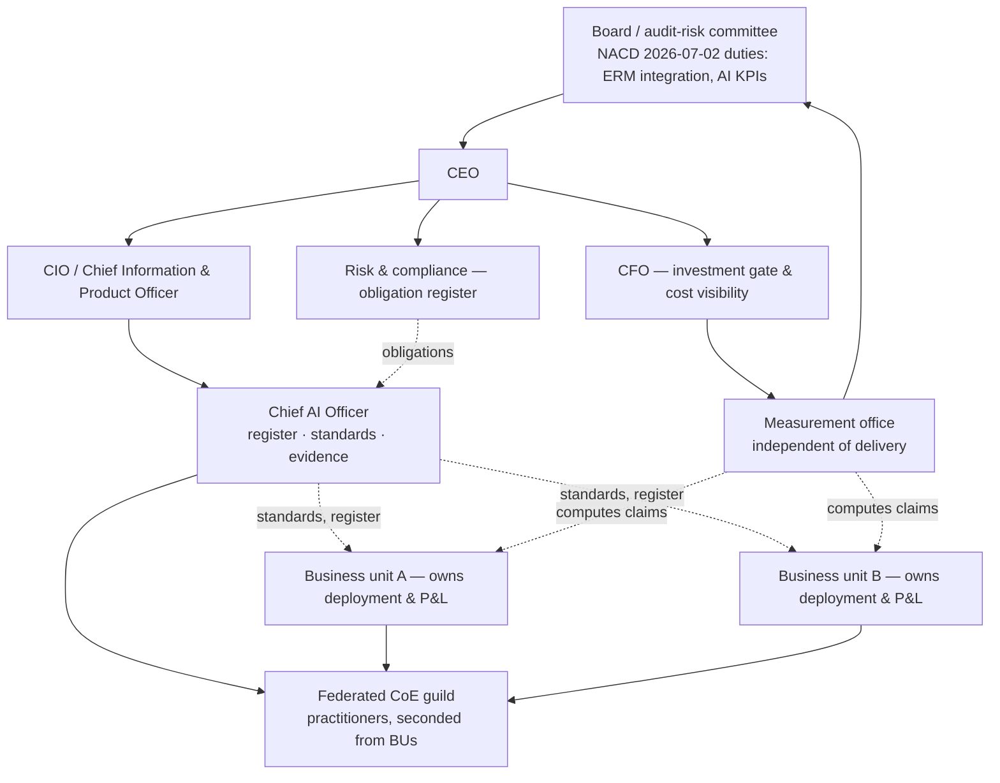
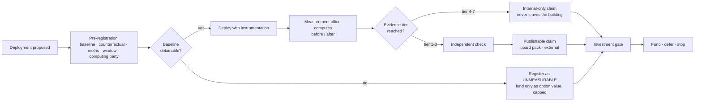
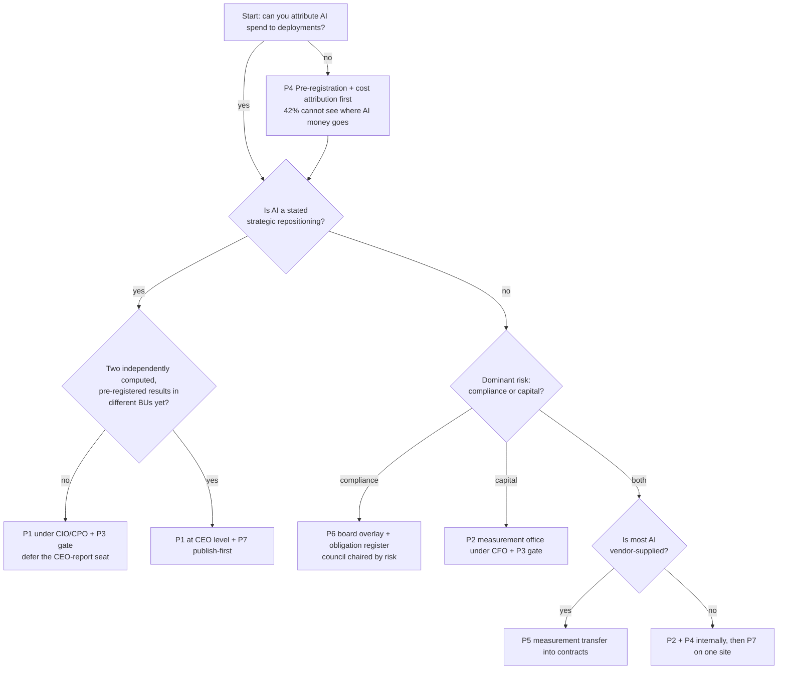

# AI Governance Before ROI — Operating-Model Design & Architecture

*A research-backed design for how an enterprise should structure AI accountability and measurement when governance capability is arriving years ahead of demonstrable ROI. Companion to the deep-dive page `ai-governance-before-roi`. Version 1.0, dated 2026-08-17. The SOTA window in §11 is 2026-06-17 → 2026-08-17.*

*The design problem here is not software. It is an operating model: who is accountable, to whom they report, what evidence they are allowed to accept, and what they are permitted to claim.*

---

## 0. How to read this document

This document was reasoned through a panel of five named personas. Their stakes drive the component decisions in §4–§8; when you see "Nadia requires X," that is the rationale, not decoration.

| Persona | Role | Stake (what they refuse to compromise) |
|---|---|---|
| **Chandra** | Chief AI Officer (newly appointed, reports into the CIO/CPO) | Someone is accountable within 90 days for a return nobody can yet measure — so the mandate must be *coordination and evidence*, not a promised number. |
| **Nadia** | CFO | No AI spend is defended on projected ROI. Every claim must survive the same scrutiny as a capex business case, or it is not a claim. |
| **Iman** | Data / measurement lead | Baselines exist *before* deployment. A number without a pre-registered counterfactual is an anecdote with decimal places. |
| **Ruth** | Risk / compliance lead | Obligations are tracked by statutory date and by *direction of travel*; a deferred deadline is not a cancelled one, and board-level duties bind regardless of statute. |
| **Bola** | Business-unit owner (operations) | Governance must not become a tax that converts a two-week pilot into a two-quarter approval cycle. Process ownership changes with the deployment or the deployment fails. |

**Decided / proposed / open.** Three grades run through the whole document.
- **[DECIDED]** — an observation traceable to the research files, dated and sourced in Appendix A. Not our opinion.
- **[PROPOSED]** — our own design recommendation. Argued, not evidenced. Every architectural element in §4–§8 is proposed unless marked otherwise.
- **[OPEN]** — a question the evidence cannot currently settle, carried explicitly rather than resolved by assertion.
- **[VENDOR-CLAIM]** — a figure self-reported by a party selling the thing being measured. Never load-bearing.

**Reading paths.** CEO/board: §0, §3, §9, §12. CFO and measurement leads: §1, §6, §7, Appendix A. A newly appointed CAIO writing a 90-day plan: §4, §5, §8, §12.2. Anyone about to put an AI ROI figure in a board deck: §7 first, then Appendix A, then reconsider.

**A warning about the title.** The thesis — governance arrives before ROI — is *weaker than it looks*. The single largest governance instrument in the world deferred its heaviest obligations by 16–24 months inside this research window [S12]. §9 attacks the thesis properly; §11 dates the damage. Read the title as a description of *what enterprises are doing*, not a claim that regulation is racing ahead.

---

## 1. Requirements

### 1.1 Functional — what an AI accountability and measurement function must do

- **F1 — Locate accountability.** Name one executive answerable for the enterprise's AI portfolio, with a published reporting line. The reporting line is itself a signal and must be a deliberate choice, not a residue of who had headcount.
- **F2 — Maintain the portfolio register.** Every AI deployment, its owner, its stage (pilot / production / retired), its claimed benefit, and the evidence tier of that claim (§7.1).
- **F3 — Pre-register measurement.** Before a deployment starts, record the baseline, the counterfactual, the metric, the measurement window and who will compute it. A deployment without pre-registration is admitted to the register as *unmeasurable* — which is a decision, not an omission.
- **F4 — Gate investment on evidence, not narrative.** Route funding decisions through the evidence ladder; refuse to fund continuation on projected ROI.
- **F5 — Adjudicate vendor claims.** One function decides what a vendor number means before it enters a board pack.
- **F6 — Track obligations.** Maintain the regulatory and board-governance obligation register by jurisdiction, statutory date, current date, and direction of travel (tightening / loosening).
- **F7 — Publish internally, and eventually externally.** Produce one audited, facility- or process-level before/after number. Fourteen runs of the source series found **no operator in the sector has published one** [S1] — which makes the first publisher the benchmark setter.
- **F8 — Manage the change load.** Gartner's own diagnosis of the gap is that **use cases proliferate faster than change-management capacity** [S4]. The function must therefore ration deployments against change capacity, not against model availability.

### 1.2 Non-functional — credibility, auditability, speed of decision

- **Credibility over completeness.** One defensible number beats twelve indicative ones. KPMG found leaders with strong AI cost visibility are **5x likelier** to report established ROI (15% vs 3%) [S6] — the constraint is measurement infrastructure, not model quality.
- **Auditability.** Any figure that reaches a board or an investor must be reconstructable from a stored baseline, a stored method, and a named computing party. If it cannot be reconstructed, it is a [VENDOR-CLAIM] regardless of who said it.
- **Speed of decision.** Bola's constraint. The gate must return a fund / defer / stop answer inside one planning cycle. A governance function that adds a quarter to every deployment will be routed around, and routed-around governance is worse than none because it removes the register's completeness.
- **Symmetry.** The standard applied to vendors must be applied to internal claims and to the function's own favourite numbers. §7.3 forces this.
- **Survivability of the role.** Lululemon's first Chief AI & Technology Officer exited after under a year, disclosed 2026-08-13 [S3]. Any design that depends on one incumbent's tenure is not a design.

### 1.3 Constraints

- **Regulatory timelines are moving, and mostly *later*.** EU AI Act Annex III high-risk obligations deferred to **2027-12-02** and Annex I embedded-product obligations to **2028-08-02** via the Digital Omnibus [S12]. What still bit on 2026-08-02: Article 50 transparency, Article 4 AI-literacy duty, GPAI enforcement powers, the penalty regime, and a new Article 5 prohibition [S12]. Texas TRAIGA live since 2026-01-01; Colorado's SB 24-205 replaced by the narrower SB 26-189 effective 2027-01-01 with enforcement **paused 2026-04-27**; US federal preemption remains a push, not law [S13][S14].
- **Existing org structures win.** Target's first CAIO reports to the **chief information and product officer**, not the CEO [S2]. Most enterprises have a CIO, a CDO and a CISO already holding adjacent mandates; a new function that does not compose with them will be starved.
- **Data availability is the binding constraint.** KPMG: **42% cannot see where AI money goes** [S6]. Pre-registration (F3) is impossible where cost attribution does not exist, so cost visibility is a *prerequisite*, not a deliverable.
- **The board layer is already committed.** NACD's *Director Essentials: Implementing AI Governance*, published **2026-07-02**, tells boards to fold AI risk into ERM rather than a silo, assess individual director AI competence, update committee charters, and set AI KPIs to track management accountability; **62%+ of directors now reserve full-board agenda time for AI** [S11]. The function will be asked for board-grade artefacts whether or not it has them.
- **Survey evidence is all there is.** Every leg of the measurement gap (§6.1) is a survey. The function must be designed to operate on weak evidence without pretending it is strong.

---

## 2. How the field currently tackles it

Five approach families, grounded in the appointments and structures observed in the research window.

**Family A — Standalone CAIO org reporting to CEO.**
*Shape.* A dedicated executive with own budget and staff, direct to the chief executive, owning strategy, standards and portfolio.
*Where observed.* Advisory sources (Hunt Scanlon, PwC leadership-center material, mid-2026) assert most CAIOs report to CEO or board — but **no rigorous in-window primary survey establishes the split**, so this is [OPEN] and no number is cited here [S5]. HSBC's David Rice and Bank of Ireland's Prag Sharma (role assumed October 2026) are in-window appointments whose lines are not reliably reported [S5].
*Wins when.* AI is a stated strategic repositioning, the CEO will spend political capital, and the enterprise has cross-BU AI with genuine conflicts to arbitrate.
*Breaks when.* There is no measurable return to defend the budget with — a direct-report seat with no P&L evidence is the most exposed job in the building. Lululemon's under-12-month CAIO tenure is the cautionary instance [S3].
*Maturity.* Emerging, and churn-prone.

**Family B — CAIO under CIO/CPO as execution coordination.**
*Shape.* AI leadership placed one level below the C-suite, inside the technology/product organisation, coordinating delivery rather than repositioning the company.
*Where observed.* **Target**, announced 2026-08-11: Chandhu Nair, SVP, first chief AI officer, effective 2026-08-24, previously 6+ years at Lowe's (most recently SVP of stores, data, AI and innovation), earlier Staples/Gap/Infosys; appointed alongside Purvi Shah as SVP of UX; **both report to chief information and product officer Prat Vemana** [S2].
*Wins when.* The bottleneck is delivery coordination and platform standardisation, and the honest answer to "what is the return" is "we do not know yet." The source series' read: this signals **execution coordination, not strategic repositioning — a maturity marker, and a more honest one than a standalone AI org** [S2, inference].
*Breaks when.* AI genuinely requires business-model change, or when the CIO's own agenda conflicts with an AI decision. The seat cannot arbitrate its own boss.
*Maturity.* Standard-ish and rising; the most defensible starting structure.

**Family C — Federated centre of excellence with BU ownership.**
*Shape.* A small central team owning standards, evaluation, the register and the evidence ladder; business units own deployments, budgets and outcomes.
*Where observed.* Not cleanly instanced by a named appointment in the research; it is the residual structure most large enterprises run before appointing anyone. Its evidence footprint is indirect: the source series records that **vendor-led builds succeed ~67% versus internal ~33%**, and that **88% of agent pilots never reach production** [S8] — both consistent with capability concentrated centrally and execution dispersed.
*Wins when.* The estate is genuinely heterogeneous, BUs have real P&Ls, and the central need is comparability rather than control.
*Breaks when.* The centre has standards but no gate. Federation without a funding gate produces a register nobody updates.
*Maturity.* Standard as a de-facto structure; rarely designed deliberately.

**Family D — Committee / council governance with no dedicated executive.**
*Shape.* A cross-functional AI council, usually chaired by risk, legal or the CIO, meeting monthly, with the board committee above it.
*Where observed.* This is the structure NACD's July 2, 2026 guidance effectively addresses — integrate AI into ERM, assign oversight in committee charters, assess director AI competence, set AI KPIs — with **62%+ of directors giving AI full-board agenda time** [S11]. Texas TRAIGA's deployer duties and NIST AI RMF safe harbour push in the same direction [S13].
*Wins when.* The dominant risk is compliance and reputational, the AI portfolio is small, and the enterprise is regulated.
*Breaks when.* Nobody's day job is the outcome. Councils are excellent at refusing things and structurally incapable of publishing a measured return.
*Maturity.* Standard, and the most common actual state.

**Family E — Finance-led AI investment gating.**
*Shape.* No new AI executive. The CFO's investment-committee machinery is extended: AI spend competes for capital, must carry a baseline and a measurement plan, and gets stage-gated.
*Where observed.* Implied rather than instanced. Its supporting evidence is the strongest in the corpus: **KPMG Q2 2026 — only 7% of leaders report established ROI, 24% face investor pressure to demonstrate value, average AI spend steady at ~$188M, 42% cannot see where AI money goes, and cost-visible leaders are 5x likelier to establish ROI** (2,000+ senior leaders, 20 countries, orgs >$50M revenue) [S6]. **Gartner, 2026-08-05: 55% of chief supply chain officers unclear on ROI while 67% of supply-chain digital investment is allocated to AI** [S4].
*Wins when.* The problem is genuinely that money is unattributable — which the evidence says it usually is.
*Breaks when.* Finance gates on the wrong horizon. AI benefits that are real but lagging (cycle-time, error-rate, retention) get starved by a gate tuned for 12-month payback, and Deloitte's finding that **66% report productivity/efficiency gains while only 20% are already growing revenue via AI against 74% aspiring** is exactly the shape a finance gate mis-reads [S9].

**Layering, not selection.** These families are not exclusive and the research does not support choosing one. Family E's cost visibility is a *prerequisite* for any of the others to produce a defensible number; Family D's board machinery is arriving regardless [S11]; Family B is the observed placement of the most recent real appointment [S2]. The recommended composite in §8.4 layers them.

---

## 3. Recommended approach (thesis, stated before critique)

**[PROPOSED] Appoint accountability for the *evidence*, not for the *return* — and put a measurement gate, not a measurement promise, at the centre of the operating model.**

Three moves:

1. **Separate the accountable executive from the promised number.** The CAIO's charter is: complete portfolio register, pre-registered measurement on every new deployment, one publish-quality audited before/after inside a year, and an obligation register that survives regulatory drift. It is explicitly *not* "deliver X% ROI." Chandra can be held to the first four. Nobody can currently be held to the fifth: fourteen runs of the source series found zero audited facility-level AI ROI from any operator in the sector [S1], and KPMG puts established ROI at 7% across 2,000+ leaders in 20 countries [S6]. A charter that promises what nobody has produced manufactures the Lululemon outcome [S3].

2. **Place the seat where the work is, then move it when there is evidence to move it on.** Start under the CIO/CPO — the Target placement [S2] — because at the current evidence level the job is coordination and instrumentation, both of which live in technology. Pre-commit the *trigger* for elevation to a CEO report: two independently computed, pre-registered, audited before/after results in different business units. This makes the org-chart question empirical rather than political.

3. **Gate on evidence tier, not on projected ROI.** Every funding decision cites the tier of evidence supporting it (§7.1). Continuation funding above a threshold requires a tier at or above *independently computed internal before/after*. Vendor-projected ROI is not a fundable tier — the source series' standing recommendation is to **avoid paying for AI on projected ROI in this sector and to structure contracts so the vendor carries the measurement burden** [S1]. Screening on **revealed preference — net dollar retention, of which HappyRobot's >150% (2026-08-04) is the recommended bar** — replaces screening on logos and pilot counts [S7], with the caveat that NDR tells you the *vendor's* customers keep buying, not that they earned a return [S7].

This thesis is attacked in §9, and one of the attacks lands hard.

## 4. Architecture of the operating model

Two structures, deliberately separate: an **accountability structure** (who decides) and a **measurement chain** (what a claim must pass through before anyone is allowed to say it). Keeping them separate is the whole design. Merging them is how the accountable executive ends up grading their own homework.

### 4.1 The accountability structure

Four load-bearing choices, all **[PROPOSED]**:

- **The CAIO sits under the CIO/CPO.** Mirrors the only fresh, well-sourced appointment in the window [S2]. Elevation is trigger-based (§3, move 2), not aspirational.
- **The measurement office reports to the CFO, not the CAIO.** The party that computes the return must not report to the party whose budget depends on it. This is the single most important line on the diagram.
- **Risk owns the obligation register, not the CAIO.** Obligations move independently of deployments and are already inside ERM per NACD [S11].
- **BUs own the P&L and therefore the process change.** The gap's most-cited structural explanation in the source series is that these deployments **require process ownership changes that pilots are structurally unable to make** [S8]. Central teams cannot make them.

### 4.2 The measurement chain

Every claim travels the same path. There are only three exits: **publishable**, **internal-only**, or **unmeasurable — and labelled as such**.

The chain's asymmetry is intentional: it is *easy* to be labelled unmeasurable and *hard* to be labelled publishable. Iman's requirement — a pre-registered counterfactual — is the gate at step B, and it is the only step that cannot be performed retroactively. Retro-fitted baselines are the mechanism by which most AI ROI claims become unfalsifiable.

---

## 5. Component deep-dive with persona rationale

**5.1 — The portfolio register (F2).** One row per deployment: owner, BU, stage, spend to date, claimed benefit, evidence tier, pre-registration status, obligation exposure.
> *Nadia (CFO):* "42% of leaders cannot see where AI money goes [S6]. I am not being asked to approve AI spend; I am being asked to approve spend I cannot locate. The register is not reporting overhead — it is the precondition for me having an opinion at all. And KPMG's own finding is that cost visibility is what separates the 15% from the 3% [S6]."

**5.2 — Pre-registration (F3).** Baseline, counterfactual, metric, window, computing party — recorded before go-live, immutable afterwards.
> *Iman (measurement lead):* "Six independent surveys agree that firms cannot demonstrate returns [S1]. Read that carefully — what converges is not a measured ROI *rate*, it is a consistent *inability to measure*. That is a design defect, and it is upstream of the model. If I do not have the before, there is no after. Everything else in this document is downstream of this component."

**5.3 — The measurement office (independent of delivery).** Small, CFO-reporting, computes claims for BUs rather than receiving them.
> *Nadia:* "If the team that shipped it also computes the benefit, I am reading a marketing document. Deloitte's 66%-report-gains against 20%-actually-growing-revenue [S9] is exactly what self-reported benefit looks like at scale."

**5.4 — The evidence ladder and the claim gate (§7.1).** One published ladder; every claim carries its rung.
> *Chandra (CAIO):* "My protection is the ladder. When a BU president wants a number in the earnings deck, I do not argue about the number — I state its rung. The rung is what my predecessor at another retailer did not have, and the role there lasted under a year [S3]."

**5.5 — The obligation register.** Instrument, jurisdiction, original date, current date, status, direction of travel, confidence.
> *Ruth (risk/compliance):* "The direction-of-travel column is why this is a register and not a checklist. Inside eight weeks the EU deferred Annex III high-risk duties to 2027-12-02 and Annex I to 2028-08-02 [S12], Colorado paused enforcement on 2026-04-27 and narrowed its statute [S14], and a US federal preemption push stayed live but unenacted [S13] — while Article 50 transparency, the Article 4 literacy duty, GPAI enforcement powers and the penalty regime all took effect on 2026-08-02 anyway [S12]. A register that only records dates would have told me nothing true."

**5.6 — The vendor-claim adjudication desk (F5).** One named person converts vendor figures into register entries with tiers attached.
> *Nadia:* "Google Cloud reports 74% of executives with agents in production achieved first-year ROI [S10, VENDOR-CLAIM]. Croud reports 69% of Americans open to AI purchasing [S16] and sells AI-commerce services. Checkout.com reports 63% want AI for discovery but **only 4% trust it at the payment stage** [S17] and sells agentic checkout. Every one of those is usable — as evidence about the *seller's* thesis. None of them is usable as an input to a capital decision. The desk exists so that distinction is made once, by someone, on the record."

**5.7 — The change-capacity ration (F8).** A hard cap on concurrent deployments per BU, set by available process-owner attention rather than by model availability.
> *Bola (BU owner):* "Gartner's diagnosis is that use cases proliferate faster than change-management capacity [S4], and the series' own line is that pilots are structurally unable to make the process-ownership changes these deployments need [S8]. My people are the change-management capacity. Ration me at three concurrent and I will finish three. Give me eleven and you will get eleven pilots and the 88%-never-reach-production statistic [S8]."

**5.8 — The publication commitment (F7).** A standing commitment to publish one audited before/after per year.
> *Chandra:* "The series has recorded fourteen runs with no operator publishing an audited facility-level return [S1]. Whoever publishes first sets the sector benchmark and gains the procurement leverage [S1]. That is the only asymmetric upside available to this function, and it costs one well-instrumented site."

## 6. The measurement problem

### 6.1 Six ways the adoption/realization gap has been observed

The source series established the adoption/realization gap six independent ways [S1]. All six are surveys. Reproduced with their provenance caveats attached, because the caveats are the finding:

| # | Source | Headline | Provenance caveat |
|---|---|---|---|
| 1 | Sage (retail/wholesale ops) | ~**10%** have AI live in workflows | Survey. Original survey date and URL not present in the source corpus — [OPEN] on primary citation |
| 2 | MIT Project NANDA | **95%** of GenAI pilots show zero P&L impact | Published **Aug 2025 — pre-window**; methodology publicly criticised; no 2026 update found. Directional only |
| 3 | JLL | **88%** piloting, **5%** hitting all AI goals | From the **2025-10-28** Global Real Estate Technology Survey — **pre-window; must never be date-stamped 2026** |
| 4 | Deloitte | **6%** see ROI under a year | The July monthly records **Capgemini's contradictory 70%** against it. These two cannot both sit inside a "six surveys agree" claim without the contradiction stated |
| 5 | Stord *State of AI in E-Commerce 2026* | adoption **78% (2024) → 88% (2025)**, only **7% fully scaled** | Vendor-published survey |
| 6 | Gartner, **2026-08-05** | **55%** of CSCOs unclear on AI ROI; **67%** of supply-chain digital investment allocated to AI | 394 professionals (Nov 2025–Feb 2026, orgs >$250M) + 135 senior executives (Jan–Apr 2026). In-window, primary, verified [S4] |

Two in-window reinforcements the series did not carry: **KPMG Global AI Pulse Q2 2026 — 7% established ROI, 24% under investor pressure to show value, 79% still calling AI a strategic priority (up from 74% in Q1), ~$188M average AI spend, 42% cannot see where AI money goes, cost-visible leaders 5x likelier to report established ROI** (2,000+ leaders, 20 countries) [S6]; and **Gartner via CX Dive, ~Aug 2026: only about one quarter of AI customer-service use cases produce ROI**, companion to its 2026-04-07 finding that only 28% of I&O AI projects deliver ROI [S15].

**[PROPOSED] The honest restatement.** What converges across these is *not* a measured ROI rate. It is a consistent, cross-industry, cross-methodology **inability to measure**. KPMG's cost-visibility finding is the strongest support for that reading: where firms can see the money, established-ROI reporting quintuples [S6]. That reframes the problem from "AI does not pay" to "enterprises have not built the instrumentation to know" — a materially different, and more actionable, diagnosis.

The gap's other face is **zero-disclosure capex**. FedEx committed to automated trailer load/unload across thousands of dock doors in 20+ US hubs with **no throughput, cost-per-trailer or injury-reduction figure**; Amazon will **more than double** its robotic-arm fleet in 2026 against **750,000+ robots touching >75% of orders**, with **nothing at facility level** [S1]. The series' read: either the internal numbers are strong and proprietary, or the decision is strategic/defensive — **the absence of data means neither can be asserted** [S1].

### 6.2 What a credible ROI claim requires

**[PROPOSED]** Five conditions, all necessary:

1. **A pre-registered baseline.** Recorded before deployment, from the same process, same season, same site class.
2. **A counterfactual.** A holdout site, a staggered rollout, or a documented pre-period with the confounders named. Absent this, you have a time series with an intervention drawn on it.
3. **A cost denominator that includes the invisible.** Model spend, integration, change management, and the process-owner attention consumed. With 42% unable to see where AI money goes [S6], most published denominators are wrong low.
4. **An independent computing party.** §4.1's measurement office. Not the delivery team, not the vendor.
5. **A stated scope of what it does *not* prove.** Every rung in §7.1 carries this column.

A claim missing any one of these is not a weaker ROI claim. It is a different kind of statement, and it belongs on a lower rung.

### 6.3 Leading vs lagging indicators

**[PROPOSED]** Because lagging financial indicators arrive after the political window closes, the function needs both — with explicit rules about which may be *claimed*.

| | Leading (may be *tracked* and reported as leading) | Lagging (the only class that may be *claimed* as ROI) |
|---|---|---|
| Adoption | weekly active users of the deployment; share of eligible transactions touched | headcount redeployed, not "hours saved" |
| Quality | override/correction rate; error rate against a held-out sample | rework cost, claim leakage, chargebacks |
| Throughput | cycle time per case; queue depth | cost per unit of output, facility-level |
| Commercial | pipeline touched by the deployment | revenue attributable under a holdout design |
| Health | pilots reaching production (against the ~12% base rate implied by "88% never reach production" [S8]) | portfolio-level cost-to-serve |

The failure mode this table prevents is the most common one in the corpus: reporting a leading indicator with a currency sign in front of it. "Hours saved × loaded hourly rate" is a leading indicator wearing a lagging costume; it becomes real only when the hours leave the cost base.

### 6.4 Revealed preference beats surveys

Every leg of §6.1 is stated preference. The corpus contains one class of evidence that is not, and the series names it explicitly: **HappyRobot's net dollar retention above 150%**, disclosed 2026-08-04 alongside a **$150M Series C at $1.2B post-money** led by Prysm Capital, co-led by Eurazeo, ~$200M raised across three rounds in 20 months, 5x growth since the late-2025 Series B, and 150+ enterprise customers including DHL, Uber Freight, Kuehne+Nagel and LKW WALTER [S7]. The series' framing: "the single strongest indirect evidence in this series remains HappyRobot's >150% net dollar retention — **revealed preference, not a survey** — and it is still the recommended screening metric for this category" [S7].

**And the caveat is not optional.** The same source carries it: *still no customer-side cost-per-call or headcount disclosure; it does not tell us the customers' ROI* [S7]. NDR proves that buyers expanded spend. Buyers expand spend for reasons including sunk cost, strategic hedging and executive commitment. It is the best available signal and it is still one rung below an audit.

**[PROPOSED] Other revealed-preference metrics worth the same treatment:** contracted multi-year revenue (Symbotic's Walmart commitment — **42 DCs by 2030** [S18]); renewal at unchanged or increased scope after a leadership change on the buyer side; and internal analogues — repeat funding requests from a BU that has *already* been measured, and voluntary adoption where an opt-out exists.

---

## 7. Data, evidence discipline and governance

### 7.1 Evidence tiers

**[PROPOSED]** Seven rungs. Every register entry, board slide and procurement decision cites one. The ladder's most important property is that **rung 1 is currently empty**.

| Rung | Tier | Instances in the corpus | What it does *not* tell you |
|---|---|---|---|
| **1** | Audited facility- or process-level before/after | **None. Vacant across 14 runs of the series** [S1] | — |
| **2** | Contracted multi-year revenue | Symbotic — 42 Walmart DCs by 2030 [S18] | Whether the buyer earns a return |
| **3** | Net dollar retention (revealed preference) | HappyRobot >150%, 2026-08-04 [S7] | The customers' ROI. Vendor-disclosed |
| **4** | Deployment scale | FedEx/Dexterity multi-hub; Amazon 750,000+ robots, >75% of orders [S1] | Unit economics of any kind |
| **5** | Independent survey | Gartner 2026-08-05 [S4]; KPMG Q2 2026 [S6] | Realized ROI. Sentiment and budget allocation only |
| **6** | Stated intent / self-report | Croud 69% [S16]; Stord [S1]; Sage [S1]; Deloitte's 66%-report-gains [S9] | Behaviour, and certainly not money |
| **7** | Projection, award, vendor claim | Google Cloud 74% [S10]; the "$1T agentic commerce by 2030" and "$20.9B 2026 retail spend" figures [S19]; Exiger's SupplyChainBrain award, 2026-08-10 [S1] | Anything |

**[PROPOSED] The bifurcation rule.** The series observed that the market has split by *what gets measured*: vendors touching **money movement** can show retention and recovery; vendors touching **physical throughput** show deployment counts; vendors touching **decision support** show nothing at all — **buy in that order until someone publishes an audit** [S1]. Use this as the default procurement ordering.

### 7.2 What counts as audited

**[PROPOSED]** "Audited" is reserved. It requires all five §6.2 conditions **plus**: a computing party independent of both delivery and vendor; a method document retained and re-runnable; and an internal-audit or external-assurance sign-off on the *method*, not merely the arithmetic. An award is not an audit — the series flags Exiger's 2026 Great Supply Chain Partner recognition (2026-08-10) as "a **trade-press award, not a result** — included for completeness, excluded from any ROI conclusion" [S1]. A funding round is not an audit. A press release with a percentage in it is a rung-7 artefact regardless of the percentage.

The standing "still owed" ledger from the series is the practical test of this discipline: Altana/Cervo operating metrics (entries-per-hour, error rate, PGA classification accuracy) owed for four runs; Agility Robotics' audited S-4 owed five; returns-fraud AI accuracy *and* false-positive rates owed twelve; Stord/Wiliot facility-level audited ROI owed thirteen; and **any audited facility-level AI ROI from any operator, owed fourteen** [S1]. A governance function that does not maintain its own version of this ledger will quietly accept substitutes.

### 7.3 Handling vendor claims

**[PROPOSED]** Four rules, applied symmetrically to our own favourite numbers:

1. **Label at intake.** Every externally sourced figure enters the register with `[VENDOR-CLAIM]` or not, decided once by the §5.6 desk.
2. **Name the seller's interest, in writing, next to the figure.** Croud is a digital-marketing agency selling AI-commerce services [S16]; Checkout.com is a payments processor selling agentic checkout [S17]; Salesforce's ~200% agentic-search traffic growth comes from the company selling Agentforce [S20]; Google Cloud's 74% first-year-ROI figure comes from the company selling the agents [S10]. The interest does not invalidate the figure. Concealing it invalidates the analyst.
3. **Prefer the seller's *inconvenient* number.** Checkout.com's own data — 63% want AI for discovery but **only 4% trust it at the payment stage**, 42% fear losing control of what an agent buys, 28% cite decision opacity [S17] — is worth more than Croud's headline precisely because it cuts against its publisher's pitch.
4. **Apply the ladder to ourselves.** HappyRobot's >150% NDR is this document's best number and it is a **vendor disclosure on rung 3** [S7]. Stating that is the test of whether the discipline is real.

**Contract consequence.** The series' standing recommendation is to structure contracts so the **vendor carries the measurement burden** [S1]: baseline capture as a deliverable, a named metric, a holdout or staged rollout written into the SOW, and payment tranches tied to the measured result rather than to milestones. Nadia's version: if the vendor will not accept measurement risk on a claim, the claim was rung 7.

## 8. Design patterns and comparison

### 8.1 The patterns

**[PROPOSED]** Seven named patterns. Each is a way of arranging accountability and measurement, not a technology choice.

- **P1 — Executive Anchor.** One accountable AI executive, reporting line chosen deliberately, charter written against *evidence deliverables* rather than a return. Instanced by Target's CIO/CPO placement [S2].
- **P2 — Independent Measurement Office.** A small CFO-reporting team that computes benefit claims for BUs. The counterweight to P1.
- **P3 — Evidence Ladder Gate.** The §7.1 ladder wired into the funding process: no rung, no money above a threshold.
- **P4 — Pre-Registration Discipline.** Baseline/counterfactual/metric/window/party recorded before go-live, immutable after. Cheapest pattern here and the highest leverage.
- **P5 — Vendor Measurement Transfer.** Push measurement obligations into the contract; tranche payment against measured results [S1].
- **P6 — Board Governance Overlay.** AI folded into ERM, committee charters updated, director AI competence assessed, AI KPIs set — NACD's 2026-07-02 prescription, already live for 62%+ of boards [S11].
- **P7 — Publish-First Benchmark Play.** Instrument one site or process to publish-quality standard and publish it, taking the sector-benchmark and procurement-leverage position [S1].

### 8.2 Comparison matrix

| Pattern | Build complexity | Time to first signal | Credibility of output | Political cost | Characteristic failure mode |
|---|---|---|---|---|---|
| **P1 Executive Anchor** | Medium (headcount, charter, mandate negotiation) | 90 days (register, not results) | Low on its own — a role is not evidence | **High** — the seat displaces existing mandates | Governance theatre; incumbent churns before results, as at Lululemon [S3] |
| **P2 Measurement Office** | Medium (2–4 people, data access) | 1–2 quarters | **High** — independence is the credibility | Medium — delivery teams resent being graded | Becomes a reporting bureau; measures what is easy, not what matters |
| **P3 Evidence Ladder Gate** | Low (a policy and a template) | Immediate on the next decision | Medium — credible only if enforced once against a favoured project | Medium-high at first enforcement | Ladder published, exceptions granted, ladder dead |
| **P4 Pre-Registration** | **Low** | Immediate (but results lag one deployment cycle) | **High** — it is what makes rungs 1–3 reachable | **Low** | Retro-fitted baselines; a "pre-registration" written the week before the readout |
| **P5 Vendor Measurement Transfer** | Medium (legal + procurement change) | One contract cycle | Medium-high, and it moves risk off the buyer | Low internally, **high with vendors** | Vendors decline, or accept and define the metric to be trivially met |
| **P6 Board Overlay** | Low-medium (charters, agenda time) | One board cycle | Medium — procedural credibility, not economic | Low — boards are already asking [S11] | Compliance artefacts accumulate; no deployment changes |
| **P7 Publish-First** | **High** (one site instrumented to audit standard) | 2–4 quarters | **Highest available — this is rung 1** [S1] | **High** — you may publish a bad number | The number comes out weak and cannot be unpublished |

### 8.3 Which pattern when

### 8.4 The recommended composite

**[PROPOSED] P4 + P3 + P2, then P1, with P6 running in parallel and P7 as the year-one ambition. P5 on every renewal.**

Sequenced deliberately:

1. **P4 first, always.** It is nearly free, it is the only step that cannot be done retroactively, and without it every later pattern computes on sand.
2. **P3 next**, because a gate without a ladder is a queue, and a ladder without a gate is a poster.
3. **P2 within two quarters**, reporting to the CFO. Independence is what converts P4's baselines into a claim anyone outside the building will believe.
4. **P1 once there is a register worth owning.** Appointing the executive *before* the machinery exists produces a person accountable for a number that does not exist — the structural setup behind CAIO churn [S3].
5. **P6 in parallel**, because it is arriving regardless [S11] and costs little to align with.
6. **P7 as the single asymmetric bet.** One site, instrumented to audit standard, published. Fourteen runs and rung 1 is still vacant [S1]; the first publisher takes the benchmark and the procurement leverage.
7. **P5 at every contract renewal**, no exceptions, because it is the only pattern that transfers measurement cost off the buyer.

What the composite deliberately does **not** do: promise a return, create a standalone AI org, or set an ROI target for the CAIO.

## 9. Red-team — attacking our own recommendation

**C1 — The premise is partly false: governance did not arrive first; it slipped.** The strongest counter-evidence in the corpus is regulatory. **2026-08-02** was the EU AI Act's largest scheduled milestone, and the Digital Omnibus moved Annex III high-risk obligations to **2027-12-02** and Annex I embedded-product obligations to **2028-08-02** — a slip of **16–24 months**, driven in part by competitiveness and ROI pressure making full enforcement untenable [S12]. **Colorado paused enforcement on 2026-04-27** and replaced SB 24-205 with the narrower SB 26-189, effective 2027-01-01 [S14]. The **US federal preemption push** — the 2025-12-11 executive order and the 2026-03-20 National Policy Framework for AI — actively works to *reduce* governance load, though it remains a push and not law [S13]. If the world's heaviest AI regime blinks on its own deadline while ROI stays unproven, the honest reading is not "governance arrives before ROI." It is **"both are late, and governance is arriving unevenly — faster inside the boardroom than inside the statute book."** This document's title is a description of enterprise behaviour, not of regulatory reality, and §11 keeps it that way.

**C2 — The recommendation may be governance theatre with better paperwork.** P1 without results is a role; P6 without deployment change is a charter update. Lululemon's first Chief AI & Technology Officer left after under a year, disclosed 2026-08-13, weeks before an incoming CEO, with analysts flagging executive turnover [S3]. The composite could produce a register, a ladder, a board agenda item and zero change in what the enterprise actually does.

**C3 — "Nobody can measure it" may be measurement immaturity, not absent value.** Deloitte: **66% report productivity/efficiency gains** even as only 20% grow revenue via AI against 74% aspiring [S9]. KPMG: cost-visible leaders are **5x likelier** to report established ROI [S6]. Google Cloud claims **74%** of executives with agents in production achieved first-year ROI [S10, VENDOR-CLAIM]. If value is real and only the instrumentation is missing, a design that gates hard on evidence will starve genuinely good deployments — and Bola will route around it.

**C4 — The six-survey convergence is weaker than it is presented.** JLL is **2025-10-28**, pre-window, and must never be date-stamped 2026 [S1]. MIT NANDA is **Aug 2025**, methodologically criticised, with no 2026 update [S1]. **Capgemini's 70% directly contradicts Deloitte's 6%** and cannot sit silently inside a convergence claim [S1]. Sage, MIT and JLL have **no primary URLs in the source corpus** [S1]. Six surveys that mostly agree because they are the same weak instrument pointed at the same anxious population is not six confirmations — and this document leans on that convergence in §1 and §6.

**C5 — The independent measurement office is politically unstable.** A CFO-reporting team that grades the CIO's and CAIO's work is the first thing cut in a cost round, and the second thing captured. The design assumes an independence that no org chart enforces.

**C6 — Rung 1 may be empty for a good reason.** The corpus's own inference on zero-disclosure capex applies to us: when FedEx commits across 20+ hubs and Amazon more than doubles its arm fleet with no facility-level figures [S1], either the numbers are strong and proprietary or the decision is strategic. **P7 (publish-first) asks an enterprise to surrender proprietary information for a benchmark position** — a trade most CFOs will refuse, and Nadia would be right to.

**C7 — NDR is a vendor-health metric wearing a customer-value costume.** HappyRobot's >150% is disclosed by HappyRobot, in a fundraising context, with **no customer-side cost-per-call or headcount disclosure** [S7]. Expansion spend is consistent with real value *and* with sunk-cost commitment. Elevating it to rung 3 — above independent surveys — is a judgement call this document makes and cannot prove.

**C8 — Pre-registration assumes a stable target.** AI deployments change scope monthly. A baseline registered against a scope that no longer exists is worse than none, because it looks rigorous. The corpus offers no evidence on how often pre-registered AI measurement survives scope drift — [OPEN].

**C9 — The change-capacity ration is unfalsifiable as specified.** "Three concurrent per BU" has no evidential basis; it is a plausible number, not a measured one. The only supporting data are Gartner's qualitative diagnosis [S4] and the 88%-never-reach-production figure [S8].

**C10 — Consumer-side evidence undercuts the demand case entirely.** Croud's 69% openness [S16] sits against Checkout.com's **4% trust at the payment stage** [S17], Stord's **30% who would never allow AI to handle shopping or payment data** [S1], and the series' 44%-trust-AI-tools against 59%-trust-friends-and-family with **35% demanding human review** [S1]. If demand for agentic capability is this shallow at the money moment, a governance apparatus built for scale may be over-built for the actual volume.

---

## 10. Closing the gaps — what each critique changes

| Critique | What it changes |
|---|---|
| **C1** | The thesis is downgraded and restated in §0 and §11: governance is arriving **unevenly**, faster in boardrooms [S11] than in statute [S12][S14]. The obligation register (§5.5) gains a mandatory **direction-of-travel** column, and the design must survive deadlines moving *later*, which is the harder case: a deferred obligation removes the external forcing function that was doing the CAIO's political work. **P6 must therefore not be the primary justification for the function.** |
| **C2** | P1 is explicitly sequenced **fourth**, after P4/P3/P2 (§8.4). The CAIO charter is rewritten around evidence deliverables (§3, move 1) so the role has something falsifiable to be judged on inside 90 days. |
| **C3** | Adds a **capped option-value lane** to the measurement chain (§4.2, exit X): unmeasurable deployments can still be funded, at a capped amount, labelled honestly. The gate rejects *claims*, not *experiments*. Cost visibility is promoted to a prerequisite in §1.3 rather than an output. |
| **C4** | §6.1 is rewritten as a provenance table with pre-window flags and the Capgemini contradiction shown, not smoothed. The Sage/MIT/JLL citation gaps are recorded as [OPEN] in Appendix A rather than papered over. No "six independent confirmations" phrasing is used as load-bearing support. |
| **C5** | Independence is made structural rather than cultural: the measurement office's method documents are retained by internal audit (§7.2), so a disbanded office leaves an auditable trail. Accepted as a **residual risk**; no org chart fixes it. |
| **C6** | P7 is narrowed to **one site or process**, chosen for benchmark value rather than competitive sensitivity, with the published artefact being the *method plus the delta*, not absolute unit costs. This preserves most of the benchmark position at much lower disclosure cost. |
| **C7** | Rung 3 keeps NDR but the ladder's "does not tell you" column is made mandatory and rung 3's reads **"not the customers' ROI"** [S7]. §7.3 rule 4 forces the same label on our own best number. |
| **C8** | Pre-registration gains an **amendment log**: scope changes are recorded with dates and rationale, and a deployment whose scope changed materially reports as *re-baselined*, with the original baseline retained. Carried as [OPEN] on how often this survives contact. |
| **C9** | The ration is restated as **[PROPOSED], unevidenced** — a starting parameter to be calibrated from the enterprise's own pilot-to-production rate, not a finding. |
| **C10** | Adds a sizing discipline: governance apparatus scales with **deployed** volume, not with projected agentic-commerce TAM. The $1T-by-2030 and $20.9B-2026 figures are rung 7 and may not be used to size the function [S19]. |

---

## 11. State of the art refresh (2026-06-17 → 2026-08-17)

As of **2026-08-17**. Date-stamped; pre-window items flagged as such.

**Appointments and exits.**
- **2026-08-11** — Target names **Chandhu Nair** SVP and first chief AI officer, effective **2026-08-24**; alongside Purvi Shah as SVP of UX; both under chief information and product officer Prat Vemana. Framed as part of Target's turnaround. HIGH confidence [S2].
- **2026-08-13** — **Lululemon's Ranju Das**, first Chief AI & Technology Officer, departs after under a year (started Sept 2025), disclosed via filing and confirmed by a spokesperson; lands weeks before incoming CEO Heidi O'Neill starts in September. HIGH confidence [S3].
- In-window, MEDIUM confidence: **Bank of Ireland** — Prag Sharma, CAIO, role assumed October 2026. Context only (pre-window or unconfirmed): **HSBC** — David Rice, first CAIO; **Lloyds** — Sameer Gupta, Chief Data and AI Officer (April 2026); **Orange** — Usman Javaid reported for September 2026 (LOW confidence on date) [S5].
- A circulating claim that **76% of organizations globally now have a CAIO, up from 26% a year prior** (July 2026) is **LOW confidence, unverified provenance — not used in this document** [S5].

**Measurement.**
- **2026-08-05** — Gartner: 55% of CSCOs unclear on AI ROI; 67% of supply-chain digital investment allocated to AI. Primary, verified [S4].
- **~July 2026** — KPMG Global AI Pulse Q2 2026: 7% established ROI; 24% under investor pressure; 79% strategic priority (up from 74%); ~$188M average spend; 42% lack cost visibility; 5x ROI likelihood with cost visibility [S6].
- **~Aug 2026** — Gartner via CX Dive: ~one quarter of AI customer-service use cases produce ROI; companion to the 2026-04-07 finding that 28% of I&O AI projects deliver ROI (pre-window) [S15].
- **2026-08-04** — HappyRobot $150M Series C at $1.2B post, NDR >150% [S7].
- Weak/secondary: analyses of 2026 earnings seasons suggesting **~11% of companies quantified AI productivity gains on Q1 2026 calls and ~2% quantified AI impact on earnings** — MEDIUM/LOW provenance, direction only [S21].

**Regulation and board governance.**
- **2026-08-02** — EU AI Act milestone: Article 50 transparency, Article 4 AI literacy, GPAI enforcement powers, penalty regime, and a new Article 5 prohibition on AI-generated NCII/CSAM took effect [S12].
- **Digital Omnibus** — Annex III high-risk duties deferred to **2027-12-02**, Annex I to **2028-08-02**; several trackers give an in-force date of **2026-07-27**, MEDIUM confidence, unverified against the Official Journal [S12]. **[OPEN]**
- **2026-04-27** — Colorado enforcement paused; SB 26-189 replaces SB 24-205 effective 2027-01-01 [S14].
- Through the window — no US federal AI statute; preemption remains a push, with ~13 tracked state AI laws still enforceable; **Texas TRAIGA** live since 2026-01-01 with NIST AI RMF safe harbour [S13].
- **2026-07-02** — **NACD *Director Essentials: Implementing AI Governance***: ERM integration, director AI-competence assessment, committee-charter updates, AI KPIs; **62%+ of directors reserve full-board agenda time for AI** [S11]. This is the cleanest single artefact supporting the thesis — board machinery codified in the same quarter KPMG measured 7% established ROI.
- **August 2026** — OSHA renewed the warehousing/DC National Emphasis Program, extending it **from 3 to 5 years** — governance tightening on the physical-automation side [S1].

**Protocol / integration standardisation (a governance artefact preceding proven returns).**
- **2026-07-28** — MCP specification `2026-07-28` shipped: stateless core over plain HTTP, MCP Apps (server-rendered UIs), a Tasks extension for long-running work, and authorization aligned with **OAuth 2.1 / OpenID Connect** — the change enterprise security teams were waiting for [S22].
- **2026-07-23** — GitHub MCP Server announces support for the new spec [S22].
- **2026-07-14** — 6sense MCP Server in **open beta** (account insights, predictive buying stages, 6QA status, keyword intent, ad performance, callable from Claude, ChatGPT, Writer, Agentforce); **GA folded into its Summer 2026 release announced 2026-08-10** — note the Aug 10 release does not use the literal phrase "general availability" [S23]. Earlier/adjacent: ZoomInfo GTM.AI GA 2026-06-01 with an MCP endpoint and a Claude connector on 2026-06-05; Clari + Salesloft's joint Forecasting Execution MCP Server (April 2026, pre-window) [S23].

**Consumer trust.**
- **2026-08-11** — Croud Consumer Index: 69% of Americans open to AI purchasing without approval in at least one category; ~75% would use AI instant checkout in at least one category; 73% of AI users research via LLMs before choosing a brand; half comfortable across 3+ categories; 2,000+ US consumers. Agency-published [S16].
- The series' companion Croud figures — 44% trust AI tools vs 59% friends/family, 35% want human review, delegation concentrated in groceries (41%) and household supplies (31%) [S1]. **[OPEN]: whether these are the same release as the SOTA brief's Croud summary is unresolved.**
- Checkout.com *Agentic Commerce 2026*: 63% want AI for discovery, **4% trust it at the payment stage**, 42% fear losing control, 28% cite decision opacity, 33% expect ≥10% of purchases AI-driven within a year, 15% would delegate the weekly food shop [S17, VENDOR-CLAIM].
- Salesforce: agentic/AI-chat-originated shopping traffic up ~200% (1.5B shoppers Q1 2024–Q1 2026 plus 4,689 consumers surveyed 2026-05-12→18) [S20, VENDOR-CLAIM].

**Net effect on the thesis.** Reinforced on the enterprise and board side (Target, NACD, KPMG, Gartner, MCP). **Damaged on the statutory side** (Omnibus deferral, Colorado pause, preemption push). Net: the thesis holds for *organisational* governance and fails for *regulatory* governance, and this document says so rather than choosing the flattering half.

---

## 12. Final recommendation and honest scope

### 12.1 The recommendation

Appoint accountability for **evidence**, not for **return**. Run the §8.4 composite: **P4 pre-registration → P3 evidence-ladder gate → P2 independent measurement office under the CFO → P1 executive anchor under the CIO/CPO**, with **P6 board overlay** in parallel and **P5 vendor measurement transfer** on every renewal. Make **P7 publish-first** the single asymmetric year-one bet: one site or process, instrumented to audit standard, method and delta published.

Do not set an ROI target for the AI executive. Do not fund continuation on projected ROI. Do not let a role announcement substitute for a measurement chain.

### 12.2 What 90 / 180 / 365 days realistically buys

**First 90 days — inventory and instrumentation. No returns.**
- A complete portfolio register (F2) and an honest count of how many deployments *could* be measured retroactively. Expect the answer to be near zero.
- Pre-registration mandatory for every deployment starting after day 30 (P4).
- The evidence ladder published, and enforced once, visibly, against a favoured project (P3). If it is never enforced in the first 90 days it will never be enforced.
- The obligation register standing up with direction-of-travel columns (F6), seeded from §11.
- **What you will not have:** a return. Anyone promising one at day 90 is describing a leading indicator with a currency sign in front of it (§6.3).

**By 180 days — the first defensible internal numbers.**
- The measurement office operating (P2), with two to four deployments carrying pre-registered baselines maturing.
- Cost attribution good enough to answer "where does AI money go" — the constraint 42% of leaders currently fail [S6], and the one KPMG associates with a 5x difference in established-ROI reporting.
- Vendor measurement transfer live on renewals (P5); expect at least one vendor to refuse, which is itself a rung-7 diagnosis.
- Realistically: **one or two internal-only claims at rung 5–6**, plus a clear list of which deployments are honestly unmeasurable.

**By 365 days — one publishable result, or a documented reason there is none.**
- One audited, pre-registered before/after on a single site or process (P7). If rung 1 is reached, it is plausibly the sector's first [S1].
- Board-grade artefacts satisfying NACD's prescription [S11] as a by-product rather than as a separate workstream.
- The elevation trigger tested: two independently computed, pre-registered results in different BUs would justify moving the seat to a CEO report. Most enterprises will not reach it in year one, and that is the honest expectation.
- **What 365 days does not buy:** portfolio-level AI ROI. Nobody in the corpus has it.

### 12.3 Honest scope

- **This is an operating-model design, not a technology architecture.** No component here makes an AI system work better. The claim is narrower: it makes claims about AI systems survivable.
- **The evidence base is almost entirely surveys**, several pre-window, one pair internally contradictory (Capgemini 70% vs Deloitte 6%), three (Sage, MIT, JLL) without primary citations in the corpus [S1]. C4 stands.
- **The thesis is weaker than the title.** Governance is arriving unevenly: boardrooms hardened in July 2026 [S11] while the EU's hardest obligations slipped 16–24 months [S12] and Colorado paused enforcement [S14]. Anyone using "governance arrives before ROI" as a reason to build governance capability should know the regulatory forcing function partially withdrew inside the same eight weeks.
- **The best number in this document is a vendor disclosure.** HappyRobot's >150% NDR [S7] is rung 3, self-reported, and silent on customer ROI.
- **The recommendation is unproven.** No enterprise in the corpus has run this composite. It is a design argued from failure modes, not a pattern validated by outcomes. Treat every [PROPOSED] element accordingly.

## Appendix A — Source ledger

Every non-trivial claim in this document, its source, date and our confidence. `V` = vendor/seller-interested figure. Confidence is ours, not the source's.

| ID | Claim | Source | Date | Conf. | Notes |
|---|---|---|---|---|---|
| **S1** | Fourteen weekly runs, universal adoption, **zero audited facility-level AI ROI** from any operator; six-survey gap (Sage ~10% live; MIT 95% no P&L; JLL 88%/5%; Stord 88%/7%; Deloitte 6%; Gartner 55%/67%); Capgemini's contradictory 70%; zero-disclosure capex (FedEx 20+ hubs, Amazon 750k+ robots / >75% of orders / fleet doubling in 2026); the bifurcation-by-what-gets-measured read; the "still owed" ledger; the AVOID-projected-ROI and vendor-carries-measurement recommendations; Exiger award as "not a result" (2026-08-10); OSHA NEP 3→5 years; Croud 44%/59%/35%/41%/31%; Stord 30% hard refusal | *Industry weekly deep dive* Run #14, with legs traced to Runs #12, #13 and the July 2026 monthly | 2026-08-15 (Run #14) | High on the series' own statements; **Medium-Low on the survey legs themselves** | Sage / MIT / JLL / Deloitte-Capgemini carry **no primary URLs in the corpus — [OPEN]**. MIT is Aug 2025, JLL is 2025-10-28: both **pre-window** |
| **S2** | Target names Chandhu Nair SVP and first CAIO, announced 2026-08-11, effective 2026-08-24; 6+ yrs Lowe's (SVP stores/data/AI/innovation), earlier Staples/Gap/Infosys; Purvi Shah SVP UX; both report to CIO/CPO Prat Vemana; read as execution coordination not repositioning | CNBC; Target corporate; CIO Dive / Retail Dive | 2026-08-11 | **High** on the appointment; the coordination-vs-repositioning read is an **inference** | Corpus notes coverage does not report a direct-to-CEO seat |
| **S3** | Ranju Das, Lululemon's first Chief AI & Technology Officer, departs after <1 year (started Sept 2025), disclosed 2026-08-13; incoming CEO Heidi O'Neill starts September; analysts flag executive turnover | Bloomberg; Retail Dive; Business of Fashion | 2026-08-13 | **High** | The corpus's cleanest evidence that the governance *role* is churn-prone |
| **S4** | 55% of chief supply chain officers unclear on AI ROI; 67% of supply-chain digital investment allocated to AI. Fieldwork: 394 professionals Nov 2025–Feb 2026 (orgs >$250M) + 135 senior executives Jan–Apr 2026. Diagnosis: use cases proliferate faster than change-management capacity | Gartner press release (primary) | **2026-08-05** | **High — verified** | Sentiment + budget allocation, **not realized ROI** |
| **S5** | CAIO appointment landscape: Bank of Ireland (Prag Sharma, Oct 2026), HSBC (David Rice), Lloyds (Sameer Gupta, Apr 2026, pre-window), Orange (Usman Javaid, Sept 2026); "record pace" of Fortune 500 CAIO creation; **no rigorous in-window survey on CEO-vs-CIO reporting split**; circulating "76% have a CAIO" claim | FinTech Magazine; HSBC media release; Hunt Scanlon / PwC advisory material | Jun–Aug 2026 | **Medium**; Orange **Low**; the 76% figure **Low — not used** | Reporting-split assertion deliberately **not** cited as a number |
| **S6** | KPMG Global AI Pulse Q2 2026: 7% established ROI; 24% investor pressure; 79% strategic priority (from 74%); ~$188M average spend; 42% lack cost visibility; cost-visible leaders 5x likelier (15% vs 3%). 2,000+ leaders, 20 countries, orgs >$50M | KPMG, via CIO.com / Techstrong.ai / UC Today | ~Jul 2026 | **High** | The single most decision-relevant in-window survey for §1.3 and §12.2 |
| **S7** | HappyRobot: $150M Series C at $1.2B post (Prysm lead, Eurazeo co-lead, a16z/YC/Koch/WaVe-X returning); ~$200M across three rounds in 20 months; 5x growth since late-2025 Series B; 150+ enterprise customers incl. DHL, Uber Freight, Kuehne+Nagel, LKW WALTER; **NDR >150%**; no customer-side cost-per-call or headcount disclosure | Round coverage via the series (Run #13, carried in Run #14) | **2026-08-04** | **Medium-High** on the disclosure; **Low** as evidence of customer ROI | **V** — vendor-disclosed. Rung 3. Explicitly does not establish customers' ROI |
| **S8** | Vendor-led builds succeed ~67% vs internal ~33%; **88% of agent pilots never reach production**; the process-ownership-change explanation of the gap | Series builder note (Run #13) and convergence inference (2026-08-01 weekly / July monthly) | Aug 2026 | **Medium** | Underlying study not named in the corpus — **[OPEN]** |
| **S9** | Deloitte *State of AI in the Enterprise* (2026 edition): 3,235 leaders; 66% report productivity/efficiency gains; **20% already growing revenue via AI vs 74% aspiring** | Deloitte | Published 2026; **fieldwork Aug–Sep 2025** | **High** on existence; pre-window fieldwork | Context, not an in-window datapoint |
| **S10** | Google Cloud *ROI of AI*: 74% of executives with AI agents in production achieved ROI within the first year | Google Cloud | 2026 | **Low** as evidence | **V** — self-interested sample and ROI definition. Rung 7. Strongest single [CONTRA] to the low-ROI narrative if credited |
| **S11** | NACD *Director Essentials: Implementing AI Governance*: integrate AI risk into ERM not a silo; formal director AI-competence assessment; update committee charters; set AI KPIs. **62%+ of directors reserve full-board agenda time for AI**, a sharp YoY increase | NACD (primary); AI Governance Institute coverage | **2026-07-02** | **High** | The cleanest single artefact supporting the thesis |
| **S12** | EU AI Act: 2026-08-02 milestone; **Digital Omnibus defers Annex III high-risk duties to 2027-12-02 and Annex I to 2028-08-02**; what still bit on Aug 2 — Art. 50 transparency, Art. 4 AI literacy, GPAI enforcement powers, penalty regime, new Art. 5 NCII/CSAM prohibition; Omnibus in force reportedly 2026-07-27 | Gibson Dunn; DLA Piper; aiactblog.nl; compliancehub.wiki; aiacto.eu | Jun–Aug 2026 | **High** on structure; **Medium** on the 2026-07-27 in-force date — **[OPEN], unverified against the Official Journal** | The strongest counter-evidence in this document (C1) |
| **S13** | No US federal AI statute in-window; 2025-12-11 executive order and 2026-03-20 National Policy Framework for AI live but unenacted; preemption is a push, not law; ~13 tracked state laws enforceable; **Texas TRAIGA in effect since 2026-01-01** with deployer duties, human oversight of consequential decisions, NIST AI RMF safe harbour | ML Strategies Washington Report (2026-07-08); Holland & Knight; Paul Hastings; Cloud Security Alliance research note | Jul 2026 | **High** | |
| **S14** | Colorado: SB 24-205 replaced by narrower **SB 26-189, effective 2027-01-01**; **enforcement paused 2026-04-27**, further amendments expected | Compliance trackers, Jul 2026 | 2026 | **High** | A second [CONTRA]: states softening too |
| **S15** | ~one quarter of AI customer-service use cases produce ROI; companion 2026-04-07 Gartner finding that 28% of I&O AI projects deliver ROI | Gartner via CX Dive | ~Aug 2026 (companion Apr 2026, pre-window) | **Medium** | Secondary coverage of a Gartner finding |
| **S16** | Croud Consumer Index: 69% of Americans open to AI purchasing without approval in ≥1 category; ~75% would use AI instant checkout in ≥1 category; 73% of AI users research via LLMs first; half comfortable across 3+ categories; 2,000+ US consumers, nationally representative; UK companion >50% | PR Newswire (primary); Retail Dive; ConsumerAffairs | **2026-08-11** | **High** on existence/date; **Low** as behavioural evidence | **V-adjacent** — Croud is a digital-marketing agency selling AI-commerce services. Stated intent, rung 6 |
| **S17** | Checkout.com *Agentic Commerce 2026*: 63% want AI for discovery, **4% trust it at the payment stage**; 42% fear losing control; 28% cite decision opacity; 33% expect ≥10% of purchases AI-driven within a year; 72% of merchants expect consumers to move faster than merchants are ready; 15% would delegate the weekly food shop (21% of 25–34s) | Checkout.com newsroom | 2026 (**Medium** confidence on exact date) | **Medium** | **V** — payments processor with an agentic-checkout product. Its inconvenient 4% is the more valuable figure (§7.3 rule 3) |
| **S18** | Symbotic: multi-year Walmart DC commitment — **42 DCs by 2030** — contracted revenue | Series vendor-tier table (Run #14) | 2026-08-15 | **Medium** | Rung 2 exemplar |
| **S19** | Quarantined projections: US agentic commerce **$1T by 2030** (McKinsey/ICSC); **$20.9B retail spend in 2026** (eMarketer); **$67B Cyber Week AI-influenced sales**; data-centre expansion 24→110 GW 2026–2030 implying ~8.6M truckloads | Series hype ledger (Run #14) | 2026-08-15 | **Low — rung 7 by construction** | Corpus: "*influenced* and *projected* are doing all the work; attribution methodology is not public" |
| **S20** | Salesforce: agentic/AI-chat-originated shopping traffic grew ~200% (1.5B shoppers Q1 2024–Q1 2026; 4,689 consumers surveyed 2026-05-12→18, 8 countries) | Salesforce | ~Jul 2026 | **Medium** on existence; **Low** as an independent signal | **V** — Salesforce sells Agentforce |
| **S21** | ~11% of companies quantified AI productivity gains on Q1 2026 calls; ~2% quantified AI impact on earnings | Secondary aggregation (nextwavesinsight.com and similar) | 2026 | **Low** | Direction only; weak for citation. Corroborates §6.1 rather than evidencing it |
| **S22** | MCP specification **2026-07-28**: stateless core over plain HTTP, MCP Apps, Tasks extension, authorization aligned to **OAuth 2.1 / OIDC**; GitHub MCP Server support announced **2026-07-23** | modelcontextprotocol.io (primary); GitHub Changelog (primary); WorkOS analysis | Jul 2026 | **High** | Integration standardisation as a governance artefact preceding proven agent ROI |
| **S23** | 6sense MCP Server **open beta 2026-07-14**, GA folded into the Summer 2026 release announced **2026-08-10** (the Aug 10 release does not use the literal phrase "general availability"); exposes account insights, predictive buying stages, 6QA status, keyword intent, ad performance to Claude/ChatGPT/Writer/Agentforce. Adjacent: ZoomInfo GTM.AI GA 2026-06-01 + Claude connector 2026-06-05; Clari+Salesloft Forecasting Execution MCP (Apr 2026, pre-window); Gong as MCP client and server (date unconfirmed) | 6sense newsroom (primary); ZoomInfo coverage; vendor material | Jul–Aug 2026 | **High** on dates; **Low** on adoption/benefit claims | **V** on all adoption claims. Note the date correction: the series' "GA on Aug 10" needs the caveat above |

**Provenance summary.** Of the 23 sources: 6 are primary and in-window with high confidence (S2, S3, S4, S11, S12-structure, S22); 5 are vendor or seller-interested (S7, S10, S16, S17, S20, S23); 4 carry pre-window fieldwork or publication (S1's MIT/JLL legs, S9, S15's companion, S23's Clari item); and 4 material claims are **[OPEN]** — the Sage/MIT/JLL primary citations, the Digital Omnibus in-force date, the S8 underlying study, and whether the two Croud figure sets come from one release. Nothing in this document should be read as stronger than the weakest source under it.
