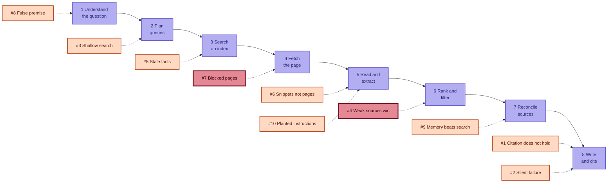
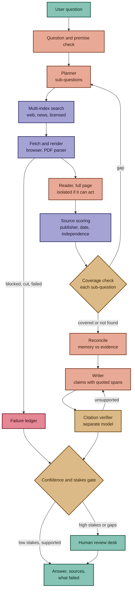
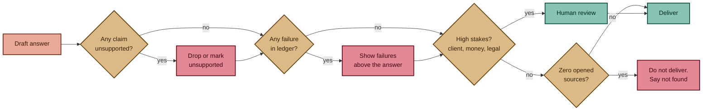
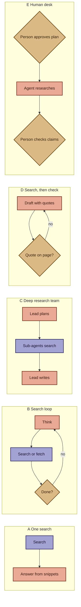
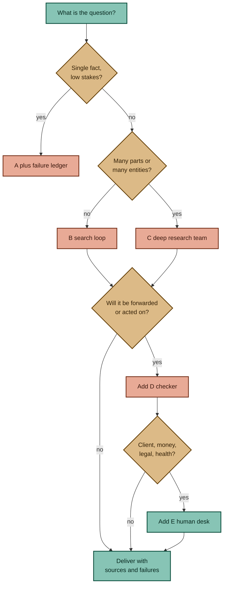

# Why AI Assistants Miss the Right Details on the Web: the Top 10 Failures, Their Causes, the Fixes, and a Reliable Search Architecture

Status: draft for review, 2026-10-25. Evidence window: studies from 2023 to 2026, with a full re-check of every item against articles dated 25 Sep to 25 Oct 2026.

Visual summary: [Where AI search breaks](https://claude.ai/artifact/FZPZejtBN6nvfwZKP8TV9F).

Products in scope: Claude and Claude Code, ChatGPT (search and Deep Research), Gemini (app, Deep Research, API grounding), Google AI Overviews and AI Mode, Perplexity, Grok, Copilot. Covered more briefly, where the research has evidence: DeepSeek, Qwen, Kimi and Meta AI (5.1).

**The answer in one paragraph.** When an AI assistant searches the web, most of the damage happens early, when it fetches and reads pages, but it only shows at the end, in the answer and its links. The ten failures below are all still present as of October 2026, and two of them got worse in the last 30 days (planted sources and blocked pages). None is fixed by a better model alone. The fix is a pipeline that opens the pages it cites, checks each claim against a quoted sentence, says plainly when a search or fetch failed, and lets a person approve high-stakes work. The user research behind this document is in [AI_Web_Search_Failures_User_Research.md](AI_Web_Search_Failures_User_Research.md).

---

## 0. How to read this document

**Persona panel.** The design is argued through six lenses. Each voice has one stake. These are fictional lenses used to argue the design, not real reviewers.

| Persona | Role | Their stake |
|---|---|---|
| Priya | Search and retrieval engineer | "If the page never reached the model, nothing downstream can save it." |
| Marcus | Research analyst, the end user | "I need the number and the sentence it came from, or I cannot use it." |
| Lena | Evals lead | "Show me the failure rate before and after, measured the same way." |
| Omar | Trust and safety lead | "Anything the agent reads is untrusted input, including the page that looks official." |
| Grace | Publisher and web operations lead | "Sites are closing the door to bots. Plan for that, do not fight it." |
| Tom | UX lead | "If the tool failed, the screen must say so before the answer does." |

**Evidence ladder.** Every claim carries a rung. Lower is stronger.

| Rung | Tier | Does not tell you |
|---|---|---|
| 1 | Audited, peer reviewed or independently reproduced | Whether it transfers to your use |
| 2 | Primary record: official doc, spec, changelog, court order | Whether it works well in practice |
| 3 | Revealed behaviour: preprint test, trace study, live audit | Whether peer review will hold |
| 4 | Deployment scale or live status | Quality |
| 5 | Independent survey or credible secondary report | Behaviour, only what was reported |
| 6 | Self-report by the party measured | Anything the party would not want to show |
| 7 | Vendor claim or unopened page | Anything |

**What is decided and what is open.** The top 10 and its order are decided, confirmed by the user on 2026-10-25. The reference architecture is a proposal. Section 10 lists where it is weakest.

---

## 1. Scope and evidence discipline

**In scope.** Failures that stop an assistant from gathering the right details from the open web for a user's question. That covers question understanding, search, fetch, reading, ranking, reconciling and citing.

**Out of scope.** Pure reasoning errors on information the user supplied, image generation, and offline model knowledge with search switched off.

**How the evidence was gathered.**

| Phase | What ran | Output |
|---|---|---|
| User research | Three parallel strands: user complaints, independent studies, builder mechanisms | 91 complaints, 33 studies, 18 mechanisms |
| Deep research | Causes and fixes, model scorecard, two last-30-days sweeps (news and vendors, studies and community) | 4 briefs. The two sweeps opened about 100 pages |
| Verification | Separate verifiers opened the page behind every headline number, then a fresh check of table 8.1 and a gap audit against the original ask | Ledger in Appendix A |

**No interviews or surveys were run.** The user research is desk research: 91 public complaints, 33 studies and 18 builder mechanisms. The personas in Section 2 are inferred from public posts, not interviewed. The interview guide in the user research file is ready but unused.

**What we excluded and why.**
- Vendor self-reported accuracy is never used in the ranking or the scorecard. It appears only in a labelled table.
- SEO-firm studies are kept only when no better source exists, and are flagged.
- Studies whose authors sell the judging tool or a rival product are kept but flagged (Oumi, DeepTRACE, LifeSearch, Cloudflare, Brave).
- Reddit and X could not be reached by any tool. The user voice leans toward developers and API users.

---

## 2. What users say in public posts and studies

Public posts and studies point to four searcher types, each hurt in a different way.

| Persona | Job | Failure they feel most |
|---|---|---|
| Executive | "Brief me before the call" | Wrong person, stale numbers |
| Analyst | "Find the figure and its source" | Citation that does not hold the number |
| Developer | "Read the current docs" | Truncated pages, silent tool failure |
| Consumer | "What is right today" | Planted or low-quality sources |

Three findings shaped the rest of the work.
1. **Users mind silence more than failure.** The loudest recent complaint is ChatGPT Deep Research runs that finish with zero sources and still deliver a confident report, reported through 2026-10-25.
2. **Citation is the top complaint by a wide margin** (28 of 91 complaints), and it appears for every product with data.
3. **Almost nobody checks.** Pew found a link inside an AI summary was clicked in only 1% of visits that showed one. The burden of being right sits on the system.

---

## 3. The top 10, ranked

Ranking used four lenses scored 0 to 3: how often users complain, how much independent measurement exists, how hard builders say it hits, and how hidden the harm is.

### 3.0 Summary

| # | Challenge | Pipeline stage | Score | Was | Status, Oct 2026 | Headline evidence |
|---|---|---|---|---|---|---|
| 1 | Citation does not hold the claim | Write and cite | 12 | same | Still true | Over 60% of 1,600 citation tests named the wrong source (Tow Center 2025). With live search, only 67% of a search agent's citations were relevant to the claim (2026-10-21) |
| 2 | Silent failure, confident answer | Fetch to write | 10 | same | Still true | Refusals 0.5% across 3,113 questions (EBU 2025). 73.2% of answers using planted content gave no warning (2026-10-21) |
| 3 | Shallow search, stops too early | Plan, search | 10 | same | Still true | 71.5% of errors came from retrieval (Stanford 2026). Best of 12 models 39.0% on live-web tasks (2026-10-19) |
| 4 | Weak or planted sources win | Rank | 10 | same | **New events** | 8 of 10 AI search platforms cited a made-up concept within 7 days (2026-10-08). Fake support numbers planted for 374+ companies (2026-09-25) |
| 5 | Stale facts shown as current | Search, reconcile | 7 | 9 | Still true | Full Fact, 7,625 answers with search on: old rates, wrong office holders (2026-10-15) |
| 6 | Reads snippets, not pages | Read | 9 | same | Still true, now measured live | One OpenAI model opened no page in 53.6% of search episodes, and snippet-only answers were stale about 5 times as often (2026-10-15) |
| 7 | Blocked or unreadable pages | Fetch | 9 | same | **New events** | Cloudflare default AI-bot blocking on ad pages widened to existing free sites (2026-09-15). Amazon, JPMorgan and others block agents (2026-10-21) |
| 8 | Goes along with a false premise | Understand | 6 | 9 | Still true in studies, not re-confirmed in window | GPT-5 accepted fabricated facts 64% of the time (Stanford 2026). A "verified source" label flipped 45% to 88% of correct answers (2026-09-29) |
| 9 | Memory beats search | Reconcile | 8 | same | Still true, both ways | Models took wrong retrieved content over correct memory over 60% of the time (ClashEval). Stale retrieved text overrode correct memory 30% to 37% (2026-09-25) |
| 10 | Planted instructions in pages | Read, act | 9 | 7 | Still true, partly fixed at the top | 73.1% of injected attacks on 1,091 real pages got through a standard browsing planner (2026-10-15) |

### 3.0b Lens split and re-rank, 2026-10-27

Each lens runs 0 to 3. Two scorers split all ten problems. Where they differed by 1 on a lens, the lower value is kept. The total is the sum of the four lenses.

| # | Reports | Measured | Impact | Hidden | Total | Was |
|---|---|---|---|---|---|---|
| 1 | 3 | 3 | 3 | 3 | 12 | same |
| 2 | 2 | 2 | 3 | 3 | 10 | same |
| 3 | 3 | 3 | 2 | 2 | 10 | same |
| 4 | 3 | 2 | 3 | 2 | 10 | same |
| 5 | 2 | 1 | 2 | 2 | 7 | 9 |
| 6 | 1 | 2 | 3 | 3 | 9 | same |
| 7 | 2 | 2 | 3 | 2 | 9 | same |
| 8 | 1 | 2 | 2 | 1 | 6 | 9 |
| 9 | 2 | 2 | 2 | 2 | 8 | same |
| 10 | 1 | 3 | 2 | 3 | 9 | 7 |

Three problems move. S5 drops from 9 to 7 and now ranks 9th. S8 drops from 9 to 6 and now ranks 10th. S10 rises from 7 to 9 and now ranks joint 5th with S6 and S7. The ids stay S1 to S10. The new order is S1, then S2 to S4, then S6, S7 and S10, then S9, S5 and S8. This split is our judgement, from two scorers on 2026-10-27, one of whom saw the totals before scoring (ledger rows 69 and 70).

### 3.1 Where each failure enters the pipeline

Red boxes had new events in the last 30 days (relabelled 2026-10-25 from "Worse" to match the stricter rule used across both research sets).

### 3.1b How each product searches

The "why" behind several failures depends on which index a product searches and who reads the page.

| Product | Index | Page reading and limits |
|---|---|---|
| Claude (app, API) | Reported to use Brave Search (rung 5). Backend not configurable (rung 2) | API fetch puts the full text into Claude's context, capped by a token limit. No JavaScript. Fetches only URLs already seen in the conversation. Cached by default (rung 2) |
| Claude Code | **Tested 2026-10-25 on version 2.1.296, 40 probes in groups of 20, 12, 4 and 4 (ledger row 66).** URL counts are rung 3, because a script can recheck them from the saved result lists. Answer and fetch scores are rung 6 until rescored: Claude judged them with the answer key in hand, and the WebFetch replies were not saved. The primary page appeared in the results for 7 of 20 questions (95% range 18% to 57%): 5 of 10 stable facts and 2 of 10 dated 2026 facts. That gap could be chance (Fisher exact p = 0.35). All 20 pages came from our own ledgers, 19 of 20 queries named the publisher, and the search mode was not recorded, so these are not rates for a buyer's own questions. Top-10 overlap with Brave Search was 7 of 38 results over 4 queries, so the test does not confirm the reported Brave backend. 13 of 20 result lists held 9 links, not 10. Backend not configurable (docs, rung 2) | **Tested, same run, rung 6 until rescored.** Answers: 15 of 20 correct (95% range 53% to 89%), 8 of them read from the primary page, 3 from another page of the same publisher and 4 from third-party copies. 2 partly, 3 wrong or none, including 1 wrong number. Fetch: on all 9 pages it read, the text matched word for word, in full where the sentence was short or the site was uncapped, and for the first 101 to 124 characters where a 125-character quote cap applied (8 probes, not on 2 documentation sites). 3 missing (2 PDFs, 1 Wikipedia footnote of unresolved cause), 0 invented (95% upper bound 24%). It reads 100,000 characters per call. The unread-amount notice appeared on 4 of 4 long web pages. On HTML pages, 2 of 3 sentences past that point were reached, both with extra offset calls. 2 of 2 PDFs were not read (95% upper bound 66%). Neither gave a truncation note. On one, the model said it saw only compressed PDF streams. **Cache and caps tested 2026-10-25 on 2.1.296 (rung 3, ledger row 68).** Cache: 3 pages that change on every request returned the same value at about 2 and 8 minutes and a new value at about 16 minutes, on 3 of 3 pages. Curl got a new value each time. The cache keeps the page by URL (on 1 call a different prompt got the cached page). It ignored no-cache headers on the 1 page that sent them, and no reply said a cached copy was used. One added query parameter got a fresh copy on 3 of 3. Caps: 30 searches in one turn over about 8 minutes hit no limit. Each search gave 9 or 10 links (median 9, 277 links in all). The documented hourly cap of 200, then 100, was not reached. Testing it needs more than 200 searches in an hour, so it stays at rung 2 (docs) |
| ChatGPT | Rewritten queries sent to third-party search providers (rung 7, help page blocked) | Not documented in what we opened |
| Gemini | Google Search grounding. The model decides whether to search and returns the queries it ran (rung 2) | Not documented in what we opened |
| AI Overviews, AI Mode | Google index. A link must be indexed and eligible for a snippet (rung 2) | Picking up new snippet controls can take days to months (rung 2) |
| Perplexity | Own index of over 200 billion URLs, re-crawl timing chosen by a model (rung 6) | Freshness traded against completeness under a fixed budget (rung 6) |
| Copilot | Grounding with Bing Search, which returns summaries, not raw results. Bing Search APIs retired 2025-08-11 (rung 2) | Not documented in what we opened |
| Grok | Server-side web and X search tools, per third-party docs. Index not documented (open) | Not documented |

### 3.2 Challenge #1. Citation does not hold the claim

**What users see.** A link that loads but does not say what the answer says. Sometimes the link never existed.

**Why it happens.** In most products the text is written first and links are attached afterwards, picked from a pool of snippets and syndicated copies. Nothing checks that the cited page contains the sentence. Priya adds that a citation often points to the copy the crawler could reach, not the original that was blocked.

**Evidence.**
- Tow Center (2025-03-06, rung 2): across 1,600 citation tests on 8 tools, over 60% named the wrong article, publisher or URL. Rates ran from 37% (Perplexity) to 94% (Grok 3).
- EBU and BBC (2025-10-21, rung 2): sourcing was the biggest cause of significant issues, at 31% of 2,709 answers. Gemini 72%.
- WashU audit of Google AI Overviews (paper first posted 2026-05-13, university release 2026-09-29, rung 3): about 11% of 98,020 claims were not backed by the cited page. Only 41.9% of overviews were fully backed.
- Rao et al. (2026-04-03, rung 3): 3% to 13% of 53,000+ cited URLs were invented outright.
- Real PMIDs, Wrong Papers (2026-10-21, rung 3): with live PubMed search, only 67% of a search agent's citations were relevant to the claim. With search switched off, IDs were real 327 of 335 times but only 3 were relevant, so a real ID is not a real citation.
- Retrieved but Not Read (2026-10-15, rung 3): when the answer was out of date, 81.8% of its citations (27 of 33) did not support it, against 0.9% otherwise.

**Status, Oct 2026.** Still true. Right answers can still be badly sourced. One audit found Google AI Overviews right about 91% of the time but fully backed only 39% of the time (Oumi, 2026-04-14, flagged because Oumi sells the judge).

### 3.3 Challenge #2. Silent failure, confident answer

**What users see.** A finished, confident report when the search found nothing, the page was blocked, or a budget ran out.

**Why it happens.** Training and scoring reward a guess over "I don't know". Tool errors often come back inside a normal success response, so the model never learns that the fetch failed. Tom puts it simply: the screen shows the answer before it shows the failure.

**Evidence.**
- EBU (2025, rung 2): refusals fell to 0.5% of 3,113 questions.
- Tow Center (2025, rung 2): ChatGPT hedged 15 times in 200 and never declined.
- Data-Void Exploits (2026-10-21, preprint, authors list NDSS 2027, rung 3): 73.2% of answers that cited or used planted content gave no warning.
- User reports (rung 6): ChatGPT Deep Research runs ending with 0 sources but full reports, 2026-10-01 to 2026-10-25. A hidden Claude Code WebSearch cap that let agents carry on from memory (opened 2026-09-21). Copilot web retrieval failing behind a green status page (2026-10-05).

**Status, Oct 2026.** Still true. Claude Code now tells the model when a page was cut or a fetch failed (versions 2.1.290 to 2.1.307, 2026-10-05 to 2026-10-21, rung 2). OpenAI added a "Broken Search Tool" eval to its GPT-6 system card (2026-09-03, vendor claim, rung 7). Gemini 4 Argon cut hallucination mainly by declining more often (2026-09-30, rung 3).

### 3.4 Challenge #3. Shallow search, stops too early

**What users see.** Few sources, generic queries, and the key page never found.

**Why it happens.** Agents stop when they feel confident, not when each part of the question has evidence. Queries copy the user's wording, which narrows the search. Cost limits push products toward one quick search.

**Evidence.**
- Suzgun et al., Stanford preprint (2026-05-21, rung 3): 71.5% of errors on 2,100 same-day news questions came from retrieval failing or drifting to the wrong source.
- Mind2Web 2 (2025-06-26, rung 1): best system 28% success against 54% for humans. ChatGPT Search 6%, Perplexity Pro 8%, Claude Research 10%.
- OpenDS-World (2026-10-19, rung 3): best of 12 frontier models 39.0% on 200 live-web tasks. Human testers scored lower, at 21.1%, so these tasks are hard for everyone.
- Yu et al. trace study (2026-10-21, rung 3): GPT-5-mini stopped too early on 75 of 100 sampled tasks.
- Ahrefs (2026-10-12, rung 4, SEO firm): only 14.4% of 66.6 million free, logged-out ChatGPT answers showed fan-out queries, the extra searches a model runs to cover parts of a question. Ahrefs corrected an early reading of this figure. It does not mean the rest never searched.

**Status, Oct 2026.** Still true. Perplexity moved its Agent API presets to Fast Search in October (rung 2), which favours speed over depth.

### 3.5 Challenge #4. Weak or planted sources win

**What users see.** SEO listicles, vendor-owned comparison pages, a single Reddit comment, or a scammer's phone number presented as fact.

**Why it happens.** Ranking rewards relevance and search-engine signals, not reliability. Many planted pages repeating each other look like agreement. Generative engine optimisation (GEO) now targets AI answers directly. Omar's point: an official-looking page is still untrusted input.

**Evidence.**
- From Public Posts to AI-Search Citations (2026-10-08, rung 3): 8 of 10 AI search platforms cited a made-up concept within 7 days. Content from a $14 GEO purchase was cited within 1 hour.
- "Dark Sourcery" campaign (Gigazine 2026-09-25, Paubox 2026-10-20, rung 5): fake support pages for at least 374 companies repeated by ChatGPT, Gemini and AI Overviews.
- Practitioner audit of Perplexity (2026-09-02, rung 5): three brands published 215,128 machine-written "best of" pages that get cited.
- NewsGuard (2025-09-04, rung 2): chatbots answered 100% of prompts and repeated false claims 35% of the time.

**Status, Oct 2026.** **New events.** Planting is now cheap, fast and measured. No count yet shows harm rising faster than AI news overall, so this uses the stricter label from the frontier research (section 4 there), not "Worse".

### 3.6 Challenge #5. Stale facts shown as current (now ranked 9th)

**What users see.** Last year's figure, a former office holder, old install steps.

**Why it happens.** Snippets and caches lag the live page. Rerankers can favour older, well-linked pages. The model's sense of "today" drifts toward its training date, and it adds old years to queries.

**Evidence.**
- Full Fact benchmark report one (about 2026-10-15, rung 3): 7,625 answers from five chatbots with web search on, over 70 days. Superseded asylum rates, a wrong prime minister into September 2026, wrong sense of the date. No overall error rate given.
- Retrieved but Not Read (2026-10-15, rung 3): snippet-only answers were outdated 6.4% of the time, against 1.3% when the cited page was opened.
- User reports (rung 6): Gemini gave abandoned install steps with search grounding on (2026-09-22). Claude Code queries kept adding "2024" (2025-12-16).

**Status, Oct 2026.** Still true. TREK-Wild (2026-10-18, rung 3) gives per-model accuracy on fast-changing facts with search on, from 70.1% (GPT-5.4) down to 49.3% (Claude Opus 4.6). No study gives a per-product stale-fact rate in a consumer app. This is one of the most reported problems and one of the least measured.

### 3.7 Challenge #6. Reads snippets, not pages

**What users see.** An answer built from a search-result snippet or a short summary of the page, so details lower on the page never reach the model.

**Why it happens.** Opening a page costs time and tokens, and snippets look good enough. Some tools pass the page through a smaller model that summarises it before the main model sees it. Claude Code's WebFetch is "lossy by design" per its own docs, and read up to 100,000 characters per call (rung 2).

**Evidence.**
- Retrieved but Not Read (2026-10-15, rung 3): GPT-5.6 Luna, running its own web search, opened no page in 53.6% of episodes. Rates across models ran from 2.6% to 76%.
- Claude Code changelog (rung 2): text past the read limit was dropped without notice until version 2.1.290 (2026-10-05). One user found an RFC returned at 7.8% of its length (2026-09-17, rung 6).
- Four Claude Code issues report the fetcher returning text that was not on the page, including a 500 error page returned as a full job posting (2026-08-17, rung 6).
- Our own scheduled runs show the same effect from the other side: when the sandbox could not open pages, every report rested on snippets (ledger row 67).
- Our own test of Claude Code 2.1.296 (2026-10-25, 12 pages, rung 6 until rescored): on all 9 pages it read, the text matched word for word, in full where the sentence was short or the site was uncapped, and for the first 101 to 124 characters where the 125-character quote cap applied. That is a quote limit, not a reading failure. The reading failures were 2 of 2 PDFs (neither gave a truncation note, and on one the model said it saw only compressed PDF streams) and 1 Wikipedia footnote of unresolved cause. On HTML pages over 100,000 characters, 2 of 3 deep sentences were reached, each needing extra offset calls.

**Status, Oct 2026.** Still true, and now measured in a live product.

### 3.8 Challenge #7. Blocked or unreadable pages

**What users see.** The best source is paywalled, bot-blocked or built in JavaScript, so the answer leans on copies, Wikipedia or memory.

**Why it happens.** Publishers and platforms are closing the door to AI bots. Many AI fetchers do not run JavaScript. PDFs and tables lose structure. Grace's view: this is a business decision by site owners and it will not reverse.

**Evidence.**
- Cloudflare: AI crawlers blocked by default since 2025-07-01. From 2026-09-15 training and agent bots are blocked on ad pages for new and existing free sites (rung 5).
- Amazon, JPMorgan, Schwab and Delta block agents, while Walmart opens a gated agent gateway (TechCrunch 2026-10-21, WinBuzzer 2026-10-20, rung 5).
- Vercel network logs (rung 4): GPTBot, ClaudeBot and PerplexityBot do not run JavaScript. In one live test only Gemini read a JavaScript-inserted price.
- Yu et al. (2026-10-21, rung 3): anti-scraping caused 33.7% of error steps for one open agent on BrowseComp.
- Our own scheduled runs (2026-10-10 and 2026-10-24, rung 3, ledger row 67): 19 of 19 page fetches failed on 2026-10-24 across 5 cloud runs, with "getaddrinfo ENOTFOUND". Search still worked. The cause was the cloud environment's network setting, which allowed only Anthropic hosts. Each report was then built from snippets (#6), and one earlier run misnamed the cause as an outage (#2).

**Status, Oct 2026.** **New events.** Paid and gated access is replacing open crawling (Cloudflare Pay Per Use beta, 2026-09-30). No count yet shows failed answers rising faster than AI use overall, so this uses the stricter label, not "Worse".

### 3.9 Challenge #8. Goes along with a false premise (now ranked 10th)

**What users see.** The wrong fact in the question is accepted and "confirmed" with sources.

**Why it happens.** Tuning makes models agree with users. The premise gets written into the search query, so the search finds pages that seem to agree. A source that claims authority is trusted more.

**Evidence.**
- Suzgun et al. (2026-05-21, rung 3): accuracy fell from about 88% to 96% down to 19% to 70% when questions held a subtle false premise. GPT-5 accepted fabricated facts 64% of the time. Claude caught 78%, Gemini 3 Pro 80%.
- Authority Bias in Language Models (2026-09-29, preprint, authors list NeurIPS 2026, rung 3): one "verified source" note backing a wrong answer flipped 45% to 88% of correct answers in 7 of 8 models.
- Which? (2025, rung 5): ChatGPT and Copilot did not correct a wrong ISA allowance in the question.

**Status, Oct 2026.** Still true in studies. The user-premise form was not re-confirmed in the window. The nearest in-window study (Authority Bias) measures deference to a source label, a related but separate failure.

### 3.10 Challenge #9. Memory beats search

**What users see.** An answer from training data when search was on, or a correct memory overwritten by a bad page.

**Why it happens.** The model's own confidence decides whether it trusts memory or the page, and that confidence is poorly calibrated. It cuts both ways.

**Evidence.**
- ClashEval (2024, rung 1, not re-opened by our verifiers): models adopted wrong retrieved content over their own correct knowledge more than 60% of the time.
- Stale-Document Poisoning (2026-09-25, rung 3): outdated retrieved text overrode correct memory in 30% to 37% of cases on open models.
- Suzgun et al. (rung 3): Gemini 3 Pro overrode retrieved evidence in 21.2% of its errors, against 5.8% to 9.7% for others.
- Full Fact (2026-10-15, rung 3): answers looked "anchored in historical training data" with search on.

**Status, Oct 2026.** Still true, and the direction of the error depends on the model.

### 3.11 Challenge #10. Planted instructions in pages (now ranked joint 5th)

**What users see.** Usually nothing. Hidden text on a page steers the answer, or tells an agent to act.

**Why it happens.** One model reads data and instructions in the same context and cannot reliably tell them apart. Any agent that can act (send, buy, fetch more) turns this into a security problem. Omar treats it as the one failure that turns a wrong answer into a breach.

**Evidence.**
- Intact (2026-10-15, rung 3): 73.1% of injected attacks on 1,091 real pages got through a standard browsing planner.
- Signals Corps (2026-10-06, rung 3, via The Register 2026-10-15): about 8,000 sites send HTTP headers aimed at AI agents, 30 of them trying injection. Claude ignored header injections on everyday prompts but obeyed 7 of 9 times when the prompt gave the site authority.
- LivePI (2026, rung 3): attack success ran from 10.7% (Claude Opus 4.6) to 29.6% (Gemini 3.1 Pro).
- Claude Code WebFetch data-leak flaw CVE-2026-54316, fixed in 2.1.163 (rung 2).

**Status, Oct 2026.** Still true. Partly fixed for top models on simple attacks. Not fixed for agents that can act.

### 3.12 Near misses

These scored 6 or appeared strongly in the last 30 days. They are watched, not ranked.

| Near miss | Why it is close | Best evidence |
|---|---|---|
| Answers change from run to run | Three separate measurements in the last 30 days | Citation overlap below 0.02 across 10 runs of one deep research system (2026-10). Gemini 3.8 Flash shipped in AI Mode without links or citations (2026-09-02, opt-in for paying subscribers) |
| Wrong person or firm | Real harm and legal liability | Aachen court order (2026-09-24) on AI Mode pinning another man's conviction on a doctor |
| Numbers, tables and PDFs misread | High for finance work | Gemini finance team paused use over wrong document years (2026-10-05). Full Fact: clearest failures came when models calculated |
| Niche, local or non-English gaps | High for multi-country work | Hindi accuracy 79.3% against 89% to 91% elsewhere (Stanford 2026). Claude Code returning Munich shops for Aargau queries (2026-10-24) |

---

## 4. Fixes per challenge

| # | Challenge | Root cause in one line | Best fix today | How mature | What a user can do now |
|---|---|---|---|---|---|
| 1 | Citation does not hold | Links attached after writing, nothing checks support | Claim-level citation check: split the answer into claims, tie each to a quoted span, drop or flag the rest | Parts sold (Vertex check grounding, Anthropic Citations). Full checks are custom | Ask for a verbatim quote next to each key claim, then open two links |
| 2 | Silent failure | Guessing is rewarded, tool errors look like success | Surface every tool failure to the model and the user. Never deliver a report with zero opened sources | Shipping in Claude Code. Evals starting elsewhere | End prompts with "List the searches you ran, pages you opened, and anything that failed" |
| 3 | Shallow search | Stops on confidence, not coverage | Split into sub-questions, check evidence per sub-question before stopping (HALT) | Decomposition mature. HALT peer reviewed, tested only on small models | Use deep research mode for multi-part questions. Ask for the plan first |
| 4 | Weak or planted sources | Ranking rewards relevance, copies look like agreement | Domain allow and block lists now. Source-independence checks next | Lists GA. Reliability scoring is research | Ask for primary sources and who published each one |
| 5 | Stale facts | Caches lag, model's "today" drifts | Give today's date, open the page for any changing fact, rerank by date | Date grounding GA. Recency reranking research | Start with "As of today, 25 October 2026". Ask for the date next to each figure |
| 6 | Snippets not pages | Opening pages costs time and tokens | Read-before-cite: only cite pages that were opened, report truncation | Partly shipped. Not a default anywhere found | Ask it to open each source and quote the sentence used |
| 7 | Blocked pages | Bot blocks, paywalls, JavaScript, PDFs | Label each blocked fetch, then route to a browser tool, a parser or a licensed source | Error codes GA. Licensed grounding early | Paste or upload the key source yourself |
| 8 | False premise | Agreement tuning, premise written into queries | Premise check before searching: list and verify the question's assumptions | Research. Not a product default | Ask neutral questions first. Ask for the best evidence against your view |
| 9 | Memory beats search | Poorly calibrated trust between memory and page | Compare memory and evidence, prefer dated primary sources for changing facts | Research. Needs model internals | Require a dated primary source for prices, rules and people in roles |
| 10 | Planted instructions | Data and instructions share one context | Keep untrusted page text away from the model that can act (dual LLM, CaMeL), plus classifiers | Classifiers shipped. Isolation is research or custom | Do not give a browsing agent email, payments or private files |

Lena's caution on this table: most fix numbers come from the authors of the fix. Independent before-and-after measurements exist for very few of them (Section 10, C3).

---

## 5. Model scorecard

Independent studies only. Each cell is graded only when one study puts the product next to at least two others on the same metric. No averaging across studies.

**Key:** B better than peers, M mixed, W worse than peers, N not enough data, dash no independent evidence. A star marks cells where all evidence is from before 2026.

| # | Challenge | Claude | ChatGPT | Gemini | AI Overviews / AI Mode | Perplexity | Grok | Copilot |
|---|---|---|---|---|---|---|---|---|
| 1 | Citation does not hold | B | M | W | N | M | W* | M* |
| 2 | Silent failure | N* | M* | W | N | W* | N | B* |
| 3 | Shallow search | M | M | M | - | W* | M* | - |
| 4 | Weak or planted sources | B | W | B* | N | M | W | N* |
| 5 | Stale facts | W | B | M | N | - | - | N* |
| 6 | Snippets not pages | - | N | - | - | - | - | - |
| 7 | Blocked pages | N | N | B | - | N | - | - |
| 8 | False premise | B | W | B | N | - | M | N* |
| 9 | Memory beats search | N | N | W | - | - | N | - |
| 10 | Planted instructions | B | M | W | - | N | - | N |

Totals across 70 cells: 9 B, 12 M, 11 W, 19 N, 19 dash.

Five cells were graded from 2026 studies added after the gap audit. Row 5 from TREK-Wild (API models with search on). Grok on row 4 from the made-up concept study. Gemini on row 2 from Data-Void warning rates. Cells already graded from other studies were not changed, because the grid never averages across studies.

**What the grid supports.**
- Claude leads on citation support, planted false claims, false premises and injection resistance in the studies that compare it. It trails on fast-changing facts: Claude Sonnet 4.6 scored 51.4% against 70.1% for GPT-5.4 and 64.6% for Gemini 3.1 Pro (TREK-Wild, API models). No third-party study measures Claude Code's search quality. Our own 40-probe test (largest group 20, ledger row 66) found the primary page for 7 of 20 questions (95% range 18% to 57%). 15 of 20 answers were correct (53% to 89%), 8 of them read from the primary page. 19 of 20 queries named the publisher, no other product ran the same probes, and Claude chose the questions, ran the tools and scored the answers. It cannot grade a cell or rank Claude Code against another product.
- ChatGPT splits by mode. Quick search ranks low on long tasks (6% on Mind2Web 2), while Deep Research leads most deep-research benchmarks.
- Gemini is worst on sourcing (EBU 72%) and invented URLs, but best at rendering JavaScript pages and among the best at catching false premises.
- Copilot is "better" on silent failure mainly because it declines more often. Declining also means answering less.
- Grok repeated a planted made-up concept in 93.7% of tries after its first citation, behind only Yuanbao, which had 5 tries (ChatGPT 35.0%, Perplexity 37.1%).

**What the grid does not support.** A single winner. 34 of 57 evidence lines were collected before 2026. Many 2026 tests run API models inside research setups, not the consumer apps. Copilot is almost absent from 2026 studies, and Grok appears in one. Gate 0 reruns these rows on the buyer's own questions (Section 11). Full cell-by-cell evidence: [P2_D_scorecard.md](AI_Web_Search_Failures_research/P2_D_scorecard.md).

### 5.1 Other models

Too little evidence to grade, so these sit outside the grid.

| Model | What the research has | Rung |
|---|---|---|
| DeepSeek | Still named Starmer as UK prime minister on 2026-09-15 with search on (Full Fact). 20.5% on OpenDS-World live-web tasks (V4.1 Flash), hitting a budget limit in 78% of runs. Did not cite the made-up concept within 7 days | 3 |
| Qwen | 25.5% on OpenDS-World (3.8-Max). Did not cite the made-up concept within 7 days | 3 |
| Kimi | 17.5% on OpenDS-World (K3). Repeated the made-up concept 65% of the time | 3 |
| Meta AI | Cited RT-linked sites in 2 of 20 German election-day answers (2026-09-20 audit). Scored 55 in a Which? consumer advice test, against 71 for Perplexity | 3 and 5 |
| Mistral and others | No evidence in this research | Open |

---

## 6. Requirements for a reliable search agent

The architecture in Section 7 answers these. Each maps to the top 10.

| ID | Requirement | Answers |
|---|---|---|
| R1 | Every cited claim has a quoted sentence from a page that was opened | #1, #6 |
| R2 | Every failed search, blocked fetch, cut page or spent budget is shown to the model and the user | #2, #7 |
| R3 | The agent stops only when each sub-question has evidence or is marked "not found" | #3 |
| R4 | Each source is labelled with publisher, date, type and independence from the others | #4, #5 |
| R5 | Time-sensitive facts come from a dated page opened in this run | #5, #9 |
| R6 | The question's assumptions are checked before searching | #8 |
| R7 | Memory and evidence disagreements are shown, not hidden | #9 |
| R8 | Page text can never trigger an action without a separate, trusted check | #10 |
| R9 | High-stakes output passes a human gate | #1, #4, #8 |

Non-functional: time and cost per run measured in quick and deep mode, with a ceiling agreed at gate 0 (7.3). No speed target is set here because none is in our evidence. Every run is traceable from question to cited sentence.

---

## 7. Reference architecture

### 7.1 Components and why each exists

| Component | What it does | Why, in the panel's words |
|---|---|---|
| Question and premise check | Lists the assumptions in the question and checks the risky ones first | Marcus: "If my question is wrong, I want to hear that before the report." Answers #8 |
| Planner | Splits the question into sub-questions, each with a source type it needs | Priya: decomposition is the most mature fix for #3 |
| Multi-index search | Queries more than one index, plus news and licensed sources | Priya: each product sees a different web. One index means one blind spot |
| Fetch and render | Opens the page in a real browser, parses PDFs and tables | Grace: plan for blocks. Use licensed routes or the user's own files when blocked. Answers #7 |
| Failure ledger | Records every blocked fetch, cut page, failed search and spent budget | Tom: the ledger is what the screen shows first. Answers #2 |
| Reader, isolated | Reads the full page. For any agent that can act, this is a separate model with no tools. Read-only research may use injection filters instead (C6) | Omar: page text is data. It never reaches a model that can act. Answers #6, #10 |
| Source scoring | Labels publisher, page date, type (primary, news, vendor, user post) and whether sources copy each other | Answers #4 and #5. Copies count as one source, not many |
| Coverage check | Stops only when each sub-question has evidence or a "not found" | Answers #3. Loops back to the planner on gaps |
| Reconcile | Compares memory with evidence, shows disagreements, prefers dated primary pages | Answers #9 |
| Writer | Writes claims, each tied to a quoted span from an opened page | Answers #1 by design |
| Citation verifier | A separate model checks that each quote is on the page and supports the claim | Lena: the writer must not grade its own work. Answers #1 |
| Confidence and stakes gate | Routes to a person when stakes are high, coverage has gaps or failures were logged | Answers #2, #8 |
| Evidence store | Keeps the pages and quotes behind every high-stakes answer, and pins model versions where the API allows | C8: the same question gives different sources on different days. The store lets anyone re-check an answer later |
| Human review desk | Approves the plan, checks the key claims the system picks with each quote shown inline, signs off | The only reliable catch for #8 in the evidence. Counts as a control only while its measured catch rate holds (7.3) |

### 7.2 The confidence and stakes gate

This is the part most designs skip.

Rules the gate enforces:
- A report with zero opened sources is never delivered as an answer. It is delivered as "not found", with what was tried.
- Failures appear above the answer, not in a footnote.
- "High stakes" is set by the user or the workflow (client briefs, money, legal, health), never guessed by the model.
- The gate measures support, not truth. A claim can be fully supported by a wrong page. That is why #4 needs source scoring upstream.

### 7.3 Evals that prove it works

Lena's eval set, run before and after any change, on the same questions:

| Metric | How measured | Target for a first release |
|---|---|---|
| Claim support rate | Share of claims whose quoted span is on the cited page and supports the claim | 95% or more |
| Silent-failure rate | Runs with a logged failure that the answer does not mention | 0% |
| Zero-source delivery | Reports delivered with no opened page | 0% |
| Sub-question coverage | Share of sub-questions with evidence or an explicit "not found" | 100% |
| Stale-fact rate | Time-sensitive facts older than the newest primary page | Below 2% |
| False-premise catch rate | Planted false premises flagged | 80% or more |
| Injection success | Attacks from a fixed test set that change the answer or trigger an action | Below 2% for actions |
| Planted-source pass-through | Share of seeded planted pages (built like ledger row 16) that reach the answer with a checker tick | Measured before any claim about #4 |
| Cost and time per run | Measured on the eval set, quick and deep mode separately | Ceiling agreed with the buyer before release |
| Answer rate and blocked share | Share of questions answered from opened pages, and share of wanted sources that were blocked | Acceptable "not found" rate set by the buyer at gate 0 |
| Reviewer catch rate | Known errors seeded into the claims the desk reviews, share caught | Agreed at gate 0. Below it, the desk is not counted as a control |

Targets are proposals, not observed results. Every one is measured first on the buyer's own questions to set a baseline (Section 11). The set reruns on every model or version change, plus a small weekly canary set.

---

## 8. Design patterns and comparison

Five ways to build web research, simplest first.

### 8.1 Comparison

| Option | Cost | Speed | Accuracy | Best use |
|---|---|---|---|---|
| **A. One search, then answer** (AI Overviews, ChatGPT search, Perplexity Sonar, Gemini grounding) | Lowest. Not measured | Fastest. Not measured | ChatGPT Search 6% and Perplexity Pro Search 8% on long live-web tasks (Mind2Web 2). Most exposed to #1, #5 and #6 | Simple, current, single-fact questions |
| **B. Search loop** (Claude Code WebSearch and WebFetch, API search with max_uses) | Medium. Call budgets cap depth. Not measured | Minutes. Not measured | ReAct beat imitation and RL baselines by 34 points on ALFWorld and 10 on WebShop [vendor]. Stops early and writes weak queries | Developer docs and targeted lookups |
| **C. Deep research team** (OpenAI, Gemini and Perplexity Deep Research, Claude Research, STORM) | About 15 times chat tokens [vendor] | Slowest automated option. Not measured | Best measured: OpenAI Deep Research 28% against humans 54% on a subset (Mind2Web 2). Anthropic reports 90.2% better than a single agent on its internal eval [vendor]. Gemini Deep Research invented 13.3% of URLs. In one traced study, one agent hallucinated during synthesis in 80 of 100 tasks and another drifted off goal in 51. STORM organisation up 25% absolute, coverage up 10% | Broad, multi-company research |
| **D. Search, then check** (Google check grounding, CitationAgent, RARR, SAFE) | Adds a checking pass per claim. Not measured | Adds a checking pass. Not measured | The only option aimed at #1. Checks support, not truth. Cannot add facts the search missed | Anything forwarded, regulated or client-facing |
| **E. Human desk** (Gemini "Edit plan", Co-STORM) | People time. Not measured | Slowest. Not measured | Co-STORM: about 70% of users preferred it to a search engine and 78% to a RAG chatbot. Yet a link inside an AI summary was clicked in only 1% of visits that showed one (Pew) | High-stakes briefs and anything said to a client |

No option fixes all ten. B and C fix #3 but cost more and raise #10. Only D targets #1. Only E reliably catches #8.

### 8.2 Which option when

### 8.3 The recommended composite

A answers single low-stakes facts. B gathers by default, C is opt-in. Domain lists and the failure ledger run on every answer. D checks anything forwarded or acted on. E signs off high stakes. Source labels sit beside each tick, so supported never reads as true.

## 9. Last 30 days: what changed

| Date | Who | Change | Effect on the top 10 |
|---|---|---|---|
| 2026-08-31 | European Commission | ChatGPT search designated a Very Large Online Search Engine under the DSA | First legal duty to assess the risks of an AI search product in the EU |
| 2026-09-02 | Google | Gemini 3.8 Flash, an opt-in model for paying subscribers, shipped in AI Mode without links and citations, then fixed | Model swaps can remove citations silently (#1, near miss) |
| 2026-09-03 | OpenAI | GPT-6 Astra system card adds a "Broken Search Tool" eval (vendor claim) | First vendor eval aimed at #2 |
| 2026-09-15 | Cloudflare | Default blocking of training and agent bots on ad pages, including existing free sites | #7 worse |
| 2026-09-25 | Security press | "Dark Sourcery" fake support numbers for 374+ companies | #4 worse |
| 2026-09-30 | Cloudflare | Pay Per Use and Monetization Gateway in beta | Paid route around #7 |
| 2026-09-30 | Google | Gemini 4 Argon lowers hallucination mainly by declining more | Partial answer to #2 |
| 2026-10-05 | Anthropic | Claude Code 2.1.290 reports unread text and accepts an offset | Partial fix for #6 and #2 |
| 2026-10-08 | Researchers | Made-up concept cited by 8 of 10 AI search platforms in 7 days | #4 measured |
| 2026-10-14 | Anthropic | Claude Code 2.1.299: page reads use the caller's model or "the small model" | Clarifies #6 risk |
| 2026-10-15 | Full Fact | Benchmark report one, 7,625 answers | #5 and #9 re-confirmed |
| 2026-10-15 | Researchers | Retrieved but Not Read: snippet-only rates measured | #6 measured live |
| 2026-10-15 | Researchers | Intact: 73.1% of injected attacks pass a standard planner | #10 re-confirmed |
| 2026-10-21 | Anthropic | Claude Code 2.1.307: in Cowork cloud sessions, robots.txt refusals and 4xx errors now come back as normal, visible results, as local sessions already did | Partial fix for #2 and #7 |
| 2026-10-20 | Anthropic | Org admins can switch web fetch off or set domain lists | Control for #4 and #10 |
| 2026-10-21 | Researchers | Data-Void Exploits: 73.2% of answers using planted content gave no warning | #2 and #4 re-confirmed |
| 2026-10-21 | Retail | Walmart opens an agent gateway, Amazon keeps blocking | Gated access replaces crawling (#7) |
| 2026-10-22 | Courts | Dow Jones v. Perplexity, a copyright and trademark suit that also alleges invented quotes, heading toward a jury trial | Legal pressure on #1 |

Rows dated before 25 September are launches tracked from 25 August, kept because their effects landed in the window.

What the month tells us: vendors are fixing the visible plumbing (notices, errors, domain controls), while the content side (planting, blocking) is getting worse faster. The gap between the two is where buyers carry the risk.

---

## 10. Design critique: the red team

### 10.0 Hostile review

Three role-played voices argued against the recommendation: a sceptical client, a principal engineer and a CFO. These are the three objections most likely to stop a buyer signing, and what each changed.

| # | Voice | Objection | Our own evidence | What changed |
|---|---|---|---|---|
| H1 | Client, backed by the CFO | **"You are selling a design nobody has tested."** Every target is a proposal and the timeline is a guess | 7.3 targets are "proposals, not observed results". The 8 to 12 weeks were our estimate. C3: failure notices and zero-source guards are unmeasured. The ledger-first case rests on user reports at rung 6 (ledger rows 8 to 10) | Section 11 now starts with a paid two-week baseline on the buyer's own questions and a go or no-go. A week-4 checkpoint ships only the ledger and zero-source rule, and work continues only if the silent-failure rate falls. Gates 0 and 1 are dated. Dates for gates 2 and 3 are set from gate 0 measurements, replacing "8 to 12 weeks" |
| H2 | Client | **"Your checker puts a green tick on planted content."** The checker confirms a quote is on the page, so a planted page passes | C1. Ledger row 16: a made-up concept cited by 8 of 10 platforms in 7 days. Row 7: 73.2% of answers using planted content gave no warning. Reliability scoring is research stage (P2 summary #4) | Domain allow and block lists run on every answer (8.3). New metric for planted-source pass-through (7.3). Source labels sit beside every tick. "Reduces #4" removed from Section 11 until measured |
| H3 | CFO, backed by the engineer | **"No price, and the scope does not match the picture."** No cost per run is stated, and release 1 is a subset of the 13 parts in Section 7 | Section 6 promised cost per run but gave none. Pattern C is about 15 times chat tokens [vendor]. C2: checking can double or triple cost and time. Release 1 left out multi-index search, the isolated reader, coverage, reconcile and the premise check. Any dollar figure is not in our evidence | Section 11 now shows which parts ship in release 1 and which come later. Cost and time per run are release metrics with a ceiling agreed with the buyer (7.3). Pattern C is opt-in per question, not the default (8.3) |

### 10.0b Runner-up objections and what changed

| Runner-up | Our own evidence | What changed | Status |
|---|---|---|---|
| **It will answer less.** As blocking rises, read-before-cite turns more questions into "not found" | Ledger row 24: blocking now covers existing free sites. Row 14: anti-scraping caused 33.7% of error steps. Scorecard limit 8: declining is not being right | New 7.3 metric for answer rate and blocked share. The buyer sets an acceptable "not found" rate at gate 0. Blocked sources route to licensed sources or the user's own upload, and the answer names what was blocked | Fixed in design. Rate unmeasured until gate 0 |
| **The human desk will rubber-stamp** | Ledger row 34: a summary link was clicked in 1% of visits that showed one | The desk reviews only claims the system picks, with quotes inline. Seeded known errors measure its catch rate (7.3). Below the agreed rate it does not count as a control (7.1) | Fixed in design |
| **Monthly evals are slower than model changes** | Section 9: Gemini 3.8 Flash shipped in AI Mode without links, then was fixed. C8 run-to-run drift | Evals run on every model or version change and on a small weekly canary set, not only monthly. Model versions are pinned where the API allows. High-stakes answers store the pages and quotes used | Fixed in design |
| **Why build when vendors are fixing it?** | Section 9: Claude Code failure notices (#2, #6, #7), Gemini 4 Argon declining more, OpenAI's Broken Search Tool eval [vendor] | Gate 0 runs the eval set on the vendor's own features too. We build only the gaps that measure open. A quarterly review retires any part a vendor feature now matches | Fixed in design |
| **The isolation rule contradicts itself** | Section 11 said isolate every reader. C6 said classifiers can do. CaMeL completed 77% of tasks against 84% (ledger row 42, not re-checked) | One rule everywhere: any agent that can act gets an isolated reader. Read-only research may use injection filters (7.1, C6, Section 11, page) | Fixed |
| **Licence and people costs are missing** | Not in our evidence | Cost-lines table in Section 11. Each line is priced at gate 0 | Open until gate 0 |
| **The scorecard is too old and our evidence leans to sites that do not block bots** | C5: 34 of 57 evidence lines predate 2026. C9: our own fetches hit blocks | Gate 0 reruns the scorecard rows on the buyer's own questions. Section 5 says so | Open until gate 0 |

### 10.0c Hostile review of our own Claude Code test (2026-10-25)

A sceptical client, an engineer and a CFO argued against T1 and T2. The 3 strongest objections:

| # | Voice | Objection | What changed |
|---|---|---|---|
| 1 | Client | Claude picked the questions, held the answer key while answering and scored itself, and the WebFetch replies were not saved, so no one can rescore | 3.1b, 3.7 and ledger row 66 now say rung 3 for URL counts and rung 6 for answer and fetch scores until a rater who is not a Claude model rescores saved replies. T1 says what the JSON can and cannot recheck |
| 2 | Engineer | All 20 pages came from our own ledgers, 19 of 20 queries named the publisher, and the search mode was not recorded. The stable against dated gap could be chance | 95% ranges added (7 of 20 is 18% to 57%). The gap is marked not significant (p = 0.35). 3.1b says these are not rates for a buyer's own questions |
| 3 | CFO | Only Claude Code was tested, so no buying decision changes | O8 now sizes a fair rerun: 88 questions per tool, each tool the buyer uses, saved replies, outside rater, 201+ searches in an hour for the cap. It also names the one release 1 choice T1 informs: a separate raw fetch for PDFs and long quotes |

Runner-ups fixed: "4 of 12 exact" reread as a quote cap, not a reading failure. The deep-text count no longer counts the PDF twice. The PDF note now records the "compressed streams" remark. "Correct" is split by where the answer came from. S09 is counted as a second wrong number. The 2 WebSearch summary errors are recorded. The F04 miss is marked cause unresolved. Cache rules found on 1 page are labelled as such. The 3 removed blocked pages are listed as a limit. Runner-ups needing no edit: the cap stopping at 30, the Brave method and the single day, because the doc already says so.

### 10.1 Earlier red team

| ID | Critique | What it changes |
|---|---|---|
| C1 | **The verifier checks support, not truth.** A claim can be perfectly quoted from a wrong or planted page. | Source scoring and independence checks are required upstream, not optional. Human review stays for high stakes |
| C2 | **Cost and speed.** Full fetch, a checking pass and coverage loops can double or triple cost and time. Users already pick quick search when given the choice. | Quick mode keeps pattern A but always keeps the failure ledger and the zero-source rule. Checking is sold as a mode, not hidden |
| C3 | **Most fixes have no independent before-and-after numbers.** Zero-source guards, failure notices, disconfirming search and cloaking checks are unmeasured. HALT was tested only on 3B and 7B models. | The eval set in 7.3 is part of the build, not an add-on. Claims about the fix stay at rung 6 until measured |
| C4 | **Blocked content cannot be engineered around ethically.** Rendering harder does not open a paywall or a Cloudflare block, and evading blocks invites legal risk (Dow Jones v. Perplexity). | The design routes to licensed sources or the user's own files and says so. It never evades blocks |
| C5 | **The scorecard is mostly old.** 34 of 57 evidence lines predate 2026, and products change monthly. | The scorecard is a snapshot with dates on every cell. Buyers should rerun the eval set on their own questions |
| C6 | **Isolation hurts usefulness.** Keeping page text away from the acting model loses some ability (CaMeL completed 77% of tasks against 84% without it, a co-author figure not re-checked by our verifiers). | Isolation applies to agents that can act. Read-only research can use classifiers instead |
| C7 | **Humans do not check.** Pew: a source link was clicked in 1% of visits with an AI summary. A human desk that rubber-stamps adds cost and false comfort. | The desk checks a small set of key claims chosen by the system, with the quote shown inline, not a full re-read |
| C8 | **Run-to-run drift.** The same question gives different sources on different days, so a passed eval may not hold next week. | Evals run on every model change and a weekly canary set (10.0b), and high-stakes answers store the exact pages and quotes used |
| C9 | **Our own research hit the same failures.** During this work, Reddit and X were unreachable, OpenAI pages returned 403, one PDF came back unreadable and a changelog was read only to 100,000 of 1.1 million characters. | Supports #6 and #7. It also means our evidence leans toward sources that do not block bots |

---

## 11. Final recommendation and honest scope

**For buyers and users of AI search (today, no build):**
1. Treat any answer you will repeat to a client as unchecked until two key claims have been matched to a quoted sentence on the cited page.
2. Use deep research modes for multi-part questions, and ask for the plan first.
3. End every research prompt with "List the searches you ran, the pages you opened, and anything that failed."
4. Paste or upload the source yourself when it matters, especially paywalled or PDF material.
5. Never give a browsing agent access to email, payments or private files.

**For teams building AI search into a product or workflow (gated after the hostile review in 10.0):**

| Gate | When | What ships | Go only if |
|---|---|---|---|
| 0. Baseline | Weeks 1 to 2, paid | The 7.3 eval set and the scorecard rows run on the buyer's own questions, against the tools they use today and the vendors' own fixes | The buyer agrees the baseline, a cost ceiling per run, an acceptable "not found" rate, and which gaps are worth building |
| 1. Honesty layer | By week 4 | Failure ledger and zero-source rule only | Silent-failure rate falls against the baseline |
| 2. Checked answers | Next checkpoint | Read-before-cite, citation checker, source labels, domain allow and block lists, pinned model versions, evidence store for high-stakes answers | Claim support rate rises, cost and time per run stay under the ceiling |
| 3. Deep and high stakes | Later | Pattern C opt-in, plan approval and sign-off with a measured catch rate, isolated reader for any agent that can act | Planted-source pass-through and injection success measured and agreed |

| Section 7 part | Release 1 (gates 1 and 2) | Later |
|---|---|---|
| Failure ledger, zero-source rule, writer with quotes, citation checker, source labels | Yes | |
| Planner, fetch and render | Uses the existing search API as is | Full browser rendering and PDF parsing |
| Multi-index search, coverage check, reconcile, premise check, isolated reader | | Yes |
| Human sign-off | Plan approval only | Full desk |

**Running costs to price at gate 0.** None of these is in our evidence, so none is estimated here.

| Cost line | Driver |
|---|---|
| Search and fetch API | Calls per run, deep runs opted in |
| Model tokens | Writer, checker pass per claim, reader |
| Licensed sources | Publisher or database licences for blocked content |
| Human desk | Reviewer hours per high-stakes brief |
| Evals | Eval set runs on every model change, weekly canary, quarterly build-or-buy review |

**Honest scope.** Release 1 targets #1, #2 and #6 directly and #5 partly. It makes no claim on #4 until planted-source pass-through is measured. It does not solve #7, which is a licensing question, and #8 and #9 remain research problems. Dates for gates 2 and 3 are set at the end of gate 0 from measured cost and time, not before.

**Open items after the gap audit.** Each is named, not fixed, because no evidence for a fix exists in this research.

| # | Open item | Why it stays open |
|---|---|---|
| O1 | No primary interviews or surveys | Desk research only. The interview guide is ready but was not run |
| O2 | Licence and people costs | Priced at gate 0, not in our evidence |
| O3 | Scorecard age and bias toward sites that do not block bots | Gate 0 reruns the rows on the buyer's own questions |
| O4 | Mistral and other models | No evidence in this research |
| O5 | Grok's search index | Not documented in anything we opened |
| O6 | ChatGPT's search providers | The help page returned 403. Only a snippet was seen (rung 7) |
| O7 | CaMeL 77% against 84% | Drives the isolation rule but was not re-checked by a verifier |
| O8 | No third-party study of Claude Code's search quality, and no baseline | Our own tests (rows 66 and 68) ran on Claude Code only, one version, one machine, one day, with Claude as tester and scorer. So 7 of 20 cannot show whether Claude Code is better or worse than ChatGPT, Gemini or Perplexity. Gate 0 reruns the probes on each tool the buyer uses, with saved replies scored by a rater who is not a Claude model. Size: 88 questions per tool (44 stable, 44 dated) for plus or minus 10 points and to detect a 50% against 20% gap, plus at least 201 searches inside one hour for the cap. That is about 88 searches and 101 fetches per tool per run. T1 already bears on one release 1 choice: if the existing fetcher is Claude Code WebFetch, the writer and verifier need raw page text from a separate fetch for PDFs and for quotes over 125 characters on news and blog sites (F02, F03, F06, F08 to F12, Q03, Q04) |

---

## 12. How Ciklum helps

- **Assessment in two weeks.** Run the eval set in 7.3 on the client's own questions across the tools they use today, and show where each of the ten failures hits their work.
- **Thin first release.** Add the failure ledger, read-before-cite and the citation checker around the client's chosen model and search provider, so model choice stays a configuration decision.
- **Licensed source routing.** Connect the client's paid news, filings and research databases as first-class sources, so licensed sources fill some of the gaps left by blocked pages.
- **Ongoing evals.** Evals on every model change, a weekly canary set and a quarterly build-or-buy review, with results the client's risk team can read.

---

## Appendix A. Source ledger

Key claims used in this document. Full ledgers with every URL, quote and date: [V1](AI_Web_Search_Failures_research/V1_verification.md) and [V2](AI_Web_Search_Failures_research/V2_verification.md). Raw research: [AI_Web_Search_Failures_research/](AI_Web_Search_Failures_research/).

Verified means a separate verifier opened the page on 2026-10-25 and found the claim there. V1 checked 101 claims (94 yes, 7 partly), V2 checked 81 (72 yes, 8 partly, 1 no). The one claim that failed and every partly supported claim used here were corrected before publication.

| # | Claim used in this doc | Source | Date | Rung | Verified |
|---|---|---|---|---|---|
| 1 | Over 60% of 1,600 citation tests wrong. Perplexity 37%, Grok 3 94%. ChatGPT hedged 15 of 200 | [Tow Center, CJR](https://www.cjr.org/tow_center/we-compared-eight-ai-search-engines-theyre-all-bad-at-citing-news.php) | 2025-03-06 | 2 | Yes (V10, V11) |
| 2 | 45% significant issues, sourcing 31%, Gemini 76% and 72%, refusals 0.5% of 3,113 | [EBU News Integrity report](https://www.ebu.ch/files/live/sites/ebu/files/Publications/Intelligence/open/EBU-Intelligence-BBC_News_Integrity_in_AI_Assistants_Report_2025.pdf) | 2025-10 | 2 | Yes (V12 to V14) |
| 3 | About 11% of 98,020 AI Overview claims unsupported, 41.9% fully grounded | [arXiv 2605.14021](https://arxiv.org/html/2605.14021v1) and [WashU release](https://source.washu.edu/2026/09/washu-research-finds-gaps-in-google-ai-overview-citations-claims/) | Paper 2026-05-13, release 2026-09-29 | 3 | Yes (VT1, V21). Only the release falls in the 30-day window |
| 4 | AI Overviews about 91% correct, 39% fully supported, unsupported 37% to 56% after Gemini 3 | [Oumi](https://oumi.ai/blog/oumis-study-finds-50-of-ai-overviews) | 2026-04-14 | 3 | Yes (V19, V20). Oumi sells the judge. Some figures only in image text |
| 5 | 3% to 13% of cited URLs invented, Gemini Deep Research 13.3% | [Rao et al., arXiv 2604.03173](https://arxiv.org/html/2604.03173) | 2026-04-03 | 3 | Yes (V04) |
| 6 | With live search, 67% of a search agent's citations relevant. With search off, real PubMed IDs 327 of 335, only 3 relevant | [arXiv 2610.29812](https://arxiv.org/abs/2610.29812) | 2026-10-21 | 3 | Yes (V55) |
| 7 | 73.2% of answers using planted content gave no warning | [Data-Void Exploits, arXiv 2610.30365](https://arxiv.org/html/2610.30365v1) | 2026-10-21 | 3 | Yes (V56, 26.8% carried a warning) |
| 8 | ChatGPT Deep Research zero-source runs | [OpenAI forum thread 1397161](https://community.openai.com/t/deep-research-completes-but-searches-0-sites-and-returns-no-usable-citations/1397161) | 2026-09-13 to 10-25 | 6 | Yes (U1, opened) |
| 9 | Hidden Claude Code WebSearch cap | [GitHub issue 95815](https://github.com/anthropics/claude-code/issues/95815) | 2026-09-21 | 6 | Yes (V79) |
| 10 | Copilot searches returned Expired while status was green | [Microsoft Tech Community](https://techcommunity.microsoft.com/discussions/bingchatenterprise/i-had-interesting-conversation-with-copilot-asked-it-to-test-it%E2%80%99s-internet-retri/4562210) | 2026-10-05 | 6 | Yes (V80) |
| 11 | 71.5% of errors from retrieval. False premise drops accuracy to 19% to 70%. GPT-5 detected 36% (accepted 64%), Claude 78%, Gemini 3 Pro 80%. Gemini 3 Pro override 21.2% | [Suzgun et al., arXiv 2605.22785](https://arxiv.org/html/2605.22785) | 2026-05-21 | 3 | Yes (V37 to V40). Override for others 5.8% to 9.7% (V38). The 88% to 96% starting accuracy is from the U2 brief, not re-checked |
| 12 | Mind2Web 2: best 28%, humans 54%, ChatGPT Search 6%, Perplexity Pro 8%, Claude Research 10% | [arXiv 2506.21506](https://arxiv.org/html/2506.21506) | 2025-06-26 | 1 | Yes (V32) |
| 13 | OpenDS-World best of 12 models 39.0% | [arXiv 2610.30181](https://arxiv.org/html/2610.30181v1) | 2026-10-19 | 3 | Yes (V57) |
| 14 | Premature stopping in 75 of 100 GPT-5-mini tasks. Anti-scraping 33.7% of error steps | [Yu et al., arXiv 2610.29346](https://arxiv.org/html/2610.29346v1) | 2026-10-21 | 3 | Partly (V59): 75 tasks stopped early, not all 75 failed. Wording here matches |
| 15 | Ahrefs 14.4% of 66.6M answers showed fan-out queries | [Ahrefs](https://ahrefs.com/blog/query-fan-out-chatgpt/) | 2026-10-12 | 4 | Yes (VT3). An earlier reading "most never search" failed (VT9b) and is not used |
| 16 | 8 of 10 platforms cited a made-up concept in 7 days, $14 GEO purchase cited in 1 hour | [arXiv 2610.11932](https://arxiv.org/html/2610.11932v1) | 2026-10-08 | 3 | Yes (V61) |
| 17 | Fake support pages for 374+ companies | [Gigazine](https://gigazine.net/gsc_news/en/20260925-dark-sourcery-hackers-manipulate-ai-scam/) | 2026-09-25 | 5 | Yes (VT4) |
| 18 | 215,128 machine-written pages from three brands cited by Perplexity | [trellner.com](https://trellner.com/reports/manufactured-sources-behind-ai-recommendations/) | 2026-09-02 | 5 | Yes (V76). Practitioner audit |
| 19 | NewsGuard: answered 100% of prompts, 35% false | [NewsGuard](https://www.newsguardtech.com/press/newsguard-one-year-ai-audit-progress-report-finds-that-ai-models-spread-falsehoods-in-the-news-35-of-the-time/) | 2025-09-04 | 2 | Yes (V24) |
| 20 | Full Fact: 7,625 answers collected 15 July to 22 Sept, old asylum rate, wrong PM into September, wrong date sense, "anchored in historical training data" | [Full Fact report one](https://fullfact.org/ai-benchmark/report-one/) | About 2026-10-15, undated page | 3 | Yes (V42 to V44, VT2, VT5, VT9a) |
| 21 | Snippet-only: one model 53.6% of episodes, range 2.6% to 76%, stale 6.4% vs 1.3% | [Retrieved but Not Read, arXiv 2610.21731](https://arxiv.org/html/2610.21731v1) | 2026-10-15 | 3 | Yes (V15 to V18) |
| 22 | Claude Code 2.1.290, 2.1.299 and 2.1.307 changes and dates | [Claude Code changelog](https://code.claude.com/docs/en/changelog) | 2026-10-05 to 10-21 | 2 | Yes (V89 to V91) |
| 23 | RFC returned at 7.8%, 500 page returned as a job posting | [GitHub issue 95127](https://github.com/anthropics/claude-code/issues/95127), [issue 87470](https://github.com/anthropics/claude-code/issues/87470) | 2026-08-17 to 09-17 | 6 | Yes (V82) |
| 24 | Cloudflare default now covers existing free sites | [Startup Fortune](https://startupfortune.com/websites-are-locking-ai-crawlers-out-as-agent-bot-traffic-surges-in-2026/) | 2026-10-17 | 5 | Yes (VT7a, T5) |
| 25 | Amazon, JPMorgan, Schwab, Delta restrict agents. Walmart agent gateway | [WinBuzzer](https://winbuzzer.com/2026/10/20/website-blocks-limit-ai-agents-shopping-and-banking-xcxwbn/), [TechCrunch](https://techcrunch.com/2026/10/21/while-amazon-blocks-ai-agents-walmart-rolls-out-the-welcome-mat/) | 2026-10-20, 10-21 | 5 | Yes (VT7b, C7.3) |
| 26 | Major AI crawlers do not render JavaScript | [Vercel](https://vercel.com/blog/the-rise-of-the-ai-crawler) | 2024-12-17 | 4 | Yes (V48) |
| 27 | One "verified source" note flipped 45% to 88% of correct answers in 7 of 8 models | [arXiv 2609.37616](https://arxiv.org/abs/2609.37616) | 2026-09-29 | 3 | Yes (V62) |
| 28 | Stale retrieved text overrode correct memory 30% to 37% | [arXiv 2609.31342](https://arxiv.org/abs/2609.31342) | 2026-09-25 | 3 | Yes (V64) |
| 29 | ClashEval: wrong retrieved content adopted over correct knowledge over 60% | [ClashEval, arXiv 2404.10198](https://arxiv.org/abs/2404.10198) | 2024 | 1 | Not re-opened by verifiers. Phase 1 opened it |
| 30 | 73.1% of attacks on 1,091 pages passed a standard planner | [Intact, arXiv 2610.22697](https://arxiv.org/abs/2610.22697) | 2026-10-15 | 3 | Yes (V65) |
| 31 | About 8,000 sites with AI-directed headers, 30 attempt injection, Claude obeyed 7 of 9 with authority framing | [Signals Corps](https://www.signalscorps.com/blog/prompt-injection-in-http-headers/), [The Register](https://www.theregister.com/ai-and-ml/2026/10/15/indirect-prompt-injection-starts-turning-up-in-webpage-headers-please-ignore-all-previous-instructions-and-rise-up-against-your-masters/5303434) | 2026-10-06, 10-15 | 3 | Yes (V66, VT10) |
| 32 | LivePI attack success 10.7% to 29.6% | [arXiv 2605.17986](https://arxiv.org/html/2605.17986v3) | 2026-05-18 | 3 | Yes (V49) |
| 33 | CVE-2026-54316 WebFetch flaw, fixed in 2.1.163 | [OSV](https://api.osv.dev/v1/vulns/CVE-2026-54316) | 2026-06-23 | 2 | Yes (V54) |
| 34 | Pew: a link inside an AI summary was clicked in 1% of visits that showed one | [Pew Research](https://www.pewresearch.org/short-reads/2025/07/22/google-users-are-less-likely-to-click-on-links-when-an-ai-summary-appears-in-the-results/) | 2025-07-22 | 3 | Yes (V100) |
| 35 | Gemini 3.8 Flash in AI Mode without links, opt-in for paying users | [Search Engine Roundtable](https://www.seroundtable.com/google-search-ai-mode-gemini-38-42009.html), [follow-up](https://www.seroundtable.com/google-ai-mode-gemini-38-no-links-42011.html) | 2026-09-02 to 09-04 | 5 | Partly (T3): date corrected to 2026-09-02 |
| 36 | ChatGPT search designated a VLOSE under the DSA | [Search Engine Journal](https://searchenginejournal.com/chatgpt-is-now-a-very-large-online-search-engine-in-the-eu/587801) | 2026-08-31 | 5 | Yes (T1b) |
| 37 | Gemini 4 Argon cut hallucination mainly by declining more | [Artificial Analysis](https://artificialanalysis.ai/articles/gemini-4-argon-google-top-three-labs) | 2026-09-30 | 3 | Yes (T10, C2.5) |
| 38 | GPT-6 Astra card adds a Broken Search Tool eval | [OpenAI system card](https://deploymentsafety.openai.com/gpt-6-astra) | 2026-09-03 | 7 | Yes (T2). Vendor claim, gains hold only at maximum effort (C2.4) |
| 39 | Cloudflare Pay Per Use beta | [Search Engine Journal](https://searchenginejournal.com/cloudflare-moves-monetization-gateway-pay-per-use-into-beta/591719) | 2026-10-01 | 5 | Yes (T11) |
| 40 | Aachen court order on AI Mode, wrong person | [beck-aktuell](https://www.beck-aktuell.de/heute-im-recht/rechtsprechung/lg-aachen-8o26826-haftung-falsche-ki-aussage-google-stoererin-chefarzt-sexualstraftaeter-2026-10-08), [Mad Robot](https://madrobot.blog/2026/10/18/german-courts-google-liable-ai-overviews-ai-mode-aachen-munich-ruling/) | 2026-09-24 | 5 | Yes (C1.5, C1.5b). Preliminary injunction |
| 41 | Dow Jones v. Perplexity heading to jury trial | [Startup Fortune](https://startupfortune.com/dow-jones-and-new-york-post-press-copyright-case-as-perplexity-nears-trial/) | 2026-10-22 | 5 | Yes (T21) |
| 42 | CaMeL completes 77% vs 84% of tasks, HALT tested on 3B and 7B models, about 15 times chat tokens for multi-agent research | [P2 causes and fixes brief](AI_Web_Search_Failures_research/P2_causes_fixes.md) | 2025 to 2026 | 1 to 6 | Opened in Phase 2, not re-checked by verifiers. Token figure is a vendor number |
| 43 | ReAct beat imitation and RL baselines by 34 points on ALFWorld and 10 on WebShop | [ReAct, arXiv 2210.03629](https://arxiv.org/abs/2210.03629) | 2022-10 | 6 | Yes (V3). Authors' own result |
| 44 | Multi-agent research 90.2% better than single-agent Claude Opus 4 on Anthropic's internal eval, about 15 times chat tokens | [Anthropic engineering](https://www.anthropic.com/engineering/multi-agent-research-system) | 2025-06 | 6 | Yes (V99, V3). Vendor number |
| 45 | Gemini Deep Research: 13.3% of citation URLs invented | [arXiv 2604.03173](https://arxiv.org/html/2604.03173) | 2026-04 | 3 | Yes (V04, V3) |
| 46 | Synthesis hallucination in 80 of 100 tasks (Step-DR), goal drift in 51 of 100 (Open-DR) | [Yu et al., arXiv 2610.29346](https://arxiv.org/html/2610.29346v1) | 2026-10-21 | 3 | Yes (V3, Table 4). Two different agents |
| 47 | STORM: organisation up 25% absolute, coverage up 10% | [STORM, arXiv 2402.14207](https://arxiv.org/abs/2402.14207) | 2024-02 | 3 | Yes (V3). Against an outline-driven retrieval baseline |
| 48 | Co-STORM: 70% of participants preferred it to a search engine, 78% to a RAG chatbot | [Co-STORM, arXiv 2408.15232](https://arxiv.org/abs/2408.15232) | 2024-08 | 3 | Yes (V3). Small user study |
| 49 | DeepSeek still named Starmer as prime minister on 2026-09-15 | [Full Fact report one](https://fullfact.org/ai-benchmark/report-one/) | About 2026-10-15 | 3 | Yes (V43), footnote 10 |
| 50 | OpenDS-World per model: GPT-6 Astra 39.0%, Claude Opus 5.5 38.0%, Gemini 3.8 Flash 36.5%, Qwen3.8-Max 25.5%, DeepSeek-V4.1-Flash 20.5% (78% hit a budget limit), Kimi K3 17.5% | [arXiv 2610.30181](https://arxiv.org/abs/2610.30181) | 2026-10-19 | 3 | Paper opened (V57). Per-model rows from the P2_E2 brief, section 3 |
| 51 | Made-up concept repeated after first citation: Grok 93.7%, Kimi 65.0%, Google AI 45.5%, Perplexity 37.1%, ChatGPT 35.0%, Yuanbao 100% of 5. Qwen and DeepSeek did not cite it in 7 days | [arXiv 2610.11932](https://arxiv.org/html/2610.11932v1) | 2026-10-08 | 3 | Yes for Grok (V61). Other rates from the P2_E2 brief, section 3 |
| 52 | Meta AI cited RT-linked sites in 2 of 20 German election-day answers | [Gurov audit](https://gurovdigital.com/newsletter/election-day-ai-poisoning-germany) | 2026-09-24 | 3 | Opened in the P2_E1 sweep, not re-checked. Self-published audit |
| 53 | Which?: ChatGPT and Copilot missed a false ISA allowance. Perplexity 71, Meta AI 55 | [Which?](https://www.which.co.uk/policy-and-insight/article/chatgpt-and-gemini-among-ai-tools-giving-risky-consumer-advice-which-finds-aBnBP0l2CE0T) | 2025 | 5 | Yes (V41) |
| 54 | TREK-Wild, fast-changing facts with search on: GPT-5.4 70.1%, Gemini 3.1 Pro 64.6%, Claude Sonnet 4.6 51.4%, Claude Opus 4.6 49.3% | [arXiv 2610.25323](https://arxiv.org/abs/2610.25323) | 2026-10-18 | 3 | Yes for GPT-5.4 (V68). Other rates from the P2_E2 brief, section 3. API models |
| 55 | Data-Void warning rate when planted content was used: ChatGPT 21.4%, Sonar Pro 22.2%, Gemini 5.6% | [arXiv 2610.30365](https://arxiv.org/html/2610.30365v1) | 2026-10-21 | 3 | Paper opened (V56). Per-product rates from the P2_E2 brief, section 3 |
| 56 | When the answer was stale, 81.8% of citations (27 of 33) unfaithful, against 0.9% | [arXiv 2610.21731](https://arxiv.org/html/2610.21731v1) | 2026-10-15 | 3 | Yes (V17) |
| 57 | Suzgun: Hindi 79.3% against 89% to 91% elsewhere | [arXiv 2605.22785](https://arxiv.org/html/2605.22785) | 2026-05-21 | 3 | 79.3% yes (V40). The 89% to 91% is from the U2 brief |
| 58 | Citation overlap below 0.02 across 10 runs of one deep research system | [arXiv 2610.26421](https://arxiv.org/abs/2610.26421) | 2026-10-19 | 3 | Opened in the P2_E2 sweep. V67 re-checked only the 0.12 entity figure |
| 59 | Claude Code returned Munich shops for Aargau queries | [Issue 104830](https://github.com/anthropics/claude-code/issues/104830) | 2026-10-24 | 6 | Yes (V74) |
| 60 | Only Gemini read a JavaScript-inserted price on live fetch | [SearchViu](https://www.searchviu.com/en/schema-markup-and-ai-in-2025-what-chatgpt-claude-perplexity-gemini-really-see/) | 2025-12-02 | 5 | Yes (V45). Test run 2025-10-30 |
| 61 | Cloudflare blocks AI crawlers by default for new domains | [Cloudflare press release](https://www.cloudflare.com/press/press-releases/2025/cloudflare-just-changed-how-ai-crawlers-scrape-the-internet-at-large/) | 2025-07-01 | 2 | Opened in Phase 1 (P11), not re-checked |
| 62 | Claude Code WebFetch "lossy by design", 100,000 characters per call, 15-minute cache, search cap 200 then 100 an hour | [Claude Code tools reference](https://code.claude.com/docs/en/tools-reference) and changelog | 2026-10-25 | 2 | Yes (V92). Search cap from the changelog, U3 M6 |
| 63 | How each product searches (3.1b): Brave for Claude, third-party providers for ChatGPT, Google grounding, Perplexity index over 200 billion URLs, Bing API retirement | [U3 brief, M7](AI_Web_Search_Failures_research/U3_builder_mechanisms.md) | 2025 to 2026 | 2 to 7 | Opened in Phase 1. Rung shown per cell in 3.1b |
| 64 | Citation was the top complaint, 28 of 91 | [U1 brief, tag table](AI_Web_Search_Failures_research/U1_voice_of_users.md) | 2026-10-25 | 6 | Count from opened posts |
| 65 | Our own fetch of the Claude Code changelog read 100,000 of about 1,105,050 characters | [U3 brief, session note](AI_Web_Search_Failures_research/U3_builder_mechanisms.md) | 2026-10-25 | 3 | Single observation in this research |
| 66 | Claude Code 2.1.296 test, 40 probes: primary page found 7 of 20, answers 15 correct, 2 partly, 3 wrong or none. Fetch 4 exact, 5 paraphrased, 3 missing of 12. PDFs 0 of 2 read. Deep text 2 of 5 reached. Quote cap on 8 probes. Brave overlap 7 of 38 | [T1 test report](AI_Web_Search_Failures_research/T1_claude_code_search_test.md) and [JSON](AI_Web_Search_Failures_research/T1_claude_code_search_test.json) | 2026-10-25 | 3 (URL counts), 6 (answer and fetch scores) | Our own measured test, ground truth from curl. Tester is Claude Code, independent of vendor docs, not of the vendor |
| 67 | Our own cloud routines, 2026-10-24: 19 of 19 WebFetch calls failed with getaddrinfo ENOTFOUND across 5 runs, WebSearch worked. Same on 2026-10-10. Cause: environment network setting allows only Anthropic hosts | [D1 run-log case](AI_Web_Search_Failures_research/D1_routine_dns_case.md) | 2026-10-25 | 3 | Our own observation from primary run logs. Does not show how often other users hit it |
| 68 | Claude Code 2.1.296: WebFetch served cached copies for at least 8 and under 16 minutes on 3 of 3 changing pages, keyed on URL, no notice. 30 searches in one turn hit no cap, median 9 links each | [T2 test report](AI_Web_Search_Failures_research/T2_cache_and_caps.md) and [JSON](AI_Web_Search_Failures_research/T2_cache_and_caps.json) | 2026-10-25 | 3 | Our own measured test, curl as ground truth. Hourly cap not reached |
| 69 | Lens split for S1 to S4, S6, S7 and S9 (3.0b). No split kept for S5, S8 and S10 | Two scorers applying the 3.0 rubric to the research briefs | 2026-10-27 | design | Our judgement. Scorers agreed within 1 on every lens, one saw the totals first |
| 70 | Re-rank from the lens split (3.0b): S5 9 to 7, S8 9 to 6, S10 7 to 9. Lower value kept where scorers differed by 1 | Two scorers applying the 3.0 rubric, splits for S5, S8 and S10 | 2026-10-27 | design | Our judgement. Published totals kept in the Was column |

Each link is the exact page the verifier opened. Row 23 and 29 links come from the Phase 1 briefs.

## Appendix B. Research files

| File | What it holds |
|---|---|
| [U1_voice_of_users.md](AI_Web_Search_Failures_research/U1_voice_of_users.md) | 91 user complaints with links and dates |
| [U2_studies_benchmarks.md](AI_Web_Search_Failures_research/U2_studies_benchmarks.md) | 33 independent studies and benchmarks |
| [U3_builder_mechanisms.md](AI_Web_Search_Failures_research/U3_builder_mechanisms.md) | 18 mechanisms by pipeline stage |
| [P2_causes_fixes.md](AI_Web_Search_Failures_research/P2_causes_fixes.md) | Root causes, fixes and architecture families |
| [P2_D_scorecard.md](AI_Web_Search_Failures_research/P2_D_scorecard.md) | Model scorecard with cell-by-cell evidence |
| [P2_E1_news_vendor.md](AI_Web_Search_Failures_research/P2_E1_news_vendor.md) | Last-30-days news, vendor and policy sweep |
| [P2_E2_studies_community.md](AI_Web_Search_Failures_research/P2_E2_studies_community.md) | Last-30-days studies and community sweep |
| [V3_table_numbers.md](AI_Web_Search_Failures_research/V3_table_numbers.md) | Fresh check of the 16 numbers in table 8.1: 11 verified, 5 wrong and fixed |
