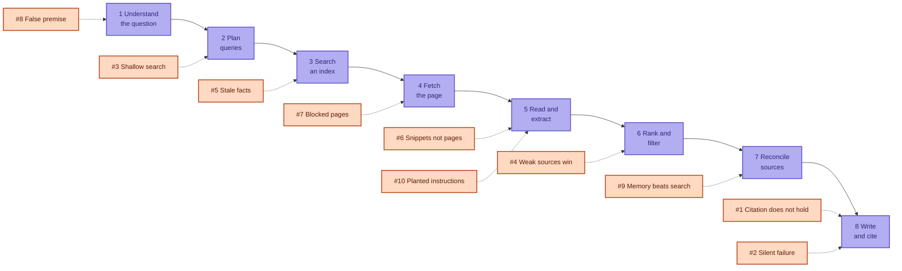
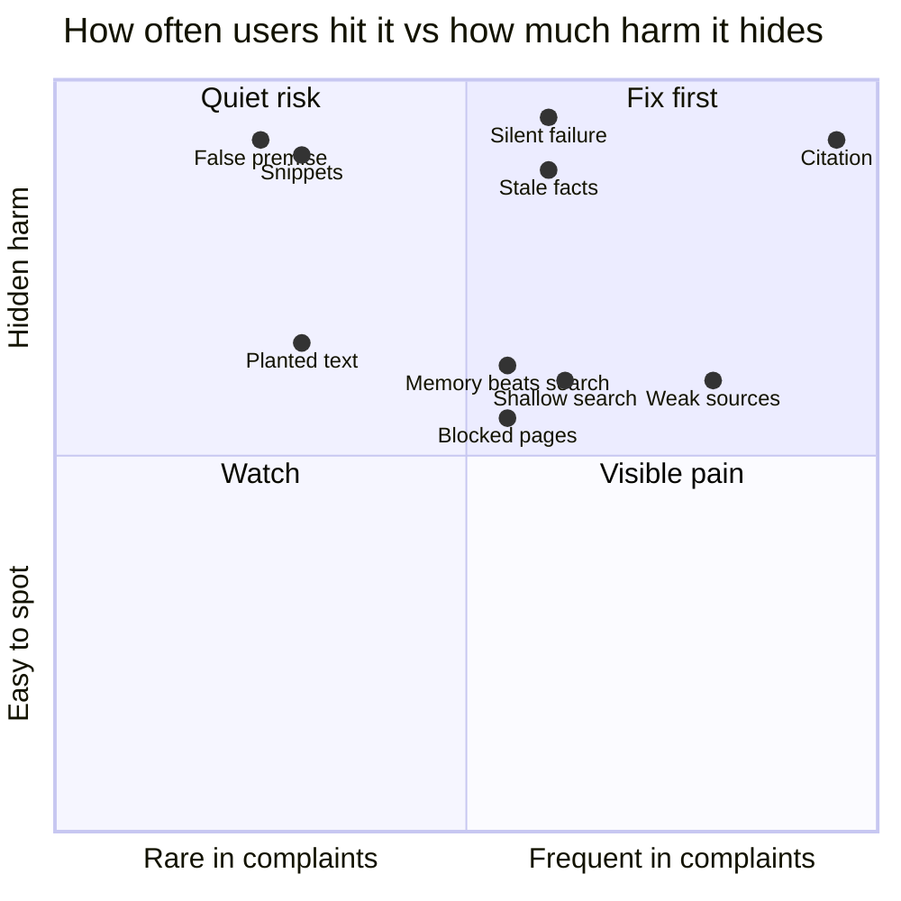

# Why AI assistants miss the right details when they search the web: user research

Research date: 2026-10-25. Status: Phase 1 of the design work, ready for review. The deep research, the last-30-days check and the full design doc come next.

Products in scope: Claude and Claude Code, ChatGPT (search and Deep Research), Gemini (app, Deep Research, API grounding), Google AI Overviews and AI Mode, Perplexity, Grok, Copilot.

## 1. How we did it

Three research strands ran side by side. Each looked at the same question from a different seat.

| Strand | Seat | What it covered | Size |
|---|---|---|---|
| U1 | The user | Complaints in vendor forums, Claude Code GitHub issues, Hacker News, practitioner audits | 91 complaints, 52 opened sources |
| U2 | The auditor | Independent studies and benchmarks with measured failure rates | 33 studies |
| U3 | The builder | Engineering docs, changelogs and papers that explain why retrieval breaks | 18 mechanisms |

Raw briefs, with every URL and date: [U1](AI_Web_Search_Failures_research/U1_voice_of_users.md), [U2](AI_Web_Search_Failures_research/U2_studies_benchmarks.md), [U3](AI_Web_Search_Failures_research/U3_builder_mechanisms.md).

Known gaps in the sample:
- Reddit and X could not be reached by any tool. The user voice leans toward developers and API users, and away from casual consumers.
- No complaints about Grok could be reached. An empty Grok cell means no data, not no problem.
- No independent study measures Claude Code's web search. Claude data comes from Claude.ai or the API.
- Hacker News dates are worked out from relative ages and are approximate.

## 2. Who searches, and what they need

| Persona | Typical job | What a miss costs them | Failure they feel most |
|---|---|---|---|
| Executive or manager | "Brief me on this company before the call" | Wrong fact said out loud to a client | Wrong person or firm, stale numbers |
| Analyst or researcher | "Find the figure and show me where it came from" | Report built on a number nobody can trace | Citation that does not hold the number |
| Developer using Claude Code or an agent | "Read the docs and use the current API" | Code written against an old version, long runs that drift | Truncated pages, silent tool failure |
| Consumer | "What is the right answer today" | Acts on a wrong phone number, price or rule | Planted or low-quality sources |

One behaviour cuts across all four. People rarely check the sources. Pew found a link inside an AI summary was clicked in only 1% of visits that showed one, and Reuters 2026 found 4% always or often click through. The burden of being right sits almost fully on the model.

## 3. Where in the search pipeline each failure hits

Read it left to right. Most failures start early, at fetch and read, but only show at the end, in the answer and its citations. That is why users blame the citation.

## 4. How we ranked

Each candidate got 0 to 3 points on four lenses. Higher total ranks higher.

| Lens | 3 points means |
|---|---|
| Users | Among the most frequent complaints in U1 |
| Measured | Several independent studies put a number on it in U2 |
| Builder impact | U3 rates the mechanism very high impact |
| Hidden harm | The user is unlikely to notice the miss before acting on it |

## 5. The candidate top 10

| # | Challenge | What the user sees | Users | Measured | Builder | Hidden | Total | Strongest evidence |
|---|---|---|---|---|---|---|---|---|
| 1 | Citation does not hold the claim | A link that loads but does not say what the answer says, or a link that never existed | 3 | 3 | 3 | 3 | **12** | Tow Center 2025: over 60% of 1,600 citation tests named the wrong article, publisher or URL. EBU 2025: sourcing was the top cause of significant issues at 31% |
| 2 | Silent failure, confident answer | A finished, confident report when the search found nothing or the tool broke | 2 | 3 | 2 | 3 | **10** | EBU 2025: refusals only 0.5%. ChatGPT Deep Research zero-source runs reported through 2026-10-25 |
| 3 | Shallow search, stops too early | Few sources, the key page never found | 2 | 3 | 3 | 2 | **10** | Stanford preprint 2026: 71.5% of errors came from retrieval. Mind2Web 2: best agent 28% vs humans 54% |
| 4 | Weak or planted sources win | SEO listicles, vendor pages, one Reddit comment, scam numbers | 3 | 2 | 3 | 2 | **10** | Practitioner audit: 215,128 machine-written pages from three brands cited by Perplexity. Scam phone number in AI Overviews |
| 5 | Stale facts shown as current | Last year's figure, old office holder, old install steps | 2 | 2 | 2 | 3 | **9** | Full Fact 2026-10-15: stale figures and wrong office holders across 7,625 answers |
| 6 | Reads snippets, not pages | Answer built from a search snippet or a cut-down page summary | 1 | 2 | 3 | 3 | **9** | "Retrieved but Not Read" preprint 2026-10-15. Claude Code WebFetch cut long pages silently until 2026-10-05 |
| 7 | Blocked or unreadable pages | The best source is paywalled, bot-blocked or JavaScript-only, so the model uses copies | 2 | 2 | 3 | 2 | **9** | Cloudflare blocks AI crawlers by default since 2025-07-01, wider default from 2026-09-15. Vercel logs: major AI bots do not run JavaScript |
| 8 | Goes along with a false premise | The question's wrong fact is accepted and "confirmed" | 1 | 3 | 2 | 3 | **9** | Stanford preprint 2026: accuracy fell to 19% to 70% with a subtle false premise. GPT-5 accepted fabricated facts 64% of the time |
| 9 | Memory beats search | The model answers from training data, or trusts a bad page over what it knew | 2 | 1 | 3 | 2 | **8** | ClashEval: models adopted wrong retrieved content over correct knowledge more than 60% of the time |
| 10 | Planted instructions in pages | Hidden text on a page steers the answer or the agent | 1 | 1 | 3 | 2 | **7** | Unit 42: 22 injection techniques seen in the wild. Brave's Comet demo. AI-targeted cloaking tests |

Near misses, each scoring 6, that could swap into slot 10:

| Challenge | Why it might matter more for you |
|---|---|
| Wrong person, firm or product variant | High for presales and account research. 9 user complaints, mostly Google AI |
| Numbers, tables and PDFs misread | High for finance and analyst work. 7 complaints, few measurements |
| Niche, local or non-English gaps | High for multi-country clients. Stanford: Hindi accuracy 79% vs 89% to 91% elsewhere |

## 6. What surprised us

- **Users mind silence more than failure.** The loudest recent complaint is not "search failed" but "it failed and did not tell me". This was not on our starting list.
- **Correct is not the same as grounded.** One audit of Google AI Overviews found about 91% of answers correct but only 39% both correct and fully backed by their sources. The vendor behind that audit sells the judging tool, so we treat it as indicative.
- **The fetcher can make things up.** Four Claude Code issues report page text that was not on the page, including a 500 error page returned as a full job posting.
- **Fixes are shipping weekly.** Claude Code changed WebFetch truncation, budget notices and robots.txt handling between 2026-10-05 and 2026-10-21. Some top-10 items may already be partly fixed. The last-30-days sweep will check each one.

## 7. Optional interview guide for primary research

For 30-minute calls with analysts, sales teams or engineers who use AI search at work.

1. Tell me about the last time an AI answer from the web turned out wrong. What was the task?
2. How did you find out it was wrong? How long did that take?
3. What did it cost you, in time, money or trust?
4. When do you click the sources, and when do you not?
5. Which kinds of questions do you no longer trust AI search with?
6. Have you seen it say "I could not find this"? How did you feel about that?
7. Which tool do you switch to when one fails, and why that one?
8. What would a trustworthy answer need to show you on the screen?
9. If you could fix one thing about AI search for your work, what would it be?

## 8. Next step

Confirm or change the top 10 in section 5. Then Phase 2 runs: the cause and fix for each item, a model scorecard from independent studies only, and an aggressive sweep of articles from 25 Sep to 25 Oct 2026 that marks each item as still true, worse, partly fixed or fixed.
