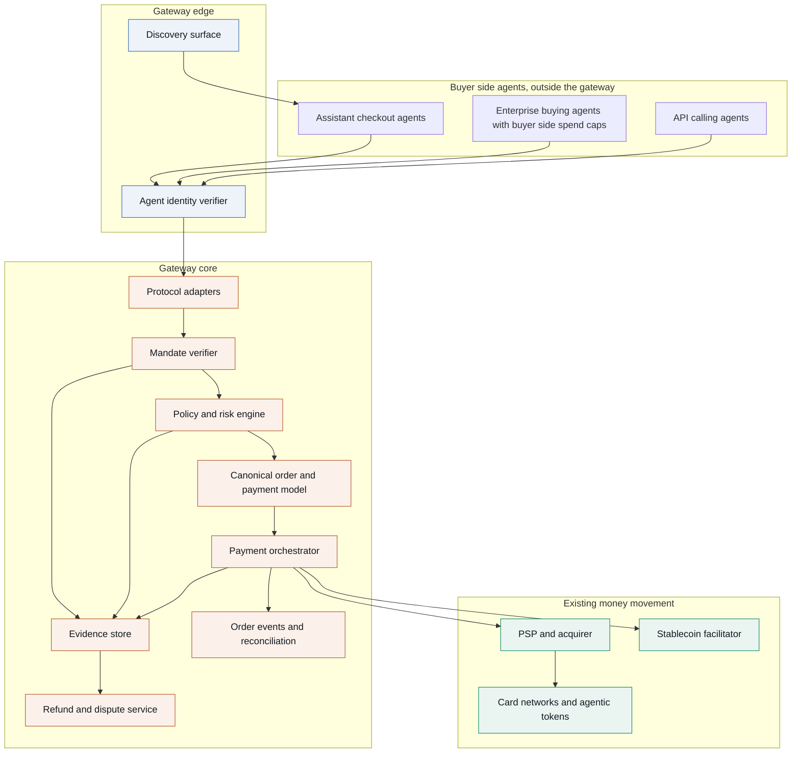
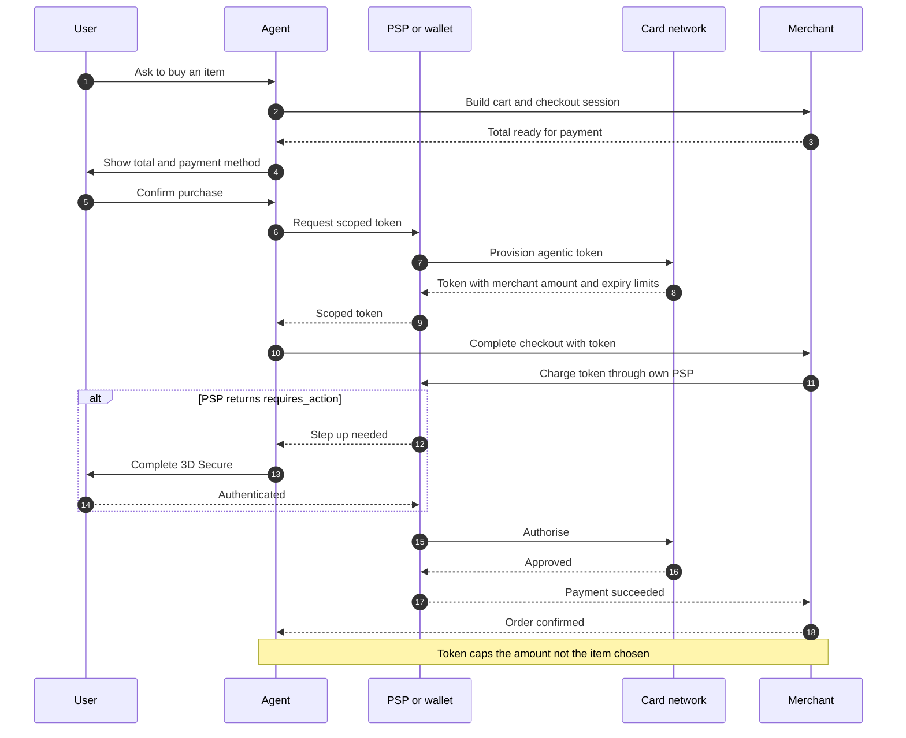
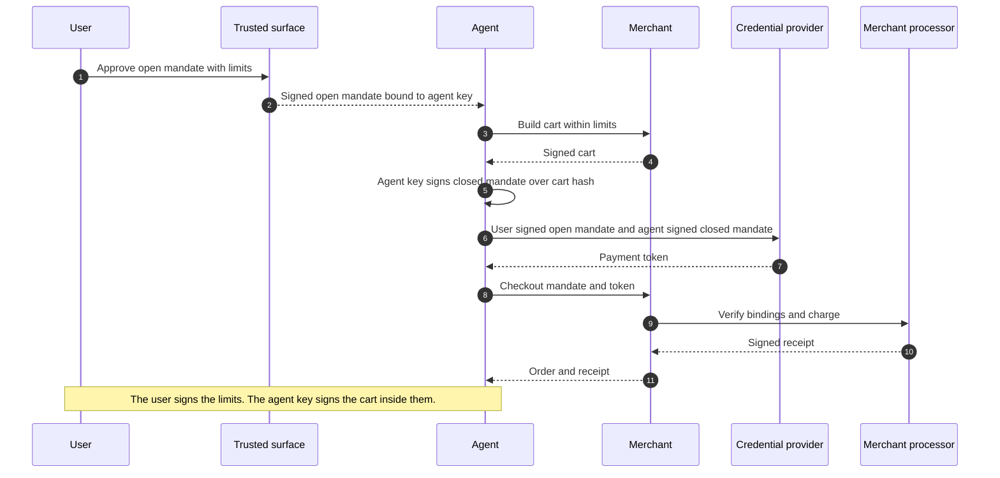
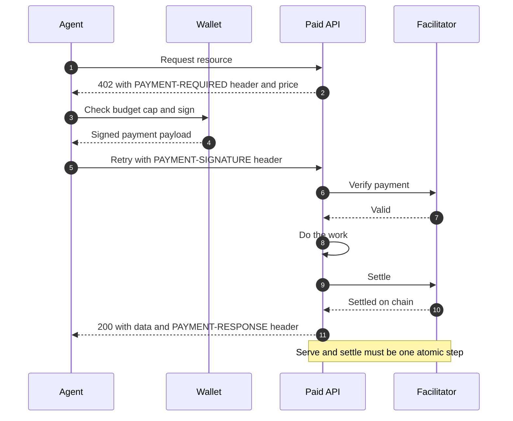
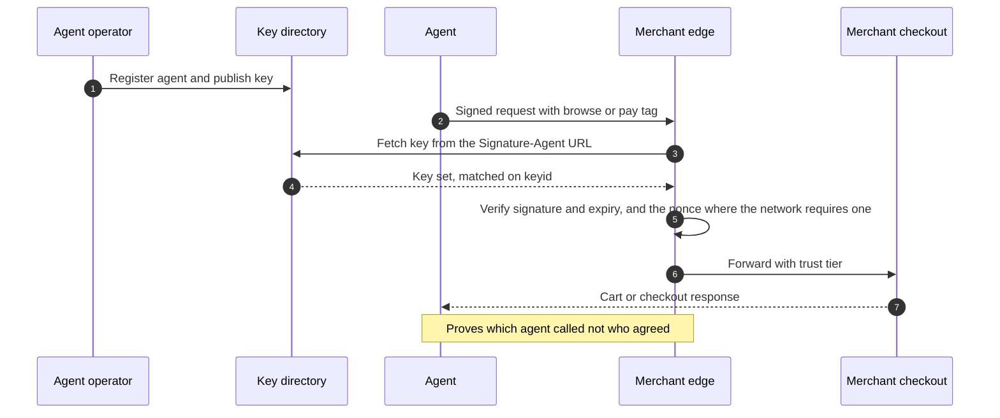
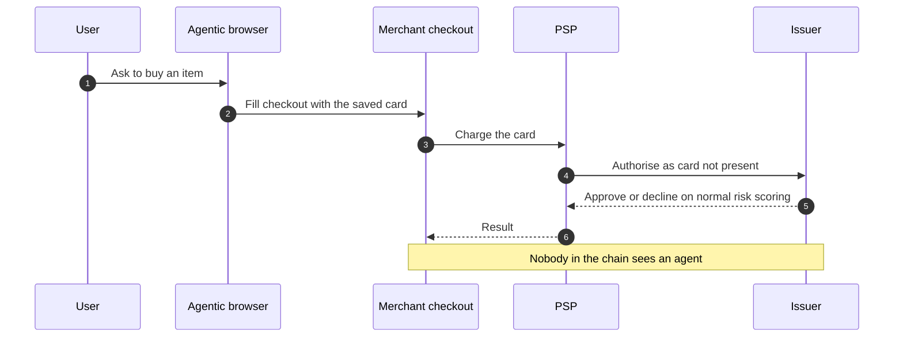
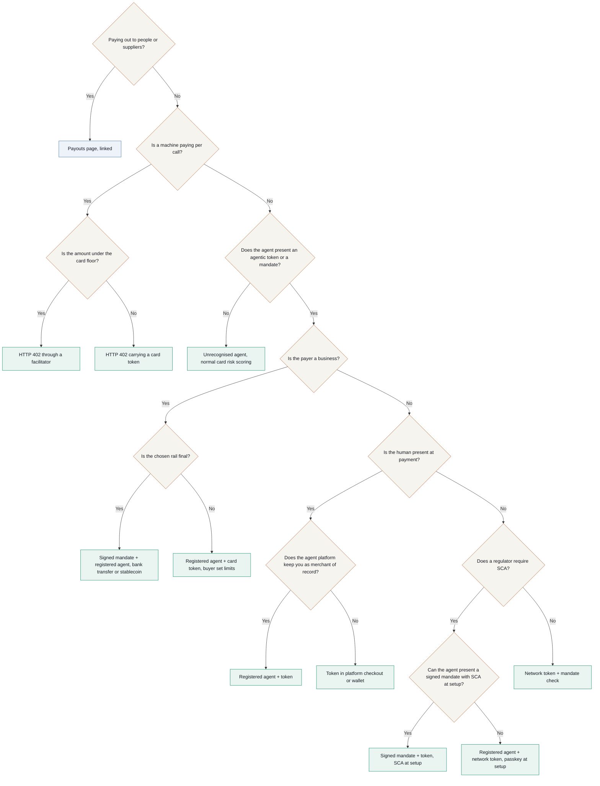
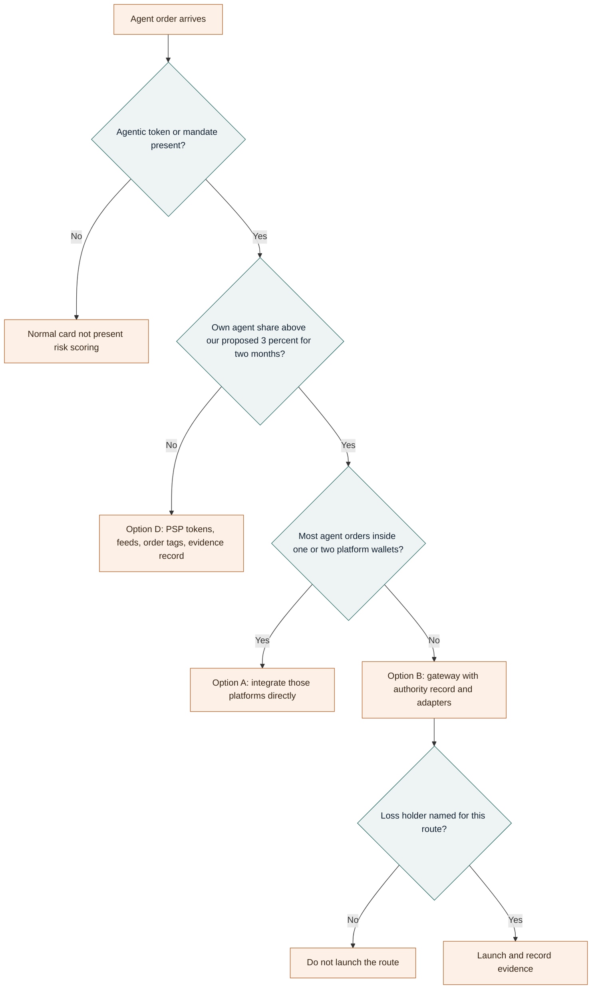

# Agentic Commerce and Payment Protocols, Technical Design and Architecture

A field guide and reference design for client leaders and payments architects. Version 0.1 draft, 15 Nov 2026. Freshness window for "recent" findings is 22 Oct to 15 Nov 2026.

Companion page: `/deep-dives/agentic-commerce-protocols`. Payouts are covered by `/deep-dives/agentic-payouts-desk` and are linked, not repeated, here.

<!-- STATUS: complete as of 2026-11-15. Wave 1 research, Wave 3 checks, red team and gap close applied. Appendix A is generated by drafts/acx/ledger.py. -->

## 0. How to read this document

### 0.1 The panel

Seven personas reasoned through this design. Each one has a stake they refuse to give up. Where two of them disagree, the design says how the tension was settled.

| Persona | Role | Stake |
|---|---|---|
| Maya | Payments architect | One integration that survives protocol churn, is idempotent and reconciles to the cent |
| Ravi | Fraud and issuer risk lead | No agent payment without a verifiable agent identity and a scope cap, with loss, declines and issuer risk measured per agent |
| Elena | Compliance lead | Consent is provable per payment under the payer's own regime, and liability is named before launch |
| Kofi | Mandate and identity owner | What the user allowed is signed, scoped, revocable and kept as evidence |
| Hana | Merchant commerce lead | Agents must not cut conversion, and the merchant stays merchant of record and keeps the customer |
| Sam | Agent platform builder | One way to pay across many merchants, low latency, and no card data inside the agent |
| Noor | Privacy and data protection lead | Evidence holds only what a dispute needs and is deleted when the rail's longest dispute window closes |

Noor joined after the red team found that the evidence store had no privacy owner (RT18). She owns the store and its retention rule, V18. Ravi's remit widened to issuer risk, because issuers rate high on four of the ten challenges (RT10). Lead decision D7.

### 0.2 Decided, proposed, open

- **Observed** facts carry a ledger id (AC#n, or C#n and payouts keys from earlier rounds) and an evidence rung from 1 to 7.
- **Proposed** design choices are marked "Proposal".
- **Open** questions are listed in section 13 and are never written as facts.
- **Critiques and decisions.** The red team's critiques are RT1 to RT20 (section 12). The lead's answers are decisions D1 to D21. Sections 0 to 11 name the RT and D ids where a critique changed the design.

### 0.3 Reading paths

Leaders read sections 1, 3, 6, 9, 10, 11 and 15. Architects read everything, starting with sections 4 and 5.

## 1. Requirements

### 1.1 Functional

1. Let a merchant sell to AI agents acting for consumers and businesses, across the protocols those agents use.
2. Let an enterprise or platform buy through agents with spend limits a human set.
3. Let an API, data or content seller charge agents per call.
4. Prove, per payment, which agent acted, for whom, under what authority, and what the user saw.
5. Handle refunds, disputes and chargebacks with evidence that holds up.

### 1.2 Non functional

| Need | Target (Proposal) | Why |
|---|---|---|
| Checkout latency added by agent checks | under 300 ms at p95, untested | Agents abandon slow merchants the same way people do. No production p95 for Web Bot Auth or TAP checks was found, so this is a target, not a measured figure (RT19, D10) |
| Pay per call settlement | under 2 s end to end | Agents retry on timeout, so slow settlement creates duplicates |
| Duplicate charge rate | 0, enforced by idempotency keys | Agents retry far more than humans |
| Evidence retention | the longest dispute window of the rail used, then delete (V18) | A dispute without the mandate is lost by default, and data protection law forbids keeping personal data longer than needed. Noor owns the rule (D7) |
| Card data in the agent | none | Keeps the agent platform out of PCI scope |

### 1.3 Constraints

- Protocols change monthly. No single checkout protocol has won in consumer checkout as of 15 Nov 2026. UCP is the only checkout protocol with a verified live consumer checkout inside the 90 day window (Google Universal Cart, rolling out in the US from 2026-10-15) [R1-29]. MCP is live as the tool transport under Shop MCP and WebMCP runs in a Chrome origin trial, but neither defines a checkout of its own [R1-33, G-206]. ACP has had no release since its 2026-04-17 spec [R1-01, R1-02] and AP2 is still a spec [R1-35]. Copilot Checkout launched on 2026-01-08 with Stripe connecting sellers over ACP, and which protocol it runs today is unconfirmed [G-204, G-205].
- Agents complete few orders. A modeled vendor panel puts agent completed orders at 1.52 percent of US ecommerce orders in October 2026, about 86 percent of them inside three platforms [G-02, G-03]. Visa calls agentic commerce a very small part of its business [G-06, G-112]. No source splits agent orders by protocol.
- Liability for agent initiated payments is not settled in law in the US, EU or UK. Visa's rules put an enrolled agent's actions on the cardholder [G-201] (see section 7).
- The merchant keeps its PSP. The design adds a layer, it does not replace the acquirer.

## 2. The protocol landscape

### 2.1 Who owns what

The specs and programmes below all compete to carry an agent's purchase. Each covers only part of the seven layer stack, and most are still run by one vendor or a small group of founders. Maturity per use case is in 2.3. "Watch" marks a protocol announced inside the window with no public spec yet (D21).

| Protocol | Owner | Governance | Latest version and date | Kind | Layers | Claims |
|---|---|---|---|---|---|---|
| ACP, Agentic Commerce Protocol | OpenAI, Stripe, Meta | Founders appoint up to 7 steering seats and keep a last resort veto. No foundation | 2026-04-17, labelled beta | commerce | L1, L2, L4, L7 partial | R1-01, R1-03, R1-04 |
| UCP, Universal Commerce Protocol | Google and Shopify, Stripe on the Governing Council | Governing Council, 16 seat Tech Council, Food, Lodging and Payments councils | v2026-08-25, later work unreleased on main | commerce | L1, L2, L3 partial, L4, L7 partial | R1-19, R1-21, R1-22, R1-23 |
| AP2, Agent Payments Protocol | Google | Standards work moved to FIDO working groups | v0.2.0, 2026-04-28 | trust | L2, L3 partial, L4, L7 | R1-35, R1-40 |
| A2A and its x402 extension | Linux Foundation (A2A), Google agentic commerce org (extension) | Neutral foundation for A2A, vendor org for the extension | A2A v1.0, first stable specification, announced 2026-04-09. Extension v0.1 2025-09-16 | commerce | L1, L3, extension L4 to L6 | R1-41, R1-42 |
| MCP | Model Context Protocol project | Own proposal process and deprecation policy | 2026-07-28 | commerce | L1 | R1-44 |
| WebMCP | W3C community group, editors from Microsoft and Google | Community group report, not a W3C standard | Draft 2026-11-13 | commerce | L1 | R1-48 |
| Shopify agent surfaces | Shopify | Vendor service on open protocols | Shop MCP 2026-10-13, Checkout WebMCP page undated, checked 2026-11-15. Chrome runs WebMCP as an origin trial | commerce | L1, L2, L4 | R1-33, R1-34, G-206 |
| Visa Trusted Agent Protocol (TAP) | Visa with Cloudflare | Visa run, launched with 12 feedback partners | No versioned release, sample repo last changed 2025-10-28 | trust | L3, L2 and L4 partial | R1-50, R1-52 |
| Visa Intelligent Commerce and Connect | Visa | Network programme, with agentic platform rules in Visa's rules (4.1.23) | API page checked 2026-11-15, Connect pilot from 2026-04-08, rules edition 2026-10-24 | payment | L2, L4, L5 | R2-05, C395, G-114, G-201 |
| Web Bot Auth over RFC 9421 | IETF working group, Cloudflare and Google authors | Standards track draft, April 2026 milestone missed | draft -01, 2026-10-29 | trust | L3 | R1-56, R1-57 |
| Mastercard Agent Pay | Mastercard | Network programme. No agent rule text found, developer guide only | No version or GA statement found. Expansion announced 2026-09-30. Agent Pay for Machines announced 2026-06-10 | payment | L3, L4, L5, L2 and L7 partial | R1-60, R2-13, G-115, G-116 |
| Mastercard Verifiable Intent | Mastercard, contributed to FIDO | Open to contributors, Mastercard maintains | Draft v0.1, last breaking change 2026-04-18 | trust | L2, L3, L7 | R1-40, R1-61, R1-63 |
| Amex ACE and Intent Intelligence | American Express | Proprietary, selective about which agents may transact | Intent Intelligence published 2026-10-13, no live integrations yet. Developer kit version not confirmed | payment | L2, L3, L4, L7 | G-24, G-25, G-20, C316 |
| KYAPay | Skyfire, with Akamai and Self-Issued Consulting co-authors | IETF individual draft, not endorsed by the IETF | -02, 2026-11-02 | trust | L3, L4 | R1-67 |
| KYA interoperability framework | Ant International, Mastercard, Visa | Convened through BuildFin.ai under the Monetary Authority of Singapore | No spec, started 2026-09-10 | trust | L3 | R1-68 |
| FIDO agentic working groups | FIDO Alliance, Mastercard and Visa chair the payments group | Standards body | No public draft, formed 2026-04-28 | trust | L2, L3 | R1-40 |
| EMVCo Agentic Payments framework | EMVCo task force | Card industry standards body | Draft framework, comments closed 2026-09-30 | trust | L2, L3, L4 | R1-64 |
| OpenID AuthZEN agent profiles | OpenID Foundation | Working group drafts | 2026-06-15 | trust | L2, L3 | R1-49 |
| Personal Agent Protocol (Watch) | Meta and Sierra, with Adyen as a partner | Draft shared with 35 design partners including Visa and OpenAI. Payments left for a later extension | Announced 2026-10-06, no public spec | trust | L2, L3 (account linking over OAuth) | G-15, G-14 |
| Stripe Shared Payment Tokens (SPT) | Stripe | Vendor API under preview terms | 2026-09-30.preview | payment | L2, L4 | R2-15 |
| x402 | x402 Foundation under the Linux Foundation | Neutral foundation since April 2026 | Spec v2, shipped 2025-12-11 | payment | L4, L5, L6 | R2-30, R2-31, C368 |
| MPP, Machine Payments Protocol | Tempo and Stripe | Spec on GitHub, IETF draft expired | draft-ryan-httpauth-payment-01, 2026-03-17, expired | payment | L4, L5, L6 | R2-23, R2-25 |
| L402 | Lightning Labs | Vendor | Agent write-up 2026-03-11 | payment | L4, L5, L6 | R2-53 |
| AWS AgentCore payments | AWS | Managed service | GA 2026-08-18 | payment | L2, L4 | R2-56 |
| PayPal, Adyen, Worldpay, Checkout.com | Each PSP | Vendor products on ACP, UCP or own APIs | See 2.2 | payment | L4 | R2-60, R2-61, R2-63, R2-64 |
| Coinbase and Circle | Coinbase, Circle | Vendor facilitator and vendor chain | Arc mainnet 2026-09-16 | rail | L5, L6 | R2-36, R2-51 |
| UPI agent payments | NPCI with Razorpay | Rail operator | Reserve Pay agent pilot 2026-02-20 | rail | L4, L5 | R2-68 |
| Pix agent payments | Banco Central do Brasil (rail), Iniciador (agent layer) | Rail operator | Iniciador MCP 2026-05-21 | rail | L4, L5 | R2-72 |
| Alipay AI Pay and Ant AMP | Ant Group, Ant International | Vendor controlled | AMP Phase I 2026-09-11 | rail | L2, L3, L4, L5 | R1-69, R1-70, R2-67 |

### 2.2 Protocol families

Payouts (use case P) are covered at `/deep-dives/agentic-payouts-desk` and are not repeated here. AP2 and ACP stay Spec in that context too [R1-01, R1-35].

**ACP (OpenAI, Stripe, Meta).** A plain REST checkout. The merchant pushes a product feed, the agent drives a checkout session, and a delegated payment step returns a token capped by amount, merchant and expiry [R1-05]. What matters most is that ChatGPT Instant Checkout ended in 2026-03 and checkout moved to retailer sites [R1-17, C359, G-119]. OpenAI's commerce docs now route buyers to "browser use or a plugin" and do not name ACP [R1-13, R1-15]. Its production guide leaves order, fulfilment, support and fraud decisions with the business and relays user risk signals in the Forwarded header [G-120]. The docs describe a ChatGPT Wallet that hands the merchant a network token [R1-14], but no launch of it could be confirmed, so it is unverified [G-136]. Visa and Mastercard have announced token deals with OpenAI, not yet live [G-121, G-118]. No release since 2026-04-17 and no commit after 2026-07-18 [R1-01, R1-02]. ACP did ship once: Copilot Checkout used it for Stripe sellers at launch [G-204]. Microsoft's current merchant page names only UCP, and Stripe's agentic docs now list UCP and not ACP [G-205]. Status: C Spec 2026-11-15, B Absent 2026-11-15, M Absent 2026-11-15.

**UCP (Google, Shopify and partners).** Each business publishes a profile at /.well-known/ucp, and agents check out over REST, MCP, A2A or an embedded page [R1-26]. It is the only checkout protocol with a verified live consumer checkout inside the 90 day window: Google Universal Cart began rolling out in the US on 2026-10-15 with checkout "powered by" UCP [R1-29]. Copilot Checkout launched on 2026-01-08 with Stripe connecting sellers over ACP, and which protocol it runs today is unconfirmed [G-204, G-205]. It is also the busiest and the most changeable. A Payments council of 8 formed on 2026-09-02 and Food Checkout merged on 2026-11-10, yet nothing has been tagged since v2026-08-25 [R1-19, R1-21, R1-24]. Two of its four 2026 releases, v2026-04-08 and v2026-08-25, carried 12 and 11 breaking items, including OAuth identity linking and a buyer consent overhaul [G-37, G-38, G-39]. Webhooks must be signed under RFC 9421 [G-131]. The business stays merchant of record [R1-27]. Status: C Live 2026-10-15, B Absent 2026-11-15, M Absent 2026-11-15.

**AP2 (Google, now in FIDO).** Signed mandates that prove what the user allowed. Version 0.2 (2026-04-28) replaced the old Intent and Cart mandates with Checkout and Payment mandates, each either open (limits set in advance) or closed (bound to one cart) [R1-35, R1-37, R1-38]. Standards work moved to the FIDO Payments working group, chaired by Mastercard and Visa, and the last release is v0.2.0 of 2026-04-28 [R1-35, R1-40]. A threat model shows a valid signature can still sit on a manipulated decision [R4-17], and the spec leaves disputes out of scope [R4-62]. Inside UCP it runs as an opt-in extension [R1-28]. Status: C Spec, B Spec, M Spec, all 2026-11-15.

**A2A and its x402 extension.** A2A is messaging between agents of different companies, with signed Agent Cards and long running tasks. It is a Linux Foundation project. v1.0 is its first stable specification, backed by more than 150 organisations (Linux Foundation, 2026-04-09, vendor count) [R1-42], and it has no commerce meaning of its own. The x402 extension adds payment states and an append only receipts list to a task, but its only release is v0.1 from 2025-09-16 and it stayed under the Google agentic commerce organisation [R1-41]. Status: A2A C Spec, B Spec, M Spec. Extension C Absent, B Absent, M Spec. All 2026-11-15.

**MCP, WebMCP and Shopify's agent surfaces.** MCP is how agents call tools. Its 2026-07-28 spec is stateless and has no payment primitive, so paid tools wrap x402 or MPP [R1-44, R1-46]. WebMCP lets a web page declare tools to a browser agent, with a hint for consequential actions and no confirmation API [R1-48]. Shopify is the largest live user. Shop MCP completes checkout only after "the shopper confirms the total and payment method" [R1-33], and Checkout WebMCP states that a Web Bot Auth signature is not buyer permission [R1-34]. AWS AgentCore payments pays for MCP tools over x402 and MPP [R1-47]. Status: MCP C Live 2026-10-13, B Absent 2026-11-15, M Live 2026-08-18. WebMCP C Pilot 2026-11-15: Shopify registers checkout tools on eligible checkouts, but Chrome runs WebMCP as an origin trial (Chrome 149 to 156, shipping planned for 157) [G-206]. B and M Absent 2026-11-15.

**Visa TAP, Intelligent Commerce and Connect.** TAP lets a registered agent sign each request with RFC 9421, so a merchant or CDN can check it against a key directory Visa hosts [R1-51, R1-53]. Intelligent Commerce gives that agent its own Visa token after the cardholder sets a passkey and approves a purchase instruction [R2-05]. Connect is a builder on ramp that accepts TAP, MPP, ACP and UCP [C395]. Shop Pay checkout inside personal agents now runs on Visa, Mastercard and Discover tokens [R2-11], and the BILL and Billtrust pilot is a live B2B use, with the BILL agent registered through TAP [R1-54, R2-04]. Visa says merchant participation in live European agent purchases (lastminute.com, Frasers, Cleverbridge, BrickDepot) was enabled through TAP, with 31 named issuers, Visa Payment Passkeys and SCA, and no signed mandate (vendor) [G-34]. Visa says nearly 50 AI partners are live and gives no volume (vendor) [R2-01, G-111]. Its CEO called agentic transactions "albeit limited" and very small against Visa's business [G-112]. Ramp's agentic bill pay is the one named use that is generally available, and Connect is still in pilot [G-113, G-114]. Visa checks every credential retrieval against the mandate's cap and preferred merchant, summed across the instruction [G-16, G-17]. Visa's rules (edition 2026-10-24) make the cardholder responsible for an enrolled agent's actions [G-201]. Status: TAP C Pilot 2026-07-02, B Pilot 2026-10-20, M Absent 2026-11-15. Intelligent Commerce C Live 2026-10-28 with volume Visa calls limited, B Pilot 2026-10-21, M Spec 2026-11-15.

**Web Bot Auth.** The IETF form of signed agent requests. An agent publishes keys at a well known address and signs each request, so any site can check who sent it [R1-56]. It is the only agent identity method here on a standards track, but the working group missed its April 2026 milestone [R1-57] and its single tag differs from the browse and pay tags Visa and Mastercard use [R1-53, R1-56]. ChatGPT's cloud browser already signs with it, and Akamai, Cloudflare, HUMAN and Vercel verify it [R1-16]. It identifies the tool, not the human [R4-69]. Status: C Live 2026-11-15 for identity only, B Spec 2026-11-15, M Spec 2026-11-15.

**Mastercard Agent Pay and Verifiable Intent.** Agent Pay registers agents, signs their requests through Web Bot Auth and issues agentic tokens that pass through the merchant's normal card form [R1-53]. All European issuers are enabled and 36 banks completed controlled live transactions with passkeys (vendor) [R1-60]. Shopify's 2026-10-28 page shows Shop Pay in personal agents on Mastercard tokens but does not name Agent Pay [R2-11]. Mastercard's CEO said on 2026-10-29 that Shop Pay uses Agent Pay [R2-09, G-09]. No Mastercard source says Agent Pay is generally available. Its developer guide says it has completed live agentic transactions in several markets including Thailand, and its agent probability score went into US testing on 2026-09-30 [G-115, G-117]. The same guide says agents must not use stored cards, because issuers then cannot see the agent, and without an agentic token the network cannot apply its risk controls [G-19, G-20]. Volumes are still described as early days [R1-18], and the CEO calls one time virtual cards "a bridge" rather than a long term answer [R2-09, G-08]. Verifiable Intent is the mandate side, chained SD-JWT layers aligned field by field to AP2, still Draft v0.1 and contributed to FIDO [R1-40, R1-61, R1-63]. Agent Pay for Machines was announced on 2026-06-10 with more than 30 partners (vendor) and no verified real money [R2-13]. Status: Agent Pay C Live 2026-10-28, B Absent 2026-11-15, M Spec 2026-11-15. Verifiable Intent C Spec, B Absent, M Absent, all 2026-11-15.

**American Express ACE.** Amex published its Intent Intelligence framework on 2026-10-13 [C316]. Amex confirmed to trade press that it has no live integrations yet and that Agent Purchase Protection is not yet available [G-24]. Its CEO said Amex will not let agents "run rogue" and will be selective about which agents may transact [G-25]. Mastercard's merchant guide names Amex ACE as one of three network agent schemes, beside Agent Pay and Visa TAP [G-20]. The earlier announcement of cover for registered agents with authenticated intent [C372] is a promise, not live cover. The ACE developer kit pages did not open in the Wave 3 check, so its spec count is not confirmed. Shopify lists Amex tokens as coming soon for Shop Pay in agents [R2-11]. Status: C Spec, B Absent, M Absent, all 2026-11-15.

**KYA and KYAPay.** Know Your Agent means a trusted issuer vouches for an agent and the human behind it. Skyfire's KYAPay draft -02 (2026-11-02) carries identity and payment claims in signed tokens sent in a request header, and it is an individual draft "not endorsed by the IETF" [R1-67]. Ant International, Mastercard and Visa began a KYA interoperability effort on 2026-09-10 with no spec and no timeline [R1-68]. Status: KYAPay C Spec, B Absent, M Spec. KYA framework C, B and M Unsettled. All 2026-11-15.

**FIDO, EMVCo and OpenID agent identity.** This is where mandate and agent authentication standards are expected to settle. FIDO formed two working groups on 2026-04-28, seeded with AP2 and Verifiable Intent, and says only that work has commenced [R1-40]. EMVCo's Agentic Payments Task Force drafted a framework centred on Intent Services and is still exploring Know Your Agent checks and Agentic Transaction Indicators, with comments closed on 2026-09-30 (trade press) [R1-64]. OpenID AuthZEN has authorization drafts for agents and MCP tools and no payment flow [R1-49]. Status: FIDO and EMVCo Unsettled for C, B and M. AuthZEN Spec for C, B and M. All 2026-11-15.

**Stripe Shared Payment Tokens.** A scoped grant of the buyer's saved payment method to one seller, limited by currency, amount and expiry and revocable at any time [R2-15]. Underneath, Stripe may use Visa or Mastercard agentic tokens [R2-16]. The API still runs under preview terms in 34 listed countries [R2-15]. Stripe's docs say SPTs are available to agents, customers and sellers in the US, Canada and select European countries [R2-15], and Microsoft says Copilot Checkout is available on Copilot.com and protects transactions with SPTs [G-205]. Link's agent wallet makes the user responsible for every purchase the agent makes, including a different product from the one shown, and is open to accounts from the US, Canada, Mexico, Japan and Singapore [G-127, G-128]. Link Purchase Protections cover US residents only, at Stripe's discretion, and say nothing about agents [G-126]. Separately, Instinct began a US rollout of a USDC funded Link balance on 2026-10-26, with a per purchase ceiling set by the user (trade press) [R2-21]. That is a Link fact and does not set the SPT status. Stripe's machine payments accept MPP and x402 [R2-17]. Status: C Live 2026-11-15 under preview terms, B Spec 2026-11-15, M Spec 2026-11-15.

**x402.** The server answers an unpaid request with HTTP 402 and payment terms, and the client signs a stablecoin payment and retries [R1-46]. x402 moved under the Linux Foundation in April 2026 [R2-31]. Coinbase's docs count 40 members at launch on 2026-04-02 [R2-31], and the Linux Foundation counted more than 50 active members on 2026-10-01 (vendor) [R2-33]. A tracker run by one pseudonymous operator, self declared independent, shows about 200.7M lifetime transactions worth about 43.0M USD. Its raw counts include tests and self dealing, so its figures are tagged vendor [R2-38, G-101, G-102]. Monthly transactions fell from 17.9M in August to 5.1M in October 2026 (about 274K USD), a 72 percent fall, then reached 4.7M in the first half of November, mostly through one facilitator [G-104, G-106, R2-39, R2-40]. TRM Labs puts the agentic share at 0.6 to 7.5 percent of settled value, about 5K to 11K USD a month [G-107]. About half of transactions may be artificial (press citing Artemis, vendor) [R2-47], and papers show unpaid service and paid but denied outcomes [R4-14]. The upto and batch-settlement schemes are merged in the spec with SDK code [G-133, G-134]. Status: C Spec 2026-11-15, B Spec 2026-11-15, M Live 2026-11-15.

**MPP (Tempo and Stripe).** An HTTP 402 scheme with charge, session and subscription intents [R2-22, R2-24]. MPP lists Tempo, Stripe, Lightning and Solana among 11 named payment methods plus a custom method option, and has no ACH or bank debit method [R2-22, R2-23]. Its IETF draft expired without working group adoption [R2-25]. On chain it is small, at 48,585 lifetime Tempo events from 1,874 payers to 92 payees [R2-28]. Status: C Spec 2026-11-15, B Absent 2026-11-15, M Live 2026-11-15.

**L402.** Lightning Labs' HTTP 402 scheme. The server returns a macaroon and a Lightning invoice, the client pays and retries with the payment preimage, and the check runs locally [R2-53]. Its Wavelength wallet toolkit is an invite only mainnet alpha with a 1 basis point fee [R2-55]. Status: C Absent, B Absent, M Pilot 2026-07-21.

**AWS AgentCore payments.** A managed service that lets agents pay for APIs, MCP servers and content over MPP and the x402 upto scheme, with Coinbase and Stripe Privy wallets and limits enforced in AWS infrastructure [R2-56]. AWS adds no charge, and wallet providers bill per operation [R2-57]. The GA notice is 89 days old on the as_of date, so it needs a recheck next round [R1-47]. Status: C Absent, B Absent, M Live 2026-08-18.

**PayPal, Adyen, Worldpay and Checkout.com.** The large PSPs sell agent readiness to merchants rather than a protocol of their own. Adyen Agentic (feed, cart and payments with token portability) is in limited availability for US enterprise merchants [R2-61]. Checkout.com is a certified ACP handler, processes UCP over Google Pay rails and is in early access for selected partners [R2-63]. Worldpay said in January that its UCP checkout with Google "launches soon" [R2-64], and no later source was found. PayPal, Shopify and Stripe launched as Copilot Checkout payment partners on 2026-01-08 [R1-72, R2-59]. Stripe says its sellers connect over ACP [G-204]. Microsoft's current merchant page names UCP as future support and does not name ACP or PayPal [G-205]. PayPal offers 33 agent tools on a remote MCP server [R2-60]. On its Q3 call PayPal said it is working with Meta and other AI firms to put PayPal into personal agents, gave no agent volume, and reported branded checkout growth stuck at 1 to 2 percent [G-12, G-13]. Adyen partnered with Sierra and Meta on the Personal Agent Protocol [G-14]. Status: Adyen C Pilot 2026-06-16. Checkout.com C Pilot 2026-11-15. Worldpay C Absent 2026-11-15 as a shipped product, announced on 2026-01-28 as launching soon. PayPal C Pilot 2026-01-08, stale. B and M Absent as products for all four, though Adyen is an Agent Pay for Machines partner [R2-14].

**Coinbase and Circle.** The stablecoin plumbing under pay per call. Coinbase's x402 facilitator settles on six mainnets, is free for the first 1,000 settlements a month and then costs 0.001 USD each [R2-34, R2-36]. It supports the exact, upto and batch-settlement schemes on five EVM mainnets [G-135]. Circle's Arc chain went live on 2026-09-16 with agent wallets, spending limits and nanopayments [R2-51]. Nanopayments batch x402 payments as small as 0.000001 USD into one settlement [R2-52]. Status: both C and B Absent 2026-11-15. Coinbase M Live 2026-11-15. Circle M Live 2026-09-16.

**UPI and Pix.** India and Brazil let agents use real time bank rails under a user approved limit or a per payment biometric. Razorpay and NPCI run agentic UPI payments on Claude with Zomato, Swiggy and Zepto, in pilot with a small group of users, on Reserve Pay limits [R2-68]. A wider Unified Agent Protocol is reported but not confirmed, with limits and liability pending [R2-69]. In Brazil, Iniciador's MCP lets agents start Pix payments that the user approves by device biometric each time [R2-72]. Status: UPI C Pilot 2026-02-20. Pix C Spec 2026-11-15. B and M Absent for both.

**Alipay and Ant.** Alipay AI Pay plugs into agents, verifies identity once and needs explicit user approval for every payment [R2-66]. It opened to OpenClaw type agents, including Claude Code, in April 2026 [G-49]. Alipay reports more than 100M users and 300M transactions to date by late May 2026 (vendor) [R2-66, R2-67]. Ant International's AMP runs on Alipay+ wallets, with 10 wallets and 7 acquirers in Phase I and no volumes or go-live dates disclosed [R1-69, R1-70]. Status: Alipay AI Pay C Pilot 2026-05-26 on vendor figures only. AMP C Spec, M Spec. B Absent. All others 2026-11-15.

### 2.3 Status matrix

Each cell reads maturity then as_of. Live and Pilot carry the date of the evidence. Spec, Unsettled and Absent carry the check date. Live needs a rung 2 to 4 source dated within 90 days of 2026-11-15, so a figure from an earnings call or press quote (rung 6) cannot make a cell Live on its own.

| Protocol | C consumer checkout | B B2B procurement | M machine pay per call | Claims |
|---|---|---|---|---|
| ACP | Spec 2026-11-15 | Absent 2026-11-15 | Absent 2026-11-15 | R1-01, R1-02, R1-15, R1-17 |
| UCP | Live 2026-10-15 | Absent 2026-11-15 | Absent 2026-11-15 | R1-29 |
| AP2 | Spec 2026-11-15 | Spec 2026-11-15 | Spec 2026-11-15 | R1-35, R1-39 |
| A2A | Spec 2026-11-15 | Spec 2026-11-15 | Spec 2026-11-15 | R1-42 |
| A2A x402 extension | Absent 2026-11-15 | Absent 2026-11-15 | Spec 2026-11-15 | R1-41 |
| MCP (Shop MCP, AgentCore) | Live 2026-10-13 | Absent 2026-11-15 | Live 2026-08-18 | R1-33, R1-47, R2-56 |
| WebMCP (Shopify checkout) | Pilot 2026-11-15 | Absent 2026-11-15 | Absent 2026-11-15 | R1-34, G-206 |
| Web Bot Auth (identity only) | Live 2026-11-15 | Spec 2026-11-15 | Spec 2026-11-15 | R1-16, R1-34, R1-56 |
| Visa TAP | Pilot 2026-07-02 | Pilot 2026-10-20 | Absent 2026-11-15 | R1-50, R1-51, R1-54, G-34 |
| Visa Intelligent Commerce and Connect | Live 2026-10-28, volume limited | Pilot 2026-10-21 | Spec 2026-11-15 | R2-11, R2-01, R2-04, R2-05, C395, G-112, G-113 |
| Mastercard Agent Pay | Live 2026-10-28 | Absent 2026-11-15 | Spec 2026-11-15 | R2-11, R2-09, R1-18, R2-13, G-117 |
| Mastercard Verifiable Intent | Spec 2026-11-15 | Absent 2026-11-15 | Absent 2026-11-15 | R1-61, R1-63 |
| Amex ACE | Spec 2026-11-15 | Absent 2026-11-15 | Absent 2026-11-15 | G-24, G-20 |
| KYAPay | Spec 2026-11-15 | Absent 2026-11-15 | Spec 2026-11-15 | R1-67 |
| KYA framework (Ant, Mastercard, Visa) | Unsettled 2026-11-15 | Unsettled 2026-11-15 | Unsettled 2026-11-15 | R1-68 |
| FIDO working groups | Unsettled 2026-11-15 | Unsettled 2026-11-15 | Unsettled 2026-11-15 | R1-40 |
| EMVCo framework | Unsettled 2026-11-15 | Unsettled 2026-11-15 | Unsettled 2026-11-15 | R1-64 |
| OpenID AuthZEN | Spec 2026-11-15 | Spec 2026-11-15 | Spec 2026-11-15 | R1-49 |
| Stripe SPT and Link | Live 2026-11-15, preview terms | Spec 2026-11-15 | Spec 2026-11-15 | R2-15, R2-17, G-205 |
| x402 | Spec 2026-11-15 | Spec 2026-11-15 | Live 2026-11-15 | R2-30, R2-38, R2-39 |
| MPP | Spec 2026-11-15 | Absent 2026-11-15 | Live 2026-11-15 | R2-17, R2-22, R2-28 |
| L402 | Absent 2026-11-15 | Absent 2026-11-15 | Pilot 2026-07-21 | R2-55 |
| AWS AgentCore payments | Absent 2026-11-15 | Absent 2026-11-15 | Live 2026-08-18 | R2-56 |
| Coinbase x402 facilitator | Absent 2026-11-15 | Absent 2026-11-15 | Live 2026-11-15 | R2-36 |
| Circle Arc and Nanopayments | Absent 2026-11-15 | Absent 2026-11-15 | Live 2026-09-16 | R2-51, R2-52 |
| Adyen Agentic | Pilot 2026-06-16 | Absent 2026-11-15 | Absent 2026-11-15 | R2-61 |
| Checkout.com agentic | Pilot 2026-11-15 | Absent 2026-11-15 | Absent 2026-11-15 | R2-63 |
| Worldpay with UCP | Absent 2026-11-15, announced 2026-01-28 | Absent 2026-11-15 | Absent 2026-11-15 | R2-64 |
| PayPal (Copilot Checkout processor) | Pilot 2026-01-08 | Absent 2026-11-15 | Absent 2026-11-15 | R1-72, R2-59 |
| UPI Reserve Pay for agents | Pilot 2026-02-20 | Absent 2026-11-15 | Absent 2026-11-15 | R2-68 |
| Pix through Iniciador MCP | Spec 2026-11-15 | Absent 2026-11-15 | Absent 2026-11-15 | R2-72 |
| Alipay AI Pay | Pilot 2026-05-26 | Absent 2026-11-15 | Absent 2026-11-15 | R2-66, R2-67 |
| Ant AMP | Spec 2026-11-15 | Absent 2026-11-15 | Spec 2026-11-15 | R1-69, R1-70 |

Calls made where the briefs disagree or the evidence sits below the bar:

- Mastercard Agent Pay C is Live, not Pilot. R1 rated it on the 2026-06-02 European transactions [R1-60]. Shopify's 2026-10-28 page shows Shop Pay in personal agents on Mastercard tokens [R2-11], a rung 4 source inside the window, but it does not name Agent Pay. Mastercard's CEO said on 2026-10-29 that Shop Pay uses Agent Pay [R2-09]. No Mastercard source says Agent Pay is generally available. Its developer guide says live agentic transactions ran in several markets, including Thailand [G-115, G-117].
- Agent Pay for Machines M is Spec, not Pilot. The only sources are press reports of an announcement with partners and no real money shown [R2-13, R2-14]. No money moved with a named partner after 2026-06-10 was found.
- Visa Intelligent Commerce C stays Live 2026-10-28, with Visa's own qualifier: its CEO called agentic transactions "albeit limited" and very small against Visa's business [G-112]. Ramp's agentic bill pay is the one named use that is generally available [G-113].
- Amex ACE C is Spec (D17). Amex published Intent Intelligence on 2026-10-13 and confirmed it has no live integrations yet and that Agent Purchase Protection is not yet available [G-24]. Mastercard's merchant guide names ACE as one of three network agent schemes [G-20]. The ACE pages behind the first Spec call did not open in the Wave 3 check and were cut, so the cell now rests on these sources.
- Visa TAP C is Pilot from 2026-07-02. Visa says merchant participation in live European agent purchases was enabled through TAP [G-34]. The evidence is older than 90 days, so it is Pilot, not Live.
- ACP C stays Spec. It shipped once, in Copilot Checkout for Stripe sellers at launch on 2026-01-08 [G-204], but Microsoft's current merchant page names only UCP and Stripe's agentic docs now list UCP and not ACP [G-205]. ChatGPT Instant Checkout ended in 2026-03 [G-119], and a ChatGPT Wallet launch could not be confirmed [G-136].
- WebMCP C is Pilot, not Live. Shopify registers checkout tools on eligible checkouts, but Chrome runs WebMCP as an origin trial, and the Shopify page carries no date [R1-34, G-206].
- Web Bot Auth C is Live as of the check date, 2026-11-15, because neither cited page carries a date [R1-16].
- Stripe SPT C is Live from 2026-11-15, under preview terms, and M is Spec. Stripe's docs say SPTs are available in the US, Canada and select European countries [R2-15], and Microsoft says Copilot Checkout is available and protects transactions with SPTs [G-205]. The Instinct Link balance [R2-21] is a Link fact and no longer sets this cell. Stripe's own MPP and x402 support is counted on the MPP and x402 rows.
- Alipay AI Pay stays Pilot. K1 found live use and proposed Live. The newest evidence is a vendor statement of 2026-05-26, and the weekly volume figure dates from February 2026, both older than the 90 day window, so the cell stays Pilot under the rule above [R2-66, R2-67, G-49].
- PayPal rests on January 2026 sources only [R1-72, R2-59] and needs a recheck. Worldpay C is Absent as a shipped product: it was announced on 2026-01-28 as launching soon and no later source was found [R2-64].
- On the page, KYAPay and the KYA framework share one row, and Alipay AI Pay and Ant AMP share one row. Each merged cell takes the status of the member that has one: B Unsettled comes from the KYA framework [R1-68] and M Spec from AMP [R1-69, R1-70].

### 2.4 Where each protocol sits

## 3. Recommended approach, thesis before critique

**Thesis (Proposal), restated after the red team (D1).** Spend first on what pays in every world: product data agents can read, a tag on every agent order, and an evidence record for each agent payment. Do not bet on one checkout protocol. Build to the token and a thin authority record, not to any one checkout protocol, and only once your own agent completed share (V17) passes 3 percent of orders for two months running. The 3 percent figure is our proposed threshold, not a sourced number. Below that trigger, keep your PSP and wait with readiness (ADR-1 option D). Above it, hold one canonical order, authority and payment model with an adapter per checkout surface your buyers' agents use (option B). Agent identity is checked at the edge, the cart is checked against the authority record by a component that cannot move money, and every decision is written to an evidence store before money moves.

Why spend first, build later: agents complete few orders. A modeled vendor panel puts agent completed orders at 1.52 percent of US ecommerce orders in October 2026 [G-02], 84 percent of merchants in one survey report no customer demand [G-42], and Visa calls agentic commerce a very small part of its business [G-06]. Product data, order tags and evidence pay off whichever scenario in 11.2 comes true (RT3).

Why the token and a thin authority record: above the trigger, the protocols overlap at transport and discovery but converge on a small set of credentials (network agentic tokens, PSP scoped tokens, stablecoin authorisations). Those move money and decide liability, so they deserve the stable core. Authority proofs do not converge. Visa, AP2, ACP and Amex share five fields (amount cap, currency, merchant constraint, expiry, recurrence) but bind them to different things: a cart, a checkout session, a merchant or a budget [G-16, G-17]. So the core keeps those five fields, a binding level and the original signed artifact unchanged, not a union of every mandate format (D3, RT2).

Where the thesis loses. If platform wallets own both the token and the checkout (scenario `walled` in 11.2), a merchant's canonical model adds little. Today about 86 percent of agent completed orders in the vendor panel sit inside Meta Muse, Alexa for Shopping and Gemini [G-03]. If three platforms still hold more than half of agent completed orders at 2027-12-31, integrate those platforms directly (ADR-1 option A) and stop investing in adapters (RT1).

What the token does not solve. The token is not neutral. Lock in moves from the protocol to the network and the PSP, and a network token moves to a new PSP only as far as the token requestor allows [G-57]. Option C in ADR-1 therefore carries a contract question: who is the token requestor for agentic tokens, and can it move (RT9)?

Section 12 attacks the first version of this thesis. This version answers RT1, RT2, RT3 and RT9.

## 4. The parameters and variables a protocol must decide

This is the answer to "what are the right parameters and variables to build these protocols". A parameter is a design choice made once. A variable is a value set per agent, per user or per payment. Source: frozen schema `docs/Agentic_Commerce_Protocols_research/R0_schema.md`.

Every row now has a kind (D11, answering RT7 and RT13). **Choice** means the builder decides. **Context** means law, a network or the market sets it, and the builder cannot choose it. **Evidence** means a field the builder records. Section 4.4 lists the final set by kind.

### 4.1 Parameters

| ID | Parameter | Kind | Values | Who decides | Why it matters |
|---|---|---|---|---|---|
| P1 | Initiator presence | choice | human present, human not present, machine to machine | Protocol and merchant | Sets whether step up is possible and how disputes are judged |
| P2 | Payer type | choice | consumer, business, agent owned wallet | Agent platform | Picks the legal regime |
| P3 | Agent identity method | choice | none, signed HTTP requests, network registered agent, verifiable credential or KYA token, OAuth client, CDN verified bot marked Direct or Intermediary [G-36] | Protocol and network | Lets a merchant tell a trusted agent from a bot |
| P4 | Mandate type | choice | none, implicit, token scoped limits, signed intent mandate, signed cart mandate, network held instructions | Protocol | Decides what proof exists that the user agreed |
| P5 | Credential | choice | agentic network token, PSP scoped token, wallet account, stablecoin key, bank account mandate, virtual card | Payer and PSP | Decides who can see and reuse the payment detail |
| P6 | Rail | choice | card, real time account to account, stablecoin, Lightning, wallet balance | Payer and merchant | Sets cost, speed, reach and reversibility |
| P7 | Finality | choice | reversible by chargeback, final with refund by agreement | Rail | Decides who absorbs a bad purchase |
| P8 | Merchant of record | choice | merchant, agent platform, marketplace | Contract, set by the agent platform's checkout | Owns tax, refunds and service |
| P9 | Dispute path | choice | card reason codes, PSP or platform policy, signed mandate as evidence, none | Network and protocol | Card reason codes were written for human buyers |
| P10 | Liability holder | context | issuer when authenticated, merchant by default, agent platform by contract, user under an authorised presumption, cardholder for an enrolled agent on Visa [G-201], Amex protection promised, not live [G-24] | Law, network rules, contract | The open question that slows adoption |
| P11 | Transport | choice | REST checkout API, HTTP 402, MCP tools, A2A messages, agentic browser | Protocol | Sets who must change their stack |
| P12 | Crypto primitive | choice | HTTP message signatures, SD-JWT or JWS credentials, on chain signatures, passkey assertion, macaroons | Protocol | Decides what can be verified offline and by whom |
| P13 | Discovery | choice | product feed, well known capability file, MCP server, open web | Merchant | An agent cannot buy what it cannot find |
| P14 | Jurisdiction | context | US, EU, UK, India, Singapore, Brazil, China | Law | Consent, refund and liability rules differ |

### 4.2 Variables

| ID | Variable | Kind | Typical values | Who decides | Why it matters |
|---|---|---|---|---|---|
| V1 | Spend limit | choice | per payment, per period, per merchant | Agent platform or network (D4) | Caps loss when the agent is wrong or hijacked. A merchant sees only its own orders, so it cannot cap spend across merchants. Visa checks the cap at credential retrieval [G-17] |
| V2 | Expiry | choice | minutes to months, and different at each layer: Web Bot Auth signatures should expire within 24 hours, Verifiable Intent layers run from about 5 minutes to about 1 year [R1-56, R1-62] | Protocol and the issuer of each layer | Shorter expiry lowers the stolen credential window. Lifetimes differ by layer, so each layer needs its own expiry |
| V3 | Scope | choice | merchant, category, product list | User, through the agent platform | Stops the right amount being spent on the wrong thing |
| V4 | Revocation | choice | by user, platform or network | User, platform or network | A mandate must not outlive the user's intent |
| V5 | Step up threshold | choice | amount or risk score that forces a passkey or approval | Merchant, PSP and issuer | Balances friction against fraud |
| V6 | Idempotency key and retries | choice | key per order, retry cap | Merchant and PSP | Stops double charges |
| V7 | Order events | choice | created, updated, fulfilled, refunded | Merchant | The agent must tell the user what happened |
| V8 | Evidence retention | choice | mandate, cart, agent id, logs, kept for the period V18 sets | Merchant, within V18 | Needed to win a dispute |
| V9 | Fees | choice | card fees, gas, protocol fee, agent platform fee from 0 to 4 percent per sale (P25) | Network, PSP and agent platform | Decides which use cases pay off |
| V10 | Latency budget | choice | ms to s | Merchant and agent platform | Pay per call needs sub second settlement |

### 4.3 How each protocol sets them

Cells use short forms of the allowed values in 4.1. "present" is human present, "not present" is human not present, "M2M" is machine to machine, "signed requests" is signed HTTP requests with a key directory, "network agent" is a network registered agent, "network instructions" are consumer instructions held by the network, "chargeback" is reversible by chargeback, "final" is final with refund by agreement, "card codes" are card reason codes and "HTTP sigs" are RFC 9421 message signatures. n/d means the protocol does not define it.

| Protocol | P1 | P3 | P4 | P5 | P6 | P7 | P9 | P10 | P11 | P12 | P13 | Claims |
|---|---|---|---|---|---|---|---|---|---|---|---|---|
| ACP | present | OAuth client | token limits, one time only | PSP or network token | card | chargeback | card codes | merchant by default | REST | optional HMAC signature for webhooks | feed | R1-05, R1-07, R1-08, R1-11, R4-63 |
| UCP | present, not present with AP2 | signed requests | none, or signed cart with AP2 | wallet, PSP or network token | card | chargeback | card codes, mandate with AP2 | merchant by default | REST, MCP, A2A, embedded | HTTP sigs, SD-JWT | well known file | R1-26, R1-27, R1-28, R1-74 |
| AP2 | present, not present | credential with agent key | signed intent and cart | n/d | n/d | by rail | mandate as evidence | n/d | n/d, rides UCP or A2A | SD-JWT | n/d | R1-36, R1-37, R1-39, R4-61, R4-62 |
| Mastercard VI | present, not present | credential with agent key | signed cart or intent | card | card | chargeback | mandate as evidence | n/d | maps to AP2, ACP, UCP | SD-JWT | n/d | R1-61, R1-62 |
| Visa TAP and Intelligent Commerce | present, not present | signed requests, network agent | network instructions | agentic network token | card | chargeback | card codes | cardholder for an enrolled agent, issuer for authenticated fraud, rest open | agentic browser, REST | HTTP sigs, passkey | open web | R1-51, R1-53, R2-05, R4-64, R4-65, G-201 |
| Mastercard Agent Pay | present, not present | network agent, signed requests | network instructions | agentic network token | card | chargeback | card codes, standard chargeback rights per its guide | issuer for authenticated fraud, rest open, no rule text found | agentic browser | HTTP sigs, passkey | open web | R1-53, R1-60, R2-09, R4-64, R4-65, G-116 |
| Amex ACE | not confirmed | network agent | network instructions (authenticated purchase intent sent to Amex) | not confirmed | card | chargeback | card codes, protection promised | Amex protection promised, not live | not confirmed | not confirmed | n/d | C372, G-24 |
| Web Bot Auth | n/d | signed requests | n/d | n/d | n/d | n/d | n/d | n/d | any HTTP | HTTP sigs | well known key directory | R1-56, R1-59 |
| KYAPay | not present, M2M | KYA token | token limits | issuer held value | n/d | n/d | none | n/d | HTTP header | JWS | n/d | R1-67 |
| Shopify Shop MCP | present | OAuth client | none, buyer must confirm | wallet (Shop Pay) | card | chargeback | card codes | n/d | MCP | n/d | MCP server | R1-33, R1-34 |
| Stripe SPT | present | none | token limits | PSP token | card, wallets | chargeback | card codes | n/d | REST | none, 3DS step up | n/d | R2-15, R2-16 |
| x402 | M2M | none, payment is identity | none, client cap only | stablecoin key | stablecoin | final | none | payer, unless the seller refunds | HTTP 402 | on chain | n/d | R1-46, R2-36, R4-32, R4-67 |
| MPP | M2M | none | none | stablecoin key, PSP token or card | stablecoin, card, Lightning | by method | by method | by method | HTTP 402 | by method | n/d | R2-22, R2-23, R2-26 |
| L402 | M2M | none | macaroon scope | Lightning wallet | Lightning | final | n/d | n/d | HTTP 402, MCP | macaroons | n/d | R2-53, R2-54 |

What the matrix shows:

- Identity is converging and consent is not. Visa TAP, Mastercard Agent Pay and ChatGPT's browser sign requests with RFC 9421, and UCP offers RFC 9421 signatures as one authentication option [R1-16, R1-26, R1-53], though the networks' browse and pay tags differ from the single tag in the IETF draft [R1-56]. The P4 column is the most divided, with at least four overlapping intent and mandate formats in play [R1-05, R1-37, R1-61, R1-64].
- No protocol defines a dispute process. P9 is card codes or a mandate offered as evidence, and AP2 puts dispute resolution out of its scope [R4-62]. P10 is blank or "merchant by default" almost everywhere. Worldpay says no liability shift exists yet [R4-64]. Visa's rules now make the cardholder answer for an enrolled agent's actions (rule 4.1.23.10) [G-201]. Mastercard publishes no matching rule we could find, and its developer guide says standard chargeback rights apply [G-116]. Amex's Agent Purchase Protection, the one network promise to cover agent errors, is not yet available [G-24].
- Credentials are converging on tokens the agent cannot reuse. Network tokens, PSP tokens and stablecoin authorisations fill P5, and Stripe's tokens can ride Visa or Mastercard agentic tokens underneath [R2-16]. That is the evidence behind the section 3 Proposal to build to the token once the trigger fires. Mastercard says agents must not use stored cards, because issuers then cannot see the agent [G-19].
- The HTTP 402 family splits on P7. x402 and stablecoin MPP are final with no refund or dispute process in the protocol [R4-67], so a paid but denied call falls on the payer unless the seller refunds by a voluntary transfer back. Two 2026 papers report paid but denied outcomes and resource leakage against x402 implementations [R4-14, R4-15].
- Before an August 2026 fix, the default x402 client let the server set amount, token and recipient with no spending cap [R4-32]. A per agent cap (V1) should therefore sit outside the client library, in the buyer's wallet or agent platform (Proposal, D4).
- Transport (P11) and discovery (P13) vary the most and are the cheapest columns to adapt. That is where thin adapters belong.

### 4.4 Parameters and variables the research added, and the final set (Proposal)

The lead fixed the first ids. The research briefs and the two gap closers proposed more, and those that are distinct take the next free ids. Ids are kept, not renumbered. All of them stay Proposal until the schema is refrozen, and so do their allowed values.

| ID | Name | Kind | Allowed values | Who decides | Why | Evidence |
|---|---|---|---|---|---|---|
| P15 | Merchant authenticity check | choice | none, domain check, signed merchant identity, network listed merchant | Agent platform, with the network for listed merchants | P3 checks the agent and nothing checks the store. In a vendor test a browser agent paid a fake Walmart store with a saved card, and six banks warn that agents type card details into sites. UCP signed profiles and AP2 merchant authorization already sign the merchant side | R4-09, R4-33, R1-26, R1-28 |
| P16 | Agent access policy | choice | none published, robots file, terms of use, agent or capability file, protocol discovery file | Merchant | Merchants now publish opposite rules. Amazon's robots file disallows 99 named AI agents, while a Shopify storefront's file points agents to UCP and asks them to identify and get buyer authorization | R5-37, R5-40 |
| P17 | Checkout location | choice | native in the agent, embedded merchant checkout, merchant site through an agent browser, handoff link to the buyer | Protocol and merchant | P11 does not say where the buyer's final page lives. ChatGPT moved to merchant sites through a browser, UCP hands off with continue_url and Shopify uses WebMCP | R1-15, R1-27, R1-34 |
| P18 | Consent capture surface | choice | agent interface, trusted surface (wallet or OS), merchant page, network app | Protocol | Decides who can prove consent. AP2 names a Trusted Surface and Shopify refuses to treat a Web Bot Auth signature as consent | R1-34, R1-36 |
| P22 | Agent signal at authorization | choice | none (card on file), agentic network token with the network's agent header (Agent Pay, TAP, ACE), PSP token riding an agentic token, single use virtual card | Network and PSP, the agent platform picks | Stored cards hide the agent from the issuer, and without an agentic token the network cannot apply its risk controls. EMVCo is only exploring an agent indicator in the authorization message | G-19, G-20, G-21 |
| P23 | Stored credential class for agent payments | context | customer initiated with the agent present, merchant initiated under a prior authenticated mandate (needs a Trace ID or Original Transaction Identifier from a first customer initiated payment), unclassified card not present | Networks (unsettled), the PSP sets the flag | Decides SCA exemptions and chargeback rights. A law firm analysis says agent payments fit neither class cleanly | G-22, G-23 |
| P24 | Buyer identity and account linking | choice | guest, OAuth account link (UCP identity linking, Personal Agent Protocol), platform wallet identity (Shop Pay, Link, Alipay), network enrolment (Visa, Amex) | Merchant offers, agent platform chooses, user consents | Keeps loyalty and the customer record with the merchant, Hana's stake | G-15, G-37, G-38 |
| P25 | Agent platform fee model | choice | none, percent per sale (0 to 4 percent seen), checkout module fee, undisclosed | Agent platform | Sets margin and which surfaces pay off. OpenAI charged 4 percent on Instant Checkout sales, and Google has published no fee for UCP checkout | G-52, G-53, G-54 |
| P26 | Mandate enforcement point | choice | network at credential retrieval, merchant against the cart, PSP by token scope, agent platform only | Protocol, picked through the choice of protocol | Tells the merchant which checks it must run and which it cannot. Visa checks at credential retrieval, AP2 has the merchant check the cart, ACP puts limits in the token scope | G-16, G-17 |
| P27 | Amount drift tolerance | choice | exact cart match, cap only, cap plus an allowance for tax, shipping and FX | Protocol, then merchant | Final totals move after tax and shipping. A Visa mandate cannot be modified, only cancelled and recreated | G-16 |
| P28 | Agent order attribution tag | evidence | none, referral tag only, agent completed flag with platform id | Merchant and PSP | Without it the client cannot measure its own ADR-1 trigger (V17) | G-01, G-02, G-03, G-04 |
| V11 | Pre signing context capture | evidence | none, cart only, cart plus offers seen plus ranking shown | Agent platform, on the buyer side. The merchant gateway records what it served and asks for the rest (D4) | A valid mandate can sit on a manipulated choice. An AP2 v0.2 threat model found 48 threats and showed that signatures do not ensure intent when the context before signing is tampered with. Injected prompts can also reorder product rankings | R4-17, R4-11 |
| V12 | Agent model and version recorded | evidence | not recorded, recorded in the mandate, recorded in the receipt | Agent platform | Model updates reshuffle what agents buy, and users with weaker agents got worse prices without noticing. Models failed 42.8 percent of runs in Visa's shopping benchmark (vendor) | R4-01, R4-07, R4-27 |
| V13 | Revocation evidence | evidence | none, user held record, platform signed revocation notice, issuer or network registry | Protocol, with the payer's bank | V4 says who can revoke, not who proves it. From 2026-11-24 Wells Fargo customers stay liable for agent activity unless they produce evidence of revocation | R5-44 |
| V15 | Settlement mode and intermediary | choice | per payment, metered session or payment channel, batched, authorize then capture. Settled through a network, PSP, facilitator or wallet provider, or none | Facilitator or PSP, with payer and merchant for the intermediary | Cost and latency depend on it more than on the rail. The x402 upto scheme (spec 2026-03-04) and batch-settlement scheme (spec 2026-05-05) are merged with SDK code, and Coinbase CDP supports both on five EVM mainnets. MPP has sessions and Circle batches nanopayments. Fees and concentration sit with the intermediary: one x402 facilitator carried 60.1 percent of transactions in the five days to 14 Nov | G-133, G-134, G-135, R2-48, R2-24, R2-52, R2-40 |
| V16 | Minimum ticket | choice | smallest amount the operator will settle | PSP or facilitator | Decides which use cases are possible at all. Stripe needs 0.50 USD for card tokens and 0.01 USDC for stablecoins, and Circle goes down to 0.000001 USD | R2-18, R2-52 |
| V17 | Own agent completed share of orders | evidence, the trigger metric | below 1 percent, 1 to 3 percent, above 3 percent for two months (3 percent is our proposed threshold) | Merchant, measured from P28 | Trigger for moving from ADR-1 option D to option B. The vendor panel puts the US average at 1.52 percent of orders in October 2026 | G-02 |
| V18 | Evidence retention by rail | evidence | longest dispute window of the rail used, then delete | Noor, privacy and data protection lead | Data protection storage limits. The UK ICO's call for evidence on agentic AI reads the controller role broadly | G-33 |
| V19 | Agent order return and cancel rate | evidence | measured per agent platform | Merchant, measured | No major study measures return rates for agent placed orders yet | G-05 |

**The final set by kind** (lead decision D11, 2026-11-15). P1 to P18 and P22 to P28, V1 to V13 and V15 to V19.

| Kind | Ids | Shown on the page |
|---|---|---|
| Choice, the builder decides | P1 to P9, P11 to P13, P15 to P18, P22, P24 to P27, V1 to V10, V15, V16 | P1 to P9, P11 to P13, P15 to P18, P22, P24, P26, V1 to V10, V15, V16 |
| Context, set by law, a network or the market | P10, P14, P23 | P10, P14 |
| Evidence, a field the builder records | P28, V11 to V13, V18, V19 | V11 to V13 |
| Trigger metric, recorded as evidence | V17 | V17 |

P23, P25, P27, P28, V18 and V19 stay in this doc only. The page adds P22, P24, P26 and V17, the three choices a builder hits first in production plus the metric that decides when to build.

Overlaps settled. R5 proposed revocation evidence as V11 and the access policy as P15, R2 proposed settlement mode as V11 and R1 proposed a lifetime variable as V11. The lead's ids replace all of those.

Where the dropped ids went:

- P19 Governance model was dropped because it is already the openness criterion in 8.2.
- P20 Settlement intermediary is merged into V15.
- P21 Bank stance was dropped because the payer's bank sets it, a market condition covered by challenge 7. Dated values as of 2026-11-15: Citi does not let third party AI agents log in or transact and allows read only access through open banking providers, Bank of America says a human should approve money leaving an account, and JPMorgan blocks outside agents that use customers' banking credentials [G-29, G-30, R2-65]. Agents that scrape bank logins are out.
- V14 lifetime by layer is folded into V2 in 4.2.

Proposals that change values or fields rather than add a parameter, for the lead to decide:

- A status word "Withdrawn" for a deployment that was Live and then ended, such as ChatGPT Instant Checkout on ACP, which ended in 2026-03 [R1-17, G-119].
- New values. P3 "signed agent card" [R1-42]. P11 "in-page tools" and "embedded checkout" [R1-26, R1-48]. P12 "detached JWS over canonical JSON" and "HMAC" [R1-07, R1-28]. P5 "stablecoin balance spent through a virtual card" [R2-21]. The P3 value for Cloudflare's Direct or Intermediary flag was applied in 4.1 (D6).
- Evidence fields. A last spec activity date next to maturity, since ACP, AP2 and the TAP repo are idle [R1-02, R1-35, R1-52]. A measurement note on every volume claim (tracker, definition, chains, filters) [R2-38, R2-46]. A "Spec, standards draft expired" nuance for MPP [R2-25].

## 5. Reference architecture, an agentic commerce gateway (Proposal)

### 5.1 Context

A merchant, marketplace or enterprise wants to accept agent traffic from several protocols without rebuilding checkout each quarter, and wants evidence strong enough to improve its odds in disputes. The PSP and acquirer stay in place.

This is the build above the ADR-1 trigger. Below it (option D), the merchant builds only three parts of this design: the discovery surface with clean product data, the agent order tag in order events (P28), and the evidence store. Those three pay off in every scenario in 11.2 (D1, D2).

### 5.2 Diagram

The buyer side box is not part of the merchant's gateway. An enterprise buying agent needs a buyer side spend control product, which runs the other way. Spend caps per agent across merchants (V1), budgets and the context the agent saw before signing (V11, V12) live with the agent platform or the network, not in the gateway (D4, RT4).

### 5.3 Components through the panel

- **Agent identity verifier.** Ravi will not accept an anonymous agent at checkout. So the edge checks signed requests (HTTP message signatures against a published key directory), network registration (Visa TAP, Mastercard Agent Pay), a KYA token or a CDN's verified bot flag, which Cloudflare marks Direct or Intermediary [G-36], and assigns a trust tier. Tier 2 accepts either a valid agent signature plus a valid mandate, or a network registered agent plus an agentic token plus a passkey at set up, which is the live Visa flow in Europe [G-34]. Hana pushed back that blocking unknown agents loses sales. The resolution: unknown agents can browse and build a cart, and an unsigned agentic browser paying with a stored card is not refused. It goes to normal card not present risk scoring (D6, RT12).
- **Discovery surface.** Hana owns it. A product feed for assistant agents, a well known capability file for protocols that discover that way, an MCP server for tool calling agents, and an HTTP 402 responder for paid APIs. Clean, structured product data is the part that pays below the trigger too.
- **Protocol adapters.** Maya's rule: each adapter maps its protocol into the canonical model and the five common authority fields, and never rewrites the signed artifact. No business logic lives in an adapter, so dropping a protocol deletes one adapter. A UCP adapter is not a thin translator. It is a checkout session state machine with handoff and order events, and two UCP releases in 2026 carried 12 and 11 breaking items [G-37, G-38], so budget it per breaking release (D3, RT2). Adapters verify webhook signatures and timestamps. ACP order webhooks must carry an HMAC-SHA256 Merchant-Signature over the timestamp and raw body, with a 300 second tolerance recommended [G-129]. UCP webhooks must be signed under RFC 9421, with ES256 as the baseline every implementation verifies [G-131]. Neither spec requires signed payment authorization responses. Keep one HMAC secret per platform (D9).
- **Mandate verifier.** Kofi requires the user's authority to be checked by a component that cannot move money. It checks the cart against the Authority record (an AP2 closed mandate, an ACP token scope or a network instruction), checks expiry, revocation and consume once, and writes the result to evidence. It does not enforce spend caps across merchants and cannot stop manipulation that happens on the buyer side before the user signs. Visa already checks each credential retrieval against the mandate's cap and preferred merchant [G-16, G-17] (D4).
- **Policy and risk engine.** Ravi's velocity caps per agent at this merchant, sanctions screening, the step up threshold (V5), agent traffic scored as its own cohort, and the agent signal at authorization (P22) where the network supports one. Elena adds the jurisdiction rule set (P14).
- **Canonical order and payment model.** One schema for cart, credential reference, status and the Authority record. The Authority record holds five common fields (amount cap, currency, merchant constraint, expiry, recurrence), a binding level (cart, session, merchant, or amount only) and the original signed artifact stored unchanged [G-16, G-17]. Next to the token it keeps the network's agent header and the token requestor [G-19, G-57]. This is the "build to the token and a thin authority record" core (D3).
- **Payment orchestrator.** Talks to the PSP for card and wallet credentials and to a stablecoin facilitator for pay per call. It never holds a card number (Sam's stake) and never holds prepaid agent balances (D5). Every call carries an idempotency key (V6).
- **Evidence store.** Append only. Holds the mandate or token scope, the cart and the offers and ranking the gateway served, the agent identity proof, the policy decision and the payment result. Noor owns the store and its retention rule: keep each record for the longest dispute window of the rail used, then delete (V18). Elena and Kofi decide what goes in, and Noor keeps it to what a dispute needs (D7, RT18).
- **Order events and reconciliation.** Sends order updates back to the agent platform (V7), reconciles to the ledger and tags every agent order with the agent platform id (P28). That tag is how the client measures its own trigger (V17).
- **Refund and dispute service.** Maps evidence to network dispute responses. On final rails it runs refunds by agreement.

### 5.4 Decision records

#### ADR-1 Wait with readiness, then build to the token and a thin authority record

**Status:** Proposed, revised after RT1, RT3, RT9 and RT20 (D1, D2). **Date:** 2026-11-15.

**Context.** Several consumer checkout protocols compete and change monthly. Credentials converge faster than transports. Agents complete few orders: 1.52 percent of US ecommerce orders in October 2026 in a modeled vendor panel, about 86 percent of them inside three platforms [G-02, G-03]. No source splits agent orders by protocol. The only measured split is by platform [G-03].

**Options.**

| Option | Complexity | Cost | Lock in | Fit for churn |
|---|---|---|---|---|
| A. Integrate one protocol or platform directly | Low | Low now, high later | High | Poor |
| B. Canonical model plus adapters | Medium to high | Paid per breaking release, not once. UCP carried 23 breaking items in two 2026 releases [G-37, G-38]. One article quotes 5K to 500K USD per standard for processors, with no source, so it is unverified [G-41] | Low | Good |
| C. Let the PSP handle all agent protocols | Low | PSP fees | Medium to high. Ask who is the token requestor for agentic tokens and whether it can move [G-57] | Depends on PSP coverage |
| D. Wait with readiness: keep the PSP, fix product feeds, tag agent orders, keep the evidence record, and watch | Low | Small, and it pays in every scenario in 11.2 | Low | Good, nothing to rebuild |

**Decision.** D is the default below the trigger. The trigger fires when your own agent completed share (V17) passes 3 percent of orders for two months running (our proposed threshold, not a sourced figure), or when a network or platform starts publishing agent orders by checkout surface. Above the trigger, B for merchants with in house payments teams, and C for merchants without one, provided the PSP exports the evidence record and answers the token requestor question. If three platforms still hold more than half of agent completed orders at 2027-12-31 (scenario `walled`), choose A: integrate those platforms directly.

**Consequences.** Easier: spend follows demand the client can measure. Harder: the client must tag agent orders (P28) to see its own trigger. Revisit when the trigger fires or when any source splits agent orders by checkout surface. The old revisit rule, "one protocol passes a clear majority of agent orders", is dropped, because nobody measures orders by protocol [G-03].

#### ADR-2 Verify agent identity at the edge with trust tiers

**Status:** Proposed, revised after RT12 (D6). **Context.** Bot traffic on commerce sites is high and agents and scrapers look alike. The live consumer flows carry no signed mandate [G-34]. **Decision.** Tiered trust rather than a binary block. Browse at tier 0, cart at tier 1, pay at tier 2. Tier 2 accepts either a valid agent signature plus a valid mandate, or a network registered agent plus an agentic token plus a passkey at set up, as in Visa's live European flow [G-34]. A Cloudflare Verified bot flag, Direct or Intermediary, counts toward tier 1 [G-36]. Unsigned agentic browsers are not refused at payment. They go to normal card not present risk scoring (pattern 6 in 8.1). **Consequence.** Merchants keep agent sales from live flows that carry no mandate, and from signed agents that are not yet registered. Revisit once network registries publish coverage.

#### ADR-3 Separate the mandate verifier from money movement

**Status:** Proposed, carried from `docs/agent-payments-architecture-audit.md` and narrowed after RT4 (D4). **Decision.** The component that checks authority cannot call the PSP, and the orchestrator cannot mint authority. The merchant gateway checks the cart against the Authority record (an AP2 closed mandate, an ACP token scope) and writes the result to evidence. Per agent spend caps across merchants (V1) and budgets belong to the agent platform or the network, and Visa already enforces the cap at credential retrieval [G-16, G-17]. **Consequence.** One compromised component cannot both approve and pay. The gateway cannot stop manipulation that happens on the buyer side before the user signs [R4-17], so it gives a clean check and a clean record, not proof of intent.

#### ADR-4 Evidence store first

**Status:** Proposed, revised after RT18 (D7). **Decision.** Write the evidence record before the payment call, then append the result. Keep each record only for the longest dispute window of the rail used, then delete (V18). Noor owns the store. **Consequence.** Writing evidence first improves the odds in a dispute. It does not guarantee a defence, because no network has said it accepts a mandate as compelling evidence. Visa Intelligent Commerce names the purchase instruction as dispute evidence [G-18], and Visa's compelling evidence for condition 10.4 now accepts the agent provider's login ID [G-201]. Storage cost is small next to one lost dispute. The UK ICO reads the controller role broadly for agent data [G-33], so the store holds only what a dispute needs.

#### ADR-5 Pay per call on its own path

**Status:** Proposed, revised after RT4 (D5). **Decision.** Machine pay per call (HTTP 402 style protocols) runs on its own path, apart from card checkout. It settles through a facilitator using the x402 upto or batch-settlement scheme, both merged in the spec with SDK code [G-133, G-134], and Coinbase CDP supports both on five EVM mainnets [G-135]. The seller never holds prepaid agent balances, because holding prepaid value for agents may be stored value that needs a licence. The per agent budget sits in the buyer's wallet, and the seller checks amount and recipient against its own quote. **Consequence.** Card fees and latency never apply to sub cent calls. Revisit if card networks ship a machine rail with comparable cost.

#### ADR-6 Name the loss holder per route before launch

**Status:** Proposed, filled in with what each route says (D8). Moved here from 7.6. **Date:** 2026-11-15.

**Context.** No US, EU or UK law or court case allocates the loss from an agent error [R4-64, R4-65, R5-47]. Each route says something different:

| Route | Who carries a wrong or disputed agent purchase today | Ids |
|---|---|---|
| Visa card, enrolled agent | The cardholder answers for the agent's actions as if the cardholder initiated the transaction (rule 4.1.23.10). No agent dispute condition exists, so disputes run on reason codes built for humans | G-201, V#10 |
| Mastercard card | No rule text found. Its developer guide says standard fraud detection, chargeback rights and dispute processes apply, and that agents take on consumer verification | G-116, G-117 |
| Stripe Link agent wallet | The user is responsible for every purchase the agent makes, including a different product from the one shown. Link Purchase Protections are US only, discretionary and silent on agents | G-127, G-126 |
| Amex | Agent Purchase Protection promised, not yet available | G-24 |
| Card, non fraud dispute | The merchant by default, unless it wins the dispute | C299, R4-65 |
| US consumer, credentials shared with an agent | Under Goodwin's reading of Reg E, the consumer, until the bank is told of revocation or unless the bank broke its own security procedure | R4-34, C296 |
| UK consumer, unauthorised online payment | The payer carries no loss under PSRs 2017 reg 77(4)(c) and (d), and a payee side that refused SCA compensates the payer's provider under 77(6). Whether an agent payment inside the user's mandate counts as authorised is unsettled. This is our reading, not a regulator view | G-124, G-125 |
| Final stablecoin rail | The payer, unless the seller agrees to refund | R4-67 |
| Agent identity checked at the CDN | Cloudflare's coalition post says that when a user disputes an agent purchase, the site pays | G-35 |

**Decision.** For each route (payer type, rail, credential, jurisdiction) the gateway carries a named loss holder from contract or from the table above. The orchestrator prefers credentials that carry agent cover when two routes are otherwise equal, and none does yet. Final rails ship only with a written refund by agreement promise. Liability clarity is a gate in 8.2: a route with no named loss holder does not launch.

**Consequences.** Easier: every dispute starts from a known owner. Harder: contracts with agent platforms must be negotiated route by route. Revisit when HM Treasury responds on Question 15, Mastercard publishes rule text, Amex's protection goes live or a network publishes an agent reason code.

### 5.5 Scale and reliability (Proposal)

- The edge verifier caches public keys from agent key directories with a short time to live and fails closed for payment, open for browsing.
- The policy engine is stateless over a velocity store, so it scales horizontally.
- Retries are safe on card rails because every payment call is idempotent. On final rails a client can still sign a second payment, so the 402 responder refunds duplicates by agreement [R5-69].
- The 300 ms p95 in 1.2 is a target, not a measurement. No production p95 for Web Bot Auth or TAP checks was found, and the only measured step is about 3.8 ms for context binding, in simulation [R4-12] (D10, RT19).
- What to revisit as volume grows: key directory availability as a single point of failure. Evidence store growth is bounded by the retention rule (V18).

## 6. Adoption, graded by evidence

### 6.1 What counts as live

- **Live** means real money in production, open to the public or to every merchant on a named platform, shown by a rung 2 to 4 source dated within 90 days.
- **Pilot** means real money with named partners or a closed group. **Spec** means a published spec or SDK with no verified real money for that use case.
- **Unsettled** means the rules, liability or market position are not decided. **Absent** means no product for that use case.
- Status is set per protocol and per use case (consumer checkout C, B2B procurement B, machine pay per call M) with an as_of date. The evidence tag (verified 2026, vendor, illustrative) is a separate label and never lifts a status.

### 6.2 The evidence, rung by rung

Rungs follow R0: 1 audited or reproduced, 2 primary record, 3 revealed behaviour, 4 deployment, 5 independent survey or press, 6 self report, 7 projection. No figure in this study reached rung 1. Nobody outside the companies has audited or reproduced an agent payment number.

| Figure | Protocol or company | Use case | Rung | Tag | as_of | Does not tell you | Ids |
|---|---|---|---|---|---|---|---|
| More than 50 active members by 2026-10-01, a count the foundation reports itself. Launch count is 40 in Coinbase docs, 50 plus in our earlier record | x402 Foundation | M | 2 | vendor | 2026-10-01 | Any usage | R2-33, R2-31 |
| 11 named payment methods plus a custom method option, no ACH or bank debit | MPP | M | 2 | verified 2026 | 2026-11-15 | Which methods carry live traffic | R2-23 |
| 200,680,559 lifetime transactions, about 43.0M USD settled. The tracker is run by one pseudonymous operator and its raw counts include tests and self dealing | x402 | M | 3 | vendor | 2026-11-15 | How many payers are agents, tests or farms | R2-38, G-101, G-102 |
| 5.1M transactions worth about 274K USD, about 5 cents each | x402, October 2026 | M | 3 | vendor | 2026-10-31 | Who the payers are | R2-39, G-104, G-105 |
| Monthly transactions 17.9M (August), 13.0M (September), 5.1M (October), 4.7M (November 1 to 15). A 72 percent fall from August to October, then a rise carried mostly by one facilitator | x402, single operator tracker | M | 3 | vendor | 2026-11-15 | Whether the November rise is organic | G-104, G-106, R2-40 |
| 48,585 lifetime events from 1,874 payers to 92 payees | MPP on Tempo | M | 3 | verified 2026 | 2026-11-15 | Off chain card MPP payments, value | R2-28 |
| 18.3M signed USDC payments in August, 2.59B USD, or 317M USD without one bridge contract | Signed USDC transfers on five EVM chains | M | 3 | verified 2026 | 2026-08-31 | Which payers are agents | R2-46 |
| No release since 2026-04-17, last commit 2026-07-18 | ACP | C | 3 | verified 2026 | 2026-11-15 | Deployments outside the repo | R1-01, R1-02 |
| 2.3% of agentic activity on checkout pages, 77% on product and search pages | HUMAN customer base | C | 3 | vendor | 2025 | Completed orders or value | R5-32 |
| AI referral visits converted 90% better than other traffic | Adobe retail data | C | 3 | vendor | 2026-09 | Agent completed checkouts | R5-27 |
| 99 named AI agents and crawlers disallowed | Amazon robots.txt | C | 3 | verified 2026 | 2026-11-15 | Technical enforcement | R5-37 |
| Universal Cart began rolling out in the US across Search and the Gemini app, with UCP checkout | Google | C | 4 | verified 2026 | 2026-10-15 | Volume, AP2 use | C313, R1-29 |
| Shopify says Shop Pay checkout is starting in Muse, Claude Duet and Instinct, with Mastercard, Visa and Discover tokens and Amex coming | Shopify | C | 4 | vendor | 2026-10-28 | Number of agent purchases | R2-11 |
| Mastercard's footnote names 36 European banks that completed controlled live Agent Pay transactions (pilot). All European issuers are enabled at network level | Mastercard Agent Pay | C | 4 | vendor | 2026-06-02 | Volume, public availability | C360, R1-60 |
| Visa says agents completed live purchases at European merchant sites with 31 named issuers, using Visa Payment Passkeys under SCA, with no signed mandate. Merchant participation was enabled through TAP | Visa TAP and Intelligent Commerce | C | 4 | vendor | 2026-07-02 | Volume, whether open to all cardholders | G-34 |
| Live pilot of agents paying approved invoices with tokenized credentials | Visa TAP with BILL and Billtrust | B | 4 | verified 2026 | 2026-10-20 | Participants, volume, liability terms | C349, R2-04, C351 |
| AgentCore payments GA with MPP and x402 | AWS | M | 4 | verified 2026 | 2026-08-18 | Any usage, none found | C384, R1-47 |
| GoCardless says it made the UK's first live agentic account to account payment, a Trussell donation by Direct Debit, inside the FCA AI Live Testing programme (a supervised test, so pilot) | GoCardless | C | 4 | vendor | 2026-09-22 | Volume, whether others came first | R2-73 |
| 28% of US shoppers comfortable with AI buying for them | Kantar survey | C | 5 | verified 2026 | 2026-11-09 | Sample size | R5-24 |
| About half of x402 transactions judged artificial | Artemis via press | M | 5 | vendor | 2026-07-10 | Method, window | R2-47 |
| Agentic share 0.6 to 7.5 percent of x402 settled value, about 5K to 11K USD a month, after screens remove about half of 52.68M USD of settlements | TRM Labs | M | 5 | verified 2026 | 2026-09-09 | Months after August, single purpose agents the screens may miss | G-107 |
| JD's assistant drew nearly 80 million users seeking advice at Singles Day 2026, Tmall AI token sales rose over 700 percent, and Douyin AI drove about 5 percent of purchases through chatbot links. No agent completed order count | JD, Tmall, Douyin | C | 5 | verified 2026 | 2026-11-11 | Orders completed by agents | G-47 |
| Shopify's investor deck says orders from AI searches rose 3.3 times year on year. Its president said the volume is still small, and Q3 was its first quarter of shoppers delegating purchases to agents. The filed release gives no agent share | Shopify Q3 investor deck and filing | C | 6 | vendor | 2026-11-03 | Base volume, share of GMV | R3-21, G-10, G-11 |
| Nearly 50 AI partners live, expected to double. Visa's CEO called agentic transactions "albeit limited" and very small, with Ramp bill pay the one named generally available use | Visa Intelligent Commerce | C, B | 6 | vendor | 2026-10-27 | Transactions, volume, what live means | R2-01, R3-14, G-111, G-112, G-113 |
| Live agentic transactions completed in several markets including Thailand. No GA statement found, and the agent probability score is in US testing | Mastercard Agent Pay | C | 6 | vendor | 2026-11-15 | Volume, which markets | G-115, G-117 |
| Over 400 million customers used Alexa for Shopping in 12 months. Amazon calls it its primary shopping agent and blocks ChatGPT and Muse agents | Amazon | C | 6 | vendor | 2026-10-29 | How many purchases the agent completed | G-26, G-27 |
| Over 120M transactions in one February week, 300M to date by late May. Opened to OpenClaw type agents including Claude Code in April, with explicit user authorisation for every payment | Alipay AI Pay | C | 6 | vendor | 2026-05-26 | Value, agent versus assistant use | R2-66, R2-67, G-49 |
| Over 120 million orders in six days (2026-02-06 to 2026-02-11), with payment authorised inside the chat | Alibaba Qwen app | C | 6 | vendor | 2026-02-11 | Subsidy effect, order value, Singles Day 2026 figures | G-48 |
| Agentic purchases with Link up 38 times in a month | Stripe Link | C | 6 | vendor | 2026-09-29 | Base level | C312 |
| ucp.dev lists 51 endorsers and 21 co-developers (counted 2026-11-15). Endorsement is stated support, not use | UCP | C | 6 | vendor | 2026-11-15 | Who ships UCP checkout | R3-24, R1-31 |
| x402.org showed 75.41M transactions and 24.24M USD for the last 30 days from at least 2026-07-10 to mid October 2026, unchanged. The window ends on or before 2026-07-10 | x402.org dashboard | M | 6 | vendor | 2026-07-10 | Method, exact window. The page no longer shows it | C369, C287, R3-27 |
| Checkout.com says merchants in the UK and US estimate 3% of transactions involve AI agents (no method given) | Checkout.com newsroom release | C | 6 | vendor | 2026-06-09 | Method, sample, definition | R3-40, R5-11, G-207 |
| Agent completed orders were 1.52 percent of US ecommerce orders in October 2026, up from 0.27 percent in Q2 and 1.35 percent in September. The panel counts any purchase where an AI platform does more than answer a question | First Page Sage modeled panel, an SEO agency | C | 7 | vendor | 2026-11-02 | Audited counts, protocol, panel bias from 46 brands | G-01, G-02 |
| About 86 percent of agent completed purchases sat in Meta Muse (32.6), Alexa for Shopping (30.4) and Gemini (22.6). ChatGPT drove 40.4 percent of AI assisted shopping sessions but 8.9 percent of completions | First Page Sage modeled panel | C | 7 | vendor | 2026-11-02 | Protocol, credential, Perplexity (not tracked) | G-03 |
| AI referred visits were 5.46 percent of US retail visits in October 2026, against 1.52 percent of orders agent completed | First Page Sage modeled panel | C | 7 | vendor | 2026-11-02 | Who paid, order value, returns | G-04 |

Read across. Machine pay per call is the only use case with rung 3 volume, the amounts are small and the monthly count is falling. Consumer checkout has real deployments at rung 4 but every count above that rung comes from the company itself, and the only monthly measure of agent completed orders is a modeled vendor panel at rung 7. B2B procurement has one live pilot and no volume. China carries the largest reported agent checkout volume, all vendor reported and all confirmed by the user per payment [G-48, G-49].

x402 membership, both counts with dates. The do not regress list says x402 moved under the Linux Foundation in April 2026 with 50 plus members. Coinbase docs give 40 members at the 2026-04-02 launch [R2-31]. The Linux Foundation calls April an intent to launch, and its operational launch release of 2026-07-14 lists 40 members with 17 premier members [R2-32, R3-26]. More than 50 were active by 2026-10-01, a count the foundation reports itself (vendor) [R2-33]. The lead decides which launch count to carry.

### 6.3 Demand side, what people say and what they do

Surveys carry the sponsor's incentive. A neutral research firm is rung 5. A firm that sells agentic products is rung 6. A figure with no method is rung 7 (R5 grading rule).

**Consumers say**

- 23% of US adults trust GenAI to handle a payment [R5-04]. Visa paid for the poll and gains if trust attaches to networks. The same poll has 61% trusting Visa itself [R5-05].
- 28% are comfortable with AI buying for them [R5-24]. Kantar is the one neutral firm in the set.
- 9% would let an agent start and finish a purchase within limits, and 32% would let it choose if they approve the payment [R5-01, R5-02]. Accenture sells AI and commerce consulting.
- 55.0% of US and UK consumers are not comfortable with agents buying for them [R5-06]. Riskified sells fraud guarantees, so worry helps it.
- 33% would let an agent spend up to 1,000 USD without prior approval [R5-26]. Mastercard gave no method, so this sits at rung 7.

**Consumers do**

- Nearly 132 million US adults have bought with AI's help, and 59% of AI assisted purchases end at Amazon (PYMNTS survey, base not stated) [R5-63]. That is AI assisted buying, not an agent paying.
- AI referral traffic to US retail sites rose 71% year on year in September 2026 and converted 90% better than other traffic, after converting 9% worse in August 2025 [R5-28, R5-27, R5-29]. These are people clicking links from AI tools.
- 2.3% of the agentic activity HUMAN saw in 2025 reached checkout pages [R5-32]. HUMAN sells bot defence.
- Alipay reports over 100 million AI Pay users, with explicit user approval for every payment [R2-66, vendor].

**Businesses say**

- 42% of merchants are testing agentic commerce [R5-10] (Checkout.com, a PSP selling agentic payments) and 44% say they are integrating protocols [R5-20] (Ravelin, a fraud vendor).
- 11% of small and 19% of large merchants count as agent ready, and 23% can tell AI traffic from human [R5-12, R5-13]. PYMNTS ran this with Visa.
- 93% of merchants think the AI provider should carry the loss [R5-14], and nearly two thirds want a standard liability framework urgently [R5-21, PayPal survey].
- 80% of a mid market sample expect to pay a fee or commission on agent sales [R5-17].
- 84% of enterprise merchants in an Oliver Wyman and Merchant Advisory Group survey have had no customer demand for agentic commerce, and only 6% want to lead [G-42].
- In an HFS survey of 101 leaders, 78% say first party data matters more with agents but only 37% have a credible plan to keep the direct relationship. Identity, authentication and fraud risk is the top barrier at 41% [G-43]. The two surveys disagree on how much the customer relationship worries merchants.

**Businesses do**

- Amazon disallows 99 named AI agents in robots.txt [R5-37] and blocked Meta's Muse from 2026-09-20 [R3-39], while ucp.dev lists it as a UCP co-developer [R3-24]. Amazon now calls Alexa for Shopping its primary shopping agent, used by over 400 million customers in 12 months (vendor), and blocks ChatGPT and Muse agents [G-26, G-27].
- One of four Shopify storefront files checked routes agents to UCP and asks them to identify themselves [R5-40].
- JPMorgan blocks outside agents that use customers' banking credentials [R2-65]. Citi does not let third party AI agents log in or transact and allows read only access through open banking, and Bank of America says a human should approve money leaving an account [G-29, G-30]. Wells Fargo makes customers liable for agent activity unless they can evidence revoking it, from 2026-11-24 [R5-44].
- Ramp's agentic bill pay is generally available on Visa [R2-02, G-113, vendor], and Visa runs a live invoice pilot with BILL and Billtrust [C349].
- OpenAI charged a 4% fee on ChatGPT Instant Checkout sales from late January 2026, on top of processing fees, before the checkout ended in March [G-52, G-119].

Read across. Willingness to let an agent pay runs from 9% to 33% depending on the wording. Measured behaviour shows discovery growing fast and checkout staying small: AI referred visits were 5.46% of US retail visits in October 2026 against 1.52% of orders agent completed, in a vendor panel [G-04]. The clearest business behaviour is gatekeeping, by marketplaces and by banks.

### 6.4 x402 and machine payment volume, reconciled

The tracker the doc relies on, agenteconomy.to, is built and maintained by one pseudonymous person. It calls itself independent of the protocols it tracks, which cannot be checked, and its raw counts include ecosystem testing, self dealing and infrastructure activity, with no wash or test filter [G-101, G-102, G-103]. Its figures are therefore tagged vendor, and the count keeps rung 3 because it is on chain data (D16). The tracker (17.9M in August, 12 chains with Solana) and Bitquery (18.3M signed USDC payments, five EVM chains, Solana excluded) are close for August, but they count different things, so the match does not validate either. Dashboard and tracker counts differ by about 12 to 16 times [R2-38, R2-46, C369].

| Figure | Window | Source type | Rung | Tag | Ids |
|---|---|---|---|---|---|
| 200,680,559 transactions, about 43.0M USD | Lifetime to 2026-11-15 | Single operator tracker, self declared independent, raw counts include tests and self dealing (agenteconomy.to) | 3 | vendor | R2-38, G-101, G-102 |
| 196M transactions, more than 42M USD | Lifetime to 2026-11-01 | Vendor blog citing the same tracker (Fireblocks) | 5 | vendor | R2-41 |
| 17,855,635 transactions, 437,476 USD | August 2026 | Single operator tracker, monthly feed | 3 | vendor | R2-38, G-104, G-105 |
| 13,003,306 transactions, 417,033 USD | September 2026 | Single operator tracker, monthly feed | 3 | vendor | G-104, G-105 |
| 5,087,812 transactions, 274,220 USD | October 2026 | Single operator tracker, monthly feed | 3 | vendor | R2-39, G-104, G-105 |
| 4,718,179 transactions, 721,545 USD | 2026-11-01 to 2026-11-15, partial | Single operator tracker, monthly feed. Daily counts rose from 134,165 on 2026-11-05 to 486,706 on 2026-11-14 | 3 | vendor | G-104, G-105, G-106 |
| 0.6 to 7.5 percent agentic share of settled value, about 5K to 11K USD a month, after screens remove about half of 52.68M USD | To 2026-09-09 | Independent on chain analysis (TRM Labs) that removes self payment, bulk flows and thin buyer seller pairs | 5 | verified 2026 | G-107 |
| Monthly AI agent payment value down 94.5 percent, from 29M USD (November 2025) to 1.59M USD (October 2026), wider scope than x402 | November 2025 to October 2026 | Crypto press citing Token Terminal data | 5 | vendor | G-108 |
| 18.3M signed USDC payments, 2.59B USD, or 317M USD without one bridge contract | August 2026 | Independent on chain audit (Bitquery), wider definition | 3 | verified 2026 | R2-46 |
| 75.41M transactions, 24.24M USD | 30 days ending on or before 2026-07-10, first quoted 2026-07-10 and unchanged to mid October 2026 | x402.org dashboard, the protocol's own figure, window not stated | 6 | vendor | C369 |
| 24.24M USD | Reported as 30 days to mid August 2026 | Crypto Briefing (2026-09-15) repeats the figure, but it was already published on 2026-07-10 | 6 | vendor | C287 |
| 75.41M transactions, 24.24M USD | Reported as 30 days to mid October 2026 | Crypto Briefing (2026-10-15) quotes the same stale x402.org reading. Do not use for October or August | 6 | vendor | R3-27 |
| More than 138M transactions on Base alone to the end of June 2026. Over 87 percent of payments in the 16 months to September 2026 fell between a hundredth of a cent and a dime | Two different periods, per Chainalysis's own post. Earlier press called it Q3 2026 | On chain analytics firm, and press reporting it | 3 | verified 2026 | G-50, R2-45 |
| Over 200M x402 transactions by June 2026, more than 95 percent of it protocol signalling per Artemis | To 2026-06 | Payments press reposting a Major Matters tracker. agenteconomy.to implies about 154M by end June (our arithmetic) | 5 | vendor | G-110 |
| 68.3M agent payments worth 3.7M USD | Q3 2026 | Vendor blog citing Allium, own classification | 5 | vendor | R2-44 |
| About 19M USD adjusted, about 4,000 wallets driving about 90 percent of adjusted spend | Cumulative to 2026-04-21 | Press reporting Visa and Artemis | 5 | vendor | C285, C286, G-109 |
| About half artificial, real daily settlement near 28,000 USD | To 2026-07-10 | Press citing Artemis and CoinDesk | 5 | vendor | R2-47 |
| One facilitator (Polygon) carried 60.1% of transactions | Five days to 2026-11-14 | Single operator tracker | 3 | vendor | R2-40 |

**What the page uses (D16).** The monthly trend and the agentic share, not a lifetime count. Trend: 17.9M transactions in August, 13.0M in September, 5.1M in October and 4.7M in the first half of November 2026. Counts fell 72 percent from August to October, then rose in November, with one facilitator carrying 60.1 percent of recent transactions [G-104, G-106, R2-40]. Agentic share: 0.6 to 7.5 percent of settled value, about 5K to 11K USD a month, once TRM Labs screens out self payment and bulk flows [G-107]. October value stays on the page as about 274K USD, tagged vendor [R2-39]. Reasons: the tracker is on chain and dated and gives a monthly window, but one operator runs it and its counts include tests and self dealing, so it is vendor. TRM's screened share is the only independent view of how much of x402 is agents paying. Q3 2026 counts are carried as a range of about 37M (the tracker, July to September) to 68M (Allium's own classification) [R2-38, R2-44, G-104]. The 138M Base figure is set aside for Q3, because Chainalysis's own post dates it to the year to the end of June 2026 [G-50]. The page also says that up to half may be artificial [R2-47] and that about 4,000 wallets drove about 90% of adjusted spend [C286].

**Reconciling 24.24M USD per 30 days.** The payouts page figure traces to the x402.org dashboard [C369]. The same pair, 75.41M transactions and 24.24M USD, was first quoted on 2026-07-10 and repeated unchanged until mid October, so its 30 day window ends on or before 2026-07-10 and covers roughly mid June to early July 2026. It is not an August figure and not an October figure. It is the protocol's own number, so it is vendor at rung 6. Crypto Briefing (2026-09-15) repeats the 24.24M figure as 30 days to mid August, but the figure was already published on 2026-07-10 [C287]. Crypto Briefing (2026-10-15) quotes the same stale x402.org reading, so it is not used for October or August [R3-27]. The dashboard and the tracker do not count the same thing: for the matching period, about mid June to early July 2026, the dashboard showed 75.41M and the tracker 4.8M (June) and 6.0M (July) [C369, R2-38]. x402.org no longer shows the dashboard [R2-37]. Proposal: the payouts page keeps 24.24M only labelled "x402.org dashboard, first quoted 2026-07-10, window not stated, vendor, rung 6", or switches to the tracker's monthly figures, tagged vendor.

### 6.5 What the evidence does not show

- **Agent orders.** One modeled vendor panel now measures agent completed orders monthly, 1.52 percent of US ecommerce orders in October 2026 [G-02]. Nothing audited does, and no source splits agent orders by protocol. The only split is by agent platform [G-03].
- **Network volume.** No card network has published agent payment volume or an agentic token count. Visa's CEO called agentic transactions "albeit limited" and expects them to stay very small for four quarters, and Mastercard calls it early days [R2-01, R2-09, R3-14, R3-17, G-112]. Google and Shopify give no transaction counts either, and Shopify's filed Q3 release gives no agent share [R3-23, R3-21, G-11]. No network or platform has committed to publish agent metrics in 2027.
- **Audit.** No figure reached rung 1. The only rung 3 volume is machine pay per call on chain [R2-38, R2-28], and the main tracker is run by one operator with no test filter [G-101, G-103].
- **Who the x402 payers are.** Trackers count payments, not agents. Up to half may be artificial [R2-47], and TRM Labs' screens leave an agentic share of 0.6 to 7.5 percent of settled value [G-107].
- **Failure rates and returns.** No agent specific decline, false decline, dispute or chargeback rate was found in any PSP, network or survey page searched (R5 section 8, G1). Chargebacks911 gives no agent dispute data [G-55]. Return patterns for agent placed orders are unmeasured by any major study [G-05]. Card dispute rules still describe a human cardholder's claim [C299].
- **Payouts.** Visa Direct and Mastercard Move had no agent payout product as of 1 Nov 2026 (R0 do not regress list). R2 found none either, by search only. Payouts stay on the payouts page.
- **Use of what is live.** AWS AgentCore payments has been GA since 2026-08-18 with no usage figure found [C384, R2 section 3], and no live ACP checkout dated in the last 90 days was found [R1-02].

## 7. Liability, regulation and security

### 7.1 The short answer for a leader

- **No law has decided who pays when an agent buys the wrong thing.** No US, EU or UK law or court case allocates the loss [R4-64, R4-65, R5-47, V#10]. Visa's rules now make the cardholder responsible for an enrolled agent's actions, as if the cardholder initiated the transaction (rule 4.1.23.10) [G-201]. Mastercard publishes no matching rule text we could find, and its developer guide says standard chargeback rights apply [G-116]. Stripe's Link agent wallet makes the user responsible for every agent purchase, including a wrong item [G-127], and Amex's agent cover is promised, not yet available [G-24]. No agent dispute condition exists, so wrong item disputes still run on reason codes built for humans. Under Goodwin's reading of Reg E, the consumer carries the loss once credentials are shared, until the bank is told the access is revoked or unless the bank broke its own security procedure [R4-34, C296], and the merchant carries non fraud card disputes by default, unless it wins the dispute [C299, R4-65].
- **Banks are moving the risk to customers before regulators act.** Bank of America says customers answer for activity from shared logins, and from 2026-11-24 Wells Fargo holds customers liable unless they can show they revoked the agent [R5-43, R5-44]. Four large US banks do not let outside agents move money [C352]. Citi does not let third party agents log in or transact, and Bank of America says a human should approve money leaving an account [G-29, G-30].
- **A signed mandate is not proof of intent.** An AP2 threat model (preprint) found 48 threats, 8 of them high risk in at least one deployment architecture, and showed that valid signatures can sit on a manipulated decision [R4-17]. Prompt injection reaches the cart in tests [R4-11, R4-16]. Evidence has to record what the agent saw, not only what it signed.
- **Agents still shop badly, and stablecoin rails have no way back.** In Visa's benchmark of 22 models, 42.8 percent of runs failed and 54 percent of failed runs still ended in a purchase, with checkout and payment not yet tested (vendor) [R4-27, R4-28]. x402 has no dispute path at protocol level, and two papers show paid but denied outcomes [R4-67, R4-14, R4-15].
- **The UK moves first and the US consumer regulator is silent.** HM Treasury asked about agent liability in Question 15, the FCA plans a trusted framework for agentic finance and the CMA says a business answers for its own agents [R4-53, R4-55, R4-56]. The four DRCF regulators said on 2026-10-30 that existing law, payments included, applies to personal agents [G-122, G-123], and the ICO's call for evidence on agentic AI closes 2026-11-20 [G-33]. In the UK, a payer carries no loss for an unauthorised online payment, and whether an agent payment inside the user's mandate counts as authorised is unsettled (our reading) [G-124, G-125]. The EU PSR is not yet in the Official Journal. The Council adopted its position in late October 2026, the Parliament's final vote is planned for 2026-12-14 and publication is expected in 2027-01 [R4-47, R4-48, G-203]. MAS will consult in 2027 [R4-60] and we found no CFPB statement on agents, with its newsroom checked on 2026-11-15 [R4-41, G-31].

### 7.2 Liability by jurisdiction

Only rows backed by a claim id are kept. "No agent text" means the rule was read and does not mention agents.

| Jurisdiction | Rule | What it says about agents | Who carries the loss today | Open question | Ids |
|---|---|---|---|---|---|
| US | Reg E, 12 CFR 1005.2(m) | No agent text. A transfer by a person the consumer furnished the access device to is not "unauthorized" unless the consumer told the bank. Goodwin reads this as a presumption of authorization when credentials go to an agent | Consumer until a revocation notice, unless the bank broke its own security procedure | Is an AI provider a "person furnished the access device"? Does acting beyond scope still count as authorized? | R4-34, R4-35, R4-38, C296 |
| US | Reg Z, 12 CFR 1026.12 and 1026.13(a)(3) | No agent text. Unauthorized use means use without actual, implied or apparent authority. Consumer liability capped at the lesser of 50 USD or the amount obtained before notice. Billing error rights in 1026.13(a)(3) cover goods not accepted or not delivered as agreed | Issuer first, then merchant by chargeback. Consumer if apparent authority applies. Goodwin says card billing rights give consumers more room to back out, with merchants typically bearing the loss | Has apparent authority ever been applied to an agent? Will buyer's remorse be reframed as non delivery? | R4-36, R4-37 |
| US | UCC Article 4A (state law) | Commercial payment orders and wires bind the customer if the bank followed an agreed, commercially reasonable security procedure in good faith | Business customer, if the bank followed the procedure | What security procedure is commercially reasonable for agent originated orders? | R4-39, C347 |
| US | CFPB | No rule, guidance or advisory on AI agents found. Its newsroom shows two items from 2026-10-01 to 2026-11-15, neither on agents, and the latest is dated 2026-10-14. ITIF asks the CFPB to confirm that agents do not waive error resolution rights | Unchanged | Will the CFPB act at all? | R4-40, R4-41, R5-54, G-31 |
| US | Federal Reserve | Governor Waller (2026-09-29) said authentication shifts to proving the agent may act for the buyer, asked who is on the hook for a wrong purchase and suggested standards that record intent and execution | Not set | Will the Fed or the card networks write the first rule? | R4-42, R4-43, C284 |
| US | GENIUS Act, OCC final rule | Issuer rule issued 2026-10-21, effective 2027-01-18. No agent provision found in what was read | Payer, since an on chain stablecoin payment is final with no chargeback | What recourse does a consumer have for an agent's stablecoin payment? | C341, R4-67 |
| US | Card network rules (Visa, Mastercard, Amex) | Mastercard lets merchants accept agent payments under existing card agreements, and Visa through existing acceptance once the agent enrols in Visa Intelligent Commerce. Visa's rules (4.1.23, added 2026-04) define an Agentic Transaction, require the cardholder's acknowledgement of responsibility and make the cardholder responsible for the agent's actions as if they initiated the transaction (4.1.23.10). Mastercard publishes no matching rule text we could find, and its developer guide says standard fraud detection, chargeback rights and dispute processes apply to agentic transactions. No agent dispute condition or reason code found, so disputes still run on reason codes built for humans. Compelling Evidence for condition 10.4 now accepts the agent provider's login ID. Amex promises Agent Purchase Protection for registered agents with authenticated intent, not yet available | Cardholder for an enrolled agent's actions on Visa. Issuer for authenticated token fraud. Merchant by default for non fraud disputes, which remain unallocated | Will a signed mandate count as compelling evidence? Will networks add an agent reason code? Will Mastercard publish a matching rule? | R4-64, R4-65, C299, C372, V#10, G-201, G-116, G-24 |
| EU | PSD2 and the SCA RTS | No special regime for agents. SCA applies when an agent pays or sets up a merchant initiated mandate. Later payments count as payee initiated only if the customer gave the merchant a mandate. EBA press releases from 2026-09-25 to 2026-11-13 say nothing on agents | Payer's PSP for unauthorised payments. Unclear when an agent exceeds its mandate | Is an agent platform a payment initiation provider? Can an agent hold a merchant initiated mandate? | R4-44, R4-45, R4-46, R4-51 |
| EU | PSD3 and PSR | Final compromise texts released 2026-04-23. The Council adopted its first reading position in late October 2026 (sources give 2026-10-28 and 2026-10-29). The Parliament's second reading vote is planned for 2026-12-14 and Official Journal publication is expected in 2027-01, so the PSR would apply about 2028-11. Impersonation refunds narrowed to PSP impersonation, plus PSP liability for failure to block. Agents not addressed in sources opened | PSP for failure to block and for PSP impersonation | Will the 2026-12-14 vote hold? Will SCA detail cover agents? | R4-47, R4-48, R4-49, C305, G-203 |
| EU | AI Act and Digital Omnibus | The Digital Omnibus on AI, Regulation (EU) 2026/1744, was adopted 2026-07-08, published in the Official Journal 2026-07-24 and in force 2026-07-27. It moves Annex III high risk duties to 2027-12-02 and product embedded ones to 2028-08-02. No source opened treats shopping agents as high risk | Provider and deployer duties, not payment loss | Is any agent payment use high risk under Annex III? | R4-50, G-202 |
| EU | Local Payments Council for Agentic Commerce (industry body) | PPRO, BLIK, Bancontact, EPI (which runs Wero) and DIAS formed it on 2026-10-26 to set standards for how users authorise agents, bank verification, merchant identification, disputes and refunds on local payment methods. No timeline or deliverable yet | Not set, an industry body, not law | Will its rules reach account to account agent payments before the PSR applies? | G-32 |
| UK | PSRs 2017 reg 77 | No agent text. Payer liable up to 35 GBP for a lost, stolen or misused instrument, and for all losses after fraud or gross negligence. Under 77(4)(c) and (d), except for fraud, the payer is not liable where SCA was required but the payer's provider did not apply it, or where the instrument was used in a distance contract. Under 77(6) a payee or payee's provider that does not accept SCA compensates the payer's provider | PSP beyond the cap. For an unauthorised online agent payment, not the payer (our reading, not a regulator view) | Does an agent payment inside the user's mandate count as authorised under reg 67? Is handing credentials to an agent gross negligence? | R4-52, G-124, G-125 |
| UK | DRCF joint statement (CMA, FCA, ICO, Ofcom) | Published 2026-10-30. As reported, existing law, payments and financial services included, applies to personal agents, agents "could act for users by buying things", and it asks how authority is given, who answers for an agent's decisions and how redress works. No payment rule or guidance. The statement page itself returned 403 | Unchanged | Will any member write agent payment guidance? | G-122, G-123 |
| UK | ICO call for evidence on agentic AI | Opened 2026-10-08, closes 2026-11-20. Reads the controller role broadly and lists payment protocols among the components that widen an agent's access to data | Not a loss rule. It decides who controls agent data, which bears on the evidence store (V18) | What retention will the ICO expect for agent payment evidence? | G-33 |
| UK | HM Treasury | Consultation Question 15 asks whether consent, authentication and unauthorised liability rules need updating for agents. Closed 2026-10-06, no response found. The AI Adoption Plan proposes an agentic payments trust framework and a Know Your Agent standard | Unchanged until a response | What will the response propose? Will Know Your Agent become a standard? | R4-53, C306 |
| UK | APP reimbursement (PSR) | Cap of 85,000 GBP per claim for consumers, microenterprises and charities since 2024-10-07. No agent text | Sending and receiving PSPs | Is a scam that tricks an agent into a push payment an APP scam? | R4-54, DC#10 |
| UK | FCA | Published good and poor practice on AI on 2026-10-19 and plans a trusted framework for agentic finance covering identity, delegated authority, accountability and execution, with no timeline. The Mills Review notes the rulebook assumes a human approving each transaction. GoCardless says it processed the first UK agentic account to account payment, a Direct Debit mandate set up inside a chat, built in FCA AI Live Testing | The firm stays responsible for outcomes | Framework content and timing | R4-55, R5-55, C418 |
| UK | CMA | Guidance of 2026-03-09, page updated 2026-10-30: a business is responsible for what its AI agent does, with fines up to 10 percent of worldwide turnover. Covers agents a business deploys, not consumers' own agents | The business that deploys the agent | Who answers for a consumer's own agent? | R4-56 |
| India | RBI Authentication Directions 2025 | Issued 2025-09-25, compliance by 2026-04-01. At least two factors per digital payment, risk based checks allowed. No agent text found | Issuer under existing rules | Can an agent payment meet two factor rules without a human each time? | R4-57 |
| India | NPCI | A Unified Agent Protocol using UPI Circle and Reserve Pay was reported in 2026-09 on unnamed sources and was expected at Global Fintech Fest in a 2026-09-09 report. No launch confirmation found by 2026-11-15. No RBI statement on agents found | Not set | Launch, limits and liability split | R4-58, R4-59 |
| Singapore | MAS AI Risk Management Guidelines | Issued 2026-10-07, effective 2027-10-07, with sections 5 and 6 due by 2028-10-07. Firms should review controls as AI use grows. MAS will consult on agentic guidance in 2027 | Financial institution, including for third party AI | Will MAS write a payment specific agent rule? | R4-60 |

Two notes for Elena. First, an anti money laundering duty sits beside these liability rules: the Travel Rule applies at 3,000 USD or more to wires and to stablecoin transfers through a money transmitter, and 31 CFR 1010.100 excludes ACH, ATM and point of sale (R0 do not regress list). Second, R4 did not cover US state law beyond UCC 4A, Australia, Hong Kong or Brazil, because its search cap was reached.

### 7.3 How each protocol answers disputes and liability (P9, P10)

| Protocol family | P9 dispute path | P10 liability holder | What the protocol text says | Gap shown by research or repos | Ids |
|---|---|---|---|---|---|
| AP2 | Signed mandate as evidence, then card or rail rules underneath | Not allocated by the spec | Mandates and receipts give a non repudiable record. Dispute resolution is out of scope. In v0.2 the user still signs open mandates with limits. An open issue says the Intent Mandate and its mispick dispute row went, and asks what now settles a mispick | Valid signatures can sit on a manipulated decision. Replay needs consume once and context binding. Prompt injection reaches the cart. Signing keys may be gone by dispute time | R4-61, R4-62, R4-17, R4-12, R4-11, R5-71, R5-72 |
| ACP | Card reason codes through the merchant's PSP (inferred from merchant of record) | Merchant by default for card not present | Businesses stay merchant of record. The site does not address refunds, chargebacks or disputes | An open issue says the merchant may hold no stored fact naming the agent. No academic analysis of the Shared Payment Token found | R4-63, R5-70, R4-18 |
| UCP | AP2 mandates, then card reason codes | Merchant stays merchant of record | Uses AP2 mandates and OAuth account linking | Inherits the AP2 gaps. An IETF draft change breaks UCP's Web Bot Auth key lookup | C281, R5-73 |
| Visa Intelligent Commerce and Trusted Agent Protocol | Card reason codes, no agent dispute condition. Compelling Evidence for 10.4 accepts the agent provider's login ID | Cardholder for the agent's actions under Visa rule 4.1.23.10. Issuer for authenticated token fraud. Non fraud disputes open | Agent identity by Web Bot Auth signatures checked against network hosted key directories. Visa's rules define an Agentic Transaction and make the cardholder answer for an enrolled agent | Web Bot Auth identifies the tool, not the human. Disputes still run on reason codes built for humans | R4-64, R4-65, R4-69, C363, V#10, G-201 |
| Mastercard Agent Pay | Card reason codes, no agent code found. Its developer guide says standard chargeback rights and dispute processes apply | Issuer for authenticated token fraud. Non fraud disputes open. No rule text on agent responsibility found, and the guide says agents take on consumer verification | Acceptance under existing card agreements. Verifiable Intent links cardholder instructions and the agent and merchant exchange in one record | Mastercard's rules PDF returned 403, so binding rule text is still unread | R4-64, C366, G-116, G-117 |
| Amex ACE | Card disputes. Agent Purchase Protection promised, not yet available | Not allocated today. Amex promises cover for registered agents with authenticated intent | Intent Intelligence published 2026-10-13, no live integrations yet. Policy, not protocol, first for select developers | Protection not live. Merchant exposure in agent behaviour disputes is not resolved | C372, G-24 |
| Stripe SPT and Link | Card reason codes through the merchant's PSP. For a wrong item the Link user contacts the agent platform and the merchant, and Link reviews if the merchant does not answer in 48 hours | The user, for every purchase the agent makes, under Link's agent wallet FAQ | SPTs scope currency, amount and expiry and can be revoked | Link Purchase Protections are US only, discretionary and silent on agents. How Link's terms sit with card chargeback rights at the issuer is unknown | R2-15, G-126, G-127, G-128 |
| x402 | None at protocol level found | Payer unless the seller agrees to refund, final on chain | The README defines a facilitator and the exact and upto schemes, with no refund or dispute process. The batch-settlement scheme was merged in the spec on 2026-05-05. About 50 to 60 of 423 open issue titles concern dispute, refund, receipt or proof | Unpaid service and paid but denied outcomes. The default client had no spend cap before the 2026-08-18 fixes | R4-67, R5-67, R4-14, R4-15, R4-31, R4-32, G-134 |
| MPP | Depends on method. A card method would follow card rules and a stablecoin method is final (inference, spec not opened in R4) | Depends on method | Lists Tempo, Stripe, Lightning and Solana methods and has no ACH method. Receipt and settlement meaning is undefined for card methods | A formal analysis covers MPP but its per protocol results were not read | R4-18, R5-75, R0 do not regress list |
| Cloudflare Trusted Agent Delegation | Not a protocol | The coalition post says that when a user disputes an agent purchase, the site pays | Coalition launched 2026-11-05 to take accountability problems to the IETF. It names no members and proposes four identity tiers | Identity tiers only, no liability rule, no dated deliverable | R4-68, R4-69, G-35 |

**Plain reading.** Every family leaves wrong purchase disputes to card dispute rules written for human buyers or, on stablecoin rails, has no dispute path at all. Visa's rules now make the cardholder answer for an enrolled agent's actions, which narrows the fraud route without adding an agent dispute condition [G-201]. Mastercard publishes no matching rule we could find and points to standard chargeback rights [G-116]. Stripe's Link puts every agent purchase on the user [G-127]. The only network promise to the buyer, Amex's, is not yet available [G-24]. The artefacts protocols offer as evidence can be valid while the decision behind them was manipulated [R4-17], and the specs themselves are moving: AP2 v0.2 replaced the Intent Mandate with user signed open mandates, and an open issue says the mispick dispute row went with it [R5-71]. An identity draft change also breaks key lookup [R5-73]. For Elena this means liability has to be written into contracts per route, because neither law nor protocol does it yet. ADR-6 in 5.4 sets out what each route says today (D8).

### 7.4 Recent research

Twenty items from R4. Preprints are not peer reviewed. Only abstracts and report pages were read, so effect sizes beyond the abstract are not claimed. Lab reports describe the lab's own experiments, and the Guardio item is a vendor demo. R4 found no new paper on agent payment security dated after 2026-08-30 before its search cap.

**Agent shopping behaviour**

| Title (short) | Venue and date | Finding | Design implication | Id |
|---|---|---|---|---|
| What Is Your AI Agent Buying? (ACES) | arXiv preprint, 2025-08, revised 2025-12 | Position bias that varies by model, demand piles onto few products, model updates reshuffle market share | Feeds need audited or randomised ordering, and mandates should record the user's criteria | R4-01 |
| Magentic Marketplace | arXiv preprint, 2025-10 | Every model showed severe first proposal bias, a 10 to 30 times edge for fast replies | Let buyer agents gather several offers before commit, and do not reward latency | R4-02 |
| AI-AI bias | PNAS, peer reviewed, 2025-08 | Models prefer goods described by an LLM over goods described by people | Feeds should carry structured attributes so agents compare facts, not prose | R4-03 |
| Commercial Persuasion in AI-Mediated Conversations | arXiv preprint, 2026-04 | In a study of human participants, an LLM shopping assistant nearly tripled sponsored picks (61.2 percent versus 22.4 percent with search), and Sponsored labels did not significantly reduce it | Disclose paid placement in the mandate and receipt. Steering may become a dispute ground | R4-04 |
| Vertical tacit collusion | arXiv preprint, 2026-01 | In simulation, platforms and sellers exploiting AI biases without coordinating more than double consumer harm | Keep ranking and description change logs auditable | R4-05 |
| The Automated but Risky Game | arXiv preprint, 2025-05, revised 2025-09 | Outcomes depend on which model each side uses, and agents overspend or accept unreasonable deals | Enforce spend caps and price bounds outside the model (V1, V3) | R4-06 |
| Project Deal | Anthropic lab report, 2026-04 | 69 staff agents made 186 real deals worth just over 4,000 USD, and users with weaker agents did not notice worse prices | Dispute rules cannot assume users spot a bad agent deal. Record model and version | R4-07 |
| Project Vend phase two | Anthropic with Andon Labs, lab report, 2025-12 | Shop agents stayed easy to manipulate. A CEO agent cut discounts about 80 percent but approved lenient requests about 8 times as often as it denied them | Seller side agents need policy engines and legal checks too | R4-08 |

**Attacks on protocols**

| Title (short) | Venue and date | Finding | Design implication | Id |
|---|---|---|---|---|
| Scamlexity (Guardio Labs) | Vendor demo, 2025-08 | Told to buy a watch, an agentic browser used a fake store and in some runs autofilled the saved card and checked out | Verify the merchant, not only the agent, and step up a stored card on a new merchant | R4-09 |
| Commercial LLM Agents Are Already Vulnerable | arXiv preprint, 2025-02 | Agents with web and tool access are easy to attack, and the attacks need no machine learning skill | Assume the agent can be hijacked. Keep limits outside the model | R4-10 |
| Whispers of Wealth (AP2 red team) | arXiv preprint, 2026-01, revised 2026-05 | Simple prompts manipulated product ranking and extracted user data from an AP2 shopping agent | Isolate untrusted merchant content from the component that builds the cart | R4-11 |
| SoK, security in agentic commerce | arXiv preprint, 2026-04, revised 2026-05 | 12 cross layer attack vectors across seven protocols, with authorization gaps | No single layer fixes it. Defend model, protocol, identity and market together | R4-13 |
| Five Attacks on x402 | arXiv preprint, 2026-05 | Five practical attacks cause unpaid service or paid but denied outcomes on testnets and live endpoints | Bind payment to resource, block replay, add a refund path the rail lacks | R4-14 |
| Free-Riding the Agentic Web (x402) | arXiv preprint, 2026-05, revised 2026-06 | Four flaw classes with resource leakage up to 100 percent against official SDKs, all disclosed | Settle then serve must be one atomic step | R4-15 |
| Protocol-Level Attacks (AIP-Bench) | arXiv preprint, 2026-07 | 33 structural flaws across three leading platforms, three of which chain into an end to end payment hijack | Secure the protocol layer, not just the model | R4-16 |
| Beyond the Mandate (AP2) | arXiv preprint, 2026-08 | 48 threats, 8 high risk in at least one architecture. Valid signatures do not ensure intent when the context before signing is manipulated | A signed mandate is weak evidence unless the context the agent saw is captured | R4-17 |
| A Formal Analysis of Agent Payment Protocols | arXiv preprint, 2026-08 | Tamarin models of x402, MPP, ACP and AP2 found 40 previously undocumented formal consistency findings across 86 verification cases | Keep authorization, payment and delivery bound across every actor and step | R4-18 |

**Identity and delegation**

| Title (short) | Venue and date | Finding | Design implication | Id |
|---|---|---|---|---|
| Zero-Trust Runtime Verification for AP2 | arXiv preprint, 2026-02 | In simulation, context binding plus consume once mandates stopped the evaluated replay and redirect attacks at about 3.8 ms | Mandates need nonces, single use and binding to merchant and cart | R4-12 |
| Authenticated Delegation and Authorized AI Agents | arXiv preprint, 2025-01 | Proposes extending OAuth 2.0 and OpenID Connect with agent credentials, not evaluated | Supports the OAuth client option for agent identity (P3) with a clear accountability chain | R4-19 |
| Virtual Agent Economies | arXiv preprint, 2025-09 | Argues current trends point to a large, permeable agent economy linked to the human one | Linking agents to card and bank rails means those rails inherit systemic risk | R4-20 |

### 7.5 Fraud and agent traffic data

Every figure below is a vendor figure. Each vendor counts its own customers with its own definition of an agent, so the panels differ and the numbers cannot be added, compared or read as market shares.

| Source | Period | What was measured | Figure (vendor) | Ids |
|---|---|---|---|---|
| LexisNexis Risk Solutions | 2025 | Agentic traffic on its network | Up 450 percent, mostly card payments and logins on gaming and gambling sites, with no sign of malicious intent. Malicious bot attacks up 59 percent | R4-21, C289 |
| HUMAN Security | 2025 | Agentic traffic across its customers | Up 7,851 percent from a low base. 2.3 percent of agentic activity on checkout pages and 77 percent on product and search pages. Retail and ecommerce 46.6 percent of agentic traffic | R4-22, R5-32, R5-33, R5-34 |
| HUMAN Security | 2022 to 2025 | Carding and account takeover | Carding up 250 percent since 2022. Post login takeover attempts quadrupled | R4-23 |
| HUMAN Security | 2026-04 to 2026-05 | Share of agentic traffic that sites block | 8.2 percent in April to nearly 9 percent in May | R5-35 |
| DataDome | 2025-07 to 2026-06 | AI traffic and agent requests | AI traffic up 82.3 percent. 605.6 million AI agent requests to login, form, cart, payment and sign up pages in H1 2026 | R4-24 |
| DataDome | 2026 | Site defences | Only 2.4 percent of tested sites blocked or challenged all 10 bot and AI traffic types | R4-25 |
| Imperva (Thales) | 2025 | Bot share of all web traffic | More than 53 percent | R5-36 |
| Visa threats report | 2025-07 to 2025-12 | Scam activity on its network | About 1 billion USD, and scams are now the largest consumer fraud type. No agent specific figure | R4-26 |
| Visa Agentic Commerce Benchmark | published 2026-11-05 | 22 models on shopping tasks | 42.8 percent of runs failed, and 54 percent of failed runs still ended in a purchase. Checkout and payment were not tested | R4-27, R4-28 |
| Adobe | 2026-09 | AI referral clicks to US retail sites | Up 71 percent year on year and converting 90 percent better than other traffic. These are people clicking links from AI tools, not agents paying | R5-27, R5-28 |

**Incidents and disclosed weaknesses**

| Event | Date | What happened | What it is not | Ids |
|---|---|---|---|---|
| Agentic browser pays a fake store (Guardio) | 2025-08-20 | The agent used a fake Walmart store and in some runs autofilled the saved card and completed checkout | A vendor lab demo with no real victim | R4-09 |
| Agent driven card skimming (Gambit Security via CSA) | note 2026-09-26 | Three open source agent frameworks breached at least 27 online retailers and other companies, took over 600,000 card records and skimmed over 100 sites, at about 25.46 USD per target by the operator's own records (Gambit Security, 2026-09-22, via CSA note 2026-09-26) | Agents used as attack tools against merchants, not a hijacked shopping agent | R4-30 |
| x402 SDK flaws (V12 via CSA) | critical fixes 2026-08-18, note 2026-10-25 | 25 flaws, 3 critical. V12 reported 25 flaws and the x402 Foundation fixed the 3 critical ones on 2026-08-18. Before the fix the default client let a server set amount, token and recipient with no cap. The patched SDK defaults to a 1 USD per payment cap. As of 2026-10-23 no security advisory had been published | No exploitation reported in the wild | R4-31, R4-32 |
| Banks warn on shopping agents | 2026-09-22 | Six banks said agents ask for card details and type them into sites, and customers do not know who protects them | A warning, not a loss report | R4-33, C417 |

We found no confirmed case of a consumer's shopping agent being hijacked and losing money. The one candidate post could not be opened, so it is not used.

### 7.6 What this changes in the gateway design (Proposal)

Each finding maps to a component or decision record from section 5. All changes are Proposals.

| Finding | Ids | Change (Proposal) | Component or ADR | Owner |
|---|---|---|---|---|
| Valid mandate signatures can sit on a manipulated decision | R4-17, R4-11 | The agent platform holds the context before signing (V11) and the agent's model and version (V12). The gateway records what it served itself (cart, offers, ranking, paid placement flags) and asks the platform for the rest (D4) | Evidence store, ADR-4 | Kofi, Elena |
| Mandates can be replayed or redirected | R4-12 | Consume once nonces, and bind each mandate to the merchant and a hash of the cart. About 3.8 ms in simulation. The 300 ms p95 budget in 1.2 is a target with no production measurement (D10) | Mandate verifier, ADR-3 | Kofi |
| x402 servers can take payment and not serve, or serve without payment | R4-14, R4-15, R4-18 | Settle then serve as one atomic step on the 402 responder, bind the payment to the resource and request, return a signed delivery receipt, and refund by agreement when service fails | Discovery surface (402 responder), payment orchestrator, refund and dispute service, ADR-5 | Sam, Maya |
| The default x402 client had no spend cap, and no security advisory had been published as of 2026-10-23 | R4-31, R4-32 | The seller checks that amount and recipient match its own quote and pins SDK versions. Per agent budgets sit in the buyer's wallet, never as prepaid balances held by the seller (D4, D5) | Policy and risk engine, ADR-5 | Ravi, Sam |
| Agents paid a fake store, and banks warn agents type card details into sites | R4-09, R4-33 | Merchant authenticity check (P15): publish a signed merchant identity in the capability file so buyer agents can verify it. On the buyer side, step up a stored card on a new merchant (V5) | Discovery surface, policy and risk engine | Hana, Ravi |
| Prompt injection reaches the cart, and merchant files already carry text aimed at agents | R4-11, R4-16, R5-41 | Feeds carry structured attributes and no instructions aimed at agents. The gateway treats the incoming cart as untrusted and re-prices it from the canonical catalog | Discovery surface, canonical order model, ADR-3 | Hana, Maya |
| 54 percent of failed benchmark runs still ended in a purchase, with checkout not tested (vendor) | R4-27, R4-28 | Check the cart against the Authority record scope (V3) before payment, and hold or step up when they differ. Price bounds across merchants (V1) are the buyer platform's job (D4) | Mandate verifier, policy and risk engine | Kofi, Ravi |
| Position and first proposal bias steer agent picks, and LLM persuasion steers users | R4-01, R4-02, R4-04 | Record the ranking served and any paid placement in evidence, and show placement on the receipt | Evidence store, order events | Elena, Hana |
| Wells Fargo puts proof of revocation on the customer from 2026-11-24 | R5-44 | Write each revocation as a timestamped event and give the user a revocation receipt (V13) | Mandate verifier, evidence store | Kofi |
| Mandate signing keys may be rotated or gone by dispute time | R5-72 | Store the verification key and a snapshot of its directory entry with each mandate | Evidence store | Elena |
| A merchant may hold no stored fact naming the agent at chargeback | R5-70 | Write agent id, key id and trust tier into evidence, and attach them to every representment. Visa's 10.4 compelling evidence now accepts the agent provider's login ID | Agent identity verifier, refund and dispute service | Ravi, Maya |
| Web Bot Auth identifies the tool, not the human, and the live consumer flows carry no signed mandate | R4-69, C363, G-34, G-36 | Trust tier 2 accepts a valid agent signature plus a valid mandate, or a network registered agent plus an agentic token plus a passkey at set up. A signature alone never reaches tier 2. Unsigned agentic browsers go to normal card not present risk scoring, not a refusal (D6, RT12) | Agent identity verifier, ADR-2 | Ravi, Kofi |
| Stored cards hide the agent from the issuer, and EMVCo is only exploring an agent indicator in the authorization message | G-19, G-20, G-21 | Prefer agentic tokens, send the network's agent signal where it exists (P22), and score stored card agent traffic as ordinary card not present (pattern 6 in 8.1) | Payment orchestrator, policy and risk engine | Ravi, Sam |
| Consent rules differ by country | R4-34, R4-44, R4-46, R4-52, R4-57, G-124 | Jurisdiction rule set (P14): EU SCA when an agent pays or sets a merchant initiated mandate, two factors per payment in India, and no reliance on shared credentials for UK or US consumers, where reg 77 and Reg E leave the open question with the payer | Policy and risk engine | Elena |
| Fraud models tuned to humans misread agents, and false declines go unseen | C284, R4-43, R5-59 | Score agent traffic as its own cohort and report approvals, declines and loss per agent | Policy and risk engine, order events and reconciliation | Ravi |
| Order webhooks: ACP must sign with HMAC-SHA256 in a Merchant-Signature header, UCP must sign under RFC 9421 with ES256 as the baseline. Neither requires signed payment authorization responses | G-129, G-131 | Verify webhook signatures and timestamps, with a 300 second tolerance for ACP, and keep one HMAC secret per platform (D9) | Protocol adapters | Maya |
| The evidence store holds personal data, and the ICO reads the controller role broadly for agents | G-33 | Keep each record only for the longest dispute window of the rail used, then delete (V18), and store only what a dispute needs (D7, RT18) | Evidence store, ADR-4 | Noor |
| No liability law. Visa's rule puts an enrolled agent's actions on the cardholder, Link puts every agent purchase on the user, Mastercard points to standard chargeback rights, and Amex's cover is not yet live | R4-64, R4-65, G-201, G-116, G-127, G-24 | Name the loss holder per route before launch | Payment orchestrator routing, ADR-6 in 5.4 | Elena, Maya |

**Through the panel.**

- Kofi: a valid signature proves the cart did not change after signing. It does not prove the user wanted that cart [R4-17]. What came before the signature sits with the agent platform, so the gateway asks for it and keeps what it served.
- Sam pushed back that capturing every page an agent read adds payload and latency to every call. Resolution: the gateway records only what it served (offers, prices, ranking, placement), which it already holds, and asks the agent platform for the mandate and the model and version. Context capture adds bytes to the evidence write, not a round trip.
- Ravi: the x402 default client trusted the server to name the amount [R4-32]. He will not accept any 402 path where the cap lives only in the model. The buyer's wallet holds the per agent budget, and the seller checks amount and recipient against its own quote (D5).
- Hana worried that a stricter tier 2 loses sales. Resolution in ADR-2: tier 2 also accepts a registered agent with an agentic token and a passkey at set up, and unsigned browsers pay under normal card risk scoring, so live consumer flows are not turned away (D6).
- Elena: with no law in sight and each network saying something different, the gateway cannot wait for law. Each route must name its loss holder before launch (ADR-6).
- Noor: the evidence store is a store of personal data. She owns its retention rule (V18) and keeps it to what a dispute needs.

ADR-6, name the loss holder per route before launch, now sits with the other decision records in 5.4, with what each route says about the loss today (D8).

## 8. Design patterns and how to decide

### 8.1 The six patterns

Every protocol in section 2 is one of the first four patterns or a mix of them. A pattern is the way authority and money travel together. Protocols come and go faster than these shapes do. Two more patterns carry agent payments today with no protocol at all: the single use virtual card (pattern 5) and the unrecognised agent paying with a stored card (pattern 6). The red team found the first version left them out, although agents meet them most (RT6, D12).

#### Pattern 1. Network token (`token`)

**What it is.** The agent never sees the card. A card network or PSP issues a token scoped to one merchant, an amount and an expiry, and the merchant charges it on card rails exactly as it does today.

**Who implements it.**

- Visa Intelligent Commerce provisions an agentic token after the cardholder sets up a Visa Payment Passkey and a purchase instruction [R2-05].
- Mastercard, Visa and Discover tokens pay inside personal agents through Shop Pay, and the card is never shared with the agent [R2-11].
- Stripe Shared Payment Tokens carry currency, maximum amount and expiry limits, can be revoked, and may use Mastercard Agent Pay or Visa Intelligent Commerce tokens underneath [R2-15, R2-16].
- ACP's delegate payment call returns a token under an Allowance that only supports one_time [R1-05]. ACP is Spec for consumer checkout, with no release since 2026-04-17 [R1-01, R1-02].
- OpenAI's docs describe a ChatGPT Wallet that hands the merchant a network token linked by PAR that must not be reused [R1-14]. No launch of it could be confirmed [G-136].
- UCP v2026-08-25 made network token a credential type of its own [R1-74].

The rule, stated plainly: the agent must present an agentic token, not a card on file. Mastercard's merchant guide says stored credentials stop issuers recognising a payment as agentic, and that without an agentic token the network cannot apply its risk controls [G-19, G-20]. Visa's rules require an enrolled agent that uses a stored credential to get a token from Visa or an Agentic Payment Enabler [G-201].

**When it wins.** Human present consumer checkout on cards. The merchant stays merchant of record, keeps its PSP, and chargebacks still work. It is the pattern carrying live money in checkout today, through Shop Pay agent checkout on Visa and Mastercard tokens [R2-11, G-07, G-09] and nearly 50 Visa AI partners live, a vendor figure, with volume Visa calls limited [R2-01, G-112]. Sam gets what he asked for: no card data inside the agent. Hana keeps her checkout and her customer.

**Where it breaks.**

- A token caps the amount, not the choice. In Visa's benchmark of 22 models, 42.8 percent of runs failed and 54 percent of the failed runs still ended in a purchase decision [R4-27, R4-28]. The benchmark did not test checkout or payment, but a valid token would not have stopped those purchases.
- The merchant can be fake. An agentic browser used a fake store and in some runs completed checkout with the saved card [R4-09]. Six banks warn that agents ask for card details and type them into sites [R4-33]. Binding the token to one merchant (merchant_id in the ACP Allowance, seller details on a Stripe token) only helps if someone checks who that merchant is [R1-05, R1-11].
- Liability is half settled. The issuer carries authenticated token fraud, but non fraud agent disputes are unallocated and no liability shift exists [R4-64, R4-65]. On Visa the cardholder answers for an enrolled agent's actions [G-201].
- The token is not neutral. It moves to a new PSP only as far as the token requestor allows [G-57].
- Card floors. Stripe's minimum card payment through a token is 0.50 USD [R2-18], so this pattern cannot price a sub cent API call.
- No standing budget. A one_time Allowance [R1-05] cannot express a standing monthly grocery budget without a mandate beside it.

Ravi will not accept a token on its own. He wants a verified agent in front of it and a per agent velocity cap behind it (section 5.3).

#### Pattern 2. Signed mandate (`mandate`)

**What it is.** The user signs what the agent may do as an open mandate with limits, or a closed cart when present. When the user is away, the agent key signs a closed mandate over the cart inside those limits. The signed object travels with the payment so the credential provider, the merchant and the processor can each check it.

**Who implements it.**

- AP2 v0.2, released 2026-04-28, defines open and closed Checkout and Payment Mandates as SD-JWT credentials, with constraints such as amount range, budget, recurrence and allowed payees [R1-35, R1-37, R1-38]. It covers human present and human not present flows [R1-39].
- Mastercard Verifiable Intent chains three SD-JWT layers with lifetimes from about 5 minutes to about 1 year, and is Draft v0.1 [R1-61, R1-62].
- UCP carries AP2 mandates as an opt in extension that locks the session once negotiated [R1-28].
- Standardisation moved to the FIDO Payments working group, chaired by Mastercard and Visa and seeded by Google and Mastercard contributions [R1-40].
- Bank rails run their own mandates. UPI Reserve Pay lets a user approve one spending limit per merchant [R2-68, R2-69]. GoCardless says it made the UK's first live agentic account to account payment, under a Direct Debit mandate inside the FCA AI Live Testing programme [R2-73].
- Visa Intelligent Commerce takes the purchase instruction through Visa's own API, after a passkey, before it releases credentials [R2-05]. It checks every credential retrieval against the mandate's cap and preferred merchant, summed across the instruction, and a mandate cannot be modified, only cancelled and recreated [G-16, G-17]. It sits between this pattern and the token pattern.

**When it wins.** Human not present purchases: replenishment, "buy when the price drops", subscriptions and B2B approvals. This is Kofi's stake, that what the user allowed is signed, scoped, revocable and kept. In the EU, repeat payments count as payee initiated, and outside SCA, only if the customer gave the merchant a mandate [R4-44]. SCA applies when an agent pays or sets one up [R4-46]. Elena needs that mandate to exist.

**Where it breaks.**

- Valid mandates over manipulated context. An AP2 v0.2 threat model found 48 threats, 8 of them high risk in at least one deployment architecture, and showed that valid signatures do not ensure intent when the context before signing is manipulated [R4-17].
- Prompt injection at checkout. Red teaming of an AP2 shopping agent manipulated product ranking and extracted user data [R4-11]. The mandate signs what the agent already decided.
- Replay and redirect. Context binding and consume once enforcement are both needed. In simulation they added about 3.8 ms [R4-12].
- Evidence with no judge. AP2 says mandates and receipts give a non repudiable record [R4-61] but puts dispute resolution outside its scope [R4-62]. Whether issuers accept them as evidence is not known.
- No live money. No real money AP2 use was verified, and the last AP2 release is v0.2.0 of 2026-04-28 [R1-35]. Verifiable Intent is still v0.1 [R1-61].
- Binding gaps. A UCP maintainer notes a checkout ID does not by itself bind authorization to a checkout state [R1-25].

Kofi will not accept a mandate verifier that can also move money (ADR-3). Ravi adds that what the agent saw before the user signed decides the dispute [R4-17]. That context sits with the agent platform (V11), so the gateway asks for it and records what it served itself (D4). No live EU agent payment with an AP2, Verifiable Intent or bank mandate was found. Visa's live European flow used a passkey and no signed mandate [G-34].

#### Pattern 3. HTTP 402 pay per call (`h402`)

**What it is.** The server answers an unpaid request with HTTP 402 and a price. The agent's wallet signs a payment, the agent retries with proof, and the server verifies the payment, does the work, settles through a facilitator and then returns the data.

**Who implements it.**

- x402 runs under the x402 Foundation at the Linux Foundation. It launched there on 2026-04-02 with 40 members and passed 50 members by 2026-10-01, a count the foundation reports itself (vendor) [R2-31, R2-33].
- MPP, co-authored by Tempo and Stripe, lists 11 named payment methods plus a custom method option, and no ACH method [R2-22, R2-23]. Its session intent covers metered pay as you go [R2-24].
- L402 answers with a token and a Lightning invoice, and the client retries with the payment preimage [R2-53].
- The A2A x402 extension carries the same flow inside agent tasks, at v0.1 [R1-41].
- Paid MCP tools wrap x402 with a 1 USD default policy cap [R1-46].
- AWS AgentCore payments supports MPP and x402 and went GA on 2026-08-18 [R1-47, R2-56]. Stripe machine payments accept both [R2-17].
- The x402 upto scheme (merged 2026-03-04) caps a payment at a maximum and settles actual use, and the batch-settlement scheme (merged 2026-05-05) stores payments and settles them later. Coinbase CDP supports both on five EVM mainnets [G-133, G-134, G-135].

**When it wins.** Machine pay per call, where prices are cents or less and no card minimum fits. Coinbase's facilitator charges 0.001 USD per settlement after 1,000 free a month [R2-34]. Circle batches agent payments down to 0.000001 USD each [R2-52]. Sam gets one call shape across many sellers.

**How big it is.** Small and falling, by a tracker one operator runs, tagged vendor. x402 transactions fell from 17.9M in August 2026 to 5.1M in October, a 72 percent fall, and October settled about 274K USD, about 5 cents a payment by our arithmetic [G-104, G-106, R2-39]. November rose to 4.7M in its first half, mostly through one facilitator [G-104, R2-40]. TRM Labs puts the agentic share at 0.6 to 7.5 percent of settled value, about 5K to 11K USD a month [G-107]. MPP on Tempo shows 48,585 lifetime events from 1,874 payers to 92 payees [R2-28].

**Where it breaks.**

- x402 paid but denied. Five practical attacks cause unpaid service or paid but denied outcomes [R4-14]. A second analysis found resource leakage up to 100 percent against official SDKs [R4-15].
- No cap by default until August. Before the 2026-08-18 fixes the default x402 client let a hostile server name the amount, token and recipient with no cap. The patched SDK defaults to 1 USD per payment, and as of 2026-10-23 no security advisory had been published [R4-31, R4-32].
- Final rail with no protocol refund path. The x402 README defines no refund or dispute process [R4-67]. A refund is a voluntary transfer back from the seller, so the payer carries the loss unless the seller agrees.
- Retries. Under MCP 2026-07-28 a client learns the result of an out of band step by retrying the request [R1-45]. Without Maya's idempotency keys a retry can pay twice.

Ravi will not accept a 402 payment without a spend cap enforced outside the model. The cap sits in the buyer's wallet, and ADR-5 gives this pattern its own path, settled through a facilitator with no seller held balances (D5).

#### Pattern 4. Registered agent (`agent`)

**What it is.** Identity comes first. The agent operator registers with a network or publishes keys in a directory, then signs every HTTP request so the merchant edge can tell a known agent from a bot before any cart or payment exists.

**Who implements it.**

- Visa Trusted Agent Protocol and Mastercard Agent Pay use Web Bot Auth signatures with browse and pay tags and directories hosted by each network [R1-50, R1-53].
- The IETF Web Bot Auth draft -01 (2026-10-29) builds on RFC 9421 and requires the single tag web-bot-auth [R1-56, R1-59].
- ChatGPT's cloud browser signs with Web Bot Auth, and Akamai, Cloudflare, HUMAN and Vercel verify it [R1-16]. Cloudflare treats signed agents as Verified bots, marked Direct or Intermediary from 2026-07-01, and lists no signing agents [G-36].
- UCP business profiles publish a JWK set at /.well-known/ucp. RFC 9421 request signatures are one authentication option, Web Bot Auth lookup is an optional layer, and business to platform webhooks must be signed [R1-26].
- KYAPay puts a Know Your Agent token in a request header, as an individual IETF draft [R1-67].

**When it wins.** Agentic browsers buying on the merchant's own checkout. ChatGPT moved checkout to retailer sites in March 2026 and its docs now send the journey to browser use or a plugin [R1-15, R1-17, C359]. It also wins in B2B, where the live Visa, BILL and Billtrust pilot registers the paying agent through TAP [R1-54, R2-04]. Hana gets bot triage without turning away sales.

**Where it breaks.**

- It proves the tool, not the human [R4-69]. Shopify states that a Web Bot Auth signature or a ready status does not grant buyer permission [R1-34].
- Tags have not converged. Visa and Mastercard use agent-browser-auth and agent-payer-auth, while the IETF draft requires web-bot-auth [R1-53, R1-56]. The working group missed its April and August 2026 milestones [R1-57].
- Know Your Agent is unsettled. The Ant International, Mastercard and Visa framework started 2026-09-10 with no spec and no timeline [R1-68].
- Liability does not move. Cloudflare's Trusted Agent Delegation coalition post says that when a user disputes an agent purchase, the site pays, and it names no members [R4-68, G-35].
- Bot defence is thin. In vendor tests only 2.4 percent of sites blocked or challenged all 10 bot and AI traffic types [R4-25].
- The key directory becomes a dependency on the payment path (section 5.5, Proposal).

Ravi wanted no unsigned agent to pay. Hana would not let him turn away paying agent traffic. ADR-2's trust tiers settle it (Proposal): signed or registered agents earn tier 2, and unsigned agentic browsers pay under ordinary card not present scoring, which is pattern 6 (D6).

#### Pattern 5. Single use virtual card (`vcard`)

**What it is.** An issuing program gives the agent a card number for one purchase or one budget. The merchant sees an ordinary card payment on its normal checkout. It is an interim pattern.

**Who implements it.**

- Rain issues scoped, stablecoin funded virtual cards to agents, with limits enforced at card issuance and transfer start. Its Agent Control Layer is in beta, and Rain says agents have paid on its cards in production for months [C399].
- Stripe previewed Issuing for agents, single use virtual cards, at Sessions 2026 [C371].
- Prava gives agents one time Visa cards with passkey approvals, announced on X [R3-55].

**When it wins.** B2B and agent platform spend where the merchant cannot yet take an agentic token. It works wherever cards are accepted, with no merchant change, and the buyer side program holds the limit.

**Where it breaks.**

- Mastercard's CEO called virtual card numbers a bridge, not "a long-term solution that we will support" [G-08].
- The issuer sees a card, not an agent, unless the program tells it, so agent risk controls do not apply [G-19].
- The merchant has no mandate to check. Limits live in the issuing program, on the buyer side.
- No share of agent payments on virtual cards against agentic tokens was found.

Note on the flow. The agent platform asks the issuing program for a card within a budget, the agent enters it at the merchant's normal checkout, and the issuer authorises it as a card not present sale. The gateway treats it as an ordinary card payment and tags the order as an agent order where it can tell (P28).

#### Pattern 6. Unrecognised agent with a stored card (`browser`)

**What it is.** An agentic browser fills the merchant's normal checkout with a card the user saved. Nothing in the payment tells the merchant or the issuer that an agent is paying.

**Who implements it.** Any agentic browser that autofills a saved card. In a vendor demo an agentic browser used a fake store and in some runs autofilled the saved card and checked out [R4-09]. Six banks warn that agents ask for card details and type them into sites [R4-33].

**When it wins.** Never by design. It happens today, and a merchant cannot refuse it without refusing people, so the design handles it rather than blocks it (D6).

**Where it breaks.**

- Mastercard says stored credentials stop issuers recognising a payment as agentic, so the network cannot apply its agent risk controls [G-19, G-20].
- Visa's agent rules apply to enrolled agents, which must use a token for stored credentials [G-201]. An unrecognised agent sits outside them, and normal card rules apply as if the cardholder paid.
- The merchant holds no fact naming the agent if a dispute arrives [R5-70].

**How the gateway handles it.** Score it as an ordinary card not present sale (ADR-2), step up a stored card on a new merchant (V5), and tag the order as a suspected agent order when signals allow (P28).

#### Side by side

Ratings in plain words are the panel's Proposal. Facts in the cells carry claim ids.

| | Network token | Signed mandate | HTTP 402 pay per call | Registered agent | Single use virtual card | Unrecognised agent, stored card |
|---|---|---|---|---|---|---|
| Build complexity | Low for a merchant, it arrives through the PSP [R2-15, R2-16] | High. SD-JWT chains, key binding, revocation and context capture [R1-37, R1-62] | Low for a seller with a facilitator [R2-34]. Medium for the buyer's wallet and caps | Low to medium. Verification can sit at the CDN [R1-16] | None for the merchant. The issuing program sits on the buyer side [C399] | None. It is the existing checkout |
| Added latency | One token request. No agentic latency figure published (R2 section 6) | Signing at setup, then checks per payment. Context binding about 3.8 ms in simulation [R4-12] | One extra round trip. Coinbase targets 900 ms P95 settlement on Base, a target not a measurement [R2-35] | One signature check per request with a cached key (Proposal estimate) | One card request on the buyer side (Proposal estimate) | None added |
| Cost per payment | Card fees. Stripe minimum 0.50 USD through a token [R2-18]. Agentic fee not published | None of its own. Inherits the rail | 0.001 USD per Coinbase settlement after 1,000 free [R2-34]. Down to 0.000001 USD batched [R2-52] | No registration or verification fee found | Card fees plus the program's fee, not published | Card fees |
| Reversibility | Chargeback on card rails [R4-65] | Inherits the rail | Final. No protocol refund or dispute process in x402, a refund is a voluntary transfer back [R4-67] | Inherits the rail | Chargeback on card rails | Chargeback on card rails |
| Liability clarity | Medium. Issuer holds token fraud, non fraud disputes open, cardholder answers for an enrolled agent on Visa [R4-65, G-201] | Low. Evidence only, disputes out of scope [R4-62] | Low. Payer carries the loss unless the seller agrees to refund [R4-67] | Low. Identifies the tool, not the human [R4-69] | Low. Card rules written for a human cardholder, plus the program's terms | Low. Normal card rules as if the cardholder paid |
| Maturity as of 2026-11-15 | C Live in Shop Pay agent checkout [R2-11]. B Pilot [R2-04]. M Spec, Agent Pay for Machines with no money moved [R2-13] | AP2 Spec in C, B and M [R1-35]. Bank mandates Pilot [R2-68, R2-73] | M Live for x402 and MPP [R2-38, R2-28]. AgentCore GA [R1-47] | Live as an identity signal [R1-16]. TAP C and B Pilot [R1-54, G-34]. IETF draft, not an RFC [R1-57] | In production on Rain's own account, control layer in beta [C399]. Mastercard will not support it long term [G-08] | Happens today, by the banks' own warning [R4-33] |
| Best use case | Human present consumer checkout on cards | Delegated, recurring and B2B purchases | API, data and content per call | Agentic browsers on existing checkout | Interim B2B and agent spend where tokens are not accepted | None. Handle it, do not design for it |
| Worst use case | Sub dollar calls | One off impulse buys with the human present | Physical goods with returns | As the only control on payment authority | A long term consumer credential | Any payment the issuer should see as agentic |

#### Verdict (Proposal)

No single pattern carries a payment end to end. Tokens move money but prove only limits. Mandates prove authority but move no money, and none is live. HTTP 402 prices tiny calls but has no protocol refund path. Registered agents say which agent called but not who agreed. Virtual cards and stored cards work today but hide the agent. The right answer is a composition.

The gateway in section 5 composes them this way:

1. Registered agent at the edge for every use case. The agent identity verifier assigns trust tiers. Tier 2 accepts a signature plus a mandate, or a registered agent plus an agentic token plus a passkey at set up. Unsigned agentic browsers (pattern 6) are scored as ordinary card not present sales, not refused (ADR-2, D6).
2. Network or PSP token as the default credential for checkout, called by the payment orchestrator so no card number enters the gateway or the agent (ADR-1).
3. Signed mandate, or token scoped limits where no mandate is offered, checked against the Authority record by a verifier that cannot move money. When the human is not present, a mandate or a network instruction set up with a passkey is required (ADR-3).
4. HTTP 402 on its own path, settled through a facilitator, with the budget in the buyer's wallet (ADR-5).
5. Single use virtual cards accepted as ordinary card payments and treated as interim (pattern 5).
6. The evidence store written before money moves, under all of them (ADR-4).

Read as one line: registered agent plus token, plus a mandate when the human is away, with HTTP 402 on a separate lane. Below the ADR-1 trigger, a merchant builds only the evidence record, the agent order tag and its PSP's token support (option D).

### 8.2 How we decide, what to weigh and why

First a gate, then weights (D14, answering RT10 and RT11).

**Gate.** A route passes only if ADR-6 names who carries the loss on it. Liability clarity left the weights because every option in the first worked examples scored 2 or 3 on it, so it separated nothing, and a route with no named loss holder should not launch at any score (RT10).

| Criterion | Weight | Why it carries this weight |
|---|---|---|
| Where your buyers' agents already are | 20 | A surface or credential nobody's agent uses earns nothing, however good it is |
| Rail fit for ticket size and finality | 20 | Card fees kill sub dollar sales, and final rails need a refund promise |
| Fraud and identity exposure | 15 | Identity, authentication and fraud risk is the top barrier merchants name, at 41 percent [G-43]. Ravi's stake |
| Integration cost and PSP support | 15 | Most merchants adopt through their PSP, not directly, and adapters cost money per breaking release |
| Data and catalog readiness | 10 | Data readiness is the next barrier, at 34 percent [G-43]. An agent cannot buy what it cannot read |
| Maturity for your use case | 10 | Live beats Pilot beats Spec, but early movers win placement |
| Openness of governance and lock in | 10 | A foundation governed spec is safer than one company's roadmap |

How the weights were set, stated plainly: a panel judgement (Proposal), anchored on survey barrier ranks, with identity and fraud the top barrier at 41 percent and data readiness at 34 percent [G-43], and on 84 percent of merchants reporting no customer demand [G-42], which is why where the agents already are stays at the top. Demand and rail fit decide whether money flows at all. Fraud exposure and integration cost decide what it costs to keep it flowing. The rest decide timing.

The weights apply above the ADR-1 trigger. Below it, option D applies and these criteria rank what to watch, not what to build (D2).

Sensitivity, from the comparisons in 8.4. Moving 10 points from integration to fraud and identity exposure puts UCP (74) just above the agentic browser path (73) for the checkout surface. Moving 10 points from openness to rail fit puts MPP (72) above x402 (70) for pay per call. Network agentic tokens stay first among credentials on every single 10 point move, and only the order of the other two credentials changes. No other single 10 point move changes who comes first.

### 8.3 Decision tree by use case

Proposal. The tree starts by sorting the use case, then asks whether the agent presents an agentic token or a mandate at all, then up to six more questions (D13, answering RT17). Each leaf is a pattern or a composition, written lead pattern first. The node ids match the `tree` array in `d1b.json`.

How the leaves read.

- **No agentic token and no mandate:** pattern 6, an unrecognised agent on the normal checkout, most often an agentic browser with a stored card. Score it as an ordinary card not present sale and step up a stored card on a new merchant (ADR-2). Machine pay per call skips this question, because an HTTP 402 payment is itself a signed payment.
- **Consumer, human present, the agent platform keeps you as merchant of record:** registered agent plus token. This is the ChatGPT browser path on the retailer's checkout [R1-15, R1-16] and the UCP path [R1-27].
- **Consumer, human present, the platform or marketplace takes merchant of record or runs its own wallet:** token inside the platform's checkout or wallet. The platform verifies the agent, not the merchant. Platform wallets that confirm every payment, such as Alipay AI Pay with explicit user authorisation for each payment, end here [G-49]. The merchant does not choose this. The agent platform decides it, and the merchant asks which it will be.
- **Consumer, human away, SCA required, signed mandate available:** signed mandate plus token, with strong authentication when the mandate is set up [R4-44, R4-46]. This is Spec today, with no live EU payment on a signed AP2, Verifiable Intent or bank mandate found.
- **Consumer, human away, SCA required, no signed mandate (the buildable fallback):** registered agent plus network token with a passkey at set up. This is the live Visa flow in Europe, with 31 issuers and no signed mandate, graded Pilot [G-34].
- **Consumer, human away, no SCA rule:** a network token payment plus a mandate check, in line with ADR-3 and step 3 of the verdict in 8.1. The mandate can be a signed mandate, a purchase instruction the network takes after a passkey, as Visa Intelligent Commerce does [R2-05], or a bank mandate such as the Direct Debit GoCardless used [R2-73]. The mandate verifier checks the cart against it before the token is charged, and Kofi keeps the instruction as evidence.
- **B2B on a final rail:** signed mandate plus registered agent, paying by bank transfer with an approval step on account to account rails, or from a stablecoin wallet. UCC 4A binds the business for funds transfers when the bank followed an agreed security procedure [R4-39], so the mandate and agent proof become that procedure. Whether UCC Article 4A covers stablecoin transfers is an open question. An EU account to account route is on watch while the Local Payments Council sets agent rules for local payment methods [G-32].
- **B2B on card:** registered agent plus a network token on card rails, paying only buyer approved invoices, as in the Visa, BILL and Billtrust pilot [R1-54, R2-04]. A single use virtual card (pattern 5) can stand in as an interim credential.
- **Every B2B route:** the buyer's platform or the network enforces the spend limit a human set (V1, requirement 1.1.2), and the seller checks the order against the Authority record (D4). In the EU and UK, SCA can apply to B2B card payments unless an exemption applies, such as the corporate exemption.
- **Machine, under the card floor:** HTTP 402 settled through a facilitator, with the budget in the buyer's wallet (ADR-5).
- **Machine, above the card floor:** HTTP 402 carrying a card token, which MPP's card and Stripe methods allow [R2-17, R2-23].

| Question | Why it matters | Sets |
|---|---|---|
| Paying out to people or suppliers? | Payouts use other rails and rules and live on the payouts page. AP2 and ACP stay Spec there, per the R0 do not regress list | Use case P, link only |
| Is a machine paying per call? | Agents retry on timeout, so settlement must be fast and prices tiny (section 1.2) | P11, V10 |
| Does the agent present an agentic token or a mandate? | Without either, nothing tells the merchant or the issuer an agent is paying. Mastercard says stored cards hide the agent from the issuer [G-19] | P22, P3 |
| Is the payer a business? | Consumers fall under Reg E or Reg Z, businesses under UCC 4A or contract [R4-34, R4-36, R4-39] | P2, P10 |
| Is the human present at payment? | Present means the buyer confirms in session. Away means authority must be signed or set up in advance [R1-39] | P1, P4 |
| Is the amount under the card floor? | Stripe's token minimum is 0.50 USD for cards and 0.01 USDC for stablecoins [R2-18] | V9, P6 |
| Is the chosen rail final? | Asked after the business picks its rail. Final rails have no chargeback, so a refund promise and the evidence carry the dispute [R4-67] | P7, P9, P5 |
| Does the agent platform keep you as merchant of record? | The agent platform decides this, not the merchant, so the merchant asks. UCP and ACP keep the business as merchant of record [R1-27, R4-63]. If a platform takes that role or runs its own wallet, its checkout owns the token | P8, P3 |
| Does a regulator require SCA? | EU SCA applies when an agent pays or sets a mandate [R4-46]. India requires at least two factors per digital payment [R4-57]. The tree asks it where it decides the mandate setup. SCA can still apply per payment to EU, UK and India payers who are present, and to business payers outside the corporate exemption, so the PSP's step up stays in every token leaf | P14, V5 |
| Can the agent present a signed mandate with SCA at setup? | Signed mandates are Spec for live EU money. The passkey flow with a registered agent and an agentic token is live in Europe [G-34] | P4, P18 |

### 8.4 What to weigh, worked examples (Proposal)

Illustrative. The scores are the panel's judgment on the cited evidence, not measurements. Each score is 0 to 5 against the seven weighted criteria in 8.2. The weighted score is the sum of score times weight, divided by 5, so the top is 100. For maturity the panel used Live 5, Live as identity only 4, Pilot 3, Spec 2, Unsettled 1, Absent 0. A cell marked illustrative has no claim behind it.

Each comparison stays inside one layer. A checkout surface, a credential and an identity check are complements, not rivals, so the first version's single ranking across them meant little (RT11, D15).

#### Buyer A. US mid size retailer, consumer checkout on cards, comparison 1: checkout surface

| Criterion (weight) | UCP | ACP | Copilot Checkout | Agentic browser on the merchant site |
|---|---|---|---|---|
| Gate: ADR-6 names the loss holder | Pass. Merchant stays merchant of record under card rules [R1-27, C299] | Pass. Merchant of record, card rules [R4-63] | Pass. Retailer stays merchant of record [R3-34] | Pass. Normal card rules, merchant by default for non fraud disputes [C299] |
| Where buyers' agents are (20) | 4. Universal Cart rolling out in the US on UCP. Gemini holds 22.6 percent of agent completed purchases in a vendor panel [R1-29, G-03] | 1. Instant Checkout ended in 2026-03 and docs no longer cite ACP [G-119, R1-15] | 2. Copilot holds 2.8 percent of agent completed purchases in the same panel [G-03] | 4. ChatGPT, with 40.4 percent of AI assisted shopping sessions, sends buyers to retailer sites through its browser [G-03, R1-15, R1-16] |
| Rail fit (20) | 4. Card and wallet handlers, chargebacks intact [R1-30] | 4. Card through Stripe token or network token [R1-05] | 4. Cards through Shared Payment Tokens [G-205] | 4. Existing card checkout unchanged |
| Fraud and identity exposure (15) | 3. Signed requests optional, webhooks signed under RFC 9421 [R1-26, G-131] | 2. No agent identity scheme, request signing only SHOULD [G-130] | 3. Shared Payment Tokens guard against agent fraud [G-205] | 2. Signed browsers can be checked, but stored cards hide the agent from the issuer [R1-16, G-19] |
| Integration and PSP support (15) | 3. Stripe handler and PSPs on the Payments council, but a checkout state machine with 23 breaking items in two 2026 releases [R1-21, R1-30, G-37, G-38] | 2. Checkout.com handler, but Stripe's agentic docs now list UCP and not ACP [R2-63, G-205] | 5. Turnkey through Stripe's suite, and Shopify merchants were auto-enrolled [G-205, R3-21] | 5. No integration, verification at the CDN [R1-16] |
| Data and catalog readiness (10) | 3. Needs a profile plus feeds (illustrative) | 3. Product feed push [R1-05] | 4. Builds on existing product feeds (illustrative) | 4. Reads the site as it is (illustrative) |
| Maturity (10) | 5. Live [R1-29] | 2. Spec [R1-01, R1-02] | 5. Available on Copilot.com [G-205] | 5. Live, buyers already pay this way [R1-15] |
| Openness (10) | 4. Councils with elected seats, Google and Shopify permanent [R1-22] | 2. Founders hold a veto, no foundation [R1-04] | 1. One company's surface (illustrative) | 4. Open web, signing on the IETF track [R1-56] |
| **Weighted score** | **74** | **46** | **68** | **79** |

Reading. The agentic browser path on the merchant's own site comes first, because buyers already arrive that way and it needs no integration. That fits option D: keep the checkout, verify signed agents at the CDN, score the rest as ordinary card sales. UCP is the surface to add first once the trigger fires. Copilot Checkout costs little to join through a PSP. ACP stays a thin adapter only if a buyer's agent still speaks it. Sensitivity: moving 10 points from integration to fraud exposure puts UCP (74) above the browser path (73).

#### Buyer A, comparison 2: credential

| Criterion (weight) | Network agentic token through the PSP | Stripe Shared Payment Token | Single use virtual card |
|---|---|---|---|
| Gate: ADR-6 names the loss holder | Pass. Issuer for token fraud, cardholder for an enrolled agent on Visa [R4-65, G-201] | Pass. Card rules underneath, user responsible on Link [R2-16, G-127] | Pass only with the program's terms written into contract (illustrative) |
| Where buyers' agents are (20) | 4. Shop Pay in Muse, Claude Duet and Instinct on Visa and Mastercard tokens, nearly 50 Visa partners live [R2-11, G-09, G-111] | 3. Copilot Checkout uses SPTs, and Link powers more than 200 personal agents (vendor) [G-205, R3-29] | 2. In production on Rain's account, no share found [C399] |
| Rail fit (20) | 4. Retail tickets clear the 0.50 USD token minimum [R2-18] | 4. Same card floor [R2-18] | 4. Any card acceptance (illustrative) |
| Fraud and identity exposure (15) | 4. The network sees the agent and applies its risk controls [G-20] | 4. Scoped to seller, amount and expiry, revocable, may ride network tokens [R2-15, R2-16] | 2. The issuer sees a card, not an agent [G-19] |
| Integration and PSP support (15) | 4. Arrives through the PSP, portable only as far as the token requestor allows [R2-16, G-57] | 3. Stripe only (illustrative) | 5. No merchant change [C399] |
| Data and catalog readiness (10) | 3. Same for every credential (illustrative) | 3. Same (illustrative) | 3. Same (illustrative) |
| Maturity (10) | 5. Live [R2-11] | 5. Live under preview terms [R2-15, G-205] | 3. Pilot, control layer in beta [C399] |
| Openness (10) | 2. Network owned programmes [R2-05] | 1. One PSP's API under preview terms [R2-15] | 2. Issuer programs under network rules [G-08] |
| **Weighted score** | **76** | **67** | **61** |

Reading. Network agentic tokens lead on every single 10 point move of the weights. Ask the PSP which agentic tokens it carries and who is the token requestor (ADR-1 option C). SPT is the strong second if you are on Stripe. Treat virtual cards as interim, since Mastercard will not support them long term [G-08]. Sensitivity: moving 10 points from fraud exposure or from maturity to integration puts the virtual card above SPT.

#### Buyer B. API data seller, machine pay per call

| Criterion (weight) | x402 | MPP | L402 | Card token per call |
|---|---|---|---|---|
| Gate: ADR-6 names the loss holder | Pass only with a written refund promise, since the payer carries the loss on a final rail [R4-67] | Same, for stablecoin methods [R2-23] | Same [R2-53] | Pass. Card rules apply [R4-65] |
| Where buyers' agents are (20) | 3. Largest on chain count, but down 72 percent from August to October 2026 and an agentic share of 0.6 to 7.5 percent [G-104, G-107] | 2. Live but small, 1,874 payers on Tempo [R2-28] | 1. Alpha tooling, mainnet by invite [R2-55] | 1. Agent Pay for Machines is Spec, with no money moved [R2-13] |
| Rail fit (20) | 4. Sub cent prices fit, final rail needs a refund promise [R2-52, R4-67] | 5. Metered sessions, plus card methods for larger calls [R2-24, R2-23] | 3. Lightning fits micro prices, stablecoins not yet [R2-55] | 1. 0.50 USD token minimum prices out per call [R2-18] |
| Fraud and identity exposure (15) | 2. Paid but denied attacks, and no default cap before August [R4-14, R4-31] | 2. Depends on method, not verified [R2-23] | 3. Macaroon scope checked locally [R2-53] | 4. Network risk controls apply [G-20] |
| Integration and PSP support (15) | 4. Stripe and AWS accept it, Coinbase free tier [R2-17, R2-34] | 4. Native in Stripe and AWS AgentCore [R2-17, R2-56] | 2. No PSP support found beyond an MPP Lightning method [R2-22] | 5. Existing PSP token flow [R2-16] |
| Data and catalog readiness (10) | 3. Price per resource in the 402 reply (illustrative) | 3. Same (illustrative) | 3. Same (illustrative) | 3. Same (illustrative) |
| Maturity (10) | 5. Live for pay per call [R2-38] | 5. Live for pay per call [R2-28] | 3. Pilot [R2-55] | 2. Spec [R2-13] |
| Openness (10) | 5. Linux Foundation, more than 50 members, self reported [R2-33] | 2. Two authors, IETF draft expired [R2-25] | 3. Lightning Labs open spec [R2-53] | 2. Network owned programme [R2-13] |
| **Weighted score** | **72** | **66** | **49** | **49** |

Reading. x402 and MPP both clear the bar and share the 402 shape, so the gateway runs one 402 responder that speaks both and settles through a facilitator (ADR-5). MPP's card method covers the rare call above the card floor. Every option passes the gate only with a written refund promise, so the seller publishes refund terms and makes settle and serve one atomic step, the defence the x402 research points to [R4-15]. Agent Pay for Machines is graded Spec here, not Pilot as in the first version, a slip that alone moved the card token from 51 to 49 under the old weights (RT20). Sensitivity: moving 10 points from openness to rail fit puts MPP (72) above x402 (70).

## 9. Who is solving it

### 9.1 How we picked

R0 froze the criteria and weights before research began. After the red team found that the ranking rewarded spec authorship and ignored the token layer the thesis builds to (RT5), the lead split authorship from 25 into authorship 15 plus control of the token or credential layer 10 (D18). Each candidate scores 0 to 5 per criterion, the score is multiplied by the weight, and each score keeps the evidence id behind it. Maximum scores stay 425 for companies and 500 for startups.

| Criterion | Weight | Evidence needed |
|---|---|---|
| P. Authors or co-owns a protocol in this study | 15 | Spec or governance page |
| T. Controls the token or credential layer | 10 | Network, PSP or wallet docs or a dated statement, with a claim id |
| L. Live production evidence, verified and not a vendor claim | 25 | Rung 2 to 4 |
| R. Reach: merchants, issuers or agents connected | 20 | Disclosed count, tagged vendor if self reported |
| M. Moves in the last 90 days (2026-08-17 to 2026-11-15) | 15 | Dated launch or partnership |
| F. Startups only: verified funding and named customers | 15 | Filing, investor page or credible press |

Anchors for T: 5 issues the agentic network token that other wallets and PSPs carry. 4 runs a wallet or PSP token that carries live agent payments in named agents. 3 runs a credential or wallet for agents that is live but limited to its own surface or to stablecoin rails. 2 has a credential in pilot, beta or interim form, such as single use virtual cards. 1 passes through other parties' credentials. 0 none.

- A **company** is a public company or a private firm over 10 years old.
- A **startup** was founded in 2019 or later, is not majority owned by an incumbent, and was not developed inside an incumbent's orbit. Founding years were not opened for most startups, so the age test is assumed met for all except Lithic, which is likely older than 2019 (R3 section 10).
- Every candidate covers at least two stack layers or owns one outright.
- A vendor reported number never decides a ranking alone. As a check, every vendor only reach score is cut to 2 at the end of 9.2.
- **Tie-break rule.** When two candidates have the same total, the higher score with every vendor only reach score cut to 2 ranks first. If they are still level, the higher T score ranks first, because the thesis builds to the token layer. If they are still level, they share the rank. We set this rule ourselves (Proposal), and it was added on 2026-11-15 after Google and Visa tied at 380.

Other changes after Wave 3 (D18): Coinbase M 3 for two dated moves inside the window (K5). Cloudflare M 3, because its Trusted Agent Delegation coalition names no members and no dated deliverable, so it scores as a move, not a delivery [G-35] (RT16). Amazon R 2, because Alexa for Shopping's 400 million users is a vendor figure only [G-26]. Shop Pay agent checkouts count toward Visa's and Mastercard's token layer and toward Shopify, not toward Stripe, because no source shows Stripe processes them [G-07, G-09]. Tempo leaves the startup list (9.5).

### 9.2 Scores

Companies. P protocol, T token layer, L live, R reach (v means vendor reported), M moves. Arithmetic is score times weight, in the order P, T, L, R, M.

| Rank | Company | Layers | P | T | L | R | M | Arithmetic | Score of 425 | Ids |
|---|---|---|---|---|---|---|---|---|---|---|
| 1 | Mastercard | 2, 3, 4, 5, 7 | 5 | 5 | 4 | 5 v | 5 | 75 + 50 + 100 + 100 + 75 | 400 | C366, G-09, G-19, C360, R3-17, C309 |
| 2 | Visa | 2, 3, 4, 5, 6 | 5 | 5 | 4 | 4 v | 5 | 75 + 50 + 100 + 80 + 75 | 380 | C364, R2-05, G-07, C349, R3-14, R3-15 |
| 3 | Google | 1, 2, 4 | 5 | 3 | 4 | 5 v | 5 | 75 + 30 + 100 + 100 + 75 | 380 | C281, R3-24, R1-29, C313, R3-21, R3-23 |
| 4 | Shopify | 1, 2, 4 | 4 | 4 | 4 | 5 v | 5 | 60 + 40 + 100 + 100 + 75 | 375 | R3-24, R2-11, R3-20, R3-22 |
| 5 | Stripe | 2, 4, 5, 6 | 5 | 4 | 3 | 3 v | 5 | 75 + 40 + 75 + 60 + 75 | 325 | R3-25, R2-15, G-205, R3-29, C312, R3-30 |
| 6 | Ant Group (Alipay) | 2, 4, 5 | 3 | 4 | 3 | 5 v | 3 | 45 + 40 + 75 + 100 + 45 | 305 | R3-13, R2-66, G-49, R3-38, C365 |
| 7 | Coinbase | 4, 5, 6 | 3 | 3 | 3 | 3 | 3 | 45 + 30 + 75 + 60 + 45 | 255 | R3-26, R3-28, C384, G-135, R3-27, R1-21 |
| 8 | OpenAI | 1, 2 | 4 | 1 | 2 | 4 v | 2 | 60 + 10 + 50 + 80 + 30 | 230 | R3-25, G-120, G-121, C359, R3-17 |
| 9 | PayPal | 1, 4, 7 | 1 | 2 | 3 | 4 v | 2 | 15 + 20 + 75 + 80 + 30 | 220 | R3-32, R3-33, G-12, R1-72, R3-34 |
| 10 | Amazon (AWS and retail) | 2, 3, 4 | 2 | 1 | 3 | 2 v | 4 | 30 + 10 + 75 + 40 + 60 | 215 | R3-24, C384, G-26, R3-39 |
| 11 | Cloudflare | 3 | 3 | 0 | 3 | 1 | 3 | 45 + 0 + 75 + 20 + 45 | 185 | C363, R3-26, C389, R4-68, G-35 |
| 12 | Microsoft | 1, checkout surface | 2 | 1 | 3 | 1 | 0 | 30 + 10 + 75 + 20 + 0 | 135 | R3-24, G-205, R3-34, R3-21 |
| 13 | American Express | 3, 4, 7 | 2 | 2 | 1 | 0 | 3 | 30 + 20 + 25 + 0 + 45 | 120 | C316, R2-11, G-24, C372 |

Fiserv, Adyen, Worldpay and JPMorgan Payments are not shown. Under the new weights none can pass 125, even with T 2 and Adyen's Personal Agent Protocol move inside the window [G-14], because each lost up to 20 points on authorship and had at most 95 before.

T scores and their basis: Visa 5 (agentic tokens after a passkey, carried by Shop Pay [R2-05, G-07]), Mastercard 5 (Shop Pay uses Agent Pay tokens, and its guide makes agentic tokens the rule [G-09, G-19]), Shopify 4 (Shop Pay inside Muse, Claude Duet and Instinct [R2-11]), Stripe 4 (SPTs in Copilot Checkout and Link in more than 200 personal agents, vendor [G-205, R3-29]), Ant 4 (Alipay AI Pay inside agents, including Claude Code [G-49]), Google 3 (Google Pay inside Universal Cart, its own surface [R1-29]), Coinbase 3 (agent wallets in AgentCore and the stablecoin rail [C384, G-135]), PayPal 2 (working to put PayPal into personal agents, no agent volume [G-12]), Amex 2 (tokens coming to Shop Pay, no live integration [R2-11, G-24]), OpenAI 1 (checkout on merchant sites, token deals not live [G-120, G-121]), Amazon 1 (AgentCore passes through Coinbase and Privy wallets [C384]), Microsoft 1 (Copilot Checkout uses Stripe's SPTs [G-205]), Cloudflare 0.

Startups. F is funding and named customers.

| Rank | Startup | Eligibility | Layers | P | T | L | R | M | F | Arithmetic | Score of 500 | Ids |
|---|---|---|---|---|---|---|---|---|---|---|---|---|
| 1 | Rain | Founding year not opened (2021 per search results) | 2, 4, 5 | 1 | 2 | 2 | 3 v | 3 | 5 | 15 + 20 + 50 + 60 + 45 + 75 | 265 | C416, C399, G-08, R3-43 |
| 2 | Skyfire | Founded 2024 per a secondary source | 3, 4, 5 | 4 | 2 | 2 | 0 | 3 | 3 | 60 + 20 + 50 + 0 + 45 + 45 | 220 | C367, R1-67, R3-54, R3-53 |
| 3 | Crossmint | Founding year not opened (2022 per search results) | 4, 5, checkout | 1 | 1 | 2 | 0 | 4 | 3 | 15 + 10 + 50 + 0 + 60 + 45 | 180 | R3-52, C416, R3-51 |
| 4 | Kite AI | Founding year not opened | 3, 5 | 1 | 0 | 2 | 2 v | 0 | 3 | 15 + 0 + 50 + 40 + 0 + 45 | 150 | R3-48, R3-47 |
| 5 | Paid | Fails the two layer test (billing only) | 6 | 0 | 0 | 2 | 1 | 0 | 4 | 0 + 0 + 50 + 20 + 0 + 60 | 130 | R3-50 |
| 6 | Basis Theory | Founding year not opened | 2, 4 | 2 | 0 | 2 | 0 | 0 | 3 | 30 + 0 + 50 + 0 + 0 + 45 | 125 | R3-49 |
| 7 | Catena Labs | Founding year not opened | 2, 6 | 0 | 0 | 1 | 0 | 3 | 3 | 0 + 0 + 25 + 0 + 45 + 45 | 115 | R3-44, R3-45 |
| 8 | Natural | Founding year not opened | 4, 5, 6 | 0 | 0 | 2 | 0 | 0 | 3 | 0 + 0 + 50 + 0 + 0 + 45 | 95 | C398 |
| 9 | Sapiom | Founding year not opened | 2, 5 | 0 | 0 | 0 | 0 | 0 | 3 | 0 + 0 + 0 + 0 + 0 + 45 | 45 | R3-46 |

T scores for startups: Rain 2 (scoped virtual cards with a beta control layer, an interim credential [C399, G-08]), Skyfire 2 (KYAPay tokens carry payment claims, little checkout use [R1-67, R3-54]), Crossmint 1 (uses Visa and Mastercard agentic tokens where a card is eligible [R3-52]). The others score 0, because no opened page shows them holding an agent credential.

Vendor check. With every vendor only reach score cut to 2, companies become Mastercard 340, Visa 340, Google 320, Shopify 315 and Stripe 305, and startups become Rain 245, Skyfire 220, Crossmint 180 and Kite AI 150. The top three in both lists keep the same members.

**For a client picking a PSP.** The strongest token layer partners are Visa and Mastercard (T 5), whose agentic tokens Shop Pay already carries, then Shopify's Shop Pay and Stripe's SPT and Link (T 4). Ask any PSP which of these agentic tokens it carries, and who is the token requestor (ADR-1 option C).

### 9.3 Top three companies, read as one tier

The order is Mastercard 1st (400), Visa 2nd (380) and Google 3rd (380). Visa and Google tie on the total, and the tie-break rule in 9.1 puts Visa ahead: with vendor reach cut, Visa scores 340 and Google 320, and Visa's token layer score is 5 against Google's 3. Shopify sits 5 points behind at 375. The gaps rest on reach figures each company reports about itself and on one token layer step, so the order is firm but the margins are thin. Read the top three as one tier with a stated order.

**Mastercard (400 of 425)**

- **Building.** Agent Pay with agentic tokens, Verifiable Intent for signed purchase records, Agent Pay for Machines across cards, accounts and stablecoins, and an agent transaction score [R3-18, C366, C419, C309].
- **Layers.** 2 Intent, 3 Agent identity through Web Bot Auth keys in a Mastercard directory [R1-53], 4 Credential, 5 Rail, 7 Dispute support.
- **Latest moves.** 2026-06-02 all European issuers enabled and 36 banks completed controlled live transactions [C360, vendor]. 2026-09-10 a know your agent framework begun with Ant International and Visa [C365, R1-68]. 2026-09-30 an expansion of Agent Pay, with the agent probability score in US testing [G-115]. 2026-10-29 a broad partnership with OpenAI that includes Agent Pay, disclosed on the Q3 call, where the CEO said Shop Pay uses Agent Pay and called one time virtual cards a bridge it will not support long term [R3-17, R2-09, G-08, G-09].
- **Token layer.** Its merchant guide makes the agentic token the rule and says stored cards hide the agent from the issuer [G-19, G-20].
- **Weak spot.** Volume, which the CEO called early days [R3-17]. No GA statement for Agent Pay was found [G-115]. No agent liability rule text was found, and its developer guide points to standard chargeback rights [G-116]. Verifiable Intent is Draft v0.1 with no commit since 2026-04-20 [R1-61, R1-63]. Only Mastercard has described the OpenAI deal [R3-17].
- **Watch.** Whether network rules restrict virtual cards for agents, and whether ChatGPT checkout uses Agent Pay tokens.

**Visa (380 of 425)**

- **Building.** Trusted Agent Protocol for signed agent requests under RFC 9421, Intelligent Commerce for agentic tokens and consumer purchase instructions taken through Visa's API after a passkey, and Intelligent Commerce Connect, an on-ramp that accepts TAP, MPP, ACP and UCP [C364, R2-05, C395].
- **Layers.** 2 Intent, 3 Agent identity, 4 Credential, 5 Rail, 6 Settle.
- **Latest moves.** 2026-10-20 a live pilot with BILL and Billtrust where agents pay approved invoices [C349, R1-54]. 2026-10-24 a rules edition with agentic platform requirements, making the cardholder responsible for an enrolled agent's actions [G-201]. 2026-10-27 nearly 50 AI partners live and Ramp agentic bill pay generally available [R3-14, R2-02, G-113, vendor]. 2026-11-05 a benchmark of 22 models found a 57.2% pass rate, and 54% of failed runs still ended in a purchase decision, with checkout and payment not yet tested [R3-15].
- **Token layer.** Agentic tokens carried by Shop Pay, with a cap checked at every credential retrieval [G-07, G-17].
- **Weak spot.** The CEO called agentic transactions "albeit limited" and expects them to stay very small for four quarters [R3-14, G-112]. The B2B pilot has no formal liability framework and no disclosed volume [C351]. The TAP sample repo has had no commit since 2025-10-28 [R1-52]. Only 23% of US adults trust AI to pay [R5-04].
- **Watch.** The partner count doubling [R2-01], commercial virtual card authentication reaching GA, expected in 2027 [R2-04], and the "clear path to resolution" the CEO asked for [R2-03].

**Google (380 of 425)**

- **Building.** UCP, co-developed with Shopify, for discovery, cart and checkout, and AP2, which it wrote, for signed mandates [C281, R3-24, R1-35]. Universal Cart puts UCP checkout with Google Pay inside Search and the Gemini app [C313, R1-29].
- **Layers.** 1 Discover, 2 Intent and mandate, 4 Credential through UCP payment handlers and Google Pay [R3-24, R1-29].
- **Latest moves.** 2026-01-11 UCP published, with PayPal support the same day [R3-21, R3-33]. 2026-09-02 a UCP Payments Technical Council of 8 formed [R1-21]. 2026-10-15 Universal Cart began rolling out in the US across Search and the Gemini app, with UCP checkout [C313, R1-29]. 2026-10-28 Google said UCP gives direct checkout for hundreds of thousands of brands and is being combined with AP2 [R3-23, vendor].
- **Token layer.** Google Pay inside its own surfaces only, so T 3.
- **Weak spot.** AP2 work moved to FIDO with no draft found, the last AP2 release is v0.2.0 of 2026-04-28, and in v0.2 the user signs open mandates in place of the Intent Mandate, while an open issue says the mispick dispute row went with it [R1-35, R1-40, R5-71]. UCP carried 23 breaking items in two 2026 releases [G-37, G-38]. A May count found 26 UCP implementations and no large brands [R3-21]. Amazon is a listed co-developer and blocks outside agents on its store [R3-24, R3-39, G-27]. No volume is disclosed [R3-23], and Google has published no fee for UCP checkout [G-53].
- **Watch.** AP2 mandates inside a tagged UCP release, Gemini agents for consumers "later this year" [R3-23], and any checkout volume.

### 9.4 Top three startups

Rain leads, then Skyfire and Crossmint. Tempo, which led the first version, is no longer on the list (9.5).

**Rain (265 of 500)**

- **Building.** Scoped virtual cards for agents, funded by stablecoins and accepted where Visa is, with an Agent Control Layer that enforces limits at card issuance and transfer start [C399, R3-43].
- **Layers.** 2 Intent, 4 Credential, 5 Rail. No protocol of its own.
- **Latest moves.** 2026-01-09 a 250 million USD Series C led by ICONIQ at 1.95 billion USD, reporting over 200 partners and over 3 billion USD in annualized transactions [R3-43, vendor]. 2026-08-18 the Agentic Payments Alliance launched with 26 founding members including Visa, Mastercard, Fiserv and Circle [C416].
- **Weak spot.** The agent product is in beta and agent volume is not split from card volume [C399, R3-43]. The alliance has no published spec [C416]. Mastercard's CEO said virtual cards are a bridge it will not support long term, which goes straight at Rain's model [G-08].
- **Watch.** Network rules on virtual cards, and a first alliance spec.

**Skyfire (220 of 500)**

- **Building.** Know your agent identity tokens with payment attached. A KYA token carries agent, platform and human principal claims from an issuer that did KYC or KYB [C367, R1-67].
- **Layers.** 3 Agent identity, 4 Credential, 5 Rail with stablecoin settlement [R3-54].
- **Latest moves.** 2024-10-24 funding reached 9.5 million USD in total [R3-53]. 2026-10-02 KYAPay draft 01 at the IETF [C367]. 2026-11-02 KYAPay draft 02 published, same three authors, expires 2027-05-06 [R1-67].
- **Weak spot.** KYAPay is an individual draft with no formal standing [C367]. A secondary analysis says checkout adoption is basically zero and API billing is the main use [R3-54, low confidence]. No 2025 or 2026 round was found.
- **Watch.** The Ant, Mastercard and Visa know your agent framework [C365], which could make a startup identity layer redundant.

**Crossmint (180 of 500)**

- **Building.** An Agent Commerce Toolkit, live and self serve, that uses Visa Intelligent Commerce and Mastercard Agent Pay tokens where a card is eligible and checks out through UCP, Shop Pay or browser automation [R3-52].
- **Layers.** 4 Credential, 5 Rail, and the checkout step.
- **Latest moves.** 2025-03-18 a 23.6 million USD round led by Ribbit Capital [R3-51]. 2026-08-18 a founding member of the Agentic Payments Alliance [C416]. 2026-10-08 the Agent Commerce Toolkit went live and self serve [R3-52, vendor].
- **Weak spot.** No named customers and no volume [R3-51, R3-52]. It rides the networks' tokens rather than holding a credential of its own (T 1). Its browser automation route is pattern 6 territory, where the issuer cannot see the agent [G-19].
- **Watch.** Named customers, and the share of its checkouts that run on agentic tokens rather than browser automation.

### 9.5 Runners up and ones to watch

- **Shopify (375).** Co-developed UCP and put Shop Pay inside Muse, Claude Duet and Instinct on network tokens [R3-20, R2-11]. Shopify says Q3 2026 was its first quarter of shoppers delegating purchases to agents, with no share disclosed [G-10, G-11]. Five points behind the top tier, on protocol authorship.
- **Stripe (325).** Co-authors ACP and MPP and runs SPTs and the Link agent wallet (T 4). Its live claims are self reported, Shop Pay agent checkouts are not counted for it without proof that Stripe processes them, and ChatGPT Instant Checkout ended in March 2026 [C359, R3-29, G-119].
- **Ant Group (305).** Alipay AI Pay reports over 120 million transactions in one week and opened to OpenClaw type agents including Claude Code [R3-38, G-49, vendor]. Alibaba says its Qwen app produced more than 120 million orders in six days in February 2026, with payment authorised in the chat [G-48, vendor]. At Singles Day 2026, JD's assistant drew nearly 80 million users seeking advice and Tmall AI token sales rose over 700 percent, with no agent completed order count [G-47]. China carries the largest reported agent checkout volume, all vendor reported and confirmed by the user per payment, outside the Western protocol stack.
- **Coinbase (255).** x402 originator, now one of 17 premier members of the x402 Foundation [R3-26]. Moves in the window: AWS AgentCore wallet integration on 2026-08-18 and a UCP Payments Technical Council seat on 2026-09-02 [C384, R1-21]. Its facilitator supports upto and batch settlement on five EVM mainnets [G-135].
- **OpenAI (230).** ACP co-author, now a partner of both networks, with checkout moved to retailer sites and fraud decisions left to the business [C359, R3-17, G-120]. A ChatGPT Wallet launch could not be confirmed [G-136].
- **PayPal (220).** Working with Meta and other AI firms to put PayPal into personal agents, with no agent volume and branded checkout growth at 1 to 2 percent [G-12, G-13].
- **Amazon (215).** AgentCore payments GA with MPP and x402 while blocking outside agents on its store. It calls Alexa for Shopping its primary shopping agent, used by over 400 million customers in 12 months (vendor) [C384, R3-39, G-26, G-27].
- **Cloudflare (185).** Co-authors Web Bot Auth and runs the verification many merchants would use. Its Trusted Agent Delegation coalition launched on 2026-11-05 with no named members [R4-68, G-35]. Outside the top 10 with M 3.
- **Tempo, no longer scored as a startup.** Stripe and Paradigm developed Tempo, Paradigm's Matt Huang leads it and sits on Stripe's board, and neither put money into its 500 million USD Series A [G-51, R3-41]. That puts it inside Stripe's orbit, and MPP authorship already counts in Stripe's score (RT15). Under the old weights it scored 335.
- **Catena Labs (115, startup).** OCC preliminary conditional approval for an agent focused trust bank on 2026-09-18 [R3-45]. Watch for the final charter.
- **Tencent.** An exploratory agent payment agreement with Visa (2026-10-29), and a signed MoU with Mastercard (2026-11-02) that lists agent payments as a possible later phase [R3-16, R3-19]. Not scored, nothing is live.

## 10. Top 10 challenges and customer pain points

### 10.1 How we ranked

R5 collected 53 pain points across seven stakeholder groups and turned them into a long list of 20 challenges. Each challenge got an evidence score E from 1 to 5, set by the number of independent sources and the best evidence rung among them, and a severity score S from 1 to 5, set by how many stakeholders it hurts and whether it stops money from moving. Rank is E times S. R5's GitHub count was a cross check: about 50 to 60 of 423 open x402 issue titles concern dispute, refund, receipt or proof, depending on how words are matched (a recount on 2026-11-15 found 48 on exact words and 58 on word stems) [R5-66, R5-67], and the most discussed AP2 and ACP issues ask for dispute evidence and agent identity [R5-72, R5-70].

**Ties.** Ties are broken by severity for the client, not by source count, which measures search effort rather than pain (RT14). The order inside a tie is S first, then how hard the challenge hits merchants and agent builders (the merchant and builder columns in 10.3), then the total across all six stakeholders. This is panel judgement, a Proposal.

**What we changed after the red team (D19).**

- Merged R5's rank 1 (who pays) and rank 5 (dispute evidence) into one challenge, because who carries the loss and what proves the user's approval are two facets of one dispute. It keeps the higher score, E 4 x S 5 = 20.
- Merged R5's rank 3 (telling good agents from bots) and rank 7 (fraud models misread agents) into "telling good agents from bad", because both are agent recognition. It keeps E 5 x S 4 = 20.
- Added "protocol churn and integration cost", R5's rank 11 rescored with the UCP release notes: 23 breaking items in two 2026 releases is primary evidence, so E rises from 3 to 4, giving E 4 x S 3 = 12 [G-37, G-38].
- Added "losing the customer and the margin", R5's ranks 15 (attribution) and 16 (margin and fees) merged and rescored with two surveys and a dated platform fee, E 4 x S 3 = 12 [G-42, G-43, G-52].
- Kept the first version's merge of R5's rank 10 (wrong purchases) and rank 20 (untrusted merchant content) with the R4 attack research, at E 4 x S 4 = 16. Under the new tie rule it now sits sixth, not last, because it hits consumers and agent builders hard.
- Added the bank stances of Citi, Bank of America and JPMorgan to "banks refuse agent access" [G-29, G-30].

**The next five, below the top 10.** Catalog data agents cannot read (R5 rank 12, score 9) [R5-12, R5-22]. No proof of delivery for machine payments (rank 13, score 9) [R5-67]. Privacy and data over-collection (rank 14, score 9), now with the ICO call for evidence open to 2026-11-20 [R5-65, G-33]. Retries that pay twice on new rails (rank 17, score 6) [R5-69]. Thin paying demand for machine payments (rank 19, score 6), now with x402 counts down 72 percent from August to October 2026 [G-104].

### 10.2 The top 10

#### 1. Who pays, and proof for disputes

Score E 4 x S 5 = 20, R5 ranks 1 and 5 merged.

- **Pain in the customer's words:** *If the agent buys the wrong thing, I cannot tell who pays me back.* Merchants add: *when a chargeback arrives, we have nothing that names the agent or what the user approved.*
- **Feels it most:** merchants, issuers and banks, consumers, PSPs and networks.
- **Who pays today, by route (ADR-6).** Visa's rules make the cardholder answer for an enrolled agent's actions [G-201]. Mastercard publishes no matching rule and its guide points to standard chargeback rights [G-116]. Stripe's Link puts every agent purchase on the user, including a wrong item [G-127]. Amex's agent cover is promised, not yet available [G-24]. In the UK a payer carries no loss for an unauthorised online payment, and whether an in mandate agent payment is authorised is unsettled (our reading) [G-124, G-125]. Cloudflare's coalition post says the site pays when a user disputes [G-35]. No law or court case settles it [R4-64, R4-65, R5-47].
- **Evidence on proof.** Card reason codes were written for human buyers and no agent code was found [C299, V#10]. An ACP issue says "the merchant's representment has nothing to point at" [R5-70]. AP2 v0.2 replaced the Intent Mandate with user signed open mandates, and an open issue says the mispick dispute row went with it [R5-71]. Visa Intelligent Commerce names the purchase instruction as dispute evidence [G-18]. No agent dispute rate was found anywhere [G-55].
- **Evidence on demand for an answer.** PNC's CEO said a massive liability shift would be needed [R5-46]. 93 percent of merchants want the AI provider to bear the loss (vendor) [R5-14], and 50.8 percent of consumers say AI platforms should pay for unauthorized purchases (vendor) [R5-07]. Merchant chargeback costs are forecast at 36.9 to 46.1 billion USD from 2026 to 2029 (vendor) [C300].
- **Who is working on it:** Visa's agentic rules [G-201], Amex Agent Purchase Protection, promised [G-24], HM Treasury Question 15 [R4-53, C306], the FCA trusted framework [R4-55], the Cloudflare coalition [R4-68], the EU Local Payments Council on disputes and refunds [G-32], an AP2 issue on dispute time evidence [R5-72], Mastercard Verifiable Intent [C366] and x402 proposals for a dispute layer and receipts [R5-67, R5-68].
- **Related research:** Fed Governor Waller asked who is on the hook for a wrong purchase [R4-42]. A valid signature does not prove intent [R4-17], and AP2 puts dispute resolution out of scope [R4-62].
- **What a builder can do now (Proposal):** name the loss holder per route before launch (ADR-6), and write evidence before payment (ADR-4) with the mandate, the context served, agent id, key id and a key snapshot, kept for the longest dispute window of the rail used (V18). Chargebacks911 advises recording authorisation at the point of delegation [G-55].

#### 2. Trust to press pay

Score E 4 x S 5 = 20, R5 rank 2.

- **Pain in the customer's words:** *I will let it choose, but I want to approve before it pays.*
- **Feels it most:** consumers, agent builders.
- **Evidence:** 23 percent of US consumers trust GenAI to handle payments (vendor) [R5-04, R4-29]. 28 percent are comfortable with AI buying for them (Kantar, a research firm) [R5-24]. 9 percent would let an agent complete purchases alone and 32 percent would accept an agent choice with a final approval (vendor) [R5-01, R5-02]. Forrester says very few consumers let agents buy without oversight [G-44]. Visa's CEO and Fed Governor Waller both named trust the main barrier [R5-50, C294].
- **Who is working on it:** Visa Trusted Agent Protocol and Mastercard Agent Pay on Web Bot Auth [C363], Visa Intelligent Commerce consumer instructions [C282], Amex agent cover, promised [G-24], and six bank principles [C417].
- **Related research:** users with weaker agents got worse deals and did not notice [R4-07]. In a study of human participants, an LLM shopping assistant nearly tripled the sponsored picks of the people using it, to 61.2 percent [R4-04]. Both suggest trust can be misplaced as well as missing.
- **What a builder can do now (Proposal):** keep a human approval for a first purchase, a new merchant and anything above the step up threshold (V5), show the cart and the merchant before pay, and make a dispute one tap from the receipt.

#### 3. Telling good agents from bad

Score E 5 x S 4 = 20, R5 ranks 3 and 7 merged.

- **Pain in the customer's words:** *We cannot tell good agents from humans or from bad bots, so we block both, and we lose agent sales to declines our approval rates do not show.*
- **Feels it most:** merchants, PSPs and networks, issuers and banks, agent builders.
- **Evidence:** only 23 percent of merchants can tell AI traffic from humans (vendor) [R5-13]. Bots were more than 53 percent of web traffic in 2025 (vendor) [R5-36]. The share of agentic traffic that sites block rose from 8.2 percent to nearly 9 percent in a month (vendor) [R5-35]. Identity, authentication and fraud risk is the top barrier merchants name, at 41 percent [G-43]. Stored cards hide the agent from the issuer [G-19], and EMVCo is only exploring an agent indicator in the authorization message [G-21]. Fed Governor Waller said fraud systems calibrated to humans may not work for agents [C284, R4-43]. Approval rates alone may not capture lost conversion [R5-59], and no agent decline rate was found anywhere. Issuers keep liability and must evidence why they trusted or declined an agent payment [C380].
- **Who is working on it:** Visa and Mastercard on Web Bot Auth with network hosted key directories [C363], Cloudflare's Verified bots with a Direct or Intermediary flag [G-36], AWS WAF support for Web Bot Auth [C389], a Know Your Agent framework that Ant International, Mastercard and Visa will "explore" [R5-52], Mastercard's agent score in US testing [C309, G-115], FIS know your agent data for issuers [C381] and Adyen [R5-58].
- **Related research:** Web Bot Auth identifies the tool, not the human [R4-69]. Only 2.4 percent of tested sites stopped all 10 bot types (vendor) [R4-25]. Carding volume is up 250 percent since 2022 (vendor) [R4-23].
- **What a builder can do now (Proposal):** agent platforms sign every request and present agentic tokens, not stored cards. Merchants adopt tiered trust (ADR-2): tier 2 for a signature plus a mandate, or a registered agent plus an agentic token plus a passkey, and normal card scoring for unsigned browsers. Score agent traffic as its own cohort and send the agent signal at authorization where the network supports it (P22).

#### 4. Platforms shut agents out

Score E 5 x S 4 = 20, R5 rank 4.

- **Pain in the customer's words:** *The biggest store shuts my agent out, so it cannot shop where I shop.*
- **Feels it most:** agent builders, then consumers and small merchants.
- **Evidence:** Amazon's robots.txt disallows 99 named AI agents and crawlers, checked 2026-11-15 [R5-37]. Amazon blocked Meta's Muse from 2026-09-20 [R5-38], and on 2026-10-29 said Alexa for Shopping will be its primary shopping agent while it blocks ChatGPT and Muse agents [G-26, G-27]. 59 percent of AI-assisted purchases still end at Amazon (PYMNTS survey, base not stated) [R5-63]. About 86 percent of agent completed purchases sit inside three platforms in a vendor panel [G-03]. The Ninth Circuit overturned the injunction against Perplexity's Comet on 2026-08-04 and the case continues [R5-39].
- **Who is working on it:** the courts [R5-39], a Shopify storefront file that routes agents to UCP and asks them to identify themselves (1 of 4 stores checked) [R5-40], and network hosted agent key directories [C363].
- **Related research:** attackers used open source agent frameworks to breach at least 27 online retailers and other companies (vendor) [R4-30], which explains merchant caution even though those were attack tools, not shopping agents.
- **What a builder can do now (Proposal):** use sanctioned routes (UCP endpoints, product feeds, MCP servers), identify the agent on every request and honour merchant access files. Merchants publish an agent access policy (P16).

#### 5. Mandates outlive user intent

Score E 4 x S 4 = 16, R5 rank 8.

- **Pain in the customer's words:** *I switched the agent off, and now I have to prove it.*
- **Feels it most:** consumers, agent builders.
- **Evidence:** Wells Fargo makes the customer evidence revocation from 2026-11-24 [R5-44]. Fewer than one in six merchants have defined which products agents may buy (vendor) [R5-16]. AP2 v0.2 replaced the Intent Mandate with user signed open mandates, and an open issue says the mispick dispute row went with it [R5-71]. A Visa mandate cannot be modified, only cancelled and recreated [G-16]. The x402 default client had no spend cap before the 2026-08-18 fix [R4-32].
- **Who is working on it:** AP2 open and closed mandates [C276], Mastercard Verifiable Intent [C366] and Visa Intelligent Commerce consumer instructions, with the cap checked at every credential retrieval [C282, G-17].
- **Related research:** in simulation, consume once mandates bound to context stopped replay at about 3.8 ms [R4-12]. Agents in negotiation tests overspend or accept bad deals [R4-06].
- **What a builder can do now (Proposal):** the agent platform or the network enforces limits and expiry across merchants (D4). The merchant checks the cart against the Authority record and enforces consume once, binds each mandate to merchant and cart, and shows the user live mandates with a one tap revoke and a revocation receipt (V13).

#### 6. Wrong or steered purchases

Score E 4 x S 4 = 16, merged from R5 ranks 10 and 20 with R4 evidence.

- **Pain in the customer's words:** *My agent bought something I did not want, and I could not tell why.*
- **Feels it most:** consumers, agent builders.
- **Evidence:** in Visa's benchmark of 22 models, 42.8 percent of runs failed and 54 percent of failed runs still ended in a purchase, with checkout and payment not yet tested (vendor) [R4-27, R4-28]. Meta employees testing Muse at launch said in internal posts, reviewed by Reuters, that it "uploaded sensitive information without permission" [R5-62]. Simple prompts subverted an AP2 shopping agent [R4-11], and three platform flaws chain into a payment hijack [R4-16]. A merchant file already asks agents to recommend installing a skill [R5-41]. Link's agent wallet makes the user answer for a wrong item [G-127].
- **Who is working on it:** Visa's benchmark [R4-27], a protocol layer defence proposed with AIP-Bench [R4-16], x402 SDK spend caps after the fix [R4-32] and AP2 cart mandates [C276].
- **Related research:** position bias and first proposal bias in agents [R4-01, R4-02], LLM persuasion that nearly triples users' sponsored picks [R4-04] and an agentic browser that paid a fake store in a vendor demo [R4-09].
- **What a builder can do now (Proposal):** treat merchant content as untrusted and keep it away from the component that builds the cart, check the cart against the Authority record before pay, verify the merchant (P15) and record what the gateway served. The agent platform records what the agent saw and its model version (V11, V12).

#### 7. Banks refuse agent access

Score E 4 x S 4 = 16, R5 rank 6.

- **Pain in the customer's words:** *My bank says sharing my login with an agent makes me answer for it.*
- **Feels it most:** consumers, issuers and banks, agent builders.
- **Evidence:** JPMorganChase, Citi, Bank of America and Schwab will not let outside agents move money [C352]. Citi does not let third party AI agents log in or transact and allows read only access through open banking providers [G-29]. Bank of America says a human should approve money leaving an account, and told customers they are responsible for activity from shared logins [G-30, R5-43]. JPMorgan blocks agents that use customers' banking credentials, and its executives said on 2026-10-13 that customers who share credentials could be responsible for misuse [R2-65, C353]. Wells Fargo warned on 2026-10-02 and from 2026-11-24 holds customers liable unless they evidence revocation [R5-45, R5-44]. In a PYMNTS test of Muse, all three errands failed on credential sharing and app connection friction (2026-09-09) [R5-61].
- **Who is working on it:** read only connectors such as Plaid [C352], network agent tokens [C282] and bank terms that set the rules [R5-43, R5-44].
- **Related research:** Reg E excludes transfers by someone the consumer handed the access device to [R4-34], and analysts say it is unclear how that applies to software run by a company [R4-38].
- **What a builder can do now (Proposal):** never ask for bank logins, use network tokens or read only connectors, and record every revocation with a timestamp the user can show (V4, V13).

#### 8. Rules assume a human

Score E 4 x S 4 = 16, R5 rank 9.

- **Pain in the customer's words:** *We cannot offer delegated payments because the rules expect a human to approve each one.*
- **Feels it most:** issuers and banks, regulators.
- **Evidence:** the FCA Mills Review notes the rulebook assumes "a human approving each transaction" [R5-55]. SCA applies when an agent pays or sets up a merchant initiated mandate [R4-46, R4-44]. RBI requires at least two factors per digital payment [R4-57]. Agent payments fit neither customer initiated nor merchant initiated cleanly in card rules [G-22]. NYDFS said there is no single correct way to deploy agentic AI [R5-53]. UK regulators say existing law, payments included, applies to personal agents [G-122, G-123].
- **Who is working on it:** HM Treasury Question 15 [R4-53, C306], FCA AI Live Testing, where GoCardless says it ran the first UK agentic account to account payment [C418], MAS, which will consult in 2027 [R4-60], and an NPCI agent protocol that was reported, with no launch confirmation found by 2026-11-15 [R4-58, R4-59].
- **Related research:** law firms note SCA elements are generally based on human interaction and that payment initiation status for agents is open [R4-46].
- **What a builder can do now (Proposal):** authenticate at delegation time where rules allow, as Visa's passkey flow does [G-34], and apply the step up each country needs per payment through the jurisdiction rule set (P14).

#### 9. Protocol churn and integration cost

Score E 4 x S 3 = 12, R5 rank 11 rescored with the UCP release notes.

- **Pain in the customer's words:** *Specs change under us, and every new agent surface asks us to rebuild.*
- **Feels it most:** PSPs and networks, agent builders, then merchants.
- **Evidence:** UCP shipped four protocol releases in 2026 [G-39]. Release v2026-04-08 marked 12 items as breaking, including identity linking, and v2026-08-25 listed 11 backward incompatible items, including a buyer consent overhaul and the removal of signing_keys from the profile [G-37, G-38]. An IETF draft change breaks UCP's Web Bot Auth key lookup [R5-73], and AP2 v0.2 replaced the Intent Mandate [R5-71]. Checkout.com backs ACP, AP2 and Agent Pay for Machines at once, and one article quotes 5 thousand to 500 thousand USD per standard for processors, with no source [G-41]. Adyen says every new agentic surface asks merchants to rebuild from scratch [R3-35].
- **Who is working on it:** Visa Intelligent Commerce Connect, which accepts four protocols [C395], Adyen Agentic [R2-61] and the UCP councils [R1-21].
- **Related research:** a formal analysis of x402, MPP, ACP and AP2 found 40 previously undocumented consistency findings across 86 verification cases [R4-18].
- **What a builder can do now (Proposal):** stay on option D until the trigger fires (ADR-1). Above it, keep the canonical model and budget each adapter per breaking release, or let the PSP absorb the churn (option C). Pin spec versions and keep the original signed artifact unchanged (D3).

#### 10. Losing the customer and the margin

Score E 4 x S 3 = 12, R5 ranks 15 (attribution) and 16 (margin and fees) merged and rescored.

- **Pain in the customer's words:** *The agent owns the customer, takes a cut, and I cannot see which sales it sent.*
- **Feels it most:** merchants, then PSPs.
- **Evidence:** in an HFS survey of 101 leaders, 78 percent say first party data matters more with agents but only 37 percent have a credible plan to keep the direct relationship [G-43]. An Oliver Wyman survey ranks the direct customer relationship lowest among merchant concerns, so the two surveys disagree [G-42]. OpenAI charged 4 percent on Instant Checkout sales on top of processing [G-52], Google has published no fee for UCP checkout [G-53], and 80 percent of a mid market sample expect to pay a fee on agent sales (vendor) [R5-17]. None of 60 mid market merchants could fully connect AI visits to purchases (vendor) [R5-18]. PayPal's branded checkout growth has stayed at 1 to 2 percent for four quarters [G-13].
- **Who is working on it:** UCP identity linking over OAuth [G-37], the Personal Agent Protocol [G-15], and Adobe's referral measurement [R5-27, R5-30].
- **Related research:** AI referred visits converted at 1.6 times other retail traffic in a vendor panel, but nobody measures returns on agent orders yet [G-04, G-05].
- **What a builder can do now (Proposal):** tag every agent order with the platform id (P28), offer account linking so the customer record stays with you (P24), track the platform fee per surface (P25), and ask each agent platform whether it keeps you as merchant of record (8.3).

### 10.3 Who feels each challenge

For regulators, severity means how far the challenge sits inside their open agenda, not a loss they carry.

| Challenge | Consumers | Merchants | Issuers and banks | PSPs and networks | Agent builders | Regulators |
|---|---|---|---|---|---|---|
| 1 Who pays, and proof for disputes | high | high | high | high | medium | medium |
| 2 Trust to press pay | high | medium | medium | medium | high | low |
| 3 Telling good agents from bad | low | high | high | high | high | low |
| 4 Platforms shut agents out | medium | medium | none | low | high | low |
| 5 Mandates outlive user intent | high | medium | medium | low | high | low |
| 6 Wrong or steered purchases | high | medium | low | low | high | low |
| 7 Banks refuse agent access | high | low | high | low | high | medium |
| 8 Rules assume a human | low | low | high | medium | medium | high |
| 9 Protocol churn and integration cost | none | medium | none | high | high | none |
| 10 Losing the customer and the margin | low | high | low | medium | low | low |

**Why each high.**

1. Consumers: under Goodwin's reading, Reg E presumes authorization once credentials are shared, Visa's rules make the cardholder answer for an enrolled agent and Link makes the user answer for every agent purchase [R4-34, G-201, G-127]. Merchants: card rules leave non fraud agent disputes with the merchant by default, and representment has nothing to point at when no agent fact is stored [C299, R4-65, R5-70]. Issuers and banks: PNC's CEO says a massive liability shift is needed before banks take part [R5-46]. PSPs and networks: they run representment on reason codes with no agent code [V#10], and MPP leaves receipt meaning undefined for card methods [R5-75].
2. Consumers: only 23 to 28 percent are comfortable letting an agent pay (vendor) [R5-04, R5-24]. Agent builders: without trust there is no demand, and 25 percent would stop using an agent if disputes are hard (vendor) [R5-09].
3. Merchants: only 23 percent can tell AI traffic from humans, and lost sales from declines do not show in approval rates [R5-13, R5-59]. Issuers and banks: fraud systems calibrated to humans may not work for agents, yet issuers must justify each decision, and stored cards hide the agent from them [C284, C380, G-19]. PSPs and networks: they must sort authorized agents from unauthorized ones at authorization [R5-58]. Agent builders: legitimate agents are blocked along with bots, at a rising rate (vendor) [R5-35].
4. Agent builders: Amazon disallows 99 named agents and crawlers, blocked Muse and calls its own agent primary [R5-37, R5-38, G-26].
5. Consumers: a mandate can outlast intent and the user must prove revocation [R5-44]. Agent builders: an open AP2 issue says v0.2 dropped the mispick dispute row, though the user still signs open mandates [R5-71], and the x402 default client had no spend cap before the fix [R4-32].
6. Consumers: 54 percent of failed benchmark runs still ended in a purchase, with checkout not tested (vendor), and users with weaker agents did not notice worse deals [R4-28, R4-07]. Agent builders: simple prompt injection subverted an AP2 shopping agent, and three platform flaws chain into a payment hijack [R4-11, R4-16].
7. Consumers: Wells Fargo puts proof of revocation on the customer from 2026-11-24 [R5-44]. Issuers and banks: Citi, Bank of America, JPMorgan and Schwab do not let outside agents move money [C352, G-29, G-30]. Agent builders: bank funded agent payments are cut off, and credential handoffs made all three Muse test errands fail [R5-61].
8. Issuers and banks: RBI two factor rules and EU SCA apply to agent payments with no agent text [R4-57, R4-46]. Regulators: the FCA's Mills Review says the rulebook assumes a human approving each transaction, and HM Treasury asked about it in Question 15 [R5-55, R4-53].
9. PSPs and networks: they carry ACP, AP2, UCP and network programmes at once, and UCP alone carried 23 breaking items in two releases [G-41, G-37, G-38]. Agent builders: specs change under them, and an IETF draft change breaks UCP key lookup [R5-73].
10. Merchants: only 37 percent have a plan to keep the direct relationship, and agent platforms may charge up to 4 percent per sale [G-43, G-52].

### 10.4 Customer pain points by stakeholder

The ones with the strongest evidence, in the stakeholder's own plain words. Survey figures are stated intent, not behaviour.

**Consumers**

- *I do not trust an agent to press pay for me.* 23 percent trust GenAI with payments (vendor) [R5-04, R4-29] and 28 percent are comfortable with AI buying for them [R5-24].
- *I will let it choose, but I want to approve.* 32 percent accept an agent choice within limits with a final approval, 9 percent allow full completion (vendor) [R5-02, R5-01].
- *My bank says sharing my login makes me responsible.* Bank of America and Wells Fargo have said so in writing [R5-43, R5-45], and Wells Fargo adds a revocation proof rule from 2026-11-24 [R5-44].
- *If it buys the wrong thing, who pays me back?* 50.8 percent say AI platforms should be responsible (vendor) [R5-07], and 25 percent would stop using an agent if disputes are hard (vendor) [R5-09]. Link's agent wallet says the user is responsible, even for a wrong item [G-127].
- *My data goes further than I want.* Privacy and security is the top concern in Europe, 32 to 42 percent by age group (vendor) [R5-65], and Meta staff testing Muse said in internal posts, reviewed by Reuters, that it uploaded sensitive information without permission [R5-62].

**Merchants**

- *We cannot tell good agents from humans or bad bots.* 23 percent can tell AI traffic from humans (vendor) [R5-13].
- *We carry the loss when the agent errs.* Card rules leave it with the merchant unless it wins the dispute [C299], and 93 percent want the AI provider to bear it (vendor) [R5-14].
- *We cannot tie agent visits to sales.* None of 60 mid market merchants could fully connect AI visits to purchases (vendor) [R5-18].
- *We are not agent ready.* 11 percent of small and 19 percent of large merchants qualify (vendor) [R5-12], and about one in five have 80 percent or more of their catalog structured (vendor) [R5-22].
- *Agents will add a toll and take the customer.* 80 percent expect to pay a fee or commission on agent sales (vendor) [R5-17], and only 37 percent have a credible plan to keep the direct relationship [G-43].

**Issuers and banks**

- *Someone else must take the liability first.* PNC's CEO wants a massive liability shift, and Stripe says there is no case law [R5-46, R5-47].
- *Shared logins break our security model.* Four large US banks do not let outside agents move money [C352], Citi allows read only access at most [G-29], and JPMorgan executives warned customers who share credentials [C353].
- *Our fraud tools are tuned to humans.* Fed Governor Waller said fraud systems calibrated to humans may not work for agents [C284, R4-43].
- *We keep the liability but must justify every approve or decline.* Outseer says issuers must evidence why they trusted or declined each agent payment [C380].
- *Agents could move our deposits.* Non interest deposits at three banks total 1.6 trillion USD, about 47 billion USD a year if paid 3 percent (analyst via press) [C355].

**PSPs and networks**

- *False declines on agents are invisible.* Approval rates alone may not capture lost conversion [R5-59].
- *No one has written who bears the loss.* Adyen and Worldpay say so [R5-57, R4-64], and each network now says something different [G-201, G-116].
- *We must sort authorized agents from unauthorized ones.* Adyen frames the task this way [R5-58], and Mastercard's agent score is still in US testing [C309].
- *Chargeback rules were written for humans and costs are rising.* Merchant chargeback costs are forecast at 36.9 to 46.1 billion USD from 2026 to 2029 (vendor) [C299, C300].
- *The credential model is shifting under us.* Mastercard's CEO called virtual card numbers a bridge it will not support long term [R5-51, G-08], and Visa's on-ramp already spans four protocols [C395].

**Agent builders**

- *The largest marketplace shuts us out.* Amazon disallows 99 named agents and crawlers and blocked Muse [R5-37, R5-38], and our legal right to act for a user is unsettled [R5-39].
- *More of our traffic gets blocked.* 8.2 percent of agentic traffic was blocked in April 2026 and nearly 9 percent in May (vendor) [R5-35].
- *Credential handoffs break the flow.* All three Muse test errands failed on credential sharing and app connection friction (PYMNTS test, 2026-09-09) [R5-61].
- *Specs change under us.* UCP carried 23 breaking items in two 2026 releases [G-37, G-38], an IETF draft change breaks UCP key lookup [R5-73], and AP2 v0.2 replaced the Intent Mandate with user signed open mandates [R5-71].
- *There is no standard proof that paid work was delivered, and retries can pay twice.* About 50 to 60 of 423 open x402 issue titles concern dispute, refund, receipt or proof [R5-67], and an open issue reports double pay on retries [R5-69].

**Regulators**

- *Payment rules assume a human approves each payment.* The FCA Mills Review says the rulebook assumes it [R5-55].
- *Consumer dispute rights do not map to agents.* ITIF says Reg E gives no clear framework [R5-54], and credentials given may mean authorized [C296].
- *There is no supervisory template.* NYDFS said there is no single correct way to deploy agentic AI [R5-53], and UK regulators say only that existing law applies [G-122].
- *There is no shared Know Your Agent standard.* Networks will only "explore" common principles [R5-52], and the UK plans its own [R5-56].
- *There is no public data on agent fraud, and rules differ by country.* Waller's speech gave no fraud numbers [C284], and refund rules diverge across the EU, UK and US [C305, DC#10, C296].

## 11. How this changes the future, 2026 to 2030

### 11.1 Forecasts, as ranges with the author's incentive

All forecasts are rung 7 projections. They are carried as ranges and never averaged.

| Author | Figure | Year | Scope | Geography | Author's incentive | Ids |
|---|---|---|---|---|---|---|
| Morgan Stanley | About 190 billion USD (base) to about 385 billion USD (bull) | 2030 | Agentic GMV from AI shopping assistants | US | Investment bank covering and advising e-commerce and payments firms | R3-02, R3-03 |
| Bain | 300 to 500 billion USD | 2030 | Purchases agents initiate, influence or complete | US | Sells retail and technology consulting | R3-04 |
| McKinsey | Up to 1 trillion USD (US), 3 to 5 trillion USD (global) | 2030 | "Orchestrated" retail revenue, term not defined | US and global | Sells transformation consulting to retailers and payment firms | R3-01 |
| Juniper Research | 8 billion USD in 2026 to 1.5 trillion USD | 2030 | Agentic commerce spending, scope not defined in the source | Not stated | Sells the paywalled report | R3-07 |
| Juniper Research | 8 billion USD in 2026 to 3.5 trillion USD | 2031 | Total agentic transaction value | Global | Sells the paywalled report | R3-08 |
| Edgar Dunn consultant, not the firm's official opinion | 2.9 trillion USD | 2030 | Retail transaction flows | Not stated | Advises acquirers, and the article urges them to act now | R3-06 |
| WARC and PHD | 944 billion USD in 2026 to 3.35 trillion USD | 2030 | Spending agents influence or complete | Global | Sells marketing research, and PHD is a media agency | R3-11 |
| eMarketer | 20.9 billion USD in 2026 to 144 billion USD | 2029 | Sales through AI platforms | Not stated by the secondary source (eMarketer is US based) | Sells research subscriptions to marketers and retailers | R3-09 |
| Gartner | More than 15 trillion USD of B2B spend intermediated | 2028 | B2B buying intermediated by agents | Global | Sells research and advice to IT buyers and vendors | R3-05 |
| BCG | 12.5 trillion JPY in 2026 to 15.6 trillion JPY | 2030 | Purchases where AI materially shapes the choice | Japan | Sells consulting | R3-12 |
| ARK Invest | 8 trillion USD, read through a secondary source | 2030 | Online consumer spending facilitated by agents | Not stated | Markets innovation themed funds | R3-10 |
| Forrester | No number. Adoption "low and relatively stagnant" | None | Consumer agentic payments | None | Sells research subscriptions | R3-13 |

How to read them:

- For 2030, the band runs from 190 billion USD (Morgan Stanley base, US) to 5 trillion USD (McKinsey high, global), about 26 times [R3-02, R3-01]. Scope and geography drive most of the gap.
- ARK's 8 trillion USD would widen the band to about 42 times. It was read through a secondary source, so it is logged and not applied [R3-10].
- Juniper's July study gives 3.5 trillion USD for 2031, one year past its April figure of 1.5 trillion USD for 2030, and uses a different measure. They are not a like for like revision [R3-07, R3-08].
- Even 2026 differs: 8 billion USD (Juniper), 20.9 billion USD through AI platforms (eMarketer, geography not stated), and 944 billion USD that agents influence or complete (WARC and PHD) [R3-07, R3-09, R3-11].
- Most scopes count purchases agents influence or orchestrate, which is wider than agent paid checkout. The measured anchors are small: a modeled vendor panel puts agent completed orders at 1.52 percent of US ecommerce orders in October 2026 [G-02], x402 settled about 274K USD in October 2026 on a vendor tagged tracker with an agentic share of about 5K to 11K USD a month [R2-39, G-107], and Visa calls agent activity very small [R3-14, G-112].

### 11.2 Four scenarios to 2030, on two axes (Proposal)

The first version's four scenarios were not distinct, and none had a dated test (RT8). They are now set on two axes (D20). The first axis is who holds the credential: a card network or a platform wallet. The second is who owns the checkout: an open protocol, a platform, or nobody, because people still pay on the merchant's site after an agent refers them. Machine payments sit outside both axes. Each scenario names what has to be true with a number and a date, a kill test a client can observe, and how the thesis in section 3 fares. The thesis now has a losing world (RT1).

| | Open protocols own the checkout | A platform owns the checkout | Nobody owns agent checkout, people pay after a referral |
|---|---|---|---|
| A network holds the credential | `open` | | `referral` |
| A platform wallet holds the credential | | `walled` | |

`machines` runs beside all three: pay per call can split off whichever world wins consumer checkout.

The lead case today is `walled`: about 86 percent of agent completed orders in October 2026 sat inside three platforms, per a vendor panel [G-03].

**`open`: network tokens with open checkout protocols** (the first version's S1 and S2, merged)

- **What has to be true by 2027-12-31.** The top three agent platforms hold less than half of agent completed orders in the vendor panel, against about 86 percent in October 2026 [G-03]. A network or EMVCo ships an agent indicator in the authorization message, which EMVCo is only exploring today [G-21].
- **Evidence today.** Shop Pay inside agents rides Visa and Mastercard agentic tokens [R2-11, G-09]. Stripe tokens can ride network agentic tokens [R2-16]. UCP carries network tokens as a credential type and is live in Universal Cart [R1-74, R1-29]. Visa's Connect accepts four protocols [C395]. Mastercard calls virtual cards a bridge [G-08].
- **Kill test.** At 2027-12-31 three platforms still hold more than half of agent completed orders, or no network has shipped an agent indicator or an agent dispute rule.
- **How the thesis fares.** It wins. Above the trigger, option B pays off: one canonical model, an adapter per checkout surface and network tokens through the PSP.
- **Who gains.** Visa and Mastercard token programmes, UCP, Web Bot Auth, and PSPs that carry agentic tokens.

**`walled`: platform wallets own token and checkout** (the lead case today)

- **What has to be true by 2027-12-31.** The top three agent platforms still hold more than half of agent completed orders in the vendor panel [G-03], and Amazon still blocks outside agents [G-27].
- **Evidence today.** Meta Muse 32.6, Alexa for Shopping 30.4 and Gemini 22.6 percent of agent completed purchases in October 2026 (vendor) [G-03]. Amazon calls Alexa for Shopping its primary shopping agent and blocks ChatGPT and Muse [G-26, G-27]. Shop Pay reports over 400 million users and Alipay over 100 million (vendor) [R2-12, R2-66]. OpenAI charged 4 percent per sale on Instant Checkout, and 80 percent of a merchant sample expect agent fees [G-52, R5-17].
- **Kill test.** The top three's share falls below half for two quarters running, or Amazon admits outside agents through UCP.
- **How the thesis fares.** It loses. A merchant's canonical model adds little when the platform owns both token and checkout. Integrate those platforms directly (ADR-1 option A) and stop investing in adapters. The token layer still matters, because Shop Pay rides network tokens [G-07, G-09].
- **Who gains.** Meta, Amazon and Google as agent platforms, Shopify's Shop Pay, Stripe's Link and Alipay.

**`referral`: agents refer, people pay**

- **What has to be true by 2027-12-31.** Agent completed orders stay below 3 percent (our proposed threshold) of US ecommerce orders in the vendor panel, against 1.52 percent in October 2026 [G-02], while AI referred visits keep growing from 5.46 percent of US retail visits [G-04]. Your own agent completed share (V17) stays below 3 percent.
- **Evidence today.** ChatGPT drives 40.4 percent of AI assisted shopping sessions but 8.9 percent of agent completed purchases [G-03]. ChatGPT Instant Checkout ended in 2026-03 and checkout moved to retailer sites [G-119]. 84 percent of merchants report no customer demand [G-42], and Forrester says very few consumers let agents buy without oversight [G-44]. Adobe's holiday metric counts link clicks only [G-45].
- **Kill test.** Your own V17 passes 3 percent of orders (our proposed threshold) for two months running, or the vendor panel passes 3 percent of US orders.
- **How the thesis fares.** Option D holds and the gateway is never built. The spend on product data, order tags and evidence still pays, because referred buyers check out on the merchant's own site.
- **Who gains.** Merchants with clean product data, AI surfaces that refer, and existing PSPs.

**`machines`: machine payments split off**

- **What has to be true by 2027-12-31.** The agentic share of x402 passes 1M USD a month on an independent screen, against about 5K to 11K USD a month in 2026 [G-107], with no facilitator above half, against 60.1 percent in the five days to 2026-11-14 [R2-40].
- **Evidence today.** x402 counts fell 72 percent from August to October 2026, then rose in November mostly through one facilitator (vendor tracker) [G-104, G-106]. Monthly AI agent payment value fell 94.5 percent in a year on a wider scope [G-108]. Circle nanopayments go down to 0.000001 USD [R2-52], AWS AgentCore supports MPP and x402 [C384], and the upto and batch-settlement schemes are merged [G-133, G-134]. About 4,000 wallets drove about 90 percent of adjusted spend [C286].
- **Kill test.** Screened agentic value is still below 1M USD a month at 2027-12-31.
- **How the thesis fares.** A separate lane, unaffected by the checkout thesis. Pay per call runs through a 402 responder that settles through a facilitator (ADR-5).
- **Who gains.** x402, MPP, Coinbase and other facilitators, Circle.

### 11.3 Signposts, 2026 to 2030

Scheduled facts carry ids. Proposed signposts are events we would watch for and are marked Proposal. A proposed signpost's year is our estimate. Signposts that waited on a network to disclose agent volume now read the vendor panel and the client's own V17 instead, because no network or platform has committed to publish agent metrics (D20).

| Year | Date | Signpost | Points to | Type | Ids |
|---|---|---|---|---|---|
| 2026 | 2026-11-20 | The UK ICO call for evidence on agentic AI closes. Guidance after it sets the retention bar for agent data (V18) | All | Scheduled fact | G-33 |
| 2026 | 2026-11-24 | Wells Fargo customers stay liable for agent activity unless they evidence revocation | `open`, as banks steer agents to tokens | Scheduled fact | R5-44, R2-65 |
| 2026 | 2026-12-14 | The European Parliament votes on PSD3 and PSR | All | Scheduled fact | G-203 |
| 2026 | By end 2026 | FCA consults on a long term open banking framework, subject to legislation | `open` | Scheduled plan | R2-74 |
| 2026 | Late 2026 | Google brings Gemini agents to consumers | `walled` or `open` | Vendor plan | R3-23 |
| 2026 | Nov to Dec | Adobe and Salesforce holiday reports, which will show referral traffic and site agents, not agent payments | `referral` | Expected reports | R5-30, R5-64, G-45, G-46 |
| 2027 | 2027-01 | EU PSR expected in the Official Journal, applying about 2028-11 | All | Expected, per a legal publisher | G-203 |
| 2027 | 2027-01-18 | OCC GENIUS Act rule for stablecoin issuers takes effect | `machines` | Scheduled fact | C341 |
| 2027 | First half 2027 | Four large US banks plan a shared tokenized deposit network | `machines` or `open` | Plan reported by press | C422 |
| 2027 | 2027 | Visa commercial virtual card authentication and supplier validation reach GA | `open` | Vendor expectation | R2-04 |
| 2027 | 2027-05-02 | Web Bot Auth working group draft 01 expires. A newer draft or an IESG submission shows progress | `open` | Scheduled fact | R1-56, R1-57 |
| 2027 | 2027-05-06 | KYAPay draft 02 expires unless renewed or adopted | `open` | Scheduled fact | R1-67 |
| 2027 | Monthly | Your own agent completed share (V17) passes 3 percent of orders, our proposed threshold, for two months running | `referral`, kill test | Proposal, measured by the client | G-02 |
| 2027 | Monthly | Vendor panel share of agent completed orders inside the top three platforms. Below half for two quarters kills `walled`, above half at 2027-12-31 kills `open` | `walled`, `open` | Proposal, vendor panel | G-03 |
| 2027 | None | The EU Local Payments Council publishes agent rules for local payment methods | `open` | Proposal | G-32 |
| 2027 | None | EMVCo or a network adds an agent indicator to the authorization message | `open` | Proposal | G-21, R1-64 |
| 2027 | None | A network publishes an agent dispute reason code | `open` | Proposal | C299, R2-03 |
| 2027 | None | Network rules restrict one time virtual cards for agents | `open` | Proposal | R2-09, G-08 |
| 2027 | 2027-12-31 | Screened x402 agentic value passes 1M USD a month with no facilitator above half | `machines` | Proposal | G-107, R2-40 |
| 2027 | 2027-12-31 | Amazon still blocks named outside agents, or admits them through UCP | `walled` or `open` | Proposal | R5-37, R3-24, G-27 |
| 2028 | None | FIDO payments group publishes a mandate draft | `open` | Proposal | R1-40 |
| 2028 | None | UCP and AP2 ship in one tagged release | `open` | Proposal | R3-23, R1-19 |
| 2028 | None | CFPB clarifies Regulation E for agent initiated transfers | `open` | Proposal | R5-54, C296 |
| 2028 | 2028 | Gartner's B2B checkpoint, more than 15 trillion USD intermediated | Calibrates forecasts | Forecast checkpoint | R3-05 |
| 2029 | 2029 | eMarketer's checkpoint, 144 billion USD of AI platform sales | `walled` | Forecast checkpoint | R3-09 |
| 2030 | 2030 | The 190 billion to 5 trillion USD band is tested | All | Forecast checkpoint | R3-02, R3-01 |

### 11.4 How protocols change the shape of commerce

- **Discovery moves from search pages to feeds, MCP servers and capability files.** Shop MCP covers over 1 billion products [R1-33, vendor], UCP businesses publish a profile at /.well-known/ucp [R1-26], and Klarna's product protocol covers over 100 million products [R1-71, vendor]. Access becomes a permission: Amazon bars 99 named agents while one Shopify storefront file routes them to UCP [R5-37, R5-40].
- **Checkout becomes an API call with a credential the agent never sees, or stays on the merchant's site.** UCP keeps the business as merchant of record [R1-27], Shop Pay never shares the card with the agent [R2-11], and Stripe tokens carry amount, expiry and revocation [R2-15]. The browser path stays too: ChatGPT moved checkout back to retailer sites [C359, R1-15], and AI referred visits far outnumber agent completed orders in a vendor panel [G-04]. Where platforms own both wallet and checkout, the shape of commerce is set by three platforms, not by protocols [G-03].
- **Identity moves to the agent.** Visa TAP, Mastercard Agent Pay and ChatGPT's cloud browser sign requests under RFC 9421 [R1-16, R1-53]. Shopify states that a valid signature is not buyer permission [R1-34], so merchants will check the agent and its principal as well as the card [R1-67, R1-68].
- **Disputes need evidence of intent.** Card dispute rules describe a human cardholder's claim [C299]. Mandate formats produce evidence but define no dispute process [R1-37, R1-61], AP2 v0.2 replaced the Intent Mandate with user signed open mandates and, an open issue says, dropped the mispick dispute row [R5-71], and banks now ask customers to prove revocation [R5-44]. Visa's rules now put an enrolled agent's actions on the cardholder and accept the agent provider's login ID as compelling evidence [G-201]. Proposal: the evidence store (ADR-4) becomes the merchant's main evidence, though no network has said it accepts a mandate as compelling evidence, so it improves the odds rather than guaranteeing a win.
- **Prices can fall to cents and below.** x402 averaged about 5 cents a payment in October [R2-39], Circle nanopayments reach 0.000001 USD [R2-52], and Stripe settles stablecoins from 0.01 USDC against 0.50 USD for card tokens [R2-18]. Proposal: per call pricing for APIs, data and content becomes viable where card fees ruled it out.

## 12. Design critique, red teaming our own approach

An outside reviewer read sections 0 to 11 and tried to make the design fail review. They raised 20 critiques, 8 high, 10 medium and 2 low. They are listed here as RT1 to RT20 (critiques 1 to 20 in `W3_redteam.md`). Six section checkers ran in parallel and opened 259 source pages. They kept 192 claims, reworded 77 and cut 2. The lead decisions that answer each critique are D1 to D21 in `L_decisions.md`.

| Id | Target | Critique in one line | Severity | Verdict | Answered by |
|---|---|---|---|---|---|
| RT1 | 3, ADR-1, 11 | The thesis held in every scenario, so nothing could prove it wrong, and its exit trigger could not be measured | High | Accepted | D1, D2, D20 |
| RT2 | 3, 5.3 | Building to the mandate put the least settled layer in the stable core | High | Accepted | D3 |
| RT3 | ADR-1, 11 | No "wait" option and no world where agents refer and people pay, although the evidence points there | High | Accepted | D2, D20 |
| RT4 | 5, 7.6 | A merchant gateway cannot enforce buyer side controls such as spend caps across merchants | High | Accepted | D4, D5 |
| RT5 | 9 | The ranking rewarded spec authorship and ignored control of the token layer | High | Accepted | D18 |
| RT6 | 8.1, 8.3 | The patterns left out virtual cards and agentic browsers on stored cards | High | Accepted | D12, D13 |
| RT7 | 4 | Missing parameters: agent flags in authorization, CIT and MIT, account linking, fees, amount drift | High | Accepted | D11 |
| RT8 | 11 | Two scenarios happened together and none had a dated test | High | Accepted | D20 |
| RT9 | 3, ADR-1 | The token is not neutral, so lock in moves to the network and the PSP | Medium | Partly accepted | D1, ADR-1 option C contract question |
| RT10 | 8.2 | Weights had no basis and fraud, customer ownership and privacy had no voice | Medium | Accepted | D7, D14 |
| RT11 | 8.4 | The worked example ranked different layers as rivals | Medium | Accepted | D15 |
| RT12 | 7.6, ADR-2 | The tier 2 rule would refuse the live consumer flows | Medium | Accepted | D6 |
| RT13 | 4 | 37 rows mixed design choices, context and evidence fields | Medium | Partly accepted | D11 |
| RT14 | 10 | The ranking hid two tiers and missed churn, attribution and fees | Medium | Accepted | D19 |
| RT15 | 9.4 | Tempo double counted MPP and may sit inside Stripe's orbit | Medium | Accepted | D18 |
| RT16 | 9 | Cloudflare's coalition launch was missed | Medium | Partly accepted | D18 |
| RT17 | 8.3 | Tree leaves ended in flows nobody can build today | Medium | Accepted | D13 |
| RT18 | ADR-4 | "Every payment can be defended" overclaimed, and the evidence store had no privacy owner | Medium | Accepted | D7 |
| RT19 | 1.2, 5.5 | The 300 ms latency target is untested | Low | Accepted, still open | D10 |
| RT20 | 1.3, 2.3, 8 | Internal slips between sections | Low | Accepted | D15 |

Where we did not fully agree:

- **RT9.** Lock in does move from protocols to the network and the PSP. We still prefer that trade, because network tokens are not tied to one PSP, although moving them depends on the token requestor (G-57). Option C now carries a contract question: who is the token requestor for agentic tokens, and can it move?
- **RT13.** The reviewer wanted fewer rows. We kept the rows and gave each one a kind (choice, context or evidence), because a builder needs the context and evidence rows to pass certification and win disputes. The page shows only the choices plus three new ones.
- **RT16.** Cloudflare's coalition names no members and no dated deliverable (G-35), so it scores as a move, not a delivery.

What the reviewer said was strongest, and we kept: the status rules in 2.3 and 6.1, the x402 reconciliation in 6.4, the liability table and finding to component map in section 7, the principles behind ADR-3 and ADR-6, and the forecasts carried as ranges with each author's incentive.

## 13. Concluding research, closing the gaps

Two gap closers answered the critiques and the checkers' gaps with about 100 opened pages (`G1_gapclose.md`, `G2_gapclose.md`). Each finding below says what it changed.

### 13.1 How much agents really buy

- The only monthly measure is a modeled vendor panel from an SEO agency. It puts agent completed orders at 1.52 percent of US ecommerce orders in October 2026, up from 0.27 percent in Q2 (G-01, G-02, vendor, rung 7).
- In the same panel, about 86 percent of agent completed purchases sat inside three platforms: Meta Muse, Alexa for Shopping and Gemini (G-03, vendor).
- ChatGPT drove 40 percent of AI assisted shopping sessions but 9 percent of agent completed purchases (G-03). People still click through and pay.
- Visa calls agentic commerce a very small part of its business (G-06). 84 percent of merchants in an Oliver Wyman survey report no customer demand (G-42).
- **What this changed.** ADR-1 gains option D, wait with readiness, with a trigger the client can measure (D2). The scenarios now include "agents refer, people pay", and platform wallets are the lead case (D20). The page shows the 1.52 percent figure tagged vendor (D17).

### 13.2 Who checks what, and where

- Visa checks every credential retrieval against the mandate's cap and merchant, across the whole instruction (G-16, G-17). AP2 has the merchant check the cart. ACP puts limits in the token scope.
- Mastercard says agents must not use stored cards, because the issuer then cannot see the agent (G-19, G-20). EMVCo is only exploring an agent indicator in the authorization message (G-21). Agent payments fit neither customer initiated nor merchant initiated cleanly (G-22, G-23).
- **What this changed.** The core holds a thin authority record with five common fields and the original signed artifact (D3). Spend caps across merchants move to the buyer side and the network (D4). Three parameters join the page: agent signal at authorization, account linking and mandate enforcement point (D11). Stored cards become their own pattern, the one to steer away from (D12).

### 13.3 Who carries the loss

- Visa's rules (edition 2026-10-24) make the cardholder responsible for an enrolled agent's actions (G-201). Mastercard publishes no equivalent rule we could find, and its developer guide says standard chargeback rights apply (G-116).
- Stripe Link makes the user responsible for every agent purchase, including wrong items (G-127). Amex's agent purchase protection is promised and not yet available (G-24).
- In the UK, a payer carries no loss for an unauthorised online payment (G-124, G-125). Whether a payment an agent made inside its mandate counts as authorised is unsettled. That is our reading, not a regulator's.
- Cloudflare's coalition post says the site pays when a user disputes an agent purchase (G-35).
- **What this changed.** ADR-6 now names the loss holder per route (D8). Liability clarity is a gate before any weighting (D14). Challenge 1 says who pays today instead of "nobody has decided" (D19).

### 13.4 x402, read honestly

- The tracker the doc relied on is run by one pseudonymous operator. Its raw counts include tests and self dealing (G-101 to G-103). Its figures are now tagged vendor.
- Monthly x402 transactions fell from 17.9M in August to 5.1M in October, a 72 percent fall, then rose in the first half of November on one facilitator (G-104 to G-106, R2-40).
- TRM Labs puts the agentic share at 0.6 to 7.5 percent of settled value, about 5K to 11K USD a month (G-107).
- The upto and batch settlement schemes are merged in the spec, and Coinbase supports both (G-133 to G-135).
- **What this changed.** Pay per call settles through a facilitator, and the seller never holds prepaid agent balances (D5). The page shows the trend and the agentic share, not a lifetime count (D16).

### 13.5 Market moves that changed rankings

- Tempo was developed by Stripe and Paradigm, and Paradigm's leader sits on Stripe's board (G-51). It leaves the startup list (D18).
- Shop Pay agent checkouts ride Visa and Mastercard agentic tokens (G-07, G-09). They count for the networks and Shopify, not for Stripe, until a source shows Stripe processes them.
- Amazon says Alexa for Shopping is its primary shopping agent and blocks outside agents (G-26, G-27). Citi, Bank of America and JPMorgan keep outside agents out of customer accounts (G-29, G-30).
- **What this changed.** Players are rescored with a token layer criterion (D18). Challenges merge two pairs of facets and add "losing the customer and the margin" and "protocol churn" (D19).

### 13.6 What we still do not know

Searched and not found as of 2026-11-15:

- an agent dispute or chargeback rate from any network, PSP or issuer
- the return rate of agent selected orders
- a production p95 latency for Web Bot Auth or TAP checks
- agent orders split by protocol
- the share of agent card payments on virtual cards
- how many merchants accept Stripe Shared Payment Tokens
- money moved under Mastercard Agent Pay for Machines with a named partner
- any 2027 commitment by a network or platform to publish agent metrics
- a primary source for a ChatGPT Wallet

Each one sits in section 15.3 as a signpost or a risk.

## 14. What we missed, 22 Oct to 15 Nov 2026

The first draft froze its research before these items were checked. Each row says what it changed.

| Date | What happened | Changed |
|---|---|---|
| 2026-10-23 | Amex says it will not let agents "run rogue" and will be selective. Its Intent Intelligence has no live integration yet (G-25, G-24) | Amex stays Spec. Its protection is marked as promised |
| 2026-10-24 | Visa's public rules carry agentic platform requirements, with the cardholder responsible for an enrolled agent (G-201) | ADR-6, challenge 1, section 7 |
| 2026-10-26 | PPRO, BLIK, Bancontact, EPI and DIAS form a council to set rules for agents on local payment methods (G-32) | New EU signpost |
| 2026-10-27 | Visa reports nearly 50 AI partners live, with volume "albeit limited" (G-111, G-112). PayPal gives no agent volume (G-12) | Visa Intelligent Commerce Live with a qualifier |
| 2026-10-28 | Adyen partners on Meta and Sierra's Personal Agent Protocol (G-14, G-15) | Account linking parameter P24 |
| 2026-10-29 | Amazon calls Alexa for Shopping its primary shopping agent and blocks outside agents (G-26, G-27). Mastercard calls virtual cards a bridge it will not support long term (G-08) | Scenario "walled", pattern 5 |
| 2026-10-30 | UK regulators publish a joint statement: existing law, payments included, applies to personal agents (G-122) | Section 7.2 UK row |
| Late Oct | The EU Council adopts its PSD3 and PSR position. Parliament votes on 2026-12-14 (G-203) | Section 7.2 EU row |
| 2026-11-03 | Shopify reports its first quarter of shoppers delegating purchases to agents, with no share disclosed (G-10, G-11) | Adoption, rung 6 |
| 2026-11-05 | Cloudflare launches the Trusted Agent Delegation coalition (R4-68, G-35). Visa's benchmark finds models failed 42.8 percent of shopping runs (R4-27) | Cloudflare move scored, challenge on wrong purchases |
| 2026-11-09 | Reported Token Terminal data shows monthly agent payment value down 94.5 percent in a year (G-108) | x402 read as volatile, not growing |
| 2026-11-11 | Singles Day: JD's assistant draws about 80 million users seeking advice, with no agent completed order count (G-47) | China stays human confirmed per payment |
| 2026-11-01 to 15 | x402 counts rebound on one facilitator (G-104, G-106) | Trend shown, with concentration risk |

Coming soon, and watched as signposts:

- the UK ICO call for evidence on agentic AI closes 2026-11-20 (G-33)
- Wells Fargo terms that keep customers liable for agent activity unless they show revocation start 2026-11-24 (R5-44)
- the European Parliament votes on PSD3 and PSR on 2026-12-14 (G-203)

## 15. Final recommendation and honest scope

### 15.1 For a leader

1. **Do not build a protocol gateway yet, unless agents already bring you orders.** Spend 2027 on what pays in every world: clean product data, a tag on every agent order, and an evidence record for each agent payment (D1, D2).
2. **Take agent payments through your PSP on network agentic tokens.** Stored cards hide the agent from the bank, and Mastercard says agents must not use them (G-19).
3. **Set a trigger and write it down.** When agents complete more than 3 percent of your orders for two months running (our proposed threshold), fund the gateway in section 5. Until then, option D.
4. **Name who pays on each route before you launch it.** Visa puts an enrolled agent's purchase on the cardholder, Link puts it on the user, and Mastercard points to normal chargeback rights. In the UK the payer is protected when a payment was not authorised (D8).
5. **Plan for the walled gardens.** Today most agent completed orders sit inside three platforms (vendor panel). If that still holds at the end of 2027, integrate those platforms directly and stop investing in adapters.

Three lanes need their own answer:

- **Machine pay per call** settles through an x402 facilitator using upto or batch settlement. Treat the volume as small and volatile.
- **B2B procurement** uses a virtual card or token on card rails, or a bank transfer with an approval step on account to account rails. The human set spend limit is checked on every payment.
- **Payouts** are covered on the agentic payouts desk page.

### 15.2 For an architect

Build order above the trigger, smallest useful slice first:

1. **Edge trust tiers.** Accept a signature plus a mandate, or a registered agent plus an agentic token plus a passkey. Send unsigned agentic browsers to normal risk scoring, never to a hard refusal (D6).
2. **Evidence store.** Write first and keep only for the rail's longest dispute window. Noor, the privacy lead, owns it (D7).
3. **Authority record.** Five common fields, a binding level, and the original artifact unchanged. The cart is checked against it at the merchant (D3, D4).
4. **Adapters.** One per surface, with webhook signatures verified: HMAC for ACP and RFC 9421 for UCP. A UCP adapter is a checkout state machine, so budget it as one (D9).
5. **Loss holder per route.** This is a gate on every route (D8).
6. **Pay per call path.** Kept separate, through a facilitator, with no seller held balances (D5).

The 300 ms p95 target is still untested (D10).

### 15.3 Honest scope

What this document can and cannot tell a client:

- **It can** tell a client which protocols exist, their status per use case with a date, the parameters a builder must decide, who carries the loss per route as of 2026-11-15, and where today's evidence points.
- **It cannot** size the market. Every agent order figure is vendor reported or modeled, and no audited figure exists.
- **It cannot** say how often agent payments are disputed or returned, because nobody publishes those rates.
- **It cannot** say which protocol will win, because no one splits agent orders by protocol.

What would change the recommendation, and how a client would see it:

| If this happens | Then | Watch |
|---|---|---|
| Your own agent share passes our proposed 3 percent threshold for two months | Move from option D to option B | V17 on your own orders |
| Three platforms still hold most agent orders at 2027-12-31 | Integrate them directly (option A) | The vendor panel, monthly |
| A network publishes agent dispute rates or adds an agent reason code | Revisit ADR-6 and the evidence store | Network rule editions, twice a year |
| EMVCo or a network adds an agent indicator to the authorization message | Make P22 a hard requirement | EMVCo framework releases |
| x402 value per month passes 1M USD of agentic payments on an independent screen | Promote pay per call from experiment to product | TRM style screens, not raw counts |

Limits of method:

- Six checkers opened up to 45 pages each, and 133 cited claims were not rechecked in Wave 3. They keep their Wave 1 opened page check.
- Weights and scenarios are panel judgement, marked Proposal.
- No interview with a merchant, issuer or agent platform was held. This is desk research, as of 2026-11-15.

## Appendix A. Source ledger

Every claim the doc or the page cites, in order of first use. AC ids are stable for this version. Rung is the evidence ladder (1 strongest, 7 weakest). Check is the verdict of a second checker who opened the page and was not the finder, from Wave 3 or the 2026-11-15 recheck (W6): keep, fix (wording changed), cut (removed from doc and page) or unverified (the page would not confirm it, so the claim keeps its hedge).

| AC | Claim id | Claim | Source | Date | Rung | Tier | Check |
|---|---|---|---|---|---|---|---|
| AC#1 | R1-29 | Google Universal Cart launched in the US across Search and the Gemini app with UCP checkout and Google Pay. Merchants remain seller of record. | https://blog.google/products-and-platforms/products/shopping/universal-cart-launch/ | 2026-10-15 | 4 | vendor | fix |
| AC#2 | R1-33 | Shopify launched Shop MCP at mcp.shop.com over more than 1 billion catalog products, completing checkout only after shopper confirmation (rechecks ... | https://shopify.dev/changelog/posts/add-shopping-and-shop-pay-checkout-to-any-agent-with-shop-mcp | 2026-10-13 | 4 | vendor | keep |
| AC#3 | G-206 | The Chromium intent to experiment for WebMCP (2026-05-15) sets a desktop origin trial from Chrome 149 to Chrome 156, with shipping planned for ... | https://groups.google.com/a/chromium.org/g/blink-dev/c/gmYffo5WOE8/m/OJxuQRP3AAAJ | 2026-05-15 | 2 | browser vendor public mailing list | keep |
| AC#4 | R1-01 | ACP latest stable spec is 2026-04-17. It deprecated 2026-01-30 and the README calls the spec beta. | https://github.com/agentic-commerce-protocol/agentic-commerce-protocol/blob/main/changelog/2026-04-17.md | 2026-04-17 | 2 | primary | keep |
| AC#5 | R1-02 | ACP has no dated release after 2026-04-17. The last commit on main is 2026-07-18. | https://github.com/agentic-commerce-protocol/agentic-commerce-protocol/commits/main | not shown | 3 | primary | keep |
| AC#6 | R1-35 | AP2 v0.2.0 was released on 2026-04-28 (v0.1.0 on 2025-09-16). Last repo commit 2026-04-29. | https://github.com/google-agentic-commerce/AP2/blob/main/CHANGELOG.md | 2026-04-28 | 2 | primary | fix |
| AC#7 | G-204 | Stripe's newsroom (2026-01-08) says that in Copilot Checkout Stripe connects with the seller via the Agentic Commerce Protocol, and describes Shared ... | https://stripe.com/us/newsroom/news/microsoft-copilot-and-stripe | 2026-01-08 | 6 | vendor press release | keep |
| AC#8 | G-205 | Microsoft's merchant page for Copilot Checkout names Universal Commerce Protocol and does not name ACP or PayPal. It says Copilot Checkout is ... | https://about.ads.microsoft.com/en/solutions/technology/agentic-commerce | read 2026-11-15 | 4 | vendor product page | keep |
| AC#9 | G-02 | Monthly agent completed share rose from 0.36% in August to 1.35% in September and 1.52% in October 2026 | https://www.firstpagesage.com/seo-blog/agentic-commerce-statistics | 2026-11-02 | 7 | marketing agency research (vendor) | keep |
| AC#10 | G-03 | In October 2026 agent completed purchases split Muse 32.6%, Alexa for Shopping 30.4%, Gemini 22.6%, ChatGPT 8.9%, while ChatGPT had 40.4% of AI ... | https://www.firstpagesage.com/seo-blog/agentic-commerce-statistics | 2026-11-02 | 7 | marketing agency research (vendor) | fix |
| AC#11 | G-06 | Visa's CEO said agentic commerce is a very small part of Visa's business and Visa disclosed no agent volume | https://aimmediahouse.com/banking/visa-says-agentic-commerce-has-hit-a-tipping-point | 2026-10-29 | 6 | trade press on earnings call | keep |
| AC#12 | G-112 | Visa CEO: agentic transactions are limited today and remain very small against Visa's business | https://www.webull.com/news/15822495508279296 | 2026-10-27 | 6 | earnings call transcript | keep |
| AC#13 | G-201 | Visa Core Rules and Visa Product and Service Rules, edition 2026-10-24, rules 4.1.23.1 to 4.1.23.11 (agentic text last updated 2026-04). An Agentic ... | https://usa.visa.com/dam/VCOM/download/about-visa/visa-rules-public.pdf | 2026-10-24 | 2 | network rules (primary record) | keep |
| AC#14 | R1-03 | Meta joined the ACP Technical Steering Committee as seat 3 and is listed as lead maintainer with OpenAI and Stripe. | https://github.com/agentic-commerce-protocol/agentic-commerce-protocol/blob/main/changelog/unreleased/add-meta-tsc-member.md | 2026-04-24 | 2 | primary | keep |
| AC#15 | R1-04 | The ACP TSC has up to 7 seats appointed by founders OpenAI and Stripe, who hold a last resort veto. No foundation exists. | https://github.com/agentic-commerce-protocol/agentic-commerce-protocol/blob/main/docs/governance.md | not shown | 2 | primary | keep |
| AC#16 | R1-19 | UCP's latest tagged release is v2026-08-25 (published 2026-08-25). No newer tag as of 2026-11-15. | https://ucp.dev/documentation/announcements/ | 2026-08-25 | 2 | primary | keep |
| AC#17 | R1-21 | The UCP Payments Technical Council formed with 8 inaugural members: Adyen, Ant International, Coinbase, Global Payments, Google, PayPal, Shopify and ... | https://ucp.dev/documentation/announcements/ | 2026-09-02 | 2 | primary | keep |
| AC#18 | R1-22 | Stripe joined the UCP Governing Council beside permanent members Google and Shopify, and two elected open seats were added. | https://ucp.dev/documentation/announcements/ | 2026-04-28 | 2 | primary | keep |
| AC#19 | R1-23 | The UCP Tech Council grew to 16 seats with members from Amazon, Meta, Microsoft, Stripe and Salesforce. | https://ucp.dev/documentation/announcements/ | 2026-04-24 | 2 | primary | keep |
| AC#20 | R1-40 | FIDO formed an Agentic Authentication TWG (chairs from CVS Health, Google, OpenAI) and a Payments TWG (chairs from Mastercard, Visa), seeded by AP2 ... | https://fidoalliance.org/fido-alliance-to-develop-standards-for-trusted-ai-agent-interactions/ | 2026-04-28 | 2 | primary | fix |
| AC#21 | R1-41 | The A2A x402 extension is v0.1, with canonical URI github.com/google-a2a/a2a-x402/v0.1. Its only release is v0.1.0 (2025-09-16) and its last commit ... | https://github.com/google-agentic-commerce/a2a-x402/blob/main/spec/v0.1/spec.md | 2025-09-16 | 2 | primary | keep |
| AC#22 | R1-42 | A2A v1.0.0 shipped 2026-03-12 and v1.0.1 on 2026-05-28. The Linux Foundation called v1.0 the first stable specification, with more than 150 ... | https://www.linuxfoundation.org/press/a2a-protocol-surpasses-150-organizations-lands-in-major-cloud-platforms-and-sees-enterprise-production-use-in-first-year | 2026-04-09 | 2 | primary | fix |
| AC#23 | R1-44 | MCP spec 2026-07-28 removes sessions and the initialize handshake, adds an extensions field and moves tasks to an extension. It defines no payment ... | https://modelcontextprotocol.io/specification/2026-07-28/changelog | 2026-07-28 | 2 | primary | keep |
| AC#24 | R1-48 | W3C WebMCP is a Draft Community Group Report dated 2026-11-13, editors from Microsoft and Google, API on document.modelContext with a ... | https://webmachinelearning.github.io/webmcp/ | 2026-11-13 | 2 | primary | keep |
| AC#25 | R1-34 | Shopify Checkout WebMCP exposes four tools. A Web Bot Auth signature or ready status does not grant buyer permission, and new card entry is blocked. | https://shopify.dev/docs/agents/carts-and-checkout/checkout-webmcp.md | 2026-09-28 | 2 | vendor | fix |
| AC#26 | R1-50 | Visa launched TAP with Cloudflare on 2025-10-14, carrying agent intent, consumer recognition and payment information, with 12 named early feedback ... | https://usa.visa.com/about-visa/newsroom/press-releases.releaseId.21716.html | 2025-10-14 | 2 | vendor | fix |
| AC#27 | R1-52 | The Visa TAP sample repo has no releases and its last commit was 2025-10-28. | https://github.com/visa/trusted-agent-protocol | not shown | 3 | primary | keep |
| AC#28 | R2-05 | Visa Intelligent Commerce provisions an agentic token, needs a Visa Payment Passkey before a purchase instruction, and takes instructions as a JWE ... | https://developer.visa.com/capabilities/visa-intelligent-commerce | checked 2026-11-15 | 2 | T2 | fix |
| AC#29 | C395 | Visa unveiled Intelligent Commerce Connect on 8 Apr 2026, a network, protocol and token-vault agnostic on-ramp supporting Trusted Agent Protocol, ... | https://usa.visa.com/about-visa/newsroom/press-releases.releaseId.22276.html |  |  | baseline | keep |
| AC#30 | G-114 | Visa Intelligent Commerce Connect launched in pilot with seven named partners | https://usa.visa.com/about-visa/newsroom/press-releases.releaseId.22276.html | 2026-04-08 | 6 | vendor press release | keep |
| AC#31 | R1-56 | IETF WG draft draft-ietf-webbotauth-httpsig-protocol-01 (Cloudflare and Google authors) requires tag web-bot-auth, recommends expires within 24 ... | https://datatracker.ietf.org/doc/draft-ietf-webbotauth-httpsig-protocol/ | 2026-10-29 | 2 | primary | keep |
| AC#32 | R1-57 | Web Bot Auth WG milestones set April and August 2026 for IESG submission. As of 2026-11-15 no document had reached the IESG. | https://datatracker.ietf.org/wg/webbotauth/about/ | not shown | 2 | primary | keep |
| AC#33 | R1-60 | Mastercard said all European issuers are enabled at network level for Agent Pay and 36 banks completed controlled live transactions with passkeys ... | https://newsroom.mastercard.com/news/europe/en/perspectives/en/2026/europe-is-building-the-foundations-for-trusted-agentic-commerce/ | 2026-06-02 | 4 | vendor | fix |
| AC#34 | R2-13 | Mastercard Agent Pay for Machines works across cards, accounts and stablecoins with programmatic spend limits and more than 30 tech partners. No GA ... | https://www.theblock.co/post/404288/mastercard-agent-pay-machines-support-autonomous-ai-transactions-stablecoins | 2026-06-10 | 6 | T5 | keep |
| AC#35 | G-115 | Mastercard announced an expansion of Agent Pay on 2026-09-30, with its agent probability score in US testing. No GA, market or liability statement | https://investor.mastercard.com/investor-news/investor-news-details/2026/Mastercard-Advances-Agentic-Commerce-With-New-Trust-and-Intelligence-Services/default.aspx | 2026-09-30 | 6 | vendor press release | keep |
| AC#36 | G-116 | Mastercard developer guide says standard chargeback and dispute processes apply to agentic transactions. No rule text allocating agent liability was ... | https://developer.mastercard.com/merchant-cloud/documentation/tutorials-and-guides/agentic-commerce-guide/21/ | 2026-11-15 | 6 | vendor developer docs | keep |
| AC#37 | R1-61 | Verifiable Intent is Draft v0.1 under Apache 2.0, maintained by Mastercard, with mappings to AP2, ACP and UCP. | https://github.com/agent-intent/verifiable-intent | not shown | 2 | primary | keep |
| AC#38 | R1-63 | VI made a breaking field alignment to AP2 on 2026-04-18. Last commit 2026-04-20. | https://github.com/agent-intent/verifiable-intent/commits/main | 2026-04-18 | 3 | primary | keep |
| AC#39 | G-24 | Amex's Intent Intelligence has no live integrations and Agent Purchase Protection is not yet available | https://www.digitalcommerce360.com/2026/10/16/american-express-ai-framework/ | 2026-10-16 | 5 | trade press with company confirmation | keep |
| AC#40 | G-25 | Amex's CEO said Amex will be selective about which agents it lets transact | https://www.digitaltransactions.net/amex-keeps-a-tight-rein-on-ai-as-it-posts-record-revenue/ | 2026-10-23 | 6 | trade press on earnings call | keep |
| AC#41 | G-20 | Mastercard's guide says without an agentic token the network cannot apply risk controls, and certified agents enter a trusted registry | https://developer.mastercard.com/merchant-cloud/documentation/tutorials-and-guides/agentic-commerce-guide/21/ | not shown (read 2026-11-15) | 2 | network developer docs | keep |
| AC#42 | C316 | A tracker lists UCP spec v2026-08-25, a UCP Payments Technical Council formed in September 2026, and Amex's Intent Intelligence framework published ... | https://agenticplug.ai/current-state-of-agentic-commerce |  |  | baseline | keep |
| AC#43 | R1-67 | KYAPay draft -02 (individual, Skyfire, Self-Issued Consulting and Akamai authors) defines KYA, PAY and KYA-PAY JWTs in a KYAPay-Token header with ... | https://datatracker.ietf.org/doc/draft-skyfire-oauth-using-kyapay-tokens/ | 2026-11-02 | 2 | primary | fix |
| AC#44 | R1-68 | Ant International, Mastercard and Visa began a KYA interoperability framework on 2026-09-10 through MAS convened BuildFin.ai, with no timeline or ... | https://www.theasianbanker.com/press-releases/ant-international-mastercard-and-visa-initiate-collaboration-on-know-your-agent-interoperability-to-scale-agentic-commerce | 2026-09-10 | 6 | vendor | keep |
| AC#45 | R1-64 | EMVCo's Agentic Payments Task Force drafted a framework with Intent Services, Know Your Agent checks and Agentic Transaction Indicators. Comments ... | https://fintech.global/2026/09/04/emvco-drafts-framework-for-agentic-card-payments/ | 2026-09-04 | 5 | secondary | fix |
| AC#46 | R1-49 | OpenID AuthZEN approved AARP and COAZ (MCP tool authorization) as Working Group Drafts. | https://openid.net/openid-foundation-advances-authorization-for-the-agent-era-with-new-authzen-working-group-drafts/ | 2026-06-15 | 2 | primary | keep |
| AC#47 | G-15 | Personal Agent Protocol is an OAuth based standard for personal agents and businesses, with payments a future extension and a draft shared with 35 ... | https://sierra.ai/blog/introducing-personal-agent-protocol | 2026-10-06 | 6 | protocol author blog | keep |
| AC#48 | G-14 | Adyen's Q3 2026 update says it partnered with Sierra and Meta on the Personal Agent Protocol and reports no agent volume | https://www.adyen.com/press-and-media/adyen-publishes-q3-2026-business-update-6r9vz0 | 2026-10-28 | 6 | company release | keep |
| AC#49 | R2-15 | A Stripe Shared Payment Token carries currency, maximum amount and expiry limits, can be revoked, may trigger 3D Secure, uses API version ... | https://docs.stripe.com/agentic-commerce/concepts/shared-payment-tokens.md?agent-seller=agent | checked 2026-11-15 | 2 | T2 | keep |
| AC#50 | R2-30 | The Foundation spec folder holds x402 specification v1 and v2 files, plus transports v1 and v2 | https://github.com/x402-foundation/x402/tree/main/specs | checked 2026-11-15 | 2 | T2 | keep |
| AC#51 | R2-31 | Coinbase docs say the x402 Foundation launched under the Linux Foundation on 2 April 2026 with forty members | https://docs.cdp.coinbase.com/x402/support/x402-foundation | checked 2026-11-15 | 2 | T2 | keep |
| AC#52 | C368 | x402 V2 shipped 11 Dec 2025 with a single payment format said to work across chains and with legacy rails such as ACH and card networks. x402 had ... | https://www.theblock.co/post/382284/coinbase-incubated-x402-payments-protocol-built-for-ais-rolls-out-v2 |  |  | baseline | keep |
| AC#53 | R2-23 | mpp.dev lists 12 method entries: Tempo, EVM, Stripe, Card, Lightning, Solana, XRP Ledger, Stellar SEP-41, Monad, NEAR Intents, RedotPay and custom. ... | https://mpp.dev | checked 2026-11-15 | 2 | T2 | fix |
| AC#54 | R2-25 | The MPP core IETF draft (draft-ryan-httpauth-payment-01, last revised 2026-03-17) is an expired individual draft, never working group adopted | https://datatracker.ietf.org/doc/draft-ryan-httpauth-payment/ | 2026-09-18 | 2 | T2 | keep |
| AC#55 | R2-53 | L402 returns 402 with a token and Lightning invoice, the client retries with the preimage, and verification is local. An agent pays once per endpoint | https://lightning.engineering/posts/2026-03-11-L402-for-agents/ | 2026-03-11 | 2 | T3 | keep |
| AC#56 | R2-56 | AWS AgentCore payments GA supports MPP and the x402 upto scheme, integrates Coinbase and Stripe Privy wallets and enforces limits at the ... | https://aws.amazon.com/about-aws/whats-new/2026/08/bedrock-agentcore-payments-ga/ | 2026-08-18 | 4 | T3 | keep |
| AC#57 | R2-60 | PayPal's agent tools page lists 30 toolkit tools in 7 groups and 3 gift card checkout tools on its remote MCP server, with no payout or Venmo tool | https://developer.paypal.com/ai-tools/agent-tools/ | 2026-10-29 | 2 | T2 | keep |
| AC#58 | R2-61 | Adyen Agentic (Feed, Cart, Payments with token portability) is in limited availability for US enterprise merchants and compatible with Meta's AI ... | https://www.adyen.com/press-and-media/adyen-agentic | 2026-06-16 | 4 | T3 | keep |
| AC#59 | R2-63 | Checkout.com's agentic offer is a certified ACP handler, processes UCP over Google Pay rails, stores agent scoped tokens in its vault and is in ... | https://www.checkout.com/agentic-commerce | checked 2026-11-15 | 6 | T3 | keep |
| AC#60 | R2-64 | Worldpay said its UCP powered checkout with Google for US retailers launches soon | https://worldpay.com/en/news/worldpay-continues-collaboration-with-google | 2026-01-28 | 6 | T3 | fix |
| AC#61 | R2-36 | Coinbase's facilitator settles on Base, Polygon, Arbitrum, Monad, World and Solana mainnets, supports exact and upto, and keeps batch-settlement EVM ... | https://docs.cdp.coinbase.com/x402/support/faq.md | checked 2026-11-15 | 2 | T2 | keep |
| AC#62 | R2-51 | Circle's Arc mainnet went live 16 Sep 2026 with permissioned validators including Visa and Mastercard, USDC as gas token, more than 100 partners, ... | https://decrypt.co/378374/circle-launches-arc-mainnet-with-blackrock-dtcc-and-visa-as-validators | 2026-09-16 | 4 | T5 | keep |
| AC#63 | R2-68 | Razorpay and NPCI launched agentic UPI payments on Claude with Zomato, Swiggy and Zepto using UPI Reserve Pay, in pilot with a small group of users | https://razorpay.com/newsroom/razorpay-npci-launch-agentic-payments-on-claude-powering-zomato-swiggy-zepto-at-the-india-ai-impact-summit/ | 2026-02-20 | 4 | T3 | keep |
| AC#64 | R2-72 | Iniciador launched an MCP for agentic Pix payments where the user approves each payment by device biometric through Pix Biometria | https://www.letsmoney.com.br/pagamentos/iniciador-lanca-o-primeiro-mcp-de-pagamentos-agenticos-via-pix/ | 2026-05-21 | 6 | T5 | keep |
| AC#65 | R1-69 | Ant AMP Phase I covers 10 Alipay+ wallets and 7 acquirers, and Ant says AMP is open-sourced on GitHub. | https://www.theasianbanker.com/press-releases/ant-international-expands-agentic-mobile-protocol-rollout-begins-kya-interoperability-framework-collaboration-with-mastercard-and-visa | 2026-09-11 | 6 | vendor | keep |
| AC#66 | R1-70 | TechWire Asia notes AMP stays under Ant's control, with no volumes and no go-live dates disclosed. | https://techwireasia.com/2026/09/agentic-payments-ant-international-amp-phase-one-wallets/ | 2026-09-15 | 5 | secondary | keep |
| AC#67 | R2-67 | Alipay said AI Pay has processed 300M transactions to date and launched AI Wallet as a control layer and Token Pay for model companies | https://techwireasia.com/2026/05/alipay-ai-wallet-token-pay-agentic-commerce-payments/ | 2026-05-28 | 6 | T5 | fix |
| AC#68 | R1-05 | The ACP delegate payment Allowance has reason, max_amount, currency, checkout_session_id, merchant_id and expires_at. Only one_time is allowed. ... | https://github.com/agentic-commerce-protocol/agentic-commerce-protocol/blob/main/spec/2026-04-17/openapi/openapi.delegate_payment.yaml | 2026-04-17 | 2 | primary | keep |
| AC#69 | R1-17 | OpenAI moved Instant Checkout into individual apps by March 2026. Visa said it is aligning TAP with OpenAI's protocol (Visa and OpenAI partnership, ... | https://www.digitalcommerce360.com/2026/06/12/visa-openai-agent-led-payments/ | 2026-06-12 | 5 | secondary | fix |
| AC#70 | C359 | OpenAI discontinued ChatGPT Instant Checkout in March 2026. Shoppers now complete purchases on retailer sites, and an OpenAI representative said it ... | https://forklog.com/en/openai-abandons-instant-checkout-feature-in-chatgpt/ |  |  | baseline | keep |
| AC#71 | G-119 | OpenAI ended Instant Checkout in early March 2026. Checkout moved to merchant apps in ChatGPT or merchant websites. About 12 to 30 Shopify merchants ... | https://www.forrester.com/blogs/what-it-means-that-the-leader-in-agentic-commerce-just-pulled-back/ | 2026-03-07 | 5 | analyst blog citing press | keep |
| AC#72 | R1-13 | OpenAI's commerce docs say shoppers pay on the merchant website or with a saved method, and the ChatGPT Wallet works with existing checkout pages. | https://developers.openai.com/commerce/guides/accept-payments.md | not shown | 2 | vendor | keep |
| AC#73 | R1-15 | OpenAI's partner playbook says the ChatGPT purchase journey moves to browser use or a plugin, with Wallet support where available. | https://developers.openai.com/commerce/guides/overview.md | not shown | 2 | vendor | keep |
| AC#74 | G-120 | OpenAI's production guide puts order, fulfilment, support and fraud with the business and relays user risk signals in the Forwarded HTTP header | https://developers.openai.com/commerce/guides/production | 2026-11-15 | 2 | vendor developer docs | keep |
| AC#75 | R1-14 | With ChatGPT Wallet the merchant gets a network token, links it by PAR, and must not reuse the credential. | https://developers.openai.com/commerce/guides/accept-payments.md | not shown | 2 | vendor | keep |
| AC#76 | G-136 | Searches for Mastercard rule text on agent liability, the DRCF statement text and an OpenAI ChatGPT Wallet launch returned 403 or nothing. No claim ... | https://investor.mastercard.com/investor-news/investor-news-details/2026/Mastercard-Advances-Agentic-Commerce-With-New-Trust-and-Intelligence-Services/default.aspx | 2026-11-15 | 7 | gap record | unverified |
| AC#77 | G-121 | Visa says its payment capabilities will be integrated into OpenAI experiences, using tokenized credentials bound to agents with user set limits. No ... | https://corporate.visa.com/en/sites/visa-perspectives/innovation/visa-openai-partnership.html | 2026-06-10 | 6 | vendor article | keep |
| AC#78 | G-118 | Mastercard Q3 call: Shop Pay uses Agent Pay and network tokens, and a new OpenAI agreement includes Agent Pay. Consumer use expected to build over ... | https://pymnts.com/earnings/2026/mastercard-backs-tokenized-card-payments-agentic-commerce | 2026-10-29 | 6 | trade press on earnings call | keep |
| AC#79 | R1-26 | UCP businesses publish a profile at /.well-known/ucp with version, services, payment_handlers and keys. Platforms send UCP-Agent. Transports are ... | https://ucp.dev/latest/specification/overview/ | not shown | 2 | primary | fix |
| AC#80 | R1-24 | The UCP Food Checkout capability (dev.ucp.food.checkout) with fulfillment and tip extensions merged on 2026-11-10. The business keeps MoR duties. | https://github.com/Universal-Commerce-Protocol/ucp/pull/897 | 2026-11-10 | 2 | primary | keep |
| AC#81 | G-37 | UCP release v2026-04-08 marks 12 items as breaking, including Order changes and OAuth 2.0 identity linking | https://newreleases.io/project/github/Universal-Commerce-Protocol/ucp/release/v2026-04-08 | 2026-04-08 | 2 | release notes mirror | keep |
| AC#82 | G-38 | UCP release v2026-08-25 lists 11 backward incompatible items, including a buyer consent overhaul and removal of signing_keys | https://newreleases.io/project/github/Universal-Commerce-Protocol/ucp/release/v2026-08-25 | 2026-08-25 | 2 | release notes mirror | keep |
| AC#83 | G-39 | ucp.dev lists four protocol releases in 2026 and a Payments Technical Council formed 2026-09-02 | https://ucp.dev/documentation/announcements/ | read 2026-11-15 | 2 | protocol site | keep |
| AC#84 | G-131 | UCP webhooks MUST be signed with RFC 9421 HTTP Message Signatures, ES256 verification required, Ed25519 optional. Payment authorization and checkout ... | https://github.com/Universal-Commerce-Protocol/ucp/blob/v2026-08-25/docs/specification/signatures.md | 2026-08-25 | 2 | spec | keep |
| AC#85 | R1-27 | UCP checkout has 6 statuses and requires continue_url with requires_escalation. The business stays merchant of record. | https://ucp.dev/latest/specification/shopping/checkout/ | not shown | 2 | primary | keep |
| AC#86 | R1-37 | The AP2 Payment Mandate has closed fields and open constraints: amount_range, budget, agent_recurrence, allowed_payees, allowed_payment_instruments, ... | https://ap2-protocol.org/ap2/payment_mandate/index.md | not shown | 2 | primary | keep |
| AC#87 | R1-38 | The AP2 Checkout Mandate is an SD-JWT with checkout_jwt and checkout_hash. The schema table says vct mandate.checkout but the type section says ... | https://ap2-protocol.org/ap2/checkout_mandate/index.md | not shown | 2 | primary | keep |
| AC#88 | R4-17 | An AP2 v0.2 threat model finds 48 threats, 8 high risk in at least one architecture, and shows valid signatures do not ensure intent when pre ... | https://arxiv.org/abs/2608.23858 | 2026-08-24 | 5 | academic preprint | fix |
| AC#89 | R4-62 | The AP2 v0.2 spec puts dispute resolution outside its scope | https://ap2-protocol.org/ap2/specification/ | not shown | 2 | protocol spec | keep |
| AC#90 | R1-28 | The UCP AP2 mandates extension (dev.ucp.common.payment.ap2_mandate) adds ap2.merchant_authorization (detached JWS) and ap2.checkout_mandate ... | https://ucp.dev/latest/specification/payment/extensions/ap2-mandates/ | not shown | 2 | primary | keep |
| AC#91 | R1-46 | x402 docs describe paid MCP tools: 402 with PAYMENT-REQUIRED, wallet signs, retry with PAYMENT-SIGNATURE, default 1 USD policy cap. | https://docs.x402.org/guides/mcp-server-with-x402.md | not shown | 2 | primary | keep |
| AC#92 | R1-47 | AWS AgentCore payments became generally available, letting agents pay for paid APIs and MCPs over x402 and MPP (rechecks baseline C384). | https://aws.amazon.com/about-aws/whats-new/2026/08/bedrock-agentcore-payments-ga/ | 2026-08-18 | 4 | vendor | keep |
| AC#93 | R1-51 | The Visa TAP spec page says the merchant rebuilds the signature base and verifies with the agent's public key under RFC 9421 (rechecks baseline C364). | https://developer.visa.com/capabilities/trusted-agent-protocol/trusted-agent-protocol-specifications | not shown | 2 | primary | keep |
| AC#94 | R1-53 | Cloudflare says Visa TAP and Mastercard Agent Pay use Web Bot Auth with tags agent-browser-auth and agent-payer-auth plus a nonce, with directories ... | https://blog.cloudflare.com/secure-agentic-commerce/ | 2026-07-15 | 5 | vendor | keep |
| AC#95 | R2-11 | Shop Pay checkout now runs inside personal agents (Muse, Claude Duet, Instinct). The card is never shared with the agent and tokens come from ... | https://www.shopify.com/news/fall-26-edition-merchant | 2026-10-28 | 4 | T3 | fix |
| AC#96 | R1-54 | Visa, BILL and Billtrust started a live pilot of AI agents paying buyer approved invoices, the agent registered through TAP and the Agentic ... | https://usa.visa.com/about-visa/newsroom/press-releases.releaseId.22856.html | 2026-10-20 | 4 | vendor | keep |
| AC#97 | R2-04 | Visa's BILL and Billtrust agent pilot is live and processing end to end with tokenized credentials. Commercial virtual card authentication and ... | https://usa.visa.com/about-visa/newsroom/press-releases.releaseId.22866.html | 2026-10-21 | 4 | T3 | keep |
| AC#98 | G-34 | Visa reported live agent transactions at European merchant sites with 31 named issuers, secured with Visa Payment Passkeys under SCA | https://www.mynewsdesk.com/uk/visa/pressreleases/visa-and-banks-across-europe-reach-the-next-phase-of-agentic-commerce-unlocking-secure-access-to-merchants-3457328 | 2026-07-02 | 4 | network press release (vendor) | keep |
| AC#99 | R2-01 | On its fiscal Q4 call Visa said nearly 50 AI partners are live in production, including Shop Pay, and expects the number to double | https://aimmediahouse.com/banking/visa-says-agentic-commerce-has-hit-a-tipping-point | 2026-10-29 | 6 | T5 | keep |
| AC#100 | G-111 | Visa CEO: nearly 50 AI partners live and in production, including Shop Pay, expected to double | https://www.webull.com/news/15822495508279296 | 2026-10-27 | 6 | earnings call transcript | keep |
| AC#101 | G-113 | Ramp's agentic bill pay on Visa Intelligent Commerce is generally available. Airwallex is testing and ARRI Bill is piloting | https://www.webull.com/news/15822495508279296 | 2026-10-27 | 6 | earnings call transcript | keep |
| AC#102 | G-16 | A Visa Intelligent Commerce mandate carries declineThreshold, effectiveUntilTime and recurringFrequency, up to 10 mandates per instruction, and ... | https://developer.visa.com/docs/visa-intelligent-commerce/concepts | not shown (read 2026-11-15) | 2 | network developer docs | keep |
| AC#103 | G-17 | Visa checks each credential retrieval against the mandate threshold and preferred merchant, summed across the instruction | https://developer.visa.com/docs/visa-intelligent-commerce/concepts | not shown (read 2026-11-15) | 2 | network developer docs | keep |
| AC#104 | R1-16 | ChatGPT's cloud browser signs requests with Web Bot Auth (Signature-Agent https://chatgpt.com, keys at ... | https://developers.openai.com/commerce/agent-access.md | not shown | 4 | vendor | keep |
| AC#105 | R4-69 | Forkast notes Web Bot Auth signatures verify the agent or operator, not the human user | https://forkast.news/?p=133056 | 2026-11-06 | 5 | press | keep |
| AC#106 | R2-09 | Mastercard's CEO said one time virtual cards in agent payments are a processor bridge, not a long term solution Mastercard will support. Shop Pay ... | https://pymnts.com/earnings/2026/mastercard-backs-tokenized-card-payments-agentic-commerce | 2026-10-29 | 6 | T5 | keep |
| AC#107 | G-09 | Mastercard said Shop Pay uses Agent Pay and Mastercard network tokens, and a new OpenAI agreement includes Agent Pay | https://pymnts.com/earnings/2026/mastercard-backs-tokenized-card-payments-agentic-commerce | 2026-10-29 | 6 | trade press on earnings call | keep |
| AC#108 | G-117 | Mastercard says it has completed live agentic transactions in several markets including Thailand and that agents take on consumer verification | https://developer.mastercard.com/merchant-cloud/documentation/tutorials-and-guides/agentic-commerce-guide/21/ | 2026-11-15 | 6 | vendor developer docs | keep |
| AC#109 | G-19 | Mastercard's merchant guide says stored credentials stop issuers recognizing a payment as agentic | https://developer.mastercard.com/merchant-cloud/documentation/tutorials-and-guides/agentic-commerce-guide/21/ | not shown (read 2026-11-15) | 2 | network developer docs | keep |
| AC#110 | R1-18 | Mastercard disclosed a partnership with OpenAI covering Agent Pay on its Q3 2026 earnings call. Volumes remain limited. | https://thepaypers.com/payments/news/mastercard-partners-with-openai-on-agent-pay-and-ai-transformation | 2026-11-03 | 5 | secondary | keep |
| AC#111 | G-08 | Mastercard's CEO said virtual card numbers are a bridge Mastercard will not support long term | https://pymnts.com/earnings/2026/mastercard-backs-tokenized-card-payments-agentic-commerce | 2026-10-29 | 6 | trade press on earnings call | keep |
| AC#112 | C372 | Amex launched its ACE Developer Kit on 15 Apr 2026 with agent registration, tokenized credentials and cart context sharing, first for select ... | https://ecommercenews.com.au/story/american-express-launches-ai-commerce-kit-protection |  |  | baseline | keep |
| AC#113 | R2-16 | For card tokens Stripe may use Mastercard Agent Pay and Visa Intelligent Commerce network tokens on the agent's behalf | https://docs.stripe.com/agentic-commerce/concepts/shared-payment-tokens.md?agent-seller=agent | checked 2026-11-15 | 2 | T2 | keep |
| AC#114 | G-127 | Link agent wallet FAQ makes the user responsible for all purchases the agent makes, including a different product from the one shown | https://support.link.com/questions/link-agent-wallet-faq | 2026-11-15 | 2 | provider support page | keep |
| AC#115 | G-128 | Link agent wallet: merchant first, Link review after 48 hours, overcharges above the approved spend request go to Link Support, daily limits, ... | https://support.link.com/questions/link-agent-wallet-faq | 2026-11-15 | 2 | provider support page | keep |
| AC#116 | G-126 | Link Purchase Protections cover US residents only, are discretionary, insured by AIG and CNA companies and run by Cover Genius. Silent on agents and ... | https://link.com/terms/purchase-protections | 2026-09-08 | 2 | provider terms | keep |
| AC#117 | R2-21 | Instinct began a US rollout of a prepaid Link balance on 26 Oct. USDC is custodied by Bridge, the user sets a per purchase ceiling, and a ceiling of ... | https://www.letsmoney.com.br/ia/instinct-link-balance-agente-ia-teto-por-compra/ | 2026-10-28 | 5 | T5 | fix |
| AC#118 | R2-17 | Stripe machine payments accept MPP (cards and stablecoins) and x402. Networks are MPP on Tempo with USDC.e, MPP on Solana with USDC and x402 on Base ... | https://docs.stripe.com/payments/machine.md | checked 2026-11-15 | 2 | T2 | keep |
| AC#119 | R2-33 | By 1 Oct 2026 the x402 Foundation had more than 50 active members | https://www.linuxfoundation.org/press/linux-foundation-appoints-michael-hursta-as-executive-director-of-the-x402-foundation | 2026-10-01 | 2 | T3 | fix |
| AC#120 | R2-38 | agenteconomy.to shows x402 at 200,680,559 lifetime transactions and about 43.0M USD settled across 12 chains and 18 facilitators | https://agenteconomy.to | 2026-11-15 | 3 | T4 | keep |
| AC#121 | G-101 | agenteconomy.to is built and maintained by one pseudonymous person and says it is independent of the protocols it tracks. No funding or sponsor named | https://agenteconomy.to/about | 2026-11-15 | 6 | independent tracker (self description) | keep |
| AC#122 | G-102 | The tracker's raw counts include testing, self dealing and infrastructure activity. Data comes from third party Dune dashboards plus its own Tempo ... | https://github.com/realdora/agenteconomy | 2026-11-15 | 6 | independent tracker (repo README) | keep |
| AC#123 | G-104 | x402 monthly transactions: August 17,855,635, September 13,003,306, October 5,087,812, November 1 to 15 partial 4,718,179 | https://agenteconomy.to/data.json | 2026-11-15 | 3 | independent tracker (data feed) | keep |
| AC#124 | G-106 | Our arithmetic from G-104 and G-105: counts fell 71.5% August to October. November is on pace for about 10.1M and its value is already 2.6 times ... | https://agenteconomy.to/data.json | 2026-11-15 | 3 | derived | keep |
| AC#125 | R2-39 | agenteconomy.to monthly table: October 2026 settled 5.1M x402 transactions worth about 274K USD. Peak month was December 2025 at 54.2M | https://agenteconomy.to | 2026-11-15 | 3 | T4 | keep |
| AC#126 | R2-40 | In the five days to 14 Nov one facilitator (Polygon) handled 1,856,674 x402 transactions, 60.1% of the total, leaving 741,197 | https://agenteconomy.to | 2026-11-15 | 3 | T4 | keep |
| AC#127 | G-107 | TRM Labs screens remove about half of 52.68M USD of x402 settlements and put the agentic share at 0.6% to 7.5%, about 5,000 to 11,000 USD a month | https://www.trmlabs.com/trm-tech-blog/whos-actually-paying-measuring-ai-agent-payments-onchain | 2026-09-09 | 5 | analytics firm blog | keep |
| AC#128 | R2-47 | Forkast cites Artemis that about half of x402 transactions are artificial and CoinDesk that real daily settlement was near 28,000 USD | https://forkast.news/the-giants-are-building-on-x402-the-transaction-count-is-the-least-interesting-part/ | 2026-07-10 | 5 | T5 | keep |
| AC#129 | R4-14 | Five practical attacks on x402 cause unpaid service or paid but denied outcomes, tested on testnets and live endpoints | https://arxiv.org/abs/2605.11781 | 2026-05-12 | 5 | academic preprint | keep |
| AC#130 | G-133 | x402 `upto` scheme is merged spec since 2026-03-04 (PR #1074), with EVM, SVM and XRPL bindings and SDK code in TypeScript, Go and Python | https://github.com/x402-foundation/x402/blob/main/specs/schemes/upto/scheme_upto.md | 2026-08-25 | 2 | spec | keep |
| AC#131 | G-134 | x402 `batch-settlement` is merged spec since 2026-05-05 (PR #2051), with EVM, SVM and Cloudflare bindings, capital backed or credit backed, value ... | https://github.com/x402-foundation/x402/blob/main/specs/schemes/batch-settlement/scheme_batch_settlement.md | 2026-05-05 | 2 | spec | keep |
| AC#132 | R2-22 | The MPP specs repo lists methods for Tempo, Stripe, Lightning, Solana and others, and intents charge, session and subscription. No ACH | https://github.com/tempoxyz/mpp-specs | checked 2026-11-15 | 2 | T2 | keep |
| AC#133 | R2-24 | MPP's session intent covers metered pay as you go payments | https://mpp.dev | checked 2026-11-15 | 2 | T2 | keep |
| AC#134 | R2-28 | MPP on Tempo shows 48,585 lifetime events, 1,874 unique payers and 92 unique payees | https://agenteconomy.to | 2026-11-15 | 3 | T4 | keep |
| AC#135 | R2-55 | Wavelength is an alpha wallet toolkit, mainnet by invite, exposing payments to agents through MCP, with a 1 basis point service fee during alpha | https://lightning.engineering/posts/2026-07-21-wavelength-launch/ | 2026-07-21 | 6 | T3 | keep |
| AC#136 | R2-57 | AWS charges nothing extra for AgentCore payments. Wallet providers bill per wallet operation, with 0.005 USD used in the worked example | https://aws.amazon.com/bedrock/agentcore/pricing/ | checked 2026-11-15 | 2 | T2 | keep |
| AC#137 | R1-72 | Microsoft Copilot Checkout launched in the US with PayPal, Shopify and Stripe, and merchants remain seller of record. The article names no protocol. | https://www.digitalcommerce360.com/2026/01/09/microsoft-copilot-checkout-agentic-ai-tools/ | 2026-01-09 | 5 | secondary | fix |
| AC#138 | R2-59 | Copilot Checkout began rolling out in the US on Copilot.com with PayPal, Shopify and Stripe on ACP, and merchants stay merchant of record | https://ppc.land/microsoft-launches-checkout-inside-copilot-as-ai-commerce-battle-intensifies/ | 2026-01-10 | 5 | T5 | fix |
| AC#139 | G-12 | PayPal's CEO said PayPal is working with Meta and other AI firms to integrate PayPal into personal agents, with no agent volume given | https://singjupost.com/?p=64870 | 2026-10-27 | 6 | earnings call transcript (third party) | keep |
| AC#140 | G-13 | PayPal branded checkout TPV growth stayed at 1% to 2% for four quarters | https://singjupost.com/?p=64870 | 2026-10-27 | 3 | earnings call transcript (third party) | keep |
| AC#141 | R2-14 | PYMNTS names Adyen as an initial Agent Pay for Machines partner and says Mastercard works with more than 30 initial partners | https://www.pymnts.com/mastercard/2026/mastercard-enables-ai-agents-to-pay-each-other/ | 2026-06-10 | 6 | T5 | keep |
| AC#142 | R2-34 | Coinbase's x402 facilitator is free for the first 1,000 settlements a month, then 0.001 USD each, with no processor or chargeback fees | https://docs.cdp.coinbase.com/x402/support/faq.md | checked 2026-11-15 | 2 | T2 | keep |
| AC#143 | G-135 | Coinbase CDP facilitator supports exact, upto and batch-settlement on Base, Polygon, Arbitrum, Monad and World, and exact and upto on Solana | https://docs.cdp.coinbase.com/x402/network-support | 2026-11-15 | 4 | vendor developer docs | keep |
| AC#144 | R2-52 | Circle Nanopayments let agents pay x402 services gas free, down to 0.000001 USD, with Gateway batching many authorizations into one settlement | https://developers.circle.com/agent-stack/agent-nanopayments | checked 2026-11-15 | 2 | T2 | keep |
| AC#145 | R2-69 | NPCI's Unified Agent Protocol for small payments without per payment approval is reported but not confirmed, with limits, liability and timing ... | https://forkast.news/india-eyes-ai-driven-upi-payments-as-npci-weighs-agent-protocol/ | 2026-09-09 | 5 | T5 | keep |
| AC#146 | R2-66 | Alipay AI Pay installs into agents, needs identity verification and explicit user authorisation for every payment, passed 100M users in Feb 2026 and ... | https://fintech.global/2026/04/23/alipay-expands-ai-pay-to-openclaw-type-agents/ | 2026-04-23 | 6 | T5 | fix |
| AC#147 | G-49 | Alipay AI Pay opened to OpenClaw type agents including Claude Code, with explicit authorisation for every payment, and reports 100 million users | https://fintech.global/2026/04/23/alipay-expands-ai-pay-to-openclaw-type-agents/ | 2026-04-23 | 6 | trade press (vendor figure) | keep |
| AC#148 | R1-39 | AP2 supports human present and human not present flows. In human not present, the agent signs closed mandates with its own key within user signed ... | https://ap2-protocol.org/ | not shown | 2 | primary | keep |
| AC#149 | G-42 | Oliver Wyman with the Merchant Advisory Group found 84% of enterprise merchants had no customer demand for agentic commerce | https://www.oliverwyman.com/our-expertise/insights/2026/sep/merchant-payment-operations-trends.html | 2026-09 (URL path) | 5 | consultancy survey | keep |
| AC#150 | G-57 | Network tokens are not tied to one provider, but reuse at a new PSP depends on the token requestor and may need re tokenizing | https://thepaypers.com/payments/interviews/what-makes-token-portability-so-operationally-difficult-for-merchants | 2026-07-03 | 5 | trade press interview | keep |
| AC#151 | G-36 | Cloudflare says signed agents are now Verified bots, marked Direct or Intermediary from 2026-07-01, and lists no signing agents | https://developers.cloudflare.com/bots/concepts/bot/signed-agents | 2026-11-12 | 2 | vendor developer docs | keep |
| AC#152 | R1-62 | VI chains three SD-JWT layers: L1 about 1 year, L2 about 15 minutes (immediate) or 24 hours to 30 days (autonomous), L3 about 5 minutes. | https://github.com/agent-intent/verifiable-intent | not shown | 2 | primary | keep |
| AC#153 | R1-07 | ACP requires Idempotency-Key and API-Version on POSTs, uses a bearer token, and offers a detached JSON signature header for requests. | https://github.com/agentic-commerce-protocol/agentic-commerce-protocol/blob/main/spec/2026-04-17/openapi/openapi.agentic_checkout.yaml | 2026-04-17 | 2 | primary | unverified |
| AC#154 | R1-08 | An ACP RFC proposes a discovery file at /.well-known/acp.json. Status Proposal, version unreleased. | https://github.com/agentic-commerce-protocol/agentic-commerce-protocol/blob/main/rfcs/rfc.discovery.md | not shown | 2 | primary | keep |
| AC#155 | R1-11 | Stripe SPTs are issued with usage_limits currency, max_amount and expires_at on API version 2026-09-30.preview, in 34 listed countries. | https://docs.stripe.com/agentic-commerce/concepts/shared-payment-tokens.md?agent-seller=agent | not shown | 2 | vendor | keep |
| AC#156 | R4-63 | ACP says businesses stay merchant of record and the site does not address refunds, chargebacks or disputes | https://www.agenticcommerce.dev/ | not shown | 2 | protocol site | keep |
| AC#157 | R1-74 | The v2026-08-25 release notes split PAN and network token into distinct credential types, add split payments across instruments and add ... | https://newreleases.io/project/github/Universal-Commerce-Protocol/ucp/release/v2026-08-25 | 2026-08-25 | 2 | secondary | keep |
| AC#158 | R1-36 | AP2 v0.2 defines five roles, including a Trusted Surface, and leaves transport to the surrounding commerce protocol. | https://ap2-protocol.org/ap2/specification/index.md | not shown | 2 | primary | keep |
| AC#159 | R4-61 | The AP2 v0.2 spec says mandates and receipts together give a non repudiable record for disputes | https://ap2-protocol.org/ap2/specification/ | not shown | 2 | protocol spec | keep |
| AC#160 | R4-64 | Worldpay says Visa and Mastercard let merchants accept agent payments under existing card agreements and no liability shift exists yet | https://worldpay.com/insights/articles/agentic-commerce-liability-is-still-being-written | 2026 | 6 | processor (vendor) | fix |
| AC#161 | R4-65 | Worldpay says authenticated token fraud follows existing token rules with the issuer carrying fraud risk, while non fraud agent disputes remain ... | https://worldpay.com/insights/articles/agentic-commerce-liability-is-still-being-written | 2026 | 6 | processor (vendor) | keep |
| AC#162 | R1-59 | RFC 9421 HTTP Message Signatures was published February 2024 on the Standards Track. | https://www.rfc-editor.org/rfc/rfc9421.html | 2024-02 | 2 | primary | keep |
| AC#163 | R4-32 | Before the fix, the default x402 client let a server set amount, token and recipient with no spending cap, and the patched SDK defaults to a 1 USD ... | https://labs.cloudsecurityalliance.org/research/csa-research-note-x402-agent-payment-sdk-flaws-20261025-csa/ | 2026-10-25 | 7 | vendor via industry body | keep |
| AC#164 | R4-67 | The x402 README defines a facilitator and exact and upto schemes, says the repo moved to the x402 Foundation, and describes no refund or dispute ... | https://github.com/coinbase/x402 | not shown | 2 | protocol repo | fix |
| AC#165 | R2-26 | Tempo charges network fees in USD stablecoins, claims deterministic sub second finality and supports MPP sessions through payment channels | https://tempo.xyz/developers | checked 2026-11-15 | 2 | T2 | keep |
| AC#166 | R2-54 | Lightning Labs' agent toolkit has seven skills and an MCP server, a remote signer that keeps keys off the agent machine, and scoped macaroons. 61 ... | https://github.com/lightninglabs/lightning-agent-tools | checked 2026-11-15 | 2 | T2 | keep |
| AC#167 | R4-15 | A systematic x402 analysis finds four flaw classes with resource leakage up to 100 percent against official SDKs and a production deployment, all ... | https://arxiv.org/abs/2605.30998 | 2026-06-22 | 5 | academic preprint | keep |
| AC#168 | R4-09 | Perplexity Comet, told to buy an Apple Watch, used a fake Walmart store and in some runs autofilled the saved card and completed checkout | https://guard.io/labs/scamlexity-we-put-agentic-ai-browsers-to-the-test-they-clicked-they-paid-they-failed | 2025-08-20 | 7 | vendor research | keep |
| AC#169 | R4-33 | Six banks warn agents are asking for card details and typing them into sites, and customers do not know who protects them | https://www.thestar.com.my/tech/tech-news/2026/09/22/banks-warn-ai-shopping-bots-raise-scam-fraud-and-data-privacy-risks | 2026-09-22 | 5 | press (Reuters) | keep |
| AC#170 | R5-37 | Amazon robots.txt sets Disallow all for 99 named AI crawlers and agents, including GoogleAgent-Shopping, ChatGPT-User, Claude-User and Perplexity-User | https://www.amazon.com/robots.txt | 2026-11-15 | 3 | primary (Amazon file) | keep |
| AC#171 | R5-40 | A Shopify storefront robots.txt now points agents to UCP endpoints and requires them to identify and get buyer authorization | https://www.brooklinen.com/robots.txt | 2026-11-15 | 3 | primary (merchant file on Shopify) | keep |
| AC#172 | G-21 | EMVCo's draft agentic payments framework proposes Intent Services and is only exploring Agentic Transaction Indicators and Know Your Agent | https://fintech.global/2026/09/04/emvco-drafts-framework-for-agentic-card-payments/ | 2026-09-04 | 5 | trade press on standards body | keep |
| AC#173 | G-22 | A law firm analysis says agent payments fit neither customer nor merchant initiated cleanly, since MIT needs a prior CIT Trace ID or OTID | https://fbtgibbons.com/the-payment-infrastructure-layer-how-network-rules-already-govern-agentic-commerce/ | 2026-05-05 | 5 | law firm analysis | keep |
| AC#174 | G-23 | The same analysis says Mastercard's public rules are silent on agentic terms while Visa's Core Rules carry agent provisions | https://fbtgibbons.com/the-payment-infrastructure-layer-how-network-rules-already-govern-agentic-commerce/ | 2026-05-05 | 5 | law firm analysis | keep |
| AC#175 | G-52 | OpenAI charged a 4% fee on ChatGPT Instant Checkout sales from late January 2026, on top of processing fees | https://ecommercenews.com.au/story/openai-to-charge-4-fee-on-shopify-chatgpt-checkout | 2026-02-03 | 5 | trade press | keep |
| AC#176 | G-53 | Google has not published fees, reporting or data sharing terms for UCP checkout in AI Mode | https://www.searchenginejournal.com/googles-ucp-checkout-brings-new-tradeoffs-for-retailers/564854/ | 2026-01-12 | 5 | trade press | keep |
| AC#177 | G-54 | Agency estimates put Perplexity Commerce near a 2 billion USD annual GMV run rate, unconfirmed by Perplexity | https://www.thekeyword.co/news/perplexity-commerce-gmv-run-rate | 2026-06-29 | 7 | trade press citing unnamed agencies | keep |
| AC#178 | G-01 | First Page Sage puts agent completed orders at 0.68% of US ecommerce orders in Q3 2026, up from 0.27% in Q2 | https://www.firstpagesage.com/seo-blog/agentic-commerce-statistics | 2026-11-02 | 7 | marketing agency research (vendor) | keep |
| AC#179 | G-04 | AI referred visits were 5.46% of US retail visits in October 2026 and converted at 1.6 times other traffic | https://www.firstpagesage.com/seo-blog/agentic-commerce-statistics | 2026-11-02 | 7 | marketing agency research (vendor) | keep |
| AC#180 | R4-11 | Red teaming of an AP2 shopping agent shows prompt injection can manipulate product ranking and extract user data | https://arxiv.org/abs/2601.22569 | 2026-05-18 | 5 | academic preprint | keep |
| AC#181 | R4-01 | ACES experiments find AI shopping agents show position bias that varies by model, concentrate demand on few products, and model updates reshuffle ... | https://arxiv.org/abs/2508.02630 | 2025-12-17 | 5 | academic preprint | keep |
| AC#182 | R4-07 | In Anthropic's Project Deal, 69 staff agents made 186 real deals worth just over 4,000 USD, and users with weaker agents got worse prices without ... | https://www.anthropic.com/research/project-deal | 2026-04-24 | 6 | AI lab report | keep |
| AC#183 | R4-27 | Visa's agentic commerce benchmark of 22 models found models failed 42.8 percent of test runs | https://usa.visa.com/about-visa/newsroom/press-releases.releaseId.22936.html | 2026-11-05 | 7 | vendor | fix |
| AC#184 | R5-44 | From 2026-11-24 Wells Fargo customers stay liable for agent activity unless they evidence revocation | https://www.americanbanker.com/news/wells-fargo-wants-customers-to-prove-theyve-revoked-ai-agents | 2026-11-02 | 5 | press | keep |
| AC#185 | R2-48 | Coinbase's Wallet MCP pays USDC on Base with x402 exact, upto and auth-capture, caps each request with maxPayment and needs approval for every ... | https://docs.cdp.coinbase.com/payments-mcp/welcome | checked 2026-11-15 | 2 | T2 | keep |
| AC#186 | R2-18 | Stripe minimums are 0.50 USD for card payments through tokens and 0.01 USDC for stablecoins. MPP sessions charge sub cent amounts but settle in at ... | https://docs.stripe.com/payments/machine.md | checked 2026-11-15 | 2 | T2 | keep |
| AC#187 | G-33 | The ICO opened a 37 page call for evidence on agentic AI on 2026-10-08, closing 2026-11-20, reading the controller concept broadly | https://ppc.land/uk-ico-gives-ai-agent-firms-until-november-20-to-submit-evidence/ | 2026-10-21 | 5 | trade press on regulator document | keep |
| AC#188 | G-05 | ClickPost states no major study measures return rates for agent placed orders | https://www.clickpost.ai/en-us/blog/agentic-commerce-statistics | 2026-11-13 | 7 | vendor blog | keep |
| AC#189 | G-29 | Citi does not let third party AI agents log in or transact and allows read only access through open banking providers | https://thepaypers.com/fintech/news/citi-and-bank-of-america-restrict-ai-agents-from-accessing-accounts | 2026-10-19 | 5 | trade press | keep |
| AC#190 | G-30 | Bank of America said a human should stay in the loop to approve money leaving an account | https://thepaypers.com/fintech/news/citi-and-bank-of-america-restrict-ai-agents-from-accessing-accounts | 2026-10-19 | 5 | trade press | keep |
| AC#191 | R2-65 | JPMorgan's CEO said the bank will not let outside agents in, and a spokesperson said it blocks third party agents that use customers' banking ... | https://fortune.com/2026/10/15/jamie-dimon-ai-agents-meta-muse-jpmorgan/ | 2026-10-15 | 6 | T5 | keep |
| AC#192 | R2-46 | Bitquery counted 18.3M signed USDC payments worth 2.59B USD on five EVM chains in August 2026, or 317M USD without one contract | https://bitquery.io/investigations/x402-ai-agent-payments-audit | 2026-09-06 | 3 | T4 | fix |
| AC#193 | G-129 | ACP order webhooks MUST carry an HMAC-SHA256 Merchant-Signature over timestamp and raw body, 300 second tolerance recommended, events order_create ... | https://github.com/agentic-commerce-protocol/agentic-commerce-protocol/blob/main/spec/2026-04-17/openapi/openapi.agentic_checkout_webhook.yaml | 2026-04-17 | 2 | spec | keep |
| AC#194 | G-41 | The same article says Checkout.com backs ACP, AP2 and Agent Pay for Machines, and puts integration at 5 thousand to 500 thousand USD per standard | https://forkast.news/checkout-com-is-building-its-own-agent-infrastructure-while-backing-three-rival-protocols/ | 2026-09-23 | 7 | crypto trade press | keep |
| AC#195 | G-18 | Visa says a purchase instruction is required to evidence the specific authorized transaction for disputes | https://developer.visa.com/docs/visa-intelligent-commerce/concepts | not shown (read 2026-11-15) | 2 | network developer docs | keep |
| AC#196 | R5-47 | Stripe said there is no case law on agent purchase liability | https://www.paymentsdive.com/news/liability-looms-over-ai-shopping/872979/ | 2026-10-28 | 5 | press | keep |
| AC#197 | V#10 | No source | baseline row |  |  | baseline | keep |
| AC#198 | C299 | Card network dispute rules were written for human buyers and say little about agents. Agent purchases map to existing reason codes, which describe ... | https://www.chargeflow.io/pt-br/blog/ai-agent-chargeback-liability |  |  | baseline | fix |
| AC#199 | R4-34 | Reg E excludes from "unauthorized" a transfer by a person the consumer furnished the access device to, unless the consumer notified the institution | https://www.law.cornell.edu/cfr/text/12/1005.2 | current | 2 | primary law | keep |
| AC#200 | C296 | Goodwin (June 2026) reads Regulation E to presume a transfer is authorized when a consumer gives an agent credentials, even if the agent goes beyond ... | https://www.goodwinlaw.com/en/insights/publications/2026/06/insights-technology-aiml-authorizing-agentic-payments |  |  | baseline | fix |
| AC#201 | G-124 | PSRs 2017 reg 77(4)(c): except for fraud, a payer is not liable for unauthorised transaction losses where reg 100 requires SCA but the payer's ... | https://www.legislation.gov.uk/uksi/2017/752/regulation/77 | 2026-11-14 | 2 | law text | keep |
| AC#202 | G-125 | PSRs 2017 reg 77(4)(d) and 77(6): no payer liability for unauthorised use in a distance contract, and a payee side that does not accept SCA must ... | https://www.legislation.gov.uk/uksi/2017/752/regulation/77 | 2026-11-14 | 2 | law text | keep |
| AC#203 | G-35 | Cloudflare's Trusted Agent Delegation post names no members, proposes four identity tiers and says the site pays when users dispute agent purchases | https://blog.cloudflare.com/trusted-agent-delegation/ | 2026-11-05 | 6 | vendor blog | keep |
| AC#204 | R5-69 | An x402 issue says retries during facilitator outages can pay twice | https://github.com/x402-foundation/x402/issues/4253 | 2026-11-13 | 6 | developer forum | keep |
| AC#205 | R4-12 | Runtime verification with context binding and consume once mandates stops evaluated AP2 replay and redirect attacks at about 3.8 ms latency | https://arxiv.org/abs/2602.06345 | 2026-02-06 | 5 | academic preprint | keep |
| AC#206 | G-105 | x402 monthly value: August 437,476, September 417,033, October 274,220, November 1 to 15 partial 721,545. Field unit not labelled, October matches ... | https://agenteconomy.to/data.json | 2026-11-15 | 3 | independent tracker (data feed) | keep |
| AC#207 | R5-32 | 2.3% of observed agentic activity in 2025 was on checkout pages, 77% on product and search pages | https://www.humansecurity.com/wp-content/uploads/HUMAN_CISOs-Guide-AI-and-Agentic-Traffic.pdf | 2026 (file modified 2026-04-28) | 3 | vendor (HUMAN sells bot and agent ... | keep |
| AC#208 | R5-27 | AI referred traffic converted 90% better than non AI traffic in September 2026 | https://smallbiztrends.com/ai-driven-retail-traffic-surges-71-converts-90-better/ | 2026-11-01 | 3 | vendor data (Adobe sells analytics) ... | keep |
| AC#209 | C313 | Google began rolling out Universal Cart in the US across Search and the Gemini app, with checkout powered by the Universal Commerce Protocol (UCP). | https://blog.google/products-and-platforms/products/shopping/universal-cart-launch/ |  |  | baseline | fix |
| AC#210 | C360 | Mastercard said on 2 Jun 2026 that all Mastercard issuers in Europe are enabled at network level for Agent Pay and that banks across Europe ... | https://newsroom.mastercard.com/news/europe/en/perspectives/en/2026/europe-is-building-the-foundations-for-trusted-agentic-commerce/ |  |  | baseline | fix |
| AC#211 | C349 | Visa, BILL and Billtrust launched on 20 Oct 2026 the first live pilot of AI agents completing approved buyer invoice payments end to end through ... | https://usa.visa.com/about-visa/newsroom/press-releases.releaseId.22856.html |  |  | baseline | keep |
| AC#212 | C351 | Forkast reports the Visa, BILL and Billtrust pilot sets no formal liability framework and does not disclose participant counts, volumes, geography, ... | https://forkast.news/?p=132486 |  |  | baseline | keep |
| AC#213 | C384 | AWS made AgentCore payments generally available on 18 Aug 2026. It lets agents pay for paid APIs, MCP servers and content, adds MPP support and the ... | https://aws.amazon.com/about-aws/whats-new/2026/08/bedrock-agentcore-payments-ga/ |  |  | baseline | keep |
| AC#214 | R2-73 | GoCardless says it made the UK's first live agentic account to account payment, a recurring donation to Trussell set up by an AI agent under a ... | https://fintech.global/2026/09/22/gocardless-completes-uks-first-agentic-bank-payment/ | 2026-09-22 | 4 | T5 | fix |
| AC#215 | R5-24 | Only 28% of US shoppers are comfortable with AI making a purchase for them | https://www.kantar.com/north-america/inspiration/retail/holiday-2026-shoppers-trust-ai | 2026-11-09 | 5 | research firm (Kantar sells research) | keep |
| AC#216 | G-47 | Reuters reports JD's assistant drew nearly 80 million users for Singles Day 2026 advice, and Douyin AI drove about 5% of purchases through chatbot ... | https://www.thestar.com.my/business/2026/11/11/china039s-singles-day-shopping-festival-puts-ai-selling-power-to-the-test | 2026-11-11 | 5 | wire press | keep |
| AC#217 | R3-21 | Shopify Q3: AI search orders up 3.3 times year on year, AI traffic up 2.6 times. The same article says Google enabled native checkout for Shopify ... | https://ppc.land/shopify-revenue-gains-32-to-3-7bn-as-ai-referred-orders-rise-3-3x/ | 2026-11-03 | 5 | trade press reporting an earnings call | fix |
| AC#218 | G-10 | Shopify said AI referred orders grew 3.3 times and Q3 2026 was the first quarter of shoppers delegating purchases to agents | https://aimmediahouse.com/retail/ai-orders-on-shopify-grew-33x-now-agents-are-completing-the-purchase | 2026-11-04 | 6 | trade press on earnings call | keep |
| AC#219 | G-11 | Shopify's Q3 2026 filed press release discloses no agent order share | https://www.sec.gov/Archives/edgar/data/0001594805/000159480526000067/exhibit991pressreleaseq320.htm | 2026-11-03 | 2 | company filing (8-K exhibit) | keep |
| AC#220 | R3-14 | Visa's CEO said nearly 50 AI partners are live in production and should double, Ramp agentic bill pay is GA, and agent activity will stay a very ... | https://aimmediahouse.com/banking/visa-says-agentic-commerce-has-hit-a-tipping-point | 2026-10-29 | 6 | trade press reporting an earnings call ... | keep |
| AC#221 | G-26 | Amazon said over 400 million customers used Alexa for Shopping in 12 months and it will be the primary agent for shopping Amazon | https://www.modernretail.co/technology/amazon-says-more-than-400m-customers-have-used-alexa-for-shopping-in-the-last-12-months/ | 2026-10-29 | 6 | trade press on earnings call | keep |
| AC#222 | G-27 | Amazon has blocked ChatGPT and Meta's Muse shopping agents from its site | https://www.modernretail.co/technology/amazon-says-more-than-400m-customers-have-used-alexa-for-shopping-in-the-last-12-months/ | 2026-10-29 | 5 | trade press | keep |
| AC#223 | G-48 | Alibaba said its Qwen app generated more than 120 million orders in six days, with payment authorised in the chat | https://kr-asia.com/alibabas-latest-qwen-subsidies-are-a-bet-on-agentic-commerce | 2026-03-30 | 6 | regional tech press (vendor figure) | keep |
| AC#224 | C312 | Stripe added incremental authorization to Link for agents and said agentic purchases made with Link rose 38x over the past month (Stripe blog, 29 ... | https://stripe.com/blog/helping-personal-agents-shop-more-intelligently-and-reliably-with-link |  |  | baseline | keep |
| AC#225 | R3-24 | ucp.dev lists co-developers including Google, Shopify, Walmart, Amazon, Microsoft, Meta, Salesforce and Stripe, over 60 endorsers including Adyen, ... | https://ucp.dev/ | not shown (2026 copyright) | 2 | spec site | fix |
| AC#226 | R1-31 | ucp.dev lists 21 co-developers, including Google, Shopify, Amazon, Microsoft, Meta, Walmart, Target and Stripe. | https://ucp.dev/ | not shown | 6 | primary | keep |
| AC#227 | C369 | x402.org dashboard (last 30 days, page updated 25 Aug 2026): 75.41M transactions, $24.24M volume, 94.06K buyers and 22K sellers. | https://www.x402.org/ |  |  | baseline | fix |
| AC#228 | C287 | Over the 30 days to mid August 2026, total x402 volume was about 24.24M USD, and Solana held about 70% of it (Crypto Briefing, Sep 15 2026). ... | https://cryptobriefing.com/solana-x402-market-share-dominance/ |  |  | baseline | fix |
| AC#229 | R3-27 | x402 processed 75.41 million transactions and settled 24.24 million USD in the 30 days to mid October 2026, with 43,100 monthly active senders, up ... | https://cryptobriefing.com/x402-stablecoin-payments-active-senders-surge/ | 2026-10-15 | 3 | trade press citing x402.org | fix |
| AC#230 | R3-40 | Checkout.com data says 89 percent of merchants are preparing for agentic commerce and 3 percent of transactions involve AI agents. No definition or ... | https://forkast.news/89-of-merchants-prepare-for-agentic-commerce-only-3-see-agent-transactions/ | 2026-07-20 | 6 | trade press citing vendor data | fix |
| AC#231 | R5-11 | Only 3% of transactions involve agents, attributed to Checkout.com | https://forkast.news/only-11-of-small-merchants-are-ready-for-ai-shopping-agents/ | 2026-09-23 | 7 | press citing vendor | fix |
| AC#232 | G-207 | Checkout.com's newsroom release (2026-06-09) says merchants across the UK and US estimate that only 3% of transactions involve AI agents, with no ... | https://www.checkout.com/newsroom/consumer-demand-for-ai-shopping-is-forming-fast-but-trust-for-agentic-commerce-is-still-catching-up | 2026-06-09 | 6 | vendor press release (survey) | keep |
| AC#233 | R2-32 | The Linux Foundation announced the x402 Foundation's operational launch with 40 members, premier members including Adyen, AWS, Amex, Circle, ... | https://www.linuxfoundation.org/press/linux-foundation-announces-operational-launch-of-x402-foundation-to-standardize-internet-native-payments-for-ai-agents-and-applications | 2026-07-14 | 2 | T3 | keep |
| AC#234 | R3-26 | The Linux Foundation launched the x402 Foundation on 2026-07-14 with 17 premier members, including Adyen, AWS, Amex, Cloudflare, Coinbase, Fiserv, ... | https://x402.org/linux-foundation-announces-operational-launch-of-x402-foundation-to-standardize-internet-native-payments-for-ai-agents-and-applications/ | 2026-07-14 | 2 | foundation primary | keep |
| AC#235 | R5-04 | Only 23% of US consumers trust GenAI to handle payment transactions | https://investor.visa.com/news/news-details/2026/New-Visa-Research-Finds-Consumer-Trust-is-Accelerating-the-Path-to-Agentic-Commerce/default.aspx | 2026-09-09 | 6 | vendor (Visa sells agentic credentials) | keep |
| AC#236 | R5-05 | 61% would trust Visa to handle agentic transactions | https://investor.visa.com/news/news-details/2026/New-Visa-Research-Finds-Consumer-Trust-is-Accelerating-the-Path-to-Agentic-Commerce/default.aspx | 2026-09-09 | 6 | vendor (Visa) | keep |
| AC#237 | R5-01 | Accenture found 9% of consumers would let an agent initiate and complete purchases within set boundaries | https://www.artificialintelligence-news.com/news/ai-shopping-agents-consumer-trust-accenture-report/ | 2026-06-15 | 6 | vendor (Accenture sells AI and ... | keep |
| AC#238 | R5-02 | 32% would let an agent decide within limits but still approve before payment | https://www.artificialintelligence-news.com/news/ai-shopping-agents-consumer-trust-accenture-report/ | 2026-06-15 | 6 | vendor (Accenture) | keep |
| AC#239 | R5-06 | 55.0% of US and UK consumers are not comfortable with agents buying for them | https://martechseries.com/analytics/data-management-platforms/privacy-and-regulations/riskified-study-finds-consumers-arent-ready-to-hand-over-control-as-ai-transforms-shopping-with-over-half-afraid-of-online-fraud/ | 2026-04-27 | 6 | vendor (Riskified sells fraud and ... | keep |
| AC#240 | R5-26 | A Mastercard survey says 33% would let an agent spend up to 1,000 USD without prior approval | https://www.beet.tv/2026/08/mastercards-nili-klenoff-one-third-of-consumers-would-let-an-agent-spend-1000-on-their-behalf-even-without-asking-first.html | 2026-08-24 | 7 | vendor (Mastercard sells Agent Pay) | keep |
| AC#241 | R5-63 | About 132 million US adults have bought with AI's help and 59% of AI-assisted purchases still end at Amazon | https://www.pymnts.com/study/will-the-2026-shopping-season-go-agentic/ | 2026-09 | 5 | research publisher (PYMNTS) | fix |
| AC#242 | R5-28 | AI traffic to US retail sites grew 71% YoY in September 2026 | https://smallbiztrends.com/ai-driven-retail-traffic-surges-71-converts-90-better/ | 2026-11-01 | 3 | vendor data (Adobe) via press | keep |
| AC#243 | R5-29 | In August 2025 AI referred visits converted 9% worse than other visits | https://smallbiztrends.com/ai-driven-retail-traffic-surges-71-converts-90-better/ | 2026-11-01 | 3 | vendor data (Adobe) via press | keep |
| AC#244 | R5-10 | 42% of merchants are already testing agentic commerce | https://www.checkout.com/guides-and-reports/agentic-commerce-2026 | 2026-06-16 | 6 | vendor (Checkout.com) | keep |
| AC#245 | R5-20 | 44% of merchants are already integrating agentic commerce protocols | https://ecommercenews.asia/story/merchants-rush-to-adopt-ai-shopping-agents-ravelin-finds | 2026-05-22 | 6 | vendor (Ravelin) | keep |
| AC#246 | R5-12 | 11% of SMBs and 19% of large merchants qualify as agent ready | https://forkast.news/only-11-of-small-merchants-are-ready-for-ai-shopping-agents/ | 2026-09-23 | 6 | press citing PYMNTS and Visa survey ... | keep |
| AC#247 | R5-13 | Only 23% of merchants can distinguish AI traffic from human users | https://forkast.news/only-11-of-small-merchants-are-ready-for-ai-shopping-agents/ | 2026-09-23 | 6 | press citing PYMNTS and Visa survey | keep |
| AC#248 | R5-14 | 93% of merchants believe the AI provider should bear the financial loss | https://forkast.news/only-11-of-small-merchants-are-ready-for-ai-shopping-agents/ | 2026-09-23 | 6 | press citing PYMNTS and Visa survey | keep |
| AC#249 | R5-21 | Nearly two thirds of US merchants say a standard liability framework is urgently needed | https://www.paypal.com/us/brc/article/agentic-commerce-pulse-report-findings | 2026-04-27 | 6 | vendor (PayPal sells agentic checkout) | keep |
| AC#250 | R5-17 | 80% of merchants expect to pay a fee or commission on agent sales | https://www.pymnts.com/report/study/the-agent-advantage-how-merchants-plan-to-win-ai-shopping/ | 2026-10 | 6 | research publisher (PYMNTS) | keep |
| AC#251 | G-43 | HFS found 78% think first party data matters more with agents but only 37% have a plan to keep the relationship, and identity and fraud risk is the ... | https://www.hfsresearch.com/?p=206781 | 2026-07-06 | 5 | analyst survey (sponsored by Cognizant) | keep |
| AC#252 | R3-39 | Amazon began blocking Meta's Muse shopping agent from its store on 2026-09-20 | https://www.thestar.com.my/tech/tech-news/2026/09/22/amazon-blocks-metas-muse-ai-agent-from-its-retail-site | 2026-09-22 | 5 | press | keep |
| AC#253 | R2-02 | Visa said Ramp's agentic bill pay is generally available and BILL's payment agent pays invoices through Visa Intelligent Commerce | https://aimmediahouse.com/banking/visa-says-agentic-commerce-has-hit-a-tipping-point | 2026-10-29 | 6 | T5 | keep |
| AC#254 | G-103 | The methodology page describes Dune and RPC sourcing, decoding and de-duplication, with no wash or test filter | https://agenteconomy.to/methodology | 2026-11-15 | 6 | independent tracker (method page) | keep |
| AC#255 | R2-41 | Fireblocks, citing agenteconomy.to, gives 196M lifetime x402 transactions across 12 chains and more than 42M USD settled as of 1 Nov | https://www.fireblocks.com/?p=32426 | 2026-11-03 | 5 | T3 | keep |
| AC#256 | G-108 | Token Terminal data, as reported, shows monthly AI agent payment value fell 94.5% from 29M USD (November 2025) to 1.59M USD (October 2026) | https://cryptobriefing.com/ai-agent-payment-value-drops-94-percent/ | 2026-11-09 | 5 | crypto press citing data vendor | keep |
| AC#257 | G-50 | Chainalysis counted over 138 million x402 transactions on Base by end June 2026, with over 87% between 0.01 cent and 10 cents | https://www.chainalysis.com/blog/north-america-crypto-adoption-2026/ | 2026-10-14 | 3 | on chain analytics firm | unverified |
| AC#258 | R2-45 | Payments Journal reports Chainalysis data of more than 138M x402 transactions on Base in Q3 2026, with more than 87% of payments between 0.0001 USD ... | https://www.paymentsjournal.com/agentic-commerce-transactions-on-x402-protocol-are-picking-up/amp/ | not shown (about Oct 2026) | 5 | T5 | keep |
| AC#259 | G-110 | A Major Matters tracker counted over 200M x402 transactions by June 2026 and Artemis found more than 95% was protocol signalling. agenteconomy.to ... | https://glenbrook.com/payments_news/the-x402-foundation-activated-a-27-year-old-internet-code-200-million-transactions-later-the-real-volume-is-still-tiny/ | not shown | 5 | payments press repost | keep |
| AC#260 | R2-44 | Allium found agent payments doubled to 68.3M in Q3 2026 while value fell to 3.7M USD, about five cents each | https://www.fireblocks.com/?p=32426 | 2026-11-03 | 5 | T3 | keep |
| AC#261 | C285 | A joint Visa and Artemis analysis put adjusted x402 volume at about 19M USD, with Base carrying the bulk of activity and about 4,000 wallets driving ... | https://thedefiant.io/news/infrastructure/visa-s-sheffield-pegs-adjusted-x402-volume-at-19m |  |  | baseline | keep |
| AC#262 | C286 | About 4,000 wallets drive roughly 90% of adjusted x402 spending, which points to a very narrow organic user base. | https://thedefiant.io/news/infrastructure/visa-s-sheffield-pegs-adjusted-x402-volume-at-19m |  |  | baseline | keep |
| AC#263 | G-109 | A joint Visa and Artemis analysis finds about 4,000 wallets drive about 90% of x402 adjusted spending, headline adjusted volume 19M | https://thedefiant.io/converge/infrastructure/visa-s-sheffield-pegs-adjusted-x402-volume-at-19m | not shown | 5 | crypto press | keep |
| AC#264 | R2-37 | The x402.org home page no longer shows dashboard figures and says only that x402 has processed millions of transactions. Page last updated 2026-10-27 | https://www.x402.org/ | 2026-10-27 | 6 | T3 | keep |
| AC#265 | R3-17 | Mastercard signed a broad strategic partnership with OpenAI covering Agent Pay, disclosed on its Q3 call. Agent volumes are growing but not yet ... | https://aimmediahouse.com/banking/mastercard-signs-partnership-with-openai-ceo-says-agentic-commerce-is-still-in-early-days | 2026-11-02 | 5 | trade press reporting an earnings call | keep |
| AC#266 | R3-23 | Google said UCP enables direct checkout for hundreds of thousands of brands, UCP is being combined with AP2, and Gemini agents for consumers come ... | https://www.pymnts.com/earnings/2026/google-pushes-ai-agents-into-commerce-as-spending-pressures-cash-flow/ | 2026-10-28 | 6 | trade press reporting an earnings call | keep |
| AC#267 | G-55 | Chargebacks911 gives no agent dispute data and advises recording authorisation at the point of delegation | https://thepaypers.com/fraud-and-fincrime/news/chargebacks911-warns-of-dispute-risk-gap-in-agentic-payments | 2026-05-15 | 6 | trade press (vendor view) | keep |
| AC#268 | R5-43 | Bank of America emailed customers that sharing logins with outside services, including AI agents, makes them responsible | https://startwithidentity.com/blog/2026-10-27-bank-of-america-tells-customers-not-to-give-ai-agents-their-banking-password/ | 2026-10-27 | 5 | press (identity blog citing TechCrunch ... | keep |
| AC#269 | C352 | PYMNTS, 19 Oct 2026: JPMorganChase, Citi, Bank of America and Schwab will not let outside AI agents move money. JPMorgan lets agents view balances ... | https://www.pymnts.com/?p=4326961 |  |  | baseline | keep |
| AC#270 | R4-16 | A cross platform benchmark finds 33 structural flaws in three leading agent commerce platforms, three of which chain into an end to end payment hijack | https://arxiv.org/abs/2607.21824 | 2026-07-23 | 5 | academic preprint | keep |
| AC#271 | R4-28 | In the same benchmark 54 percent of failed runs still ended in a purchase | https://usa.visa.com/about-visa/newsroom/press-releases.releaseId.22936.html | 2026-11-05 | 7 | vendor | fix |
| AC#272 | R4-53 | HM Treasury's AI Adoption Plan Recommendation 10 proposes an agentic payments trust framework and Know Your Agent standard, alongside consultation ... | https://bratby.law/agentic-payments-accountability-gap/ | 2026-10-25 | 5 | law firm | keep |
| AC#273 | R4-55 | The FCA (2026-10-19) plans a trusted framework for agentic finance covering agent identity, delegated authority, accountability and execution, with ... | https://www.freshfields.com/en/our-thinking/briefings/2026/10/ai-in-financial-services-fca-good-and-poor-practice-and-the-road-to-agentic-finance | 2026-10-22 | 5 | law firm summary of regulator | keep |
| AC#274 | R4-56 | CMA guidance says a business is responsible for what its AI agent does, with fines up to 10 percent of worldwide turnover. Page updated 2026-10-30 | https://www.gov.uk/government/publications/complying-with-consumer-law-when-using-ai-agents/complying-with-consumer-law-when-using-ai-agents | 2026-10-30 | 2 | regulator guidance | keep |
| AC#275 | G-122 | GOV.UK records the DRCF joint statement on agentic AI, published 2026-10-30, covering how existing frameworks apply to personal agents | https://www.gov.uk/government/publications/agentic-ai-and-consumers | 2026-10-30 | 2 | regulator page | keep |
| AC#276 | G-123 | As reported, the DRCF statement lists payments and financial services among applicable law, says agents could buy things for users, names fraud and ... | https://www.resultsense.com/news/2026-11-03-drcf-regulators-personal-ai-agents-statement | 2026-11-03 | 5 | press | keep |
| AC#277 | R4-47 | The Council released final PSD3 and PSR compromise texts on 2026-04-23, with Official Journal publication still pending | https://www.matheson.com/insights/psd3-and-psr-published-whats-changing-for-eu-payment-services/ | 2026-04-29 | 5 | law firm | keep |
| AC#278 | R4-48 | Vixio expected PSD3 and PSR Official Journal publication in Q3 2026, with the PSR applying 21 months after entry into force. No confirmation of ... | https://www.vixio.com/articles/psd3-compliance | 2026-08-12 | 5 | trade press | fix |
| AC#279 | G-203 | payment-law.eu (2026-11-03) says the Council formally adopted its PSD3 and PSR position on 2026-10-29, the European Parliament's second reading and ... | https://payment-law.eu/en/articles/publication-of-the-near-final-legal-texts-on-psd3-and-psr-the-legislative-package-in-the-home-straight/ | 2026-11-03 | 5 | legal analysis (specialist publisher) | keep |
| AC#280 | R4-60 | MAS issued AI Risk Management Guidelines on 2026-10-07, effective 2027-10-07, and will consult on agentic AI guidance in 2027 | https://www.mas.gov.sg/news/media-releases/2026/mas-sets-out-supervisory-expectations-on-responsible-ai-adoption-by-financial-institutions | 2026-10-07 | 2 | regulator page | fix |
| AC#281 | R4-41 | The CFPB newsroom lists two items from 2026-10-01 to 2026-11-15 and neither concerns AI agents or payments | https://www.consumerfinance.gov/about-us/newsroom/ | 2026-11-15 | 2 | regulator page | keep |
| AC#282 | G-31 | The CFPB newsroom shows no item on AI agents or agent payments through its latest item dated 2026-10-14 | https://www.consumerfinance.gov/about-us/newsroom/ | checked 2026-11-15 | 2 | regulator newsroom | keep |
| AC#283 | R4-35 | Goodwin reads Reg E to presume authorization when a consumer gives an agent credentials, even if the agent exceeds intent | https://www.goodwinlaw.com/en/insights/publications/2026/06/insights-technology-aiml-authorizing-agentic-payments | 2026-06-11 | 5 | law firm | keep |
| AC#284 | R4-38 | Payments Dive analysis says it is unclear how the Reg E access device exclusion applies when credentials go to software run by a company, and ... | https://paymentsdive.com/news/how-agentic-payments-artificial-intelligence-risk/832601 | 2026-10-09 | 5 | press (analyst opinion) | keep |
| AC#285 | R4-36 | Reg Z defines unauthorized use as use by someone without actual, implied or apparent authority, with consumer liability capped at 50 USD | https://www.law.cornell.edu/cfr/text/12/1026.12 | current | 2 | primary law | fix |
| AC#286 | R4-37 | Goodwin says Reg Z billing error rights leave more room than Reg E for consumers to back out of agent purchases, with merchants typically bearing ... | https://www.goodwinlaw.com/en/insights/publications/2026/06/insights-technology-aiml-authorizing-agentic-payments | 2026-06-11 | 5 | law firm | keep |
| AC#287 | R4-39 | Under UCC 4A, commercial payment orders and wires are state law and bind the customer when the bank follows an agreed security procedure | https://www.goodwinlaw.com/en/insights/publications/2026/06/insights-technology-aiml-authorizing-agentic-payments | 2026-06-11 | 5 | law firm | keep |
| AC#288 | C347 | UCC 4A-202(b): a payment order is effective as the customer's order, whether or not authorized, if the bank and customer agreed a commercially ... | https://www.law.cornell.edu/ucc/4A/4A-202 |  |  | baseline | keep |
| AC#289 | R4-40 | ITIF asks the CFPB to update Reg E so consumer authorized agents do not waive error resolution rights | https://itif.org/publications/2026/03/23/agentic-commerce-is-coming-but-regulation-meant-for-humans-will-slow-it-down/ | 2026-03-23 | 6 | think tank | keep |
| AC#290 | R5-54 | ITIF says Reg E gives no clear framework for agentic commerce disputes and asks CFPB to clarify | https://itif.org/publications/2026/03/23/agentic-commerce-is-coming-but-regulation-meant-for-humans-will-slow-it-down/ | 2026-03-23 | 6 | think tank | keep |
| AC#291 | R4-42 | Fed Governor Waller asks who bears the loss when an agent buys the wrong item and suggests standards that record intent and execution | https://www.federalreserve.gov/newsevents/speech/waller20260928a.htm | 2026-09-29 | 2 | regulator speech | keep |
| AC#292 | R4-43 | Waller says agent commerce shifts authentication to proving the agent may act for the buyer and fraud models tuned to humans need recalibration | https://www.federalreserve.gov/newsevents/speech/waller20260928a.htm | 2026-09-29 | 2 | regulator speech | keep |
| AC#293 | C284 | Fed Governor Waller said agentic commerce is in an early phase and that fraud systems calibrated to humans may not work for agents. The speech gives ... | https://www.bis.org/speeches/20261005-payments-age-ai-agents |  |  | baseline | keep |
| AC#294 | C341 | OCC issued its GENIUS Act final rule for permitted payment stablecoin issuers on 21 Oct 2026, effective 18 Jan 2027. AML and sanctions parts come in ... | https://occ.gov/news-issuances/news-releases/2026/nr-occ-2026-92.html |  |  | baseline | keep |
| AC#295 | R4-44 | EBA Q&A: subsequent payments count as payee initiated, and outside SCA, only if the customer gave the merchant a mandate to initiate them | http://www.eba.europa.eu/single-rule-book-qa/qna/view/publicId/2018_4131 | 2019-03-01 | 2 | regulator Q&A | keep |
| AC#296 | R4-45 | Osborne Clarke says EU agent payment models stay under PSD2 and the SCA RTS with no special regime | https://www.osborneclarke.com/insights/agentic-payments-new-challenge-europes-payments-ecosystem | 2026-03-06 | 5 | law firm | keep |
| AC#297 | R4-46 | Ashurst says SCA applies when an agent pays or sets up a merchant initiated mandate, liability is unclear when an agent exceeds its mandate, and ... | https://www.ashurstperkinscoie.com/en/insights/ai-powered-payment-agents-the-next-payments-revolution | 2025-11-03 | 5 | law firm | keep |
| AC#298 | R4-51 | EBA press releases from 2026-09-25 to 2026-11-13 include none on AI agents, SCA, PSD3 or PSR. One classifies USDC as the first significant e-money ... | https://www.eba.europa.eu/publications-and-media/press-releases | 2026-11-13 | 2 | regulator page | keep |
| AC#299 | R4-49 | The provisional PSR deal narrows impersonation refunds to PSP impersonation and adds failure to block liability for PSPs | https://finologee.com/psr-what-the-provisional-political-agreement-signals-for-psps/ | 2026-01-08 | 5 | vendor blog | keep |
| AC#300 | C305 | The provisional EU PSR deal (not yet final) limits the impersonation refund right to fraudsters impersonating the payer's PSP or its staff. Under a ... | https://finologee.com/psr-what-the-provisional-political-agreement-signals-for-psps/ |  |  | baseline | keep |
| AC#301 | R4-50 | EU Parliament backed the AI Act omnibus delay on 2026-06-16, moving Annex III high risk duties to 2027-12-02, pending Council approval | https://datamatters.sidley.com/2026/06/22/eu-lawmakers-reach-provisional-agreement-to-delay-key-eu-ai-act-obligations/ | 2026-06-22 | 5 | law firm | fix |
| AC#302 | G-202 | Regulation (EU) 2026/1744, the Digital Omnibus on AI, was adopted 2026-07-08, published in the Official Journal on 2026-07-24 and in force on the ... | https://eur-lex.europa.eu/eli/reg/2026/1744/oj | 2026-07-24 | 2 | law text (EUR-Lex) | keep |
| AC#303 | G-32 | PPRO, BLIK, Bancontact, EPI and DIAS formed a Local Payments Council for Agentic Commerce covering agent authorisation, bank verification, disputes ... | https://www.paymentsjournal.com/european-payments-firms-form-council-for-agentic-commerce/ | 2026-10-26 | 6 | trade press | keep |
| AC#304 | R4-52 | UK PSRs 2017 reg 77 caps payer liability for a lost, stolen or misused instrument at 35 GBP, except fraud or gross negligence | https://www.legislation.gov.uk/uksi/2017/752/regulation/77 | current | 2 | primary law | keep |
| AC#305 | C306 | HM Treasury's Modernising Payment Services Regulation consultation (published 14 July 2026, closed 6 October 2026) asks in Question 15 whether ... | https://bratby.law/agentic-payments-accountability-gap/ |  |  | baseline | keep |
| AC#306 | R4-54 | UK APP scam reimbursement is capped at 85,000 GBP per claim for consumers, microenterprises and charities | https://www.psr.org.uk/information-for-consumers/app-fraud-reimbursement-protections/ | current | 2 | regulator page | keep |
| AC#307 | DC#10 | Payment Systems Regulator | https://psr.org.uk/news-and-updates/latest-news/news/psr-confirms-its-decision-on-app-scams-reimbursement |  |  | baseline | keep |
| AC#308 | R5-55 | The FCA Mills Review notes the payments rulebook assumes a human approving each transaction | https://gocardless.com/blog/action-plan-agentic-commerce | 2026-07 (last edited) | 6 | vendor blog (GoCardless sells account ... | keep |
| AC#309 | C418 | GoCardless said on 22 Sep 2026 it processed the first agentic account-to-account payment in the UK: an AI agent set up a Direct Debit mandate for a ... | https://gocardless.com/blog/gocardless-first-agentic-payment-uk |  |  | baseline | fix |
| AC#310 | R4-57 | RBI requires at least two factor authentication for digital payments, with compliance due 2026-04-01 | https://www.rbi.org.in/Scripts/BS_PressReleaseDisplay.aspx?prid=61282 | 2025-09-25 | 2 | regulator page | keep |
| AC#311 | R4-58 | NPCI was reported to be preparing a Unified Agent Protocol using UPI Circle and Reserve Pay so agents can make small payments within user limits | https://inc42.com/buzz/npci-to-launch-agentic-payments-on-upi-report/ | 2026-09-01 | 5 | press | keep |
| AC#312 | R4-59 | At Global Fintech Fest 2026 NPCI launched AiNxt and AtOM but the Unified Agent Protocol was still described as expected | https://inc42.com/buzz/gff-2026-npci-launches-instant-card-issuing-atms-deepens-ai-push/ | 2026-09-09 | 5 | press | fix |
| AC#313 | R5-71 | An AP2 issue says v0.2 removed the Intent Mandate and the mispick dispute row | https://github.com/google-agentic-commerce/AP2/issues/393 | 2026-11-03 | 6 | developer forum citing spec diff | fix |
| AC#314 | R5-72 | An AP2 issue says mandates may not be verifiable years later at dispute time | https://github.com/google-agentic-commerce/AP2/issues/338 | 2026-08-21 | 6 | developer forum | keep |
| AC#315 | R5-70 | An ACP issue says a merchant can end up with no stored fact naming the agent or platform | https://github.com/agentic-commerce-protocol/agentic-commerce-protocol/issues/315 | 2026-10-15 | 6 | developer forum | keep |
| AC#316 | R4-18 | Tamarin analysis of x402, MPP, ACP and AP2 finds 40 previously undocumented consistency findings out of 86 cases | https://arxiv.org/abs/2609.00060 | 2026-08-30 | 5 | academic preprint | fix |
| AC#317 | C281 | UCP is backed by a list of companies including Google, Shopify, Walmart and Stripe. It uses AP2 payment mandates and verifiable credentials for ... | https://ucp.dev/ |  |  | baseline | keep |
| AC#318 | R5-73 | A UCP issue says a current IETF Web Bot Auth draft would make verifiers drop UCP's key source | https://github.com/Universal-Commerce-Protocol/ucp/issues/1080 | 2026-11-13 | 6 | developer forum | keep |
| AC#319 | C363 | Cloudflare says Visa Trusted Agent Protocol and Mastercard Agent Pay both use Web Bot Auth: HTTP Message Signatures with Ed25519 keys, a tag for ... | https://blog.cloudflare.com/secure-agentic-commerce/ |  |  | baseline | keep |
| AC#320 | C366 | Mastercard open-sourced its Verifiable Intent spec and a reference implementation on 5 Mar 2026. It was co-developed with Google, builds on FIDO, ... | https://ppc.land/mastercard-and-googles-new-trust-layer-could-reshape-how-ai-buys-for-you/ |  |  | baseline | keep |
| AC#321 | R5-67 | 60 of 423 open x402 issue titles mention dispute, refund, receipt, proof, attestation or delivery | https://github.com/x402-foundation/x402/issues | 2026-11-15 | 3 | primary (GitHub), counted by R5 | unverified |
| AC#322 | R4-31 | V12 found 25 flaws in x402 SDKs, 3 critical, fixed 2026-08-18 without security advisories, and no exploitation reported | https://labs.cloudsecurityalliance.org/research/csa-research-note-x402-agent-payment-sdk-flaws-20261025-csa/ | 2026-10-25 | 7 | vendor via industry body | fix |
| AC#323 | R5-75 | MPP specs leave receipt and settlement meaning undefined for card methods | https://github.com/tempoxyz/mpp-specs/issues/292 | 2026-07-04 | 6 | developer forum | keep |
| AC#324 | R4-68 | Cloudflare launched the Trusted Agent Delegation coalition on 2026-11-05 to take agent accountability problems to the IETF and says sites often pay ... | https://blog.cloudflare.com/trusted-agent-delegation/ | 2026-11-05 | 6 | vendor | keep |
| AC#325 | R4-02 | In Magentic Marketplace all tested models show severe first proposal bias, giving fast responses a 10 to 30 times edge over better ones | https://arxiv.org/abs/2510.25779 | 2025-10-27 | 5 | academic preprint | keep |
| AC#326 | R4-03 | LLMs consistently prefer goods described by an LLM over goods described by a human | https://ideas.repec.org/a/nas/journl/v122y2025pe2415697122.html | 2025-08 | 5 | peer reviewed journal (PNAS) | keep |
| AC#327 | R4-04 | LLM persuasion raised the share of people choosing sponsored products to 61.2 percent versus 22.4 percent with search, and labels did not reduce it | https://arxiv.org/abs/2604.04263 | 2026-04-05 | 5 | academic preprint | fix |
| AC#328 | R4-05 | In simulation, platforms and sellers exploiting AI biases without coordination cause consumer harm more than double independent strategies | https://arxiv.org/abs/2601.03061 | 2026-01-06 | 5 | academic preprint | keep |
| AC#329 | R4-06 | Agent to agent negotiation benchmarks show outcomes depend on the model and agents can overspend or accept unreasonable deals | https://arxiv.org/abs/2506.00073 | 2025-09-20 | 5 | academic preprint | keep |
| AC#330 | R4-08 | In Project Vend phase two, Claude shop agents remained open to manipulation and a CEO agent cut discounts about 80 percent while approving lenient ... | https://www.anthropic.com/research/project-vend-2 | 2025-12-18 | 6 | AI lab report | keep |
| AC#331 | R4-10 | Attacks on commercial LLM agents with web and tool access are simple and need no ML skill | https://arxiv.org/abs/2502.08586 | 2025-02-12 | 5 | academic preprint | keep |
| AC#332 | R4-13 | A systematisation across seven agent commerce protocols finds 12 cross layer attack vectors and authorization gaps | https://arxiv.org/abs/2604.15367 | 2026-05-01 | 5 | academic preprint | keep |
| AC#333 | R4-19 | Researchers propose extending OAuth 2.0 and OpenID Connect with agent credentials for authenticated delegation | https://arxiv.org/abs/2501.09674 | 2025-01-16 | 5 | academic preprint | keep |
| AC#334 | R4-20 | Tomasev et al. argue current trends point to a large, permeable agent economy linked to the human economy | https://arxiv.org/abs/2509.10147 | 2025-09-12 | 5 | academic preprint | keep |
| AC#335 | R4-21 | LexisNexis measured 450 percent growth in agentic traffic in 2025, mainly card payments and logins on gaming and gambling sites, with no sign of ... | https://risk.lexisnexis.co.uk/about-us/press-room/press-release/20260326-ccr-global-fraud | 2026-03-26 | 7 | vendor | keep |
| AC#336 | C289 | LexisNexis Risk measured a 450% rise in agentic traffic during 2025, mostly card payments and logins on gaming and betting sites. It also measured a ... | https://risk.lexisnexis.co.uk/about-us/press-room/press-release/20260326-ccr-global-fraud |  |  | baseline | keep |
| AC#337 | R4-22 | HUMAN data: agentic traffic up 7,851 percent year on year, 2.3 percent of agentic activity at checkout, retail and ecommerce 46.6 percent of agentic ... | https://www.pymnts.com/artificial-intelligence-2/2026/bots-run-the-internet-now-someone-has-to-run-them/ | 2026-06-10 | 7 | vendor via press | keep |
| AC#338 | R5-33 | Retail and e-commerce took 46.6% of agentic traffic seen by HUMAN | https://www.humansecurity.com/wp-content/uploads/HUMAN_CISOs-Guide-AI-and-Agentic-Traffic.pdf | 2026 | 3 | vendor (HUMAN) | keep |
| AC#339 | R5-34 | Traffic from AI agents and agentic browsers grew 7,851% YoY in 2025 | https://www.implicator.ai/human-security-reports-ai-traffic-surged-187-in-2025-as-bots-eclipsed-human-users/ | 2026-03-26 | 3 | vendor data (HUMAN) via press | keep |
| AC#340 | R4-23 | HUMAN data: carding volume up 250 percent since 2022 and post login takeover attempts quadrupled | https://www.pymnts.com/artificial-intelligence-2/2026/bots-run-the-internet-now-someone-has-to-run-them/ | 2026-06-10 | 7 | vendor via press | keep |
| AC#341 | R5-35 | The share of agentic traffic blocked by sites rose from 8.2% in April to nearly 9% in May 2026 | https://ppc.land/ai-agent-traffic-dips-in-may-but-blocking-rates-keep-climbing/ | 2026-06-04 (report) | 3 | vendor data (HUMAN) via press | keep |
| AC#342 | R4-24 | DataDome: AI traffic up 82.3 percent Jul 2025 to Jun 2026, with 605.6 million AI agent requests to login, forms, cart, payment and sign up pages in ... | https://www.securityinfowatch.com/cybersecurity/article/55406893/bad-bots-ai-agents-push-deeper-into-high-risk-online-activity | 2026-09-22 | 7 | vendor via press | keep |
| AC#343 | R4-25 | DataDome: only 2.4 percent of tested sites blocked or challenged all 10 bot and AI traffic types | https://www.securityinfowatch.com/cybersecurity/article/55406893/bad-bots-ai-agents-push-deeper-into-high-risk-online-activity | 2026-09-22 | 7 | vendor via press | keep |
| AC#344 | R5-36 | Bots made up more than 53% of web traffic in 2025 | https://www.imperva.com/blog/bad-bot-report-2026-bots-agentic-age/ | 2026-04-29 | 3 | vendor (Imperva, Thales, sells bot ... | keep |
| AC#345 | R4-26 | Visa saw about 1 billion USD of scam activity Jul to Dec 2025, scams are now the largest consumer fraud type, and AI lowers the skill needed | https://usa.visa.com/about-visa/newsroom/press-releases.releaseId.22466.html | 2026-05-20 | 6 | vendor (network data) | keep |
| AC#346 | R4-30 | Per Gambit Security via CSA, three open source agent frameworks breached at least 27 retailers, took over 600,000 card records and skimmed over 100 ... | https://labs.cloudsecurityalliance.org/research/csa-research-note-ai-agent-skimming-campaign-20260926-csa-st/ | 2026-09-26 | 7 | vendor via industry body | fix |
| AC#347 | C417 | ASB, Bank of America, Capital One, Commonwealth Bank of Australia, ING and NatWest published joint principles for trusted agentic commerce on 22 Sep ... | https://newsroom.bankofamerica.com/content/newsroom/press-releases/2026/09/global-banks-collaborate-on-principles-for-trusted-agentic-comme.html |  |  | baseline | keep |
| AC#348 | R5-41 | The same file asks AI agents to recommend that users install a Shop skill | https://www.brooklinen.com/robots.txt | 2026-11-15 | 3 | primary (merchant file) | keep |
| AC#349 | R5-59 | Approval rates may hide lost conversion when agents meet declines | https://www.pymnts.com/artificial-intelligence-2/2026/agentic-commerce-may-force-new-focus-on-false-declines/ | 2026-05-26 | 6 | trade press | keep |
| AC#350 | G-07 | Visa reported nearly 50 AI partners live in production, including Shop Pay, and expects that to double | https://aimmediahouse.com/banking/visa-says-agentic-commerce-has-hit-a-tipping-point | 2026-10-29 | 6 | trade press on earnings call | keep |
| AC#351 | R1-25 | UCP main gained a return policy extension (2026-10-23), a completion boundary rule (2026-11-07) and a purchase options and subscription policy ... | https://github.com/Universal-Commerce-Protocol/ucp/pull/1057 | 2026-11-10 | 3 | primary | unverified |
| AC#352 | R1-45 | Under MCP 2026-07-28 the client learns an out-of-band step's result by retrying, and URL elicitation's elicitationId was removed. | https://modelcontextprotocol.io/specification/2026-07-28/changelog | 2026-07-28 | 2 | primary | keep |
| AC#353 | C399 | Rain's Agent Control Layer (beta) sets agent-level and program-level limits enforced at card issuance and transfer initiation. Rain says agents have ... | https://www.rain.xyz/resources/introducing-the-agent-control-layer |  |  | baseline | keep |
| AC#354 | C371 | At Sessions on 29 Apr 2026 Stripe said businesses can accept MPP agent payments in stablecoins and in fiat via cards, Klarna and Affirm through ... | https://stripe.com/blog/everything-we-announced-at-sessions-2026 |  |  | baseline | keep |
| AC#355 | R3-55 | Prava Pay gives agents one-time Visa cards, with each purchase approved by passkey. It was announced on X | https://runtimewire.com/article/prava-launches-prava-pay-ai-agents-one-time-cards | 2026-05-26 | 6 | trade press citing a social post | unverified |
| AC#356 | R2-35 | Coinbase targets P95 settlement of 900 ms on Base and 1,500 ms on Solana, P95 verification of 60 ms and 275 ms, and 99.9% availability | https://docs.cdp.coinbase.com/x402/support/faq.md | checked 2026-11-15 | 6 | T2 | keep |
| AC#357 | R3-34 | Microsoft launched Copilot Checkout in the US with PayPal, Stripe, Shopify and Etsy as launch partners. The retailer stays merchant of record | https://www.retailtouchpoints.com/news/etsy-shopify-among-early-partners-for-microsofts-copilot-checkout/156346/ | 2026-01-09 | 4 | trade press | keep |
| AC#358 | R1-30 | Stripe is a UCP Tech Council member and offers a Stripe Payments handler for card and Apple Pay in UCP checkouts. | https://docs.stripe.com/agentic-commerce/protocols/ucp.md | not shown | 2 | vendor | keep |
| AC#359 | G-130 | ACP checkout API request signing is SHOULD only (Signature over canonical JSON with Timestamp) | https://github.com/agentic-commerce-protocol/agentic-commerce-protocol/blob/main/rfcs/rfc.agentic_checkout.md | 2026-11-15 | 2 | spec | keep |
| AC#360 | R3-29 | Anthropic put Stripe's Link wallet for agents and the Stripe MCP server in Claude Duet. Users approve each purchase. Link powers payments for more ... | https://stripe.com/newsroom/news/anthropic-and-stripe | 2026-10-21 | 6 | vendor primary | keep |
| AC#361 | C309 | Mastercard expanded Agent Pay with trust services. These include a probability score that an AI agent initiated a transaction, now in US testing. ... | https://stellagent.ai/insights/mastercard-agent-pay-ai-transaction-score |  |  | baseline | keep |
| AC#362 | C364 | Visa's Trusted Agent Protocol spec says a trusted agent adds an RFC 9421 message signature to its request, and the merchant rebuilds the signature ... | https://developer.visa.com/capabilities/trusted-agent-protocol/trusted-agent-protocol-specifications |  |  | baseline | keep |
| AC#363 | R3-15 | Visa's benchmark ran 22 models from 12 labs on 15 shopping tasks. The pass rate was 57.2 percent, 54 percent of failed runs still bought, and 23 ... | https://investor.visa.com/news/news-details/2026/Visa-Releases-First-of-Its-Kind-Industry-Benchmark-for-AI-Shopping-Almost-Half-of-Test-Runs-Fail/default.aspx | 2026-11-05 | 6 | vendor primary | keep |
| AC#364 | R3-20 | Shopify put Shop Pay checkout in Muse, Claude Duet and Instinct. Purchases from brands off Shopify use Mastercard, Visa and Discover tokens, Amex ... | https://www.shopify.com/news/fall-26-edition-merchant | 2026-10-28 | 4 | vendor primary | keep |
| AC#365 | R3-22 | Shopify said Q3 was the first time shoppers used delegated purchasing through personal agents | https://ppc.land/shopify-revenue-gains-32-to-3-7bn-as-ai-referred-orders-rise-3-3x/ | 2026-11-03 | 5 | trade press reporting an earnings call | keep |
| AC#366 | R3-25 | agenticcommerce.dev says Stripe and OpenAI developed ACP under Apache 2.0, OpenAI is the first platform and Stripe the first payment provider. No ... | https://www.agenticcommerce.dev/ | not shown | 2 | spec site | keep |
| AC#367 | R3-30 | Stripe Treasury for agents lets agents check balances, pay invoices, move funds and convert currencies, with the business choosing when a person ... | https://stripe.com/newsroom/news/treasury-for-agents | 2026-10-21 | 4 | vendor primary | keep |
| AC#368 | R3-13 | Forrester gives no number. It says consumer adoption is low, UCP and ACP lead, Alipay launched its own protocol, ChatGPT had 900 million weekly ... | https://www.forrester.com/blogs/agentic-payments-in-b2c-commerce-where-we-are-now/ | 2026-04-09 | 5 | analyst primary | keep |
| AC#369 | R3-38 | Alipay AI Pay processed over 120 million transactions in the week of 2026-02-05 to 2026-02-11 and reached 100 million users. Every transaction is ... | https://letsdatascience.com/news/alipay-enables-ai-agents-to-complete-user-approved-payments-5389ae58 | 2026-04-21 | 6 | trade press reporting vendor | keep |
| AC#370 | C365 | Ant International, Mastercard and Visa began a know-your-agent interoperability framework on 10 Sep 2026 to streamline agent onboarding and ... | https://www.theasianbanker.com/press-releases/ant-international-mastercard-and-visa-initiate-collaboration-on-know-your-agent-interoperability-to-scale-agentic-commerce |  |  | baseline | keep |
| AC#371 | R3-28 | The coinbase/x402 repo is now a development fork. Issues and pull requests moved to the x402-foundation repo | https://github.com/coinbase/x402 | not shown | 2 | code repository | keep |
| AC#372 | R3-32 | PayPal launched Agent Ready (for early 2026) and Store Sync. Merchants stay merchant of record. Available to millions of existing PayPal merchants | https://newsroom.paypal-corp.com/2025-10-28-PayPal-Launches-Agentic-Commerce-Services-to-Power-AI-Driven-Shopping | 2025-10-28 | 6 | vendor primary | keep |
| AC#373 | R3-33 | PayPal announced support for Google's UCP | https://investor.pypl.com/news-and-events/news-details/2026/From-Search-to-Checkout-PayPal-Supports-Trusted-AI-Checkout-with-Google/default.aspx | 2026-01-11 | 6 | vendor primary | keep |
| AC#374 | C389 | AWS WAF Bot Control supports Web Bot Authentication as a cryptographic way for bots and AI agents to prove identity, on CloudFront and Regional ... | https://docs.aws.amazon.com/waf/latest/developerguide/waf-bot-control.html |  |  | baseline | keep |
| AC#375 | C416 | Rain's own release lists 26 founding members of the Agentic Payments Alliance, launched 18 Aug 2026, including Visa, Mastercard, Fiserv, Circle, ... | https://www.rain.xyz/resources/rain-launches-the-agentic-payments-alliance |  |  | baseline | keep |
| AC#376 | R3-43 | Rain raised a 250 million USD Series C led by ICONIQ at 1.95 billion USD. It reports over 200 partners and over 3 billion USD in annualized ... | https://www.theblock.co/post/384910/rain-valuation-nears-2-billion-usd-series-c-250-million-raise | 2026-01-09 | 5 | trade press | keep |
| AC#377 | C367 | Skyfire's KYAPay IETF draft (-01, 2 Oct 2026) is an individual Internet-Draft with no formal standing. A KYA token carries agent instance, platform ... | https://datatracker.ietf.org/doc/html/draft-skyfire-oauth-using-kyapay-tokens-01 |  |  | baseline | keep |
| AC#378 | R3-54 | A secondary analysis says Skyfire was founded in 2024, supports AP2, that developer API billing is its largest use, and that its checkout adoption ... | https://stellagent.ai/insights/skyfire-kyapay-know-your-agent | 2026-04-09 | 6 | aggregator blog | keep |
| AC#379 | R3-53 | Skyfire's total funding reached 9.5 million USD after Coinbase Ventures and a16z CSX joined | https://www.theblock.co/post/322742/coinbase-ventures-and-a16zs-csx-bring-skyfires-tal-funding-to-9-5million | 2024-10-24 | 5 | trade press | keep |
| AC#380 | R3-52 | Crossmint's Agent Commerce Toolkit is live and self-serve. It uses Visa Intelligent Commerce and Mastercard Agent Pay tokens where a card is ... | https://crossmint.com/announcement/agent-commerce-toolkit-launch | 2026-10-08 | 6 | vendor primary | keep |
| AC#381 | R3-51 | Crossmint raised 23.6 million USD led by Ribbit Capital, with Franklin Templeton, Nyca, First Round, Lightspeed Faction and HF0 | https://www.theblock.co/post/346863/ribbit-capital-leads-23-6-million-funding-round-for-enterprise-blockchain-platform-crossmint | 2025-03-18 | 5 | trade press | keep |
| AC#382 | R3-48 | Kite launched its mainnet and Kite Agent Passport with over 90 service providers integrated, positioning itself as a hub for x402 and AP2 | https://www.theblock.co/post/399534/kite-launches-kite-chain-and-kite-agent-passport-enabling-autonomous-ai-agent-payments | 2026-04-30 | 6 | press release | keep |
| AC#383 | R3-47 | Kite raised an 18 million USD Series A led by PayPal Ventures and General Catalyst, 33 million USD in total | https://fortune.com/crypto/2025/09/02/kite-ai-blockchain-paypal-general-catalyst-18-million/ | 2025-09-02 | 5 | national press | keep |
| AC#384 | R3-50 | Paid raised a 21.6 million USD seed led by Lightspeed, 33.3 million USD in total, valuation over 100 million USD, customers Artisan and IFS. It ... | https://techcrunch.com/2025/09/28/paid-the-ai-agent-results-based-billing-startup-from-manny-medina-raises-huge-21m-seed | 2025-09-28 | 5 | national tech press | keep |
| AC#385 | R3-49 | Basis Theory raised a 33 million USD Series B led by Costanoa. It launched basistheory.ai in June 2025 and formed the Agentic Commerce Consortium | https://blog.basistheory.com/series-b-announcement | 2025-10-14 | 6 | company blog | keep |
| AC#386 | R3-44 | Catena Labs raised a 30 million USD Series A co-led by a16z crypto and Acrew Capital. Its trust bank charter application was accepted for filing | https://theblock.co/post/402029/catena-labs-lands-30-million-series-a-files-for-national-trust-bank-charter-to-underpin-agentic-finance | 2026-05-20 | 5 | trade press | keep |
| AC#387 | R3-45 | The OCC gave preliminary conditional approval to Catena Trust Bank, N.A. on 2026-09-18 | https://forkast.news/catena-trust-bank-secures-preliminary-occ-approval-for-ai-agent-financial-infrastructure/ | 2026-09-21 | 5 | trade press | keep |
| AC#388 | C398 | Natural raised a 30M USD Series A led by Forerunner (21 Jul 2026), taking total funding past 40M USD. Six products are generally available: Wallets ... | https://fintech.global/2026/07/21/natural-raises-30m-to-power-payments-for-ai-agents/ |  |  | baseline | keep |
| AC#389 | R3-46 | Sapiom raised a 35 million USD Series A led by Dragonfly, six months after its seed | https://runtimewire.com/article/sapiom-raises-35m-series-a-agent-infrastructure | 2026-08-05 | 5 | trade press, partly paywalled | keep |
| AC#390 | R3-18 | Mastercard's CEO said single-use virtual cards are not a lasting answer for agent payments. Visa, Mastercard and Amex favour tokenization | https://www.americanbanker.com/payments/news/mastercard-touts-the-importance-of-agentic-tokens | 2026-10-29 | 6 | trade press | keep |
| AC#391 | C419 | Mastercard unveiled Agent Pay for Machines on 10 Jun 2026, a layer on its network that works across cards, accounts and stablecoins, with ... | https://www.theblock.co/post/404288/mastercard-agent-pay-machines-support-autonomous-ai-transactions-stablecoins |  |  | baseline | keep |
| AC#392 | R2-03 | Visa's CEO called trust the next growth vector and wants a clear path to resolve problems in agent payments | https://www.paymentsdive.com/news/visa-adapts-to-tech-innovations/873045/ | 2026-10-28 | 6 | T5 | keep |
| AC#393 | G-51 | Stripe and Paradigm developed Tempo but put no money into its 500 million USD Series A at a 5 billion USD valuation | https://fortune.com/crypto/2025/10/17/stripe-paradigm-tempo-series-a-5-billion-thrive-capital-greenoaks-joshua-kushner/ | 2025-10-17 | 5 | national press | keep |
| AC#394 | R3-41 | Tempo raised a 500 million USD Series A at about 5 billion USD, led by Thrive Capital and Greenoaks. Stripe and Paradigm incubated it but did not ... | https://www.theblock.co/post/375152/stripe-tempo-500-million-series-a-thrive | 2025-10-17 | 5 | trade press citing Fortune | keep |
| AC#395 | R3-16 | Tencent and Visa signed an MoU to explore agent payments using Visa Intelligent Commerce. Plans are exploratory | https://www.tencent.com/tencent-and-visa-announce-strategic-partnership-to-enhance-global-payment-and-commerce-experiences/ | 2026-10-29 | 6 | vendor primary | keep |
| AC#396 | R3-19 | Tencent and Mastercard proposed an MoU with agent payments (Agent Pay, Agent Connect) as an exploratory later phase | https://thepaypers.com/payments/news/tencent-and-mastercard-partner-on-cross-border-and-agentic-payments | 2026-11-02 | 5 | trade press | fix |
| AC#397 | R5-66 | x402 has 423 open issues and 417 open PRs, the most of the five protocol repos | https://github.com/x402-foundation/x402/issues | 2026-11-15 | 3 | primary (GitHub API) | fix |
| AC#398 | R5-22 | Only about one in five merchants have 80% or more of their catalog as structured data | https://www.paypal.com/us/brc/article/agentic-commerce-pulse-report-findings | 2026-04-27 | 6 | vendor (PayPal) | keep |
| AC#399 | R5-65 | Data privacy and security is the top AI shopping concern in Europe, 32% (Gen Z) to 42% (Gen X) | https://www.deloitte.com/nl/en/Industries/retail/perspectives/ai-x-retail-the-state-of-agentic-commerce-in-europe.html | 2026 (page shows only year) | 6 | vendor (Deloitte sells consulting) | keep |
| AC#400 | R5-46 | PNC's CEO said a massive liability shift to agent platforms would be needed | https://www.paymentsdive.com/news/liability-looms-over-ai-shopping/872979/ | 2026-10-28 | 5 | press | keep |
| AC#401 | R5-07 | 50.8% say AI platforms should be responsible for unauthorized purchases | https://martechseries.com/analytics/data-management-platforms/privacy-and-regulations/riskified-study-finds-consumers-arent-ready-to-hand-over-control-as-ai-transforms-shopping-with-over-half-afraid-of-online-fraud/ | 2026-04-27 | 6 | vendor (Riskified) | keep |
| AC#402 | C300 | Chargeflow cites a Mastercard article (updated June 2026, research by Datos Insights) forecasting global merchant chargeback costs rising from 36.9 ... | https://www.chargeflow.io/pt-br/blog/ai-agent-chargeback-liability |  |  | baseline | keep |
| AC#403 | R5-68 | An x402 issue says no one is standardizing what happens when paid work is wrong | https://github.com/x402-foundation/x402/issues/2887 | 2026-07-17 | 6 | developer forum | keep |
| AC#404 | R4-29 | Only 23 percent of US consumers trust GenAI to handle payments for them (n 1,016, Morning Consult for Visa) | https://usa.visa.com/about-visa/newsroom/press-releases.releaseId.22886.html | 2026-10-30 | 6 | vendor commissioned survey | keep |
| AC#405 | G-44 | Forrester says very few consumers let agents buy without oversight and frames readiness in four steps | https://www.forrester.com/blogs/the-state-of-agentic-commerce-in-mid-2026/ | 2026-05-28 | 5 | analyst blog | keep |
| AC#406 | R5-50 | Visa's CEO called the quarter a tipping point for agentic use but expects activity to stay very small relative to Visa | https://aimmediahouse.com/banking/visa-says-agentic-commerce-has-hit-a-tipping-point | 2026-10-29 | 6 | vendor (Visa) via press | keep |
| AC#407 | C294 | Fed Governor Waller, speaking at Sibos 2026 on 2026-09-29, called trust the biggest barrier to scaling agent-delegated commerce. The report names ... | https://forkast.news/?p=131077 |  |  | baseline | keep |
| AC#408 | C282 | Visa launched Intelligent Commerce on 2025-04-30. It replaces card details with tokenized credentials and confirms that the consumer's chosen agent ... | https://usa.visa.com/about-visa/newsroom/press-releases.releaseId.21361.html |  |  | baseline | keep |
| AC#409 | C380 | Outseer says issuers stay central to approval of agent transactions, must evidence why they trusted or declined them and still retain liability. It ... | https://www.outseer.com/article/agentic-commerce-fraud-authentication-card-issuers |  |  | baseline | keep |
| AC#410 | R5-52 | Ant International, Mastercard and Visa began work on a Know Your Agent interoperability framework | https://www.theasianbanker.com/press-releases/ant-international-mastercard-and-visa-initiate-collaboration-on-know-your-agent-interoperability-to-scale-agentic-commerce | 2026-09-10 | 6 | vendor (networks) press release | keep |
| AC#411 | C381 | FIS launched an agentic commerce offering for issuing banks in Jan 2026 that uses know-your-agent data to authorize AI-initiated payments, with Visa ... | https://thefintechtimes.com/fis-seals-13-5bn-tsys-deal-and-launches-ai-agentic-commerce-for-banks/ |  |  | baseline | keep |
| AC#412 | R5-58 | Adyen says the task is telling authorized agents from unauthorized ones, not blocking automation | https://www.adyen.com/knowledge-hub/agentic-commerce-fraud | 2026-09-13 | 6 | vendor (Adyen) | keep |
| AC#413 | R5-38 | Amazon blocked Meta's Muse agent and says buying agents should operate openly | https://siliconangle.com/2026/09/21/amazon-blocks-metas-muse-agent-from-shopping-on-users-behalf/ | 2026-09-21 | 5 | press | keep |
| AC#414 | R5-39 | The Ninth Circuit overturned the order that blocked Perplexity's Comet from shopping on Amazon | https://decrypt.co/374996/perplexity-amazon-ai-agent-lawsuit | 2026-08-05 | 5 | press on court ruling | keep |
| AC#415 | R5-16 | Fewer than one in six merchants have defined which products agents may buy | https://www.pymnts.com/report/study/the-agent-advantage-how-merchants-plan-to-win-ai-shopping/ | 2026-10 | 6 | research publisher (PYMNTS sells ... | keep |
| AC#416 | C276 | AP2 uses cryptographically signed mandates of two types, Checkout and Payment, and each type comes in an open and a closed form. An open mandate ... | https://ap2-protocol.org/ |  |  | baseline | keep |
| AC#417 | R5-62 | Muse testers reported the agent disconnected and uploaded sensitive data without permission | https://www.pymnts.com/?p=4225873 | 2026-09-23 | 5 | press citing Reuters | fix |
| AC#418 | C353 | JPMorgan CFO Jeremy Barnum said on the Q3 2026 call that customers who share banking credentials with AI agents could be responsible for misuse or ... | https://www.americanbanker.com/news/jpmorgan-warns-of-risks-to-consumers-who-rely-on-ai-agents |  |  | baseline | unverified |
| AC#419 | R5-45 | Wells Fargo emailed customers on 2026-10-02 that giving an AI tool their login may make them liable | https://www.paymentsdive.com/news/liability-looms-over-ai-shopping/872979/ | 2026-10-28 | 5 | press | keep |
| AC#420 | R5-61 | PYMNTS tested Muse on 2026-09-09 and all three errands failed, blamed on credential sharing friction | https://forkast.news/only-11-of-small-merchants-are-ready-for-ai-shopping-agents/ | 2026-09-23 | 5 | press citing press test | fix |
| AC#421 | R5-53 | NYDFS acting superintendent said there is no single correct way to deploy agentic AI and flagged consumer protection gaps | https://www.ashurstperkinscoie.com/en/insights/new-yorks-financial-regulator-turns-its-attention-to-agentic-commerce/ | 2026-07-28 | 5 | law firm summary of regulator remarks | keep |
| AC#422 | R3-35 | Adyen launched Adyen Agentic (Feed, Cart, Payments) for US enterprise merchants in limited availability. It is an early endorser of UCP, AP2 and ACP | https://www.adyen.com/en_GB/press-and-media/adyen-agentic | 2026-06-16 | 6 | vendor primary | keep |
| AC#423 | R5-18 | No merchant selling through its own site could fully connect AI visits to purchases | https://www.pymnts.com/report/study/the-agent-advantage-how-merchants-plan-to-win-ai-shopping/ | 2026-10 | 6 | research publisher (PYMNTS) | keep |
| AC#424 | R5-30 | Adobe forecasts AI traffic to US retail sites up 130% YoY over the 2026 holidays | https://news.adobe.com/news/2026/09/adobe-us-holiday-shopping-season-to-hit-record | 2026-09-28 | 7 | vendor (Adobe) | keep |
| AC#425 | R5-09 | A quarter of consumers would stop using an agent if a purchase was hard to dispute | https://www.checkout.com/guides-and-reports/agentic-commerce-2026 | 2026-06-16 | 6 | vendor (Checkout.com is a PSP selling ... | keep |
| AC#426 | C355 | DigitalToday, citing the FT and Apollo's Torsten Slok, reports deposit-flight concern behind bank agent blocks: non-interest-bearing deposits at ... | https://www.digitaltoday.co.kr/en/view/115865/major-financial-firms-move-to-block-access-by-personal-ai-agents-citing-deposit-flight-risk |  |  | baseline | keep |
| AC#427 | R5-57 | Adyen says rules on who bears the loss when an agent misreads intent are not written | https://www.adyen.com/knowledge-hub/agentic-commerce-fraud | 2026-09-13 | 6 | vendor (Adyen sells agentic payments ... | keep |
| AC#428 | R5-51 | Mastercard's CEO said virtual card numbers are a bridge it will not support long term | https://pymnts.com/earnings/2026/mastercard-backs-tokenized-card-payments-agentic-commerce | 2026-10-29 | 6 | vendor (Mastercard) via press | keep |
| AC#429 | R5-56 | The UK trust framework for agentic payments is planned to cover agent liability and Know Your Agent protocols | https://gocardless.com/blog/action-plan-agentic-commerce | 2026-07 (last edited) | 6 | vendor blog summarising HM Treasury | keep |
| AC#430 | R3-02 | Morgan Stanley puts US agentic GMV at about 190 billion USD (base) and about 385 billion USD (bull) in 2030, 10 to 20 percent of US e-commerce | https://finance.yahoo.com/news/morgan-stanley-sees-multi-path-093502239.html | 2025-11-29 | 7 | analyst via trade press | keep |
| AC#431 | R3-03 | Morgan Stanley says agentic shoppers could drive up to 385 billion USD of US online sales by 2030 | https://www.digitalcommerce360.com/2025/12/09/morgan-stanley-ai-agentic-shoppers-385-billion-online-sales/ | 2025-12-09 | 7 | analyst via trade press | keep |
| AC#432 | R3-04 | Bain sizes US agentic commerce at 300 to 500 billion USD by 2030, 15 to 25 percent of online retail, counting purchases agents initiate, influence ... | https://www.digitalcommerce360.com/2025/12/22/bain-agentic-ai-us-ecommerce-sales-2030/ | 2025-12-22 | 7 | analyst via trade press | keep |
| AC#433 | R3-01 | McKinsey forecasts up to 1 trillion USD of orchestrated US retail revenue through agents by 2030, and 3 to 5 trillion USD globally | https://www.digitalcommerce360.com/2025/10/20/mckinsey-forecast-5-trillion-agentic-commerce-sales-2030/ | 2025-10-20 | 7 | analyst via trade press | keep |
| AC#434 | R3-07 | Juniper projects agentic commerce spending rising from 8 billion USD in 2026 to 1.5 trillion USD by 2030 | https://technode.global/2026/04/08/agentic-commerce-spending-can-reach-1-5-trillion-by-2030-study-finds/ | 2026-04-08 | 7 | analyst via trade press | fix |
| AC#435 | R3-08 | Juniper's later study projects transaction value from 8 billion USD in 2026 to 3.5 trillion USD by 2031, users from under 300 million to 1.3 billion | https://hellopartner.com/agentic-commerce-users-could-reach-1-3-billion-globally-by-2031-new-research-forecasts/ | 2026-07-09 | 7 | analyst via trade press | fix |
| AC#436 | R3-06 | Edgar Dunn projects 2.9 trillion USD of retail transaction flows through agents by 2030, 29 percent of e-commerce, 185 percent yearly growth from 2026 | https://www.edgardunn.com/articles/acquirers-should-act-now-to-position-as-agentic-commerce-native | 2026-04-01 | 7 | consultancy primary | fix |
| AC#437 | R3-11 | WARC and PHD project global consumer agentic AI spending from 944 billion USD in 2026 to 3.35 trillion USD in 2030, 1.3 to 3.8 percent of consumer ... | https://manifest-media.in/advertising/220726/ai-agents-to-influence-usd-335-trillion-in-consumer-spending-by-2030-s.html | 2026-07-22 | 7 | agency research via trade press | keep |
| AC#438 | R3-09 | eMarketer projects AI platform sales of 144 billion USD by 2029, 8.8 percent of e-commerce, and 20.9 billion USD in 2026 | https://stellagent.ai/insights/emarketer-ai-commerce-2026-forecast | 2026-01-27 | 7 | analyst via aggregator blog | fix |
| AC#439 | R3-05 | Gartner says AI agents will intermediate more than 15 trillion USD of B2B spend by 2028, 90 percent of B2B buying | https://www.digitalcommerce360.com/2025/11/28/gartner-ai-agents-15-trillion-in-b2b-purchases-by-2028/ | 2025-11-28 | 7 | analyst via trade press | keep |
| AC#440 | R3-12 | BCG sizes Japan's agentic commerce at 12.5 trillion JPY in 2026 and 15.6 trillion JPY in 2030, counting purchases where AI materially shapes the ... | https://www.bcg.com/ja-jp/publications/2026/the-future-of-agentic-commerce-in-japan | 2026-11-02 | 7 | consultancy primary | keep |
| AC#441 | R3-10 | ARK Invest says AI agents could facilitate 8 trillion USD of online consumer spending by 2030 | https://finance.yahoo.com/sectors/technology/articles/ai-agents-coming-online-shopping-133434129.html | 2026-05-10 | 7 | asset manager via press | keep |
| AC#442 | R2-12 | Shopify says more than 400 million people trust Shop Pay | https://www.shopify.com/news/fall-26-edition-merchant | 2026-10-28 | 6 | T3 | keep |
| AC#443 | G-45 | Adobe forecasts holiday 2026 AI traffic to US retail sites up 130%, measured as link clicks, with no purchase share | https://news.adobe.com/news/2026/09/adobe-us-holiday-shopping-season-to-hit-record | 2026-09-28 | 7 | vendor research | keep |
| AC#444 | R2-74 | Per the FCA, VRPs are about 16% of open banking payments, and the FCA will consult on a long term open banking framework by end 2026 | https://www.lewissilkin.com/insights/2026/06/11/uk-payments-initiative-launches-new-open-banking-recurring-payments-scheme-102n1ql | 2026-06-11 | 5 | T5 | fix |
| AC#445 | R5-64 | Salesforce predicts 20% of 2026 holiday ecommerce traffic will come from AI chat agents | https://www.salesforce.com/blog/holiday-retail-predictions-2026/ | 2026-07-20 | 7 | vendor (Salesforce sells Agentforce ... | keep |
| AC#446 | G-46 | Salesforce predicts 1 in 3 ecommerce sites will run a shopper agent by Cyber Week 2026 and gives no agent completed purchase share | https://www.salesforce.com/blog/holiday-retail-predictions-2026/ | 2026-07-20 | 7 | vendor research | keep |
| AC#447 | C422 | The Paypers, citing the WSJ, reports JPMorgan Chase, Bank of America, Citigroup and Wells Fargo plan a shared tokenized deposit network through The ... | https://thepaypers.com/fintech/news/major-us-banks-plan-tokenised-deposit-network-for-2027 |  |  | baseline | keep |
| AC#448 | R1-71 | Klarna's Agentic Product Protocol is a product data standard served by a Klarna hosted API covering more than 100 million products in 12 markets. | https://thepaypers.com/payments/news/klarna-unveils-agentic-product-protocol-for-ai-commerce | 2025-12-16 | 6 | secondary | keep |
| AC#449 | R2-71 | Central bank data: Pix Automatico moved 3.5B reais in 9.5M transactions in Q2 2026, and recipients rose to 14,000 by August | https://finsidersbrasil.com.br/giro-noticias/pix-automatico-cresce-no-1o-semestre-de-2026-diz-bc/ | 2026-10-28 | 5 | T5 | keep |
| AC#450 | R1-55 | The Visa Agentic Commerce Benchmark tested 22 models from 12 labs on 15 shopping tasks with a 57.2 percent overall pass rate. | https://investor.visa.com/news/news-details/2026/Visa-Releases-First-of-Its-Kind-Industry-Benchmark-for-AI-Shopping-Almost-Half-of-Test-Runs-Fail/default.aspx | 2026-11-05 | 6 | vendor | keep |
