# D1a draft, sections 2, 4.3 and 4.4

Draft for the lead, as of 2026-11-15. Every fact points to a claim row in R1, R2, R4 or R5 (ids like R1-05). A few baseline rows that R1 and R2 lean on carry their baseline ids (C368, C372, C395). Statuses follow the R0 status model.

## Replacement for 1.3

No single protocol has won in consumer checkout as of 15 Nov 2026, because UCP is the only commerce protocol with a verified live consumer checkout (Google Universal Cart, US, 2026-10-15) [R1-29] while ACP has had no release since its 2026-04-17 spec [R1-01, R1-02] and AP2 is still a spec [R1-35].

## 2. The protocol landscape

### 2.1 Who owns what

The specs and programmes below all compete to carry an agent's purchase. Each covers only part of the seven layer stack, and most are still run by one vendor or a small group of founders. Maturity per use case is in 2.3.

| Protocol | Owner | Governance | Latest version and date | Kind | Layers | Claims |
|---|---|---|---|---|---|---|
| ACP, Agentic Commerce Protocol | OpenAI, Stripe, Meta | Founders appoint up to 7 steering seats and keep a last resort veto. No foundation | 2026-04-17, labelled beta | commerce | L1, L2, L4, L7 partial | R1-01, R1-03, R1-04 |
| UCP, Universal Commerce Protocol | Google and Shopify, Stripe on the Governing Council | Governing Council, 16 seat Tech Council, Food, Lodging and Payments councils | v2026-08-25, later work unreleased on main | commerce | L1, L2, L3 partial, L4, L7 partial | R1-19, R1-21, R1-22, R1-23 |
| AP2, Agent Payments Protocol | Google | Standards work moved to FIDO working groups | v0.2.0, 2026-04-28 | trust | L2, L3 partial, L4, L7 | R1-35, R1-40 |
| A2A and its x402 extension | Linux Foundation (A2A), Google agentic commerce org (extension) | Neutral foundation for A2A, vendor org for the extension | A2A v1.0.1 2026-05-28, extension v0.1 2025-09-16 | commerce | L1, L3, extension L4 to L6 | R1-41, R1-42 |
| MCP | Model Context Protocol project | Own proposal process and deprecation policy | 2026-07-28 | commerce | L1 | R1-44 |
| WebMCP | W3C community group, editors from Microsoft and Google | Community group report, not a W3C standard | Draft 2026-11-13 | commerce | L1 | R1-48 |
| Shopify agent surfaces | Shopify | Vendor service on open protocols | Shop MCP 2026-10-13, Checkout WebMCP 2026-09-28 | commerce | L1, L2, L4 | R1-33, R1-34 |
| Visa Trusted Agent Protocol (TAP) | Visa with Cloudflare | Visa run, launched with 12 feedback partners | No versioned release, sample repo last changed 2025-10-28 | trust | L3, L2 and L4 partial | R1-50, R1-52 |
| Visa Intelligent Commerce and Connect | Visa | Network programme | API page checked 2026-11-15, Connect pilot from 2026-04-08 | payment | L2, L4, L5 | R2-05, C395 |
| Web Bot Auth over RFC 9421 | IETF working group, Cloudflare and Google authors | Standards track draft, April 2026 milestone missed | draft -01, 2026-10-29 | trust | L3 | R1-56, R1-57 |
| Mastercard Agent Pay | Mastercard | Network rules | Not found. Agent Pay for Machines announced 2026-06-10 | payment | L3, L4, L5, L2 and L7 partial | R1-60, R2-13 |
| Mastercard Verifiable Intent | Mastercard, contributed to FIDO | Open to contributors, Mastercard maintains | Draft v0.1, last breaking change 2026-04-18 | trust | L2, L3, L7 | R1-40, R1-61, R1-63 |
| Amex ACE developer kit | American Express | Proprietary | 3 of 5 specs out since 2026-04-14 | payment | L2, L3, L4, L7 | R1-65 |
| KYAPay | Skyfire, with Akamai and Self-Issued Consulting co-authors | IETF individual draft, not endorsed by the IETF | -02, 2026-11-02 | trust | L3, L4 | R1-67 |
| KYA interoperability framework | Ant International, Mastercard, Visa | Convened through BuildFin.ai under the Monetary Authority of Singapore | No spec, started 2026-09-10 | trust | L3 | R1-68 |
| FIDO agentic working groups | FIDO Alliance, Mastercard and Visa chair the payments group | Standards body | No public draft, formed 2026-04-28 | trust | L2, L3 | R1-40 |
| EMVCo Agentic Payments framework | EMVCo task force | Card industry standards body | Draft framework, comments closed 2026-09-30 | trust | L2, L3, L4 | R1-64 |
| OpenID AuthZEN agent profiles | OpenID Foundation | Working group drafts | 2026-06-15 | trust | L2, L3 | R1-49 |
| Stripe Shared Payment Tokens (SPT) | Stripe | Vendor API under preview terms | 2026-09-30.preview | payment | L2, L4 | R2-15 |
| x402 | x402 Foundation under the Linux Foundation | Neutral foundation since April 2026 | Spec v2, shipped 2025-12-11 | payment | L4, L5, L6 | R2-30, R2-31, C368 |
| MPP, Machine Payments Protocol | Tempo and Stripe | Spec on GitHub, IETF draft expired | draft-ryan-httpauth-payment-01, 2026-03-17, expired | payment | L4, L5, L6 | R2-23, R2-25 |
| L402 | Lightning Labs | Vendor | Agent write-up 2026-03-11 | payment | L4, L5, L6 | R2-53 |
| AWS AgentCore payments | AWS | Managed service | GA 2026-08-18 | payment | L2, L4 | R2-56 |
| PayPal, Adyen, Worldpay, Checkout.com | Each PSP | Vendor products on ACP, UCP or own APIs | See 2.2 | payment | L4 | R2-60, R2-61, R2-63, R2-64 |
| Coinbase and Circle | Coinbase, Circle | Vendor facilitator and vendor chain | Arc mainnet 2026-09-16 | rail | L5, L6 | R2-36, R2-51 |
| UPI agent payments | NPCI with Razorpay | Rail operator | Reserve Pay agent pilot 2026-02-20 | rail | L4, L5 | R2-68 |
| Pix agent payments | Banco Central do Brasil (rail), Iniciador (agent layer) | Rail operator | Iniciador MCP 2026-05-21 | rail | L4, L5 | R2-72 |
| Alipay AI Pay and Ant AMP | Ant Group, Ant International | Vendor controlled | AMP Phase I 2026-09-11 | rail | L2, L3, L4, L5 | R1-69, R1-70, R2-67 |

### 2.2 Protocol families

Payouts (use case P) are covered at `/deep-dives/agentic-payouts-desk` and are not repeated here. AP2 and ACP stay Spec in that context too [R1-01, R1-35].

**ACP (OpenAI, Stripe, Meta).** A plain REST checkout. The merchant pushes a product feed, the agent drives a checkout session, and a delegated payment step returns a token capped by amount, merchant and expiry [R1-05]. What matters most is that ChatGPT moved checkout to retailer sites in March 2026 [R1-17]. OpenAI's commerce docs now route buyers to "browser use or a plugin", with a ChatGPT Wallet handing the merchant a network token, and they do not name ACP [R1-13, R1-14, R1-15]. No release since 2026-04-17 and no commit after 2026-07-18 [R1-01, R1-02]. Status: C Spec 2026-11-15, B Absent 2026-11-15, M Absent 2026-11-15.

**UCP (Google, Shopify and partners).** Each business publishes a profile at /.well-known/ucp, and agents check out over REST, MCP, A2A or an embedded page [R1-26]. It is the only commerce protocol with a verified live consumer checkout: Google Universal Cart launched in the US on 2026-10-15 with checkout "powered by" UCP [R1-29]. It is also the busiest. A Payments council of 8 formed on 2026-09-02 and Food Checkout merged on 2026-11-10, yet nothing has been tagged since v2026-08-25 [R1-19, R1-21, R1-24]. The business stays merchant of record [R1-27]. Status: C Live 2026-10-15, B Absent 2026-11-15, M Absent 2026-11-15.

**AP2 (Google, now in FIDO).** Signed mandates that prove what the user allowed. Version 0.2 (2026-04-28) replaced the old Intent and Cart mandates with Checkout and Payment mandates, each either open (limits set in advance) or closed (bound to one cart) [R1-35, R1-37, R1-38]. Standards work moved to the FIDO Payments working group, chaired by Mastercard and Visa, and the repo has been idle since 2026-04-29 [R1-35, R1-40]. A threat model shows a valid signature can still sit on a manipulated decision [R4-17], and the spec leaves disputes out of scope [R4-62]. Inside UCP it runs as an opt-in extension [R1-28]. Status: C Spec, B Spec, M Spec, all 2026-11-15.

**A2A and its x402 extension.** A2A is messaging between agents of different companies, with signed Agent Cards and long running tasks. It is a Linux Foundation project at v1.0.1 [R1-42] and has no commerce meaning of its own. The x402 extension adds payment states and an append only receipts list to a task, but its only release is v0.1 from 2025-09-16 and it stayed under the Google agentic commerce organisation [R1-41]. Status: A2A C Spec, B Spec, M Spec. Extension C Absent, B Absent, M Spec. All 2026-11-15.

**MCP, WebMCP and Shopify's agent surfaces.** MCP is how agents call tools. Its 2026-07-28 spec is stateless and has no payment primitive, so paid tools wrap x402 or MPP [R1-44, R1-46]. WebMCP lets a web page declare tools to a browser agent, with a hint for consequential actions and no confirmation API [R1-48]. Shopify is the largest live user. Shop MCP completes checkout only after "the shopper confirms the total and payment method" [R1-33], and Checkout WebMCP states that a Web Bot Auth signature is not buyer permission [R1-34]. AWS AgentCore payments pays for MCP tools over x402 and MPP [R1-47]. Status: MCP C Live 2026-10-13, B Absent 2026-11-15, M Live 2026-08-18. WebMCP C Live 2026-09-28 on Shopify checkout, B and M Absent 2026-11-15.

**Visa TAP, Intelligent Commerce and Connect.** TAP lets a registered agent sign each request with RFC 9421, so a merchant or CDN can check it against a key directory Visa hosts [R1-51, R1-53]. Intelligent Commerce gives that agent its own Visa token after the cardholder sets a passkey and approves a purchase instruction [R2-05]. Connect is a builder on ramp that accepts TAP, MPP, ACP and UCP [C395]. Shop Pay checkout inside personal agents now runs on Visa, Mastercard and Discover tokens [R2-11], and the BILL and Billtrust pilot is a live B2B use, with the BILL agent registered through TAP [R1-54, R2-04]. Visa says nearly 50 AI partners are live and gives no volume (vendor) [R2-01]. Status: TAP C Spec 2026-11-15, B Pilot 2026-10-20, M Absent 2026-11-15. Intelligent Commerce C Live 2026-10-28, B Pilot 2026-10-21, M Spec 2026-11-15.

**Web Bot Auth.** The IETF form of signed agent requests. An agent publishes keys at a well known address and signs each request, so any site can check who sent it [R1-56]. It is the only agent identity method here on a standards track, but the working group missed its April 2026 milestone [R1-57] and its single tag differs from the browse and pay tags Visa and Mastercard use [R1-53, R1-56]. ChatGPT's cloud browser already signs with it, and Akamai, Cloudflare, HUMAN and Vercel verify it [R1-16]. It identifies the tool, not the human [R4-69]. Status: C Live 2026-09-28 for identity only, B Spec 2026-11-15, M Spec 2026-11-15.

**Mastercard Agent Pay and Verifiable Intent.** Agent Pay registers agents, signs their requests through Web Bot Auth and issues agentic tokens that pass through the merchant's normal card form [R1-53]. All European issuers are enabled and 36 banks completed controlled live transactions with passkeys (vendor) [R1-60]. Shop Pay agent checkout uses Mastercard tokens [R2-11], volumes are still described as early days [R1-18], and the CEO calls one time virtual cards "a bridge" rather than a long term answer [R2-09]. Verifiable Intent is the mandate side, chained SD-JWT layers aligned field by field to AP2, still Draft v0.1 and contributed to FIDO [R1-40, R1-61, R1-63]. Agent Pay for Machines was announced on 2026-06-10 with more than 30 partners (vendor) and no verified real money [R2-13]. Status: Agent Pay C Live 2026-10-28, B Absent 2026-11-15, M Spec 2026-11-15. Verifiable Intent C Spec, B Absent, M Absent, all 2026-11-15.

**American Express ACE.** A developer kit for agent registration, intent capture, tokenized credentials and cart context [R1-65]. Agent Registration and Cart Context are still in development, and Agent Purchase Protection, the only network promise to absorb agent error, is still worded as a future commitment [R1-65, R1-66]. Shopify lists Amex tokens as coming soon for Shop Pay in agents [R2-11]. Status: C Spec, B Absent, M Absent, all 2026-11-15.

**KYA and KYAPay.** Know Your Agent means a trusted issuer vouches for an agent and the human behind it. Skyfire's KYAPay draft -02 (2026-11-02) carries identity and payment claims in signed tokens sent in a request header, and it is an individual draft "not endorsed by the IETF" [R1-67]. Ant International, Mastercard and Visa began a KYA interoperability effort on 2026-09-10 with no spec and no timeline [R1-68]. Status: KYAPay C Spec, B Absent, M Spec. KYA framework C, B and M Unsettled. All 2026-11-15.

**FIDO, EMVCo and OpenID agent identity.** This is where mandate and agent authentication standards are expected to settle. FIDO formed two working groups on 2026-04-28, seeded with AP2 and Verifiable Intent, and says only that work has commenced [R1-40]. EMVCo drafted a framework with Intent Services, Know Your Agent checks and Agentic Transaction Indicators, with comments closed on 2026-09-30 (trade press) [R1-64]. OpenID AuthZEN has authorization drafts for agents and MCP tools and no payment flow [R1-49]. Status: FIDO and EMVCo Unsettled for C, B and M. AuthZEN Spec for C, B and M. All 2026-11-15.

**Stripe Shared Payment Tokens.** A scoped grant of the buyer's saved payment method to one seller, limited by currency, amount and expiry and revocable at any time [R2-15]. Underneath, Stripe may use Visa or Mastercard agentic tokens [R2-16]. The API still runs under preview terms in 34 listed countries [R2-15]. Instinct began a US rollout of a USDC funded Link balance on 2026-10-26, with a per purchase ceiling set by the user (trade press) [R2-21]. Stripe's machine payments accept MPP and x402 [R2-17]. Status: C Pilot 2026-10-26, B Spec 2026-11-15, M Spec 2026-11-15.

**x402.** The server answers an unpaid request with HTTP 402 and payment terms, and the client signs a stablecoin payment and retries [R1-46]. x402 moved under the Linux Foundation in April 2026 [R2-31]. Coinbase's docs count 40 members at launch on 2026-04-02 [R2-31], and the Linux Foundation counted more than 50 active members on 2026-10-01 [R2-33]. An independent tracker shows about 200.7M lifetime transactions worth about 43.0M USD, with 5.1M worth about 274K USD in October 2026 [R2-38, R2-39]. About half of transactions may be artificial (press citing Artemis, vendor) [R2-47], and papers show unpaid service and paid but denied outcomes [R4-14]. Status: C Spec 2026-11-15, B Spec 2026-11-15, M Live 2026-11-15.

**MPP (Tempo and Stripe).** An HTTP 402 scheme with charge, session and subscription intents [R2-22, R2-24]. MPP lists Tempo, Stripe, Lightning and Solana methods among 12 entries and has no ACH method [R2-22, R2-23]. Its IETF draft expired without working group adoption [R2-25]. On chain it is small, at 48,585 lifetime Tempo events from 1,874 payers to 92 payees [R2-28]. Status: C Spec 2026-11-15, B Absent 2026-11-15, M Live 2026-11-15.

**L402.** Lightning Labs' HTTP 402 scheme. The server returns a macaroon and a Lightning invoice, the client pays and retries with the payment preimage, and the check runs locally [R2-53]. Its Wavelength wallet toolkit is an invite only mainnet alpha with a 1 basis point fee [R2-55]. Status: C Absent, B Absent, M Pilot 2026-07-21.

**AWS AgentCore payments.** A managed service that lets agents pay for APIs, MCP servers and content over MPP and the x402 upto scheme, with Coinbase and Stripe Privy wallets and limits enforced in AWS infrastructure [R2-56]. AWS adds no charge, and wallet providers bill per operation [R2-57]. The GA notice is 89 days old on the as_of date, so it needs a recheck next round [R1-47]. Status: C Absent, B Absent, M Live 2026-08-18.

**PayPal, Adyen, Worldpay and Checkout.com.** The large PSPs sell agent readiness to merchants rather than a protocol of their own. Adyen Agentic (feed, cart and payments with token portability) is in limited availability for US enterprise merchants [R2-61]. Checkout.com is a certified ACP handler, processes UCP over Google Pay rails and is in early access for selected partners [R2-63]. Worldpay said in January that its UCP checkout with Google "launches soon" [R2-64]. PayPal processes Copilot Checkout and offers 33 agent tools on a remote MCP server [R1-72, R2-60]. Status: Adyen C Pilot 2026-06-16. Checkout.com C Pilot 2026-11-15. Worldpay C Spec 2026-01-28. PayPal C Pilot 2026-01-08, stale. B and M Absent as products for all four, though Adyen is an Agent Pay for Machines partner [R2-14].

**Coinbase and Circle.** The stablecoin plumbing under pay per call. Coinbase's x402 facilitator settles on six mainnets, is free for the first 1,000 settlements a month and then costs 0.001 USD each [R2-34, R2-36]. Circle's Arc chain went live on 2026-09-16 with agent wallets, spending limits and nanopayments [R2-51]. Nanopayments batch x402 payments as small as 0.000001 USD into one settlement [R2-52]. Status: both C and B Absent 2026-11-15. Coinbase M Live 2026-11-15. Circle M Live 2026-09-16.

**UPI and Pix.** India and Brazil let agents use real time bank rails under a user approved limit or a per payment biometric. Razorpay and NPCI run agentic UPI payments on Claude with Zomato, Swiggy and Zepto, in pilot with a small group of users, on Reserve Pay limits [R2-68]. A wider Unified Agent Protocol is reported but not confirmed, with limits and liability pending [R2-69]. In Brazil, Iniciador's MCP lets agents start Pix payments that the user approves by device biometric each time [R2-72]. Status: UPI C Pilot 2026-02-20. Pix C Spec 2026-11-15. B and M Absent for both.

**Alipay and Ant.** Alipay AI Pay plugs into agents, verifies identity once and needs explicit user approval for every payment [R2-66]. Alipay reports more than 100M users and 300M transactions to date by late May 2026 (vendor) [R2-66, R2-67]. Ant International's AMP runs on Alipay+ wallets, with 10 wallets and 7 acquirers in Phase I and no volumes or go-live dates disclosed [R1-69, R1-70]. Status: Alipay AI Pay C Pilot 2026-05-26 on vendor figures only. AMP C Spec, M Spec. B Absent. All others 2026-11-15.

### 2.3 Status matrix

Each cell reads maturity then as_of. Live and Pilot carry the date of the evidence. Spec, Unsettled and Absent carry the check date. Live needs a rung 2 to 4 source dated within 90 days of 2026-11-15, so a figure from an earnings call or press quote (rung 6) cannot make a cell Live on its own.

| Protocol | C consumer checkout | B B2B procurement | M machine pay per call | Claims |
|---|---|---|---|---|
| ACP | Spec 2026-11-15 | Absent 2026-11-15 | Absent 2026-11-15 | R1-01, R1-02, R1-15, R1-17 |
| UCP | Live 2026-10-15 | Absent 2026-11-15 | Absent 2026-11-15 | R1-29 |
| AP2 | Spec 2026-11-15 | Spec 2026-11-15 | Spec 2026-11-15 | R1-35, R1-39 |
| A2A | Spec 2026-11-15 | Spec 2026-11-15 | Spec 2026-11-15 | R1-42 |
| A2A x402 extension | Absent 2026-11-15 | Absent 2026-11-15 | Spec 2026-11-15 | R1-41 |
| MCP (Shop MCP, AgentCore) | Live 2026-10-13 | Absent 2026-11-15 | Live 2026-08-18 | R1-33, R1-47, R2-56 |
| WebMCP (Shopify checkout) | Live 2026-09-28 | Absent 2026-11-15 | Absent 2026-11-15 | R1-34 |
| Web Bot Auth (identity only) | Live 2026-09-28 | Spec 2026-11-15 | Spec 2026-11-15 | R1-16, R1-34, R1-56 |
| Visa TAP | Spec 2026-11-15 | Pilot 2026-10-20 | Absent 2026-11-15 | R1-50, R1-51, R1-54 |
| Visa Intelligent Commerce and Connect | Live 2026-10-28 | Pilot 2026-10-21 | Spec 2026-11-15 | R2-11, R2-01, R2-04, R2-05, C395 |
| Mastercard Agent Pay | Live 2026-10-28 | Absent 2026-11-15 | Spec 2026-11-15 | R2-11, R2-09, R1-18, R2-13 |
| Mastercard Verifiable Intent | Spec 2026-11-15 | Absent 2026-11-15 | Absent 2026-11-15 | R1-61, R1-63 |
| Amex ACE | Spec 2026-11-15 | Absent 2026-11-15 | Absent 2026-11-15 | R1-65, R1-66 |
| KYAPay | Spec 2026-11-15 | Absent 2026-11-15 | Spec 2026-11-15 | R1-67 |
| KYA framework (Ant, Mastercard, Visa) | Unsettled 2026-11-15 | Unsettled 2026-11-15 | Unsettled 2026-11-15 | R1-68 |
| FIDO working groups | Unsettled 2026-11-15 | Unsettled 2026-11-15 | Unsettled 2026-11-15 | R1-40 |
| EMVCo framework | Unsettled 2026-11-15 | Unsettled 2026-11-15 | Unsettled 2026-11-15 | R1-64 |
| OpenID AuthZEN | Spec 2026-11-15 | Spec 2026-11-15 | Spec 2026-11-15 | R1-49 |
| Stripe SPT and Link | Pilot 2026-10-26 | Spec 2026-11-15 | Spec 2026-11-15 | R2-15, R2-17, R2-21 |
| x402 | Spec 2026-11-15 | Spec 2026-11-15 | Live 2026-11-15 | R2-30, R2-38, R2-39 |
| MPP | Spec 2026-11-15 | Absent 2026-11-15 | Live 2026-11-15 | R2-17, R2-22, R2-28 |
| L402 | Absent 2026-11-15 | Absent 2026-11-15 | Pilot 2026-07-21 | R2-55 |
| AWS AgentCore payments | Absent 2026-11-15 | Absent 2026-11-15 | Live 2026-08-18 | R2-56 |
| Coinbase x402 facilitator | Absent 2026-11-15 | Absent 2026-11-15 | Live 2026-11-15 | R2-36 |
| Circle Arc and Nanopayments | Absent 2026-11-15 | Absent 2026-11-15 | Live 2026-09-16 | R2-51, R2-52 |
| Adyen Agentic | Pilot 2026-06-16 | Absent 2026-11-15 | Absent 2026-11-15 | R2-61 |
| Checkout.com agentic | Pilot 2026-11-15 | Absent 2026-11-15 | Absent 2026-11-15 | R2-63 |
| Worldpay with UCP | Spec 2026-01-28 | Absent 2026-11-15 | Absent 2026-11-15 | R2-64 |
| PayPal (Copilot Checkout processor) | Pilot 2026-01-08 | Absent 2026-11-15 | Absent 2026-11-15 | R1-72, R2-59 |
| UPI Reserve Pay for agents | Pilot 2026-02-20 | Absent 2026-11-15 | Absent 2026-11-15 | R2-68 |
| Pix through Iniciador MCP | Spec 2026-11-15 | Absent 2026-11-15 | Absent 2026-11-15 | R2-72 |
| Alipay AI Pay | Pilot 2026-05-26 | Absent 2026-11-15 | Absent 2026-11-15 | R2-66, R2-67 |
| Ant AMP | Spec 2026-11-15 | Absent 2026-11-15 | Spec 2026-11-15 | R1-69, R1-70 |

Calls made where the briefs disagree or the evidence sits below the bar:

- Mastercard Agent Pay C is Live, not Pilot. R1 rated it on the 2026-06-02 European transactions [R1-60]. R2 adds Shopify's 2026-10-28 deployment of Shop Pay in personal agents on Mastercard tokens [R2-11], a rung 4 source inside the window.
- Agent Pay for Machines M is Spec, not Pilot. The only sources are press reports of an announcement with partners and no real money shown [R2-13, R2-14].
- Amex ACE C is Spec, not Pilot. Two of five specs are unfinished and the protection is future tense [R1-65, R1-66]. The baseline row R2 used describes access for select developers, not real money [C372].
- Visa TAP C is Spec. No source ties TAP itself to a live consumer payment. The live consumer evidence is Visa tokens in Shop Pay [R2-11], which sits on the Intelligent Commerce row.
- Stripe SPT C is Pilot, and M is Spec. The token API runs under preview terms [R2-15] and the live use rests on trade press about one named partner [R2-21]. Stripe's own MPP and x402 support is counted on the MPP and x402 rows.
- Alipay AI Pay is Pilot because its figures are vendor statements reported by press and older than 90 days [R2-66, R2-67].
- PayPal and Worldpay rest on January 2026 sources only [R1-72, R2-59, R2-64]. Both need a recheck.

### 2.4 Where each protocol sits

```mermaid
flowchart LR
  subgraph S1["1 Discover"]
    d1["UCP profile"]
    d2["ACP product feed"]
    d3["MCP and WebMCP"]
    d4["A2A Agent Card"]
  end
  subgraph S2["2 Intent and mandate"]
    m1["AP2 mandates"]
    m2["Verifiable Intent"]
    m3["ACP allowance"]
    m4["Network held instructions"]
    m5["FIDO and EMVCo, pending"]
  end
  subgraph S3["3 Agent identity"]
    i1["Web Bot Auth"]
    i2["Visa TAP"]
    i3["Agent Pay registry"]
    i4["KYAPay"]
  end
  subgraph S4["4 Credential"]
    c1["Agentic network tokens"]
    c2["Stripe SPT"]
    c3["Stablecoin wallet keys"]
    c4["UPI and Pix mandates"]
  end
  subgraph S5["5 Rail"]
    r1["Card networks"]
    r2["x402"]
    r3["MPP"]
    r4["L402 Lightning"]
    r5["Real time bank rails"]
  end
  subgraph S6["6 Settle"]
    s1["Acquirer settlement"]
    s2["x402 facilitators"]
    s3["Tempo and Arc chains"]
  end
  subgraph S7["7 Dispute"]
    p1["Card reason codes"]
    p2["Mandates as evidence"]
    p3["Amex cover, future"]
    p4["No path on chain"]
  end
  S1 --> S2 --> S3 --> S4 --> S5 --> S6 --> S7
  classDef item fill:#F6F4EF,stroke:#B45A28,color:#141820
  class d1,d2,d3,d4,m1,m2,m3,m4,m5,i1,i2,i3,i4,c1,c2,c3,c4,r1,r2,r3,r4,r5,s1,s2,s3,p1,p2,p3,p4 item
```

### 4.3 How each protocol sets them

Cells use short forms of the allowed values in 4.1. "present" is human present, "not present" is human not present, "M2M" is machine to machine, "signed requests" is signed HTTP requests with a key directory, "network agent" is a network registered agent, "network instructions" are consumer instructions held by the network, "chargeback" is reversible by chargeback, "final" is final with refund by agreement, "card codes" are card reason codes and "HTTP sigs" are RFC 9421 message signatures. n/d means the protocol does not define it.

| Protocol | P1 | P3 | P4 | P5 | P6 | P7 | P9 | P10 | P11 | P12 | P13 | Claims |
|---|---|---|---|---|---|---|---|---|---|---|---|---|
| ACP | present | OAuth client | token limits, one time only | PSP or network token | card | chargeback | card codes | merchant by default | REST | detached signature, HMAC | feed | R1-05, R1-07, R1-08, R1-11, R4-63 |
| UCP | present, not present with AP2 | signed requests | none, or signed cart with AP2 | wallet, PSP or network token | card | chargeback | card codes, mandate with AP2 | merchant by default | REST, MCP, A2A, embedded | HTTP sigs, SD-JWT | well known file | R1-26, R1-27, R1-28, R1-74 |
| AP2 | present, not present | credential with agent key | signed intent and cart | n/d | n/d | by rail | mandate as evidence | n/d | n/d, rides UCP or A2A | SD-JWT | n/d | R1-36, R1-37, R1-39, R4-61, R4-62 |
| Mastercard VI | present, not present | credential with agent key | signed cart or intent | card | card | chargeback | mandate as evidence | n/d | maps to AP2, ACP, UCP | SD-JWT | n/d | R1-61, R1-62 |
| Visa TAP and Intelligent Commerce | present, not present | signed requests, network agent | network instructions | agentic network token | card | chargeback | card codes | issuer for authenticated fraud, rest open | agentic browser, REST | HTTP sigs, passkey | open web | R1-51, R1-53, R2-05, R4-64, R4-65 |
| Mastercard Agent Pay | present, not present | network agent, signed requests | network instructions | agentic network token | card | chargeback | card codes | issuer for authenticated fraud, rest open | agentic browser | HTTP sigs, passkey | open web | R1-53, R1-60, R2-09, R4-64, R4-65 |
| Amex ACE | present, not present | network agent | network instructions | agentic network token | card | chargeback | card codes plus protection | issuer, promised for later | not found | not found | n/d | R1-65, R1-66 |
| Web Bot Auth | n/d | signed requests | n/d | n/d | n/d | n/d | n/d | n/d | any HTTP | HTTP sigs | well known key directory | R1-56, R1-59 |
| KYAPay | not present, M2M | KYA token | token limits | issuer held value | n/d | n/d | none | n/d | HTTP header | JWS | n/d | R1-67 |
| Shopify Shop MCP | present | OAuth client | none, buyer must confirm | wallet (Shop Pay) | card | chargeback | card codes | n/d | MCP | n/d | MCP server | R1-33, R1-34 |
| Stripe SPT | present | none | token limits | PSP token | card, wallets | chargeback | card codes | n/d | REST | none, 3DS step up | n/d | R2-15, R2-16 |
| x402 | M2M | none, payment is identity | none, client cap only | stablecoin key | stablecoin | final | none | payer, once signed | HTTP 402 | on chain | n/d | R1-46, R2-36, R4-32, R4-67 |
| MPP | M2M | none | none | stablecoin key, PSP token or card | stablecoin, card, Lightning | by method | by method | by method | HTTP 402 | by method | n/d | R2-22, R2-23, R2-26 |
| L402 | M2M | none | macaroon scope | Lightning wallet | Lightning | final | n/d | n/d | HTTP 402, MCP | macaroons | n/d | R2-53, R2-54 |

What the matrix shows:

- Identity is converging and consent is not. Visa TAP, Mastercard Agent Pay, UCP and ChatGPT's browser all sign requests with RFC 9421 [R1-16, R1-26, R1-53], though the networks' browse and pay tags differ from the single tag in the IETF draft [R1-56]. The P4 column is the most divided, with at least five overlapping intent and mandate formats in play [R1-05, R1-37, R1-61, R1-64, R1-65].
- No protocol defines a dispute process. P9 is card codes or a mandate offered as evidence, and AP2 puts dispute resolution out of its scope [R4-62]. P10 is blank or "merchant by default" almost everywhere. Worldpay says no liability shift exists yet [R4-64], and the one network promise to cover agent errors is still future tense [R1-66].
- Credentials are converging on tokens the agent cannot reuse. Network tokens, PSP tokens and stablecoin authorisations fill P5, and Stripe's tokens can ride Visa or Mastercard agentic tokens underneath [R2-16]. That is the evidence behind the section 3 Proposal to build to the token.
- The HTTP 402 family splits on P7. x402 and stablecoin MPP are final with no refund or dispute process in the protocol [R4-67], so a paid but denied call falls on the payer unless the seller refunds. Two 2026 papers report paid but denied outcomes and resource leakage against x402 implementations [R4-14, R4-15].
- Before an August 2026 fix, the default x402 client let the server set amount, token and recipient with no spending cap [R4-32]. A per agent cap (V1) should therefore sit outside the client library (Proposal).
- Transport (P11) and discovery (P13) vary the most and are the cheapest columns to adapt. That is where thin adapters belong.

### 4.4 Parameters the research added (Proposal)

The lead fixed the first five ids. The research briefs proposed more, and those that are distinct take the next free ids. All of them stay Proposal until the schema is refrozen. The allowed values are a Proposal too, drawn from each brief.

| ID | Name | Allowed values | Who decides | Why | Evidence |
|---|---|---|---|---|---|
| P15 | Merchant authenticity check | none, domain check, signed merchant identity, network listed merchant | Agent platform, with the network for listed merchants | P3 checks the agent and nothing checks the store. In a vendor test a browser agent paid a fake Walmart store with a saved card, and six banks warn that agents type card details into sites. UCP signed profiles and AP2 merchant authorization already sign the merchant side | R4-09, R4-33, R1-26, R1-28 |
| P16 | Agent access policy | none published, robots file, terms of use, agent or capability file, protocol discovery file | Merchant | Merchants now publish opposite rules. Amazon's robots file disallows 99 named AI agents, while a Shopify storefront's file points agents to UCP and asks them to identify and get buyer authorization | R5-37, R5-40 |
| V11 | Pre signing context capture | none, cart only, cart plus offers seen plus ranking shown | Agent platform, written to the evidence store | A valid mandate can sit on a manipulated choice. An AP2 v0.2 threat model found 48 threats and showed that signatures do not ensure intent when the context before signing is tampered with. Injected prompts can also reorder product rankings | R4-17, R4-11 |
| V12 | Agent model and version recorded | not recorded, recorded in the mandate, recorded in the receipt | Agent platform | Model updates reshuffle what agents buy, and users with weaker agents got worse prices without noticing. Models failed 42.8 percent of runs in Visa's shopping benchmark (vendor) | R4-01, R4-07, R4-27 |
| V13 | Revocation evidence | none, user held record, platform signed revocation notice, issuer or network registry | Protocol, with the payer's bank | V4 says who can revoke, not who proves it. From 2026-11-24 Wells Fargo customers stay liable for agent activity unless they produce evidence of revocation | R5-44 |
| P17 | Checkout location | native in the agent, embedded merchant checkout, merchant site through an agent browser, handoff link to the buyer | Protocol and merchant | P11 does not say where the buyer's final page lives. ChatGPT moved to merchant sites through a browser, UCP hands off with continue_url and Shopify uses WebMCP | R1-15, R1-27, R1-34 |
| P18 | Consent capture surface | agent interface, trusted surface (wallet or OS), merchant page, network app | Protocol | Decides who can prove consent. AP2 names a Trusted Surface, Amex uses its own app and Shopify refuses to treat a Web Bot Auth signature as consent | R1-34, R1-36, R1-66 |
| P19 | Governance model | single vendor, vendor consortium with veto, multi council, standards body | Protocol owners | Sets lock in risk. ACP founders keep a veto, UCP runs councils, AP2 moved to FIDO and AMP stays with Ant | R1-04, R1-21, R1-40, R1-70 |
| P20 | Settlement intermediary | network, PSP, facilitator, wallet provider, none | Payer and merchant | Fees and concentration sit here. One x402 facilitator carried 60.1 percent of transactions in the five days to 14 Nov | R2-40 |
| P21 | Bank stance on outside agents | allows agents, allows only through tokens or open banking, blocks credential use | Payer's bank | Decides which credential paths work at all. JPMorgan blocks third party agents that use customers' banking credentials | R2-65 |
| V14 | Credential and signature lifetime by layer | minutes to a year | Protocol and platform | V2 covers only the mandate. Web Bot Auth signatures should expire within 24 hours, and Verifiable Intent layers run from about 5 minutes to about 1 year | R1-56, R1-62 |
| V15 | Settlement mode | per payment, metered session or payment channel, batched, authorize then capture | Facilitator or PSP | Cost and latency depend on it more than on the rail. x402 has upto, batch settlement and auth capture schemes, MPP has sessions and Circle batches nanopayments | R2-29, R2-48, R2-24, R2-52 |
| V16 | Minimum ticket | smallest amount the operator will settle | PSP or facilitator | Decides which use cases are possible at all. Stripe needs 0.50 USD for card tokens and 0.01 USDC for stablecoins, and Circle goes down to 0.000001 USD | R2-18, R2-52 |

Overlaps settled. R5 proposed revocation evidence as V11 and the access policy as P15, R2 proposed settlement mode as V11 and R1 proposed a lifetime variable as V11. The lead's ids replace all of those. P21 sits beside P16 but concerns the payer's bank, not the merchant.

Proposals that change values or fields rather than add a parameter, for the lead to decide:

- A status word "Withdrawn" for a deployment that was Live and then ended, such as ChatGPT Instant Checkout on ACP [R1-17].
- New values. P3 "signed agent card" [R1-42]. P11 "in-page tools" and "embedded checkout" [R1-26, R1-48]. P12 "detached JWS over canonical JSON" and "HMAC" [R1-07, R1-28]. P5 "stablecoin balance spent through a virtual card" [R2-21].
- Evidence fields. A last spec activity date next to maturity, since ACP, AP2 and the TAP repo are idle [R1-02, R1-35, R1-52]. A measurement note on every volume claim (tracker, definition, chains, filters) [R2-38, R2-46]. A "Spec, standards draft expired" nuance for MPP [R2-25].
