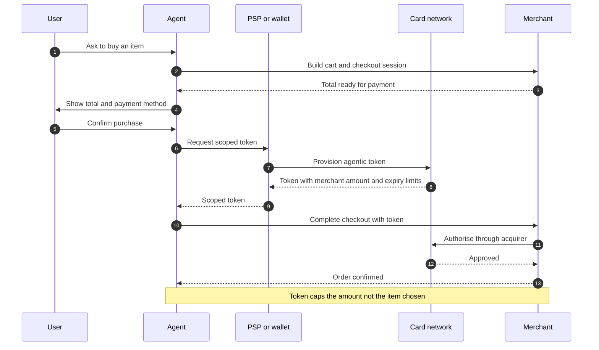
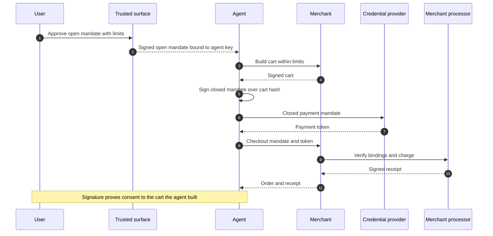
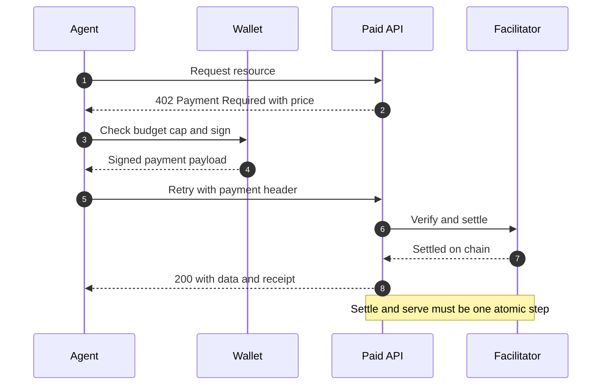
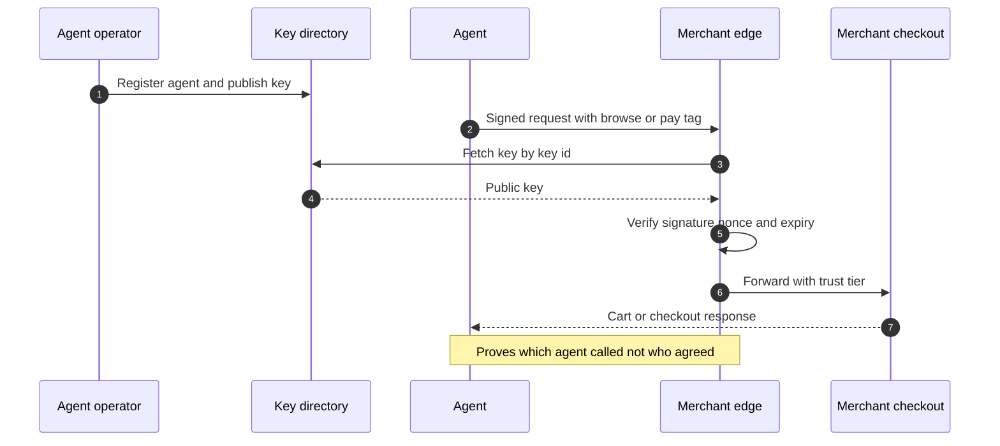
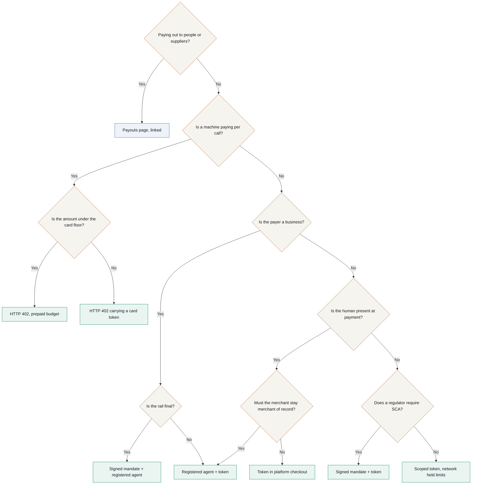

# D1b, design doc sections 8.1, 8.3 and 8.4

Draft for `docs/Agentic_Commerce_Protocols_Technical_Design.md`. As of 2026-11-15. Claim ids point to the claim tables in `R1_specs.md`, `R2_rails.md` and `R4_risk.md`. Pattern ids (`token`, `mandate`, `h402`, `agent`) match `drafts/acx/frag/d1b.json`. Observed facts carry a claim id. Design choices are marked Proposal.

### 8.1 The four patterns

Every protocol in section 2 is one of four patterns or a mix of them. A pattern is the way authority and money travel together. Protocols come and go faster than these four shapes do.

#### Pattern 1. Network token (`token`)

**What it is.** The agent never sees the card. A card network or PSP issues a token scoped to one merchant, an amount and an expiry, and the merchant charges it on card rails exactly as it does today.

**Who implements it.**

- Visa Intelligent Commerce provisions an agentic token after the cardholder sets up a Visa Payment Passkey and a purchase instruction [R2-05].
- Mastercard, Visa and Discover tokens pay inside personal agents through Shop Pay, and the card is never shared with the agent [R2-11].
- Stripe Shared Payment Tokens carry currency, maximum amount and expiry limits, can be revoked, and may use Mastercard Agent Pay or Visa Intelligent Commerce tokens underneath [R2-15, R2-16].
- ACP's delegate payment call returns a token under an Allowance that only supports one_time [R1-05]. ACP is Spec for consumer checkout, with no release since 2026-04-17 [R1-01, R1-02].
- ChatGPT Wallet hands the merchant a network token linked by PAR that must not be reused [R1-14].
- UCP v2026-08-25 made network token a credential type of its own [R1-74].

**When it wins.** Human present consumer checkout on cards. The merchant stays merchant of record, keeps its PSP, and chargebacks still work. It is the pattern carrying live money in checkout today, through Shop Pay agent checkout [R2-11] and nearly 50 Visa AI partners live, a vendor figure [R2-01]. Sam gets what he asked for: no card data inside the agent. Hana keeps her checkout and her customer.

**Where it breaks.**

- A token caps the amount, not the choice. In Visa's benchmark 42.8 percent of runs failed and 54 percent of the failed runs still ended in a purchase [R4-27, R4-28]. A valid token would have paid for each of them.
- The merchant can be fake. An agentic browser used a fake store and in some runs completed checkout with the saved card [R4-09]. Six banks warn that agents ask for card details and type them into sites [R4-33]. Binding the token to one merchant (merchant_id in the ACP Allowance, seller details on a Stripe token) only helps if someone checks who that merchant is [R1-05, R1-11].
- Liability is half settled. The issuer carries authenticated token fraud, but non fraud agent disputes are unallocated and no liability shift exists [R4-64, R4-65].
- Card floors. Stripe's minimum card payment through a token is 0.50 USD [R2-18], so this pattern cannot price a sub cent API call.
- No standing budget. A one_time Allowance [R1-05] cannot express a standing monthly grocery budget without a mandate beside it.

Ravi will not accept a token on its own. He wants a verified agent in front of it and a per agent velocity cap behind it (section 5.3).

#### Pattern 2. Signed mandate (`mandate`)

**What it is.** The user signs what the agent may do, either an open intent with limits or a closed cart. The signed object travels with the payment so the credential provider, the merchant and the processor can each check it.

**Who implements it.**

- AP2 v0.2, released 2026-04-28, defines open and closed Checkout and Payment Mandates as SD-JWT credentials, with constraints such as amount range, budget, recurrence and allowed payees [R1-35, R1-37, R1-38]. It covers human present and human not present flows [R1-39].
- Mastercard Verifiable Intent chains three SD-JWT layers with lifetimes from about 5 minutes to about 1 year, and is Draft v0.1 [R1-61, R1-62].
- UCP carries AP2 mandates as an opt in extension that locks the session once negotiated [R1-28].
- Standardisation moved to FIDO working groups chaired by Mastercard and Visa, seeded by AP2 and Verifiable Intent [R1-40].
- Bank rails run their own mandates. UPI Reserve Pay lets a user approve one spending limit per merchant [R2-68, R2-69]. The UK's first live agentic account to account payment ran under a Direct Debit mandate [R2-73].
- Visa Intelligent Commerce keeps the purchase instruction at the network rather than sending it with the payment [R2-05]. It sits between this pattern and the token pattern.

**When it wins.** Human not present purchases: replenishment, "buy when the price drops", subscriptions and B2B approvals. This is Kofi's stake, that what the user allowed is signed, scoped, revocable and kept. In the EU, repeat payments count as payee initiated, and outside SCA, only if the customer gave the merchant a mandate [R4-44]. SCA applies when an agent pays or sets one up [R4-46]. Elena needs that mandate to exist.

**Where it breaks.**

- Valid mandates over manipulated context. An AP2 v0.2 threat model found 48 threats, 8 of them high risk, and showed that valid signatures do not ensure intent when the context before signing is manipulated [R4-17].
- Prompt injection at checkout. Red teaming of an AP2 shopping agent manipulated product ranking and extracted user data [R4-11]. The mandate signs what the agent already decided.
- Replay and redirect. Context binding and consume once enforcement are both needed. In simulation they added about 3.8 ms [R4-12].
- Evidence with no judge. AP2 says mandates and receipts give a non repudiable record [R4-61] but puts dispute resolution outside its scope [R4-62]. Whether issuers accept them as evidence is not known.
- No live money. No real money AP2 use was verified and the AP2 repo has been idle since 2026-04-29 [R1-35, R1-39]. Verifiable Intent is still v0.1 [R1-61].
- Binding gaps. A UCP maintainer notes a checkout ID does not by itself bind authorization to a checkout state [R1-25].

Kofi will not accept a mandate verifier that can also move money (ADR-3). Ravi adds that the evidence store must hold what the agent saw before the user signed, which R4 proposes as a new variable for pre signing context [R4-17].

#### Pattern 3. HTTP 402 pay per call (`h402`)

**What it is.** The server answers an unpaid request with HTTP 402 and a price. The agent's wallet signs a payment, the agent retries with proof, and the server settles through a facilitator before it returns the data.

**Who implements it.**

- x402 runs under the x402 Foundation at the Linux Foundation. It launched there on 2026-04-02 with 40 members and passed 50 members by 2026-10-01 [R2-31, R2-33].
- MPP, co-authored by Tempo and Stripe, lists 12 method entries and no ACH method [R2-22, R2-23]. Its session intent covers metered pay as you go [R2-24].
- L402 answers with a token and a Lightning invoice, and the client retries with the payment preimage [R2-53].
- The A2A x402 extension carries the same flow inside agent tasks, at v0.1 [R1-41].
- Paid MCP tools wrap x402 with a 1 USD default policy cap [R1-46].
- AWS AgentCore payments supports MPP and x402 and went GA on 2026-08-18 [R1-47, R2-56]. Stripe machine payments accept both [R2-17].

**When it wins.** Machine pay per call, where prices are cents or less and no card minimum fits. Coinbase's facilitator charges 0.001 USD per settlement after 1,000 free a month [R2-34]. Circle batches agent payments down to 0.000001 USD each [R2-52]. Sam gets one call shape across many sellers.

**How big it is.** x402 shows about 200.7M lifetime transactions and about 43.0M USD settled [R2-38]. October 2026 settled 5.1M transactions worth about 274K USD, about 5 cents each by our arithmetic [R2-39]. Artemis, cited by Forkast, says about half of x402 transactions are artificial [R2-47]. MPP on Tempo shows 48,585 lifetime events from 1,874 payers to 92 payees [R2-28].

**Where it breaks.**

- x402 paid but denied. Five practical attacks cause unpaid service or paid but denied outcomes [R4-14]. A second analysis found resource leakage up to 100 percent against official SDKs [R4-15].
- No cap by default until August. Before the 2026-08-18 fixes the default x402 client let a hostile server name the amount, token and recipient with no cap. The patched SDK defaults to 1 USD per payment, and the fixes shipped without advisories [R4-31, R4-32].
- Final rail, no refund path. The x402 README defines no refund or dispute process [R4-67]. The payer carries the loss once it signs.
- Retries. Under MCP 2026-07-28 a client learns the result of an out of band step by retrying the request [R1-45]. Without Maya's idempotency keys a retry can pay twice.

Ravi will not accept a 402 payment without a spend cap enforced outside the model. ADR-5 gives this pattern its own path with prepaid per agent budgets.

#### Pattern 4. Registered agent (`agent`)

**What it is.** Identity comes first. The agent operator registers with a network or publishes keys in a directory, then signs every HTTP request so the merchant edge can tell a known agent from a bot before any cart or payment exists.

**Who implements it.**

- Visa Trusted Agent Protocol and Mastercard Agent Pay use Web Bot Auth signatures with browse and pay tags and directories hosted by each network [R1-50, R1-53].
- The IETF Web Bot Auth draft -01 (2026-10-29) builds on RFC 9421 and requires the single tag web-bot-auth [R1-56, R1-59].
- ChatGPT's cloud browser signs with Web Bot Auth, and Akamai, Cloudflare, HUMAN and Vercel verify it [R1-16].
- UCP business profiles publish keys and requests are signed under RFC 9421 [R1-26].
- KYAPay puts a Know Your Agent token in a request header, as an individual IETF draft [R1-67]. Amex agent registration is still in development [R1-65].

**When it wins.** Agentic browsers buying on the merchant's own checkout. ChatGPT moved checkout to retailer sites in March 2026 and its docs now send the journey to browser use or a plugin [R1-15, R1-17]. It also wins in B2B, where the live Visa, BILL and Billtrust pilot registers the paying agent through TAP [R1-54, R2-04]. Hana gets bot triage without turning away sales.

**Where it breaks.**

- It proves the tool, not the human [R4-69]. Shopify states that a Web Bot Auth signature or a ready status does not grant buyer permission [R1-34].
- Tags have not converged. Visa and Mastercard use agent-browser-auth and agent-payer-auth, while the IETF draft requires web-bot-auth [R1-53, R1-56]. The working group missed its April and August 2026 milestones [R1-57].
- Know Your Agent is unsettled. The Ant International, Mastercard and Visa framework started 2026-09-10 with no spec and no timeline [R1-68].
- Liability does not move. Cloudflare's Trusted Agent Delegation coalition says sites often pay today when a user disputes an agent purchase [R4-68].
- Bot defence is thin. In vendor tests only 2.4 percent of sites blocked or challenged all 10 bot and AI traffic types [R4-25].
- The key directory becomes a dependency on the payment path (section 5.5, Proposal).

Ravi will not let an unsigned agent pay. Hana will not let him block it from browsing. ADR-2's trust tiers settle it (Proposal).

#### Side by side

Ratings in plain words are the panel's Proposal. Facts in the cells carry claim ids.

| | Network token | Signed mandate | HTTP 402 pay per call | Registered agent |
|---|---|---|---|---|
| Build complexity | Low for a merchant, it arrives through the PSP [R2-15, R2-16] | High. SD-JWT chains, key binding, revocation and context capture [R1-37, R1-62] | Low for a seller with a facilitator [R2-34]. Medium for the buyer's wallet and caps | Low to medium. Verification can sit at the CDN [R1-16] |
| Added latency | One token request. No agentic latency figure published (R2 section 6) | Signing at setup, then checks per payment. Context binding about 3.8 ms in simulation [R4-12] | One extra round trip. Coinbase targets 900 ms P95 settlement on Base, a target not a measurement [R2-35] | One signature check per request with a cached key (Proposal estimate) |
| Cost per payment | Card fees. Stripe minimum 0.50 USD through a token [R2-18]. Agentic fee not published | None of its own. Inherits the rail | 0.001 USD per Coinbase settlement after 1,000 free [R2-34]. Down to 0.000001 USD batched [R2-52] | No registration or verification fee found |
| Reversibility | Chargeback on card rails [R4-65] | Inherits the rail | Final. No refund or dispute process in x402 [R4-67] | Inherits the rail |
| Liability clarity | Medium. Issuer holds token fraud, non fraud disputes open [R4-65] | Low. Evidence only, disputes out of scope [R4-62] | Low. Payer carries the loss once signed [R4-67] | Low. Identifies the tool, not the human [R4-69] |
| Maturity as of 2026-11-15 | C Live in Shop Pay agent checkout [R2-11]. B Pilot [R2-04]. M Pilot [R2-13] | AP2 Spec in C, B and M [R1-35]. Bank mandates Pilot [R2-68, R2-73] | M Live for x402 and MPP [R2-38, R2-28]. AgentCore GA [R1-47] | Live as an identity signal [R1-16]. TAP B Pilot [R1-54]. IETF draft, not an RFC [R1-57] |
| Best use case | Human present consumer checkout on cards | Delegated, recurring and B2B purchases | API, data and content per call | Agentic browsers on existing checkout |
| Worst use case | Sub dollar calls | One off impulse buys with the human present | Physical goods with returns | As the only control on payment authority |

#### Verdict (Proposal)

No single pattern carries a payment end to end. Tokens move money but prove only limits. Mandates prove authority but move no money, and none is live. HTTP 402 prices tiny calls but has no refund path. Registered agents say which agent called but not who agreed. The right answer is a composition.

The gateway in section 5 composes them this way:

1. Registered agent at the edge for every use case. The agent identity verifier assigns trust tiers (ADR-2).
2. Network or PSP token as the default credential for checkout, called by the payment orchestrator so no card number enters the gateway or the agent (ADR-1).
3. Signed mandate, or token scoped limits where no mandate is offered, checked by a mandate verifier that cannot move money. A mandate is required when the human is not present (ADR-3).
4. HTTP 402 on its own path with prepaid per agent budgets for pay per call (ADR-5).
5. The evidence store written before money moves, under all four (ADR-4).

Read as one line: registered agent plus token, plus a mandate when the human is away, with HTTP 402 on a separate lane.

### 8.3 Decision tree by use case

Proposal. The tree starts by sorting the use case, then asks six questions. Each leaf is a pattern or a composition, written lead pattern first. The node ids match the `tree` array in `d1b.json`.

How the leaves read.

- **Consumer, human present, merchant stays merchant of record:** registered agent plus token. This is the ChatGPT browser path on the retailer's checkout [R1-15, R1-16] and the UCP path [R1-27].
- **Consumer, human present, platform or marketplace is merchant of record:** token inside the platform's checkout. The platform verifies the agent, not the merchant.
- **Consumer, human away, SCA required:** signed mandate plus token, with strong authentication when the mandate is set up [R4-44, R4-46].
- **Consumer, human away, no SCA rule:** a scoped token with limits held by the network or PSP, the only live option today [R2-05, R2-21]. Kofi still wants the instruction stored as evidence.
- **B2B on a final rail:** signed mandate plus registered agent. UCC 4A binds the business when the bank followed an agreed security procedure [R4-39], so the mandate and agent proof become that procedure.
- **B2B on card:** registered agent plus token, as in the Visa, BILL and Billtrust pilot [R1-54, R2-04].
- **Machine, under the card floor:** HTTP 402 from a prepaid budget.
- **Machine, above the card floor:** HTTP 402 carrying a card token, which MPP's card and Stripe methods allow [R2-17, R2-23].

| Question | Why it matters | Sets |
|---|---|---|
| Paying out to people or suppliers? | Payouts use other rails and rules and live on the payouts page. AP2 and ACP stay Spec there, per the R0 do not regress list | Use case P, link only |
| Is a machine paying per call? | Agents retry on timeout, so settlement must be fast and prices tiny (section 1.2) | P11, V10 |
| Is the payer a business? | Consumers fall under Reg E or Reg Z, businesses under UCC 4A or contract [R4-34, R4-36, R4-39] | P2, P10 |
| Is the human present at payment? | Present means the buyer confirms in session. Away means authority must be signed in advance [R1-39] | P1, P4 |
| Is the amount under the card floor? | Stripe's token minimum is 0.50 USD for cards and 0.01 USDC for stablecoins [R2-18] | V9, P6 |
| Is the rail final? | Final rails have no chargeback, so a refund promise and the evidence carry the dispute [R4-67] | P7, P9 |
| Must the merchant stay merchant of record? | UCP and ACP keep the business as merchant of record [R1-27, R4-63]. If a platform takes that role, its checkout owns the token | P8, P3 |
| Does a regulator require SCA? | EU SCA applies when an agent pays or sets a mandate [R4-46]. India requires at least two factors per digital payment [R4-57] | P14, V5 |

### 8.4 What to weigh, worked example (Proposal)

Illustrative. The scores are the panel's judgment on the cited evidence, not measurements. Each score is 0 to 5 against the six criteria in 8.2. The weighted score is the sum of score times weight, divided by 5, so the top is 100. For maturity the panel used Live 5, Pilot 3, Spec 2, Unsettled 1, Absent 0.

#### Buyer A. US mid size retailer, consumer checkout on cards

| Criterion (weight) | UCP | ACP | Network tokens through the PSP | Web Bot Auth on own checkout | AP2 mandates |
|---|---|---|---|---|---|
| Where buyers' agents are (25) | 4. Universal Cart live in the US on UCP [R1-29] | 2. ChatGPT left native checkout, docs no longer cite ACP [R1-15, R1-17] | 4. Shop Pay agents and ChatGPT Wallet use network tokens [R2-11, R1-14] | 4. ChatGPT's browser signs and buys on retailer sites [R1-15, R1-16] | 1. No real money use verified, repo idle [R1-35] |
| Rail fit (20) | 4. Card and wallet handlers, chargebacks intact [R1-30] | 4. Card through Stripe token or network token [R1-05] | 4. Retail tickets clear the 0.50 USD token minimum [R2-18] | 4. Existing card checkout unchanged | 3. Instrument agnostic, cards first, nothing live [R1-37] |
| Liability clarity (20) | 3. Merchant stays merchant of record under card rules [R1-27, R4-65] | 3. Merchant of record, disputes not addressed [R4-63] | 3. Issuer holds token fraud, other disputes open [R4-65] | 2. Identifies the agent, not the human [R4-69] | 2. Evidence only, disputes out of scope [R4-62] |
| Integration cost (15) | 4. Stripe handler, major PSPs on the Payments council [R1-21, R1-30] | 4. Stripe tokens and a certified Checkout.com handler [R1-11, R2-63] | 5. Arrives through the PSP, Stripe may use them under its tokens [R2-16] | 4. CDN vendors already verify it [R1-16] | 2. SD-JWT chains built in house, no PSP support found |
| Maturity (10) | 5. Live, the only commerce protocol with verified live checkout [R1-29] | 2. Spec, no release since 2026-04-17 [R1-01, R1-02] | 5. Live in Shop Pay agent checkout [R2-11] | 4. Live as identity, still an IETF draft [R1-16, R1-56] | 2. Spec [R1-35] |
| Openness (10) | 4. Councils with elected seats, Google and Shopify permanent [R1-22] | 2. Founders hold a veto, no foundation [R1-04] | 2. Network owned programmes [R2-05] | 4. IETF track, network tags not converged [R1-53, R1-56] | 4. Moving to FIDO working groups [R1-40] |
| **Weighted score** | **78** | **58** | **77** | **72** | **43** |

Reading. The top three are complements, not rivals. A UCP adapter reaches Google surfaces, network tokens arrive through the existing PSP, and Web Bot Auth checks at the CDN catch ChatGPT's browser on the retailer's own checkout. That is the section 5 composition. ACP stays a thin adapter only if a buyer's agent still speaks it. AP2 goes on a watch list tied to the first FIDO draft.

#### Buyer B. API data seller, machine pay per call

| Criterion (weight) | x402 | MPP | L402 | Card token per call |
|---|---|---|---|---|
| Where buyers' agents are (25) | 4. Largest on chain volume, but about half may be artificial [R2-38, R2-47] | 3. Live but small, 1,874 payers on Tempo [R2-28] | 1. Alpha tooling, mainnet by invite [R2-55] | 2. Agent Pay for Machines still in pilot [R2-13] |
| Rail fit (20) | 4. Sub cent prices fit, final rail needs a refund promise [R2-52, R4-67] | 5. Metered sessions, plus card methods for larger calls [R2-24, R2-23] | 3. Lightning fits micro prices, stablecoins not yet [R2-55] | 1. 0.50 USD token minimum prices out per call [R2-18] |
| Liability clarity (20) | 2. No refund or dispute process, paid but denied attacks [R4-67, R4-14] | 2. Depends on method, dispute rules not verified [R2-23] | 2. Final payment with local proof, no dispute path [R2-53] | 3. Card rules apply, non fraud disputes open [R4-65] |
| Integration cost (15) | 4. Stripe and AWS accept it, Coinbase free tier [R2-17, R2-34] | 4. Native in Stripe and AWS AgentCore [R2-17, R2-56] | 2. No PSP support found beyond an MPP Lightning method [R2-22] | 5. Existing PSP token flow [R2-16] |
| Maturity (10) | 5. Live for pay per call [R2-38] | 5. Live for pay per call [R2-28] | 3. Pilot [R2-55] | 3. Pilot [R2-13] |
| Openness (10) | 5. Linux Foundation, more than 50 members [R2-33] | 2. Two authors, IETF draft expired [R2-25] | 3. Lightning Labs open spec [R2-53] | 2. Network owned programme [R2-13] |
| **Weighted score** | **76** | **69** | **43** | **51** |

Reading. x402 and MPP both clear the bar and share the 402 shape, so the gateway runs one 402 responder that speaks both (ADR-5). MPP's card method covers the rare call above the card floor. Liability is the weakest criterion for every option here, so the seller publishes refund terms and makes settle and serve one atomic step, the defence the x402 research points to [R4-15].
