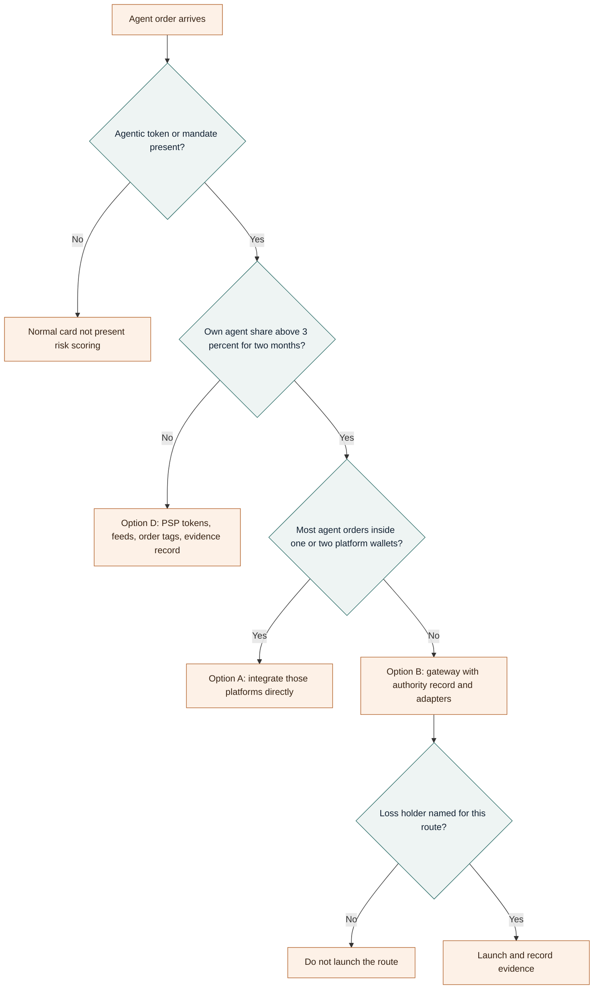

## 12. Design critique, red teaming our own approach

An outside reviewer read sections 0 to 11 and tried to make the design fail review. They raised 20 critiques, 8 high, 10 medium and 2 low. They are listed here as RT1 to RT20 (critiques 1 to 20 in `W3_redteam.md`). Six section checkers ran in parallel and opened 259 source pages. They kept 192 claims, reworded 77 and cut 2. The lead decisions that answer each critique are D1 to D21 in `L_decisions.md`.

| Id | Target | Critique in one line | Severity | Verdict | Answered by |
|---|---|---|---|---|---|
| RT1 | 3, ADR-1, 11 | The thesis held in every scenario, so nothing could prove it wrong, and its exit trigger could not be measured | High | Accepted | D1, D2, D20 |
| RT2 | 3, 5.3 | Building to the mandate put the least settled layer in the stable core | High | Accepted | D3 |
| RT3 | ADR-1, 11 | No "wait" option and no world where agents refer and people pay, although the evidence points there | High | Accepted | D2, D20 |
| RT4 | 5, 7.6 | A merchant gateway cannot enforce buyer side controls such as spend caps across merchants | High | Accepted | D4, D5 |
| RT5 | 9 | The ranking rewarded spec authorship and ignored control of the token layer | High | Accepted | D18 |
| RT6 | 8.1, 8.3 | The patterns left out virtual cards and agentic browsers on stored cards | High | Accepted | D12, D13 |
| RT7 | 4 | Missing parameters: agent flags in authorization, CIT and MIT, account linking, fees, amount drift | High | Accepted | D11 |
| RT8 | 11 | Two scenarios happened together and none had a dated test | High | Accepted | D20 |
| RT9 | 3, ADR-1 | The token is not neutral, so lock in moves to the network and the PSP | Medium | Partly accepted | D1, ADR-1 option C contract question |
| RT10 | 8.2 | Weights had no basis and fraud, customer ownership and privacy had no voice | Medium | Accepted | D7, D14 |
| RT11 | 8.4 | The worked example ranked different layers as rivals | Medium | Accepted | D15 |
| RT12 | 7.6, ADR-2 | The tier 2 rule would refuse the live consumer flows | Medium | Accepted | D6 |
| RT13 | 4 | 37 rows mixed design choices, context and evidence fields | Medium | Partly accepted | D11 |
| RT14 | 10 | The ranking hid two tiers and missed churn, attribution and fees | Medium | Accepted | D19 |
| RT15 | 9.4 | Tempo double counted MPP and may sit inside Stripe's orbit | Medium | Accepted | D18 |
| RT16 | 9 | Cloudflare's coalition launch was missed | Medium | Partly accepted | D18 |
| RT17 | 8.3 | Tree leaves ended in flows nobody can build today | Medium | Accepted | D13 |
| RT18 | ADR-4 | "Every payment can be defended" overclaimed, and the evidence store had no privacy owner | Medium | Accepted | D7 |
| RT19 | 1.2, 5.5 | The 300 ms latency target is untested | Low | Accepted, still open | D10 |
| RT20 | 1.3, 2.3, 8 | Internal slips between sections | Low | Accepted | D15 |

Where we did not fully agree:

- **RT9.** Lock in does move from protocols to the network and the PSP. We still prefer that trade, because network tokens are not tied to one PSP, although moving them depends on the token requestor (G-57). Option C now carries a contract question: who is the token requestor for agentic tokens, and can it move?
- **RT13.** The reviewer wanted fewer rows. We kept the rows and gave each one a kind (choice, context or evidence), because a builder needs the context and evidence rows to pass certification and win disputes. The page shows only the choices plus three new ones.
- **RT16.** Cloudflare's coalition names no members and no dated deliverable (G-35), so it scores as a move, not a delivery.

What the reviewer said was strongest, and we kept: the status rules in 2.3 and 6.1, the x402 reconciliation in 6.4, the liability table and finding to component map in section 7, the principles behind ADR-3 and ADR-6, and the forecasts carried as ranges with each author's incentive.

## 13. Concluding research, closing the gaps

Two gap closers answered the critiques and the checkers' gaps with about 100 opened pages (`G1_gapclose.md`, `G2_gapclose.md`). Each finding below says what it changed.

### 13.1 How much agents really buy

- The only monthly measure is a modeled vendor panel from an SEO agency. It puts agent completed orders at 1.52 percent of US ecommerce orders in October 2026, up from 0.27 percent in Q2 (G-01, G-02, vendor, rung 7).
- In the same panel, about 86 percent of agent completed purchases sat inside three platforms: Meta Muse, Alexa for Shopping and Gemini (G-03, vendor).
- ChatGPT drove 40 percent of AI referred visits but 9 percent of agent completed purchases (G-03). People still click through and pay.
- Visa calls agentic commerce a very small part of its business (G-06). 84 percent of merchants in an Oliver Wyman survey report no customer demand (G-42).
- **What this changed.** ADR-1 gains option D, wait with readiness, with a trigger the client can measure (D2). The scenarios now include "agents refer, people pay", and platform wallets are the lead case (D20). The page shows the 1.52 percent figure tagged vendor (D17).

### 13.2 Who checks what, and where

- Visa checks every credential retrieval against the mandate's cap and merchant, across the whole instruction (G-16, G-17). AP2 has the merchant check the cart. ACP puts limits in the token scope.
- Mastercard says agents must not use stored cards, because the issuer then cannot see the agent (G-19, G-20). EMVCo is only exploring an agent indicator in the authorization message (G-21). Agent payments fit neither customer initiated nor merchant initiated cleanly (G-22, G-23).
- **What this changed.** The core holds a thin authority record with five common fields and the original signed artifact (D3). Spend caps across merchants move to the buyer side and the network (D4). Three parameters join the page: agent signal at authorization, account linking and mandate enforcement point (D11). Stored cards become their own pattern, the one to steer away from (D12).

### 13.3 Who carries the loss

- Visa's rules (edition 2026-10-24) make the cardholder responsible for an enrolled agent's actions (G-201). Mastercard publishes no equivalent rule we could find, and its developer guide says standard chargeback rights apply (G-116).
- Stripe Link makes the user responsible for every agent purchase, including wrong items (G-127). Amex's agent purchase protection is promised and not yet available (G-24).
- In the UK, a payer carries no loss for an unauthorised online payment (G-124, G-125). Whether a payment an agent made inside its mandate counts as authorised is unsettled. That is our reading, not a regulator's.
- Cloudflare's coalition post says the site pays when a user disputes an agent purchase (G-35).
- **What this changed.** ADR-6 now names the loss holder per route (D8). Liability clarity is a gate before any weighting (D14). Challenge 1 says who pays today instead of "nobody has decided" (D19).

### 13.4 x402, read honestly

- The tracker the doc relied on is run by one pseudonymous operator. Its raw counts include tests and self dealing (G-101 to G-103). Its figures are now tagged vendor.
- Monthly x402 transactions fell from 17.9M in August to 5.1M in October, a 72 percent fall, then rose in the first half of November on one facilitator (G-104 to G-106, R2-40).
- TRM Labs puts the agentic share at 0.6 to 7.5 percent of settled value, about 5K to 11K USD a month (G-107).
- The upto and batch settlement schemes are merged in the spec, and Coinbase supports both (G-133 to G-135).
- **What this changed.** Pay per call settles through a facilitator, and the seller never holds prepaid agent balances (D5). The page shows the trend and the agentic share, not a lifetime count (D16).

### 13.5 Market moves that changed rankings

- Tempo was developed by Stripe and Paradigm, and Paradigm's leader sits on Stripe's board (G-51). It leaves the startup list (D18).
- Shop Pay agent checkouts ride Visa and Mastercard agentic tokens (G-07, G-09). They count for the networks and Shopify, not for Stripe, until a source shows Stripe processes them.
- Amazon says Alexa for Shopping is its primary shopping agent and blocks outside agents (G-26, G-27). Citi, Bank of America and JPMorgan keep outside agents out of customer accounts (G-29, G-30).
- **What this changed.** Players are rescored with a token layer criterion (D18). Challenges merge two pairs of facets and add "losing the customer and the margin" and "protocol churn" (D19).

### 13.6 What we still do not know

Searched and not found as of 2026-11-15:

- an agent dispute or chargeback rate from any network, PSP or issuer
- the return rate of agent selected orders
- a production p95 latency for Web Bot Auth or TAP checks
- agent orders split by protocol
- the share of agent card payments on virtual cards
- how many merchants accept Stripe Shared Payment Tokens
- money moved under Mastercard Agent Pay for Machines with a named partner
- any 2027 commitment by a network or platform to publish agent metrics
- a primary source for a ChatGPT Wallet

Each one sits in section 15.3 as a signpost or a risk.

## 14. What we missed, 22 Oct to 15 Nov 2026

The first draft froze its research before these items were checked. Each row says what it changed.

| Date | What happened | Changed |
|---|---|---|
| 2026-10-23 | Amex says it will not let agents "run rogue" and will be selective. Its Intent Intelligence has no live integration yet (G-25, G-24) | Amex stays Spec. Its protection is marked as promised |
| 2026-10-24 | Visa's public rules carry agentic platform requirements, with the cardholder responsible for an enrolled agent (G-201) | ADR-6, challenge 1, section 7 |
| 2026-10-26 | PPRO, BLIK, Bancontact, EPI and DIAS form a council to set rules for agents on local payment methods (G-32) | New EU signpost |
| 2026-10-27 | Visa reports nearly 50 AI partners live, with volume "albeit limited" (G-111, G-112). PayPal gives no agent volume (G-12) | Visa Intelligent Commerce Live with a qualifier |
| 2026-10-28 | Adyen partners on Meta and Sierra's Personal Agent Protocol (G-14, G-15) | Account linking parameter P24 |
| 2026-10-29 | Amazon calls Alexa for Shopping its primary shopping agent and blocks outside agents (G-26, G-27). Mastercard calls virtual cards a bridge it will not support long term (G-08) | Scenario "walled", pattern 5 |
| 2026-10-30 | UK regulators publish a joint statement: existing law, payments included, applies to personal agents (G-122) | Section 7.2 UK row |
| Late Oct | The EU Council adopts its PSD3 and PSR position. Parliament votes on 2026-12-14 (G-203) | Section 7.2 EU row |
| 2026-11-03 | Shopify reports its first quarter of shoppers delegating purchases to agents, with no share disclosed (G-10, G-11) | Adoption, rung 6 |
| 2026-11-05 | Cloudflare launches the Trusted Agent Delegation coalition (R4-68, G-35). Visa's benchmark finds models failed 42.8 percent of shopping runs (R4-27) | Cloudflare move scored, challenge on wrong purchases |
| 2026-11-09 | Reported Token Terminal data shows monthly agent payment value down 94.5 percent in a year (G-108) | x402 read as volatile, not growing |
| 2026-11-11 | Singles Day: JD's assistant draws about 80 million users seeking advice, with no agent completed order count (G-47) | China stays human confirmed per payment |
| 2026-11-01 to 15 | x402 counts rebound on one facilitator (G-104, G-106) | Trend shown, with concentration risk |

Coming soon, and watched as signposts:

- the UK ICO call for evidence on agentic AI closes 2026-11-20 (G-33)
- Wells Fargo terms that keep customers liable for agent activity unless they show revocation start 2026-11-24 (R5-44)
- the European Parliament votes on PSD3 and PSR on 2026-12-14 (G-203)

## 15. Final recommendation and honest scope

### 15.1 For a leader

1. **Do not build a protocol gateway yet, unless agents already bring you orders.** Spend 2027 on what pays in every world: clean product data, a tag on every agent order, and an evidence record for each agent payment (D1, D2).
2. **Take agent payments through your PSP on network agentic tokens.** Stored cards hide the agent from the bank, and Mastercard says agents must not use them (G-19).
3. **Set a trigger and write it down.** When agents complete more than 3 percent of your orders for two months running, fund the gateway in section 5. Until then, option D.
4. **Name who pays on each route before you launch it.** Visa puts an enrolled agent's purchase on the cardholder, Link puts it on the user, and Mastercard points to normal chargeback rights. In the UK the payer is protected when a payment was not authorised (D8).
5. **Plan for the walled gardens.** Today most agent completed orders sit inside three platforms (vendor panel). If that still holds at the end of 2027, integrate those platforms directly and stop investing in adapters.

Three lanes need their own answer:

- **Machine pay per call** settles through an x402 facilitator using upto or batch settlement. Treat the volume as small and volatile.
- **B2B procurement** uses a virtual card or token on card rails, or a bank transfer with an approval step on account to account rails. The human set spend limit is checked on every payment.
- **Payouts** are covered on the agentic payouts desk page.

### 15.2 For an architect

Build order above the trigger, smallest useful slice first:

1. **Edge trust tiers.** Accept a signature plus a mandate, or a registered agent plus an agentic token plus a passkey. Send unsigned agentic browsers to normal risk scoring, never to a hard refusal (D6).
2. **Evidence store.** Write first and keep only for the rail's longest dispute window. Noor, the privacy lead, owns it (D7).
3. **Authority record.** Five common fields, a binding level, and the original artifact unchanged. The cart is checked against it at the merchant (D3, D4).
4. **Adapters.** One per surface, with webhook signatures verified: HMAC for ACP and RFC 9421 for UCP. A UCP adapter is a checkout state machine, so budget it as one (D9).
5. **Loss holder per route.** This is a gate on every route (D8).
6. **Pay per call path.** Kept separate, through a facilitator, with no seller held balances (D5).

The 300 ms p95 target is still untested (D10).

### 15.3 Honest scope

What this document can and cannot tell a client:

- **It can** tell a client which protocols exist, their status per use case with a date, the parameters a builder must decide, who carries the loss per route as of 2026-11-15, and where today's evidence points.
- **It cannot** size the market. Every agent order figure is vendor reported or modeled, and no audited figure exists.
- **It cannot** say how often agent payments are disputed or returned, because nobody publishes those rates.
- **It cannot** say which protocol will win, because no one splits agent orders by protocol.

What would change the recommendation, and how a client would see it:

| If this happens | Then | Watch |
|---|---|---|
| Your own agent share passes 3 percent for two months | Move from option D to option B | V17 on your own orders |
| Three platforms still hold most agent orders at 2027-12-31 | Integrate them directly (option A) | The vendor panel, monthly |
| A network publishes agent dispute rates or adds an agent reason code | Revisit ADR-6 and the evidence store | Network rule editions, twice a year |
| EMVCo or a network adds an agent indicator to the authorization message | Make P22 a hard requirement | EMVCo framework releases |
| x402 value per month passes 1M USD of agentic payments on an independent screen | Promote pay per call from experiment to product | TRM style screens, not raw counts |

Limits of method:

- Six checkers opened up to 45 pages each, and 133 cited claims were not rechecked in Wave 3. They keep their Wave 1 opened page check.
- Weights and scenarios are panel judgement, marked Proposal.
- No interview with a merchant, issuer or agent platform was held. This is desk research, as of 2026-11-15.
