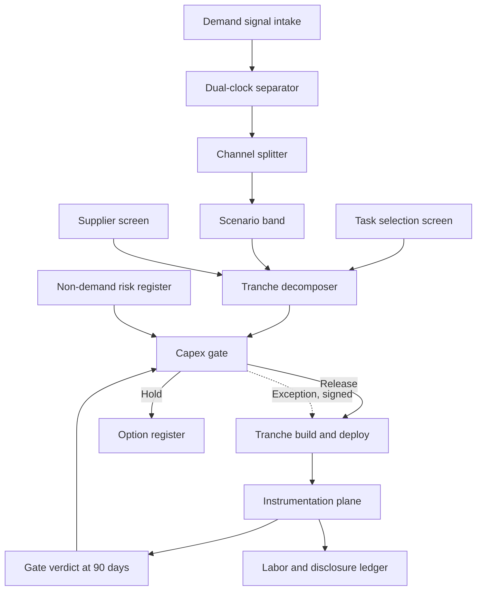
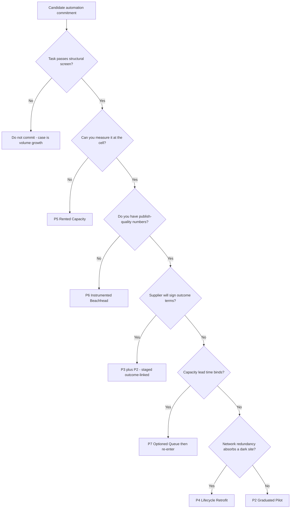

# Automation Capex Into A Demand Air Pocket — Technical Design & Architecture

*A research-backed design for how an operator should decide, instrument and stage large automation capital commitments when the demand signal is ambiguous and no operator in the market publishes per-unit economics. Companion to the deep-dive page `automation-capex-air-pocket`. Version 1.0, dated 2026-08-17. The SOTA window in §11 is 2026-06-17 → 2026-08-17.*

---

## 0. How to read this document

This document was reasoned through a panel of named personas. Their stakes drive the decisions in §4–§8; when you see "Dana requires X," that is the rationale, not decoration.

| Persona | Role | Stake (what they refuse to compromise) |
|---|---|---|
| **Dana** | COO, mid-market parcel/3PL network | The document produces a *decision* — commit, stage, or wait — not an "it depends." Every artifact must move an eight-figure capex line. |
| **Marcus** | CFO | Capital at risk is bounded and reversible; nothing is approved on a payback model whose inputs the sector has never published. |
| **Iris** | Automation engineering lead | Cell-level throughput, uptime and exception rates are measured from day one, on the operator's own meters, not the vendor's dashboard. |
| **Rosa** | Labor / HR lead | WARN, OSHA and redeployment obligations are scheduled as part of the capital plan, not discovered at closure minus 60 days. |
| **Tomas** | Supplier-side product lead (physical-AI vendor) | Any outcome-linked term is measurable, attributable and not a disguised transfer of the customer's own operational risk. |

**Decided vs proposed vs open.**
- **Observation** — a fact from the research files, graded in Appendix A. Marked `[FACT]`, with `[VENDOR-CLAIM]` and `[ESTIMATE]` where the source is a vendor or an analyst projection.
- **Proposal** — this document's design. Everything in §3–§8 is a proposal; none of it is observed practice.
- **Open** — genuinely unresolved on available evidence. Collected in §9 and §12. The central open question — countercyclical discipline versus timing error — is *never* closed by this document.

**Two standing conventions, restated because both were misread in-window.**
1. **Two clocks on one print.** July 2026 US retail was **−0.6% m/m** and **+5.0% y/y** in the same Census release `[FACT]`. Both are true; they measure different things. Several outlets ran "retail sales rise 5.4%," which is a year-over-year *core* measure excluding autos, gas and restaurants. This document never substitutes one for another.
2. **Loading is not unloading.** FedEx/Dexterity at Hagerstown is autonomous trailer **LOADING** (Jul 30, 2026). Trailer **unloading** is a separate Berkshire Grey "Scoop" program from Feb 2026. Conflating them inflates the apparent scope of a single vendor relationship.

**Reading paths.** Dana and Marcus: §0, §3, §8, §12. Iris: §4–§6. Rosa: §7. Tomas: §5.3, §8, §12.2. Anyone about to quote a truckload number in a board packet: Appendix A first.

---

## 1. Requirements

A capital-commitment decision system is not a forecasting system. Its job is not to know whether demand recovers; it is to make a commitment whose cost of being wrong is bounded and whose evidence arrives before the next tranche.

### 1.1 Functional

- **F1 — Separate the clocks.** Ingest the demand signal on at least two independent time bases (sequential and annual) and on at least two independent channels (consumer/parcel and industrial/project). Never emit a single blended "demand" number. The in-window evidence is exactly why: nonstore retail **−2.2% m/m** and NRF August imports **2.22M TEU, −4.2% y/y** ran simultaneously with **LTL tonnage +5.1% y/y** and **ISM 55.6**, the highest since May 2022`[FACT]`. Blending these produces a wrong answer in both directions.
- **F2 — Decompose the commitment.** Convert any "network rollout" into an ordered series of independently cancellable tranches, each with a named asset, a capital number, a gate, and a defined abandonment cost.
- **F3 — Instrument before you scale.** Produce, per deployed cell, the per-unit economics the market does not publish: cost per trailer loaded, throughput, uptime, exception rate, recordable-injury delta, utilization.
- **F4 — Gate on evidence, not calendar.** Each tranche opens only when its predecessor's measured metrics clear pre-registered thresholds, or when a named exception is signed by an accountable person.
- **F5 — Price the non-demand risks.** Grid curtailment, tariff/import volatility, supplier solvency and queue position, and labor obligations each carry an explicit line, not a contingency percentage.
- **F6 — Carry the labor plan as a capital line item.** WARN timing, redeployment, retraining and OSHA exposure are scheduled inside the project plan, on the project's dates.
- **F7 — Shift the burden.** Where the operator cannot verify economics ex ante, contract so the supplier carries the unverified portion — outcome-linked terms rather than capex.

### 1.2 Non-functional

- **Reversibility over optimality.** The design target is that no single decision can lose more than one tranche of capital. Rationale: the adjudicating evidence does not exist. Across the searched window **no operator — FedEx, Amazon, Walmart, UPS, GXO, DHL — published audited per-unit automation economics**`[FACT]`. A system optimized for a return it cannot verify is optimized for a number someone made up.
- **Time-to-signal ≤ 90 days per tranche.** A gate that cannot produce a verdict within one quarter is not a gate; it is a delay. Iris's constraint: a cell that has run 90 days at production duty cycle has produced enough throughput, downtime and exception data to be judged, even if payback has not been earned.
- **Auditability to publish quality.** Every gate metric must survive being published — same definitional rigor as an external disclosure, whether or not it is ever disclosed. This is the standard the sector currently fails: **Gartner (Aug 2026) reports 55% of CSCOs cannot measure AI ROI while 67% of supply-chain digital spend goes to AI**`[FACT]`. Marcus's requirement is that the operator not join that 55%.
- **Attribution integrity.** A metric that improves because volume fell is not an improvement. Every gate metric is defined per unit of work, normalized to duty cycle, with the denominator disclosed in the metric definition.
- **Decision latency vs. queue position.** The system must produce a tranche decision fast enough to hold a supplier delivery slot. Waiting is not free (see C7, §9).

### 1.3 Constraints

- **Multi-year build cycles.** Amazon's Florida retrofits are **~2-year builds with tentative 2028 reopening**, against closure phases of Sep 17 / Sep 30 / Dec 17 2026`[FACT]`. Walmart/Symbotic's 42-RDC program runs **"8+ years" from announcement** — "by ~2030" is approximate and must be marked as such`[FACT]`. A decision system whose feedback loop is slower than its commitment cycle cannot steer.
- **Supplier lock-in and thin supply.** The structural pattern in-window is that **incumbents scale and startups supply**: Dexterity → FedEx, Symbotic → Walmart, Amazon in-house`[FACT]`. For a mid-market operator there are few credible suppliers per modality, so exit costs are real and queue position is a scarce asset.
- **WARN and labor obligations.** Facility closure triggers statutory notice regardless of whether the operator calls the closure temporary. Amazon's Florida program notified **1,110 workers (616 Homestead TMB8, 494 Port St. Lucie PBI3)** under WARN as permanent displacement while the company framed the closures as temporary`[FACT]`. Both framings are carried here; this document does not resolve the contradiction.
- **OSHA emphasis program.** OSHA **renewed the warehousing/DC National Emphasis Program in August 2026, extending it from 3 years to 5**`[FACT]`. The sector runs **4.8 recordable injuries per 100 FTE against a 2.7 private-industry average**, willful-violation penalties reach **$165,514**, and DOL OIG found warehouse injuries roughly doubled (~42,500 → 80,500+) while facility count grew just 14%`[FACT]`. Enforcement exposure is now a five-year planning constant, and it cuts *toward* automating injury-dense tasks.
- **A shrinking labor pool that is also cheap to keep.** Warehousing employment is **−9,500 m/m and −34,700 y/y** at ~1.83M, about 105K below the March 2022 peak; truck transportation is flat at **1.465M**`[FACT]`. Labor is leaving without being replaced, which weakens the "automation displaces workers" framing and strengthens "automation covers a pool that cannot be staffed."
- **No public benchmark to price against.** There is no audited per-unit reference point in this sector. The nearest disclosed automation bridge is **UPS: 68.5% of volume through automated buildings at ~28% lower cost, $1.2B realized of a $3B program**`[FACT]` — and that is conveyance automation, not AI. It is the disclosure *standard*, not a comparable.

## 2. How the field currently tackles it

Five commitment families, each observed in-window. Confidence per family in Appendix A. Note that all five are *observed behaviors*; none of the operators has published the economics that would let an outsider judge which family works.

**Family 1 — Big-bang network commitment on strategic conviction.**
Commit the network target first, prove the economics later (or never publicly). FedEx is the clean in-window example: a February 2026 Investor Day target of automated trailer load *and* unload **across thousands of dock doors in more than 20 US hubs**, restated by trade coverage on Aug 11, with the Jul 30 Hagerstown expansion of **Dexterity "Mech" dual-arm robots on the Foresight world model** as the visible increment`[FACT]`. Mech specs: ~18 ft wingspan, 7.5 ft vertical reach, 60 kg / 132 lb payload`[FACT]`. Amazon's **"more than double the robotic-arm fleet in 2026"** against a **1M+ robots deployed since 2012 / >750,000 currently in network touching >75% of orders** base is the same family at larger scale`[FACT]`.
*Wins when:* the operator has enough network scale that per-site variance averages out, enough balance sheet to eat a wrong tranche, and a task whose case is structural rather than cyclical.
*Breaks when:* the operator lacks the portfolio to average variance, or when the strategic conviction is actually a competitive reflex. Note that **zero unit economics were published for any of it** — no cost per trailer, no packages per hour, no injury-rate delta`[FACT]`. That absence is what makes this family unimitable by anyone smaller: you cannot copy a decision whose inputs are not visible.
*Maturity:* standard practice among the top-5 US operators; unavailable as a template to everyone else.

**Family 2 — Pilot-to-scale gated rollout.**
One site, then a cohort, then the network, with an explicit graduation decision between stages. FedEx's Hagerstown site (a 325,000 sq ft hub) was framed as moving "beyond pilot"`[FACT]`. GXO is the more legible case: **GXO IQ to ~50 sites by YE2026 and 20,000 robots across the network in 2026**, disclosed as deployment scale`[FACT]`.
*Wins when:* the task is repeatable across sites and the operator can hold the line on graduation criteria.
*Breaks when:* "beyond pilot" is read as "proven ROI." It is not. GXO disclosed the deployment scale and **adjusted EBITDA margin flat y/y at 6.4%** in the same Q2 2026 release`[FACT]` — scale-up without visible margin expansion yet. The failure mode of this family is a graduation gate with no pre-registered threshold, which degenerates into a schedule.
*Maturity:* the default; also the most frequently corrupted.

**Family 3 — Supplier-financed / outcome-linked contracting.**
The supplier carries capital or is paid against measured outcomes (units handled, hours saved, injuries avoided). *No in-window operator disclosed contracting on these terms* — this family is present in the market as vendor structure and in the funding data, not as disclosed operator practice. The strongest indirect evidence is revealed preference: **HappyRobot's $150M Series C at $1.2B post (Aug 4, 2026), ~$200M across three rounds in 20 months, 150+ enterprise customers including DHL, Uber Freight, Kuehne+Nagel, LKW WALTER, and net dollar retention >150%**`[FACT]`. NDR above 150% means existing customers are expanding spend materially — a behavioral signal, not a survey.
*Wins when:* the outcome is cleanly attributable and the supplier is solvent enough to carry risk.
*Breaks when:* attribution is contested (volume fell, so cost per unit rose — whose fault?), or the supplier prices the risk transfer back into the rate. Tomas's objection is legitimate and is handled in §5.3.
*Maturity:* emerging; commonplace in software, rare in physical-AI hardware.

**Family 4 — Facility-lifecycle retrofit (close → retrofit → reopen).**
Take the site down, rebuild it to a next-generation design, reopen smaller and more automated. Amazon's **$400M retrofit of Homestead TMB8 (1.3M sq ft) and Port St. Lucie PBI3 (1.0M sq ft)** is the archetype: ~2-year builds, tentative 2028 reopen, closure phases Sep 17 / Sep 30 / Dec 17`[FACT]`. Coverage widely infers these return as next-gen robotics FCs on the Shreveport pattern, but **Amazon has not itemized the automation content — that is inference, not disclosure**`[FACT]`.
*Wins when:* the brownfield constraint is binding — you cannot install the target topology around live operations — and network redundancy can absorb the site's volume for two years.
*Breaks when:* redundancy does not exist, or when the demand assumption two years out is the thing you were uncertain about in the first place. This family has the *worst* reversibility profile of the five: the moment the site is dark, the capital is committed and the workforce is gone.
*Maturity:* standard for hyperscale operators; near-impossible for single-region operators.

**Family 5 — Capacity-as-a-service / variable automation.**
Rent the capability: 3PL outsourcing, RaaS, seasonal-flex cells. GXO's Q2 2026 **record $410M of new business wins, its best commercial quarter in three years**`[FACT]`, is the demand side of this family — shippers buying automated capacity as an operating expense rather than building it.
*Wins when:* volume is genuinely uncertain (which is precisely the state of the world in §1) or the operator lacks the engineering depth to run cells.
*Breaks when:* the capability is a differentiator rather than a utility, or when the effective rate over a multi-year horizon exceeds ownership by enough to fund the reversibility you bought.
*Maturity:* mature commercially; the pricing premium is the honest cost of the option.

**What the five have in common.** All five are being executed against the same information vacuum. Fourteen consecutive weekly research runs produced no audited facility-level AI ROI in this sector`[FACT]`. What fills the vacuum is unattributed vendor benchmarks — "25% injury reduction," "35% productivity gain," "up to 300% faster picking," "700+ units per labor-hour at 99.996% accuracy," "2.5–5 year payback" — none tied to a named operator's audited numbers `[VENDOR-CLAIM]`, LOW confidence. None of these should enter a capital model.

---

## 3. Recommended approach (thesis before critique)

**Thesis.** Do not try to resolve the demand question. Resolve the *exposure* question instead.

The demand signal in-window is genuinely ambiguous and will stay ambiguous past the point where a capital decision must be made. A sequential stall (−0.6% m/m) sits inside a positive annual trend (+5.0% y/y, May–Jul +6.3%) that is itself decelerating (from +7.3% in May and +6.7% in June)`[FACT]`. Imports are flat for the full year (**FY2026 25.5M TEU, +0.1%**) with a front-loaded first half and a hollow peak`[FACT]`. That is a pull-forward hangover pattern, not a collapse — and it is also not a confirmed floor. No amount of further analysis of these series will tell an operator whether Q2 2027 volume is up or down.

So the proposal is to build the commitment so that the demand question stops being load-bearing:

1. **Select tasks on structural, not cyclical, grounds.** Automate work that is unstructured, physically punishing, injury-dense and chronically hard to staff — the stated reason trailer loading was selected at Hagerstown`[FACT]`. That case does not move with a monthly retail print. Conversely, automation justified purely by projected volume growth is a bet on the exact variable you cannot resolve.
2. **Stage the capital into tranches no larger than one quarter's evidence cycle.** Tranche size is set by what you can afford to abandon, not by what the supplier wants to sell.
3. **Instrument the first cell to publish quality within 90 days.** You will not get the sector's numbers. Manufacture your own. This is the single highest-leverage act in the whole design, because it converts a market-wide information asymmetry into a local information advantage.
4. **Shift unverified economics onto the supplier via outcome-linked terms** — cost per trailer, picks per hour, recordable-injury delta — rather than paying capex against a payback model built from vendor benchmarks.
5. **Price the non-demand risks explicitly**, especially grid curtailment. PJM proposes to curtail large loads energized after **June 1, 2027** without their own generation; the capacity backdrop is a **$555/MW-day cap versus $325 prior (~71% up)**, a **6.8 GW shortfall**, and up to **$20B** at stake on 15-year commitments`[FACT]`. A highly automated warehouse is a large load too. This coupling has been flagged three consecutive research runs with zero market uptake`[FACT]`.
6. **Schedule the labor plan on the capital plan's dates**, because WARN and OSHA timelines are statutory and do not flex to a delayed gate.

**What this thesis explicitly does not claim.** It does not claim the incumbents are wrong. It does not claim they are right. Their internal numbers may be strong and proprietary, or the spend may be strategic and defensive; both hypotheses are live and the adjudicating data does not exist publicly`[FACT]`. The absence of published economics is **absence of evidence, not evidence of absence** — private investor-day material sits outside the searched universe, and this document says so rather than pretending the searched universe is the world.

## 4. Architecture of the decision system

The system is a pipeline from ambiguous demand signal to a bounded capital release, with a measurement loop that closes back on the gate. Everything below is a **proposal**.

**A — Demand signal intake.** Raw series only, never a vendor's blended index. Minimum set: Census advance retail (headline and category), NRF/Hackett Global Port Tracker TEU, LTL tonnage, ISM manufacturing, DAT contract and spot rates, BLS warehousing and truck-transportation employment.

**B — Dual-clock separator.** Every series is carried on both a sequential and an annual basis and the two are never collapsed. This component exists because the collapse is the single most common error in the sector's commentary: the same July print produced "biggest monthly drop in more than a year" and "retail sales rise 5.4%" headlines in the same week`[FACT]`, and the 5.4% figure was a year-over-year core measure on a different basket. The separator's output is a pair, not a number.

**C — Channel splitter.** Consumer/parcel and industrial/project freight are separated before any aggregation. In-window they moved in opposite directions: nonstore **−2.2% m/m**, August TEU **−4.2% y/y** against LTL **+5.1% y/y** and ISM **55.6**`[FACT]`. An operator whose volume is parcel-side must not be comforted by industrial strength, and an operator serving data-center construction must not be alarmed by consumer softness. Blending them produces wrong 2026 forecasts in both directions.

**D — Scenario band.** Not a forecast. Three pre-registered volume paths (stall-and-recover, flat, sustained decline) with explicit probabilities that the operator owns and dates. The band's only job is to size tranches and set abandonment costs — it is never used to compute an expected return.

**E — Task selection screen.** Filters candidate work to structurally justified tasks (§5.1).

**F — Tranche decomposer.** Converts a network ambition into an ordered list of independently cancellable commitments with per-tranche capital, gate metrics, and abandonment cost.

**G — Supplier screen.** Evaluates suppliers on revealed preference and contractual willingness, not reference decks (§5.3).

**H — Capex gate.** The single choke point. Releases exactly one tranche at a time, or holds it and books the hold in the **option register** (J) with its own carrying cost — because holding is a decision with a price, not the absence of one.

**K — Instrumentation plane.** The per-unit meters (§6). Feeds gate verdicts and the labor ledger.

**M — Labor and disclosure ledger.** WARN timelines, redeployment commitments, OSHA exposure, and the internal disclosure record (§7).

**N — Non-demand risk register.** Grid curtailment, tariff/import policy, supplier solvency and queue position, enforcement exposure. Each is a line with a number, and each can independently block a gate.

---

## 5. Component deep-dive

### 5.1 Task selection screen — structural, not cyclical

A candidate task passes only if it clears all four filters, each traceable to in-window evidence:

1. **Physically punishing and injury-dense.** The sector runs **4.8 recordables per 100 FTE vs 2.7 private-industry average**, and OSHA's NEP now runs five years rather than three`[FACT]`. Trailer loading was selected at Hagerstown precisely because it is unstructured, physically punishing, injury-dense and chronically hard to staff`[FACT]`.
2. **Chronically unfillable.** Warehousing employment is **−34,700 y/y**`[FACT]` — the pool is shrinking on its own. Automating a role you cannot fill is a different decision from automating a role you currently pay for.
3. **High-frequency, ground-truth-verifiable.** The outcome must be countable without human judgment (trailers loaded, packages placed, exceptions raised), or you cannot instrument it and §6 fails.
4. **Insensitive to a monthly demand print.** If the business case reverses on a −0.6% m/m retail reading, the case was volume growth wearing an automation costume.

*Rosa's requirement:* filters 1 and 2 are stated in the project charter in that order, because a task that passes on injury and staffing grounds carries a materially different labor conversation than one that passes on cost-per-unit alone — and the injury case is, per §7, the strongest part of the argument and the part with the least published data.
*Iris's requirement:* filter 3 is a hard gate. A task whose success cannot be counted at the cell does not enter the program regardless of how good the ROI story is.

### 5.2 Tranche decomposer — reversibility engineering

Every commitment is decomposed into tranches with four mandatory fields: **capital**, **gate metrics**, **abandonment cost**, and **queue-position cost of delay**. A worked shape (illustrative, not observed):

| Tranche | Scope | Reversibility | Evidence produced |
|---|---|---|---|
| T0 | One cell, one shift, existing building | High — cell is redeployable or returnable | Throughput, uptime, exception rate, injury baseline delta |
| T1 | Full-shift coverage at one site | Medium — site process change, staffing change | Cost per unit at production duty cycle |
| T2 | Cohort of 3–5 comparable sites | Medium-low — supplier commitment, spares, training | Cross-site variance; the number that decides network scale |
| T3 | Network | Low | — |

The rule Marcus enforces: **no tranche may be larger than the loss the balance sheet can absorb without changing the capital plan.** Note the contrast with Family 4 (§2): a close-retrofit-reopen program has effectively no T0 — capital and workforce commit at closure. Amazon can run that structure because network redundancy absorbs a dark 1.3M sq ft site for two years`[FACT]`. Most operators cannot, and copying the structure without the redundancy is the sharpest single failure mode in this document.

### 5.3 Supplier screen and outcome-linked terms

**Screen on revealed preference.** The recommended primary metric is **net dollar retention, with >150% as the bar** — the level HappyRobot disclosed`[FACT]`. NDR above 150% means existing customers materially expanded spend after living with the product, which is behavior rather than survey. Reference calls, case studies and the vendor-benchmark corpus in §2 are explicitly *not* evidence.

**Contract on outcomes, not capex.** The proposed term structure pays against three measured quantities:
- **Cost per trailer loaded** (or per unit of the selected task), at a defined duty cycle;
- **Picks/placements per hour** sustained over a defined window, not peak;
- **Recordable-injury delta** against a pre-registered baseline period.

**Tomas's objection, and the answer.** A supplier-side product lead will not accept outcome terms that transfer the customer's operational risk — if the operator's inbound flow is erratic, the robot's units-per-hour falls through no fault of the vendor. The design answer is a **duty-cycle floor**: outcome metrics are computed only over intervals where the operator supplied work above an agreed rate, and intervals below that floor are excluded and reported. This makes attribution symmetric, which is also what makes the terms signable. Without it, outcome-linked contracting is a negotiating posture that dies in legal.

**Solvency and queue position.** Supplier concentration is real — the in-window structure is incumbents scaling and startups supplying`[FACT]`. Two protections: escrowed spares and documentation, and a named second-source modality even if it is never exercised. Queue position is booked as a dated option with a stated price, so that "wait" has a number attached (C7, §9).

### 5.4 Capex gate — the choke point

The gate has exactly three verdicts and no fourth:

- **RELEASE** — the prior tranche's metrics cleared pre-registered thresholds, the non-demand risk register is clear, and the labor plan is funded and scheduled.
- **HOLD** — one or more conditions failed. The hold is booked in the option register with its carrying cost (lost queue position, deferred injury reduction, supplier price escalation).
- **EXCEPTION** — release without clearing a threshold, requiring a named signature and a written reason. Exceptions are permitted; unrecorded exceptions are not. The purpose of this verdict is to make strategic/defensive spending *visible as such* inside the operator's own walls, which is precisely what the market-level version of this decision lacks.

**Pre-registration is the whole mechanism.** Thresholds are written before the tranche is built and are versioned. Without pre-registration, a gate reliably becomes a schedule — which is how Family 2 (§2) degrades, and how "beyond pilot" gets read as "proven ROI."

### 5.5 Non-demand risk register

| Risk | In-window basis | Gate effect |
|---|---|---|
| Grid curtailment | PJM proposal targets loads energized after **Jun 1, 2027** without own generation; RBP cap **$555/MW-day vs $325 prior (~71% up)**, **6.8 GW** shortfall, up to **$20B**, 15-year commitments`[FACT]` | Blocks siting approval until curtailment terms are priced into the site's operating model |
| Import/tariff volatility | July TEU forecast cut **>10%** below prior projection; NRF cites late-July tariff changes and Iran conflict disruption`[FACT]` | Widens the scenario band; does not by itself block |
| Supplier concentration | Incumbent-scales/startup-supplies structure`[FACT]` | Blocks T2 absent escrow and a named second source |
| Enforcement exposure | OSHA NEP 3→5 years; willful penalties to **$165,514**`[FACT]` | Blocks release absent a signed safety-case for the cell |
| Legal/labor environment | NJ AG monopsony suit over Amazon's DSP network (Aug 4); California Teamsters suit vs DMV over driverless-truck rules — the 2026 pattern is state AGs using antitrust and consumer-protection statutes`[FACT]` | Informational; escalates to board-level review at T3 |

The curtailment line deserves emphasis because it is the register's least-priced entry. The same AI buildout generating the industrial freight counter-current is the buildout PJM proposes to curtail — and a highly automated warehouse is a large electrical load on the same grid. Three consecutive research runs flagged this coupling with zero market uptake`[FACT]`. An operator who prices it is early, not paranoid.

## 6. The instrumentation problem

### 6.1 Why you must manufacture the number

The market will not give it to you. Across the searched window, FedEx's Jul 30 release and all August coverage carried **no cost per trailer, no packages per hour, no injury-rate delta**; Amazon disclosed fleet counts and square footage but no facility-level economics; GXO disclosed ~50 AI sites and 20,000 robots with **adjusted EBITDA margin flat y/y at 6.4%**`[FACT]`. Six independent studies corroborate the gap as systemic: Sage ~10% live; MIT 95% no P&L impact; JLL 88% pilot / 5% at goal; Stord 88% adopt / 7% scaled; Deloitte 6% seeing ROI inside a year; Gartner **55% of CSCOs cannot measure AI ROI while 67% of supply-chain digital spend goes to AI**`[FACT]`.

Restating the epistemic boundary, because it is easy to over-read: **this is absence of evidence, not evidence of absence.** No operator published audited per-unit economics in the searched window. That does not mean the economics do not exist, do not work, or are bad. Private investor-day material is explicitly outside the searched universe.

The practical consequence for a mid-market operator is the opposite of despair. It is that **instrumenting one deployment to publish quality within 90 days produces a number that nobody else in the market has** — including, possibly, your own supplier's other customers. FedEx and Amazon have chosen to accept information asymmetry inside their own walls. You have no reason to accept it from a vendor.

### 6.2 The mandatory meter set

Per cell, per tranche. All definitions written before the cell runs.

| Meter | Definition | Denominator discipline |
|---|---|---|
| **Cost per unit handled** | Fully loaded cost (capital amortization, energy, maintenance, spares, supervision, integration labor) ÷ units handled | Per unit of *work*, not per hour of *uptime*. A cell that idles cheaply looks great per hour and terrible per trailer. |
| **Throughput** | Units per hour sustained over the measurement window at production duty cycle | Sustained, never peak. Peak is a vendor number. |
| **Uptime / availability** | Scheduled hours minus all downtime ÷ scheduled hours | Downtime includes waiting-for-work and waiting-for-human, not just faults. |
| **Exception rate** | Interventions requiring a human per 100 units | The metric most likely to be quietly excluded; it is where the labor savings actually go. |
| **Recordable-injury rate delta** | Cell recordables per 100 FTE vs a pre-registered baseline period on the same task | Baseline registered *before* deployment. Post-hoc baselines are unusable. |
| **Utilization** | Units handled ÷ designed capacity | The meter that decides whether the demand question mattered after all. |
| **Payback under each scenario band** | Tranche capital ÷ measured annual benefit, computed separately under stall-and-recover / flat / sustained-decline | Three numbers, always. A single payback figure hides the only uncertainty that matters. |

### 6.3 How to avoid measuring only what is easy

The characteristic failure is a dashboard of the meters the equipment emits natively — cycle counts, uptime, fault codes — because they are free, and silence on the meters that require operator effort — fully loaded cost, exception rate, injury delta, cross-site variance. That dashboard will show a successful deployment under almost any real outcome.

Four disciplines, all Iris's:

1. **Define the metric before the vendor defines it.** Whatever the supplier's console reports is a starting point for reconciliation, never the system of record. If the operator's number and the vendor's number differ, the difference is itself a finding and is documented.
2. **Instrument the denominator harder than the numerator.** Every attractive per-unit improvement should be checked against whether volume fell. In a window where nonstore retail fell **−2.2% m/m**`[FACT]`, a cost-per-unit that improved because throughput requirements dropped is not a benefit; it is a measurement artifact.
3. **Measure the displaced work, not the automated work.** The honest question is not "how many trailers did the robot load" but "what did the humans previously on that task now do, and what does that cost." If exception handling absorbs the saved hours, the savings are notional.
4. **Publish internally to external standard.** Every gate metric goes into a versioned record with its definition, its window, its denominator and its exclusions — written as if a regulator or an auditor will read it. Marcus's rule: if a metric could not survive being printed, it cannot be used to release capital. This costs real effort and it is the entire reason the number is worth anything.

**What must not enter the model.** The vendor-benchmark corpus — "25% injury reduction," "35% productivity gain," "300% faster picking," "700+ units/labor-hour at 99.996% accuracy," "2.5–5 year payback" `[VENDOR-CLAIM]` — is unattributed to any named operator's audited numbers and is LOW confidence. It may be used to size a *hypothesis to test*. It may never be used as an input to a payback calculation. Likewise the aggregate venture figures (H1 2026 sector totals of $6.2B across ~350 deals; $18.8B robotics YTD) are secondary-aggregator context, not evidence`[ESTIMATE]`.

---

## 7. Labor, disclosure and governance

### 7.1 The facility-lifecycle displacement pattern

The mechanism by which headcount leaves this sector in 2026 is not a layoff announcement. It is a facility lifecycle: **close → retrofit → reopen smaller**.

The archetype is Amazon's Florida program. **$400M** to rebuild two fulfillment centers; **1,110 workers notified under WARN** (616 at Homestead TMB8, 494 at Port St. Lucie PBI3), filed as **permanent** displacement; the company frames the closures as **temporary**, with ~2-year renovations, tentative 2028 reopening, and roughly 1,000 jobs each after reopening`[FACT]`. Both framings are reported side by side in the source material and this document deliberately carries both without resolving the contradiction — it is a genuine divergence between statutory treatment and corporate framing, and collapsing it in either direction misstates the record.

The structural observation, stated as **inference**: from the affected worker's position, a two-year gap is not distinguishable from termination; from the capital plan's position, the same event is a scheduled line in a retrofit. The displacement is real, it is caused by an automation capital project, and it is filed as neither.

### 7.2 Why it is invisible in AI-attributed layoff data

Layoff-attribution datasets of the Challenger type code a reduction to a *stated reason*. A WARN filing attached to a building closure states a facility closure. No field in that record says "automation," and the operator has no incentive to add one. So the sector's automation-driven headcount effect is **structurally undercounted**, not by conspiracy but by taxonomy.

The aggregate consistent with this: warehousing employment **−9,500 m/m, −34,700 y/y**, sector ~1.83M, roughly 105K below the March 2022 peak of ~1.94M, and flat in a 1.83–1.84M band all year`[FACT]`. Truck transportation flat at **1.465M**; transportation-sector unemployment **5.1% (Jul 2026) vs 4.3% (Jul 2025)**`[FACT]`. The line falls while essentially no layoff in it is coded to automation.

The design consequence, and the reason this section sits in a technical document: **any operator relying on public AI-layoff data to calibrate its own labor-impact expectations is calibrating against a series that cannot contain the effect it is looking for.**

### 7.3 What honest disclosure looks like

A proposal, in ascending order of cost to the operator:

1. **Internal honesty first.** The capital request states the expected headcount effect at each tranche, in FTE, by site and role, and it is reviewed by Rosa before Marcus signs. An automation business case with no headcount line is either dishonest or is not a business case.
2. **Label the closure by its function.** If a closure is part of a capital automation project, say so in the internal record and in the WARN communication, whatever the statutory framing requires. The taxonomy problem in §7.2 begins with operators who could have named the cause and did not.
3. **Do not use "temporary" to describe a two-year gap** unless the operator is prepared to hold the roles open, fund the interval, or guarantee rehire. Otherwise the word is doing work the facts do not support.
4. **Publish the injury delta even when it is the only number you publish.** This is the cheapest credible disclosure available and it is the one with the strongest public-interest case, given a five-year OSHA emphasis program and a **4.8 vs 2.7** recordable gap`[FACT]`.
5. **Schedule labor obligations on capital dates.** WARN notice periods, redeployment windows and retraining programs are dated against closure phases at the point the tranche is approved, not at closure minus 60 days.

**The uncomfortable symmetry, stated plainly.** The injury-and-staffing case for automating trailer loading is the strongest part of the entire argument — unstructured, punishing, injury-dense, chronically unfillable work, in a sector under a renewed federal emphasis program`[FACT]`. It is also the part of the argument with the least published data: not one operator disclosed an injury-rate delta in the window`[FACT]`. Rosa's position, which this document adopts: an operator making the safety argument publicly while declining to publish the safety number has not yet made the argument.

## 8. Design patterns and comparison

Seven named commitment patterns. P1–P5 correspond to the observed families in §2; P6 and P7 are proposals.

- **P1 — Conviction Network.** Commit the network target up front; prove economics internally or not at all.
- **P2 — Graduated Pilot.** One cell → one site → cohort → network, with a graduation decision at each boundary.
- **P3 — Outcome-Linked Supply.** Supplier paid against measured units, hours or injury deltas rather than on capex.
- **P4 — Lifecycle Retrofit.** Close the site, rebuild to next-gen topology, reopen smaller and more automated.
- **P5 — Rented Capacity.** Buy automated capability as an operating expense (3PL, RaaS, seasonal flex).
- **P6 — Instrumented Beachhead.** *(proposal)* Deploy one cell whose primary product is publish-quality measurement, sized so the whole tranche is affordable as a pure information purchase.
- **P7 — Optioned Queue.** *(proposal)* Buy and hold a supplier delivery slot as a dated, priced option while deferring the build decision — making "wait" a purchased position rather than a default.

### Comparison matrix

| Pattern | Capital at risk | Reversibility | Time to signal | Supplier leverage | Labor exposure | Characteristic failure mode |
|---|---|---|---|---|---|---|
| **P1 Conviction Network** | Very high | Very low | Years | High (you are the anchor customer) | High, network-wide, late | Strategic conviction turns out to be competitive reflex; no gate existed to catch it |
| **P2 Graduated Pilot** | Moderate, staged | Moderate | 1–2 quarters per stage | Moderate | Moderate, staged | Gates without pre-registered thresholds degrade into a schedule; "beyond pilot" read as "proven ROI" |
| **P3 Outcome-Linked Supply** | Low up front | High | 1–2 quarters | Low to moderate | Low early | Attribution disputes; supplier reprices the transferred risk into the rate |
| **P4 Lifecycle Retrofit** | Very high | Lowest of all — capital and workforce commit at closure | Years, and only after reopening | High | Highest, and concentrated (WARN at a single date) | Two-year demand assumption is the exact thing you were uncertain about; no redundancy to absorb a dark site |
| **P5 Rented Capacity** | Lowest | Highest | Immediate | Low (but capability is not yours) | Lowest direct; transferred | Multi-year premium exceeds ownership; capability never becomes a differentiator |
| **P6 Instrumented Beachhead** | Low, explicitly expensed as information | High | ≤90 days by design | Moderate | Minimal | Under-instrumented, so it produces a deployment instead of a number and the purchase is wasted |
| **P7 Optioned Queue** | Option premium only | High | None — buys time, produces no evidence | Moderate | None | Option repeatedly rolled; becomes indecision with an invoice |

### Which pattern when

Note what the tree refuses to route to: **P1 has no entry path.** That is deliberate. Conviction Network is a legitimate pattern for an operator with network-scale variance averaging and balance-sheet depth to absorb a wrong tranche, and this document does not claim FedEx or Amazon are wrong to run it. It claims that no *decision procedure* can select it, because the thing that justifies it is conviction, which by definition is not an output of a gate. An operator arriving at P1 should arrive there by signed exception (§5.4), with the exception recorded.

### Recommended composite

**Staged commitment with outcome-linked supplier terms: P6 → P3+P2 → conditional P4/P5.**

This composite assumes the modal case in the tree above: the task passes the structural screen, the cell is measurable, no publish-quality baseline exists yet, and the supplier will sign outcome terms (leaves F→G→H→I). It is not the universal answer for every leaf — a reader who cannot measure at the cell (leaf D→E) should read this as P5 Rented Capacity instead; a reader whose supplier will not sign outcome terms and faces a binding lead time (leaf H→J→K) should read this as P7 Optioned Queue first, re-entering at step 2 once a slot is secured.

1. **Buy the number first (P6).** One cell, instrumented per §6, expensed as information rather than justified as return. Its deliverable is a meter set, not a payback.
2. **Stage against outcome terms (P3+P2).** With your own baseline in hand, contract on cost per trailer, sustained picks per hour and recordable-injury delta with a duty-cycle floor (§5.3), and graduate through pre-registered gates. Screen suppliers on NDR >150%`[FACT]`.
3. **Hold queue position deliberately (P7)** during any HOLD verdict, so waiting carries a priced option rather than a silent loss of delivery slot.
4. **Escalate to P4 only where redundancy exists**, and to P5 wherever the capability is a utility rather than a differentiator.
5. **Price curtailment at every siting decision** (§5.5), before the June 1, 2027 threshold`[FACT]`.

### Anti-patterns

- **"Beyond pilot" as proof of ROI.** It is a statement about deployment stage, not returns.
- **Copying P4 without hyperscale redundancy.** The single sharpest failure mode available.
- **Vendor benchmarks in the payback model.** See §6.3.
- **A single blended demand number.** See §4-B and §4-C.
- **A gate with no pre-registered threshold.** It is a schedule wearing a gate's name.
- **Treating "wait" as free.** It has a price; §9-C7.

---

## 9. Design critique — red-teaming our own approach

**C1 — The air pocket may not exist. Demand is still growing.**
The strongest counter-evidence, and it is strong. July retail was **+5.0% y/y**; May–Jul **+6.3% y/y**`[FACT]`. **ISM manufacturing 55.6**, the highest since May 2022`[FACT]`. **July LTL tonnage +5.1% y/y**`[FACT]`. **Full-year 2026 imports 25.5M TEU, +0.1%** — fractionally positive, with September through December TEUs all above 2025 levels despite sequential decline`[FACT]`. **GXO's record $410M of new business wins, its best commercial quarter in three years**`[FACT]` says third-party demand for outsourced and automated capacity is strong right now. A design built around a "demand air pocket" may be built around a single soft monthly print inside a growing year.
*Response:* accepted, and it constrains the framing throughout. This document does not claim a demand collapse, and §4-B exists specifically to prevent one being asserted. What survives is narrower and still true: capex is being committed against a **flattening sequential curve with a hollowed-out peak season**, not against a collapse. The design does not require the air pocket to be real — it requires only that the demand signal be *ambiguous*, which C1 itself demonstrates.

**C2 — This is a pull-forward hangover, and hangovers end.**
The most plausible benign reading: a tariff- and refund-driven front-load pulled volume into H1, and H2 is paying it back. The evidence fits — NRF describes exactly a front-loaded first half and a hollow true peak`[FACT]`, and the July TEU forecast cut of **>10%** is attributed to late-July tariff changes and Iran-conflict disruption`[FACT]`, both policy and geopolitical shocks rather than consumer weakness. If so, an operator who staged conservatively through a hangover emerges under-capacitated into a recovering market.
*Response:* this is not answered; it is priced. It is the "stall-and-recover" path in the §4-D scenario band, and the composite in §8 handles it via P7 — hold queue position, do not lose the delivery slot. The document's honest position is that C2 may well be correct.

**C3 — Instrumentation is not free, and it may be the wrong purchase.**
P6 tells an operator to spend real capital and scarce engineering attention manufacturing a measurement that produces no throughput. For a mid-market operator the engineering depth to run §6 properly may not exist, and a half-instrumented beachhead delivers neither capacity nor a number.
*Response:* valid, and it is the failure mode recorded in the §8 matrix. The mitigation is that the P6 tranche is explicitly expensed as information — if it cannot be justified on that basis alone it should not be run, and the operator should route to P5 instead. An operator without the capability to measure should rent, not build.

**C4 — Outcome-linked terms may be unobtainable.**
No in-window operator disclosed contracting on outcome-linked terms. A supplier with a queue of anchor customers has no reason to sign risk-bearing terms with a mid-market buyer, and the duty-cycle floor in §5.3 may move the dispute rather than resolve it.
*Response:* conceded on availability. This document proposes the structure; it does not observe it. The fallback is that willingness to discuss outcomes is itself a screening signal — a supplier who will not discuss any measured commitment is telling you something about their confidence in the deployment.

**C5 — The zero-disclosure finding is being over-read.**
It is tempting to infer from universal silence that the economics are bad. That inference is invalid. Absence of published economics is **absence of evidence, not evidence of absence**`[FACT]`; private investor-day material sits outside the searched universe, and that universe is public releases and trade coverage over a two-month window.
*Response:* accepted without qualification, and stated in §3 and §6.1. Two hypotheses remain live — internals strong and proprietary, or spend strategic and defensive — and neither can be asserted.

**C6 — The truckload counter-current numbers do not support planning.**
The data-center freight vector is quarantined for good reason. **24 GW → 110 GW (2026–2030) implying ~8.6M truckloads** originates with the Journal of Commerce via IA Insights and is an analyst conversion, not measured data`[ESTIMATE]`. FreightWaves' SONAR Sitrep puts **~18.9M incremental truckloads through 2031** on a different window and scope`[ESTIMATE]`. A better-than-2x spread between two analyst estimates disqualifies the figure as a planning input. The audited anchor for this story is narrower: **DHL's ~30% operating-profit growth** attributed to heavy industrial and data-center project freight, plus **10+ dedicated North America data-center logistics warehouses (>650,000 m² / ~7M sq ft) live by end-2026**`[FACT]`.
*Response:* accepted. Neither truckload figure appears anywhere in this document as an input; both appear only inside this quarantined band, with windows and scopes labeled.

**C7 — Waiting has a cost this design under-weights.**
Capacity lead times are long, supplier queues are real, and integration engineering is scarce. An operator who holds through 2026 may find 2028 delivery slots gone, prices escalated, and the injury reduction deferred by two more years — a safety cost, not only a financial one, against a **4.8 vs 2.7** recordable gap`[FACT]`. The gate architecture in §5.4 is structurally biased toward HOLD, because HOLD requires no signature.
*Response:* this is the most serious internal critique of the design. Two corrections were made because of it: HOLD is booked in the **option register** with an explicit carrying cost rather than treated as a null action (§4-J, §5.4), and **P7 Optioned Queue** exists as a named pattern (§8) so that deferral is a purchased position. Neither fully removes the bias.

**C8 — Persona-driven design overstates coherence.**
Real capital committees do not decompose into five clean stakes; Dana and Marcus disagree about tranche size in ways this document resolves too neatly, and Rosa's labor line loses to schedule pressure more often than §7.3 implies.
*Response:* conceded. The personas are a rationale device, not an organizational model.

**C9 — Both flagship examples may be misread from outside.**
This document treats FedEx and Amazon as instances of families. But FedEx's Aug 11 coverage is **trade coverage restating a February Investor Day target, not a new disclosure**`[FACT]`, and Amazon's retrofit automation content is **inferred from the Shreveport pattern by coverage, not itemized by Amazon**`[FACT]`. Building a taxonomy on externally observed behavior risks classifying press cadence rather than capital strategy.
*Response:* accepted; both caveats are carried inline in §2 and §7.1 rather than smoothed away.

---

## 10. Concluding research — closing the gaps

What this document could not resolve, ordered by how much a resolution would change the recommendation:

1. **Any single audited facility-level per-unit automation economic figure**, from any operator in this sector. Fourteen consecutive research runs produced none`[FACT]`. This is *the* gap; everything else is downstream of it. **How it closes:** an operator publishing a cost-per-trailer or injury delta on a defined denominator — or the reader's own P6 beachhead doing it internally.
2. **Whether outcome-linked physical-AI contracting is actually being signed.** No in-window disclosure. **How it closes:** supplier disclosure of contract mix, or a buyer willing to describe terms.
3. **Whether the July stall persists.** The next Census retail print (August data, mid-September 2026) sits past this document's window. A second sequential decline would move the scenario band materially; a rebound validates C2.
4. **Whether Amazon's Florida sites reopen as next-gen robotics FCs**, and at what headcount. Currently inference from coverage, not disclosure`[FACT]`.
5. **How PJM's large-load curtailment rules land**, and whether they reach automated warehouses rather than only data centers. Next dated event: the RBP auction, Sep 30 – Oct 21, results Dec 2`[FACT]`.
6. **Whether the warehousing employment decline is automation, demand, or attrition.** The series cannot separate them, and §7.2 explains why the layoff-attribution data cannot either.

---

## 11. State of the art refresh (2026-06-17 → 2026-08-17)

As of **2026-08-17**. Everything below is dated; anything undated is out of scope.

- **2026-07-20/21** — Amazon: **$400M** Florida retrofit; **1,110 WARN-notified** (616 Homestead TMB8, phases Jul 2 and Sep 30; 494 Port St. Lucie PBI3, effective Sep 17); ~2-year builds, tentative 2028 reopen, ~1,000 jobs each after reopening; "temporary" per company, permanent per WARN. HIGH.
- **2026-07-30** — FedEx + Dexterity: expanded deployment of Mech dual-arm robots (Foresight world model) for autonomous trailer **LOADING** at the Hagerstown, MD hub, "from pilot to production at significantly larger operational scale." Press release contains **no cost, throughput or injury numbers**. HIGH.
- **2026-08-04** — GXO Q2 2026: **record $410M new business wins**, best commercial quarter in three years; GXO IQ to ~50 sites by YE2026; 20,000 robots in network in 2026; **adjusted EBITDA margin flat y/y at 6.4%**; no per-unit economics. HIGH.
- **2026-08-04** — HappyRobot **$150M Series C at $1.2B post** (Prysm lead, Eurazeo co-lead; a16z, YC, Koch Disruptive, WaVe-X returning); ~$200M across three rounds in 20 months; 150+ enterprise customers; **NDR >150%**. HIGH. Last supply-chain-tech mega-round; none inside Aug 8–15.
- **2026-08-05** — DHL H1/Q2 2026: **~30% operating-profit growth** led by heavy air freight, CEO citing AI-related data-center projects. The audited anchor for the industrial counter-current. HIGH. (Related: 10+ NA data-center logistics warehouses, >650,000 m², live by end-2026; announced 2026-03-19.)
- **2026-08-06** — OSHA renews the warehousing/DC **National Emphasis Program, 3 years → 5 years**. HIGH.
- **2026-08-10** — IA Insights read of BLS: warehousing **−34,700 y/y** at ~1.83M (~105K below the Mar 2022 peak of 1.94M); truck transportation flat at **1.465M**; **ISM 55.6**; **LTL tonnage +5.1% y/y**. Also carries the JOC **24→110 GW / ~8.6M truckloads** estimate `[ESTIMATE]`. MED-HIGH.
- **2026-08-11** — DAT July TVI: contract van linehaul **$2.39/mi (+13¢ m/m, largest June→July gain on record)**; contract reefer **$3.29/mi (+9¢, record)**; contract flatbed **$3.09/mi**; spot van linehaul **$2.39/mi — exact parity with contract**; spot all-in van $3.01 / reefer $3.42 / flatbed $3.64; volumes down across all three equipment types. **Convention: $2.39 is linehaul, $3.01 is all-in.** HIGH.
- **2026-08-11** — Trucking Dive coverage restating FedEx's **February 2026 Investor Day** target: automated trailer load *and* unload across **thousands of dock doors in 20+ US hubs**. Coverage of the Jul 30 announcement, **not a new FedEx disclosure**. Same window: Amazon's robotic-arm fleet to more than double in 2026; **1M+ robots since 2012, >750,000 in network touching >75% of orders**. HIGH.
- **2026-08-14** — US Census advance retail, July 2026: **$763.6B, −0.6% m/m** (consensus ~+0.1/+0.2), **+5.0% y/y**; sharpest monthly drop since May 2025. Nonstore **−2.2%**, motor vehicles **−1.8%**, gasoline **−0.9%**; clothing **+1.9%**, health **+0.7%**, food services **+0.5%**. HIGH.
- **August 2026** — NRF/Hackett Global Port Tracker: August **2.22M TEU (−4.2% y/y)**; Sep 2.16M (+2.8%), Oct 2.13M (+2.7%), Nov 2.03M (+0.3%), Dec 2.06M (+2.5%); **FY2026 25.5M TEU, +0.1%**. July forecast cut **>10%** below prior projection. HIGH.
- **Steady state, no in-window announcement** — Walmart/Symbotic: all **42 regional DCs**, program horizon **"8+ years"** from the expansion announcement; "by ~2030" is approximate. HIGH for program, MED for the date.
- **Context, pre-window** — FedEx/Berkshire Grey "Scoop" autonomous trailer **UNLOADER** (Feb 2026 multi-year deal; first production systems late calendar 2026). Separate program from Dexterity. HIGH for existence; throughput language is `[VENDOR-CLAIM]` with no numbers.

**Net movement in the window:** the demand signal weakened sequentially while remaining positive annually; the capex commitments scaled; the disclosure gap did not close.

---

## 12. Final recommendation and honest scope

### 12.1 The recommendation

For an operator facing an eight-figure automation line in a quarter where sequential volume just stalled:

1. **Do not resolve the demand question. Resolve the exposure question.** Select on structural task characteristics — injury-dense, chronically unfillable, ground-truth-countable — not on projected volume (§5.1).
2. **Buy the number before you buy the network.** Run one instrumented beachhead cell (P6), expensed as information, producing publish-quality per-unit economics within 90 days (§6.2).
3. **Contract on outcomes with a duty-cycle floor**, not on capex; screen suppliers on **NDR >150%** rather than on references (§5.3).
4. **Stage through pre-registered gates**, with HOLD verdicts booked as priced options rather than free deferrals (§5.4).
5. **Price grid curtailment into every siting decision** before the June 1, 2027 threshold (§5.5).
6. **Put the labor plan on the capital plan's dates**, and publish the injury delta even if it is the only number you publish (§7.3).
7. **Do not copy the lifecycle-retrofit pattern without hyperscale network redundancy** (§5.2, §8).

### 12.2 Honest scope

**What this document decides.** How to stage, instrument and contract a large automation commitment so that a wrong demand call costs one tranche instead of a network. That is a real decision, and the artifacts in §5–§8 are enough to make it.

**What this document explicitly leaves open.** Whether operators committing network-scale capital into this window are exercising **countercyclical discipline** or making a **timing error**. Both hypotheses are live: the internal numbers may be strong and proprietary, or the spend may be strategic and defensive. The data that would adjudicate between them does not exist publicly, and this document declines to guess. Any reader who wants that question closed will have to close it with their own instrumented deployment — which is precisely why §6 is the longest operational section here.

**The boundary of the evidence.** The searched universe is public releases, trade coverage and primary statistical sources over 2026-06-17 → 2026-08-17. Private investor-day material is outside it. The finding "no operator published audited per-unit economics" is a statement about that universe and nothing more.

**The asymmetry that motivates the design.** FedEx and Amazon have chosen to accept information asymmetry inside their own walls, and they have the scale to absorb being wrong about it. A mid-market operator has neither that scale nor any reason to accept the same asymmetry from a vendor. The recommendation is not to be braver than the incumbents, nor more cautious. It is to be better instrumented than either — which, on the public record, is an achievable bar.

---

## Appendix A — Source ledger

Confidence: **HIGH** = primary source or multiple independent outlets; **MED** = single reputable outlet; **LOW** = aggregator, vendor or uncorroborated. Class: `sourced` / `inference` / `estimate`.

**Standing conventions.** (a) *Two clocks* — −0.6% m/m and +5.0% y/y are the same July print on different bases; the "5.4%" figure circulating that week was a year-over-year *core* measure excluding autos, gas and restaurants, and is never substituted here. (b) *Linehaul vs all-in* — $2.39 is linehaul, $3.01 is all-in; never compared across conventions. (c) *Loading vs unloading* — Dexterity = loading (Hagerstown, Jul 30 2026); Berkshire Grey "Scoop" = unloading (Feb 2026).

| # | Claim | Source | Date | Class | Confidence |
|---|---|---|---|---|---|
| S1 | July 2026 US retail $763.6B, −0.6% m/m, +5.0% y/y; sharpest monthly drop since May 2025 | US Census advance retail; Bloomberg; Washington Post | 2026-08-14 | sourced | HIGH |
| S2 | Category m/m: nonstore −2.2%, motor vehicles −1.8%, gasoline −0.9%, clothing +1.9%, health +0.7%, food services +0.5% | US Census advance retail | 2026-08-14 | sourced | HIGH |
| S3 | May–Jul +6.3% y/y, decelerating from +7.3% (May) and +6.7% (June) | US Census; weekly deep-dive Run #14 | 2026-08-15 | sourced | HIGH |
| S4 | "Retail sales rise 5.4%" is a y/y *core* measure, not the Census headline | Weekly deep-dive reconciliation note | 2026-08-15 | sourced | HIGH |
| S5 | NRF/Hackett: Aug 2.22M TEU (−4.2% y/y); FY2026 25.5M TEU (+0.1%); July forecast cut >10% | NRF Global Port Tracker; DC Velocity; AJOT | 2026-08 | sourced | HIGH |
| S6 | FedEx/Dexterity Mech dual-arm robots, Foresight model, trailer **loading**, Hagerstown; no cost/throughput/injury numbers | FedEx newsroom release | 2026-07-30 | sourced | HIGH |
| S7 | Mech specs ~18 ft wingspan, 7.5 ft vertical reach, 60 kg / 132 lb payload; Hagerstown hub 325,000 sq ft | Sourcing Journal/WWD; CEP Research; Logistics Mgmt | 2026-07/08 | sourced | HIGH |
| S8 | FedEx target: automated trailer load and unload across thousands of dock doors in 20+ US hubs (Feb 2026 Investor Day, restated) | Trucking Dive | 2026-08-11 | sourced | HIGH |
| S9 | Trailer **unloading** is the separate Berkshire Grey "Scoop" program; first production systems late 2026 | FedEx newsroom; Supply Chain Dive | 2026-02 | sourced | HIGH (throughput language `[VENDOR-CLAIM]`) |
| S10 | Amazon: arm fleet to more than double in 2026; 1M+ robots since 2012; >750,000 in network touching >75% of orders | About Amazon; trade coverage | 2026-08-11 | sourced | HIGH |
| S11 | Amazon $400M Florida retrofit: Homestead TMB8 1.3M sq ft, Port St. Lucie PBI3 1.0M sq ft; ~2-yr builds, tentative 2028 reopen | Supply Chain Dive; Sourcing Journal/WWD | 2026-07-20/21 | sourced | HIGH |
| S12 | 1,110 WARN-notified (616 + 494) filed as permanent; company frames closures temporary | WARN filings; Tech Times; Sourcing Journal | 2026-07 | sourced | HIGH — contradiction carried, not resolved |
| S13 | Retrofit sites return as next-gen robotics FCs | Coverage inference; Amazon has not itemized automation content | 2026-07 | inference | MED |
| S14 | Amazon Georgetown TX 248,687 sq ft robotics sorting warehouse; filing Jul 6, groundbreaking August | Supply Chain Dive | 2026-08 | sourced | HIGH |
| S15 | Walmart/Symbotic: all 42 regional DCs; horizon "8+ years" from announcement (≈2030, approximate) | Symbotic release | ongoing | sourced | HIGH program / MED date |
| S16 | GXO Q2: record $410M new business wins; ~50 GXO IQ sites by YE2026; 20,000 robots; adj. EBITDA margin flat y/y 6.4%; no per-unit economics | StockTitan; Investing.com | 2026-08-04 | sourced | HIGH |
| S17 | No operator published audited per-unit automation economics in the searched window | Direct verification against releases and coverage | 2026-06-17→08-17 | sourced | HIGH — absence of evidence, not evidence of absence |
| S18 | Gartner: 55% of CSCOs cannot measure AI ROI; 67% of supply-chain digital spend goes to AI | Gartner | 2026-08-05 | sourced | HIGH |
| S19 | Measurement-gap corroboration: Sage ~10% live; MIT 95% no P&L impact; JLL 88%/5%; Stord 88%/7%; Deloitte 6% | Weekly deep-dive standing block | 2026 | sourced | MED |
| S20 | Vendor benchmarks: 25% injury reduction, 35% productivity, 300% faster picking, 700+ units/labor-hour at 99.996%, 2.5–5 yr payback | Aggregator/vendor blogs; unattributed to any named operator | 2026 | estimate | LOW — never a model input |
| S21 | UPS: 68.5% of volume through automated buildings at ~28% lower cost; $1.2B realized of a $3B program; 2M Amazon pieces/day removed, $4.5B expense out | UPS Q2 2026 release | 2026-07 | sourced | HIGH — conveyance, not AI |
| S22 | Warehousing employment −9,500 m/m, −34,700 y/y, ~1.83M, ~105K below the Mar 2022 peak (1.94M); truck transportation flat 1.465M | BLS via IA Insights and cross-verified outlets | 2026-08-10 | sourced | HIGH (BLS pages 403 automated fetch) |
| S23 | Transportation-sector unemployment 5.1% (Jul 2026) vs 4.3% (Jul 2025); July payrolls −23,000 with −103K prior revisions | BLS via secondary outlets | 2026-08 | sourced | MED |
| S24 | OSHA renews warehousing/DC NEP, 3 → 5 years | OSHA QuickTakes | 2026-08-06 | sourced | HIGH |
| S25 | Sector injury rate 4.8 per 100 FTE vs 2.7 private-industry average; DOL OIG warehouse injuries ~42,500 → 80,500+ while facility count grew 14%; willful penalties to $165,514 | DOL/OSHA via weekly deep-dive standing block | 2026 | sourced | HIGH |
| S26 | Facility-lifecycle removal is invisible in AI-attributed layoff data | Weekly deep-dive Run #14 synthesis | 2026-08-15 | inference | — |
| S27 | ISM manufacturing 55.6 in July, highest since May 2022; July LTL tonnage +5.1% y/y | IA Insights | 2026-08-10 | sourced | MED |
| S28 | DAT July: contract van linehaul $2.39/mi (+13¢, record June→July), reefer $3.29 (+9¢, record), flatbed $3.09; spot van linehaul $2.39 at parity; spot all-in van $3.01 / reefer $3.42 / flatbed $3.64; volumes down across all three | DAT via GlobeNewswire; Logistics Mgmt; DC Velocity | 2026-08-11 | sourced | HIGH |
| S29 | DHL ~30% operating-profit growth led by heavy air freight, CEO citing AI/data-center projects; 10+ NA data-center logistics warehouses >650,000 m² live by end-2026 | DHL Group results; FreightWaves | 2026-08-05 (warehouses announced 2026-03-19) | sourced | HIGH |
| S30 | Data-center expansion 24 GW → 110 GW (2026–2030) implying ~8.6M truckloads | Journal of Commerce via IA Insights | 2026-08-10 | estimate | MED-HIGH source, analyst conversion — quarantined |
| S31 | Competing estimate: ~18.9M incremental truckloads 2026–2031 | FreightWaves SONAR Sitrep | 2026 | estimate | MED — different window and scope; the >2x spread disqualifies both as planning inputs |
| S32 | PJM large-load curtailment proposal for loads energized after Jun 1, 2027 without own generation; RBP cap $555/MW-day vs $325 prior (~71% up); 6.8 GW shortfall; up to $20B; 15-yr commitments; auction Sep 30 – Oct 21, results Dec 2; ~70 GW new large load by 2038 vs ~15 GW retired since 2022 | PJM Inside Lines; FERC large-load integration | 2026 | sourced | HIGH |
| S33 | HappyRobot $150M Series C at $1.2B post; ~$200M over three rounds in 20 months; 150+ enterprise customers (DHL, Uber Freight, Kuehne+Nagel, LKW WALTER); NDR >150% | Round coverage via weekly deep-dive | 2026-08-04 | sourced | HIGH |
| S34 | Sector venture context: H1 2026 $6.2B across ~350 deals; robotics $18.8B global YTD vs $15B in all of 2025 | Secondary aggregators; Crunchbase | 2026-08 | estimate | LOW-MED — context, not evidence |
| S35 | Structural pattern: incumbents scale, startups supply (Dexterity → FedEx, Symbotic → Walmart, Amazon in-house); no warehouse-automation mega-round in Jun 17 – Aug 17 | Weekly deep-dive Run #14 | 2026-08-15 | inference | — |
| S36 | NJ AG monopsony suit over Amazon's DSP network; California Teamsters suit vs DMV over driverless-truck rules | Coverage via weekly deep-dive | 2026-08-04 | sourced | MED |
| S37 | Fourteen consecutive weekly runs without an audited facility-level AI ROI in this sector | Weekly deep-dive series | through 2026-08-15 | sourced | HIGH |
