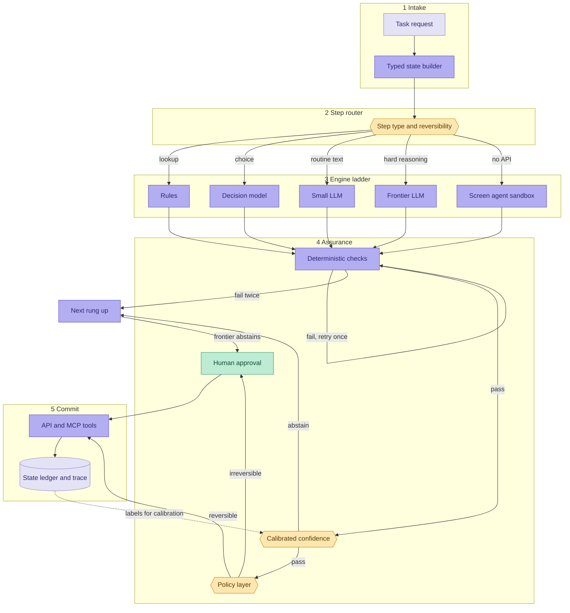
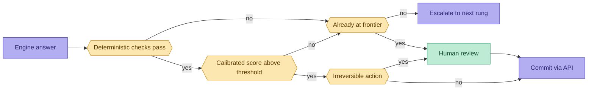
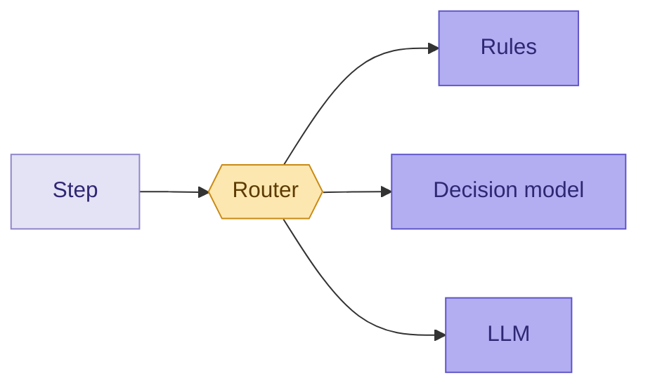
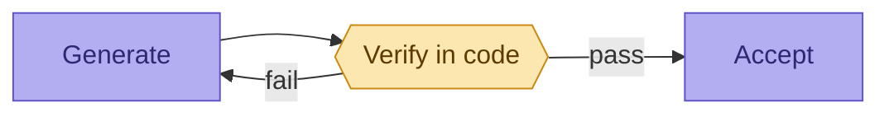
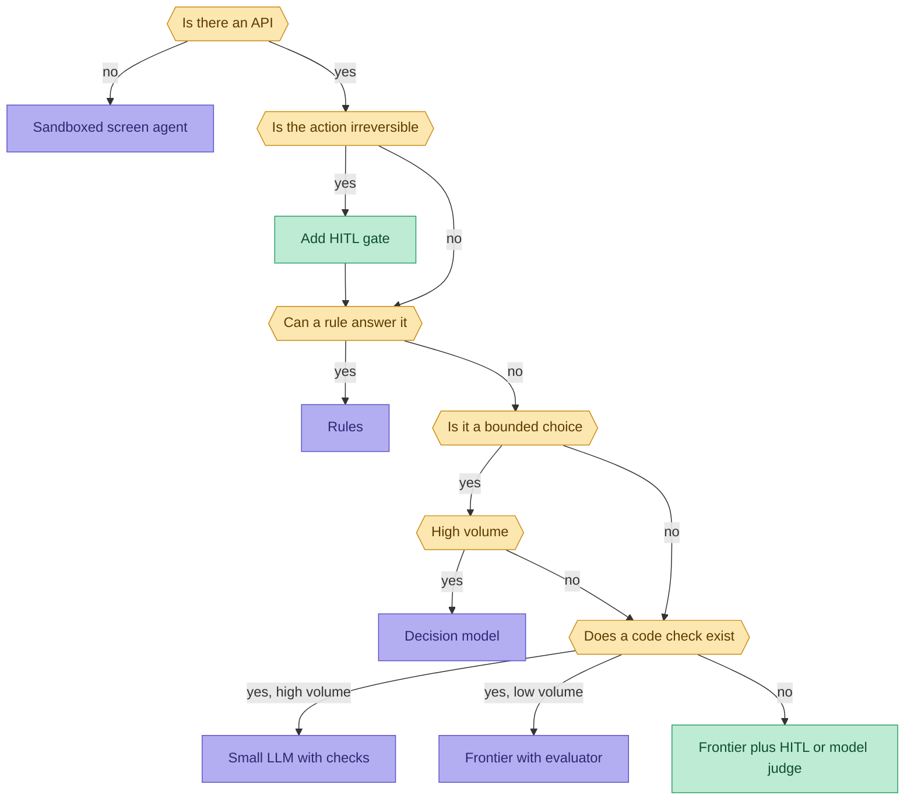

# Decision-First Agents: Technical Design and Architecture

**A research-backed design for agents that route each step to the cheapest engine that can do it reliably, abstain when unsure, and leave state and money to deterministic code.**
Version 1.2 · 2026-10-23 (post-audit round 2) · Audience: solution architects, AI delivery leads, MLOps, security and governance reviewers

This document backs the Models to Margins deep dive at `/deep-dives/decide-dont-chat`, now one page with 7 screens (the former `decision-replay` page is folded in). The page shows no sources. This document is the only home of its sources, and Section 23 maps every number the page shows to a ledger row. It starts from a deep review of seven popular articles, keeps only what survives a fact check, and turns the common thread into an architecture.

---

## 0. How to read this document

### 0.1 Persona legend

| Persona | Role | Refuses to compromise on |
|---|---|---|
| **Maya** | AI and solution architect | Simple, composable control flow. Expensive compute goes only where difficulty lives. |
| **Sam** | MLOps and evals lead | Nothing ships without measured quality per slice. The silent failure rate (confident and wrong) is tracked, not just accuracy. |
| **Priya** | Security lead | Screen and document text is data, never instructions. Credentials never reach a model. Irreversible actions pass a policy layer outside the model. |
| **Alex** | HITL and UX lead | Reviewers see state, a plan and a diff, not a chat log. Reviewer attention is the scarcest resource. |
| **Nadia** | Governance and compliance lead | Every decision is traceable to an engine, an input, a confidence and an owner. EU AI Act transparency duties are met. |

### 0.2 What is decided vs. proposed vs. open

- **Observed fact.** Cited inline and logged in the source ledger (Section 23).
- **[PROPOSED].** A design recommendation from this document, not a measured result.
- **[OPEN].** Not resolved. Section 11 says so rather than claim closure.
- **[VENDOR].** Self-reported by a supplier. Never used to size cost or accuracy in this design.
- **[UNVERIFIED].** Could not be confirmed in a live search on 2026-10-23.

**Terms defined once.**

| Term | Definition |
|---|---|
| Abstain | The engine's calibrated score is below the slice threshold, so the step is not accepted on that rung and escalates (Section 6.3) |
| ECE | Expected calibration error, measured on accepted items only, per slice |
| pass^k | Share of tasks that succeed on all k independent trials of the same task |

### 0.3 Reading paths

| You are | Read |
|---|---|
| Executive or sponsor | Sections 1, 3, 9, 13, 15, 21 |
| Architect | All of it |
| Evals and MLOps | Sections 5, 6, 8, 10, 11, 17, 18 |
| Security | Sections 4.1, 7, 16, 19 |
| Governance | Sections 6.4, 7.4, 7.5, 12, 13.2, 20, 23 |

### 0.4 Storyline: the 20.6% problem

Frame: **Decide, don't chat.**

| Beat | Content | Source |
|---|---|---|
| Hook | Claude Opus 4.8 scores 83.4% on OSWorld-Verified (Anthropic) but 20.6% on OSWorld 2.0 long workflows. Same model, a 4x drop. The hook uses 83.4% because the 83.5% figure could not be verified. | Ledger 10, 36 |
| Why | Each chat-driven step compounds error and cost over a long task | Section 10, C2, C3 |
| Answer | Decide each step on the cheapest reliable rung, check in code, abstain when unsure | Sections 4 to 6 |
| APIs before screens | Commit through APIs, use screens only where none exist. Metric: share of committed steps via API, target at least 90% [illustrative]. Screen runs carry a completion SLO of at least 80% of checkpointed tasks [illustrative] | Sections 3.5, 17.2 |
| Proof | Worked cost per completed task, labelled illustrative | Section 15 |
| Ask | A 30-day pilot, shadow then suggest then auto | Section 21 |

Site: one page, `/deep-dives/decide-dont-chat`, 7 screens.

---

## 1. Deep review of the seven articles (Sam, Nadia)

The brief was seven widely shared articles. Each was read in full and its load-bearing claims were checked against primary sources. 24 claims were checked in total: 6 verified, 4 partly verified, 8 unverified, 2 refuted and 4 vendor self-reported.

The page's hype check shows 11 of the 24.

| # | Claim on the page | Verdict |
|---|---|---|
| 1 | Jev 200x faster, 400x cheaper | Vendor |
| 2 | Outputs are calibrated | Vendor |
| 3 | TypeSafe launched Jev | Verified |
| 4 | 0.966 accuracy on 49 tasks | Partly |
| 5 | Zero schema errors | Vendor |
| 6 | Made by Typeface | Refuted |
| 7 | Stanford open-sourced a skill | Refuted |
| 8 | Reflection lifts 40% to 95% | Vendor, illustrative |
| 9 | Long workflows stay hard | Verified |
| 10 | Open-source fast agent | Partly |
| 11 | EU transparency in force | Partly |

| # | Article | Thesis in one line | Verdict |
|---|---|---|---|
| 1 | The vibe coding trap (levelup) | AI-built MVPs hide failures in pooling, concurrency, idempotency and LLM spend | **Sound advice, weak numbers.** The fixes are standard practice. The unit economics come from one anonymous case. Use METR, Stack Overflow and the security studies instead. |
| 2 | UI trends that are actually happening | Real trends come from user behaviour, not fashion | **Mixed.** The DTCG stable spec (Oct 2025) is real. The 71% NN/g figure is not in the NN/g source, which says "almost in half". The 84% token adoption figure was not found. |
| 3 | Jev and the art of making up your mind | Use a decision model where messy text feeds bounded next steps, and keep rules in code | **The most careful of the seven.** It names Jev's weak areas (arithmetic, dates, multi-step reasoning, adversarial text). The 0.966 accuracy comes from a third-party synthetic benchmark. |
| 4 | New Jev model is insane: 200x faster, 400x cheaper | A new "System One" model category | **Vendor numbers, rounded up.** The headline rounds TypeSafe's own 193.6x and 444.6x [VENDOR]. Those come from TypeSafe internal workflow evals scored against averaged LLM reference answers, not human labels. Vercel's CEO reported up to 18x faster at p95 [VENDOR partner]. No independent replication of the headline was found. The author did not test it. |
| 5 | The $800k AI skill Stanford just open-sourced | Reliability comes from a generate, verify, retry loop | **Refuted as framed.** Nothing was open-sourced. The source is the CS329A course. The loop itself is sound and well known. |
| 6 | AI doesn't need to talk to be great | Small calibrated System-1 models are a new axis of progress | **Good framing, wrong details.** It names the company "Typeface" (it is TypeSafe). Its 238x figure contradicts the vendor's own 444.6x. |
| 7 | Building fast computer agents | Screen agents are slow because of the interface, so lift each app into typed tools | **Right direction, self-reported results.** The OSWorld 2.0 figures check out. The OSWorld-Human 76 to 96% figure is 2025 and was dropped from the page (Section 14). The ai-pc repo is "All rights reserved", so it is not open source, and its 180/180 tests are the author's own. |

**The common thread.** All seven describe one design problem. Take the probabilistic model out of the control path and put it behind a typed boundary that can be checked. Code owns state, money and permissions. Models answer bounded, typed questions with a confidence. Verifiers check before anything retries. Agents call APIs before driving a screen. Interfaces show state, not chat.

---

## 2. Requirements (Maya, Nadia)

### 2.1 Problem in one paragraph

Teams build agents where a frontier model decides every step, including the many steps that a rule, a classifier or a small model could settle in milliseconds. The result is slow, costly and hard to audit, and failures are silent because the model is confident when it is wrong. The goal is an agent design that sends each step to the cheapest engine that can do it reliably, knows when it does not know, and puts a human on the small set of irreversible decisions.

### 2.2 Functional requirements

- **F1.** Classify each step by type (lookup, choice, extraction, reasoning, screen action) and by reversibility (read, reversible write, irreversible).
- **F2.** Route each step to one engine on the ladder: rules, decision model or classifier, small LLM, frontier LLM, computer-use agent.
- **F3.** Return a typed answer with a calibrated confidence, or abstain.
- **F4.** Run deterministic checks (schema, policy, arithmetic, idempotency) before any confidence gate.
- **F5.** Escalate on abstention to the next rung, or to a human for irreversible actions.
- **F6.** Prefer API and MCP tools. Use screen control only where no API exists.
- **F7.** Record every step for replay: engine, inputs, confidence, cost, latency, outcome, approver.

### 2.3 Non-functional requirements

| Area | Target [PROPOSED] |
|---|---|
| Latency | First feedback under 1 s, per NN/g response-time limits. Steps over 10 s run async with checkpoints. |
| Cost | Measured per completed task, including retries, escalations and review minutes, not per call. |
| Quality | Accuracy reported per slice. Silent failure rate on auto-accepted steps under an agreed ceiling. |
| Auditability | Every irreversible action has an owner, a reason and a replayable trace. |
| Portability | Engines are swappable behind a typed contract. No single vendor in the control path. |

### 2.4 Constraints

- Deterministic code owns state, money and permissions. No model writes to a ledger directly.
- Screen and document content is untrusted input.
- EU AI Act Article 50 transparency duties apply from 2 August 2026 (Digital Omnibus transition for 50(2) marking only).
- Sources used for sizing must be dated, and vendor numbers are never used for sizing.

---

## 3. The top approach families (Maya)

Each family below was checked against the literature. Figures that could not be confirmed live were dropped.

### 3.1 Cascades and learned routers
A cascade tries a cheap model and escalates when a scorer judges the answer weak (FrugalGPT, AutoMix). A router predicts the right model before the call (RouteLLM, Hybrid LLM). **Wins** on mixed traffic with a reliable correctness signal. **Breaks** under distribution shift, and on hard items where you pay for both calls. A 2026 benchmark, LLMRouterBench, found that recent routers did not reliably beat a simple baseline. **Maturity:** research mature, production common.

### 3.2 Small specialised and distilled models
Distil or fine-tune a 1B to 8B model on a narrow task. Distilling Step-by-Step showed a 770M T5 beating few-shot 540B PaLM on several benchmarks. **Wins** at high volume on a stable task. **Breaks** on the long tail and on task drift. **Maturity:** high.

### 3.3 Non-generative decision models
Classifiers, encoders and scoring heads that return a label or a score, not text (ModernBERT, SetFit, and hosted decision models such as Jev). **Wins** for routing, triage and risk scoring in milliseconds, and these models can be calibrated with standard methods. **Breaks** on fixed label spaces and when labels are missing. JEPA-style models have no evidence yet as business decision routers. **Maturity:** encoders high, hosted decision models early.

### 3.4 Deterministic workflow with bounded model steps
A state machine or durable workflow owns control flow and model calls fill typed slots. tau-bench showed GPT-4o function-calling agents reached pass^8 (defined in 0.2) on fewer than 25% of retail tasks, which argues for constraining control flow. **Wins** in regulated, replayable processes. **Breaks** when the process is unknown or exceptions cannot be listed. **Maturity:** high.

### 3.5 API-first tools with a sandboxed screen fallback
Call APIs or MCP tools first and drive the screen only where none exist. In "Beyond Browsing" (ACL Findings 2025), a hybrid API plus browsing agent reached 38.9% on WebArena, against 14.8% for browsing only. **Wins** on legacy systems with no API and low volume. **Breaks** on speed, cost, UI change and prompt injection. **Maturity:** API tools high, screen agents rising.

### 3.6 Compiled prompt programs
DSPy, MIPRO and GEPA optimise prompts against a metric so a smaller model can take over a step. **Wins** when a metric and a few hundred examples exist. **Breaks** on small dev sets, and prompts must be recompiled on each model swap. **Maturity:** medium to high.

### 3.7 Layered, not exclusive
These families stack. The workflow (3.4) is the backbone. Rules and decision models (3.3) are the first gate. Small models (3.2, 3.6) take the routine generative steps. A cascade (3.1) sends the hard remainder to a frontier model. Screen agents (3.5) are the last resort.

---

## 4. Thesis and high-level architecture (Maya, Priya)

### 4.0 Thesis (pre-critique)

**Decision first.** Treat each agent step as a decision with a type, a reversibility tag and a cost budget. Route it to the cheapest engine that can answer it reliably. Require a calibrated confidence and let any engine abstain. Let deterministic code own state, money and permissions. Call an API before driving a screen. Put a human only on the irreversible tail, and show that human state and a diff, not a transcript.

### 4.1 Architecture

**Legend. Style: B Isometric.** Violet = core engine or control. Amber hexagon = gate. Green = human. Pale violet = data or state.

**Walkthrough.** A request becomes typed state. The router tags each step and picks a rung. Every answer passes deterministic checks first. A failed check retries once with the error, then escalates. Then the confidence gate runs. One rule covers both: escalate to the next rung up, and if the frontier rung abstains or fails, send the step to a human. Passed steps meet the policy layer, which sends irreversible ones to a human. Only API tools commit, and every step lands in the ledger, whose outcomes feed calibration.

### 4.2 Trust boundaries

1. **Untrusted content zone.** Screens, pages, emails and documents. Read by models, never obeyed.
2. **Model zone.** Engines receive typed state and return typed answers. No credentials, no direct writes.
3. **Policy and commit zone.** Deterministic code holds credentials, enforces policy and writes state.

---

## 5. Component deep-dive, argued by persona

### 5.1 Step router (Maya)
Maya wants the router boring. It is a rules table plus a small classifier, not an LLM. Inputs are step type, reversibility, latency budget and volume. Output is a rung and a budget. Maya rejects a frontier model as top-level controller because its cost and step count are open-ended.

### 5.2 Engine ladder (Maya and Sam)
Each rung exposes the same contract: typed input, typed answer, confidence, cost and latency. Sam insists every rung is evaluated on the same golden set per slice so a step can move down the ladder only with evidence. Indicative ladder [PROPOSED, illustrative, measure on your own traffic]. The p50 latencies match the page ladder. The page labels cost as "near zero", "tiny fraction of a cent", "fraction of a cent", "cents per step" and "dimes to dollars", about 10x per rung [illustrative]:

| Rung | Typical latency | Relative cost | Best for |
|---|---|---|---|
| Rules | under 1 ms | near zero | Enumerable lookups and policy |
| Decision model or classifier | about 100 ms | tiny fraction of a cent | Choice, triage, scoring |
| Small LLM | about 1 s | fraction of a cent | Routine extraction and drafting |
| Frontier LLM | about 10 s | cents per step | Hard reasoning, the abstained tail |
| Screen agent | minutes per task | dimes to dollars | Systems with no API |

### 5.3 Deterministic checks (Sam)
Schema, arithmetic, date, idempotency key and policy checks run before any confidence is read. A valid schema is not a correct answer, so checks test content, not just shape. This is the generate, verify, retry loop from article 5, with the verify step in code.

### 5.4 Confidence gate (Sam and Alex)
Covered in Section 6.

### 5.5 Policy layer (Priya)
A deterministic allowlist decides which actions an engine may propose and which need approval. It sits outside every model, so an injected instruction cannot widen it.

### 5.6 Screen agent sandbox (Priya)
Runs in a disposable VM with no stored credentials. It may read and propose clicks. Any write that is irreversible becomes a proposed action for the policy layer.

### 5.7 Review console (Alex)
Shows the plan before execution, the diff after, the evidence and the confidence. Approve, edit and undo are the main buttons. It asks the reviewer to decide before revealing the model's answer on high-stakes items, which reduced overreliance in Buçinca et al. (CSCW 2021).

### 5.8 Ledger and trace (Nadia)
Each step records engine, model version, inputs hash, confidence, cost, latency, outcome and approver, using OpenTelemetry GenAI conventions. The ledger is the audit trail and the label source for calibration.

---

## 6. Confidence, calibration and human-in-the-loop

### 6.1 Why naive confidence fails
Verbalised LLM confidence is poorly calibrated (Xiong et al. 2023). Vendor "calibrated" claims need checking per task. Guo et al. ("Just Ask Jev", arXiv 2609.29429) report a median zero-shot AUROC of 0.886 across 44 benchmarks, which measures ranking, not calibration. The paper itself notes that on skewed benchmarks F1 mostly reflects base rate, so a pooled score can hide per-task error. Explanations also raise acceptance whether or not the AI is right (Bansal et al., CHI 2021).

### 6.2 What works
- Fit calibration on your own labels per slice (temperature scaling, isotonic). Temperature scaling is the standard first fix [UNVERIFIED for Jev, no source found].
- Use conformal risk control or selective classification for a distribution-free error bound on accepted items, assuming exchangeability (Angelopoulos and Bates 2021). The bound is marginal, not per slice. Use Mondrian or group-conditional conformal for per-slice bounds. Items below threshold abstain (0.2) and go up.
- Track the silent failure rate on auto-accepted steps, not only accuracy.

### 6.3 Gating flow

### 6.4 The review queue as a product (Alex)
Gate by reversibility and blast radius, not every step, because approval fatigue erodes oversight (automation bias, Parasuraman and Manzey 2010). Show confidence only where it is calibrated. Measure reviewer override rate and time per item.

### 6.5 Measuring the gate (Sam)
Report per slice: escalation recall on the hard slice, silent failure rate, abstention rate and cost per completed task. A router is judged on how well it finds the hard items, not average accuracy.

---

## 7. Data, security and governance

### 7.1 Data model
Typed task state, step records and the ledger live in a transactional store. Models read snapshots and never hold write access.

### 7.2 Identity and least privilege (Priya)
Credentials live in the commit zone. Each tool call uses a scoped, short-lived token issued by the policy layer for that action only.

### 7.3 Prompt injection on computer-use (Priya)
Screen agents read hostile text by design. The evidence is mixed: VPI-Bench found computer-use and browser agents highly susceptible to visual prompt injection on older models. Gray Swan's 2026 round (blog 18 Mar 2026) was an indirect prompt injection arena, not a computer-use test: 464 participants, 41 scenarios, over 272,000 attacks on 13 frontier models, and no model came out clean. Per-model attack success rates of 0.5% to 8.5% are [UNVERIFIED]. The strongest defences reported are out-of-model capability and information-flow controls. CaMeL (Google DeepMind, arXiv 2503.18813) solved 77% of AgentDojo tasks with provable security against 84% undefended in its v2 (67% in v1), so it costs utility. FIDES (Microsoft, arXiv 2505.23643) labels data for confidentiality and integrity and enforces policy deterministically [preprint results]. Design response: screen agents propose, the policy layer disposes, and irreversible actions always reach a human.

### 7.4 Untrusted content handling
Content from screens and documents is wrapped as data with provenance tags. Tool descriptions from third-party MCP servers are reviewed and pinned.

### 7.5 Governance (Nadia)
AI labels and decision provenance in the UI meet EU AI Act Article 50 duties, which apply from 2 August 2026. The Digital Omnibus left Article 50 in place but gave the Art 50(2) marking duty a transition to 2 December 2026 for systems already on the market. Systems placed on the market from 2 August 2026 get no grace period. High-risk duties moved to December 2027 (ledger 47). Check the Official Journal text. The ledger supports replay of any decision. Vendor engines are recorded by version so a silent vendor update shows up as drift.

---

## 8. Design patterns and comparison (Maya)

### 8.1 Pattern A, single call
One model call does the whole step. Fine as an inner primitive, collapses on large or multi-part steps.

### 8.2 Pattern B, prompt chaining
A fixed sequence of typed steps. The dependable backbone for known processes.

### 8.3 Pattern C, routing
Classify the step and dispatch to a rung. The front door of this design.

### 8.4 Pattern D, orchestrator-workers
Split a task into parallel sub-steps. Useful where one task has many independent decisions, as in Jev's parallel question fan-out.

### 8.5 Pattern E, evaluator-optimizer
Generate, verify, retry. Right for the hard tail, with the verifier in code first and a model judge only for what code cannot check.

### 8.6 Pattern F, autonomous ReAct
Open-ended tool loop. Allowed only inside a budgeted sandbox step, never as top-level controller.

### 8.7 Pattern G, HITL checkpoint
A human approves irreversible actions. Cross-cutting.

### 8.8 Comparison matrix

| Dimension | A Single | B Chain | C Route | D Orch | E Eval-opt | F ReAct | G HITL |
|---|---|---|---|---|---|---|---|
| Build effort | Low | Low | Medium | Medium | Medium | Low | Medium |
| Latency | Low | Medium | Lowest on easy | Medium | High | Highest | Human time |
| Cost per task | Varies | Low | Lowest if escalation rate is low | Medium | High | Highest | Review minutes |
| Easy majority | Good | Good | Best | Good | Overkill | Overkill | Not needed |
| Hard tail | Poor | Poor | Escalates | Fair | Best | Fair | Best |
| Confidence per step | Poor | Fair | Good | Good | Good | Poor | High, fatigue-limited |
| Predictability | High | High | Medium, drifts | Medium | Medium | Low | High |
| Eval difficulty | Low | Low | Medium | Medium | Medium | High | Low |
| Best role | Inner call | Backbone | Front door | Fan-out | Tail | Sandboxed step | Irreversible gate |

### 8.9 Decision tree

The API question comes first because it decides the action surface before any rung is chosen. Volume decides whether training a decision model or small model pays back.

### 8.10 Recommended composite
B as the backbone, C as the front door, D for fan-out decisions, E on the tail, F only inside the screen sandbox, G on irreversible actions. All on a durable workflow.

### 8.11 Anti-patterns rejected
| Anti-pattern | Why rejected |
|---|---|
| Frontier model as top-level controller | Cost and step count are open-ended, and every step pays frontier latency |
| Model judge as the only verifier | Shares the generator's blind spots, so errors pass together |
| Raw model confidence shown to reviewers | Uncalibrated scores anchor reviewers and raise wrong acceptance |
| Screen control where an API exists | Slower, costlier, breaks on UI change and widens injection surface |
| Per-call routing with no upstream context | Errors compound across steps (C2) |

---

## 9. How we decide (Maya, Nadia)

| Criterion | Why it matters |
|---|---|
| **Reversibility** | Sets the floor on oversight. An irreversible action gets a human whatever the confidence says. |
| **Latency budget** | Picks the fastest rung that fits. Over 1 s breaks flow and over 10 s needs async handling. |
| **Volume** | High volume justifies training a classifier or small model. Low volume favours a frontier call. |
| **External check exists** | If code can verify the answer, a cheaper engine plus a retry beats a costly engine alone. |
| **Calibration need** | Auto-accept needs a calibrated score on your data. Without it, every answer is reviewed or escalated. |
| **Cost per completed task** | Escalations, retries and review minutes count. A cascade that escalates often can cost more than one frontier call. |
| **API availability** | An API is faster, cheaper and safer than a screen. Screen control is the last rung. |
| **Data residency and vendor risk** | A hosted decision model in the control path is a dependency. Keep it behind a swappable contract. |

---

## 10. Design critique, red-teaming the thesis (all personas, see 20.4)

**Gaps the research flagged**
- **C1. Vendor calibration is unproven.** Jev's calibration varies by task (Section 6.1). A decision model cannot auto-accept until calibrated on local labels.
- **C2. Per-step routing compounds errors.** A cheap model's subtly wrong output corrupts the next step's context, so per-step accuracy overstates task accuracy.
- **C3. Screen agents fail on long work.** Claude Opus 4.8 scores 83.4% on OSWorld-Verified per Anthropic but 20.6% on OSWorld 2.0 long workflows (same model). Short benchmarks overstate readiness.

**Substantive critiques**
- **C4. Router staleness.** Distribution shift makes a trained router wrong without warning. Needs drift monitoring and periodic refit.
- **C5. Routers may not beat one good model.** LLMRouterBench (2026) found routers did not reliably beat a simple baseline. The ladder must prove it saves money on your traffic.
- **C6. Cold start.** Calibration and routing need labels that a new deployment lacks. Early weeks run with heavier review.
- **C7. Review fatigue.** If the irreversible tail is large, humans rubber-stamp. Automation bias grows with reliability.
- **C8. Injection through the policy gap.** A policy layer only protects actions it knows about, and indirect prompt injection (Gray Swan's 2026 arena) reaches agents through any text they read. New tools must be classified before use.
- **C9. Hidden vendor drift.** A hosted engine can change under a fixed name, breaking calibration silently.
- **C10. Overhead on small tasks.** For low-volume flows the router, checks and ledger cost more than they save.

**What the critique changes**
- Decision models start in shadow mode and earn auto-accept per slice (C1, C6).
- Routing is judged on end-to-end task success, not per-step accuracy (C2, C5).
- Screen agents are scoped to short, checkpointed tasks (C3).
- A minimum volume threshold decides whether the ladder is worth building (C10).

---

## 11. Gap-closing research (Sam, Priya)

A live search pass on 2026-10-23 on the top three gaps.

| Gap | Finding | What it changes |
|---|---|---|
| **C1 Calibration of decision models** | Guo et al. (arXiv 2609.29429) report median AUROC 0.886 over 44 benchmarks, a ranking metric. No per-task calibration figure could be sourced, and earlier ECE figures were removed. Any temperature fix is [UNVERIFIED]. | Confirms the shadow-mode rule. Calibration is per slice on local labels, not trusted from the vendor. Still **[OPEN]**: no refereed reliability diagram exists. |
| **C2 Error compounding in per-step routing** | AgentRouter (Paul and Nandy, ICML 2026 AgenticUQ Workshop, arXiv 2609.22951, accepted at AgenticUQ Workshop, ICML 2026) reports a 12M classifier choosing one of four tiers per step, 72% cost cut and under 3% task-completion loss, against 31% and 44% for per-step RouteLLM and FrugalGPT [authors' numbers, slide figures inconsistent]. It names corrupted intermediate context as the cause. | Supports a small classifier router, but one that sees cross-step context. The router input gains "upstream rung and confidence". Independent replication **[OPEN]**. |
| **C8 Prompt injection on agents** | Gray Swan indirect prompt injection arena (18 Mar 2026, 464 participants, 41 scenarios, 272k+ attacks, 13 models, none clean, per-model rates [UNVERIFIED]). CaMeL (DeepMind) reaches 77% of AgentDojo tasks with provable security vs 84% undefended. FIDES (Microsoft) enforces information-flow labels deterministically. | Confirms the policy layer outside the model as the main control, not model refusal training. Adaptive attacks against those defences remain **[OPEN]**. |

---

## 12. SOTA refresh, 2026-08-23 to 2026-10-23 (Maya, Sam)

- **What we got wrong.** The first draft treated a hosted decision model's "calibrated" label as usable. The September preprints report ranking quality (AUROC), not per-task calibration. Fixed in Sections 6 and 10.
- **Biggest miss.** Cross-step routing. AgentRouter (Sep 2026) and Signed Rescue Routing (arXiv 2609.07786, Sep 2026) both say per-call routing is the wrong unit. Signed Rescue Routing escalates on predicted rescue, meaning when the large model is likely to fix the small model's error. That differs from our abstention trigger, so we propose adding predicted rescue as a second escalation signal. Its results are not yet published (TBD). The page tile "2 events, escalate only when both hold" is from this preprint and is tagged preprint, illustrative.
- **Computer use.** One model, Claude Opus 4.8, reaches 83.4% on OSWorld-Verified (Anthropic), close to the benchmark ceiling, while OSWorld 2.0 long-horizon success is about 21% (arXiv 2606.29537).
- **Cost.** Moonshot Kimi K3 lists at $3 and $15 per million input and output tokens per a third-party tracker citing Moonshot's pricing page. Kimi K3.1 Pro pricing is [UNVERIFIED] and is not used. BenchLM puts the median open-weight blended price 78% below proprietary ($0.43 vs $1.93 per million tokens, live on 23 Oct 2026). The 82% figure ($0.48 vs $2.63) was BenchLM's 2 Jul 2026 reading and is superseded. Both lower the cost of the small and frontier rungs but do not change the ladder order.
- **Standards.** NIST CAISI's AI Agent Standards Initiative (launched 17 Feb 2026) has no final output yet (ledger 48). The Evaluation Context Protocol (arXiv 2608.19263) is the one new eval contract proposal found.

---

## 13. Final recommendation and honest scope (Maya, Nadia)

### 13.1 Recommendation
Build a decision-first agent on a durable workflow. Route each step with a small context-aware router to rules, a decision model or classifier, a small LLM, a frontier LLM, or a sandboxed screen agent, in that order of preference. Check in code before reading confidence. Calibrate per slice on your own labels and start every learned engine in shadow mode. Keep credentials and writes in deterministic code behind a policy layer, and put a human on irreversible actions with a plan and diff view.

### 13.2 Honest scope
- **Wave 1 (one process, 6 to 8 weeks) [PROPOSED].** Workflow backbone, rules and frontier rungs only, deterministic checks, policy layer, ledger, review console. Collect labels.
- **Wave 2.** Add the decision model or classifier rung and the small LLM rung in shadow mode. Turn on auto-accept per slice once calibration holds.
- **Wave 3.** Add the screen agent sandbox for systems with no API, scoped to short tasks.
- **Not promised.** A specific cost saving before Wave 2 data exists, any vendor speed multiple, or long-horizon autonomy on screens.

---

## 14. Figures dropped or marked after live verification (Sam, Nadia)

| Figure | Original source | Action |
|---|---|---|
| Copilot users 41% higher bug rate (Uplevel) | Strand C | Dropped, vendor and not checked |
| GitClear 8x rise in duplicated blocks | Strand C | Dropped, not checked live |
| 26% more tasks with Copilot (Cui et al.) | Strand C | Dropped, not checked live |
| Static types catch about 15% of JS bugs | Strand C | Dropped, not checked live |
| Pearce 40% vulnerable completions | Strand C | Dropped, older models, not checked live |
| "RouterBench found routers barely beat one model" | Strand B | Reattributed to LLMRouterBench 2026 |
| OSWorld leaderboard 40 to 60% through 2025 | Strand B | Dropped, superseded |
| Speculative actions for agents (2510.04371) | Strand B | Dropped, not checked |
| Ladder latency and cost ratios | Strand B | Kept as illustrative only |
| One-temperature fix for Jev | Gap search | Marked [UNVERIFIED] |
| Jev ECE 0.047, 0.246 and "24 of 31" | Gap search | Removed, not in cited preprints (T1) |
| Independent Jev 25x, 2.9x, 12x | Article 4 review | Removed, unverifiable (T6) |
| OSWorld-Human 76 to 96% | Article 7 review | Dropped from the page, 2025 figure (T13) |
| NN/g 71% | Article 2 review | Dropped, not in the NN/g source (T13) |
| 84% design token adoption | Article 2 review | Dropped, not found (T13) |
| Jev 238x | Article 6 review | Debunked, contradicts the vendor's 444.6x, not live (T13) |
| Simular 73% OSWorld 2.0 | SOTA refresh | Removed, unverifiable (T5) |
| Attack rates 24% to 98% | Section 7.3 | Removed, no source (T8) |
| Kimi K3.1 Pro $2/$10 | SOTA refresh | Replaced with Kimi K3 $3/$15 (T7) |

Kept after live check: METR 19% slower with a perceived 20% speedup (2025, historical. The 2026 continuation measured about -4%, not significant), DORA 2024 1.5% throughput and 7.2% stability per 25% adoption, Stack Overflow 2025 46% distrust vs 33% trust and 66% "almost right", Veracode 45% (vendor), Spracklen 19.7% hallucinated packages (2025-era models), tau-bench pass^8 (8 independent trials) under 25% in retail, Beyond Browsing 38.9% vs 14.8%.

---

## 15. Cost per completed task and human cost (Maya, Alex)

All figures in this section are **illustrative**, not measured. Swap in your own prices and rates. The review rate matches the page and `dcr.js`: $1.50 for 3 minutes.

### 15.1 Assumptions [illustrative]

| Input | Value |
|---|---|
| Frontier call per step | $0.050 |
| Small LLM call per step | $0.005 |
| Retry rate after a failed check | 5% |
| Escalation rate, small to frontier | 20%, the worst case. Assumed run rate 15%, target under 20% |
| Review time per item | 3 min |
| Loaded reviewer rate | $30 per hour, so $0.50 per min and $1.50 per review |
| Volume | 100,000 tasks per month, the page default |
| One-off build cost | $60,000, the page figure |

### 15.2 One task on three routes (G1) [illustrative]

| Route | Model cost | Review share | Review cost | Total per task |
|---|---|---|---|---|
| Frontier only, review every 10th | 0.050 x 1.05 = $0.0525 | 10% | 0.10 x 1.50 = $0.150 | **$0.203** |
| Cascade, review every 10th | 0.005 x 1.05 + 0.20 x 0.050 = $0.0153 | 10% | 0.10 x 1.50 = $0.150 | **$0.165** |
| Cascade plus review on irreversible only | $0.0153 | 3% | 0.03 x 1.50 = $0.045 | **$0.060** |

At the assumed 15% escalation the cascade model cost is 0.00525 + 0.15 x 0.050 = $0.0128, so the totals fall to $0.163 and $0.058.

Reading: review minutes dominate. Routing saves cents, gating by reversibility saves about a dime per task.

### 15.3 Review volume and break-even (G11) [illustrative]

| Item | Formula | Value |
|---|---|---|
| Reviews per month at 3% | 0.03 x 100,000 | 3,000 |
| Reviewer hours | 3,000 x 3 / 60 | 150 |
| Review cost per month | 150 x $30 | $4,500 |
| Break-even escalation, model cost only | 0.005 + e x 0.050 = 0.050, so e = 0.045 / 0.050 | 90% |
| Break-even if each escalation also adds a review | 0.005 + e x (0.050 + 1.50) = 0.050, so e = 0.045 / 1.55 | about 2.9% |
| Monthly saving, frontier reviewed vs gated cascade | (0.203 - 0.060) x 100,000 | about $14,250 |
| Payback on the $60,000 build | 60,000 / 14,250 | about 4.2 months |

### 15.4 CFO challenges

| ID | Challenge | Answer |
|---|---|---|
| F1 | Build cost and payback | Build $60,000 [illustrative]. On the 15.2 routes it pays back in about 4.2 months at 100,000 tasks (15.3). The page's "pays back fast" uses its six-step refund replay instead: $0.260 all frontier vs $0.0024 decision first, so (0.260 - 0.0024) x 100,000 = $25,760 a month and 60,000 / 25,760 = 2.3, shown as about 3 months. Both are illustrative. No figure is promised before Wave 2 data. |
| F2 | What if model prices double | Model cost is 0.0153 / 0.060, about 25% of the gated route, so doubling adds about $0.015 per task. Review rate is the lever that matters. |
| F3 | Link to outcome pricing | Price per completed task, not per call, using the 15.2 total plus margin. The ledger proves completion. |
| F4 | Are review minutes priced | Yes. Review minutes are a line in every route at $0.50 per minute. |
| F5 | When is it not worth it | At 1,000 tasks a month the 15.2 saving is (0.203 - 0.060) x 1,000 = $143, so payback runs past 35 years. This backs the page's "under about 1,000 tasks a month" line. |

---

## 16. Data, privacy, tenancy and security challenges (Priya, Nadia)

### 16.1 Data classes (G3)

| Class | Example | Redaction before model call | Retention [PROPOSED] |
|---|---|---|---|
| PII | Names, emails, IDs | Yes, tokenised in the commit zone | Per tenant DPA |
| Screenshots | Screen agent frames | Mask fields marked sensitive | 30 days, then hash only |
| Traces | Step records | Inputs hashed, no raw PII | Per audit duty, see P4 |
| Labels | Reviewer outcomes | Not needed | Life of model version |

Residency per rung: rules and the ledger run in the tenant region. Hosted rungs are allowed only where the vendor offers that region. GDPR roles, lawful basis and data subject requests are handled by the commit zone (ledger 43).

### 16.2 Multi-tenancy (G2)

| Control | Design [PROPOSED] |
|---|---|
| Isolation | Separate ledger partition and keys per tenant |
| Calibration | Fitted per tenant and slice, never pooled across tenants |
| Thresholds | Set per tenant from its own labels |
| Cross-tenant injection | Retrieval and few-shot examples never cross tenants. Shared prompts are pinned and reviewed. |

### 16.3 Security challenges

| ID | Challenge | Answer |
|---|---|---|
| P1 | Incident path for flagged injection | Policy layer blocks the action, freezes the task, pages security on-call, keeps the frame and trace as evidence |
| P2 | Least privilege for the screen agent | Disposable VM, no stored credentials, network allowlist, read and propose only |
| P3 | DPA and residency for hosted decision models | Signed DPA, named region, no training on tenant data, else the rung stays off |
| P4 | Audit retention | Ledger kept for the longest applicable duty, set by Nadia per tenant |
| P5 | Version pinning | Every engine pinned by version. A change re-runs the golden set before it carries traffic. |

---

## 17. Evaluation, observability, latency and drift (Sam)

### 17.1 Golden set and metrics (G5)

| Item | Design [PROPOSED, illustrative targets] |
|---|---|
| Golden set | 500 labelled tasks per process, stratified by slice, 20% hard tail |
| Refresh | Monthly, plus after any version change |
| Task success | at least 95% |
| Share of committed steps via API | at least 90% |
| ECE (0.2) | under 0.05 per slice with at least 300 labels, else pooled within tenant |
| Escalation rate | assumed 15%, target under 20%, 20% is the worst case priced in 15.2 |
| False-accept rate | under 1% on auto-accepted steps |

### 17.2 Span schema and SLOs (G6)

| Span field | Meaning |
|---|---|
| rung | Engine that answered |
| model_version | Pinned version |
| confidence | Calibrated score or abstain |
| verifier_result | Pass, fail, retry |
| reviewer_id | Set when a human decided |
| cost_usd, latency_ms | Per step |

| SLO [illustrative] | Alert when |
|---|---|
| p95 end-to-end under 30 s for sync tasks | 3 breaches in 1 hour |
| False-accept rate under 1% | Weekly sample above target |
| Escalation rate under 20% | Daily rate above 1.5x baseline |
| API share of committed steps at least 90% | Weekly share below target |
| Screen run completion at least 80% of checkpointed tasks | Weekly rate below target |

### 17.3 Latency budget (G9) [illustrative]

The p50 column matches the page ladder (under 1 ms, about 100 ms, about 1 s, about 10 s). The p95 column is this document's own and is not on the page. The replay's frontier steps run 1.8 to 3.0 s, shorter than the 10 s ladder figure. TypeSafe's source gives 70 to 500 ms for the decision rung, wider than the page's 70 to 300 ms.

| Rung | p50 | p95 |
|---|---|---|
| Rules | under 1 ms | 5 ms |
| Decision model | 100 ms | 300 ms |
| Small LLM | 1 s | 3 s |
| Frontier LLM | 10 s | 25 s |
| End to end, typical task | under 5 s | under 30 s, else async |

### 17.4 Versioning and drift (G10)

| Signal | Trigger | Action |
|---|---|---|
| Mean confidence shifts | over 2 standard deviations week on week | Sample and relabel |
| Calibration error rises | ECE above target on fresh labels | Refit and re-run golden set |
| Vendor version changes | Any | Shadow the new version before switching |

---

## 18. Failure handling and rollout (Maya, Sam)

### 18.1 Per-component failures (G7)

| Component | Timeout [illustrative] | If down | Retry |
|---|---|---|---|
| Decision model | 500 ms | Skip to next rung | No |
| Small LLM | 5 s | Skip to frontier | Once, idempotent |
| Frontier LLM | 30 s | Queue for human | Once, idempotent |
| Screen agent | 2 min per step | Checkpoint and pause | From last checkpoint |
| Commit API | 10 s | Circuit breaker opens after 5 failures | Idempotency key on every write |

### 18.2 Rollout ladder (G4)

| Stage | Behaviour | Exit metric [illustrative] | Rollback trigger |
|---|---|---|---|
| Shadow, days 1 to 14 | Engine answers, human decides, no effect | ECE under 0.05, pooled within tenant on at least 300 labels. A slice auto-accepts later only with its own 300 labels | Not needed |
| Suggest, days 15 to 24 | Engine answer prefilled, human approves | Override rate under 10% | Override rate above 20% |
| Auto-accept, reversible only, days 25 to 30 | Commits without review | False-accept under 1% | Any irreversible error, or false-accept over 2% |

One duration: the 30-day pilot (Section 21) is this ladder. Wave 1 build (13.2) comes before it.

---

## 19. Review console, UX and accessibility (Alex)

### 19.1 Accessibility (G12)

| Need | Design |
|---|---|
| Standard | WCAG 2.2 AA (ledger 42) |
| Keyboard triage | A approve, E edit, U undo, J and K move, all visible |
| Confidence | Shown as a number and a label, never by colour alone |
| Focus | Visible focus ring, no focus trap in drawers |

### 19.2 Design system and agentic patterns (G14)

| Pattern | Tie to the UI article |
|---|---|
| Design tokens | Console colours and verdict chips come from DTCG tokens (ledger 14) |
| Plan before act | Plan card shown before any write |
| Diff after act | State diff, not a chat log |
| Verdict chip | One chip per step with a key, see U4 |

### 19.3 First-time customer questions

| ID | Question | Answer |
|---|---|---|
| U1 | Who is this for | Teams running a repeatable process with an API, enough volume and a clear owner |
| U2 | Can I undo | Reversible steps have one-click undo from the ledger. Irreversible ones never run without approval. |
| U3 | Time to value | A 30-day pilot: shadow, then suggest, then auto-accept for reversible steps (18.2, 21) |
| U4 | Verdict chip key | Accepted, Escalated, Reviewed, Blocked, each with an icon and text |

---

## 20. Operating model, exit and critique (Nadia, Priya, Maya)

### 20.1 Build, buy or fine-tune (G8)

| Option | Speed to start | Lock-in | Calibration control | Best when |
|---|---|---|---|---|
| Buy hosted decision model (Jev) | Fast | High | Low, vendor model | Pilot and low volume |
| Train in-house classifier | Medium | Low | Full | Stable labels, high volume |
| Fine-tune small LLM | Medium | Medium | Medium | Text output needed |

Exit test: swap the rung for the in-house classifier on the golden set. If task success holds within 2 points [illustrative], the exit is proven.

### 20.2 Build this without the vibe-coding trap (G13)

| Trap from article 1 | CI gate |
|---|---|
| No pooling or limits | Load test on every release |
| Concurrency bugs | Race tests on the commit path |
| Missing idempotency | Test rejects any write without a key |
| Runaway LLM spend | Budget check per task in CI and at runtime |
| Hallucinated packages | Lockfile and allowlist check |

### 20.3 RACI and on-call (G15)

| Activity | Responsible | Accountable | Consulted | Informed |
|---|---|---|---|---|
| Router and ladder | Maya | Maya | Sam | Nadia |
| Evals and drift | Sam | Sam | Maya | Alex |
| Policy and injection on-call | Priya | Priya | Maya | Nadia |
| Review console | Alex | Alex | Sam | Nadia |
| Audit and retention | Nadia | Nadia | Priya | All |

### 20.4 Critique attribution (G16)

| Critique | Raised by | Rebuttal |
|---|---|---|
| C1, C6 | Sam | Shadow mode until local calibration holds |
| C2, C5 | Maya | Judge on task success and use a context-aware router |
| C3 | Maya | Screen agents scoped to short checkpointed tasks |
| C4, C9 | Sam | Drift monitor and version pins (17.4) |
| C7 | Alex | Gate by reversibility, keep review share low |
| C8 | Priya | Classify every new tool before use |
| C10 | Nadia | Volume threshold before building the ladder |

---

## 21. Pilot offer (G18) (Alex, Nadia)

| Item | Scope |
|---|---|
| Length | 30 days, the same 30 days as the 18.2 rollout ladder |
| Process | One, with an API |
| Stages | Shadow days 1 to 14, suggest days 15 to 24, auto-accept for reversible steps days 25 to 30 |
| Success criteria [illustrative] | Task success at least 95%, false-accept under 1%, API share of commits at least 90%, cost per completed task below the frontier-only baseline |
| Deliverable | Ledger, review console, measured cost per task |

Close: the pilot ends with a measured cost per completed task, and that number, not this document, decides Wave 2.

---

## 22. Audit log (Sam, Nadia)

### 22.1 ID legend

| Prefix | Meaning |
|---|---|
| G | Completeness gap, something missing |
| K | Correctness fault, wrong or inconsistent |
| T | Truthiness, a figure or source that failed a live check |
| R2- | Round 2 item, 2026-10-23 |
| F, P, U, C | CFO, security, customer and critique items, defined where they appear |

### 22.2 Round 1

Round 1 G1 and G11 were reopened in round 2 because the review rate was wrong ($60/h). They closed again with R2-K1 and R2-K2.

| ID | Status | Change |
|---|---|---|
| G1 | Fixed | 15.2 three-route table, illustrative |
| G2 | Fixed | 16.2 |
| G3 | Fixed | 16.1 |
| G4 | Fixed | 18.2 |
| G5 | Fixed | 17.1 |
| G6 | Fixed | 17.2 |
| G7 | Fixed | 18.1 |
| G8 | Fixed | 20.1 |
| G9 | Fixed | 17.3 |
| G10 | Fixed | 17.4 |
| G11 | Fixed | 15.3 |
| G12 | Fixed | 19.1 |
| G13 | Fixed | 20.2 |
| G14 | Fixed | 19.2 |
| G15 | Fixed | 20.3 |
| G16 | Fixed | 20.4 |
| G17 | Fixed | 8.11 now a table with a why per row |
| G18 | Fixed | Section 21 |
| K1 | Fixed | One rule in 4.1, 6.3 and walkthrough |
| K2 | Fixed | Failed-check edge in 4.1 |
| K3 | Fixed | 6.2 wording |
| K4 | Removed | Claim removed with T1 |
| K5 | Removed | 0.246 removed, temperature fix tagged [UNVERIFIED] |
| K6 | Fixed | 3.4 and Section 14 |
| K7 | Fixed | Section 12 |
| K8 | Fixed | 5.2 and 17.3 |
| K9 | Fixed | See T7 |
| K10 | Fixed | Matrix |
| K11 | Fixed | Matrix |
| K12 | Fixed | Matrix |
| K13 | Fixed | Decision tree |
| K14 | Fixed | 7.3 and 11, CaMeL v2 77% vs 84% |
| T1 | Removed | ECE and 24 of 31 figures. AUROC 0.886 kept, sourced |
| T2 | Fixed in round 2 | Venue confirmed, AgenticUQ Workshop, ICML 2026. Tag removed in 11 and ledger 25 |
| T3 | Fixed | 3.1 and C5 wording |
| T4 | Fixed | Model named, saturation softened |
| T5 | Removed | Simular 73% |
| T6 | Removed | Independent Jev multiples 25x, 2.9x and 12x. Vendor figures kept with caveat, 18x as vendor partner |
| T7 | Fixed | Kimi K3 $3/$15, sourced |
| T8 | Removed | 24% to 98%. Gray Swan per-model rates now [UNVERIFIED] |
| T9 | Fixed | Marked TBD |
| T10 | Fixed | Attribution and figures, ledger 34 and 35 |
| T11 | Fixed | 2 Aug 2026 and Omnibus 50(2) transition |

### 22.3 Round 2

Outcome: 32 items, 31 fixed, 1 kept with a live-checked reason (R2-T4). G8 had no item.

| ID | Status | Change |
|---|---|---|
| R2-S1 | Fixed | Ledger moved to Section 23, after the audit log. Sections 15 to 22 renumbered with all cross-references. Rows sorted, ID added to row 28 |
| R2-G1 | Fixed | API share metric (target 90%) and screen completion SLO (80%) in 0.4, 17.1, 17.2, 21 |
| R2-G2 | Fixed | Governance path cites 7.4 and 7.5 |
| R2-G3 | Fixed | Ledger rows 44 to 50 for OrcaRouter, AI in Plain English, Goodwin, Baker Botts, CSA, arXiv 2602.09902, eesel Kimi. OSWorld 2.0 108 workflows and ai-pc 180/180 mapped in 23.2 |
| R2-G4 | Fixed | Page number map, 23.2 |
| R2-G5 | Fixed | Illustrative page inputs, 23.3 |
| R2-G6 | Fixed | 11 page claims listed in Section 1 |
| R2-G7 | Fixed | METR 19% labelled 2025, historical, in 14 and ledger 1 |
| R2-G9 | Fixed | Persona names on sections 1 to 4, 8 to 14, 21 to 23 |
| R2-G10 | Fixed | Close line in 21 |
| R2-G11 | Fixed | ID legend in 22.1 |
| R2-G12 | Fixed | Hook uses 83.4%, reason stated in 0.4 |
| R2-G13 | Fixed | Rescue tile tagged preprint, illustrative, in 12 and 23.2 |
| R2-G14 | Fixed | Page cost labels in 5.2 |
| R2-K1 | Fixed | Review rate $30/h. Totals $0.203, $0.165, $0.060 in 15.2 |
| R2-K2 | Fixed | Break-even formula, e about 2.9%, in 15.3 |
| R2-K3 | Fixed | Volume 100,000, the page default |
| R2-K4 | Fixed | $60k build and payback reconciled in 15.4 F1 |
| R2-K5 | Fixed | Pilot and rollout share one 30-day timeline, 18.2 and 21 |
| R2-K6 | Fixed | 300 labels pooled within tenant in shadow, 300 per slice to auto-accept |
| R2-K7 | Fixed | 6.2 rewritten, marginal bound, Mondrian for per slice |
| R2-K8 | Fixed | Abstain defined once in 0.2 |
| R2-K9 | Fixed | 20% is the worst case, 15% assumed, 15.1 and 17.1 |
| R2-K10 | Fixed | ECE and pass^k defined once in 0.2 |
| R2-K11 | Fixed | Round 1 G1 and G11 reopened for the review rate, then closed by R2-K1 and R2-K2 |
| R2-K12 | Fixed | 17.3 says p50 matches the page, p95 is the doc's own, replay and source ranges differ |
| R2-T1 | Fixed | 83.5% replaced by 83.4% everywhere in this document |
| R2-T2 | Fixed | Gray Swan reworded as an indirect injection arena. Per-model rates [UNVERIFIED] |
| R2-T3 | Fixed | AgentRouter venue confirmed (see T2) |
| R2-T4 | Kept 78% | Live BenchLM on 23 Oct 2026 reads 78% ($0.43 vs $1.93). 82% was its 2 Jul 2026 reading. Cited as BenchLM |
| R2-T5 | Fixed | Omnibus no-grace rule for systems placed from 2 Aug 2026, 7.5 |
| R2-T6 | Fixed | Removed-figure rows below and in Section 14 |

### 22.4 Removed figures

| ID | Status | Change |
|---|---|---|
| T12 Uplevel 41% | Removed | Section 14 |
| T12 GitClear 8x | Removed | Section 14 |
| T12 Cui 26% | Removed | Section 14 |
| T12 15% JS bugs | Removed | Section 14 |
| T12 Pearce 40% | Removed | Section 14 |
| T13 OSWorld-Human 76 to 96% | Removed | 2025, dropped from page. Article 7 review line fixed |
| T13 NN/g 71% | Removed | Not in source |
| T13 84% token adoption | Removed | Not found |
| T13 238x | Removed | Debunked, not live |

---

## 23. Source ledger (Nadia)

The page at `/deep-dives/decide-dont-chat` shows no sources. This section is their only home.

### 23.1 Sources

| # | Source | Used for | Confidence |
|---|---|---|---|
| 1 | METR, Early-2025 AI and experienced OS developers, https://metr.org/blog/2025-07-10-early-2025-ai-experienced-os-dev-study/ | Article 1 review, Section 14 | High method, small n. 2025, historical. The 2026 continuation measured about -4%, not significant |
| 2 | DORA 2024 Accelerate State of DevOps, https://dora.dev/research/2024/dora-report/ | Article 1 review | Medium, correlational |
| 3 | Stack Overflow Developer Survey 2025, https://survey.stackoverflow.co/2025/ai | Article 1 review | Medium, self-selected |
| 4 | Veracode 2025 GenAI Code Security, https://www.veracode.com/blog/genai-code-security-report/ | Article 1 review | Medium, vendor |
| 5 | Spracklen et al., USENIX Security 2025, arXiv 2406.10279 | Article 1 review | High, older models |
| 6 | TypeSafe Jev coverage, https://letsdatascience.com/news/typesafe-ai-launches-jev-decision-model-889a38c0 | Articles 3, 4, 6 | Medium, press |
| 7 | AgentConn Jev test, https://agentconn.com/blog/jev-typesafe-new-agent-layer-if-calibration-holds | Article 6 context only, multiples removed | Low |
| 8 | Guo et al., Just Ask Jev, arXiv 2609.29429 (AUROC 0.886, 44 benchmarks). 2609.28940 no longer cited for figures | Sections 6, 11 | Low to medium, unrefereed |
| 9 | CS329A, https://cs329a.stanford.edu/ | Article 5 | High |
| 10 | OSWorld 2.0, arXiv 2606.29537 (108 long-horizon workflows, 20.6% best, checked live 2026-10-23) | Article 7, Sections 0.4, 10, 12 | Medium, preprint |
| 11 | OSWorld-Human, arXiv 2506.16042 | Article 7 | Medium |
| 12 | ai-pc repo, https://github.com/FareedKhan-dev/ai-pc | Article 7 | High that licence is restrictive |
| 13 | NN/g hamburger menus, https://www.nngroup.com/videos/hamburger-menus/ | Article 2 | High |
| 14 | DTCG stable spec, https://www.w3.org/community/design-tokens/2025/10/28/design-tokens-specification-reaches-first-stable-version/ | Article 2 | High |
| 15 | tau-bench, arXiv 2406.12045 (ICLR 2025) | Section 3.4 | High |
| 16 | Beyond Browsing, arXiv 2410.16464 (ACL Findings 2025) | Section 3.5 | High |
| 17 | LLMRouterBench, arXiv 2601.07206 | Sections 3.1, 10 | Medium, preprint |
| 18 | Distilling Step-by-Step, arXiv 2305.02301 | Section 3.2 | High |
| 19 | Xiong et al., verbalised confidence, arXiv 2306.13063 | Section 6.1 | High |
| 20 | Angelopoulos and Bates, conformal prediction, arXiv 2107.07511 | Section 6.2 | High |
| 21 | Bansal et al. CHI 2021, arXiv 2006.14779 | Section 6.1 | High |
| 22 | Buçinca et al. CSCW 2021, arXiv 2102.09692 | Section 5.7 | High |
| 23 | Parasuraman and Manzey 2010, Human Factors 52(3) | Section 6.4 | High |
| 24 | NN/g response time limits, https://www.nngroup.com/articles/response-times-3-important-limits/ | Section 2.3 | High |
| 25 | AgentRouter, Paul and Nandy, arXiv 2609.22951, accepted at AgenticUQ Workshop, ICML 2026 | Section 11 | Low, self-reported |
| 26 | Signed Rescue Routing, arXiv 2609.07786 | Section 12 | Low, results not yet published |
| 27 | Gray Swan Indirect Prompt Injection Arena 2026 (464 participants, 41 scenarios), https://www.grayswan.ai/blog/your-ai-agent-can-be-compromised-youd-never-know | Sections 7.3, 10, 11 | Medium. Per-model rates [UNVERIFIED] |
| 28 | VPI-Bench, visual prompt injection for computer-use agents, arXiv 2506.02456 | Section 7.3 | Medium, older models |
| 29 | Out-of-band defences survey, arXiv 2607.25379 | Sections 7.3, 11 | Medium, preprint |
| 30 | Kimi K3.1 Pro pricing, https://fourweekmba.com/ai-moonshot-prices-kimi-k3-1-pro-at-half-of-claude-opus-5-5/ | Not used, unverified | Low |
| 31 | BenchLM open-weight price index, https://benchlm.ai/stats/llm-pricing (78%, $0.43 vs $1.93, live 2026-10-23. 82% was the 2 Jul 2026 reading) | Section 12, page | Low to medium, third party |
| 32 | Evaluation Context Protocol, arXiv 2608.19263 | Section 12 | Low, preprint |
| 33 | OpenTelemetry GenAI conventions, https://opentelemetry.io/docs/specs/semconv/gen-ai/ | Section 5.8 | High |
| 34 | CaMeL, Debenedetti et al., Google DeepMind, arXiv 2503.18813 | Sections 7.3, 11 | Medium, preprint (v2 77% vs 84%) |
| 35 | FIDES, Costa et al., Microsoft, arXiv 2505.23643 | Sections 7.3, 11 | Medium, preprint |
| 36 | Introducing Claude Opus 4.8, https://www.anthropic.com/news/claude-opus-4-8 (83.4% OSWorld-Verified) | Sections 0.4, 10, 12 | Medium, vendor |
| 37 | TypeSafe Jev claims, https://fourweekmba.com/ai-typesafe-jev-444x-cheaper-193x-faster-claim/ | Article 4 | Low, vendor via third party |
| 38 | Jev review incl. Vercel 18x p95, https://www.eesel.ai/blog/typesafe-jev-review | Article 4 | Low, vendor partner |
| 39 | Kimi K3 pricing, https://anotherwrapper.com/llm-pricing/kimi-k3 | Section 12 | Low, third party. Returned 403 on 2026-10-23, see row 50 |
| 40 | Digital Omnibus and Art 50, https://www.srd-rechtsanwaelte.de/en/blog/digital-omnibus-ai-what-is-changing-in-the-ai-act | Sections 2.4, 7.5 | Medium, legal commentary |
| 41 | Gray Swan IPI arena paper, arXiv 2603.15714 | Sections 7.3, 11 | Medium |
| 42 | WCAG 2.2, https://www.w3.org/TR/WCAG22/ | Section 19 | High |
| 43 | GDPR, Regulation (EU) 2016/679 | Section 16 | High |
| 44 | OrcaRouter, Jev what we know, https://www.orcarouter.ai/blog/jev-typesafe-system-one-what-we-know (gives 70 to 500 ms, 193.6x, 444.6x, no malformed tool calls) | Page 70 to 300 ms, zero schema errors, 193.6x | Low, vendor via third party, live 2026-10-23 |
| 45 | AI in Plain English, Jev rerun on a 3090, https://ai.plainenglish.io/someone-rebuilt-jev-on-a-3090-it-beats-the-json-path-not-the-model-6617aac7d4bd | Page 86.6% vs 73.8%, 0.966 on 49 tasks | Low, blog. Returned 403 live on 2026-10-23, carried from round 1 |
| 46 | Goodwin, EU AI Act transparency obligations now in force, 3 Aug 2026, https://www.goodwinlaw.com/en/insights/publications/2026/08/alerts-technology-dpc-eu-ai-act-transparency-obligations-now-in-force | Page 2 Aug, Section 7.5 | Medium, legal commentary, checked live |
| 47 | Baker Botts, Article 50 transparency obligations go live, Sep 2026, https://www.bakerbotts.com/thought-leadership/publications/2026/september/eu-ai-act-article-50-transparency-obligations-go-live | Page high-risk duties to Dec 2027, Section 7.5 | Medium, legal commentary, live 2026-10-23 |
| 48 | CSA research note, NIST AI agent standards initiative, https://labs.cloudsecurityalliance.org/research/csa-research-note-nist-ai-agent-standards-initiative-2026040/ | Page US standards pending, Section 12 | Medium, live 2026-10-23 |
| 49 | Routing, Cascades, and User Choice for LLMs, arXiv 2602.09902, Feb 2026 | Page cascade card | Medium, preprint, live 2026-10-23 |
| 50 | eesel AI, Kimi K3 pricing, https://www.eesel.ai/blog/kimi-k3-pricing ($3 and $15 per million tokens) | Page Kimi K3 price, Section 12 | Low, third party, live 2026-10-23 |

### 23.2 Page number map

| Page number | Ledger row | Tag |
|---|---|---|
| 83.5% short (hook, claim 9) | 36 | Verified as 83.4%. The page shows 83.4% |
| 20.6% long | 10 | Verified 2026 |
| 108 workflows | 10 | Verified 2026 |
| 193.6x, 444.6x | 37, 44 | Vendor |
| 200x faster, 400x cheaper headline | 37, 44 | Vendor, rounded from 193.6x and 444.6x |
| Over $500 needs a person | This document, replay rule | Illustrative |
| 0 calibration reports | 2, 8 | Verified 2026 |
| 5 engine rungs | This document, 5.2 | Illustrative |
| 2 events a router predicts | 26 | Preprint, illustrative |
| 86.6% vs 73.8%, local 7B rerun | 45 | Third party blog |
| 0.966 on 49 tasks | 45 | Third party, synthetic benchmark |
| $40M seed, early access Sep 2026 | 6 | Verified 2026, press |
| 78% open-weight gap | 31 | Third party |
| 2 Aug 2026, Article 50 | 40, 46, 47 | Verified 2026 |
| High-risk duties moved to Dec 2027 | 47 | Verified 2026 |
| Zero schema errors | 44 | Vendor |
| Reflection lifts 40% to 95% | None, article 5 author claim | Vendor, illustrative |
| 180 of 180 tests | 12 | Self-reported |
| 70 to 300 ms | 44 | Vendor. Source says 70 to 500 ms |
| Kimi K3 $3 and $15 | 50, 39 | Third party |
| Cascade pays when models differ | 49 | Preprint |
| US agent standards, no final output | 48 | Verified 2026 |

### 23.3 Illustrative page inputs

| Page input | Doc section | Reconciliation |
|---|---|---|
| $60,000 build | 15.1, 15.4 F1 | Same value, payback reconciled |
| Review $1.50 for 3 min | 15.1 | Same, $30 per hour |
| 90-day log retention | 16.1 P4 | Page default. The doc sets retention per tenant duty, 90 days is the minimum shown |
| 1,000 tasks a month threshold | 15.4 F5 | Matches, payback past 35 years |
| 10k, 100k, 1M volumes, default 100k | 15.1 | Doc uses 100k |
| About 10x per rung | 5.2 | Matches p50 ladder |
| $42 refund, $900 injected, $2,400 over limit | Replay only | Illustrative cases. Over $500 stops for a person |
| 30 days | 18.2, 21 | One timeline |
| Replay step costs $0.260 vs $0.0024 | 15.4 F1 | From dcr.js |
