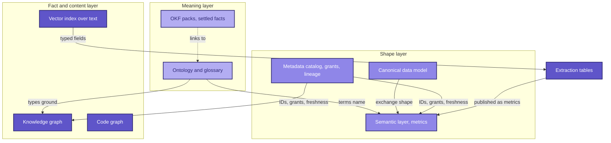
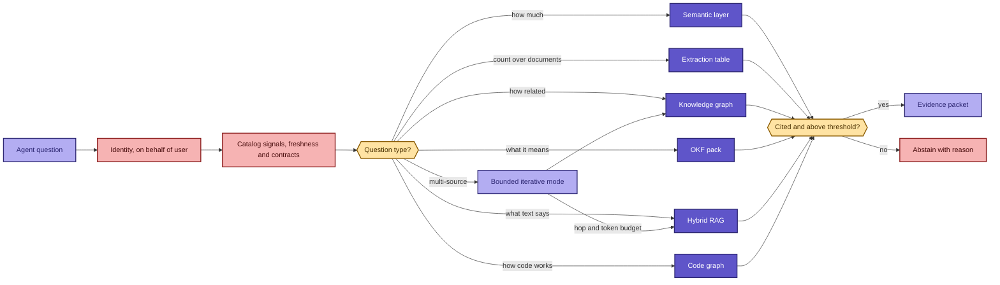
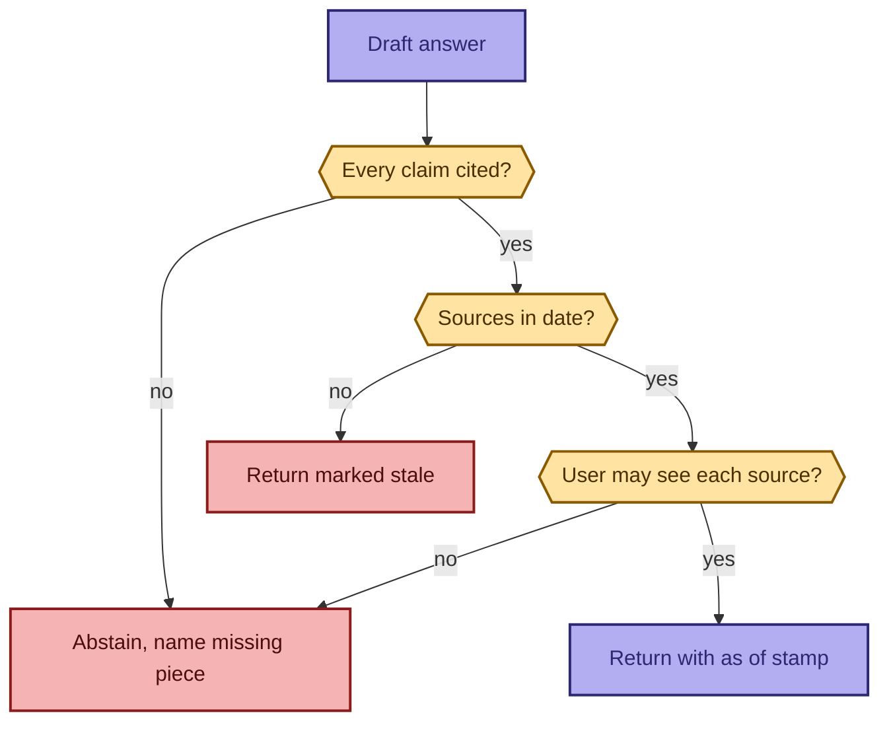
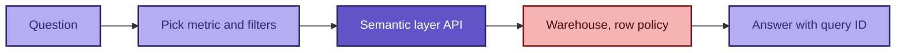
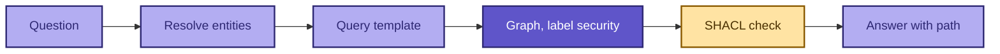
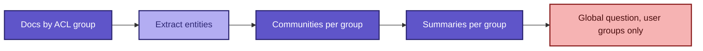
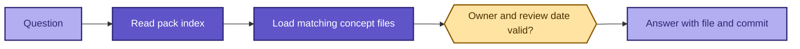
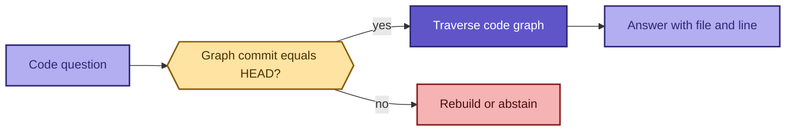
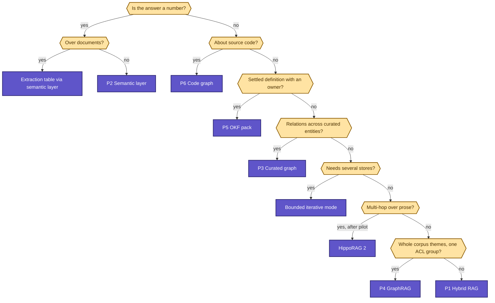

# The Enterprise Knowledge Layer for AI Agents: Technical Design and Architecture

**Stop calling everything a knowledge graph. Route each question to the store built to answer it, and enforce access and provenance in that store, not in the model.**
Version 1.0 · 2026-10-23 · Audience: solution architects, data platform leads, AI delivery leads, security and governance reviewers

This document backs a planned Models to Margins deep dive on the knowledge layer. The page will show no sources. This document is the only home of its sources, and Section 22 is the ledger. It starts from a review of five articles, vets 19 alternative techniques, keeps only what survives a fact check, and turns the common thread into an architecture.

Style: B · Isometric (Mermaid approximation through `classDef` face colours).

---

## 0. How to read this document

### 0.1 Persona panel

| Persona | Role | Stake, what they refuse to compromise on |
|---|---|---|
| **Maya** | AI and solution architect | Each question type goes to one store that is good at it. No single store is sold as the answer to everything. |
| **Dev** | Data and ontology engineer | Shape, meaning and facts stay in separate artefacts. A schema is never passed off as an ontology. |
| **Sam** | MLOps and evals lead | Nothing ships without a golden set split by question type, with abstention and citation support measured. |
| **Priya** | Security lead | Retrieved text is data, never instructions. Permissions are checked in the store with the end user's identity, before ranking. |
| **Nadia** | Governance lead | Every answer names its source, version and timestamp. Stale facts carry an "as of" stamp. |
| **Omar** | Platform and cost owner | Index and query cost is known per store, and no index is built before a concrete failure justifies it. |

### 0.2 Status labels

- **Observed fact.** Cited and logged in the ledger (Section 22).
- **[PROPOSED].** A design recommendation, not a measured result.
- **[OPEN].** Not resolved, listed in Section 11.
- **[VENDOR].** Produced by a party that sells the approach. Never used to size cost or accuracy here.
- **[UNVERIFIED].** Not confirmed on 2026-10-23.
- **[ILLUSTRATIVE].** A worked number built from stated assumptions.

**Terms defined once.**

| Term | Meaning in this document |
|---|---|
| CDM | Canonical data model. Fixes the shape of data exchanged between systems (JSON Schema, Avro, Protobuf) |
| Ontology | Fixes meaning: concepts, relations and rules (RDFS, OWL, SKOS, SHACL for checks) |
| Knowledge graph | Holds instance facts, ideally grounded in an ontology |
| Semantic layer | Governed metrics, dimensions and joins over the warehouse (dbt, Cube, Snowflake semantic views) |
| RAG | Retrieval-augmented generation. It fetches passages. It stores no meaning of its own |
| OKF | Open Knowledge Format. A folder of Markdown files with YAML frontmatter, one settled concept per file. Spec v0.2 since 2026-07-24, now in GoogleCloudPlatform/open-knowledge-format with no tagged release. "v0.1" describes the launch only |
| Evidence packet | The structured answer envelope: data used, assumptions, confidence, policy checks passed, options and citations |
| Action rights | Per-agent tiers of what an agent may do with an answer: read, recommend, escalate, execute |
| Code graph | Symbols, references and call edges parsed from source (tree-sitter, SCIP, Graphify) |
| ASR | Attack success rate |

### 0.3 Reading paths

| You are | Read |
|---|---|
| Executive or sponsor | Sections 0.4, 3, 9, 13, 15 |
| Architect | All of it |
| Data and ontology | Sections 1, 3, 4, 5, 8 |
| Evals and MLOps | Sections 6, 10, 11, 17 |
| Security and governance | Sections 7, 14, 16, 22 |
| Alternatives and outlook | Sections 20, 21 |

### 0.4 Storyline: five documents

Frame: **Six stores, one router, rules in the store.**

| Beat | Content | Evidence |
|---|---|---|
| Hook | Five planted texts per target question, in a knowledge base of millions of passages, steer the answer about 90% of the time (PoisonedRAG, USENIX Security 2025). The retriever trusts whatever ranks. | Verified 2026, ledger 1 |
| Why | "Knowledge graph" now names five different things. Teams buy one store and push every question through it | Section 1, ledger 10 to 12 |
| Answer | A router sends each question type to the store built for it: semantic layer for numbers, graph for relations, OKF for settled definitions, RAG for long text, code graph for code | Sections 4, 5 |
| Rules | Access control, provenance and freshness are checked in each store, never by the model | Section 7 |
| Proof | No family wins everywhere. Graph (HippoRAG2) wins multi-hop 70.3 vs 67.0, RAG wins single hop 64.8 vs 63.0 (one controlled study) | Ledger 5 |
| Ask | A 60-day pilot on one domain with a typed golden set | Section 18 |

The hook was checked against the USENIX paper itself. The 97% black box figure on Natural Questions is in the same paper. We use the rounder and more conservative "about 90%".

---

## 1. Article review (Sam, Dev)

Five articles were supplied. All five were read. Article 5 was found and read after an earlier pass missed it.

| # | Article | Author, date | Thesis | What survives |
|---|---|---|---|---|
| 1 | Stop Mixing CDM, Ontology, and Knowledge Graphs | Thilo Hermann, 2026-07-02 | CDMs fix structure, ontologies fix meaning, graphs hold facts. Merging them adds coupling | All of it. Conceptual, no vendor claims. N x (N-1) mappings vs N via a canonical model is textbook (Hohpe and Woolf 2003) |
| 2 | Production-Grade OKF + Graphify Setup, Not Just a Demo | Udaykiran Estari, 2026-08-13 | A code graph is a static index that goes stale silently. Judge it by freshness detection, not benchmarks | The failure modes (MCP servers caching the graph at startup, skipped rebuilds, outputs drifting apart) and the freshness practice. The scale anecdotes are dropped (Section 14) |
| 3 | Did Google Just Kill RAG? What OKF Actually Replaces | Divy Yadav, 2026-07-13 | OKF does not replace RAG. It stops agents re-deriving settled facts | The body, not the headline. OKF has no search or ranking. The claim that Google Knowledge Catalog preserves source permissions is [VENDOR] |
| 4 | Graphify, OKF, or Both? Beyond RAG for Codebases | Udaykiran Estari, 2026-07-22 | Each layer fixes one failure mode. Adopt none without a concrete failure | The layering idea. Graphify's own benchmark ties vector RAG on accuracy. The ERPNext experiment and the timeline are [UNVERIFIED] |
| 5 | From Data Warehouse to Agentic Data Architecture: A Reference Model for Governed Enterprise Reasoning | Srinivas Bommena, 2026-06-02 | A warehouse stores data for people to interpret. An agentic architecture turns it into a governed reasoning system across six layers: data foundation, trust and meaning, context and memory, agent execution, governed outcomes, control and learning | The control ideas: action rights per agent, the evidence packet, freshness and data contracts read at runtime, retrieval scoped by workflow, role and policy, and outcomes fed back as golden cases. It has no statistics and cites no sources, so nothing enters the ledger as a figure |

**Article 5 review (Sam, Dev, Priya).** Bommena's six layers map onto ours with one shift. Our design stops at the answer. His continues to what the agent may do with it. Layer 1 (data products with owner, schema, refresh rate and contract) and layer 2 (lineage, freshness and sensitivity as runtime checks) match our provenance and freshness rules, and add one useful idea: the router should read freshness and contract status as signals before it picks a store. Layer 3 scopes retrieval by workflow, domain, role and policy, which is wider than our per-user ACL. Layer 4 says a tool grant is not a right to act, and defines read, recommend, escalate and execute rights per agent. Layer 5 adds the evidence packet and action tiers with a rebuildable audit trail. Layer 6 turns accepted and rejected outcomes into golden cases. Dev notes the gaps. There is no ontology or graph layer and no explicit router, and its semantic layer is only metric definitions, so our shape, meaning and facts split stays sharper. Sam notes the only numbers (sales every 15 minutes, inventory every 6 hours) are a hypothetical refresh cadence. Its additions land in Sections 4.4, 5.9, 7.6 and 13.4.

**Common thread.** RAG is not dead. All five pieces put structured layers beside retrieval. All five warn about freshness and governance. Four say to adopt a layer only when a failure needs it, and Article 5 says to start from one decision workflow.

**Tensions we carry forward.**
- OKF has no schema enforcement. In Hermann's terms it is closer to documentation than to an ontology, so it can recreate the conflation he warns about (C3).
- Graphify sells parse determinism, yet its pass over docs and images is LLM inferred. That blurs facts and meaning (C5).
- OKF is "vendor neutral" yet launched with Google Knowledge Catalog as its first consumer.
- Article 5 governs actions but not meaning. Our design governs meaning but, before this revision, not actions. Section 4.4 closes that.

---

## 2. Requirements (Maya, Nadia)

### 2.1 Problem in one paragraph

Enterprise agents answer five kinds of question: how much, how is X related to Y, what does this term mean here, what does the long text say, and how does this code work. Most programmes build one index and push all five through it. Numbers come back inconsistent, relations break past one hop, definitions conflict, and the index leaks content across permission lines. The goal is a knowledge layer that answers each kind from the right store, cites it, and refuses when it cannot.

### 2.2 Functional requirements

| ID | Requirement |
|---|---|
| F1 | Classify each question into a type: numeric, relational, definitional, textual, code, or unanswerable |
| F2 | Route each type to one primary store, with a fallback order |
| F3 | Return a citation for every claim: source ID, version, timestamp |
| F4 | Abstain with a reason when no store meets its threshold |
| F5 | Resolve entities across stores through one identity service |
| F6 | Surface an "as of" stamp on every fact from a batch artefact |
| F7 | Expose each store to agents as an MCP server with typed tools, scoped per user and logged |
| F8 | Rebuild each index incrementally from change events, with a full rebuild as a scheduled fallback |
| F9 | Keep one owned golden set per question type, versioned with the stores it tests |
| F10 | Name an owner for the ontology, the glossary, entity merges and every OKF pack |

### 2.3 Non-functional requirements

| ID | Requirement |
|---|---|
| N1 | Access is checked in the store with the end user identity, before ranking |
| N2 | No precomputed summary crosses a permission boundary |
| N3 | Retrieved text never changes tool permissions or plans |
| N4 | p95 latency per route is published [PROPOSED, target set in pilot] |
| N5 | Freshness lag per store is observable and alerted |
| N6 | Tenant isolation: no index, summary, cache or embedding is shared across tenants unless approved in writing |
| N7 | A permission change reaches every derived artefact (chunk, node, summary, pack, cache) within a published window [PROPOSED, window set in pilot] |
| N8 | Each store has a defined failure mode and degrades to abstention, never to a silent fallback |
| N9 | Every deleted or revoked source can be traced to and purged from every derived artefact |

### 2.4 Constraints

- Existing warehouse and row access policies stay the source of truth for numbers.
- No model is fine-tuned on restricted content.
- The EU AI Act applies if the consuming agent is high risk (Section 16).
- The semantic layer owns metric logic. The ontology owns entity types and relations. Neither copies the other. Where both name a concept, the ontology links to the metric by ID.
- Existing RAG indexes and warehouse marts are migrated in place behind the router, not replaced in one step.

---

## 3. Approach families (Maya)

| Family | Best at | Weakest at | Maturity | Cost shape |
|---|---|---|---|---|
| A1 Vector RAG | Single hop lookup in long text | Global, multi-hop, numeric | High | Low index, low query |
| A2 GraphRAG | Global themes, multi-hop over prose | Precise lookup, re-index cost | Medium | High index (full) or higher query (lazy) |
| A3 Ontology plus curated graph | Entity questions, constraints, explanations | Modelling speed, skills | High tech, medium agent use | High people cost up front |
| A4 Semantic layer and CDM | Numbers and KPIs, inherited row security | Unstructured text, long tail | High | Modelling plus warehouse compute |
| A5 Knowledge packs (OKF, AGENTS.md, llms.txt) | Small, settled know-how in git | Scale, per-user access, freshness | Medium, OKF spec v0.2, untagged | Tokens per query |
| A6 Code graphs (SCIP, tree-sitter, Graphify) | Large repos, impact analysis | Dynamic dispatch, small repos | Medium | Cheap local parse |

**A1 Vector RAG.** Chunk, embed, retrieve top k. The named default here is hybrid: BM25 plus dense, fused, cross-encoder rerank, with contextual chunks (Section 20). BEIR found BM25 a robust zero-shot baseline and reranking models best on average. It ties graph methods on simple facts (60.9 vs 60.1 in GraphRAG-Bench, Novel set) and trails on multi-hop.

**A2 GraphRAG.** An LLM extracts entities and relations, clusters them and pre-writes community summaries. Strong on "what are the main themes". Those summaries are the access control hazard in Section 7.3. Building the graph took 5,560 s against 135 s for a vector index on MultiHop-RAG (High confidence, primary paper).

**A3 Ontology plus curated graph.** Modelled by people in OWL and SHACL, or as a property graph. Mature and explainable. The cost is people and governance, not compute.

**A4 Semantic layer.** Agents call governed metrics through an API or MCP instead of writing SQL. dbt reports 98.2% to 100% vs 84.1% for text-to-SQL on 11 questions [VENDOR]. Independent evidence points the same way. On Spider 2.0, enterprise text-to-SQL with o1-preview solved 21.3% of tasks against 91.2% on Spider 1.0 (current arXiv abstract, 17.0% in v1). Our reading: the layer's lasting value is consistent definitions and inherited row security, and raw text-to-SQL stays a labelled fallback.

**A5 Knowledge packs.** OKF (spec v0.2, launched as v0.1) formalises a folder of concept files with one required field, `type`. Zero infrastructure and reviewable in git. No search, no ranking, no per-user access. Long context does not rescue it at scale: in NoLiMa, GPT-4o fell from 99.3% to 69.7% at 32K tokens.

**A6 Code graphs.** Parse code into symbols and call edges so a coding agent traverses instead of reading whole files. Graphify's 71.5x token saving is a single self-reported case [VENDOR].

These families are layers, not rivals. The design composes them.

---

## 4. Architecture (Maya, Priya)

### 4.0 Thesis

A CDM fixes shape. An ontology fixes meaning. A graph holds facts. RAG only fetches. OKF packs carry settled facts. Code graphs map code. The agent never searches "the knowledge graph". It asks a router, which picks a store by question type. Each store enforces its own access rules and returns citations.

### 4.1 Three layers

Legend: light face = meaning, mid face = shape, dark face = facts and content. The metadata catalog is a prerequisite, not an option. It supplies entity IDs, grants, lineage and freshness timestamps to every warehouse-side store [PROPOSED].

### 4.2 Question router over stores

Legend: lilac = control, dark violet = store, amber = gate, red = identity, policy and refusal.

Every store is called as an MCP server holding a token scoped to the end user (OAuth, per the MCP authorisation spec), never a service account [PROPOSED]. Before picking a store, the router reads catalog signals: a store whose data contract is broken or whose freshness is past its published window is skipped or answers marked stale (Article 5, layer 2). Questions marked multi-source run a bounded iterative mode with a hop budget and a token budget, and the gate in Section 6 runs at every hop, not only at the end [PROPOSED]. Text-to-SQL is not a route. It is a fallback inside the numeric route, read only, under user credentials, labelled "unmodelled".

### 4.3 Trust boundaries

- Each store sits behind its own access check. The router passes the user's token, never a service account.
- Retrieved text enters the model as quoted data. Tool permissions are fixed before retrieval.
- The identity service resolves entities across stores but never grants access.
- Retrieval is scoped by workflow, domain, role and policy as well as by user ACL. A finance-close agent does not retrieve HR policy even when the user could read it (Article 5, layer 3).

### 4.4 Action rights and the evidence packet (Priya, Nadia)

Having a tool is not a right to act. Each agent carries one of four action rights per workflow [PROPOSED, after Article 5]:

| Tier | The agent may | Approval |
|---|---|---|
| Read | Answer and cite | None |
| Recommend | Propose options with an evidence packet | None, a person decides |
| Escalate | Route a case to a named owner with the packet | Owner accepts or rejects |
| Execute | Write back or trigger an action | Pre-approved scope only, logged and reversible |

Every answer leaves as an evidence packet: data and query IDs, assumptions, confidence from the Section 6 gate, policy checks passed, options, and citations with version and timestamp. The packet is what the audit trail stores, so any answer can be rebuilt. Accepted and rejected outcomes are written back as candidate golden cases for routing and retrieval (Section 17).

---

## 5. Components, argued by persona

### 5.1 Question classifier (Maya)
A small classifier labels the question type. Maya wants it cheap and auditable, so it starts as rules plus a small model, and mixed questions are split into sub-questions. Sam requires a confusion matrix by type, because a wrong route is a silent failure.

### 5.2 Semantic layer adapter (Omar, Nadia)
Numbers go only here. Omar likes that it adds no LLM indexing cost. Nadia likes that row access policies from the warehouse apply unchanged. Questions outside modelled metrics abstain by default. Where a team opts in, a text-to-SQL fallback runs read only under the user's credentials and the answer is labelled "unmodelled" [PROPOSED]. Spider 2.0 is the reason it stays a fallback.

### 5.3 Ontology and knowledge graph (Dev)
Dev insists the ontology (TBox) and the instance facts (ABox) are versioned apart, and that SHACL shapes run in CI. The agent reaches the graph through fixed query templates first and generated Cypher or SPARQL second, because generated queries are a known error source.

### 5.4 OKF packs (Dev and Nadia)
Packs hold settled definitions: metric meaning, join rules, runbooks. Dev pushes back on treating OKF as an ontology, since it enforces no schema. The resolution is a lint step that checks each file's `type` against the ontology and fails the build on unknown types [PROPOSED]. Nadia requires an owner and a review date in each file's frontmatter.

### 5.5 Vector RAG (Priya and Sam)
For long text only. The default is hybrid BM25 plus dense with cross-encoder rerank and contextual chunks. Anthropic reports top-20 retrieval failure down 35% with contextual embeddings, 49% adding contextual BM25 and 67% adding rerank, on its own sets [VENDOR]. Priya adds a rule: the context sentence is generated per ACL segment, so it never carries text from a stricter part of a document. Scanned PDFs and slides use ColPali-style page retrieval instead of OCR [PROPOSED]. Priya requires ACL metadata on every chunk and filtering before ranking, not after. Sam wants context recall and citation support tracked separately from answer accuracy.

### 5.6 Code graph (Omar and Sam)
Worth it on large repos. Omar notes the break-even heuristic of about 500 files is one author's guess [UNVERIFIED], so the pilot measures it. Sam requires the graph's build commit to match HEAD, or the route abstains.

### 5.7 Entity resolution service (Dev)
Deterministic keys from master data first, probabilistic matching next (Splink), the LLM only as a tie-breaker with review. "Same as" edges carry confidence. Nothing merges destructively.

### 5.8 Provenance ledger (Nadia)
Every chunk, node, edge and pack file carries source ID, version and timestamp, in W3C PROV-O terms. The answer cites spans, and citations are checked after generation.

### 5.9 Metadata catalog (Nadia, Omar)
Unity Catalog, Apache Polaris or Dataplex hold grants, lineage, owners and timestamps. Nadia wants it first because it already holds the provenance she asks every store for. Omar wants it first because building the router without it duplicates governance work per store. It answers no question itself. It feeds entity IDs, grants and freshness to the router and to every warehouse-side store, and data contracts give each store a pass or fail status the router reads [PROPOSED].

### 5.10 Extraction tables (Dev, Sam)
"How many contracts auto-renew in Q1" is a count over documents. RAG cannot count and the semantic layer has no table. An LLM extraction pass writes typed fields into a table, published through the semantic layer so row policies apply. Sam requires sampled field accuracy per column, because extraction errors are silent. Dev requires the schema to be designed with the owner first, since each new column means a backfill [PROPOSED].

### 5.11 Bounded iterative mode (Maya, Omar, Priya)
Maya accepts that a one-shot classifier cannot answer multi-source questions. Omar caps the hops and tokens per question. Priya requires every hop to re-check access and treat retrieved text as data, because each hop is a new injection surface. Abstention runs per hop [PROPOSED].

### 5.12 Graph over prose (Dev, Sam)
Where relations live in prose rather than curated data, HippoRAG 2 is the candidate in place of GraphRAG. In the controlled study behind ledger 5 it scored 70.27 on MultiHop-RAG against 69.01 for Community-GraphRAG (Local), 64.40 for Community-GraphRAG (Global) and 67.02 for RAG, and it builds no community summaries, which removes the Section 7.3 hazard. Its authors report about 7% over the best embedding model on associative tasks [Author]. Sam keeps it off the default path until a pilot slice confirms it [PROPOSED].

### 5.13 Memory stays outside (Priya)
Per-user and per-session memory (Mem0, Letta, Zep) sits beside the knowledge layer, never inside it. Memory is written by the model, so it is a poisoning surface. Valid-from and valid-to edges, as in Graphiti, are worth borrowing for graph freshness.

**Conflict resolved.** Omar wanted one GraphRAG index to cut operating cost. Priya vetoed it because community summaries mix permission groups. The design keeps GraphRAG out of the default path and allows it only on corpora with one permission group (Section 7.3).

---

## 6. Confidence and abstention (Sam)

### 6.1 Why naive confidence fails
A model sounds equally sure over a stale definition and a fresh one. Retrieval score says a passage is similar, not that it is true or current.

### 6.2 What works
Each route has its own check. Numbers pass when the metric exists and the query ran. Graph answers pass when the path exists and every edge is in date. Text answers pass when every claim has a supporting cited span. Code answers pass when the graph matches HEAD.

### 6.3 Gating flow

### 6.4 Measuring the gate
Track abstention rate, wrong-but-confident rate and citation support per question type. One vendor-authored study reported an ontology check plus LLM repair reaching 72% accuracy with 8% "I don't know" [VENDOR]. We cite it as a shape to aim for, not a target.

---

## 7. Security (Priya)

### 7.1 Knowledge poisoning
PoisonedRAG reached about 90% ASR with five injected texts per target question in a knowledge base of millions of passages. Paraphrase and perplexity defences were not enough. Controls: write access to indexed sources is itself a privileged action, new documents are quarantined before they rank, and answers on high-impact questions need two independent sources.

### 7.2 Indirect prompt injection
Once one malicious document reaches top k, nearly any of 11 tested LLMs can be steered (2026 study). A layered defence study over 17,278 runs cut ASR from 40.6% to 0.2% with the full stack, and to 3.2% with sanitisation alone (Medium confidence). Controls: retrieved text is quoted data, tool permissions are fixed before retrieval, and no retrieved text can add a tool call.

### 7.3 Access control leaks through precomputed summaries
An index built with a service account ignores source permissions. Worse, GraphRAG community reports and compiled packs merge content across permission groups, so filtering per document is too late. No public benchmark measures this leak rate [OPEN]. Controls: ACL labels on every chunk and node, filter before ranking, one graph or summary set per permission group, and no summary that spans groups.

### 7.4 Stale graph as a security issue
A code graph or MCP server that caches the graph at startup can answer from code that no longer exists. The route abstains when build commit and HEAD differ.

### 7.5 MCP tool poisoning and confused deputy
Tool descriptions are text the model reads, so a malicious or altered server can hide instructions in them (tool poisoning, documented by Invariant Labs in 2025). A server holding broad credentials can be steered to act for a user beyond that user's rights (confused deputy). A July 2026 scan of 9,695 MCP servers found 2,259 with confirmed exploitable flaws and 2,054 with no authentication (Medium confidence, security press). Controls: per-user OAuth tokens with the narrowest scope, never a shared service token. An allowlist of signed, pinned servers and tool descriptions per agent, with a diff alert on change. No server may chain to another with the first one's token.

### 7.6 Policy scope and action rights
Access control decides what a user may read. Policy scope decides what a workflow should read, and action rights decide what an agent may do (Section 4.4). Execute rights are granted per workflow, logged, and never widened by retrieved text.

---

## 8. Patterns, matrix and decision tree (Maya)

### 8.1 Pattern P1, plain RAG

### 8.2 Pattern P2, semantic layer as a tool

### 8.3 Pattern P3, ontology-grounded graph query

### 8.4 Pattern P4, GraphRAG with per-group summaries

### 8.5 Pattern P5, OKF pack loaded on demand

### 8.6 Pattern P6, code graph with freshness gate

### 8.7 Comparison matrix

| | P1 RAG | P2 Semantic | P3 Graph | P4 GraphRAG | P5 OKF | P6 Code |
|---|---|---|---|---|---|---|
| Numeric questions | Poor | Best | Fair | Poor | Fair (definitions only) | n/a |
| Multi-hop | Fair | Fair | Best | Good | Poor | Good (code) |
| Global themes | Poor | n/a | Fair | Best | Poor | n/a |
| Settled definitions | Fair, can conflict | Good | Good | Fair | Best | n/a |
| Per-user access | Good if filtered first | Best, inherited | Good | Weak, needs per-group summaries | Weak, whole pack | Repo level |
| Freshness | Incremental | Live | Pipeline | Costly recompute | Manual review | Rebuild per commit |
| Build cost | Low | People | People | High LLM | Low | Low |

### 8.8 Decision tree

### 8.9 Anti-patterns rejected
- One graph for everything, labelled "the enterprise knowledge graph".
- An ontology embedded in the CDM.
- Indexing with a service account and filtering in the prompt.
- Long context as the knowledge layer.
- A code graph with no freshness check.
- Raw text-to-SQL as the numeric route.
- An unbounded agent loop across stores.
- Agent memory used as the enterprise knowledge store.

---

## 9. How we decide (Maya, Nadia)

| Consideration | Why it matters |
|---|---|
| Question mix | The share of numeric, relational, definitional, textual and code questions sets which stores pay off. Count it first from real logs |
| Permission granularity | Row or document level permissions rule out cross-group summaries and whole-pack loading |
| Rate of change | Fast-changing facts belong in live stores. Batch artefacts need an "as of" stamp |
| Existing assets | A warehouse with row policies and a glossary makes P2 and P5 cheap. A graph without an ontology is a liability |
| Skills | Ontology work needs scarce people. Start with the glossary and OKF, grow into OWL only where rules matter |
| Concrete failure | Every store is justified by a failing golden-set slice, not by a trend |
| Regulation | High-risk use needs provenance and logging that the store can prove |
| Curation headcount | Ontology, glossary and entity merges need named people every week. If no budget exists for them, do not build the graph |
| Ownership model | Each artefact has a business owner who signs off meaning and a platform owner who runs it. No owner, no store |
| Tenancy | Shared or per-tenant indexes change cost, isolation and rebuild time. Decide before the first index |
| Migration start point | Most teams already have a warehouse and a RAG index. The first step wraps both behind the router and adds a golden set, with no new store |
| When not to build a graph | Skip it when relational questions are a small share of real logs, when entity keys are missing, or when no one will curate the ontology |

---

## 10. Critique (all personas)

| ID | Challenge | Response |
|---|---|---|
| C1 | The router is a new single point of failure and its own error source | Mixed questions split, misroutes are tracked by type, and a wrong route abstains when its check fails |
| C2 | Six stores is too much for most teams | Start with two (semantic layer and RAG) and add a store only when a slice fails |
| C3 | OKF without schema enforcement recreates the CDM and ontology mix-up | Lint `type` against the ontology in CI |
| C4 | Per-group summaries multiply GraphRAG cost | Allowed only where groups are few. Otherwise use LazyGraphRAG style query-time work [VENDOR cost claim] |
| C5 | Code graph doc passes are LLM inferred, so "deterministic" overstates it | Separate parsed edges from inferred edges and label them |
| C6 | Benchmarks behind the matrix are small and often vendor run | The matrix is a starting prior. The pilot golden set replaces it |
| C7 | Abstention annoys users | Abstentions name the missing piece and the owner, so they become a backlog |
| C8 | Entity resolution is the real bottleneck and is barely covered | Section 5.7 and a pilot slice on entity questions |
| C9 | Semantic layer and ontology overlap, so two teams define "customer" twice | The semantic layer owns measures, the ontology owns entities. A CI check flags any term defined in both without a link |
| C10 | Nobody owns entity resolution, so merges drift | Master data management owns keys and merge rules. The platform team runs the service. Disputed merges go to a weekly review queue |
| C11 | Nobody maintains the ontology after launch | A named ontology steward and a change board. Changes go through pull requests with SHACL checks and a version bump |
| C12 | Curation cost is people, and it is not in the cost model | Section 15 covers compute only. Curation hours are tracked from the pilot and added before any scale decision |
| C13 | Permission changes do not reach graph summaries or caches | Every derived artefact keeps the source IDs it came from. A revoke event marks them stale and the route abstains until rebuilt |
| C14 | Full rebuilds are slow and expensive | Change data capture drives incremental updates per store. Full rebuild runs on a schedule and after ontology version changes |
| C15 | Shared indexes leak across tenants | Per-tenant indexes by default. Shared indexes only for public content, with the tenant ID checked in the store |
| C16 | Golden sets go stale and get gamed | Each set has an owner, is refreshed from real logs each quarter, and keeps a held-out slice no one tunes against |
| C17 | Each store fails differently and the router hides it | Per-store failure modes are listed: warehouse timeout, stale graph, missing pack, empty RAG hit, code graph behind HEAD. Each maps to an abstention reason |
| C18 | MCP exposure widens the attack surface | One MCP server per store, read only, user identity passed through, tool allowlist per agent, all calls logged |
| C19 | Users and teams do not change how they work | Change management: owners trained on the review queues, abstention backlog reviewed in a monthly forum, adoption measured per team |
| C20 | A graph gets built because it is fashionable | The decision rule in Section 9: no graph without a failing relational slice, entity keys, and a funded steward |
| C21 | MCP servers can be poisoned through tool descriptions or act as confused deputies | Section 7.5: per-user scoped tokens, signed and pinned server allowlist, description diff alerts |
| C22 | The iterative mode reintroduces unbounded cost and injection hops | Hop and token budgets per question, access and abstention checked at every hop (Section 5.11) |
| C23 | Extraction tables fail silently | Sampled field accuracy per column, owner-approved schema, backfill tracked as a cost line |
| C24 | Tool access gets mistaken for permission to act | Four action-rights tiers per workflow, execute only in pre-approved scope (Section 4.4) |
| C25 | The design depends on a catalog many clients do not have | Catalog adoption is step 1 of migration. Without one, the router starts with per-store grants and a stated duplication cost |
| C26 | "OKF v0.1" in old notes misstates today's spec | Cite v0.2 and the new repo. Pin packs to a commit, since there is no tag |

---

## 11. Gap research (Sam, Priya)

| Gap | Finding | Status |
|---|---|---|
| ACL leak rate in GraphRAG summaries | No public benchmark found | [OPEN] |
| Injection benchmark for MCP knowledge servers | None found | [OPEN] |
| OKF licence and release tag | Apache-2.0. Spec v0.2 since 2026-07-24. Frozen in the old repo on 2026-08-21 and moved to GoogleCloudPlatform/open-knowledge-format, which has no tags. A "v0.3 proposal" is mentioned in a commit message, not released | Closed |
| HippoRAG 2 on enterprise prose with ACLs | Only academic benchmarks | [OPEN], pilot slice |
| Graphify release | PyPI `graphifyy` 0.9.95 on 2026-10-23 | Closed |
| Graphify to OKF export | Not in the README | [UNVERIFIED] |
| Equal token budget comparison | Not in the primary paper. Dropped, see Section 14 | Closed |
| Evaluation method sensitivity | Scoring cited passages rather than all retrieved context changes rankings | Low, noted only |
| ACL propagation latency from source to derived artefacts | No public measure found. Pilot measures revoke to purge time per store | [OPEN] |
| Curation effort per ontology class or entity type | No reliable public figure found. Pilot logs steward hours | [OPEN] |
| Incremental GraphRAG update quality versus full rebuild | Vendor claims only | [UNVERIFIED] |
| Multi-tenant isolation patterns for graph stores | Patterns exist (database per tenant, label per tenant), no comparative benchmark | [OPEN] |
| MCP server authorisation patterns for knowledge stores | Spec supports OAuth based auth. Per-tool scoping practice is still young | [OPEN] |
| Migration from an existing RAG index | No case study found that measures before and after behind a router | [OPEN] |

---

## 12. SOTA refresh, 2026-06-01 to 2026-10-23 (Maya, Sam)

| Date | Change | Confidence |
|---|---|---|
| 2026-06-12 | Google Cloud blog announces OKF v0.1, "a starting point, not a finished standard" | High (Google post read) |
| 2026-07-24 | OKF spec moves to v0.2 (commit 780fe9d). On 2026-08-21 the okf folder is frozen and moved to GoogleCloudPlatform/open-knowledge-format, no tags | High (commit history read) |
| 2026-07-28 | MCP spec 2026-07-28: stateless core, auth hardening, extensions framework | High (project blog) |
| 2026-10-08 | microsoft/graphrag v3.3.0, latest GitHub release | High |
| 2026-07-27 | EU Digital Omnibus on AI in force. Annex III high-risk duties move to 2027-12-02 | Medium |
| 2026-10-23 | Graphify at about 134k stars (133,861), Apache-2.0, PyPI 0.9.95 | High |
| 2026 | GraphRAG-Bench (ICLR 2026): tie on simple facts, graph about 10 points ahead on complex reasoning | Medium |
| 2026-01 | Social web RAG injection: 34.0% ASR undefended, 5.0% with full defences | High |
| 2026 | Long context still decays with distractors. Routing between RAG and long context remains the practical answer | Medium |

### 12.1 Strict 60-day window, 2026-08-23 to 2026-10-23

| Date | Area | Signal | Status | Type |
|---|---|---|---|---|
| 2026-08-26 | Semantic layer | Snowflake Semantic Studio enters public preview | Confirmed, Snowflake release note | Vendor |
| 2026-09-21 | Memory benchmark | DolphinBench (arXiv 2609.24971) scores agent memory by task completion over three personas and reports cost and latency | Confirmed on arXiv. Corrected label: authors are Mem0 founders, so Vendor, not independent | Vendor |
| 2026-09-23 | Code graph | InfoQ covers Graphify: weekly releases, MCP serving, mixed results against grep on mid-sized repos | Confirmed (press) | Independent |
| 2026-10-08 | GraphRAG | microsoft/graphrag v3.3.0 | Confirmed (GitHub) | Vendor |
| 2026-10-13 | Semantic layer | Snowflake blog announces Semantic Studio GA | Corrected: GA dated 2026-10-13, not 2026-09-30. "DEFINE SEMANTIC VIEW" not confirmed | Vendor |

No confirmed in-window release for: OKF spec changes or named adopters, Apache Ossie (OSI) spec, dbt semantic layer, Databricks metric views, LightRAG or HippoRAG, a new MCP spec version, EU AI Omnibus Official Journal text, and a dated RAG poisoning paper. The MCP server scan (9,695 servers, 2,259 exploitable) dates from about July 2026, so it is context, not an in-window signal. The Meta 1M-context model could not be confirmed and is dropped. The window is quiet: standards are digesting mid-year releases, so the design targets the July MCP spec and OKF v0.2.

---

## 13. Recommendation and honest scope (Maya, Nadia)

### 13.1 Recommendation
Start from the metadata catalog, which supplies IDs, grants, lineage and freshness. Build a question router with two stores first, both called as MCP servers with per-user OAuth: the semantic layer for numbers and ACL-filtered hybrid RAG with contextual chunks for text. Every answer leaves as an evidence packet, and each agent has explicit action rights. Add an OKF pack for settled definitions in the same quarter, because it costs little. Add the curated graph only when a relational slice fails, grounded in a versioned ontology. Add a code graph only for repos large enough to show a measured saving. Route counts over documents to extraction tables published through the semantic layer. Give multi-source questions a bounded iterative mode. Keep GraphRAG off the default path, and pilot HippoRAG 2 as the graph-over-prose candidate. Keep agent memory outside the layer and text-to-SQL as a labelled fallback. Enforce access, provenance and freshness in each store.

### 13.2 Honest scope
- The comparison matrix rests on a few studies, some vendor run. The pilot replaces it.
- No leak rate exists for precomputed summaries. The control is design reasoning.
- The router itself is untested at scale here.
- Cost figures in Section 15 are illustrative.
- People cost for curation (ontology steward, glossary owners, merge reviewers) is not in Section 15. It is the most likely cost overrun.
- Multi-tenant deployment, incremental rebuild and ACL propagation are designed here but not tested.
- Change management and ownership are named as requirements (F10) but depend on the client organisation.

### 13.3 When not to build this
- Questions are mostly textual. Plain ACL-filtered RAG plus a golden set is enough.
- The warehouse has no governed metrics. Fix the semantic layer first.
- No one is funded to curate the ontology or review entity merges.
- Permissions are per document and change daily, and no event feed exists to propagate them.

### 13.4 Migration path from an existing warehouse and RAG
1. Pick one decision workflow (Article 5). Register its data products, owners and contracts in the metadata catalog.
2. Build a golden set from real logs, by question type, for that workflow.
3. Put the router in front of the existing RAG index and warehouse. Add ACL filtering before ranking and policy scope by workflow and role. Upgrade RAG to hybrid with contextual chunks.
4. Expose both as MCP servers with per-user OAuth and a signed server allowlist.
5. Emit evidence packets and set action rights per agent, read only at first.
6. Add OKF packs for settled definitions, pinned to a commit.
7. Add extraction tables, the iterative mode, the graph or the code graph only when a golden-set slice fails and an owner is funded.
8. Feed accepted and rejected outcomes back into the golden set, then extend to the nearby workflow.

---

## 14. Dropped figures (Sam, Nadia)

| Figure | Source | Reason |
|---|---|---|
| Graphify 71.5x token reduction | Graphify README | Kept only as [VENDOR], one favourable 52-file case. Not on the page |
| Independent 6.8x to 49x, 7.3x | Secondary blog | Single secondary, sources unclear |
| 500-file break-even | Article 2 | Author heuristic, measured in pilot instead |
| 450k nodes, 114 minutes on 96 cores, 10 minutes on M3 Pro | GitHub issues via article 2 | Anecdotes, not reproduced |
| Incremental update 0.8 s vs 10+ s | Article 2 | Anecdote |
| Star counts 58.3k, 60k, 63k, 78k | Articles 2, 4 | Snapshots, cannot be checked after the fact |
| 1.2M PyPI downloads | Article 4 | Snapshot |
| LOCOMO 45.3% at $1.40 vs 49.7% at $15.67 | Article 4 | Vendor self benchmark |
| LongMemEval-S 76% vs 76%, n=50 | Article 4 | Not checked in the file, n too small |
| ERPNext 70.8% vs 82.0% | Article 4 | Author experiment, not reproducible |
| 72% of enterprise RAG underdelivers | Article 4 | No primary source |
| 17% to 33% legal hallucination | Article 4 | Second hand, resembles Stanford RegLab, not rechecked |
| YC S26, launch 2026-04-03, toolkit 2026-07-01 | Article 4 | Unverified |
| "86% vs 32%" enterprise accuracy | Blog | Unverified |
| FalkorDB 71.48 vs 55.39 | FalkorDB docs | Vendor |
| dbt 98.2% to 100% vs 84.1% | dbt Labs | Kept as [VENDOR], 11 questions, not on the page as independent |
| data.world 16% vs 54% | data.world | Vendor, 2023 model |
| GraphRAG $33,000 vs LazyGraphRAG $33 | Blog | Low confidence |
| LazyGraphRAG 0.1% index cost, 700x lower query cost | Microsoft Research | Kept as [VENDOR] |
| Long context 26x token cost | Blog | Low confidence |
| Models reliable at 200K to 400K tokens | Blog | Low confidence |
| Jina 4K token embedding limit | Jina | Vendor |
| GraphRAG 9,770 vs RAG 3,631 tokens per query | Secondary summary of arXiv 2502.11371 | Not found in the paper v3 |
| Equal budget RAG 69.33 vs GraphRAG 69.01 | Secondary summary | 69.33 not in the paper. 69.01 is Community-GraphRAG (Local) overall in Table 2, not an equal budget run |
| microsoft/graphrag v3.1.1 | techsy.io blog | Superseded, latest release is v3.3.0 |
| "1.1M" readers | Mirror site counter | Not from the article |
| Spider 2.0 o1-preview 17.1% | Alternatives brief, from memory | Corrected. v1 abstract says 17.0%, current abstract 21.3%. Doc uses 21.3% and notes 17.0% |
| RAPTOR +20 points on QuALITY | Alternatives brief, from memory | Not re-fetched. Dropped |
| ColBERTv2 and ColPali benchmark leads | Alternatives brief, from memory | Not re-fetched. Technique kept, no figure |
| Zep 94.8% vs 93.4%, Mem0 +26%, Letta 74% on LoCoMo | Alternatives brief, from memory | Vendor and not re-fetched. Dropped |
| FRAMES 0.408 to 0.66 | Alternatives brief, from memory | Not re-fetched. Dropped |
| BrowseComp 51.5% vs 1.9% | Alternatives brief, from memory | Vendor and not re-fetched. Dropped |
| LongMemEval 30% to 60% drop | Alternatives brief, from memory | Not re-fetched. Dropped |
| MCP scan dated 2026-09-07 | gbhackers banner | Corrected. The banner date is the viewing date. First seen about 2026-07-07, outside the window |
| DolphinBench as independent | Aggregator | Corrected to Vendor. Authors are Mem0 founders |
| Snowflake Semantic Studio GA on 2026-09-30, DEFINE SEMANTIC VIEW | querio.ai | Corrected to GA 2026-10-13 per Snowflake blog. Syntax not confirmed, dropped |
| Meta model with 1,048,576 token context on OpenRouter | Secondary roundup | Not confirmed. Dropped |
| Claude Opus 5.5 launch, OpenAI shelved model | Secondary roundups | Not knowledge-layer signals, not checked. Not used |

---

## 15. Cost (Omar) [ILLUSTRATIVE]

### 15.1 Assumptions
- Corpus of 200M tokens of text [assumption].
- Embedding at $0.02 per million tokens [assumption, check current price sheet].
- LLM extraction at $3 per million input tokens and two passes [assumption].
- 100k questions a month, 4k retrieved tokens each at $3 per million input [assumption].

### 15.2 Index cost per store

| Store | Calculation | One-off index |
|---|---|---|
| Vector RAG | 200 x $0.02 | about $4 |
| Full GraphRAG | 200 x $3 x 2, plus summaries | about $1,200 plus |
| Semantic layer | People time, no LLM indexing | modelling weeks |
| OKF pack | Authoring and review | people hours |
| Code graph | Local parse, LLM only for docs | near zero for code |

The shape matters more than the totals: LLM extraction runs two to three orders of magnitude above embedding. That matches the derived estimate in strand D (Low confidence) and the 41x build-time gap (Medium).

### 15.3 Query cost
100k x 4k tokens = 400M tokens, about $1,200 a month at the assumed price, before caching. Graph methods use more tokens per answer, so measure this line in the pilot.

---

## 16. Data and privacy (Priya, Nadia)

| Data class | Store allowed | Rule |
|---|---|---|
| Public and internal docs | RAG, OKF, graph | ACL label on every chunk |
| Restricted docs | RAG with per-user filter, per-group graph | No cross-group summaries |
| Personal data | Semantic layer and graph only, with row policies | Minimised, no embedding of free text with personal data unless the purpose is documented |
| Source code | Code graph per repo | Repo permissions apply |

EU AI Act: the knowledge layer is not itself regulated. If the consuming agent is high risk, Article 10 (data governance), Article 12 (logging) and Article 15 (accuracy and robustness, including poisoning) apply. The provenance ledger and the gate logs are the evidence. Annex III duties apply from 2027-12-02 after the Digital Omnibus (Medium confidence, check final text).

---

## 17. Evals (Sam)

| Slice | Metric |
|---|---|
| Numeric | Exact match against warehouse |
| Relational, multi-hop | Path correctness, answer F1 |
| Definitional | Agreement with the owned definition |
| Textual | Context recall and precision, faithfulness, citation support |
| Code | File and symbol accuracy, freshness hits |
| Unanswerable | Abstention rate (should be high) |
| Security | Poisoned doc ASR, injection ASR, cross-group leak count (target zero) |
| Ops | p50 and p95 latency, cost per answer, freshness lag |

| Outcomes | Accepted and rejected evidence packets turned into new golden cases each month |
| Iterative mode | Hops used, budget hits, abstention per hop |
| Extraction | Sampled field accuracy per column |

Run each question at least five times and report variance. Replay the golden set on every schema or ontology change.

---

## 18. Rollout (Maya, Sam)

| Phase | Weeks | Exit criterion |
|---|---|---|
| 0 Inventory | 1 to 2 | Question mix counted from logs, golden set of 200 typed questions [PROPOSED size] |
| 1 Two stores | 3 to 6 | Semantic layer and ACL-filtered RAG behind the router, shadow mode |
| 2 OKF and gate | 7 to 8 | Pack linted against glossary, abstention live |
| 3 Graph or code graph | 9 onward | Added only if a slice fails, with freshness gate |

Rollback: the router can send any type to "abstain" with one flag.

---

## 19. Page storyline: seven screens

| # | Screen | Interaction | Exact numbers shown | Evidence tag |
|---|---|---|---|---|
| 1 | Hook | Counter: drop 5 planted texts into a pile of millions, watch the answer flip | 5 texts, about 90% success | Verified 2026 (ledger 1) |
| 2 | Three layers | Tap a layer to see what it fixes: shape, meaning, facts | No numbers | n/a |
| 3 | Which layer answers this | Drag 10 sample questions onto six stores, instant feedback | Single hop 64.8 vs 63.0, multi-hop 70.3 vs 67.0 | Verified 2026 (ledger 5) |
| 4 | Answer replay | One question ("what was Q3 churn for EU enterprise?") through RAG, OKF and graph. Toggles inject a poisoned doc, a stale graph and a permission leak | Poisoning about 90% ASR, injection 40.6% to 0.2% with layered defence, leak count shown as "no public rate" | Verified 2026 (ledger 1), Verified 2026 Medium (ledger 3), Illustrative replay |
| 5 | Cost and freshness | Sliders for corpus size and query volume, bars for index cost and freshness lag per store | Build 5,560 s vs 135 s, $ figures from Section 15 | Verified 2026 High (ledger 6), Illustrative |
| 6 | Chooser | Answer five questions from Section 9, get a recommended store set | Decision tree 8.8 | Illustrative |
| 7 | Rules | Five cards: route by type, check access in the store, cite every claim, stamp freshness, abstain with a reason | NoLiMa 99.3% to 69.7% at 32K on the "no long context as store" card | Verified 2026 (ledger 4) |

Vendor numbers (dbt, LazyGraphRAG, Graphify 71.5x) appear on no screen. If a later edit adds one, it carries a "Vendor" tag.

---

## 20. Alternatives vetted (Maya, Sam)

Nineteen techniques, the six families of Section 3 plus thirteen more, scored 1 to 5 (5 best, and for cost 5 is cheapest). Scores are panel judgement. The evidence column only cites figures re-checked on 2026-10-23. Unverified figures from the brief were removed (Section 14).

| # | Technique | Single-hop | Multi-hop | Freshness | ACL fit | Build cost | Query cost | Maturity | Evidence |
|---|---|---|---|---|---|---|---|---|---|
| A1 | Vector RAG | 4 | 2 | 4 | 4, prefilter | 5 | 5 | 5 | 4, many studies |
| A2 | GraphRAG | 3 | 4 | 1 | 1, summaries mix groups | 1, 5,560 s vs 135 s | 3 | 3 | 3, ledger 5 and 6 |
| A3 | Ontology plus KG | 4 | 5 | 3 | 4, per-node security | 1, people heavy | 4 | 4 | 3, case studies |
| A4 | Semantic layer, CDM | 5 | 2 | 5 | 5, inherits row policy | 2 | 4 | 5 | 2, vendor figures |
| A5 | OKF packs plus long context | 4 | 2 | 2 | 1, whole pack | 5 | 2 | 2, spec v0.2 untagged | 3, NoLiMa |
| A6 | Code graphs | 4 | 4 | 3 | 3, repo level | 5 | 5 | 3 | 2, vendor savings |
| N1 | Hybrid BM25 plus rerank | 5 | 2 | 4 | 4 | 4 | 4 | 5 | 5, BEIR (Independent) |
| N2 | Contextual retrieval | 5 | 2 | 3 | 3, context can cross ACL segments | 3, LLM call per chunk | 4 | 4 | 2, 35/49/67% (Vendor) |
| N3 | ColBERT, ColPali | 5 | 2 | 4 | 3 | 3, larger index | 4 | 3 | 3, author papers |
| N4 | RAPTOR | 4 | 3 | 2 | 2, precomputed summaries | 2 | 4 | 2 | 2, author paper |
| N5 | HippoRAG 2 | 4 | 4 | 3 | 3, passage nodes filterable | 3 | 4 | 2, research code | 3, 70.27 vs 69.01 (ledger 5) |
| N6 | LightRAG | 3 | 3 | 3 | 2, shared graph | 3 | 4 | 3 | 1, LLM-judge author runs |
| N7 | Agent memory (Mem0, Letta, Zep) | 3 | 3 | 5 | 2, user scoped, poisoning | 4 | 4 | 3 | 1, disputed vendor runs |
| N8 | Text-to-SQL | 3 | 2 | 5 | 4, if user credentials | 4 | 3 | 3 | 5, Spider 2.0 21.3% (Independent) |
| N9 | Extraction into tables | 4 | 3 | 2 | 4, row tags | 2 | 5 | 3 | 2, mostly vendor |
| N10 | Operational ontology | 4 | 5 | 4 | 5, object security | 1 | 3 | 4 | 1, vendor only |
| N11 | MCP resource servers | 3, transport | 3, transport | 4 | 5, per-user OAuth | 4 | 4 | 3, spec moving | 2, spec plus security notes |
| N12 | Metadata catalogs | 3 | 2 | 4 | 5, grants native | 3 | 5 | 4 | 2, vendor docs |
| N13 | Agentic search loops | 4 | 5 | 4 | 3, re-check per hop | 4 | 1, tens of calls | 3 | 3, mixed |

**Five changes to the recommendation, with the persona who carried each.**

1. **Catalog as prerequisite (Nadia, Omar).** It already holds grants, lineage and timestamps. Without it every store rebuilds governance. Applied in 4.1, 5.9, 13.1 and 13.4.
2. **MCP with per-user OAuth (Priya).** It is how "inherit the source ACL" happens at call time. Tool poisoning and confused deputy go into 7.5. Applied in 4.2 and 13.4.
3. **Extraction tables for counts over documents (Dev, Sam).** RAG cannot count and the semantic layer has no table. Applied in 4.2, 5.10 and 8.8.
4. **Bounded iterative router mode (Maya, Omar).** A one-shot classifier fails multi-source questions. Budgets keep cost known. Applied in 4.2, 5.11 and 8.8.
5. **HippoRAG 2 as the graph-over-prose candidate pending a pilot (Dev, Sam).** Better multi-hop than GraphRAG in one controlled study with no community summaries. Applied in 5.12 and 8.8.

**Refinements.** Hybrid plus contextual retrieval is the default RAG (5.5). ColPali covers scans and slides (5.5). Memory stays outside the layer (5.13). Text-to-SQL is a labelled fallback only (5.2). RAPTOR and LightRAG are P4 variants with the same ACL hazard. An operational ontology matters only when agents must act, and is recorded as a future actions layer over A3 governed by Section 4.4.

---

## 21. How this evolves (Maya, Omar)

Likelihoods are panel judgement, not data. Baseline: route each question to the right store, enforce ACL and provenance in the store, expose each store through MCP.

### 21.1 Six months, to 2027-04

| Scenario | Likelihood (judgement) | Leading indicators | Effect |
|---|---|---|---|
| Status quo plus hardening. Next MCP spec adds auth and registry trust | 60% | Authorisation and signed-server proposals merged, new MCP CVEs monthly | Holds. Add allowlists and signed provenance |
| Semantic layer convergence starts | 25% | Apache Ossie converter releases, dbt or Databricks Ossie import in release notes | Holds. One metric source behind the router |
| OKF adoption beyond Google | 15% | Two or more non-Google catalogs ingest OKF bundles, a tagged OKF release | Holds. OKF becomes the pack authoring format |

### 21.2 Twelve months, to 2027-10

| Scenario | Likelihood (judgement) | Leading indicators | Effect |
|---|---|---|---|
| Long context reliable for most enterprise documents | 30% | Independent multi-hop long-context results above 90% at 1M tokens, input price below cached RAG cost | Small, low-sensitivity sets go straight to context. ACL still applied before loading |
| Memory platforms absorb per-user knowledge | 25% | Task-completion benchmarks show memory beating RAG, memory APIs ship ACL and audit | Memory becomes one routed store, never the router |
| OKF plus Ossie become the pair for docs and metrics | 25% | OKF v1.0, Ossie ontology working group output | Fewer store formats, router stays |
| Major RAG poisoning or MCP breach at a known enterprise | 35% | Public incident report, regulator inquiry | Strengthens the design. Signed ingestion becomes mandatory |

### 21.3 Twenty-four months, to 2028-10

| Scenario | Likelihood (judgement) | Leading indicators | Effect |
|---|---|---|---|
| Fragmented but routed, the baseline wins | 45% | Several stores in use, MCP as common access | Holds |
| Platform consolidation in one vendor catalog with docs, metrics, graph and memory | 30% | Unified catalog products GA with native ACL, OKF and Ossie native | Router moves inside the platform. Buy rather than build |
| Model-native knowledge removes most retrieval | 10% | Reliable 10M token contexts, permission-aware memory per tenant | Policy gate plus context loading. ACL and provenance stay at ingestion |
| Regulation forces retrieval provenance | 15% as main driver | Harmonised standards citing lineage, audits asking for retrieval logs | Strengthens provenance in the store |

**What would change the recommendation.** Drop routing for a domain only if long context passes independent multi-hop tests with ACL applied before loading. Collapse stores if OKF and Ossie gain cross-vendor adopters. Treat memory as primary only if it ships ACL, audit and deletion equal to the source stores. No scenario moves ACL or provenance out of the store.

---

## 22. Source ledger

| # | Claim | Source | Date | Confidence |
|---|---|---|---|---|
| 1 | PoisonedRAG about 90% ASR with 5 texts per target, 97% black box on NQ (2,681,468 texts) | https://usenix.org/system/files/usenixsecurity25-zou-poisonedrag.pdf | 2025 | High |
| 2 | One malicious doc in top k can hijack nearly any of 11 LLMs | https://arxiv.org/pdf/2601.07072 | 2026-01 | High |
| 3 | Layered defences 40.6% to 0.2%, sanitisation alone 3.2%, 17,278 runs (UCLA thesis, abstract read) | https://escholarship.org/uc/item/8zq0952f | 2026 | Medium, single thesis |
| 4 | NoLiMa, GPT-4o 99.3% to 69.7% at 32K tokens | https://arxiv.org/abs/2502.05167 | 2025 | High |
| 5 | MultiHop-RAG overall HippoRAG2 70.27 vs RAG 67.02, NQ F1 RAG 64.78 vs Community-GraphRAG (Local) 63.01 | https://arxiv.org/html/2502.11371 (v3, Tables 1 and 2) | 2026-03 | High |
| 6 | Community-GraphRAG build 5,560 s vs RAG 135 s on MultiHop-RAG | https://arxiv.org/html/2502.11371 (v3, Table 4) | 2026-03 | High |
| 7 | Dropped. Token and equal budget figures not in the primary paper, see Section 14 | arXiv 2502.11371 v3 | 2026-10-23 | Dropped |
| 8 | GraphRAG-Bench fact retrieval ACC, Novel set, RAG with rerank 60.92 vs HippoRAG2 60.14 | https://arxiv.org/html/2506.05690v3 (Table 2, ICLR 2026) | 2026 | High |
| 9 | Social web RAG injection, hidden spans 34.0% to 5.0% ASR with all defences (Table 1) | https://arxiv.org/pdf/2601.10923 | 2026-01 | High |
| 10 | CDM, ontology and graph are separate concerns | Thilo Hermann, "Stop Mixing CDM, Ontology, and Knowledge Graphs" | 2026-07-02 | High (read) |
| 11 | OKF does not replace RAG, has no search or ranking | Divy Yadav, AI Engineering Simplified | 2026-07-13 | High (read) |
| 12 | Code graphs go stale silently, freshness is the test | Udaykiran Estari, Data Science Collective | 2026-08-13 | High (read) |
| 13 | Layering Graphify, OKF and vectors, Graphify ties RAG in its own benchmark | Udaykiran Estari, Towards AI | 2026-07-22 | Medium |
| 14 | OKF announced as v0.1 by Google Cloud on 2026-06-12, one required field `type`. "v0.1" is outdated as a description of today's spec, which is v0.2 | https://cloud.google.com/blog/products/data-analytics/how-the-open-knowledge-format-can-improve-data-sharing (also searchenginejournal.com, 2026-06-15) | 2026-06-12 | High |
| 15 | OKF spec v0.2 on 2026-07-24 (commit 780fe9d). okf folder frozen 2026-08-21 (6265173) and moved to the canonical repo, Apache-2.0, no tags | https://github.com/GoogleCloudPlatform/open-knowledge-format (old home GoogleCloudPlatform/knowledge-catalog) | 2026-10-23 | High |
| 16 | Graphify 133,861 stars, Apache-2.0, PyPI 0.9.95 | https://github.com/safishamsi/graphify and PyPI `graphifyy` | 2026-10-23 | High |
| 17 | Microsoft GraphRAG global sensemaking wins, judge based | https://arxiv.org/abs/2404.16130 | 2024 | High |
| 18 | LazyGraphRAG index cost at 0.1% of full GraphRAG [VENDOR] | https://www.microsoft.com/en-us/research/blog/lazygraphrag/ | 2024 | High as stated, Vendor |
| 19 | dbt semantic layer 98.2% to 100% vs 84.1% [VENDOR] | https://docs.getdbt.com/blog/semantic-layer-vs-text-to-sql-2026 | 2026 | Medium, Vendor |
| 20 | Ontology check plus repair 72% with 8% abstain [VENDOR] | https://iianalytics.com/community/blog/knowledge-graphs-improve-accuracy-of-large-language-models | 2023 | Medium, Vendor |
| 21 | Graphify 71.5x token reduction [VENDOR] | https://cdn.jsdelivr.net/gh/safishamsi/graphify@main/README.md | 2026 | Low, self reported |
| 22 | Neo4j fine-grained access control | https://neo4j.com/docs/operations-manual/current/authentication-authorization/ | current | High |
| 23 | Snowflake row access policies | https://docs.snowflake.com/en/user-guide/security-row-intro | current | High |
| 24 | OWASP LLM Top 10, disclosure and vector weaknesses | https://genai.owasp.org/llm-top-10/ | current | High |
| 25 | W3C PROV-O | https://www.w3.org/TR/prov-o/ | 2013 | High |
| 26 | W3C SHACL | https://www.w3.org/TR/shacl/ | 2017 | High |
| 27 | Splink entity resolution | https://github.com/moj-analytical-services/splink | current | High |
| 28 | dbt model contracts | https://docs.getdbt.com/docs/mesh/govern/model-contracts | current | High |
| 29 | RAGAS metrics | https://arxiv.org/abs/2309.15217 | 2023 | High |
| 30 | ALCE citation support gaps | https://arxiv.org/abs/2305.14627 | 2023 | Medium |
| 31 | EU Digital Omnibus on AI, Annex III to 2027-12-02, Annex I to 2028-08-02. Official Journal reference not checked on EUR-Lex | https://www.gibsondunn.com/eu-ai-act-omnibus-agreement-postponed-high-risk-deadlines-and-other-key-changes/ | 2026 | Medium |
| 32 | microsoft/graphrag v3.3.0, latest release 2026-10-08 | https://github.com/microsoft/graphrag/releases | 2026-10-23 | High |
| 33 | Hohpe and Woolf, canonical data model | Enterprise Integration Patterns | 2003 | High |
| 34 | Article 5, six-layer reference model, action rights, evidence packet, outcome loop. No figures | Srinivas Bommena, "From Data Warehouse to Agentic Data Architecture" | 2026-06-02 | High (read) |
| 35 | Spider 2.0: 21.3% solved vs 91.2% on Spider 1.0 and 73.0% on BIRD (current abstract). v1 abstract: o1-preview 17.0% | https://arxiv.org/abs/2411.07763 | 2024-11, revised | High, Independent |
| 36 | BEIR: BM25 a robust zero-shot baseline, reranking and late interaction best on average | https://arxiv.org/abs/2104.08663 | 2021 | High, Independent |
| 37 | Contextual retrieval: top-20 failure down 35%, 49%, 67% (5.7% to 1.9%) | https://www.anthropic.com/news/contextual-retrieval | 2024-09-19 | Medium, Vendor |
| 38 | MultiHop-RAG overall HippoRAG2 70.27, Community-GraphRAG Local 69.01, Global 64.40, RAG 67.02 (Llama-3.1-8B, Table 2) | https://arxiv.org/html/2502.11371 | 2026-03 | High |
| 39 | HippoRAG 2, about 7% over best embedding model on associative tasks | https://arxiv.org/abs/2502.14802 | 2025-02 | Medium, Author |
| 40 | HippoRAG, up to 20% over prior RAG on multi-hop, 10 to 30 times cheaper than IRCoT | https://arxiv.org/abs/2405.14831 | 2024-05 | Medium, Author |
| 41 | MCP scan 9,695 servers, 5,832 with issues, 2,259 exploitable, 2,054 without auth. First seen about 2026-07-07 | https://gbhackers.com/thousands-of-mcp-servers-found-vulnerable/ and https://threatcluster.io/cluster/critical-vulnerabilities-found-in-thousands-of-mcp-servers-488d6a32 | 2026-07 | Medium, security press |
| 42 | MCP tool poisoning | https://invariantlabs.ai/blog/mcp-security-notification-tool-poisoning-attacks | 2025-04 | Medium, Independent |
| 43 | MCP authorisation (OAuth) and 2026-07-28 spec | https://modelcontextprotocol.io/specification/2025-06-18 and https://blog.modelcontextprotocol.io/tags/protocol/ | 2026-07-28 | High, primary |
| 44 | DolphinBench, task-completion memory benchmark with cost and latency, Mem0-affiliated authors | https://arxiv.org/abs/2609.24971 | 2026-09-21 | Medium, Vendor |
| 45 | Snowflake Semantic Studio preview | https://docs.snowflake.com/en/release-notes/2026/other/2026-08-26-semantic-studio-preview | 2026-08-26 | High, Vendor |
| 46 | Snowflake Semantic Studio GA | https://www.snowflake.com/ko/blog/semantic-studio-ga/ | 2026-10-13 | High, Vendor |
| 47 | Graphify coverage, MCP serving, mixed results against grep | https://www.infoq.com/news/2026/09/graphify-codebase-exploration/ | 2026-09-23 | Medium, press |
| 48 | Metadata catalogs: Unity Catalog, Apache Polaris | https://github.com/unitycatalog/unitycatalog and https://polaris.apache.org | current | Medium, project docs |
